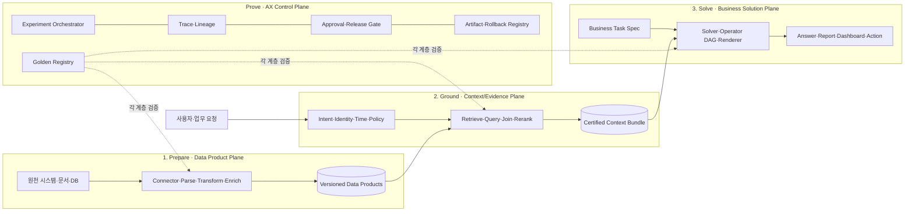

# AX Experiment OS 제품 설계

> 온톨로지를 포함한 확장 아키텍처와 구현 계약은
> [Ontology-centered AX Experiment OS](./ONTOLOGY_CENTERED_AX_EXPERIMENT_OS.md)를 기준으로 한다.

> 고객의 기존 데이터·RAG·BI·모델 스택을 교체하지 않고, 데이터 준비부터 근거 회수,
> 비즈니스 산출물 생성까지 골든 기반 실험·승인·재현성을 강제하는 온프레미스 제어계층.

## 0. Executive Decision

### 결론

제품화 가치는 있다. 다만 `AI FDE`라는 넓은 이름으로 전체 데이터 플랫폼을 처음부터
만들면 성공 확률이 낮다. 가장 강한 시작점은 다음과 같다.

> 고객이 자신의 pipeline/retriever/solver를 plug-in하면, 플랫폼이 계약, 골든,
> trace, paired experiment, 실패 진단, release gate와 rollback evidence를 제공한다.

제품 category는 `AI FDE`보다 다음 표현이 정확하다.

- AX Experiment OS
- EvidenceOps Platform
- On-prem AX Delivery Control Plane
- Golden-driven AI Engineering Platform

AI FDE는 제품 전체가 아니라 이 control plane 위에서 움직이는 copilot/agent다.

### 왜 팔 수 있는가

기업 AX의 반복 비용은 모델 API 호출보다 다음에 집중된다.

1. 현업 데이터를 평가 가능한 표본으로 바꾸는 일
2. pipeline의 어느 단계가 실패했는지 찾는 일
3. 변경 전후가 정말 같은 조건인지 증명하는 일
4. PoC 로직을 온프레미스에서 재현·승인·배포하는 일
5. FDE가 빠진 뒤 고객이 같은 루프를 유지하는 일

이 문제는 회사와 use case가 바뀌어도 반복된다. 따라서 FDE의 방법론을 schema,
runner, gate, UI, agent tool로 제품화할 수 있다.

### 가장 큰 위험

시장의 주요 도구가 이미 일부 또는 전체 영역을 차지한다.

- LangSmith, Braintrust, Phoenix, MLflow: trace, dataset, evaluation, experiment
- Unstructured 계열: document ingestion과 partitioning
- dbt/Cube 등: analytics semantic layer
- Palantir: data pipeline, ontology, application, AIP Evals, AI FDE를 한 플랫폼에 통합

따라서 단순 “RAG 평가 대시보드”나 “자연어로 pipeline 생성”은 차별화가 약하다.

### 차별화 가설

| 차별점 | 구체적 의미 |
|---|---|
| BYO Stack | 고객의 Airflow/dbt/Spark/vectorDB/LLM/BI를 그대로 사용한다. |
| Evaluation-first | 실행 전에 각 layer의 contract와 golden을 요구한다. |
| On-prem native | 인터넷 없는 환경, 내부 registry, 파일 운반, target 재색인을 기본으로 한다. |
| Evidence ABI | 모든 retriever가 공통 Evidence/Context Bundle을 출력한다. |
| Business contract | dashboard·report·decision이 사용할 metric/entity/evidence를 명시적으로 bind한다. |
| FDE playbook | failure→hypothesis→experiment→decision을 agent tool과 승인 workflow로 만든다. |
| Portable evidence | 코드·데이터·index·model·prompt·judge를 release bundle로 묶는다. |

## 1. 제품의 핵심 모델

사용자가 제시한 3단계를 다음과 같이 이름 붙인다.

1. **Prepare — Data Product Plane**
2. **Ground — Context/Evidence Plane**
3. **Solve — Business Solution Plane**

그리고 세 단계를 관통하는 네 번째 수직 계층을 둔다.

4. **Prove — AX Control Plane**

`Prove`는 네 번째 업무 단계가 아니라 모든 단계의 골든·실험·trace·승인·배포를
통제하는 control plane이다.



## 2. 세 계층의 정확한 책임

## Layer 1. Prepare — Data Product Plane

### 역할

원천 데이터를 다음 계층이 안정적으로 사용할 수 있는 versioned data product로 만든다.

```text
raw source
  → acquired asset
    → normalized asset
      → structured units
        → enriched units
          → published data product
```

### 이 계층이 소유하는 것

- source 연결과 증분 수집
- parsing/OCR/schema extraction
- 정규화, 중복, version, 유효시점
- chunk/table/entity 생성
- metadata와 ACL 전파
- data quality와 lineage
- publish·deprecate·rollback

### 이 계층이 소유하지 않는 것

- 사용자 질문에 어떤 evidence를 선택할지
- 최종 답변이나 dashboard를 어떻게 만들지
- LLM이 업무 결론을 어떻게 표현할지

### 출력 계약: `DataProduct`

```yaml
data_product_id:
version:
kind: document_corpus | relational_dataset | event_stream | api | feature_set
owner:
source_assets:
schema:
semantic_types:
grain:
primary_keys:
time_semantics:
freshness_sla:
acl_policy:
quality_contracts:
lineage:
interfaces:
  - sql
  - lexical_search
  - vector_search
  - object_api
  - file
build_artifact:
```

### 1단계 자동화의 현실적 범위

1단계 전체를 자동화하려고 하면 범용 ETL/Foundry를 다시 만들게 된다. MVP에서는
실행엔진을 소유하지 말고 다음을 제공한다.

#### 플랫폼이 제공

- Connector/Parser/Transform plugin SDK
- input/output schema와 data contract
- 자동 profiling과 anomaly report
- sample preview와 before/after diff
- lineage와 build manifest
- contract test 생성·실행
- human approval과 publish gate
- Airflow/dbt/Spark/Unstructured job adapter

#### AI FDE가 보조

- 표본 데이터에서 schema와 semantic type 제안
- parser/transform recipe 제안
- null, duplicate, key, range, freshness test 초안 생성
- 실패 row와 pipeline log를 읽고 수정 후보 생성
- 변경 전후 dataset diff 설명

#### 사람이 승인

- 업무 key와 grain
- metric 원천과 계산 규칙
- PII/민감도와 ACL
- version·시행일·폐기 정책
- 데이터 손실이 허용되는 transformation

AI가 제안한 로직은 runtime prompt로 남기지 않고 가능한 한 deterministic code/config와
contract test로 materialize한다.

### Layer 1 Golden

| 대상 | Golden 예시 | Metric |
|---|---|---|
| Parser | 문서/페이지와 기대 block·표·heading | block recall, table fidelity, order error |
| Schema | 입력 sample과 기대 column/type/key | schema accuracy, incompatible change |
| Transform | 입력 rows와 기대 output/invariant | row diff, invariant pass, loss rate |
| Freshness | source version과 기대 current record | stale/missing rate |
| ACL | identity와 허용/금지 asset | leakage/over-block rate |

## Layer 2. Ground — Context/Evidence Plane

### 역할

질문이나 task intent를 받아, Layer 3이 비즈니스 문제를 풀 수 있는 최소하고 검증 가능한
context package를 만든다.

이 계층은 단순 `top-k chunk` 반환 계층이 아니다. 문서 evidence, metric, entity,
tool을 하나의 표준 bundle로 만든다.

### 입력 계약: `ContextRequest`

```yaml
request_id:
actor:
intent:
task_type:
question:
conversation_context:
as_of_time:
allowed_data_products:
required_context_types:
constraints:
  max_latency_ms:
  max_tokens:
  minimum_freshness:
  risk_level:
```

### 출력 계약: `ContextBundle`

```yaml
bundle_id:
request_id:
data_product_versions:
policy_decision:
coverage:
missing_requirements:
conflicts:

evidence:
  - claim_candidate:
    document_id:
    passage_id:
    quote:
    relevance:
    valid_time:
    provenance:

metrics:
  - metric_id:
    definition_version:
    value_or_query_handle:
    dimensions:
    filters:
    time_range:
    lineage:

entities:
  - entity_type:
    entity_id:
    properties:
    relations:

tools:
  - tool_id:
    allowed_actions:
    approval_required:

budgets:
  tokens:
  rows:
  documents:
trace_id:
```

### 왜 `ContextBundle`이 핵심 제품 자산인가

- retriever와 solver를 분리할 수 있다.
- 같은 evidence를 여러 solver/report/dashboard가 재사용한다.
- “답이 왜 틀렸는가”를 Layer 2와 3 사이에서 명확히 가른다.
- structured와 unstructured data를 같은 task에 결합할 수 있다.
- context 자체를 cache·approve·replay할 수 있다.
- 고객의 내부 로직을 공통 ABI 뒤에 숨길 수 있다.

### Layer 2 plugin points

- intent parser/router
- query rewrite/decomposition
- lexical/dense/graph/SQL/API retriever
- metadata/ACL/time filter
- join/federation
- reranker
- evidence dedup/diversity
- context budgeter
- conflict detector
- answerability/coverage estimator

### Layer 2 Golden

```yaml
query:
identity:
as_of_time:
expected_data_products:
required_evidence:
required_metrics:
required_entities:
forbidden_evidence:
expected_conflicts:
expected_missing:
```

주요 metric:

- Evidence Recall@k / nDCG@k
- required evidence bundle coverage
- metric/entity selection accuracy
- forbidden/stale/unauthorized evidence rate
- context precision과 duplication
- answerability/coverage calibration
- latency, rows, tokens, cost

## Layer 3. Solve — Business Solution Plane

### 역할

인증된 ContextBundle을 받아 답변, 보고서, dashboard, workflow, recommendation, action을
생성한다.

Layer 3는 “데이터를 예쁘게 wrapping”하는 수준보다 강한 계약이 필요하다. 어떤 비즈니스
개념과 계산을 사용할지 먼저 정하고 그 위에 표현을 만든다.

### 핵심 개념: `BusinessTaskSpec`

```yaml
task_id:
task_type: answer | report | dashboard | decision | workflow | action
business_owner:
user_personas:
required_context:
  evidence_types:
  metrics:
  dimensions:
  entities:
  tools:
business_semantics:
  definitions:
  formulas:
  join_paths:
  grain:
policy:
  forbidden_claims:
  approval_rules:
  abstention_rules:
output_contract:
  schema:
  citations:
  visualization_constraints:
acceptance_rubric:
```

### Dashboard 요청의 실제 처리

사용자가 “매출 대시보드 만들어줘”라고 했을 때 곧바로 chart code를 만들면 안 된다.

```text
1. 사용자와 권한 확인
2. dashboard intent와 대상 의사결정 식별
3. business entity와 grain 선택
4. metric·dimension·time range 후보 탐색
5. 인증된 definition이 없거나 여러 개면 clarification
6. ContextRequest 생성
7. Layer 2에서 MetricBundle과 lineage 획득
8. DashboardPlan 생성
9. query/result contract 검증
10. visualization template 선택
11. sandbox render와 acceptance golden 실행
12. 사람 승인 후 publish
```

`DashboardPlan` 예시:

```yaml
title: 월간 매출·수익성 현황
decision: 지역별 매출 감소와 원인 확인
grain: month x region x product
metrics:
  - certified_revenue
  - gross_margin
  - order_count
dimensions:
  - region
  - product_category
filters:
  - legal_entity = current_user.entity
time_range: trailing_12_months
views:
  - type: line
    x: month
    y: certified_revenue
  - type: bar
    x: region
    y: gross_margin
  - type: table
    columns: [product_category, revenue_delta, margin_delta]
drilldowns:
  - region -> product_category -> customer_segment
freshness:
access_policy:
lineage:
```

### Layer 3 operator model

Layer 3 solver는 자유 prompt 하나가 아니라 검토 가능한 operator DAG로 표현한다.

```text
ContextBundle
  → validate coverage
  → calculate/aggregate
  → compare/rank/explain
  → compose claims
  → bind citations/metric lineage
  → render artifact
  → policy/approval gate
```

사용자는 다음 내부 로직을 plugin으로 채운다.

- domain calculator
- rule engine
- SQL/metric query
- classifier/forecast/optimizer
- report template
- dashboard renderer
- workflow action
- human approval step

### Layer 3 Golden

| Task | Golden |
|---|---|
| Answer | required/forbidden claims, citation, abstention |
| Report | section coverage, calculation, evidence, tone/schema |
| Dashboard | metric binding, filter, grain, visualization validity |
| Decision | expected action/range, constraints, rationale |
| Workflow | expected tool calls, order, approval, side-effect |

Layer 3 평가는 ContextBundle을 고정한 component test와 실제 Layer 2까지 포함한 E2E test를
분리한다. 그래야 retrieval 문제와 solver 문제를 구분할 수 있다.

### 자연어 기반 서비스 생성 가설

#### 판단

사용자의 자연어 질문을 정확한 업무 의도와 데이터 요구로 구조화하고, 그것을 인증된
DataProduct·metric·entity·tool에 바인딩할 수 있다면, 그 위의 조회형 서비스는 상당 부분
자연어로 생성할 수 있다. 특히 dashboard, report, search, Q&A, 탐색형 분석은 공통
operator와 renderer 조합으로 만들기 쉽다.

그러나 자연어를 바로 React·SQL·Python으로 번역하면 안 된다. 중간에 타입이 있는
업무 IR(Intermediate Representation)이 필요하다.

```text
Natural Language
  → Intent Compiler
  → Typed BusinessIntent IR
  → Semantic Binder / Type Checker
  → ContextRequest
  → Certified ContextBundle
  → Operator DAG
  → Renderer / Action Adapter
  → Service Artifact
```

컴파일러에 비유하면 다음과 같다.

| 컴파일러 개념 | AX 제품 개념 |
|---|---|
| Source language | 사용자의 자연어 요청 |
| Parser | Intent Compiler |
| Type system | business semantic model, schema, ACL, time, grain |
| Symbol table | 인증된 metric, entity, evidence, tool registry |
| Linker | Semantic Binder |
| Intermediate representation | BusinessIntent와 Operator DAG |
| Runtime | Data/Model/Tool adapters |
| Target code | dashboard, report, API, workflow, answer |
| Unit/acceptance tests | layer별 Golden과 release gate |

#### 핵심 중간 표현: `BusinessIntent`

```yaml
intent_id:
task_type: dashboard | report | answer | analysis | workflow | action
goal:
decision_to_support:
actor:
entities:
measures:
dimensions:
filters:
time:
comparisons:
operations:
output:
  artifact_type:
  audience:
  interaction:
constraints:
  latency:
  freshness:
  risk:
  approvals:
unresolved_slots:
confidence:
```

자연어 모델은 이 IR을 완성하는 역할을 한다. metric 계산, join, ACL, write action을
자유롭게 발명하지 않는다.

#### 예시

사용자 요청:

> 최근 12개월 동안 지역별 매출이 꺾인 제품을 찾고, 마진과 함께 임원용 대시보드로
> 만들어 줘. 급락한 제품은 원인을 볼 수 있게 해 줘.

Intent Compiler 출력:

```yaml
task_type: dashboard
goal: 지역별 매출 감소 제품과 수익성 원인 탐색
decision_to_support: 임원의 지역·제품 대응 우선순위 결정
entities: [region, product]
measures: [certified_revenue, gross_margin]
dimensions: [month, region, product_category]
time: trailing_12_months
comparisons: [month_over_month, year_over_year]
operations:
  - detect_decline
  - rank_by_revenue_delta
  - explain_margin_change
output:
  artifact_type: interactive_dashboard
  audience: executive
  interaction: [region_drilldown, product_drilldown]
unresolved_slots:
  - decline_threshold
  - legal_entity_scope
```

시스템은 `unresolved_slots`를 임의로 채우지 않고 질문한다. 사용자가 답하면 semantic
binder가 `certified_revenue`, `gross_margin`, 허용된 법인, 정확한 join path와 grain에
연결한다. 그 뒤에야 query와 dashboard를 만든다.

#### 자동화 가능성

| 서비스 유형 | 자동화 가능성 | 필요한 통제 |
|---|---|---|
| Q&A·검색 | 높음 | evidence, answerability, citation |
| 정기·비정기 report | 높음 | section schema, metric/evidence binding |
| Dashboard·탐색형 분석 | 높음 | semantic metric, grain, filter, ACL |
| Read-only 업무 앱 | 중상 | object model, state/view contract |
| 승인 workflow | 중간 | 상태머신, role, approval, audit |
| DB 변경·외부 action | 제한적 | idempotency, validation, side-effect preview, rollback |
| 최적화·의사결정 | 도메인 의존 | objective, constraints, solver, human accountability |

조회형 서비스는 자연어로 `spec → plan → render`하기 쉽다. 반면 상태를 변경하는 서비스는
다음이 추가되어야 한다.

- deterministic state machine
- precondition/postcondition
- idempotency key
- transaction boundary
- 권한과 다단계 승인
- dry-run과 side-effect preview
- compensating action/rollback
- 법적·업무 책임자

따라서 “자연어로 모든 서비스를 구현한다”보다 다음 약속이 정확하다.

> 자연어로 업무 서비스를 설계하되, 인증된 데이터·업무 의미·연산·권한을 조립하여
> 검증 가능한 실행계획과 UI를 생성한다.

#### 자연어 서비스 생성의 Golden

이 기능은 한 개 E2E 점수로 평가하지 않는다.

| 단계 | 입력 | Golden |
|---|---|---|
| Intent parse | 자연어 요청 | task, entity, metric, filter, time, output slot |
| Semantic bind | BusinessIntent | 인증된 DataProduct/metric/entity/tool ID |
| Plan | Bound intent + ContextBundle | operator DAG, query, approval path |
| Artifact | 실행 결과 | dashboard/report/workflow acceptance rubric |

문장이 달라도 같은 BusinessIntent로 컴파일되는 paraphrase consistency와, 서로 다른
업무 의미를 같은 metric에 잘못 묶지 않는 semantic separation을 함께 측정한다.

#### 제품적 의미

이 관점을 채택하면 Layer 3의 본질은 low-code UI builder가 아니라
`Natural Language Business Application Compiler`가 된다. UI 생성 모델보다 중요한
제품 자산은 다음이다.

1. BusinessIntent type system
2. DataProduct·metric·entity·tool registry
3. Semantic Binder와 clarification policy
4. 재사용 가능한 operator library
5. 서비스 유형별 renderer와 action adapter
6. intent→binding→plan→artifact Golden

화면 코드는 교체 가능하지만 이 type system과 Golden은 고객 업무가 누적될수록 강해진다.

## 3. Prove — AX Control Plane

### 3.1 핵심 서비스

| 서비스 | 책임 |
|---|---|
| Contract Registry | DataProduct, ContextBundle, TaskSpec schema/version |
| Golden Studio | layer별 case, annotation, adjudication, split |
| Trace & Lineage | raw→data product→context→artifact 전체 연결 |
| Experiment Orchestrator | baseline/candidate paired run, repeats, sweep |
| Evaluator Registry | deterministic, human, LLM judge, statistics |
| Failure Workbench | 최초 소실 단계, cluster, case diff, root cause |
| AI FDE Agent | 관찰, 가설, candidate 생성, sandbox 실험, 설명 |
| Release Center | MDE/guardrail/approval, artifact bundle, promotion |
| Runtime Monitor | online traces, drift, incident, rolling shadow |

### 3.2 공통 실행 단위: `Target`

사용자 내부 로직은 다음 최소 interface만 구현한다.

```python
class Target:
    id: str
    version: str
    input_schema: dict
    output_schema: dict

    def invoke(self, payload: dict, context: RunContext) -> dict:
        ...

    def health(self) -> dict:
        ...

    def manifest(self) -> dict:
        ...
```

Target 종류:

- `PrepareTarget`: raw asset → DataProduct
- `GroundTarget`: ContextRequest → ContextBundle
- `SolveTarget`: ContextBundle + TaskSpec → BusinessArtifact
- `EndToEndTarget`: UserRequest → BusinessArtifact

REST/gRPC/container/batch job/Python function을 adapter로 감싼다.

### 3.3 각 layer의 실험을 같은 형식으로 관리한다

```yaml
experiment:
  hypothesis:
  layer: prepare | ground | solve | end_to_end
  baseline_target:
  candidate_target:
  dataset_snapshot:
  golden_suite:
  evaluators:
  repetitions:
  resource_budget:
  decision_rule:
```

### 3.4 Release bundle

```yaml
release_bundle:
  contracts:
  code_commit:
  container_digests:
  data_product_versions:
  index_builds:
  model_digests:
  prompt_and_task_specs:
  golden_suite:
  experiment_report:
  approvals:
  rollback_bundle:
```

## 4. AI FDE Agent 설계

### 4.1 Agent의 올바른 역할

AI FDE는 autonomous production operator가 아니라 evidence-producing engineer다.

허용되는 기본 loop:

```text
Observe failure
  → Locate first broken contract
  → Form hypothesis
  → Propose one scoped change
  → Create branch/candidate
  → Run sandbox preview
  → Run paired experiment
  → Analyze cases and trade-offs
  → Submit decision proposal
  → Human approves promotion
```

### 4.2 Agent tools

- inspect contract/schema/lineage
- sample/profile/diff dataset
- inspect trace and replay case
- create/update golden draft
- generate test or evaluator draft
- change adapter/config/prompt/task spec on branch
- invoke preview and experiment
- cluster failures and compare cases
- produce ADR/release report
- request approval

### 4.3 Agent permission model

| Mode | 권한 |
|---|---|
| Explore | read-only metadata와 승인된 sample |
| Draft | branch에 contract/code/config 생성 |
| Experiment | sandbox compute와 golden 실행 |
| Propose | release candidate와 report 제출 |
| Promote | 기본적으로 human-only; 제한적 자동화는 정책 충족 시 |

### 4.4 Agent가 하면 안 되는 것

- locked test answer를 candidate prompt/code에 노출
- production data를 임의 외부 endpoint로 전송
- 승인 없이 ACL, metric definition, business formula 변경
- 실패 suite를 삭제하거나 threshold를 낮춰 통과
- 여러 layer를 동시에 바꾸고 한 변경처럼 보고
- experiment evidence 없이 production promotion

### 4.5 AI FDE의 가장 중요한 출력

코드보다 `증거가 포함된 변경 제안`이다.

```markdown
관측: 17건의 실패 중 11건이 최신 시행일 filter 이전에 구문서가 rerank됨
가설: retrieval pre-filter가 stale evidence를 줄일 것
변경: GroundTarget config 1개
결과: stale 11→2, required recall 16→16, p95 +18ms
회귀: 1건은 effective_date missing으로 결과 0건
제안: missing metadata fallback을 별도 실험 후 채택 보류
```

## 5. 제품 화면

### 5.1 Workspace Map

- 3개 layer의 target과 DataProduct/ContextBundle/TaskSpec 연결
- 현재 production version과 candidate branch
- 각 연결의 contract, owner, golden coverage, last run
- red/yellow/green은 임의 health가 아니라 명시된 gate 결과만 사용

### 5.2 Contract Studio

- schema, grain, time, ACL, metric definition 편집
- version diff와 downstream impact
- sample validation과 approval

### 5.3 Golden Studio

- production trace/incident에서 case 생성
- layer별 expected output과 rubric
- annotator blind mode, adjudication, disagreement
- dev/locked/challenge/rolling split
- leakage와 duplicate 검사

### 5.4 Experiment Lab

- baseline/candidate target 선택
- one-variable diff 검사
- repeats, concurrency, budget 설정
- 전체/segment paired delta와 CI
- case-level input/output/trace 비교

### 5.5 Failure Workbench

- first broken layer 자동 추정
- failure taxonomy와 cluster
- Layer 1 output, Layer 2 bundle, Layer 3 artifact를 나란히 비교
- AI FDE 가설과 수정 branch 생성

### 5.6 Business Solution Composer

- TaskSpec과 필요한 context type 선택
- certified metrics/entities/evidence 탐색
- operator DAG와 renderer 연결
- dashboard/report/answer preview
- acceptance golden 생성

### 5.7 Release Center

- quality/risk/cost/latency/security gate
- artifact bundle과 approval chain
- staging/canary/promote/rollback
- production version과 exact evidence 연결

### 5.8 Runtime Monitor

- online traces와 layer별 SLO
- data/index/model drift
- user correction과 incident
- rolling shadow 후보 queue

## 6. 기술 아키텍처

### 6.1 Control plane / Data plane 분리

```text
Control Plane
  contracts · goldens · experiments · metadata · approvals · agent

Customer Data Plane
  connectors · pipelines · stores · indexes · models · solvers · renderers
```

민감 데이터는 data plane에 남긴다. Control plane은 가능하면 metadata, hashes, metrics,
masked samples만 보유한다. 완전 폐쇄망에서는 control plane도 고객 환경에 배포한다.

### 6.2 구성요소

| 구성요소 | 권장 역할 |
|---|---|
| API/Identity | OIDC/SAML, RBAC/ABAC, service account |
| Metadata DB | contract, golden metadata, experiments, approvals |
| Object Store | dataset snapshot, trace artifact, report, bundle |
| Trace Store | OpenTelemetry/OpenInference 호환 span |
| Queue/Scheduler | batch eval, pipeline build, retry, cancellation |
| Runner | isolated container/job execution |
| Agent Sandbox | branch, network/tool allowlist, resource quota |
| Registry adapters | Git, container, model, prompt, index |
| UI/API/CLI | 동일 기능의 세 인터페이스 |

### 6.3 Integration 전략

처음부터 모든 pipeline을 native로 만들지 않는다.

- Trace: OpenTelemetry/OpenInference ingest
- Experiment: Python/REST target adapter
- Data: Airflow/dbt/Spark job wrapper와 manifest hook
- Documents: Unstructured/docling/custom parser adapter
- Retrieval: vector DB와 search API wrapper
- Semantic: dbt Semantic Layer/Cube/고객 ontology adapter
- Model: OpenAI-compatible/vLLM/Triton/custom REST
- BI: Superset/Metabase/Power BI/Tableau/custom renderer connector
- CI/CD: GitHub/GitLab/Gitea/Jenkins/Argo/Tekton webhook

제품은 실행엔진 경쟁보다 contract와 evidence를 통합하는 데 집중한다.

## 7. 시장 포지셔닝

### 7.1 현재 제품과의 관계

| 범주 | 강점 | 남는 공백 |
|---|---|---|
| LangSmith/Braintrust/Phoenix | LLM trace·dataset·experiment | data preparation과 business semantic contract는 고객 책임 |
| MLflow/Databricks | model·trace·dataset·evaluation lifecycle | Databricks 중심 환경에서는 강하지만 이기종 고객 stack의 delivery method는 별도 |
| Unstructured | ingestion/partition workflow | business outcome·experiment gate 없음 |
| Cube/dbt semantic | governed metrics·dimension·access | document evidence와 전체 AX experiment lifecycle은 별도 |
| Palantir Foundry/AIP | pipeline·ontology·app·eval·AI FDE end-to-end | 플랫폼 도입 범위와 lock-in이 크고 경량 BYO control plane 시장이 남음 |

### 7.2 경쟁 판단

Palantir 공식 문서는 AI FDE가 자연어로 data transform, repository, ontology, function,
application 작업을 수행하고 AIP Evals와 연결됨을 명시한다. 즉, category validation은
이미 끝났다. 반대로 `AI FDE`라는 이름과 broad vision은 독점적 차별점이 아니다.

우리가 팔 수 있는 것은 다음 고객이다.

- Foundry 같은 통합 플랫폼을 도입할 수 없거나 원하지 않는 기업
- 기존 data/BI/MLOps stack을 유지해야 하는 기업
- 폐쇄망·온프레미스·국내 규제 환경이 강한 기업
- document-heavy RAG와 structured analytics를 함께 다루는 기업
- 여러 SI/FDE/부서가 만든 AI를 동일 release gate로 관리하려는 AX CoE

### 7.3 첫 ICP

#### Primary

- 금융·보험·공공·제조의 AX/AI CoE
- 온프레미스 또는 망분리
- 3개 이상의 RAG/agent project
- 현업 SME label과 release 승인 필요
- 자체 platform/data engineering team 보유

#### Secondary

- 여러 고객사에 RAG를 납품하는 SI/consulting/FDE 조직
- 프로젝트별 평가 자산과 delivery 방법을 표준화하려는 팀

### 7.4 구매자와 사용자

| 역할 | 구매 이유 |
|---|---|
| AX/AI CoE 책임자 | 프로젝트 품질과 납품 기준을 표준화 |
| CIO/CDO | 기존 stack을 유지하며 governance 확보 |
| Risk/Compliance | golden, trace, approval, rollback evidence |
| FDE/SI 리더 | 개인 역량을 reusable playbook으로 전환 |
| AI Engineer | 실패 진단과 experiment 반복시간 단축 |
| Domain SME | 코드 없이 golden·rubric·승인에 참여 |

### 7.5 판매 문구

나쁜 문구:

> AI가 모든 enterprise app을 자동으로 만들어 줍니다.

좋은 문구:

> 기존 AI 로직을 그대로 연결하십시오. 데이터 준비, 근거 회수, 비즈니스 산출물의
> 각 변경을 동일한 골든과 release gate로 검증하고 온프레미스에서 재현합니다.

## 8. MVP 범위

### 제품 wedge

**Layer 2 + Prove를 먼저 만든다.**

이유:

- RAG/FDE 경험이 가장 직접적인 영역이다.
- 고객의 기존 retriever를 adapter로 빠르게 연결할 수 있다.
- Golden과 paired experiment의 ROI를 짧게 증명할 수 있다.
- Layer 1 전체 ETL과 Layer 3 전체 app builder를 만들 필요가 없다.
- 이후 EvidenceBundle이 Layer 3 확장의 안정적 경계가 된다.

### MVP 0 — 6~8주 내부 dogfood

- Target SDK: Python + REST
- ContextRequest/ContextBundle schema
- Golden import/version/split
- paired baseline/candidate runner
- deterministic + custom + LLM evaluator
- trace import와 case replay
- case diff와 experiment report
- local Docker Compose
- 현재 8-AGENT retriever/E2E 연결

### MVP 1 — 3~4개월 design partner

- web Golden Studio
- annotator/adjudication workflow
- Experiment Lab와 CI gate
- failure taxonomy와 first-broken-layer 진단
- agent가 experiment card와 candidate branch 제안
- offline package install과 internal registry
- RBAC, audit, secrets
- release bundle과 rollback evidence
- 2개 고객 stack adapter

### MVP 2 — 6~9개월

- Layer 1 manifest/contract adapter
- data profiling, sample diff, lineage
- Layer 3 TaskSpec과 Solution Composer
- metric/semantic layer adapter
- report/dashboard reference renderer
- production feedback→rolling shadow
- HA, backup, DR, enterprise SSO

### MVP에서 하지 않을 것

- 자체 vector DB
- 자체 general-purpose ETL engine
- 자체 foundation model serving
- 범용 BI tool 전체
- 모든 문서 format parser
- 자동 production promotion
- no-code로 모든 enterprise application 생성

## 9. 핵심 API 초안

```text
POST /targets/register
POST /contracts/validate
POST /goldens/import
POST /goldens/{id}/cases
POST /experiments
POST /experiments/{id}/run
GET  /experiments/{id}/compare
GET  /traces/{trace_id}
POST /failures/cluster
POST /agent/propose-experiment
POST /releases
POST /releases/{id}/approve
POST /releases/{id}/promote
POST /releases/{id}/rollback
```

## 10. 제품 자체의 Golden

이 솔루션 역시 스스로를 평가해야 한다.

### Contract engine

- incompatible schema 변경 차단
- ACL/time/grain 필수값 검증
- artifact version mismatch 탐지

### Experiment engine

- suite/case 순서 불일치 차단
- 동일 input paired 실행 보장
- 취소·재시도·부분 실패 정직한 기록
- 통계 계산과 segment aggregation 검증

### AI FDE

- 실패 layer 진단 정확도
- one-variable proposal 비율
- 실행 가능한 candidate 비율
- 인간이 채택한 proposal 비율
- golden leakage와 권한 위반 0
- 불필요한 복잡성/비용 증가율

### Release engine

- gate 우회 불가
- bundle completeness
- rollback 재현 성공
- audit trail completeness

## 11. Business Model 가설

### 판매 단위

1. 온프레미스 platform 연간 license
2. production/evaluation environment 또는 node 단위
3. Design partner onboarding/FDE package
4. regulated domain golden/adapter pack
5. enterprise support와 upgrade channel

seat 기반만으로 가격을 정하면 SME와 reviewer 참여를 막을 수 있다. 핵심 개발자 seat와
runtime/environment 가치의 혼합이 적합하다.

### Land and expand

```text
한 개 RAG retrieval 평가
  → 여러 RAG project의 공통 Golden/Experiment
    → AX CoE release gate
      → data contract와 business task까지 확대
```

### 첫 유료 가치 증명

고객에게 “정확도 X% 향상”만 팔지 않는다.

- regression 발견시간
- 실패 원인 분석시간
- 동일 실험 재현시간
- release evidence 준비시간
- FDE 투입일수
- 신규 golden 반영 lead time
- rollback 성공시간

를 baseline과 비교한다.

## 12. 90일 실행 계획

### Day 0~15 — Contract와 adapter

- ContextRequest/Bundle v0
- Golden/Experiment/Run manifest v0
- Python/REST Target adapter
- 현재 8-AGENT 연결

### Day 16~35 — Experiment core

- paired runner와 repetitions
- evaluator registry
- trace/case diff
- artifact store
- CLI report

### Day 36~55 — Failure workbench

- layer별 trace UI
- failure taxonomy/cluster
- first broken layer heuristic
- AI FDE experiment proposal

### Day 56~75 — On-prem package

- Docker Compose 또는 Kubernetes profile
- SSO/RBAC 최소판
- offline image/package bundle
- backup/restore/audit
- CI release gate

### Day 76~90 — Design partner

- 고객 기존 retriever 1개 연결
- 고객 golden 50~150건 pilot
- baseline/candidate 2개 실험
- 고객 engineer 단독 재실행
- 시간 절감과 release confidence 측정

## 13. Go / No-Go 기준

### Go

- 2개 이상의 고객이 기존 stack 교체 없이 동일 Target adapter를 사용한다.
- 고객 trace에서 golden 후보를 만드는 시간이 절반 이하로 줄어든다.
- candidate 비교와 report가 기존 수작업보다 명확히 빠르다.
- 고객 engineer가 FDE 없이 실험을 재현한다.
- Layer 2 failure를 Layer 3 failure와 실제로 분리해낸다.

### Pivot

- 고객이 UI보다 consulting playbook과 template만 구매하려 한다.
- adapter 비용이 고객마다 지나치게 크다.
- golden label 확보가 제품 사용의 지속적 병목이다.

이 경우 platform보다 `FDE Delivery Kit + managed evaluation service`로 시작한다.

### No-Go

- 고객이 golden이나 release gate 없이 자동 생성만 원한다.
- 제품 가치가 특정 vectorDB dashboard와 구분되지 않는다.
- 매 고객마다 core schema와 runner를 다시 작성해야 한다.
- 온프레미스 설치·지원비가 license 가치보다 크다.

## 14. 시장 근거와 참고 제품

| 제품·문서 | 확인한 시장 기능 | 이 제품의 대응 |
|---|---|---|
| [LangSmith Evaluation](https://docs.langchain.com/langsmith/evaluation-quickstart) | dataset, target, evaluator, experiment 비교 | layer별 contract와 on-prem release evidence까지 확장 |
| [LangSmith Self-hosted](https://docs.langchain.com/langsmith/self-hosted) | observability/evaluation의 enterprise self-host | 더 가벼운 BYO control plane과 망분리 bundle 차별화 |
| [Braintrust Experiments](https://www.braintrust.dev/docs/evaluate/run-evaluations) | immutable experiment snapshot과 비교 | DataProduct/ContextBundle/BusinessArtifact 공통 실험 |
| [Arize Phoenix](https://arize.com/docs/phoenix/) | open-source tracing, evaluation, dataset/experiment | trace backend 교체 가능; delivery gate가 상위 가치 |
| [MLflow GenAI Evaluation](https://docs.databricks.com/aws/en/mlflow3/genai/eval-monitor) | trace 기반 개발·운영 평가 | MLflow를 registry/trace adapter로 수용 |
| [Unstructured Partitioning](https://docs.unstructured.io/concepts/partitioning) | 문서 parsing/partition workflow | Layer 1 실행엔진이 아니라 adapter 대상으로 수용 |
| [Cube Semantic Layer](https://docs.cube.dev/docs/introduction) | metric, dimension, join, access를 AI/BI에 제공 | Layer 3 BusinessTaskSpec의 analytics provider로 연결 |
| [Palantir AI FDE](https://www.palantir.com/docs/foundry/ai-fde/overview) | pipeline, ontology, function, application을 agent가 조작 | category 선행 사례; platform-neutral 전략 필요 |
| [Palantir AIP Evals](https://www.palantir.com/docs/foundry/aip-evals/overview) | test/evaluator/run 비교와 AI FDE 연동 | 독립 Golden과 변경 불가능한 release gate로 차별화 |
| [Palantir Ontology](https://www.palantir.com/docs/foundry/ontology/overview) | object, relation, action, function의 업무 계층 | 고객 ontology/semantic layer를 plugin으로 수용 |

## 15. 최종 제품 원칙

1. 사용자의 내부 로직은 plugin이다.
2. 플랫폼은 input/output contract와 증거를 소유한다.
3. 각 layer는 독립 Golden과 E2E Golden을 모두 가진다.
4. Layer 2의 표준 출력은 top-k가 아니라 Certified ContextBundle이다.
5. Layer 3의 시작점은 prompt가 아니라 BusinessTaskSpec이다.
6. AI FDE는 변경을 실행할 수 있지만 release threshold와 gold를 바꿀 수 없다.
7. 모든 변경은 branch, experiment, decision, release bundle을 거친다.
8. 기존 고객 stack과 결합할수록 제품 가치가 커져야 한다.
9. 온프레미스 반입·재생·rollback은 first-class feature다.
10. 최종 목표는 AI 자동 생성이 아니라 고객 조직의 반복 가능한 AX 능력이다.

---

이 제품의 moat는 agent의 대화 능력이 아니다. `DataProduct → ContextBundle →
BusinessArtifact` 사이의 계약, 실제 업무 Golden, layer별 trace, 고객 온프레미스에서
재현되는 release evidence가 moat다.
