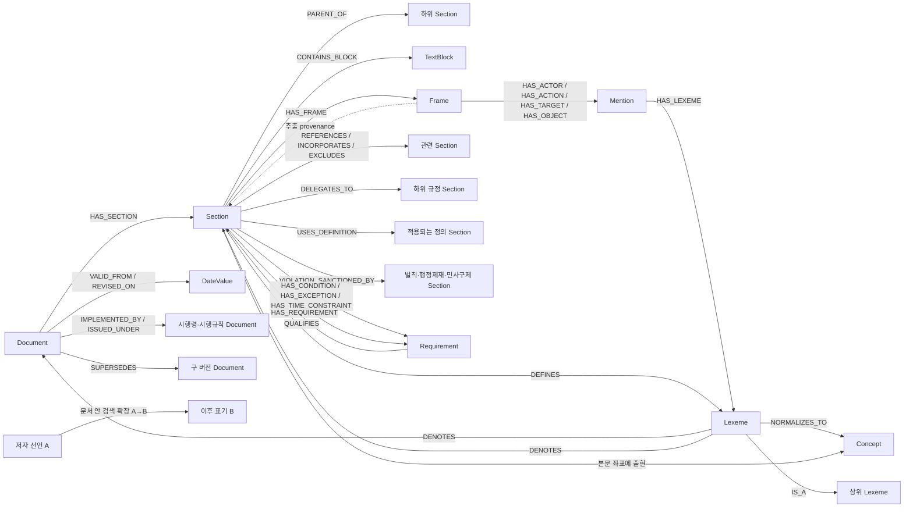

# 도메인 중간 레이어: 구조화 지식 그래프

이 그래프의 목적은 문서 검색 결과를 하나 더 만드는 것이 아니다. 사용자의 표현을
도메인의 **개념과 확정 좌표**로 번역하고, 그 좌표에서 관련 규범까지 결정적으로 걸어
가기 위한 중간 레이어다.

## 가장 중요한 세 층

```text
원문/LLM 출력              표기 통합                    의미 통합
Mention ──HAS_LEXEME──▶ Lexeme ──NORMALIZES_TO──▶ Concept
"투자 설명서를 교부"       투자설명서를교부              투자설명서 교부
 (출처·조항·slot 보존)       (공백·대소문자만 통합)         (용어집/승인 근거 필요)
```

- `Mention`은 실제 출현이다. 프레임의 actor/act/target/object, 정의어, 용어집
  occurrence가 어떤 문서·조항·추출기에서 나왔는지 보존한다.
- `Lexeme`은 글자 표기형이다. 공백과 대소문자만 접는다. LLM이 뽑은 모든 문자열은
  우선 여기에 모인다.
- `Concept` 후보는 glossary에서도 부트스트랩할 수 있지만, **1급 active Concept**은
  `data/domain_graph/canonical.json`에서 별도 승인된 것만 허용한다. glossary의
  `활성`은 검색 표면형 상태이지 1급 의미 승인이 아니다.

따라서 Concept 하나에서 역방향으로 걸으면 "어떤 글자들이 이 개념으로 합쳐졌고,
각 글자가 어느 조항의 어떤 프레임 칸에서 나왔는가"를 모두 복원할 수 있다.

## 노드와 간선



검색 관점에서는 이 계층 전체가 같은 **착지 객체** 계약을 쓴다. 그렇다고 모든 노드를
의미 `Concept`로 강제 변환하지는 않는다. 문서 제목·목차·Heading은 구조 객체,
본문은 `TextBlock`, 재사용 가능한 값은 `Concept`, 용어로 올리기 어려운 조건·효과·
예외·기한은 원문 offset을 가진 `Requirement`다. Frame/옛 Assertion 행은 누가 어떤 방식으로 조각을
추출했는지 보존하는 provenance이며, 기본 RAG의 논리 검색 단위는 아니다. 각 출현은
종류와 실제 본문 좌표를 유지한 채 같은 착지 결과 형식으로 검색된다.

```text
Document
  └─ TOC / Heading / Section
       └─ TextBlock(본문)
            ├─ ACTOR/PREDICATE/OBJECT 출현 ─▶ Concept
            ├─ 용어화 가능한 다른 출현 ─────────▶ Concept
            └─ 조건·예외·기한·수치·방법·효과 ──▶ Requirement ─QUALIFIES→ Section
```

질문 검색은 이 계층을 앞에서부터 범위로 사용한다. `자본시장법 + 금융투자업자(ACTOR)`면
먼저 자본시장법의 본문 좌표만 남기고 그 안에서 ACTOR가 금융투자업자인 출현을 찾는다.
Heading까지 있으면 해당 Heading 하위 좌표로 한 번 더 줄인다. ACTOR와 PREDICATE 등
의미 단서가 여러 개면 각 단서의 **본문 좌표 집합**을 교차한다. 같은 본문을 조건·효과·
예외로 여러 번 추출했더라도 좌표 하나로 접고, 서로 다른 본문에 흩어진 단서는 결합하지
않는다.

정의는 교집합 축이 아니다. `A(이하 "B"라 한다)`가 있으면 질문의 A를 해당 문서의
선언 이후 B 출현으로 확장한다. 즉 A 직접 출현과 B 출현은 `A AND B`가 아니라
`A OR B`다. 이 방향성 간선은 다른 문서의 B까지 전역 동의어로 열지 않는다.

`제1조제3항`, 문서명, 문서 별칭도 `Lexeme`이다. 해당 표기에서 `DENOTES`를 따라가면
실제 `Section`/`Document`에 도착한다. 같은 `제1조`가 여러 문서에 있으므로 간선에는
항상 `doc_id` 스코프를 둔다.

참조가 아직 확정되지 않았다면 확정 간선을 만들지 않는다. 대신
`PendingReference ─MAY_REFER_TO→ 후보 Section`으로 보존한다. 그래프가 불확실성을
숨기지 않게 하기 위해서다.

## 불확실성 계약

그래프의 어떤 데이터도 무오류라고 가정하지 않는다. 원문 좌표도 수집·파싱이 틀릴 수
있고, exact span은 글자 offset의 일치만 뜻하며 요건 분류의 정답을 뜻하지 않는다.
`active` 역시 소비 가능한 상태일 뿐 사실임을 뜻하지 않는다. 빌드 DB의
`build_meta.uncertainty_contract`가 이 기본 계약을 기록한다.

- `uncertainty_policy=may_be_wrong`: 오류 가능성이 기본값이다.
- `review_state`: `unreviewed`, `batch_accepted`, `model_reviewed`,
  `declared_approved`, `human_verified`를 구분한다.
- `user:force-all`은 `batch_accepted`이며 개별 사람 검증으로 표시하지 않는다.
- confidence가 없으면 임의 점수를 만들지 않고 `confidence_status=unscored`로 둔다.
- `consumer_policy=candidate_only`인 `MAY_*` 간선은 법적 결론의 확정 근거로 사용할 수 없다.

Requirement는 같은 source node에 Frame이 정확히 하나 있을 때만 아래 후보 간선을 만든다.
Frame이 없으면 `no_same_node_frame`, 둘 이상이면 `ambiguous_same_node_candidates`를
Requirement에 기록하고 의미 간선을 만들지 않는다.

```text
Requirement ─MAY_CONDITION_OF──────────▶ Frame / Assertion
            ├MAY_EXCEPTION_TO──────────▶ Frame / Assertion
            ├MAY_TIME_LIMIT_OF─────────▶ Frame / Assertion
            ├MAY_QUANTITY_LIMIT_OF─────▶ Frame / Assertion
            ├MAY_METHOD_OF─────────────▶ Frame / Assertion
            └MAY_EFFECT_OF─────────────▶ Frame / Assertion
```

Frame에서 만들어진 Assertion은 `DERIVED_FROM_FRAME`으로 생성 계보를 보존한다. 이 간선은
의미의 진실성을 주장하지 않는다. Requirement의 조건·예외·시점·수치·방법·효과를 Concept
후보로 검토하려면 다음 명령을 사용한다. 결과는 `pending` 후보일 뿐 자동 승격되지 않는다.

```bash
.venv/bin/python -m lawrag.core.domain_graph stage-requirement-concepts
```

## 현재 입력 재료

- `result.json/meta.json`: Document, Section, TextBlock, 계층, 좌표
- `frames/*.jsonl`: Frame과 네 slot의 Mention
- 결정론 정의 추출: `DEFINES`
- `taxonomy/*.jsonl`: `IS_A`와 그 근거 좌표
- `glossary.json`: 2급 검색 표면형과 occurrence (1급 승인을 뜻하지 않음)
- `aliases.json`: 문서 별칭
- 내부/문서 간 참조: 관계형 Section 간선
- `delegation.json`: 위임 간선
- 정의 선언과 실제 사용 범위: `DEFINES`, `USES_DEFINITION`
- 의무·금지를 인용하는 벌칙·과징금·행정처분·민사구제: `VIOLATION_SANCTIONED_BY`
- 부칙 종류와 본문 참조: `EFFECTIVE_FOR`, `APPLIES_TO`, `TRANSITION_FOR`, `AMENDS`
- `law_index.json` 법령 가족과 문서 버전: `IMPLEMENTED_BY`, `ISSUED_UNDER`, `SUPERSEDES`
- 닫힌 문면 표지의 원문 span: Requirement와 조건·예외·기한·수량·방법·효과 간선
- 태그·정량 추출: Tag, Quantity

이 관계들은 [relations.py](../lawrag/core/rag/relations.py)에서 한 번 조립한다. domain graph
빌더와 LegalClosure의 구조 확장이 같은 `RelationBundle`을 소비하므로, 그래프에만 있거나
검색에서만 즉석 생성되는 companion 관계를 만들지 않는다. 대상 조문이 없는 공식
위임행정규칙 포인터는 문서 수준 `DELEGATES_TO_DOCUMENT`로 보존하고, 반대 방향 수임
문면이 출발 조문을 정확히 가리키면 조문 수준 `DELEGATES_TO`로 닫는다.

SQLite 파일은 정본이 아니라 재생성 가능한 파생물이다. 저장 계약이 일반적인 property
graph(`nodes`, `edges`, `kind`, `props`)이므로 Graph DB 도입 시 JSONL export를 통해
라벨과 relationship을 그대로 옮길 수 있다.

## 빌드와 조회

```bash
.venv/bin/python -m lawrag.core.domain_graph build
.venv/bin/python -m lawrag.core.domain_graph resolve '제1조제3항' --doc-id <doc_id>
.venv/bin/python -m lawrag.core.domain_graph resolve '자본시장법'
.venv/bin/python -m lawrag.core.domain_graph counts
.venv/bin/python -m lawrag.core.domain_graph export /tmp/domain-graph-jsonl
```

## 1급 지식 발행 규율

런타임 LLM은 1급 지식을 쓰거나 승격할 수 없다. `active` Concept은 허용 type과
`approved_by`가 필요하다. 현재 canonical의 Assertion 스키마는 과거 컴파일 결과와
회귀 재생을 위해 남아 있지만, 기본 RAG는 Assertion ID를 의미 게이트나 교집합 키로
사용하지 않고 그 행이 가리키는 `source.doc_id/node` 출현만 사용한다.

`query_cues`와 Frame slot 문자열은 용어화하기 어려운 본문 조각을 다시 찾기 위한
출현 표면이다. 여러 추출 행에 나뉘어 있어도 같은 source 좌표에서 합쳐진다. 문서·
Heading·ACTOR·OBJECT 등 질문 단서의 좌표 교집합이 작으면 원문을 바로 사용하고,
크면 그 좌표 안에서만 Vector와 LLM으로 줄인다.

```text
1급  Concept + 구조 객체                     RAG 첫 조회
2급  Lexeme + alias                          표현 해소
3급  Mention + Frame/옛 Assertion + TextBlock 원문 출현·provenance
```

레거시 회귀 재생용 개념·Assertion 파일 예시:

```json
{
  "concepts": [
    {
      "id": "deliver_prospectus",
      "label": "교부하다",
      "type": "action",
      "aliases": ["교부", "제공하다"],
      "status": "active",
      "approved_by": "reviewer-id"
    }
  ],
  "assertions": [
    {
      "id": "rule-123-1",
      "status": "active",
      "roles": {
        "ACTOR": "financial_operator",
        "PREDICATE": "deliver_prospectus",
        "OBJECT": "investment_prospectus"
      },
      "source": {"doc_id": "...", "node": 123},
      "confidence": 0.99,
      "approved_by": "reviewer-id"
    }
  ]
}
```

이 파일의 변경은 의미 변경이므로 검수 대상이다. 프레임 재추출은 Mention만 바꾸고,
기존 개념 병합 규칙을 몰래 바꾸지 않는다.

### 후보의 LLM 최종 승인

사람이 하던 마지막 승인만 컴파일 타임 LLM으로 바꿀 수 있다. 승인 입력은 앞 단계가
이미 만든 Concept·Relation·Assertion 후보의 label/type/role/source 좌표/query cue다.
원문과 골든은 입력하지 않으며, LLM은 닫힌 `item_key`별 `approve/reject/defer`만
반환한다. 새 ID·label·role·source를 생성하거나 수정할 수 없다.

LLM의 `approve`가 곧바로 `active`가 되는 것도 아니다. `confidence=high`, source 좌표
실재, 의존 Concept 전부 승인, 엄격 레지스트리 검증을 모두 통과해야 코드가 발행한다.
판정과 후보 파일 해시는 감사 로그에 남는다.

```bash
.venv/bin/python -m lawrag.core.domain_graph approve \
  --candidate data/domain_graph/candidates.json \
  --output data/domain_graph/canonical.json \
  --audit data/domain_graph/approval_audit.json
```

사용자가 후보 전수를 명시적으로 승인하는 경우에는 기존 reject/defer까지 다시 열어
LLM 호출 없이 `approve/high`로 기록할 수 있다. 이 모드도 source 좌표 실재, 의존
Concept, `IS_A` 비순환, 최종 정본 스키마 검증은 우회하지 않는다.

```bash
.venv/bin/python -m lawrag.core.domain_graph approve --approve-all
```

`candidates.json`은 승인·기각·보류와 이유를 모두 보존하는 원장이고,
`canonical.json`에는 승인되어 실제 RAG가 읽는 1급 지식만 들어간다.

## 기본 본문 좌표 RAG와 레거시 OQL

사람에게 보이는 이름과 보고서 표현은 [아리아드네(실마리) 용어집](RAG_TERMS.md)을
따른다. `label`은 표준 개념의 **대표명**만 뜻하며, role/type/verdict는 각각
**자리/종류/판정**으로 구분한다.
단계별 유지·제거 근거와 최신 골든은 [실마리 RAG 오컴 감사](RAG_OCCAM.md)에 기록한다.

자연어를 Cypher로 변환하지 않는다. 운영 경로에서는 LLM이 질문에 **실제로 존재하는
연속 부분 문자열**만 Span으로 자른다. 각 Span을 구조 객체·Concept·본문 조각에
착지하고 source 좌표를 교차한다. `A(이하 B라 한다)`는 같은 Span의 A/B 표면을
합집합한 뒤 교차한다.

```text
사용자 질문
  → Exact Span 분해 (질문의 부분 문자열인지 서버 검증)
  → Document/TOC/Heading/조문 좌표 확정
  → Span별 실제 DB 객체 또는 본문 조각 착지
  → 정의 별칭 A→B를 문서 범위 대체 표면으로 확장
  → 각 단서의 source(doc_id,node) 좌표 교집합
  → 후보 ≤N이면 전부, 초과면 좌표 안 Vector + LLM
  → 기존 배제·준용·참조 확장과 답 합성
  → 빈손이면 Keyword/Frame/Vector fallback
```

`coordinate_first=False`인 직접 Concept-first 단위 API에는 과거 골든을 재생하기 위한
Assertion/OQL 구현이 남아 있다. 기본 `/ask` 경로는 좌표 검색이 빈손이어도 이 레거시
명제 ID 경로로 다시 해석하지 않고 다음 검색 사다리로 내려간다.

문서명·승인 약칭과 `제N조제M항제K호`는 의미 후보가 아니라 구조 제약이다. 예를
들어 질문에 `국세기본법 제81조의13제1항제9호`가 명시되면 그 호의 자손 Section 좌표만
`source_doc_ids/source_coordinates`로 OQL에 바인딩된다. 부품 의미가 비슷하더라도
자본시장법 Assertion은 실행 단계에서 열릴 수 없다. 정확한 부품 연결이 없으면 LLM은
`NO_MATCH`를 반환하고 하위 RAG로 내려간다.

구조 제약은 LLM 유무와 관계없이 먼저 실행한다. 서로 다른 법령명이 한 질문에 있으면
각 이름을 보존하고, 긴 이름 안에 실제로 포함된 짧은 이름만 중복 제거한다. 명시한
조·항·호가 저장소에서 끝까지 하나로 확정되지 않으면 비슷한 다른 조문으로 넓히지 않고
Concept 진입을 포기한다. 문서·조문 스코프 없이 `정보+공개`, `보고서+제출` 같은 범용
부품만 잡힌 경우에도 기관·사람 역할·문서·산출물 Concept가 함께 있지 않으면 하위
RAG로 내린다. 식별 부품이 있더라도 무좌표 Concept 조합이 의미 게이트 뒤 서로 다른
근거 좌표를 둘 이상 열면 하나를 임의 선택하지 않고 폴백한다. 동일 조문을 여러 Frame
Assertion이 표현한 것은 좌표 하나로 접는다. 문서·산출물 Concept를 포함한 수동 정본이
자동 Frame보다 confidence 0.1 이상 우세하고 근거도 하나면 그 정본으로 접는다. 반대로
문서·조문이 확정된 경우 결정론
Concept 공동출현 경쟁도 그 구조 범위 안으로 제한한다. 긴 정식 문서명 뒤의 참조 파서
hint가 `법률`처럼 짧게 잘리더라도 이미 유일하게 확정한 문서 앵커를 버리지 않는다.

Span별 후보는 한 번만 조립한다. 후보를 8개에서 12개로 넓혀 다시 묻는 경로는 블라인드
50문항에서 양성을 한 건도 회수하지 못했고 차단 문항에 호출만 추가했으므로 제거했다.
모델이 `SELECT`한 부품만 active Assertion과 대조하며, 메뉴에 있었지만 고르지 않은
부품을 코드가 대신 끼워 넣지 않는다. 따라서 `NO_MATCH`나 엉뚱한 술어가 그 좌표의 실제 술어로
바뀌는 자기확증 경로가 없다. 메뉴 밖 ID, action을 subject로 고르는 타입 불일치,
모호하거나 잘못된 Span 번호는 일부만 무시하지 않고 조립 전체를 거부한다. `span_idx`는
원칙적으로 1-based이며, 모델이 0-based로 냈을 때는 각 ID가 실제 어느 Span 메뉴에
속하는지로 해석이 하나만 성립하는 경우에만 정규화한다.

정확한 source 좌표가 이미 확정된 질문에는 제한적인 결정론 인계가 있다. 모델이
`NO_MATCH`를 냈거나, 유효한 부품을 골랐지만 더 구체적인 술어 Concept 때문에
정본 Assertion과 결합되지 않은 경우만 구조 범위 안의 결정론 정렬을 다시 검사한다.
`제출하여야 한다`와 `제출하여야 하는가`, `할 수 있다`와 `할 수 있는가` 같은 법률
평서형·의문형 활용이 승인 cue와 일치해야 통과한다. 잘못된 ID·role·좌표나 의미가 다른
술어에는 이 인계를 적용하지 않는다. LLM이 고른 술어의 표면 유사도가 낮으면 별도의
닫힌 `MATCH/MISMATCH/UNSURE` 판정으로 질문 술어와 승인 술어만 비교한다. 구조 좌표와
닫힌 Concept 메뉴를 이미 통과한 후보이므로 명시적인 `MISMATCH`만 차단하고, 판정기의
불확실성인 `UNSURE`는 통과시킨다. 일반 관계 질문이 아니라면 최종 부품에 실제
`PREDICATE`가 있거나 질문이 Assertion의 승인 `query_cues`를 포함해야 한다.

질의 중에는 용어 임베딩을 새로 만들거나 저장하지 않는다. 컴파일된
`data/lexicon/terms.npz`의 실제 데이터 표면형만 읽고, 질문 Span을 배치 임베딩해 메뉴를
줄인다. 유사도는 LLM에게 보여 줄 부품을 절삭하는 데만 쓰며 최종 의미 선택 권한은 없다.

OQL pattern은 `oql_patterns.yaml` 카탈로그에 선언된 것만 실행한다. 자연어, 임의
relationship, 함수나 Cypher 조각은 OQL 파라미터가 될 수 없다. 현재 pattern은
`assertion_by_parts`, `relation_between_concepts`, `assertions_for_concept`, `actor_obligations`,
`actions_on_object`, `concept_definition`이다.

회귀 검사는 두 층이다.

```bash
# 결정론 전용 골든 50문항의 축별 분석 + 기존 207문항 source 좌표 오염 검사
.venv/bin/python scripts/concept_golden.py

# live_llm 표시 10문항의 실제 Span→부품 조립 canary (207문항 자동 생략)
.venv/bin/python scripts/concept_golden.py --live-llm

# 개발 홀드아웃 또는 동결 블라인드셋의 결정론 회귀
.venv/bin/python scripts/concept_golden.py --file data/bench/concept_holdout.yaml --no-shadow
.venv/bin/python scripts/concept_golden.py --file data/bench/concept_blind.yaml --no-shadow
```

전용 골든은 양성 25건·대조군 25건이며 `outcome`, `source_tier`, `scope`,
`expression`, `challenge`, `domain` 여섯 축별 통과율과 실제 Concept 진입/폴백 수를 함께
낸다. 양성은 수동 승인 Assertion 14건과 구조 좌표로 한정한 frame Assertion 11건을
분리해 과대평가를 피한다. 문항 수, ID 유일성, 모든 축, 양성 source 좌표는 실행 전에
스키마로 검증된다.

source-shadow는 기존 정답 evidence에 적힌 법령·조·항·호를 현재 구조 좌표로 해소한 뒤,
Concept Section이 그 좌표 밖으로 나갔는지를 센다. Concept가 빈손으로 하위 RAG에 넘긴
문항은 정밀도 실패가 아니다.

추가 50문항 `concept_holdout.yaml`은 원 골든과 질문·양성 source 좌표가 겹치지 않는
개발용 일반화 세트다. `concept_blind.yaml`은 두 개발 세트 모두와 겹치지 않는 또 다른
50문항으로, 서로 다른 신규 문서 25개에서 양성을 만들고 술어 반전·좌표 이동·문서명
교체·무좌표 중의성·교차 도메인 오염 음성을 각각 5개 둔다. 테스트는 세 세트의 질문과
블라인드 양성 좌표 교집합이 비었는지도 검증한다.

2026-08-22 동결 기준 실제 LLM 결과는 개발 홀드아웃 50/50, 신규 블라인드
40/50이었다. 블라인드는 음성 25/25, 양성 15/25로 정밀도 안전성은 유지했지만 표현
회수율은 아직 60%다. 같은 블라인드의 결정론 경로는 양성 2/25였으므로 LLM 조립의
순증가는 분명하지만, `전력↔사실`, `간직↔보관`처럼 동치인 문맥을 별도 술어 판정기가
과도하게 거부하는 문제가 남아 있다. 이 40/50은 구현 수정 전 최초 점수로 보존하며
후속 튜닝의 검증 점수로 재해석하지 않는다.

같은 날 술어 판정 가이드라인을 단계적으로 줄인 ablation도 수행했다. 상세 가이드를
의미·극성만 묻는 한 문장과 verdict 하나로 줄이자 블라인드 양성은 15/25에서 20/25,
paraphrase는 4/11에서 8/11로 개선됐다. 두 세트의 wrong-predicate 음성은 12/12를
유지했다. 전체 음성은 49/50이었는데, 실패 1건은 술어 판정을 호출하지 않은
`과세정보→통계자료` Composer 오선택이어서 가이드 축소와 독립적인 변동이다. 술어
판정을 완전히 끈 대조 실행에서는 전체 음성이 45/50, wrong-predicate가 8/12로
떨어졌다. 코드 판정만 `MATCH` 단독 허용에서 명시적 `MISMATCH` 차단으로 완화한 추가
ablation에서는 블라인드 양성이 20/25에서 22/25로 늘었고, 두 음성 세트는 49/50,
wrong-predicate는 12/12를 유지했다. 따라서 운영 기본값은 상세 예시도 무검증도 아닌
한 줄 의미 판정과 명시적 불일치 차단으로 둔다.
