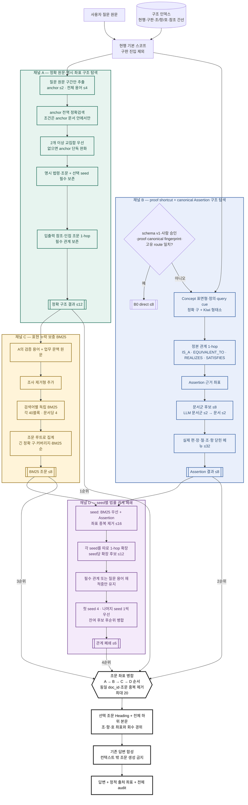
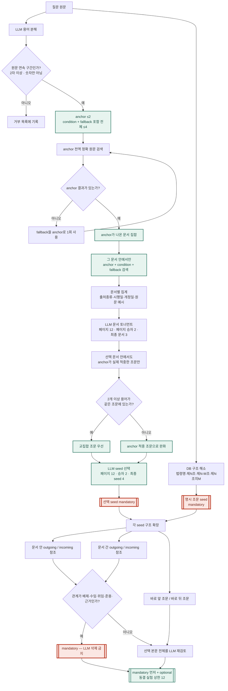
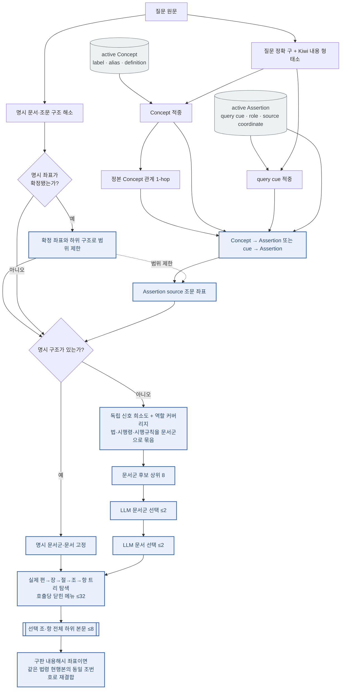
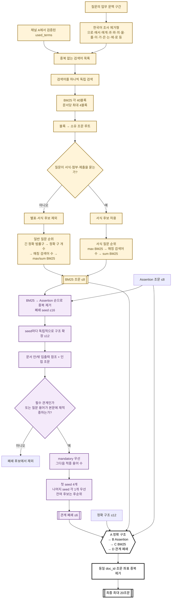
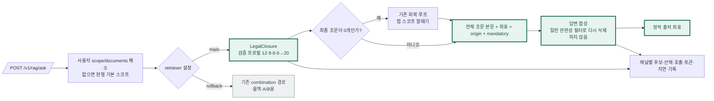

# LegalClosure 메인 검색 구조

- 상태: **운영 기본 검색기 — 2026-08-25 배선 완료**
- 검증 프로필: 정확 구조 12 + proof/Assertion 8 + BM25 8 + 관계 폐쇄 6 + 규범참조 검증 → 최종 20
- 검증 결과: 후보 상한 70/70, v2 frozen replay 69/70, 사례 50/51 (ADR-0021)
- 운영 조립: `lawrag/core/rag/legalclosure_runtime.py`
- 검색 정책 정본: `lawrag/core/rag/legalclosure.py`
- 실험 기록: `docs/adr/0011-legal-coordinate-closure.md`

이 문서는 68/70을 만든 **동결 실험 프로필**과 현재 메인 검색기의 구조 계약을 그린다.
`POST /v1/rag/ask`에서 mode를 생략하면 `legalclosure-v2`가 실행된다. 이전
`vecfirst → combination` 경로는 `legacy-vector`와 `legacy-auto`로 보관하며,
`legalclosure_main` 스위치를 끄면 `legacy-vector`로 즉시 롤백한다.

## 1. 전체 구조

핵심은 네 채널을 점수 하나로 다시 섞지 않는 것이다. 정확 구조 결과를 먼저 보존하고,
Assertion·BM25·관계 폐쇄는 남은 슬롯만 채운다. 그래서 보충 채널의 잡음이 이미 찾은
직접 근거를 밀어낼 수 없다.

## 2. 채널 A — 정확 구조 탐색 상세

### 채널 A 불변식

1. LLM이 만든 동의어·법령명·조문은 사용하지 않는다. 질문에 실제 포함된 문자열만
   검색어로 통과한다.
2. 조건어는 전역 문서를 열지 않는다. anchor가 먼저 연 문서 안에서만 작동한다.
3. 명시 조문과 선택을 통과한 정확 seed는 마지막 본문 검토자가 삭제하지 못한다.
4. 필수 법률 관계는 검색어가 직접 없더라도 보존한다.
5. `제2-4조`와 `제2조의4`는 서로 다른 좌표다.

## 3. 채널 B — Assertion 구조 탐색 상세

Assertion 채널은 원문 BM25와 임베딩을 사용하지 않는다. 질문에서 추측한 역할이 아니라
DB Assertion에 저장된 역할과 근거 좌표만 따라간다. 명시 구조가 있으면 문서군 라우팅보다
그 좌표가 우선한다.

## 4. 채널 C·D와 최종 병합 상세

## 5. 후보 예산과 우선순위 계약

| 단계 | 상한 | 선택 방식 | 최종 병합 우선순위 |
|---|---:|---|---:|
| 정확 구조 | 12 | 명시/정확 seed 필수 + 선택 본문 LLM | 1 |
| Assertion | 8 | canonical 신호 + 닫힌 계층 메뉴 LLM | 2 |
| 균등 BM25 | 8 | 검색어별 quota 후 결정론 정렬 | 3 |
| 관계 폐쇄 | 6 | seed별 1-hop, 필수/재적중 후보 | 4 |
| 최종 | 20 | 조문 좌표 중복 제거 | - |

상한은 독립 합계 34개를 모두 출력한다는 뜻이 아니다. `A → B → C → D` 순으로
좌표를 넣다가 20개에서 닫는다. A가 12개를 사용하면 B·C·D가 경쟁하는 슬롯은 8개다.

## 6. 메인 운영 배선 목표

운영 전환은 기존 `mode="vector"` 이름 아래 조용히 바꾸지 않았다. 응답의
`retriever.id=legalclosure-v2`, `status=main`에 실제 전략을 남긴다. 기존 경로는
`legacy-vector`·`legacy-auto`이며, 독립 `legalclosure_main` 스위치가 즉시 롤백을
담당한다. 옛 클라이언트의 `vector`·`auto` 값은 호환 별칭으로 받지만 결과에는
`status=archived`가 표시된다.

## 7. 운영 배선에서 해소한 코드 차이

68/70 동결 실험과 운영 호출 사이의 차이를 다음과 같이 해소했다.

1. 채널 A를 `PRIMARY_CAP=12`로 분리했다.
2. API가 적용한 사용자 scope가 있으면 `legalclosure`와 `termexplore`가 그대로 보존한다.
3. 일반 관련성 필터는 LegalClosure 좌표에 재적용하지 않는다.
4. 관계 폐쇄의 출발 좌표를 `ref_src`로 보존해 scope 밖 조문은 동반으로만 남긴다.
5. 응답·로그에 retriever ID, 채널별 선택, 모델, 토큰·지연을 남긴다.
6. 승인된 proof shortcut만 Assertion B0에서 열고 miss·중의·fingerprint 불일치는 B1로 내린다.
7. 준용·위임 질문은 선택된 `준용` 표제 조문의 직접 참조 중 질문 표제 일치가 고유한 조문만 보충한다.
8. 각 조문에 조건·예외·시점·수량·방법·효과 span과 authority/as-of 검증을 관측 메타로 붙인다.

남은 검증은 실시간 51건의 확률 단계 재실행과 자연어 답변 정답률이다. 운영 승격의
근거 수치는 frozen-stage 68/70이며, 이는 답변 정답률이 아니라 조문 회수율이다.

## 8. 코드 대응표

| 다이어그램 영역 | 코드 |
|---|---|
| 운영 의존성 조립 | `lawrag/core/rag/legalclosure_runtime.py` |
| 채널 실행·최종 병합 | `lawrag/core/rag/legalclosure.py` |
| 조문 좌표·현행본 재결합 | `lawrag/core/rag/legal_coordinates.py` |
| 채널 A 정확 구조 | `lawrag/core/rag/termexplore.py` |
| 명시 법령·조문 해소 | `lawrag/core/domain_graph/spanparts.py` |
| 채널 B Assertion | `lawrag/core/rag/assertionfirst.py` |
| B0 증명 단축경로 | `lawrag/core/rag/assertion_shortcuts.py` |
| 준용·위임 참조 verifier | `lawrag/core/rag/legal_references.py` |
| 좌표별 규범·시점 주석 | `lawrag/core/rag/legal_evidence.py` |
| 규범요건 span | `lawrag/core/domain_graph/requirements.py` |
| 시점·법원성 검증 | `lawrag/core/rag/legal_validity.py` |
| 채널 C BM25 | `lawrag/core/rag/general_search.py` |
| 참조 문법·관계 라벨 | `lawrag/core/rag/refs.py` |
| 구조·현행 스코프·간선 인덱스 | `lawrag/core/rag/index.py` |
| 답변 합성·정적 인용 | `lawrag/core/rag/answer.py` |
| API 응답 표현 | `lawrag/api/legalclosure_presenter.py` |
| API 전환 지점 | `lawrag/api/routers/rag.py` |
