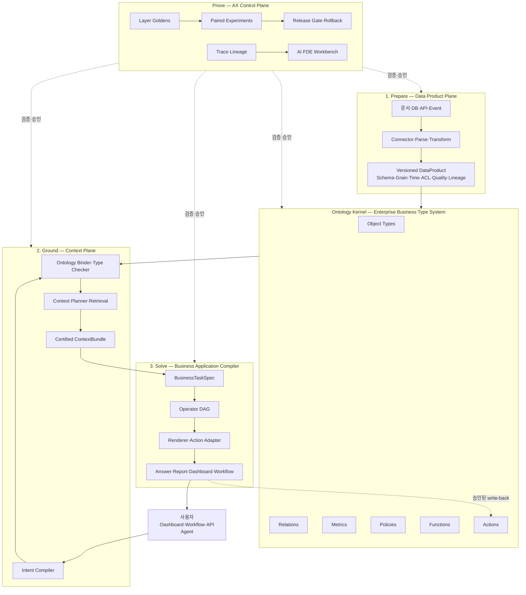

# Ontology-centered AX Experiment OS

> 상태: 제품·구현·FDE Delivery 기준 설계안  
> 문서 버전: v0.1  
> 대상: AI FDE, 데이터·AI 플랫폼팀, 도메인 SME, 보안·운영팀, 제품팀  
> 관련 문서: [AX Experiment OS 제품 설계](./AX_EXPERIMENT_OS_PRODUCT_DESIGN.md), [FDE AX·RAG Delivery Manual](./FDE_AX_RAG_DELIVERY_MANUAL.md), [자기진화형 문서 KG](./ONTOLOGY_KG.md)

## 0. Executive Decision

### 한 문장

이 제품은 고객의 데이터 파이프라인을 대체하는 플랫폼이 아니라, 고객 데이터와 업무 의미를
`Ontology`로 연결하고 자연어 요청을 검증 가능한 `ContextBundle`과 업무 애플리케이션으로
컴파일하며, 그 전 과정을 계층별 Golden과 실험으로 통제하는 **온프레미스 AX 실험 운영체제**다.

### 핵심 판단

1. 자연어에서 서비스를 만드는 일의 병목은 UI 생성이 아니라 **올바른 데이터·지표·시점·권한·행동을 결정하는 것**이다.
2. 이를 해결하려면 검색 인덱스보다 상위에 기업 공통 업무 타입 시스템이 있어야 한다.
3. 온톨로지는 `객체·관계·지표·정책·함수·행동`을 정의하며, 자연어 요청의 모호함과 잘못된 조합을 실행 전에 차단한다.
4. 검색·SQL·Graph·API는 모두 Context를 가져오는 실행 수단이다. 제품의 표준 출력은 검색 결과가 아니라 provenance가 붙은 `Certified ContextBundle`이다.
5. 서비스 생성은 자연어를 React·SQL·Python으로 직접 번역하는 문제가 아니다. 타입이 있는 업무 IR과 Operator DAG를 생성하는 컴파일 문제다.
6. AI FDE는 운영 결과를 보고 임의로 시스템을 고치는 자율 에이전트가 아니다. 실패를 진단하고 한 변수 실험을 제안·실행하되 Golden과 release threshold는 변경할 수 없는 통제된 실험자다.

### 제품 경계

| 제품이 소유하는 것 | 고객 또는 기존 플랫폼이 소유하는 것 |
|---|---|
| 계약, ontology registry, Golden, experiment, trace, release evidence | 원천 시스템과 업무 데이터 |
| Intent compiler와 ontology binder | Airflow, dbt, Spark, 사내 ETL 구현 |
| Context planner와 ContextBundle 계약 | Vector DB, 검색엔진, Graph DB, DW 선택 |
| Operator DAG와 renderer/action 계약 | 고객 고유 업무 로직과 승인 조직 |
| AI FDE failure workbench | 최종 업무 책임과 정책 승인 |
| 온프레미스 패키징·재현·promotion | 인프라 표준, IAM, 망분리 정책 |

## 1. 문제 정의

### 1.1 현재 기업 AX 프로젝트의 구조적 문제

기업 RAG·AX 프로젝트는 보통 다음 순서로 진행된다.

```text
데이터를 연결한다
  → 검색을 만든다
  → 프롬프트를 조정한다
  → 데모가 동작한다
  → 실제 업무 질문에서 실패한다
  → 무엇이 틀렸는지 분해하지 못한다
  → FDE가 현장에서 다시 데이터와 프롬프트를 손본다
```

실패 원인은 단순한 모델 성능이 아니다.

- 같은 단어가 부서마다 다른 객체를 뜻한다.
- 지표의 grain, 계산식, 기준시점이 정의되지 않는다.
- 사용자의 질문이 어떤 업무 의사결정을 지원하는지 구조화되지 않는다.
- 검색 결과가 맞아도 최종 업무 규칙과 권한에 연결되지 않는다.
- 최종 답변 점수만 있어 parser, mapping, retrieval, reasoning 중 어디가 실패했는지 모른다.
- 고객마다 실험 코드·데이터셋·평가기·환경이 달라 개선 결과를 재현하기 어렵다.
- 온프레미스에서는 외부에서 성공한 실험을 동일한 artifact로 재생하지 못한다.

### 1.2 해결할 제품 문제

제품이 해결해야 할 질문은 다음이다.

> “이 자연어 요청을 어떤 기업 객체·관계·지표·시점·권한·행동으로 해석해야 하며, 어떤 데이터와 근거를 사용해 어떤 업무 산출물을 만들었는지를 반복 가능한 실험으로 증명할 수 있는가?”

## 2. 전체 아키텍처



### 2.1 네 Plane의 책임

| Plane | 입력 | 핵심 책임 | 표준 출력 | 대표 Golden |
|---|---|---|---|---|
| Prepare | 원천 문서·DB·API·Event | 수집, 파싱, 정규화, 품질, lineage | `DataProduct` | parser·schema·freshness·ACL |
| Ontology | DataProduct와 SME 정의 | 업무 객체·관계·지표·정책·함수·행동 정의 | versioned `OntologyBundle` | mapping·relation·metric·policy·action |
| Ground | 자연어 요청과 OntologyBundle | 의도 구조화, type check, retrieval plan, evidence 조립 | `Certified ContextBundle` | intent·binding·retrieval·context |
| Solve | ContextBundle과 업무 목표 | 계산·비교·규칙·설명·표현·행동 실행 | `ServiceArtifact` | task·operator·render·action |
| Prove | 모든 trace와 Golden | 실험, 비교, 진단, 승인, promotion, rollback | `ReleaseBundle` | control-plane 자체 회귀 |

## 3. Ontology Kernel

### 3.1 이 문서에서 온톨로지의 정의

온톨로지는 단순한 용어집, 지식그래프, 벡터 검색 보조 메타데이터가 아니다.

```text
Ontology = Semantic Model + Operational Contract
         = Objects + Relations + Metrics + Policies + Functions + Actions
```

- `Semantic`: 기업이 무엇을 고객, 계약, 상품, 설비, 위험으로 보는지 정의한다.
- `Operational`: 어떤 계산을 할 수 있고 누가 어떤 조건에서 어떤 행동을 수행할 수 있는지 정의한다.
- `Type System`: 존재하지 않는 지표, grain이 맞지 않는 join, 권한 없는 객체 접근을 실행 전에 거부한다.
- `Symbol Table`: 자연어의 표현을 인증된 객체·지표·함수·행동 ID에 연결한다.
- `Linker`: DataProduct의 필드와 API를 업무 의미에 바인딩한다.

### 3.2 TBox와 ABox

| 구분 | 의미 | 예시 | 변경 통제 |
|---|---|---|---|
| TBox | 타입·관계·규칙의 정의 | `Customer`, `owns`, `Revenue`, 승인 정책 | 설계자·SME 승인 |
| ABox | 실제 개별 사실 | 고객 123, 계약 A, 8월 매출 3억 | 데이터 파이프라인 |

사용자 피드백은 보통 ABox 오류로 도착한다. 동일 유형 오류가 반복될 때 규칙 후보로
일반화하고, 충분한 증거와 회귀 실험을 거쳐 TBox를 개정한다. TBox 변경은 기존 데이터를
소급 재분류하고 모든 서비스에 영향을 줄 수 있으므로 AI Agent가 자동 승인하면 안 된다.

### 3.3 Ontology 구성요소

#### Object Types

업무에서 독립적인 식별자와 생명주기를 갖는 대상이다.

```yaml
object_type:
  id: customer
  version: 3
  display_name: 고객
  identifiers: [customer_id]
  properties:
    - name: segment
      type: enum
      source: crm_customer.segment_code
    - name: risk_grade
      type: string
      source: risk_master.grade
      as_of_policy: latest_before_query_time
  acl_policy: customer_read_policy
  steward: crm_data_owner
```

#### Relations

객체 사이의 방향·기수·시점·근거를 정의한다.

```yaml
relation:
  id: customer_owns_contract
  from: customer
  to: contract
  cardinality: one_to_many
  temporal: valid_time
  source_binding: contract.customer_id
  constraints:
    - contract.status != deleted
```

#### Metrics

단순 컬럼명이 아니라 계산식, grain, 시간 의미, 허용 dimension을 포함한 계약이다.

```yaml
metric:
  id: net_revenue
  version: 7
  entity: contract
  expression: sum(invoice.amount - invoice.refund_amount)
  grain: [contract_id, accounting_month]
  time_semantics: accounting_period
  dimensions: [product, customer_segment, region]
  currency_policy: convert_at_month_end_rate
  source_products: [invoice_fact_v12, fx_rate_v4]
  owner: finance_analytics
```

#### Policies

읽기·계산·출력·행동을 통제한다.

```yaml
policy:
  id: customer_read_policy
  effect: allow
  subject: user.department == object.owner_department
  purpose: [sales_support, risk_review]
  fields:
    pii: masked_unless_role:pii_reader
  audit: required
```

#### Functions

재사용 가능한 결정론 계산, 규칙, 예측, 최적화 단위다.

```yaml
function:
  id: calculate_churn_risk
  inputs:
    customer: customer
    as_of: datetime
  output: churn_risk_score
  implementation: model://churn-risk@sha256:...
  preconditions: [customer.active == true]
  timeout_ms: 2000
```

#### Actions

조회가 아니라 시스템 상태를 바꾸는 명령이다. action은 반드시 사전조건, 승인, idempotency,
감사, 보상 또는 rollback 계약을 가져야 한다.

```yaml
action:
  id: adjust_credit_limit
  target: customer
  inputs:
    new_limit: money
    reason: string
  preconditions:
    - caller.role in [credit_manager]
    - new_limit <= approved_ceiling
  approval: four_eyes
  idempotency_key: request_id
  executor: api://credit-core/v2/limits
  postconditions:
    - customer.credit_limit == new_limit
  compensation: restore_previous_limit
```

### 3.4 OntologyBundle

온프레미스 반입과 실험 재현을 위해 온톨로지는 개별 DB 상태가 아니라 불변 bundle로 발행한다.

```yaml
ontology_bundle:
  id: enterprise-ontology-2026.08.26.3
  schema_version: 1
  parents: [enterprise-ontology-2026.08.19.1]
  objects_digest: sha256:...
  relations_digest: sha256:...
  metrics_digest: sha256:...
  policies_digest: sha256:...
  functions_digest: sha256:...
  actions_digest: sha256:...
  source_product_versions:
    invoice_fact: v12
    crm_customer: v8
  golden_suite: ontology-golden-v5
  approvals:
    - role: domain_owner
    - role: security_owner
```

### 3.5 변경 유형과 승인 수준

| 변경 | 예 | 영향 | 최소 검증 |
|---|---|---|---|
| ABox 교정 | 개별 객체의 잘못된 값 | 국소 | data validation + affected cases |
| Mapping 수정 | source column 바인딩 변경 | 해당 object·metric | mapping golden + downstream replay |
| 규칙 추가 | 동의어·routing 규칙 | 특정 scope | challenge set + false positive audit |
| Metric 개정 | 매출 계산식 변경 | 모든 소비 서비스 | metric reconciliation + business sign-off |
| TBox 개정 | 객체 분할·관계 타입 변경 | 광범위·소급 | migration + full regression + dual run |
| Action 개정 | precondition·executor 변경 | 업무 상태 | sandbox + approval + compensation test |

## 4. 핵심 계약

### 4.1 DataProduct

```yaml
data_product:
  id: invoice_fact
  version: 12
  kind: dataset
  schema_ref: schemas/invoice_fact-v12.json
  grain: [invoice_line_id]
  primary_time: issued_at
  freshness_slo: PT6H
  quality_contract:
    completeness: 0.999
    duplicate_rate_max: 0.0001
  acl_profile: finance_internal
  lineage:
    sources: [erp.invoice, erp.refund]
    pipeline_digest: sha256:...
  interfaces:
    - sql://warehouse/finance.invoice_fact_v12
```

### 4.2 BusinessIntent

Intent compiler의 출력이며 아직 데이터를 가져오지 않는다.

```yaml
business_intent:
  id: intent-01
  task_type: dashboard
  original_utterance: 지난 분기 위험 고객의 매출 감소 원인을 보여줘
  goal: 위험 고객 매출 감소 원인 분석
  decision_to_support: 영업 개입 대상 결정
  actor: regional_sales_manager
  entities:
    - type: customer
      filters: [risk_grade in [high, critical]]
  metrics: [net_revenue]
  comparisons: [previous_quarter]
  time_range: previous_quarter
  dimensions: [customer_segment, product, region]
  output_contract:
    kind: dashboard
    required_views: [trend, drivers, customer_table]
  ambiguities:
    - term: 위험 고객
      candidates: [risk_grade, churn_risk_score]
```

### 4.3 ContextRequest

Ontology binding이 끝난 뒤 retrieval 계층으로 보내는 실행 가능한 요청이다.

```yaml
context_request:
  ontology_bundle: enterprise-ontology-2026.08.26.3
  actor_context:
    user_id: u-123
    roles: [regional_sales_manager]
    purpose: sales_support
  bindings:
    entities: [ontology://object/customer@3]
    metrics: [ontology://metric/net_revenue@7]
    policies: [ontology://policy/customer_read_policy@4]
  as_of: 2026-06-30T23:59:59+09:00
  evidence_needs:
    - metric_values
    - causal_driver_candidates
    - metric_definition
  budgets:
    latency_ms: 8000
    max_context_tokens: 24000
```

### 4.4 Certified ContextBundle

Ground 계층의 최종 제품 자산이다. 데이터뿐 아니라 누락·상충·권한·출처를 함께 운반한다.

```yaml
context_bundle:
  id: ctx-7f4a
  request_id: intent-01
  ontology_bundle: enterprise-ontology-2026.08.26.3
  items:
    - item_id: metric-series-1
      type: metric_series
      metric: net_revenue@7
      grain: [customer_id, accounting_month]
      data_ref: artifact://ctx-7f4a/net-revenue.parquet
      provenance:
        data_products: [invoice_fact@12, fx_rate@4]
        query_digest: sha256:...
  conflicts: []
  missing:
    - requested: causal proof
      reason: available data supports association only
  policy_decisions:
    - pii_fields: masked
  freshness:
    observed_at: 2026-08-26T09:00:00+09:00
  completeness: partial
```

### 4.5 BusinessTaskSpec와 Operator DAG

```yaml
business_task_spec:
  task: explain_revenue_decline
  input_bundle: ctx-7f4a
  rubric:
    - use_only_certified_metrics
    - separate_fact_from_hypothesis
    - expose_missing_causal_evidence
  output: dashboard

operator_dag:
  nodes:
    - id: n1
      op: compare_periods
      input: metric-series-1
    - id: n2
      op: decompose_change
      inputs: [n1]
      dimensions: [product, region, segment]
    - id: n3
      op: rank_contributors
      inputs: [n2]
    - id: n4
      op: render_dashboard
      inputs: [n1, n3]
  edges: [n1->n2, n2->n3, n1->n4, n3->n4]
```

### 4.6 ReleaseBundle

```yaml
release_bundle:
  id: release-2026.08.26.5
  application_digest: sha256:...
  ontology_bundle: enterprise-ontology-2026.08.26.3
  data_product_contracts: [invoice_fact@12, crm_customer@8]
  prompt_bundle: prompt-34
  model_bundle: local-llm-12
  index_bundle: search-index-84
  golden_suites:
    data: data-golden-10
    ontology: ontology-golden-5
    context: context-golden-12
    service: service-golden-8
  experiment_report: exp-2026-441
  security_attestation: sec-2026-81
  approvals: [eval_owner, domain_owner, platform_owner]
  rollback_to: release-2026.08.19.2
```

## 5. End-to-End 프로세스

### 5.1 구축 흐름

```text
1. 업무 의사결정과 실패 비용 정의
2. 원천 시스템·권한·시점·grain 조사
3. DataProduct 계약과 baseline fixture 고정
4. 핵심 업무 질문에서 필요한 object·relation·metric 역설계
5. source field를 ontology에 mapping
6. ontology golden으로 mapping·관계·지표·정책 검증
7. Intent·Context·Service golden 작성
8. baseline end-to-end trace 확보
9. 한 변수 실험으로 layer별 개선
10. ReleaseBundle 승인 후 on-prem promotion
```

객체를 먼저 대량 모델링하지 않는다. 가치가 높은 실제 질문과 의사결정에서 시작해 필요한
ontology slice를 얇게 세로로 관통한다.

### 5.2 자연어 실행 흐름

```text
자연어 요청
  → Intent Compiler
  → BusinessIntent
  → Ontology Binder / Type Checker
      ├─ 유효: ContextRequest 생성
      ├─ 모호: 선택지를 제한한 clarification
      └─ 무효: 존재하지 않는 지표·권한·행동 거부
  → Context Planner
  → SQL / Search / Graph / API / Tool 실행
  → Certified ContextBundle
  → BusinessTaskSpec
  → Operator DAG
  → Renderer 또는 승인된 Action
  → Answer / Report / Dashboard / Workflow
  → Trace·Feedback·Outcome
```

### 5.3 변경 학습 흐름

```text
운영 실패 또는 사용자 교정
  → trace에서 최초 실패 layer 식별
  → FailureMode 분류
  → Golden 후보로 격리
  → ABox 교정 / mapping 수정 / rule 후보 / TBox 개정 후보
  → 변경 영향 범위 계산
  → branch에서 paired experiment
  → regression·security·cost·latency gate
  → 사람 승인
  → versioned bundle 발행
```

## 6. 자연어 기반 서비스 생성 가설

### 6.1 어디까지 쉬워지는가

질문을 정확한 `BusinessIntent`로 구조화하고 Ontology에 bind한 뒤 인증된 ContextBundle을
만들 수 있다면 다음 조회형 서비스는 공통 operator와 renderer로 빠르게 조립할 수 있다.

- Q&A와 근거형 답변
- 정기·수시 보고서
- KPI Dashboard와 drill-down
- 비교·추세·기여도 분석
- 검색·탐색형 내부 도구
- 승인 전 단계까지의 workflow 초안

### 6.2 여전히 어려운 것

- 정책적으로 정의되지 않은 업무 질문
- 인과 데이터 없이 원인을 확정하는 요청
- 사람의 책임 판단을 대체하는 고위험 의사결정
- 보상·rollback이 정의되지 않은 write action
- 새로운 business logic, metric, action을 자동으로 정본화하는 일
- 자유로운 UI 요구와 실제 데이터 가능성의 불일치

### 6.3 컴파일러 대응표

| Compiler | AX 시스템 |
|---|---|
| Source language | 사용자의 자연어 |
| Parser | Intent Compiler |
| AST / IR | BusinessIntent |
| Type system | Ontology |
| Symbol table | Object·Metric·Function·Action registry |
| Type checker | Ontology Binder |
| Linker | DataProduct·Tool binding |
| Query planner | Context Planner |
| Runtime value | ContextBundle |
| Execution plan | Operator DAG |
| Target | Answer·Dashboard·Workflow·Action |
| Tests | Layer Goldens |
| Build artifact | ReleaseBundle |

## 7. Golden과 실험 체계

### 7.1 계층별 Golden

| Golden | 핵심 질문 | 대표 단위 지표 |
|---|---|---|
| Data Golden | 원천을 손실 없이 올바르게 구조화했는가 | parse F1, schema validity, value accuracy |
| Ontology Golden | 데이터가 올바른 업무 의미와 규칙에 연결됐는가 | mapping accuracy, relation validity, metric parity |
| Intent Golden | 질문을 올바른 타입 요청으로 바꿨는가 | intent exact/field match, clarification accuracy |
| Retrieval Golden | 필요한 evidence를 가져왔는가 | recall@k, precision@k, ACL violation |
| Context Golden | 최종 입력이 충분하고 정직한가 | evidence coverage, conflict/missing detection |
| Service Golden | 산출물이 의사결정을 지원하는가 | task success, groundedness, rubric pass |
| Action Golden | 안전하게 상태를 변경하는가 | pre/postcondition, idempotency, rollback success |

최종 점수 하나로 튜닝하지 않는다. End-to-end 성공과 최초 실패 layer를 함께 저장한다.

### 7.2 Golden case 공통 스키마

```yaml
case:
  id: rev-risk-017
  source: production_log
  business_value: high
  risk: high
  input:
    utterance: 지난 분기 위험 고객의 매출 감소 원인을 보여줘
    actor_profile: regional_sales_manager
    as_of: 2026-06-30
  expected:
    intent_bindings:
      object: customer
      metric: net_revenue@7
    clarification_required: true
    acceptable_risk_definitions: [risk_grade, churn_risk_score]
    required_evidence: [revenue_series, metric_definition]
    forbidden_claims: [causal_certainty]
    output_rubric: dashboard-revenue-driver-v2
  segment_tags:
    - ambiguous_term
    - temporal
    - high_value
```

### 7.3 실험 규율

모든 실험은 다음 계약을 가진다.

```yaml
experiment:
  id: exp-441
  observation: 위험 고객 질의에서 clarification 누락이 많다
  hypothesis: risk 용어에 2개 이상의 유효 binding이 있을 때 질문하면 오류가 감소한다
  single_change: binder.clarification_policy=v3
  baseline_release: release-2026.08.19.2
  candidate_release: candidate-2026.08.26.1
  suites: [intent-golden-v7, context-golden-v12, service-golden-v8]
  primary_metric: high_risk_task_success
  guardrails: [latency_p95, clarification_rate, user_abandonment, acl_violation]
  decision_rule:
    promote_if: primary_delta > 0 and no_high_risk_regression
```

운영 원칙은 다음과 같다.

- 동일 case를 baseline과 candidate에 paired 실행한다.
- 변경은 한 인과 질문을 답할 수 있도록 가능한 한 한 변수로 제한한다.
- aggregate score뿐 아니라 segment와 case-level diff를 본다.
- LLM judge는 human-labeled calibration set으로 교정하고 judge version을 고정한다.
- Golden 정답과 release threshold는 AI FDE가 수정할 수 없다.
- 실패를 본 test set으로 튜닝했다면 새 locked version을 만든다.
- 품질·비용·지연·보안·운영 복잡도를 함께 기록한다.

## 8. AI FDE 운영 모델

### 8.1 AI FDE의 역할

```text
Observe → Localize → Hypothesize → Branch → Run → Compare → Recommend
```

| 단계 | AI FDE가 하는 일 | 사람이 소유하는 결정 |
|---|---|---|
| Observe | 실패 trace와 cluster 요약 | 우선순위·업무 위험 확인 |
| Localize | 최초 실패 layer와 후보 원인 제시 | 진단 승인 또는 수정 |
| Hypothesize | 한 변수 실험 카드 작성 | 실험 가치와 범위 승인 |
| Branch | config·prompt·mapping candidate 생성 | 민감 변경 승인 |
| Run | Golden paired experiment 실행 | 중단·예산 정책 |
| Compare | case/segment regression과 비용 분석 | trade-off 판단 |
| Recommend | promote/reject/needs-review 제안 | release 최종 승인 |

### 8.2 권한 경계

AI FDE가 할 수 있는 것:

- read-only trace·metric·masked sample 조회
- 승인된 sandbox에서 experiment branch 생성
- allowlist 안의 target 실행
- failure cluster와 experiment report 생성
- ontology mapping·rule 변경안 제안

AI FDE가 할 수 없는 것:

- Golden의 expected answer, rubric, threshold 수정
- production data 또는 ontology 정본 직접 변경
- 새로운 tool·network destination 임의 등록
- 승인 없는 action 실행
- high-risk failure를 평균 점수로 상쇄
- 결과가 불리한 case를 제외하거나 experiment history 삭제

### 8.3 FDE 현장 진행 순서

#### Week 1 — 업무와 판을 고정

1. 성공 의사결정 1~3개와 실패 비용을 정한다.
2. 실제 사용 로그·SME 사례·사고 사례를 모은다.
3. 원천 데이터, ACL, 시점, grain, 배포 제약을 실측한다.
4. layer별 baseline trace 한 건을 끝까지 만든다.

#### Week 2 — 얇은 ontology slice

1. 핵심 질문에 필요한 object·metric·relation만 만든다.
2. DataProduct mapping과 metric parity를 SME와 검증한다.
3. 모호한 용어와 금지된 조합을 binder rule로 정의한다.
4. ontology·intent·context Golden의 초기 locked set을 만든다.

#### Week 3 — 서비스 vertical slice

1. ContextBundle을 생성한다.
2. Operator DAG와 renderer 하나를 연결한다.
3. end-to-end service Golden을 실행한다.
4. 실패 layer를 분해하고 첫 paired experiment를 수행한다.

#### Week 4 — 인계 가능한 실험 루프

1. 고객 담당자가 Golden case를 추가해 본다.
2. 고객 담당자가 candidate를 만들고 비교 보고서를 읽는다.
3. release·rollback rehearsal을 한다.
4. FDE 없이 동일 실험을 재현하는 졸업시험을 수행한다.

## 9. 온프레미스 배포 아키텍처

### 9.1 논리 구성

```text
┌──────────────────────── Customer On-premises ────────────────────────┐
│                                                                      │
│  [Users / Apps] → [Gateway / IAM / Policy Enforcement]               │
│                         │                                            │
│                         ▼                                            │
│  [Intent Compiler] → [Ontology Binder] → [Context Planner]           │
│                         │                    │                        │
│                         │                    ├→ SQL / DW              │
│                         │                    ├→ Search / Vector       │
│                         │                    ├→ Graph                 │
│                         │                    └→ Internal API / Tool   │
│                         ▼                                            │
│                  [Ontology Runtime]                                  │
│                         │                                            │
│  [ContextBundle] → [Operator Runtime] → [Renderer / Action Gateway]  │
│                                                                      │
│  ───────────────────── Prove / Control Plane ──────────────────────  │
│  Contract Registry · Golden Registry · Experiment Runner             │
│  Trace/Lineage · Artifact Store · Approval · Release · Rollback      │
│  AI FDE Sandbox · Audit · Secrets · Scheduler                        │
│                                                                      │
│  ───────────────────────── Supply Chain ───────────────────────────  │
│  Git · Container · Model · Prompt · Ontology · Index Registries      │
└──────────────────────────────────────────────────────────────────────┘
```

### 9.2 격리 원칙

| 영역 | 원칙 |
|---|---|
| 민감 데이터 | 고객 data plane 밖으로 나가지 않음 |
| Control plane | 완전 폐쇄망에서는 고객 환경에 함께 설치 |
| 모델 | digest로 고정된 local serving 또는 승인된 gateway만 사용 |
| 실험 runner | production과 동일 image·bundle, 별도 namespace와 quota |
| AI FDE | sandbox, read-mostly, tool/network allowlist |
| artifact | 서명·checksum·SBOM·provenance 포함 |
| secrets | bundle에 포함하지 않고 target secret store에서 주입 |
| trace | PII masking, field-level retention, query-level audit ID |

### 9.3 환경과 promotion

```text
dev → test → staging/shadow → production
```

환경 사이에 source data 자체를 복사하지 않는다. 동일한 코드·ontology·prompt·model·index build
정의를 promotion하고, target 환경의 승인된 원천에서 재생성한다. 비교가 필요한 fixture는 비식별
또는 합성된 불변 artifact로 운반한다.

### 9.4 망분리 ReleaseBundle 반입 절차

1. 외부 build zone에서 bundle manifest, image, SBOM, signature, test report를 생성한다.
2. malware scan과 반입 승인을 거친다.
3. 내부 registry에 digest를 보존해 import한다.
4. secret 없이 smoke test와 compatibility validation을 실행한다.
5. 내부 DataProduct·Ontology binding을 검증한다.
6. locked Golden을 재실행한다.
7. shadow 또는 canary 후 release owner가 promotion한다.
8. 이전 bundle의 alias와 rollback 절차를 유지한다.

## 10. 제품 모듈

| 모듈 | 핵심 기능 | 첫 사용자 |
|---|---|---|
| Workspace Map | source→DataProduct→Ontology→Service→Outcome lineage | FDE·architect |
| Contract Studio | DataProduct·ContextBundle·Action schema 관리 | platform engineer |
| Ontology Studio | object·relation·metric·policy·function·action 편집·diff | SME·ontology owner |
| Golden Studio | case 작성, annotation, split, lock, leakage 관리 | eval owner |
| Experiment Lab | baseline/candidate paired run과 통계 | AI/ML engineer |
| Failure Workbench | 최초 실패 layer, cluster, trace replay | FDE |
| Business App Composer | Intent→DAG→renderer 미리보기 | analyst·product owner |
| Release Center | bundle, approval, promotion, rollback | platform owner |
| Runtime Monitor | drift, incident, feedback→Golden 후보 | operations |

## 11. API 초안

### Contracts와 Ontology

```text
POST /data-products
POST /data-products/{id}/validate
POST /ontology/bundles
GET  /ontology/bundles/{id}/diff
POST /ontology/bindings/validate
POST /ontology/metrics/{id}/reconcile
POST /ontology/actions/{id}/dry-run
```

### Compile과 Runtime

```text
POST /intents/compile
POST /intents/{id}/bind
POST /contexts/plan
POST /contexts/execute
GET  /context-bundles/{id}
POST /tasks/compile
POST /operator-dags/{id}/execute
POST /actions/{id}/request-approval
```

### Golden·Experiment·Release

```text
POST /golden-suites
POST /golden-suites/{id}/lock
POST /experiments
POST /experiments/{id}/run
GET  /experiments/{id}/compare
GET  /traces/{trace_id}
POST /failures/cluster
POST /agent/proposals
POST /releases
POST /releases/{id}/approve
POST /releases/{id}/promote
POST /releases/{id}/rollback
```

### 공통 식별자

모든 응답은 최소 다음 식별자를 연결한다.

```text
request_id
trace_id
actor_id / purpose
data_product_versions
ontology_bundle_id
context_bundle_id
operator_dag_id
model / prompt / index digests
golden_suite_versions
release_bundle_id
```

## 12. 저장 모델

초기 MVP는 polyglot DB보다 명확한 계약이 우선이다.

| 저장소 | 권장 데이터 |
|---|---|
| PostgreSQL | contracts, ontology metadata, cases, experiments, approvals |
| Object Store | dataset snapshot, parquet, trace artifact, reports, bundles |
| Git | 사람이 리뷰하는 schema·metric·policy·prompt·config |
| Trace Store | OpenTelemetry/OpenInference span |
| Search/Vector | 문서 evidence retrieval |
| Graph 또는 RDB adjacency | 대규모 relation traversal이 실제 병목일 때 도입 |

Ontology의 논리 모델과 물리 저장소를 동일시하지 않는다. 초기에는 YAML/JSON + RDB로도
충분하다. Graph DB는 복잡한 관계 탐색이 실제 사용 사례에서 필요하다는 증거가 생겼을 때 도입한다.

## 13. 보안·거버넌스

### 13.1 필수 불변식

1. ACL은 retrieval 후 필터가 아니라 planning 전후에 모두 강제한다.
2. 정책은 prompt 텍스트가 아니라 versioned executable contract다.
3. 서비스 출력은 source·metric·ontology·release version까지 추적 가능해야 한다.
4. write action은 조회와 다른 gateway, approval, audit 정책을 사용한다.
5. masked field가 LLM context에 들어간 뒤 복원되는 경로가 없어야 한다.
6. 실험용 agent는 production credential을 보유하지 않는다.
7. Golden expected와 threshold 변경은 별도 승인·감사 이벤트다.

### 13.2 책임자

| 자산 | Accountable owner |
|---|---|
| DataProduct | Data owner |
| Object·Relation | Domain ontology owner |
| Metric | Business metric owner |
| Policy | Security/Compliance owner |
| Function·Model | Model or platform owner |
| Action | Business process owner |
| Golden | Eval owner + SME |
| ReleaseBundle | Platform release owner |

## 14. MVP 계획

### 14.1 첫 wedge

첫 제품은 범용 자동 ontology builder가 아니다.

> “기업 내부 RAG/분석 서비스 한 개를 대상으로, 질문을 typed intent로 바꾸고 인증된 ContextBundle을 만들며 layer별 Golden과 paired experiment로 개선·배포하는 온프레미스 실험 환경”

### 14.2 90일

#### Day 0–15 — Contract Core

- DataProduct, BusinessIntent, ContextBundle schema
- target adapter와 trace ID
- Golden import·version·lock
- 기존 RAG 한 개를 baseline target으로 연결

#### Day 16–35 — Ontology Slice

- Object·Relation·Metric registry
- source binding과 type validation
- 간단한 policy enforcement
- ontology Golden과 diff

#### Day 36–55 — Compile·Experiment

- Intent compiler와 binder
- Context planner adapter
- paired experiment와 case-level diff
- failure layer taxonomy

#### Day 56–75 — Solve·AI FDE

- BusinessTaskSpec과 최소 Operator DAG
- report/dashboard renderer 1종
- AI FDE experiment proposal
- human approval workflow

#### Day 76–90 — On-prem Package

- Helm 또는 고객 표준 배포 패키지
- offline bundle import/export
- IAM·secret·audit 연동
- release/rollback rehearsal
- design partner acceptance test

### 14.3 MVP에서 하지 않을 것

- 모든 기업 데이터를 자동으로 이해하는 범용 ontology 생성
- 고객 ETL·DW·BI 전체 대체
- 자유형 agent가 production을 자동 변경하는 기능
- Golden 없이 online feedback만으로 자동 self-improvement
- action precondition과 책임자가 없는 autonomous workflow
- Graph DB를 전제로 한 과도한 플랫폼 구축

## 15. Acceptance Gates

### Gate A — Business

- 지원할 의사결정과 사용자가 명확하다.
- 잘못된 답·조치의 비용과 abstain 기준이 정의됐다.
- 현재 baseline과 목표 outcome이 있다.

### Gate B — DataProduct

- schema, grain, time, ACL, lineage, freshness가 명시됐다.
- target 환경에서 재생성 가능하다.
- parser와 mapping Golden이 통과한다.

### Gate C — Ontology

- 핵심 object·metric에 owner가 있다.
- metric parity가 기존 정본과 맞는다.
- ambiguity와 forbidden binding이 테스트된다.
- policy와 action precondition이 코드로 실행 가능하다.

### Gate D — Context

- 필요한 evidence coverage가 기준을 넘는다.
- missing과 conflict를 숨기지 않는다.
- ACL 위반이 0이다.
- trace로 source까지 역추적할 수 있다.

### Gate E — Service

- BusinessTaskSpec rubric을 통과한다.
- 근거 없는 인과·확정 표현이 차단된다.
- renderer와 action 결과가 재현 가능하다.

### Gate F — Release

- locked Golden의 high-risk regression이 없다.
- 비용·지연·자원 guardrail을 통과한다.
- SBOM·signature·security scan이 있다.
- canary와 rollback이 검증됐다.
- 고객 운영자가 FDE 없이 재실행할 수 있다.

## 16. 대표 실패와 진단 순서

| 증상 | 먼저 볼 layer | 흔한 원인 | 첫 실험 |
|---|---|---|---|
| 답에 필요한 문서가 없음 | Prepare·Ground | 수집 누락, parse 손실, retrieval miss | oracle corpus와 retrieval 분리 측정 |
| 숫자가 BI와 다름 | Ontology | metric 식·grain·time 불일치 | metric reconciliation fixture |
| 같은 질문에 다른 지표 사용 | Intent·Ontology | 모호한 용어, binder 우선순위 | clarification policy A/B |
| 권한 없는 정보 노출 | Policy·Ground | late filtering, cache scope 오류 | actor별 adversarial Golden |
| Dashboard는 예쁘지만 쓸모없음 | Solve | decision·rubric·drill-down 미정의 | BusinessTaskSpec 고정 비교 |
| 모델을 바꿔도 개선 없음 | 상위 layer | data/context 병목 | oracle context로 generation ceiling 측정 |
| 특정 부서만 실패 | Ontology·Data | local terminology·source mapping | scope별 mapping Golden |
| 조치가 중복 실행됨 | Action | idempotency·postcondition 누락 | retry/timeout fault injection |
| 실험 결과 재현 불가 | Prove | artifact/version 누락 | ReleaseBundle completeness test |

## 17. 제품 성공 지표

모델 점수만 제품 성공으로 보지 않는다.

| 범주 | 지표 예시 |
|---|---|
| Delivery | 첫 재현 가능한 baseline까지 걸린 시간 |
| Ontology | 핵심 질문의 certified binding coverage |
| Experiment | 가설→결론까지 cycle time, 재현 성공률 |
| Quality | high-risk task success, abstention correctness |
| Operations | release frequency, rollback time, incident localization time |
| Adoption | 고객이 직접 만든 Golden·실험·release 비율 |
| Economics | FDE 인일 절감, case당 평가 비용, runtime cost |
| Governance | ACL 위반, unsigned artifact, untraceable answer 수 |

가장 중요한 장기 지표는 **FDE가 빠져도 고객 내부 팀이 같은 방법으로 오류를 재현하고
개선안을 검증해 안전하게 배포할 수 있는가**다.

## 18. 최종 설계 원칙

1. 질문에서 시작하고 ontology는 필요한 만큼만 만든다.
2. 온톨로지는 검색용 부가정보가 아니라 전 계층의 업무 타입 시스템이다.
3. 데이터 값과 업무 정의, 읽기와 쓰기, 후보와 정본을 분리한다.
4. 자연어는 직접 코드로 가지 않고 typed IR을 거친다.
5. Ground 계층의 제품 출력은 `Certified ContextBundle`이다.
6. Service는 ContextBundle 위의 검증된 operator 조합이다.
7. 모든 개선은 최초 실패 layer와 하나의 가설을 가진다.
8. Golden은 정답집이 아니라 조직이 합의한 실행 가능한 제품 사양이다.
9. AI FDE는 실험을 자동화하되 정답·정책·release 권한은 소유하지 않는다.
10. 온프레미스에서는 설치보다 동일 artifact의 재생·검증·rollback이 제품의 본체다.
