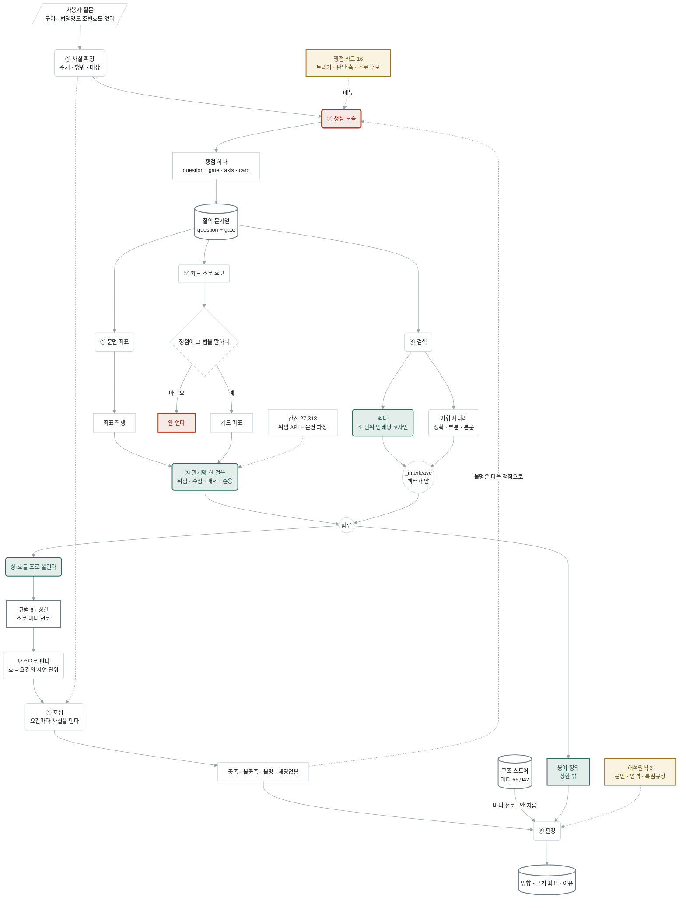
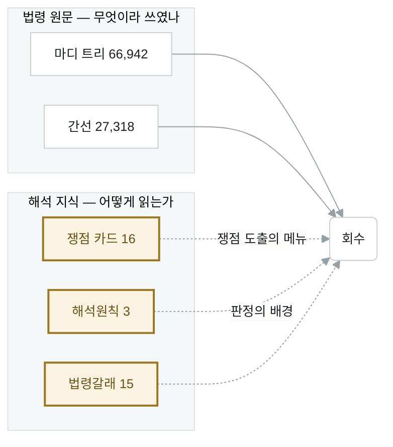
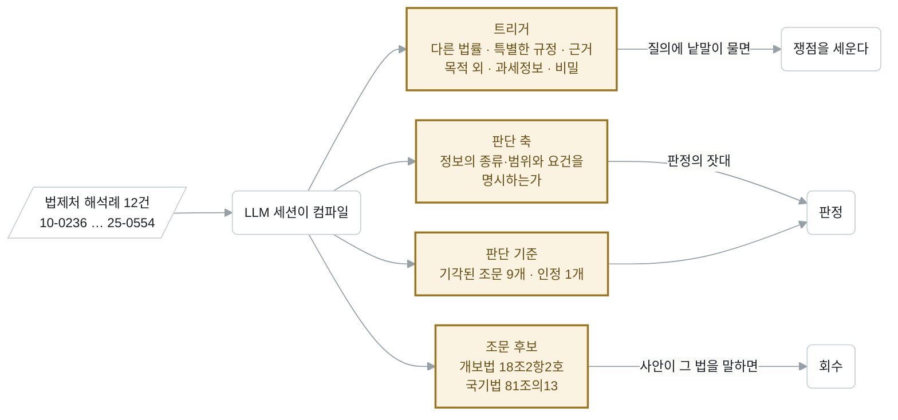
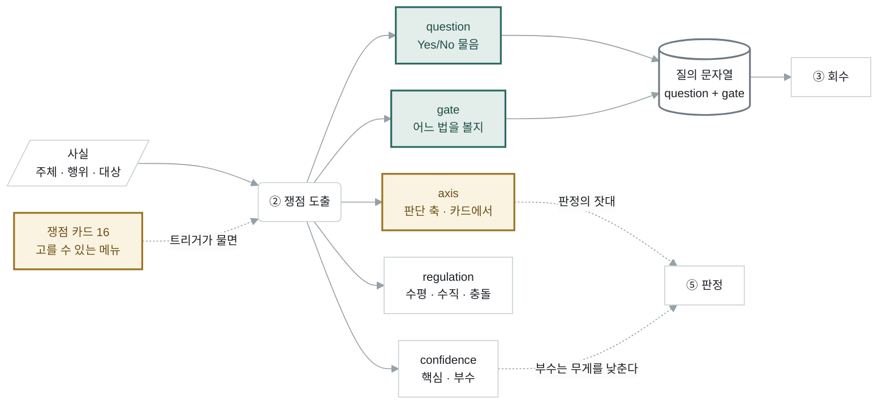
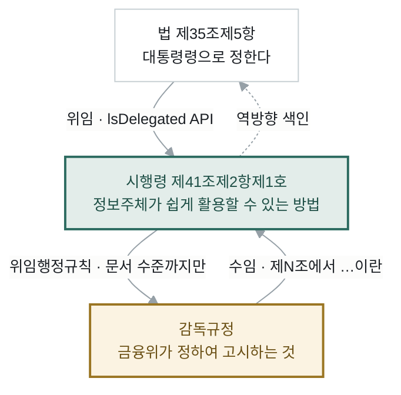
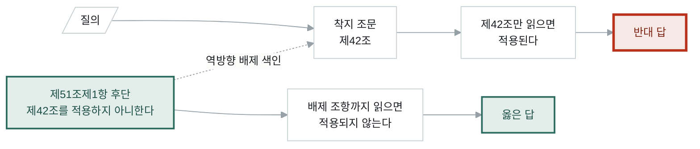
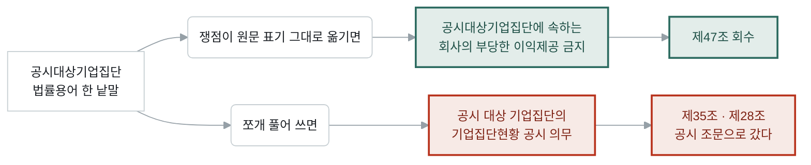
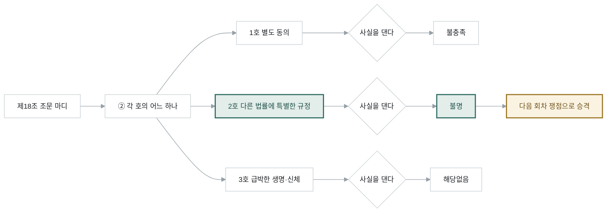
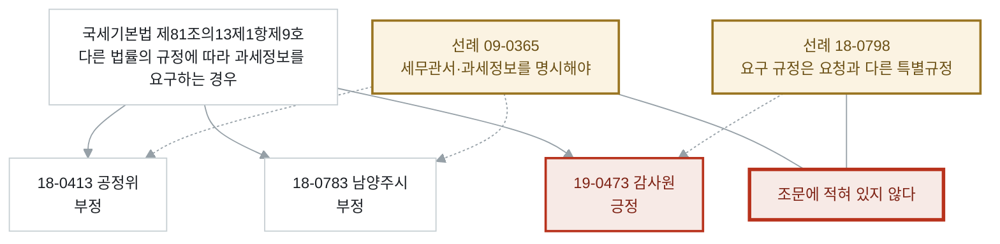

# RAG 핵심 — 법 도메인을 어떻게 반영했나

일반 RAG는 문서를 잘라 임베딩하고 유사한 조각을 가져온다. 법령은 그렇게 하면
답이 안 나온다. 이 문서는 **법 도메인의 사실 열둘**과 그것이 시스템의 어디에
어떻게 박혀 있는지를 하나씩 짚는다.

노션: `···` → **Import** → **Markdown & CSV**

---

## 0. 핵심 아키텍처 — 한 장



**금색**은 도메인 지식(쟁점 카드 · 해석원칙 · 관계망)이 회수·판정에 끼어드는
자리다. **초록**은 법 도메인 때문에 특별히 넣은 장치, **붉음**은 병목이거나
버리는 길이다.

| 통로 | 무엇 | LLM |
|---|---|---|
| ① 문면 좌표 | 질문에 「법령」제N조가 있으면 검색을 거치지 않는다 | 안 씀 |
| ② 카드 조문 후보 | 쟁점 카드가 든 좌표. 사안이 그 법을 말할 때만 | 안 씀 |
| ③ 관계망 한 걸음 | 위임·수임·배제·준용을 판단 없이 동반 | 안 씀 |
| ④ 검색 | 어휘 사다리 + 조 단위 벡터, 벡터를 앞에 | 안 씀 |

**③ 규범 조립 전체가 LLM을 안 쓴다.** 회수는 결정론이고, LLM은 사실·쟁점·포섭·
판정 네 곳에만 쓴다.

---

# 도메인 사실 열둘과 반영 지점

## 1. 법령 원문과 해석 지식은 다른 것이다

조문에 무엇이 쓰였는지와 그것을 어떻게 읽는지는 **다른 지식**이다. 전자는
변하지 않고 후자는 선례가 쌓이며 자란다. 섞으면 둘 다 못 쓴다.



| 층 | 담는 것 | 갱신 |
|---|---|---|
| 법령 원문 | 마디 트리 66,942 · 간선 27,318 | 법령이 개정될 때 |
| 해석 지식 | 쟁점 카드 16 · 해석원칙 3 · 법령갈래 15 | 세션이 해석례를 읽을 때 |

해석 지식은 다시 두 겹이다 — 법제처 해석례 **원문은 `raw/`에 불변**으로 두고,
LLM 세션이 그것을 읽어 아티클을 쓴다. 아티클이 틀리면 다시 컴파일하면 되고,
원문은 그대로 남아 있다.

## 2. 해석례는 사례가 아니라 정식(定式)으로 써야 한다

해석례 180건을 그냥 회수 대상에 넣으면 “비슷한 사례”가 나온다. 필요한 것은
사례가 아니라 **법제처가 반복해 쓰는 판정 정식**이다. 그래서 세션이 사례
여러 건을 읽고 하나의 카드로 접는다.



### 실물 — 쟁점 카드 「다른 법률 근거의 문턱」

이 카드는 해석례 **12건**(2010-08-23 ~ 2025-10-29)을 접어 만들었다.

```
트리거     다른 법률 · 특별한 규정 · 근거 · 목적 외 · 제3자 · 자료 요청 ·
           자료 제출 · 협조 · 과세정보 · 비밀 · 정보공개 · 넘겨

판단 축     그 법률이 정보의 종류·범위와 이용·제공 요건을 명시하는가
           — 여는 문은 좁게, 잠그는 문은 문언대로

조문 후보   「개인정보 보호법」 제18조제2항제2호
           「국세기본법」 제81조의13제1항제9호
           「공공기관의 정보공개에 관한 법률」 제9조제1항제1호
```

카드 본문에는 **기각된 조문이 연대순으로** 적혀 있다 — 이게 판정의 실제 잣대다.

```
「지방세기본법」 제134조의6 · 「질서위반행위규제법」 제23조     14-0438
「민사소송법」 제274조·제275조 (준비서면 기재사항)             17-0506
「국세기본법」 제84조 (국세행정 협조)                          18-0124
「고등교육법」 제12조                                          19-0018
「산업안전보건법」 제41조제2항                                  20-0461
「농수산물 유통 및 가격안정에 관한 법률」 제79조·제80조         20-0446
「민원 처리에 관한 법률」 제26조                                21-0889
토지보상법 제68조제2항 (감정평가)                              22-0993
도시정비법 제124조제4항 (조합원 열람·복사)                     25-0554
                                                    ↑ 12건 중 11건 기각

인정된 하나
「국회에서의 증언·감정 등에 관한 법률」 제4조제1항              10-0236
  "다른 법률의 규정에도 불구하고" 라고 명시 — 이게 진짜 특례의 모양
```

### 카드 네 조각이 각기 다른 단계에서 쓰인다

| 조각 | 쓰이는 곳 | 방식 |
|---|---|---|
| 트리거 | ② 쟁점 도출 | 사실 문장에 낱말이 물면 카드가 후보로 선다 (결정론) |
| 판단 축 | ⑤ 판정 | 판정의 잣대로 프롬프트에 실린다. **일반화된다** |
| 조문 후보 | ③ 회수 통로 ② | 사안이 그 법령을 말할 때만 좌표를 연다 |
| 판단 기준 | ⑤ 판정 | 기각·인정 선례가 배경으로 실린다 |

**조문 후보만 조건부인 이유** — 카드의 조문 후보는 그 카드를 컴파일할 때 본
**사례들의 좌표**다. 판단 축은 다른 사안에도 통하지만 조문 후보는 안 통한다.

```
실측 15-0720   정보공개법 질문에 「포섭의 경계」 카드가 개인정보법 제2조·
               공정거래법 제47조를, 「다른 법률 근거의 문턱」이 개인정보법
               제18조·국세기본법을 끌어와 규범 12개 중 7개가 잡음이었다
```

---

## 3. 쟁점 분석 — 이 시스템의 경첩

법률 검토는 “무엇을 묻는가”를 먼저 세운다. 사용자 질문은 구어이고 법령명도
조번호도 없으므로 **쟁점이 곧 질의**가 된다. 여기가 틀리면 뒤가 다 옳아도
답이 안 나온다.

### 3-1. 쟁점 하나는 다섯 조각이다



| 조각 | 하는 일 | 예 |
|---|---|---|
| `question` | Yes/No로 답할 수 있게 압축한 물음. **이게 검색 질의의 본체** | “이 서비스가 자본시장법상 ‘증권’에 해당하는가?” |
| `gate` | **어느 법을 볼지** 정하는 관문 질문 | “수익을 기대하게 하고 자금을 모으는가” |
| `axis` | 판단 축. 카드에서 오며 일반화된다 | “정보의 종류·범위와 요건을 명시하는가” |
| `regulation` | 규제 구조 — 수평 · 수직 · 충돌 | |
| `confidence` | 핵심(질문이 직접 묻는 것) · 부수(딸려 오는 것) | |

질의 문자열은 앞의 둘로 만든다 — `q = question + " " + gate`.

| `regulation` | 뜻 |
|---|---|
| 수평 | 같은 위계의 법들이 나란히 걸린다 (개인정보법 ↔ 정보공개법) |
| 수직 | 법 → 시행령 → 감독규정으로 내려간다 |
| 충돌 | 두 규범이 서로 어긋난다 |

### 3-2. 쟁점 도출에 넣은 도메인 규율 여섯

프롬프트에 실린 실제 규율이다. 하나하나가 실측에서 나왔다.

**① 카드에 없어도 새로 세운다** — 카드 16장은 메뉴일 뿐이고, 사안의 핵심이
메뉴에 없으면 `card`를 비우고 세운다.

**② Yes/No로 압축한다** — 열린 질문은 조문에 닿지 않는다.

**③ `gate`에 그 법이 걸리는 이유를 적는다** — 어느 법을 열지가 여기서 정해진다.

**④ 여러 축을 함께 본다** — 사안 하나에 최대 4개. 법률 검토는 하나만 보지 않는다.

**⑤ 빈손은 법적 검토 대상이 아닐 때만이다.**

```
사실에 이런 행위가 하나라도 있으면 반드시 쟁점을 세운다
  정보의 수집·제공·위탁
  업(業)으로 하는 행위
  인가·등록·신고가 필요할 수 있는 행위
  고객 자산·데이터의 취급

"확신이 없어도 세우는 쪽이 맞다 — 세운 쟁점은 뒤에서 요건별로 검증되지만,
 안 세운 쟁점은 영영 검토되지 않는다."
```

**⑤-2 법률용어를 원문 표기 그대로 옮긴다** — 이 규율은 실패에서 나왔다(→ 7절).

**⑥ `why`와 `confidence`를 적는다** — 왜 이 쟁점이 걸리는지, 그리고 핵심인지
부수인지. **부수 쟁점은 뒤에서 판정의 무게를 낮춘다.**

### 3-3. 결정론 안전망 — 트리거 매칭

쟁점 도출은 검토의 경첩이라 빈손이면 뒤의 네 단계가 없어진다. 그래서 LLM이
빈손이면 **카드 트리거로 받는다.**

```
사실 문장을 한 줄로 이어      "…교육장 공문서 … 공무원 성명 … 공개 청구 …"
카드마다 트리거 낱말을 비춘다   물은 낱말 수 = 점수
점수순으로 세운다
```

**다만 약한 매칭으로는 세우지 않는다.** 최소 트리거 **2개**가 물어야 한다.

```
실측 25-0653   '열람 경로' 사안에 트리거 하나("제공")가 물어 「동의와 정보이용」
               카드가 섰고, 남의 쟁점의 요건 18개가 전부 불명이 되어
               그럴듯한 유보를 만들었다

  → 틀린 쟁점은 빈손보다 나쁘다.
    빈손은 '쟁점 실패' 로 눈에 띄지만 틀린 쟁점은 원인을 숨긴다.
```

### 3-4. 두 시점에 쟁점을 본다

| 시점 | 무엇을 보고 | 왜 |
|---|---|---|
| 회수 **전** (트리거) | 사실 문장만 | 질의를 만들어야 회수가 시작된다 |
| 회수 **후** (LLM 판정) | 질문 + 회수된 조문 | 조문이 드러낸 준용·부칙 구조는 질문만 보고는 모른다 |

회수 후 판정은 스위치로 끌 수 있다(기본 꺼짐) — 판정 콜 지연이 답변 앞에
얹히므로 켜는 것은 사용자다.

---

## 4. 법령은 계층 문서다 — 조가 최소 단위가 아니다

일반 RAG는 문서를 고정 길이로 자른다. 법령은 **편·장·절·조·항·호·목**이
이미 계층이고, 그 계층이 곧 규범의 구조다. 자르면 뜻이 깨진다.

| 반영 | 어디 |
|---|---|
| 계층을 그대로 트리로 | 마디마다 `node_id` · `span` · `path` |
| 정답 좌표는 항·호·목까지 | 제18조제2항**제2호**와 **제3호**는 다른 사건의 답이다 |
| 임베딩은 **조 단위**로 | 호를 따로 임베딩하면 “①항 개인정보처리자는…” 머리글이 떨어져 뜻을 잃는다 |
| 검색이 호에 착지하면 **조로 올린다** | 판정이 읽으려면 항 머리글이 필요하다 |
| 판정 입력은 **자르지 않는다** | 조 아래 항·호·목 전부를 넣는다 |

**부칙도 같은 트리에 들어온다.** 정보공개법에 `제2조`는 넷이고(본칙 정의 ·
부칙 경과조치 · 부칙 적용례 · 부칙 개정경과조치), **부칙이 정답인 사건도 있다** —
13-0365는 정답 넷 중 셋이 부칙이다.

**삭제된 조문은 걸러낸다.** 개정으로 비워진 마디(`삭제 <2020.2.4>`)가 회수되면
규범 6칸을 잡아먹는다.

---

## 5. 하나의 규범이 여러 문서에 흩어져 있다 — 수직 체인

법에 원칙이 있고, 시행령에 구체가 있고, 감독규정에 세부가 있다. **법 조문만
읽으면 답이 없다.**



| 관계 | 어떻게 얻었나 | 방향 |
|---|---|---|
| 위임 (법 → 시행령) | law.go.kr `lsDelegated` API — **문면에 목적지 좌표가 없다** | 순 · 역 |
| 위임행정규칙 (→ 감독규정) | 같은 API — 그런데 **문서 수준까지만** 나온다 | 순 |
| 수임 (감독규정 → 법) | 본문 파싱 — `제N조에서 "…"이란` | 역 |

**수임이 특별한 이유.** 위임 API는 “이 조는 감독규정이 정한다”까지만 알려주고
감독규정의 몇 조인지는 안 알려준다. 그런데 감독규정 쪽 본문에는
`제2조에서 "금융위원회가 정하여 고시하는 것"이란 …`이라고 **되가리키는 좌표가
있다.** 이 문장을 쓴 조문이 곧 그 위임의 구체 내용이다 — 수직 체인을
**아래에서 위로** 복원하는 유일한 길이다.

```
실패 실물 (배선 전)  사건 26-0271
  회수됨   개인정보 보호법 제35조 (열람 요구)                ○
  안 옴    개인정보 보호법 시행령 제41조제2항제1호            ✗  ← 답이 여기 있다
  배선 후  회수 4/4 · 근거 4/4 · 방향 정답
```

---

## 6. 배제 조항을 놓치면 반대 답이 나간다

법령에는 “제N조를 적용하지 아니한다”는 조항이 있다. 착지 조문만 읽으면
**정반대 결론**이 나온다. 회수 누락 중 이것만이 유일하게 **틀린 답을 만든다.**



```
자본시장법 제51조제1항 후단
  "이 경우 제42조를 적용하지 아니한다"

그런데 제42조에는 '투자권유대행' 이 한 글자도 없다
  → 제42조에서 제51조로 갈 단서가 없다
  → 역방향 색인이 없으면 영영 못 만난다
```

**그래서 배제는 역방향 색인을 만들었고, 상한과 무관하게 전부 데려온다.**

| 관계 | 역방향 | 동반 상한 |
|---|---|---|
| 배제 | 있음 | **전부** |
| 수임 | 있음 | 조문당 3 |
| 위임 | 있음 | 상한 안 |
| 준용 | **없음** | 순방향만 |

**준용 역방향이 없는 것이 남은 구멍이다.**

```
자본시장법 제160조제1항 후단
  "…제159조제2항…을 준용한다"          ← 160 → 159 로 갈 단서가 있다
자본시장법 제159조
  '반기·분기보고서' 라는 말이 없다      ← 159 → 160 으로 올 단서가 전혀 없다
```

---

## 7. 법률용어는 한 낱말이다 — 쪼개면 다른 법을 만난다

`공시대상기업집단`은 공정거래법이 정의한 **하나의 용어**다. “공시 대상 기업집단”
으로 풀어 쓰면 ‘공시’가 살아나 공시 의무 조문으로 간다.



같은 회수기에 질의만 바꿔 사건 24-0239를 세 번 넣은 결과다.

| 넣은 질의 | 결과 | 데려온 조 |
|---|---|---|
| “공시대상기업집단에 속하는 회사의 부당한 이익제공 금지” | **성공** | **제47조**(특수관계인 부당이익제공 금지) · 제54조 · 제17조 |
| “공시 대상 기업집단의 이익제공” | 실패 | 시행령 제38조(공시대상기업집단 지정) · 제4조 |
| “공시대상기업집단 기업집단현황 공시 의무” | 실패 | 제35조(현황 공개) · 제28조(기업집단현황 공시) |

**반영한 곳은 쟁점 프롬프트다** — 질의 후처리가 아니다.

```
⑤-2  question 과 gate 에는 사실에 나온 법률용어를 원문 표기 그대로 옮겨라
      — 쪼개거나 풀어 쓰지 마라. 이 문장이 그대로 조문 검색 질의가 되므로
      용어가 쪼개지면 엉뚱한 조문이 온다.
      그리고 사안이 묻는 행위(이익제공·위탁·겸직·열람 요구 등)를 반드시
      question 에 넣어라 — 배경 서술(지정·해당·설립 등)만 남으면
      그 배경의 조문이 회수된다.
```

**질의 후처리로 고치려다 실패했다.** 쟁점이 쪼갠 용어의 원문 표기를 질의에
덧붙여 봤더니, 그 용어가 든 ‘공시’ 계열 조문이 상위로 올라와 정답을 **더**
밀어냈다. 온전한 질의에서도 정답이 1순위에서 밀렸다.

> 무엇이 배경이고 무엇이 판별인지는 **질의 밖에서 알 수 없다.**
> 그래서 쟁점이 처음부터 옳게 써야 한다.

---

## 8. 법 조문은 요건-효과 구조다

조문은 “이러이러하면(요건) 이렇게 된다(효과)”로 되어 있다. 판단은 요건마다
사실을 대는 일이다. 문서 유사도로는 못 한다.



**요건의 단위는 마디다.** 텍스트를 다시 자르지 않는다 — `호`가 한국 법령에서
요건의 **자연 단위**이고 이미 마디로 파싱돼 있다. 그래서 요건 id가 좌표에서
나오고, 실행마다 같으며, 되먹임이 조문을 직접 가리킨다.

| 판정 | 뜻 |
|---|---|
| 충족 | 사실이 요건에 맞는다 |
| 불충족 | 사실이 요건에 어긋난다 |
| **불명** | 사실이 요건에 딱 맞지 않는다 |
| 해당없음 | 이 사안에 그 요건이 걸리지 않는다 |

포섭 프롬프트의 규율:

```
② 사실이 요건에 딱 맞지 않으면 불명으로 두어라 — 애매한 것을 충족으로 미는 것이
   가장 큰 잘못이다. 불명은 실패가 아니라 이 사안의 진짜 쟁점을 가리키는 발견이다.
③ 판정마다 근거가 된 사실 id 와 이유를 적는다. 근거 사실이 없으면 판정은 대개 불명이다.
④ 조문에 없는 요건을 지어내지 마라 — 준 요건 목록 안에서만 판정한다.
```

**불명이 다음 회차의 쟁점으로 승격된다.** 요건 대조가 “여기서 막혔다”고 말하면
그게 곧 새 쟁점이다.

---

## 9. 용어 정의는 판단 대상이 아니라 낱말의 뜻이다

법령 제2조는 대개 정의 조항이다. 이걸 규범 후보로 다루면 상한을 잡아먹는데,
없으면 판정이 용어를 모른다. **그래서 상한 밖 별도 칸에 싣는다.**

```
앞자리에 넣으면   원래 들어오던 정답이 6칸 밖으로 밀려남      회수 77% → 73%
뒷자리에 넣으면   이미 쟁점당 6.0개로 꽉 차 하나도 안 들어감   효과 0
별도 칸으로 빼면  사건 24-0239 가 0/3 → 3/3
```

용어는 두 곳에서 긁는다 — 정의 조항의 각 호, 그리고 본문 속
`(이하 "X"라 한다)` 같은 인라인 정의. 현재 **1,154개**.

---

## 10. 판정에는 문언 전문이 필요하다

법률 판단은 문언해석에서 시작한다. 요약하면 안 된다.

| 무엇 | 어떻게 |
|---|---|
| 조문 마디 | 스토어의 **전문** — 조 아래 항·호·목 전부. 자르지 않는다 |
| 요건표 | 포섭 결과 + 근거 사실 id |
| 용어 정의 | 상한 밖 칸에서 |
| 해석원칙 | 위키 아티클 3 — 다른 법률의 특별한 규정 · 위임과 법령보충 · 준용과 경과조치 |
| 카드 판단 축·선례 | 이 쟁점의 잣대 |

**포섭용 조각을 판정에 쓰면 안 된다** — 포섭에는 요건을 260/400자로 줄여
넣는다. 답이 제9조제1항제6호 라목인데 그 조각에는 라목이 안 들어간다.

**판정만 강한 모델을 쓴다.** 같은 입력 5회에 하이쿠는 긍정2·조건부3으로
흔들렸고 소넷5는 5/5 일치했다.

---

## 11. 해석원칙은 조문 밖에 있다

“다른 법률에 특별한 규정”이 무엇인지는 어느 조문에도 안 적혀 있다. 법제처가
해석례로 만든 정식이다. 그것을 아티클로 컴파일해 판정에 싣는다.

```
해석원칙 「다른 법률의 특별한 규정」 — 판정 정식

  "특별한 규정" 이려면 개별 법률이 개인정보의 종류·범위와,
  목적 외로 이용·제공할 수 있는 요건을 명시해야 한다      [21-0889]

  자료 제출·협조를 일반적으로 요구하는 조문은 개인정보를 특정하지 않으므로
  문턱을 넘지 못한다                                    → 12건 중 11건 기각

  Sources: 법제처 법령해석례 13건 · 법제처 법령 입안·심사 기준(2026년판)
           제2편 제1장 §8 다른 법령과의 관계
```

수치와 인용은 쓰기 전에 **원문에서 확인하고 원문 표기 그대로** 쓴다 —
“20%”가 아니라 “100분의 20”. 검증 스크립트가 이 grounding을 검사한다.

---

## 12. 아직 반영하지 못한 것 — 선례가 답을 가른다

마킹한 38건 중 **58%**가 답이 조문 밖에 있다. 같은 조문에서 반대 결론이 난다.



```
국세기본법 제81조의13제1항제9호
  "다른 법률의 규정에 따라 과세정보를 요구하는 경우"

  18-0413 (공정위)     부정  ┐
  18-0783 (남양주시)   부정  ┘ 선례 09-0365 — 세무관서·과세정보를 명시해야 한다
  19-0473 (감사원)     긍정    선례 18-0798 — '요구' 는 일반 '요청' 과 다른 특별규정

갈림은 조문 문언이 아니라 법제처 선례가 만든 기준에 있다.
그 기준은 어느 조문에도 적혀 있지 않다.
```

법제처 유권해석 **180건이 이미 불변층에 있는데 회수 대상이 아니다.** 지금은
조문만 주고 이 판단을 요구하고 있다 — 다음 우선순위다.

---

# 한눈에 — 도메인 사실 → 반영 지점

| 도메인 사실 | 반영 |
|---|---|
| 원문과 해석 지식은 다른 지식 | 두 층 · raw 불변 + LLM 컴파일 |
| 해석례는 정식으로 접어야 쓸모 있다 | 쟁점 카드 16 (트리거·판단 축·조문 후보·선례) |
| 검토는 쟁점을 먼저 세운다 | Issue 다섯 조각 · 쟁점이 곧 질의 |
| 틀린 쟁점은 빈손보다 나쁘다 | 트리거 최소 2개 · 약한 매칭은 안 세움 |
| 검토는 여러 축을 함께 본다 | 쟁점 최대 4 · 핵심/부수 구분 |
| 법령은 계층 문서다 | 마디 트리 · 임베딩은 조 단위 · 항·호는 조로 승격 |
| 부칙이 정답일 수 있다 | 부칙도 트리에 · `path`로 구별 |
| 하나의 규범이 여러 문서에 흩어진다 | 위임 API + 수임 파싱 · 필수 동반 |
| 배제를 놓치면 반대 답 | 역방향 색인 · 상한 무관 전부 동반 |
| 법률용어는 한 낱말 | 쟁점 프롬프트 ⑤-2 (질의 후처리 아님) |
| 조문은 요건-효과 구조 | 포섭 단계 · 요건 단위 = 마디 · 불명 되먹임 |
| 정의는 판단 대상이 아니다 | 상한 밖 별도 칸 |
| 판단은 문언에서 시작한다 | 판정 입력 무절단 · 해석원칙 아티클 |
| **선례가 조문 밖에서 답을 가른다** | **미반영 — 해석례 180건이 회수 대상 밖** |

---

**함께 읽을 것** — [ARCH_SYSTEM.md](ARCH_SYSTEM.md) 수집·질의 두 단계 ·
[NOTION_ARCHITECTURE.md](NOTION_ARCHITECTURE.md) 벤치마크와 실측 ·
[LEGAL_DOMAIN.md](LEGAL_DOMAIN.md) 도메인 지식 정리
