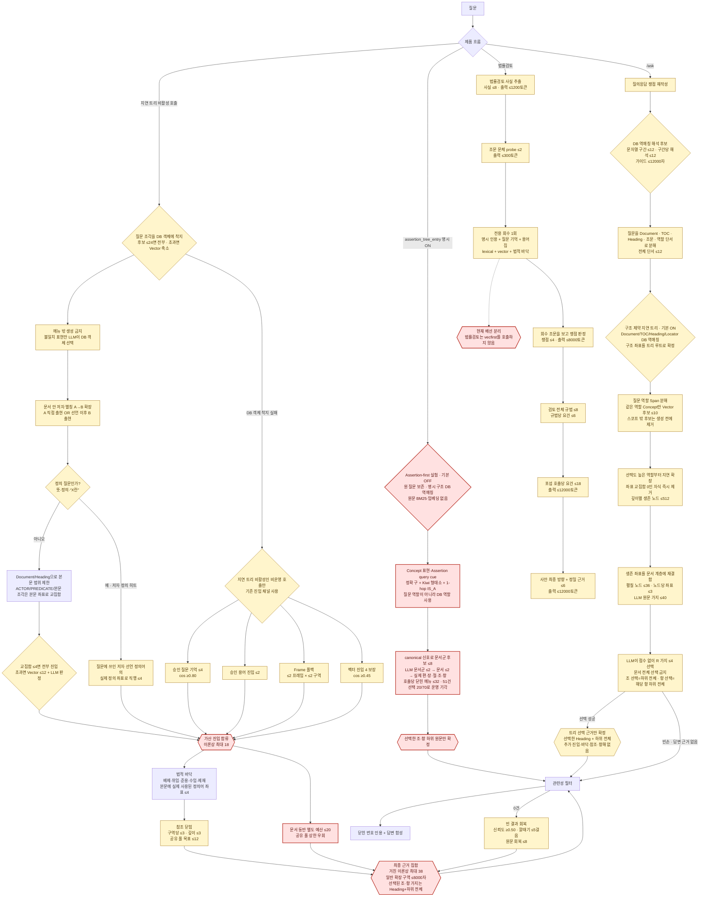

# 실마리 RAG 전체 흐름과 성능 손잡이

<!-- rag-controls-fingerprint: daccf47b9ce76445 -->

이 그림은 기능 순서만 보여 주는 소개도가 아니다. 데이터가 잘리는 곳, 후보 수가
늘어나는 곳, 점수 문턱과 별도 예산을 함께 표시하는 성능 계약이다. 기준값은
`lawrag/core/rag/controls.py`의 기본값이며 위 지문이 바뀌면 이 문서도 다시 검토해야
한다.

RAG 동작을 바꾼 이유·대안·실험 결과는 [ADR 목록](adr/README.md)에 기록한다.

68/70을 달성해 운영 기본으로 배선한 LegalClosure의 상세 구조와 운영 전환
경계는 [LegalClosure 메인 검색 구조](LEGALCLOSURE_MAIN_ARCHITECTURE.md)에 별도로
고정한다. 이 문서의 아래 그림은 아직 실제 `/ask` 배선이며, 목표 구조와 현재 구조를
혼동하지 않는다.



붉은 노드는 현재의 구조 경고다. `context.shared_sections_max=12`는 일반 조립,
법적 바닥, 참조 닫힘이 함께 쓰는 목표 상한이다. Concept·기억·용어·Frame 채널은
벡터 4자리를 빼앗지 않도록 가산되고, `expand.doc_companion_max=20`은 별도 예산이라
12는 최종 절대 상한이 아니다. 이를 곧바로 12로 강제하면 문서 동반의 회수 이득을
잃을 수 있으므로 통합 골든 A/B 전에는 동작을 바꾸지 않는다.

DB 역매칭은 기존 `query_cues`를 만능 인덱스로 키우지 않는다. 질의마다 실제로
맞은 Document·Section·Concept·저자 정의·본문 조각만 별도 `QueryGuide`에 모은다.
같은 질문 문자열의 여러 객체 해석은 OR이고, 선택된 서로 다른 문자열은 기존 본문
좌표 AND에 들어간다. 문서·조문이 먼저 잡히면 그 범위의 출현 수가 0인 Concept와
본문 조각은 후보표에서 제외한다. 단, 같은 문자열 자체가 Document이면서 Concept인
경우는 문서냐 의미 객체냐를 고를 수 있도록 전역 OR 해석을 보존한다. 가이드에 없는
질문 Span도 기존 자유 분해 경로로 계속 들어가므로 두 분해의 합집합이다.

운영 `/ask`에서는 Query Guide의 구조 역매칭과 역할 Span 분해가 지연 트리의 필수
입력이다. 트리가 빈손이어도 Concept 단일해석·BM25·전역 Vector로 우회하지 않는다.
따라서 평가 결과는 이 트리 하나의 회수 성능을 그대로 나타낸다.

임베딩 없는 Assertion-first 경로는 `assertion_tree_entry`를 명시적으로 켰을 때만
기본 지연 트리 대신 실행되는 실험 경로다. canonical 표현 역색인 단계에서는 정답
조문 60/70을 포함했지만 후보 좌표 중앙값이 1,633개였다. 법률과 그 시행령·시행규칙을
문서군으로 묶고 독립 canonical 신호 커버리지 상위 8개 문서군만 열자 정답 60/70을
유지하면서 문서 중앙값은 95개에서 15개, 좌표 중앙값은 911개로 줄었다. 그러나 소형
LLM의 최종 선택은 14/70에서 20/70으로만 개선되어 기본값은 계속 OFF다. 최초 기각은
[ADR-0002](adr/0002-assertion-first-structural-navigation.md), 문서군 후속 실험은
[ADR-0003](adr/0003-document-family-routing.md)에 있다. 두 트리는 같은 요청에서
결과를 섞지 않는다.

지연 트리의 좌표는 정답 Bundle이 아니라 탐색 범위다. 같은 조의 제1항과 제2항이
회수되면 하나의 조 좌표로 합치지 않고 다음처럼 원래 계층에 꽂는다.

```text
문서제목                         # 경로 루트, 선택 불가
└─ 제433조 정관변경의 방법       # 이 조 자체가 회수됐을 때만 선택 가능
   ├─ 제1항                      # 회수됐으면 독립 선택 가능
   └─ 제2항                      # 회수됐으면 독립 선택 가능
```

트리 생성 단계에서는 연결 조문을 새 후보로 보충하지 않는다. 선택된 원문 가지가
답변 경로에 들어간 뒤에도 법적 바닥·참조 닫힘·LLM 항해를 실행하지 않는다. 따라서
답변 모델이 받는 법률 데이터는 LLM 선택기가 고른 R 가지의 Heading과 하위 원문뿐이다.
트리가 빈손이면 기존 Frame·BM25·전역 Vector로 우회하지 않고 빈 근거로 끝낸다.

선택기는 숫자 점수를 보지 않고 이 트리와 실제 DB 간선만 본다. 각 R에는
`ACTOR → 금융투자업자`, `PREDICATE → 배상하다` 같은 구조화 매칭과 실제 일치점
주변 원문을 최대 180자 표시한다. 구조화 일치 구간이 없을 때만 직접 소유 본문
첫머리를 최대 360자 보여 준다. 제433조를
선택하면 조 Heading과 모든 하위 항·호·목·본문을, 제1항을 선택하면 제1항의 Heading과
그 하위만 확정한다. 부모와 자식을 동시에 고르면 부모가 이미 자식을 포함하므로 코드는
자식 선택을 중복으로 제거한다. 선택 후 확정된 조·항 가지에는
`context.section_chars`를 다시 적용하지 않는다.

배선 분리 노드는 더 중요한 검증 경고다. `/ask`의 운영 질의는 지연 트리만 타고,
지연 트리가 비활성인 비운영 호출만 `vecfirst`의 Concept·질문 기억·승인 용어·Frame·
벡터·문서 동반을 탄다. 법률검토는 명시 인용·질문 기억·용어집
`termretrieve`·lexical·vector·법적 바닥으로 별도 회수한다. 따라서 법률검토 E2E만
통과해도 공용 검색 채널을 검증한 것이 아니고, 그 러너에서 Concept·승인 용어·문서
동반 스위치를 꺼도 실제 회수 배선은 바뀌지 않는다.

전체 검증은 `scripts/rag_e2e_portfolio.py`가 두 흐름의 실제 E2E manifest를 합쳐
판정한다. 현재 단계 관측은 `/ask` 4/4, 법률검토 5/5지만, `/ask` 채널은 질문 기억
승인 데이터 0행 때문에 전체 두 판을 합쳐도 6/7만 관측된다.

## 다이어그램 필수 성능 손잡이

| 단계 | 등록 키 | 기준값 | 값이 작아질 때의 주된 위험 |
|---|---|---:|---|
| DB 역매칭 | `query_guide.mentions_max` | 12 | 긴 질문 뒤쪽의 DB 해석 후보 누락 |
| DB 역매칭 | `query_guide.readings_per_mention_max` | 12 | 같은 문자열의 후순위 문서·Concept 해석 누락 |
| DB 역매칭 | `query_guide.prompt_chars_max` | 12000자 | 뒤쪽 해석 카드가 Span 분해기에 보이지 않음 |
| 지연 트리 | `combination.lexicon_neighbors_max` | 40 | 같은 역할 Concept로 되돌릴 의미 후보 누락 |
| 지연 트리 | `combination.candidates_per_part_max` | 10 | 같은 Span의 후순위 역할·Concept 가지 누락 |
| 지연 트리 | `combination.surviving_states_max` | 512 | 0이 아닌 후순위 노드가 깊이 중간에 잘림 |
| 지연 트리 | `combination.states_to_expand_max` | 36 | 원문으로 펼치기 전 정답 노드 누락 |
| 지연 트리 | `combination.coordinates_per_state_max` | 3 | 넓은 노드 안의 정답 항·호 누락 |
| 지연 트리 | `combination.llm_options_max` | 40 | 최종 LLM 트리 밖 정답 원문 누락 |
| Assertion 트리 실험 | `assertion_tree.page_size` | 32 | 작으면 LLM 왕복 증가, 크면 소형 모델의 메뉴 판별 난도 증가 |
| Assertion 트리 실험 | `assertion_tree.family_candidates_max` | 8 | 결정론적 라우팅에서 후순위 문서군과 그 조문 누락 |
| Assertion 트리 실험 | `assertion_tree.families_max` | 2 | 소형 LLM이 세 번째 이후 정답 문서군을 열지 못함 |
| Assertion 트리 실험 | `assertion_tree.documents_max` | 2 | 세 번째 이후 정답 문서 누락 |
| 계층 탐색 | `exploration.body_preview_chars_max` | 360자 | 구조화 일치가 없는 조·항의 본문 단서 누락 |
| 계층 탐색 | `exploration.match_context_chars_max` | 180자 | ACTOR·PREDICATE 일치점 주변 조건 누락 |
| 계층 탐색 | `exploration.connected_ranges_max` | 12 | 초기 착지와 연결된 특별·보완 조문 누락 |
| 조합 진입 | `entry.combination_sections_max` | 4 | LLM이 선택할 수 있는 복수 조·항 가지 누락 |
| DB 값 착지 | `landing.closed_menu_max` | 24 | 줄임말·미등록 표현의 정답 객체가 메뉴 밖으로 잘림 |
| 좌표 교집합 | `landing.direct_sections_max` | 4 | Vector 없이 바로 쓰는 원문 후보 감소 |
| 좌표 교집합 | `landing.vector_shortlist_max` | 12 | LLM 판정 전에 정답 본문이 잘림 |
| 단서 분해 | `concept.query_spans_max` | 12 | 긴 복합 질문의 조건·대상 누락 |
| 개념 후보 | `concept.parts_per_span_max` | 8 | 정답 개념이 닫힌 메뉴 밖으로 잘림 |
| 개념 후보 | `concept.raw_pool_factor` | 5 | 의미 후보 회수 감소; 커지면 비교 비용 증가 |
| 개념 후보 | `concept.semantic_cos_min` | 0.45 | 높이면 바꿔쓰기 누락, 낮추면 잡음 증가 |
| 뜻 검문 | `concept.predicate_surface_min` | 0.50 | 높이면 LLM 생략 증가, 뜻 오염 가능 |
| 개념 조립 | `concept.prompt_context_chars` | 160자 | 실제 사실 문맥 부족 |
| Concept 진입 | `entry.concept_sections_max` | 4 | 승인 사실 근거 일부 누락 |
| 질문 기억 | `entry.memory_sections_max` | 4 | 승인 직행 근거 누락 |
| 질문 기억 | `entry.memory_cos_min` | 0.80 | 높이면 회수 감소, 낮추면 다른 사안 오염 |
| 승인 용어 | `entry.keyword_sections_max` | 2 | 다의 용어의 다른 정의·용례 누락 |
| Frame | `entry.frame_sections_per_query_max` | 2 | Concept가 빈손인 표현의 폴백 회수 감소 |
| 벡터 | `entry.vector_sections_max` | 4 | 미발행 영역·패러프레이즈 회수 감소 |
| 벡터 | `entry.vector_cos_min` | 0.45 | 높이면 누락, 낮추면 주제 유사 오염 |
| 공유 풀 | `context.shared_sections_max` | 12 | 확장 근거 누락; 현재 최종 절대 상한 아님 |
| 본문 | `context.section_chars` | 6000자 | 일반 채널 조문 후반 요건·예외 누락; 계층 탐색 선택 가지에는 미적용 |
| 참조 | `context.refs_per_section_max` | 3 | 네 번째 이후 필수 참조 누락 |
| 문서 동반 | `expand.doc_companion_max` | 20 | 실무문서가 가리키는 법령 지도 일부 누락 |
| 참조 | `expand.ref_depth_max` | 3걸음 | 긴 위임·준용 사슬 누락 |
| 정의 동반 | `companion.definitions_per_term_max` | 4 | 본문에 쓰인 다섯 번째 이후 정의어 좌표가 잘림 |
| 회복 | `recover.confidence_min` | 0.50 | 높이면 회복 실패, 낮추면 드리프트 |
| 회복 | `recover.funnel_steps_max` | 5걸음 | 깊은 문서 구조 탐색 실패 |
| 회복 | `recover.fulltext_sections_max` | 8 | 원문 폴백 결과 누락 |
| 법률검토 | `review.issues_max` | 4 | 다중 법률 쟁점 누락; 커지면 부수 쟁점 증가 |
| 법률검토 | `review.norms_total_max` | 8 | 결정적 규범 누락; 커지면 판정 잡음 증가 |
| 법률검토 | `review.requirements_per_norm_max` | 6 | 후순위 요건 누락 |
| 법률검토 | `review.sub_requirements_max` | 18 | 포섭 입력 누락; 커지면 구조화 출력 잘림 |

## 그림을 고칠 때의 계약

앞으로 RAG 흐름도를 추가하거나 수정할 때는 다음을 지킨다.

1. 후보 수, 슬라이스, top-k, fan-out, 깊이, 문자 길이, 토큰 한도, 점수 문턱을
   해당 노드에 적는다. 단순히 “검색”이나 “확장”이라고만 쓰지 않는다.
2. 공유 예산과 별도 예산을 다른 선과 색으로 표시한다. 여러 채널의 가산값을
   하나의 “전체 상한”이라고 부르지 않는다.
3. 기본 설정 지문과 등록 키 표를 싣는다. `controls.validate_diagram()`이 핵심 키와
   지문 누락을 검사한다.
4. 실행 결과에는 설정값뿐 아니라 실제 `entry/final context 수`, 본문 글자,
   LLM 호출·토큰·TTFT·총 지연의 p50/p95를 남긴다.
5. 상한을 바꾸거나 제거한 A/B는 같은 suite SHA, 같은 case 순서, 한 변수 차이로
   실행한다. 확률적 LLM 판은 trial 번호를 달리해 반복하고 평균과 최악값을 함께 본다.

등록부 감사는 다음 명령으로 재현한다.

```bash
.venv/bin/python scripts/rag_controls.py audit
.venv/bin/python scripts/rag_controls.py snapshot --json
```
