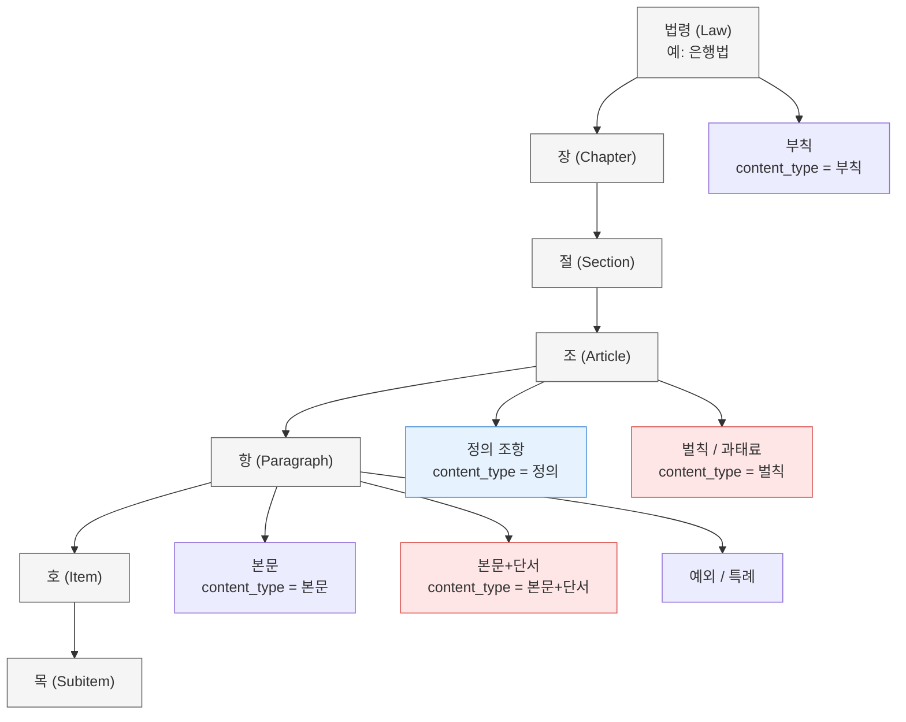
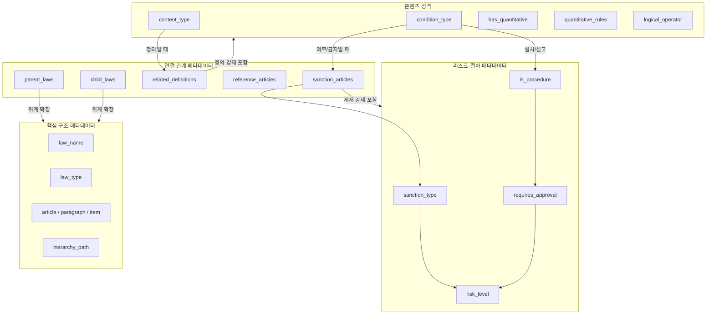
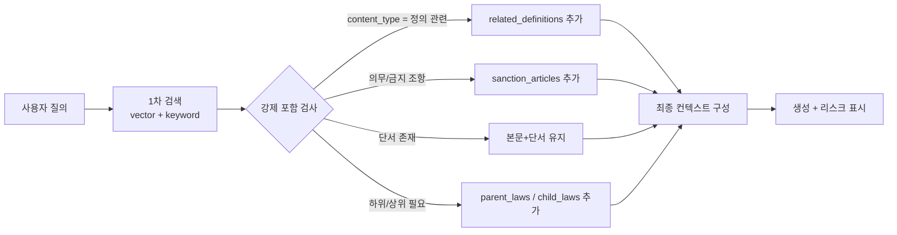

# 성격 태그층 — 외부 설계 검토와 구현 기록

앞부분(「데이터 구조」~「6. 리스크·분석용 메타데이터」)은 2026-08-18 에 받은 **외부 설계 검토
원문**을 그대로 옮긴 것이고, 뒷부분 「구현 기록」이 그것을 코드(`lawrag/core/rag/tags.py`)로 옮기며
받아들인 것·바꾼 것·미룬 것과 실측이다. 검토 원문은 고치지 않는다.

---

# 데이터 구조

## 1. 법령 문서 내부 구조 (큰 그림)

- 가장 큰 단위는 **법령**
- 그 아래 **장 → 절 → 조 → 항 → 호 → 목** 순으로 계층
- 각 계층(특히 조·항)에 content_type이 붙음
- **정의**는 주로 조 단위, **단서/예외**는 항 단위, **벌칙**은 조 단위, **부칙**는 법령 맨 끝에 위치



## 2. 메타데이터 연결 및 검색 확장 관계도



# 3. 검색 시 실제 데이터 흐름

 



## 1. 구조·식별 메타데이터 (기본)

| 필드 | 설명 | 예시 | 목적 | engine | glossary | 추출 방법 | Human | feedback |
| --- | --- | --- | --- | --- | --- | --- | --- | --- |
| `law_name` | 법령명 | 은행법, 자본시장법, 은행법 시행령 | 법령명 검색시 | keyword | yes | 초기 사용자 입력 | yes | no |
| `law_type` | 법령 종류 | 법률 / 대통령령 / 총리령 / 부령 / 고시 / 규정 | 위계 활용(검증, 사전 연결) | keyword | no | xml 메타 데이터 | no | no |
| `article` | 조 | 23 | 검색  | vector | no | 구조화 청킹 | no | yes |
| `paragraph` | 항 | 1 | 검색  | vector | no | 구조화 청킹 | no | yes |
| `item` | 호 | 2 | 검색  | vector | no | 구조화 청킹 | no | yes |
| `subitem` | 목 | 가 | 검색  | vector | no | 구조화 청킹 | no | yes |
| `hierarchy_path` | 전체 경로 | 은행법 > 제3장 > 제23조 > 제1항 | 연결성 부여 |  |  |  | no | no |
| `content_type` | 내용 성격 | 본문 / 본문+단서 / 예외 / 특례 / 정의 / 벌칙 / 부칙 | 이후 필터링 
멀티 타입 |  |  | 각각의 성격에 따라서  | no | yes |

| content_type | 주요 패턴 / 키워드 | 비고 | 목적 | engine | Human | feedback |
| --- | --- | --- | --- | --- | --- | --- |
| **정의** | `"이 법에서"`, `"이 영에서 사용하는 용어"`, `"~란"`, `"정의"`, `"용어의 뜻"` | 조 제목이 “정의”인 경우도 많음 | 정의 항목은 연결관계로 들고오기  | keyword | no | yes |
| **본문+단서** | 본문 뒤에 `"다만,"` / `"단,"` / `"다만 다음 각 호의"` 가 나오는 경우 | 가장 중요. 단서가 있으면 무조건 이 타입 | 향후 ontology 구축에 활용 |  | no | yes |
| **예외** | `"예외로 한다"`, `"제외한다"`, `"~의 경우에는 그러하지 아니하다"`, `"적용하지 아니한다"` | 단서와 비슷하지만 표현이 다름 | 향후 ontology 구축에 활용 |  | no | yes |
| **특례** | `"특례"`, `"특별한 규정"`, `"다른 법률의 규정에 따른다"`, `"이 법의 규정에 불구하고"` |  | 향후 ontology 구축에 활용 |  | no | yes |
| **벌칙** | `"벌칙"`, `"과태료"`, `"징역"`, `"벌금"`, `"금고"` | 조 제목에 “벌칙”, “과태료”가 있는 경우 | 향후 ontology 구축에 활용 |  | no | yes |
| **부칙** | `"부칙"`, `"시행일"`, `"경과조치"`, `"다른 법령과의 관계"` | 보통 법령 맨 뒤에 위치 | 향후 ontology 구축에 활용 |  | no | yes |
| **본문** | 위에 해당하지 않는 일반 조항 | 기본값 |  |  | no  | yes |

## 2. 시간 관련 메타데이터 (매우 중요)

| 필드 | 설명 | 예시 |
| --- | --- | --- |
| `effective_date` | 시행일 | 2024-07-01 |
| `amendment_date` | 개정일 | 2024-05-15 |
| `enforcement_type` | 경과조치 유형 | 즉시시행 / 유예 / 구법적용 |
| `applicable_from` | 이 청크가 적용되는 시작 시점 | 2024-07-01 |
| `applicable_to` | 적용 종료 시점 (폐지된 경우) | null |

# 3. 적용 범위 메타데이터 (금융 도메인 핵심)

| 필드 | 설명 | 예시 |
| --- | --- | --- |
| `subject` | 적용 주체 | ["은행", "금융회사", "대주주"] |
| `subject_detail` | 더 세부적인 주체 | ["시중은행", "지방은행"] |
| `object` | 규율 대상 행위/객체 | ["신용공여", "대규모 거래"] |
| `domain` | 규제 영역 | 여신 / 내부통제 / 공시 / 지배구조 / 건전성 |

## 4. 정량 조건 메타데이터

| 필드 | 설명 | 예시 | engine | Human | feedback |
| --- | --- | --- | --- | --- | --- |
| `has_quantitative` | 정량 기준 존재 여부 | true | keyword | no  | yes |
| `quantitative_rules` | 숫자·비율 정보 | [{"type": "비율", "value": 25, "unit": "%", "base": "자기자본"}] | llm | no  | yes |
| `condition_type` | 조건의 성격 | 의무 / 금지 / 허용 / 절차 / 신고 | llm | no  | yes |
| `logical_operator` | 내부 논리 구조 | AND / OR / AND_OR_MIXED | keyword  | no | yes |

| condition_type | 주요 키워드/문형 | 의미 | 대표 표현 | 비고 |
| --- | --- | --- | --- | --- |
| **의무** | ~하여야 한다, ~해야 한다, ~할 것, ~의무를 진다 | 반드시 해야 하는 행위 | ~하여야 한다, ~해야 한다, ~할 것 | 기속적 의무 |
| **금지** | ~하여서는 아니 된다, ~금지한다, ~할 수 없다, ~허용되지 아니한다 | 해서는 안 되는 행위 | ~하여서는 아니 된다, ~금지한다, ~할 수 없다 |  |
| **허용** | ~할 수 있다, ~허용한다 (주어가 사업자인 경우) | 할 수 있는 행위 (재량) | ~할 수 있다, ~허용한다 | 재량 행위 |
| **절차** | 승인을 받아야 한다, 인가를 받아야 한다, 심의를 거쳐야 한다, 이사회 의결을 거쳐 | 특정 절차를 거쳐야 함 | 승인, 인가, 심의, 이사회 의결 등 | 절차적 요건 |
| **신고·보고** | ~신고하여야 한다, ~보고하여야 한다, ~통지하여야 한다, ~공시하여야 한다, ~제출하여야 한다 | 신고·보고·공시·제출 의무 | ~신고하여야 한다, ~보고하여야 한다, ~공시하여야 한다 |  |
| **요건** | - | 자격·기준 충족 조건 | ~에 해당할 것, ~기준을 충족할 것 |  |
| **위임** | 대통령령으로 정한다, 총리령으로 정한다, 부령으로 정한다, 금융위원회가 정한다, 고시로 정한다 | 하위 법령/기관에 위임 | 대통령령으로 정한다, 금융위원회가 정한다 |  |
| **효과·간주** | - | 법률상 효과나 간주 | ~으로 본다, ~효력을 가진다 |  |
| **권한** | ~할 수 있다 (주어가 금융위·금감원 등 감독기관인 경우) | 감독기관 등에 권한 부여 | ~조치를 명할 수 있다, ~할 수 있다 (기관 주어) |  |

### 5. 관계 연결 메타데이터

| 필드 | 설명 | 예시 | 목적 | engine | glossary | 추출 방법 | feedback |
| --- | --- | --- | --- | --- | --- | --- | --- |
| `parent_laws` | 상위 법령 | ["은행법 제23조"] | 검색시에 같이 들고오기  | keyword | no | 법령명 조항호목 매칭 | yes |
| `child_laws` | 하위 법령 | ["은행법 시행령 제19조"] | 검색시에 같이 들고오기  | keyword | no  | 법령명 조항호목 매칭 | yes |
| `related_definitions` | 관련 정의 조항 | ["신용공여", "대주주", "자기자본"] | 검색시에 같이 들고오기  | keyword | yes | content_type에서 내용성격 뽑아내기 | yes |
| `reference_articles` | 준용·위임·참조 조문 | ["상법 제398조"] | 검색시에 같이 들고오기  | keyword |  | 준용한다… 뭐 이런거 있으면 준용 | yes |
| `sanction_articles` | 이 의무 위반 시 적용되는 제재 조문 | ["은행법 제69조"] | 검색시에 같이 들고오기  | keyword |  | hmm | yes |

## 6. 리스크·분석용 메타데이터 (선택적이지만 강력)

| 필드 | 설명 | 예시 | 추출 방법 |
| --- | --- | --- | --- |
| `risk_level` | 추정 리스크 수준 | High / Medium / Low |  |
| `sanction_type` | 주요 제재 유형 | ["과태료", "시정명령", "임원 제재"] |  |
| `is_procedure` | 절차 규정 여부 | true |  |
| `requires_approval` | 사전 승인 필요 여부 | true |  |
---

# 구현 기록 (2026-08-18)

위 스키마를 코드로 옮기며 **분류학은 받아들이고 저장 모델은 바꿨다.**
정본은 `lawrag/core/rag/tags.py` 머리 — 여기는 대조표와 실물만 남긴다.

## 받아들인 것 / 바꾼 것 / 미룬 것

| 스키마 | 처리 | 어디에 |
|---|---|---|
| content_type 패턴표 | **채택** — 단 enum 하나가 아니라 **다중 태그** | tags.TYPES |
| condition_type 9분류 | **채택** — 허용/권한(주어 판별)만 미분화 | tags.CONDS |
| quantitative_rules | **채택** — 결정론까지만, 표기는 원문 그대로 | tags.quant_rules |
| related_definitions | **채택** — 문자열이 아니라 좌표·관할 계산 | 정의 동반 (floor_definition) |
| sanction_articles ("hmm") | **해소** — 벌칙 조의 역간선이 이미 refs 에 있었다 | 제재 동반 (floor_sanction) |
| 청크가 메타를 든다 | **변경** — 불변 원본 위 파생층 (재계산 공짜) | DocView 지연 캐시 |
| effective_date | 문서 수준만 (meta 의 enforce) — 조문 수준은 구법 코퍼스 후 | DocView.enforce |
| risk_level | **미룸** — 추출 방법이 없는 필드는 소음 | — |

다중 태그의 근거 실물 — 증권발행공시규정 제1-2조 ⑦ 한 항에 정의('"지주회사"란')
·단서("다만, 외국법인등…")·정량("100분의 50 이상")이 같이 산다.

## 실측 (42문서 · 96,580블록 · 태그 전량 0.9초)

```
의무 7,172 · 위임 6,199 · 허용 4,350 · 정량 3,783 · 단서 3,138 · 정의 2,808
예외 2,324 · 신고보고 1,212 · 특례 1,147 · 간주 1,003 · 금지 847 · 벌칙 113
관할급 정의 조 50 · 벌칙 조 109
```

정밀화 세 번 — 전부 실측이 고쳤다:
- 「업무규**정의** 보고」(자본시장법 제290조)가 정의 제목에 물림 → 한글 경계
- 부칙 「다른 법률의 개정」이 남의 법 정의문을 인용해 정의 조로 오탐 → 부칙 제외
- 인라인 정의("이 조에서")가 관할로 서서 금융투자업규정 81개 → 제목·선언만 관할급 11개

## 회수에 들어간 자리 — 바닥 두 종 (스위치, 기본 켜짐)

- **정의 동반**: 착지 조문의 관할 정의 조 = 최근접 스코프 + 문서 대표.
  자본시장법의 제목 없는 정의 조(제3~8조의2)는 본문 선언('이 법에서 "X"란')이
  잡는다 — 제9조 「그 밖의 용어의 정의」가 앞이 정의였음을 증언하는 구조.
- **제재 동반**: 착지가 의무·금지 조문일 때만, 벌칙 조에서 겨누는 역간선을
  싣는다. 실물 — 개인정보 보호법 제17조 착지:

```
[제재] 제10장 벌칙 ▸ 제71조 벌칙 ▸ 1.   ← '제17조제1항제2호' (역간선)
[정의] 제1장 총칙 ▸ 제2조 정의          ← 관할 정의 조
```

응답 context 행에는 관측이 붙는다 (회수·순위 불관여):

```json
{"path": "… ▸ 제17조 개인정보의 제공", "성격": ["의무", "허용", "위임"],
 "시행일": "20251002"}
```
