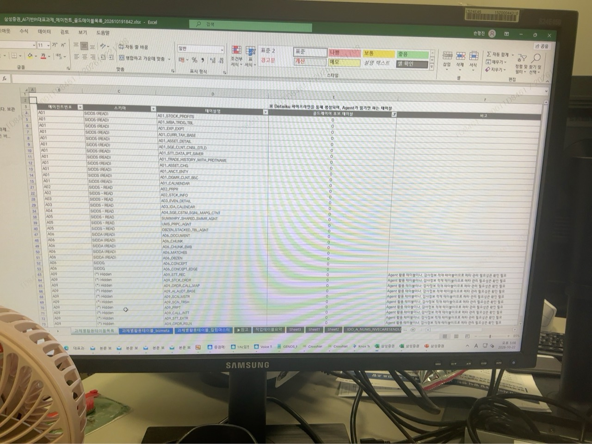
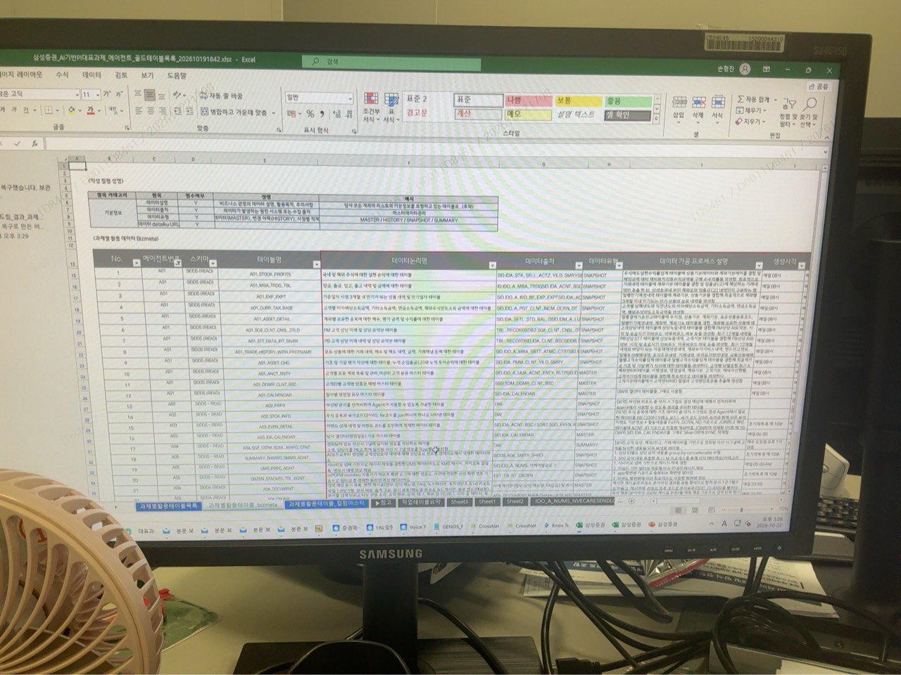
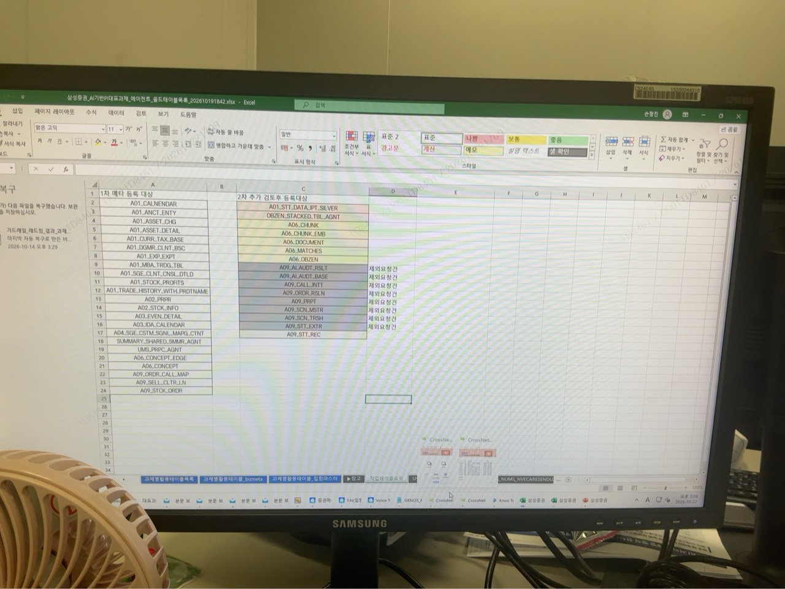
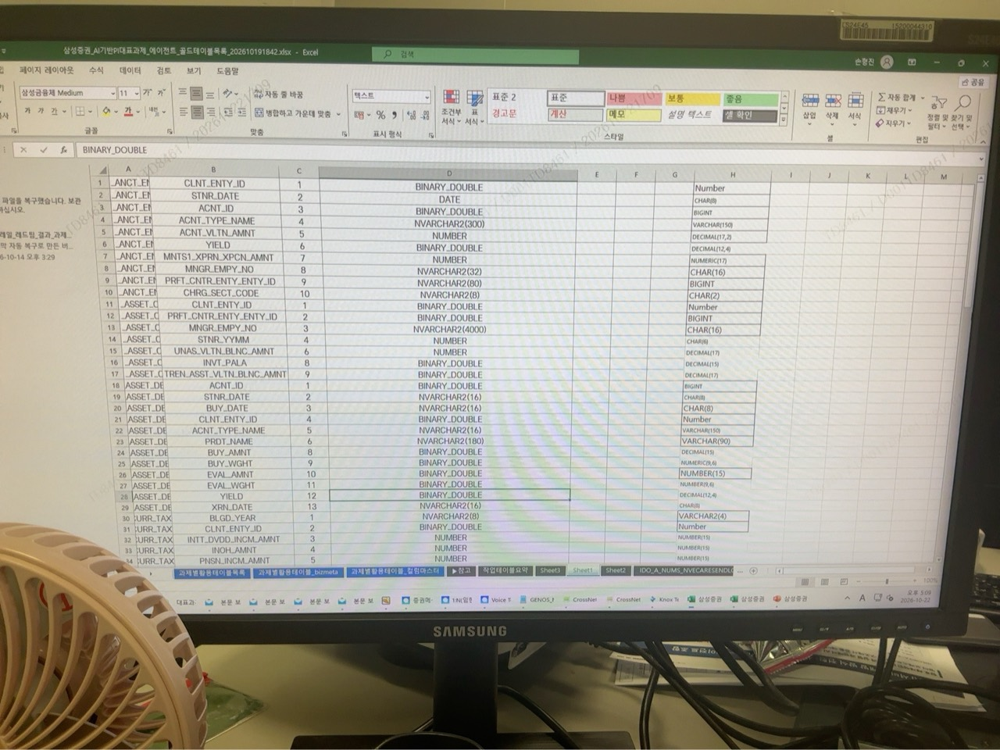
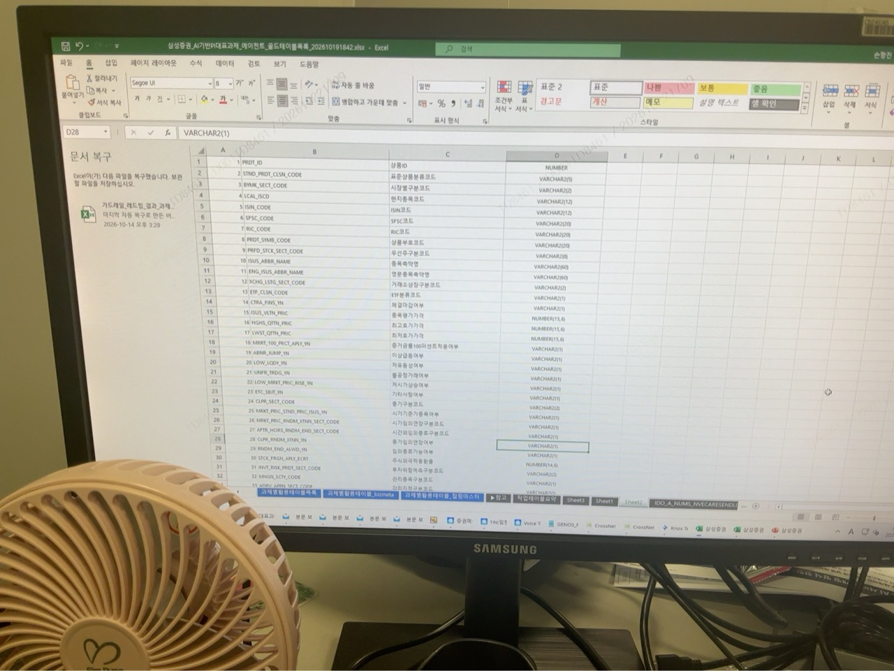
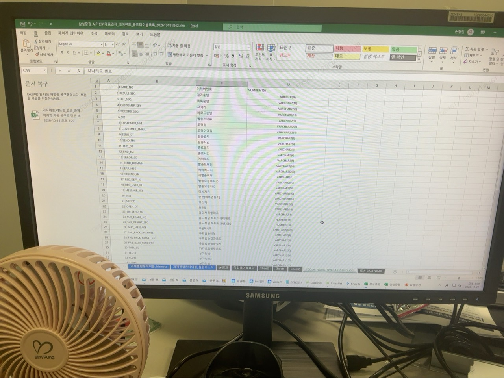
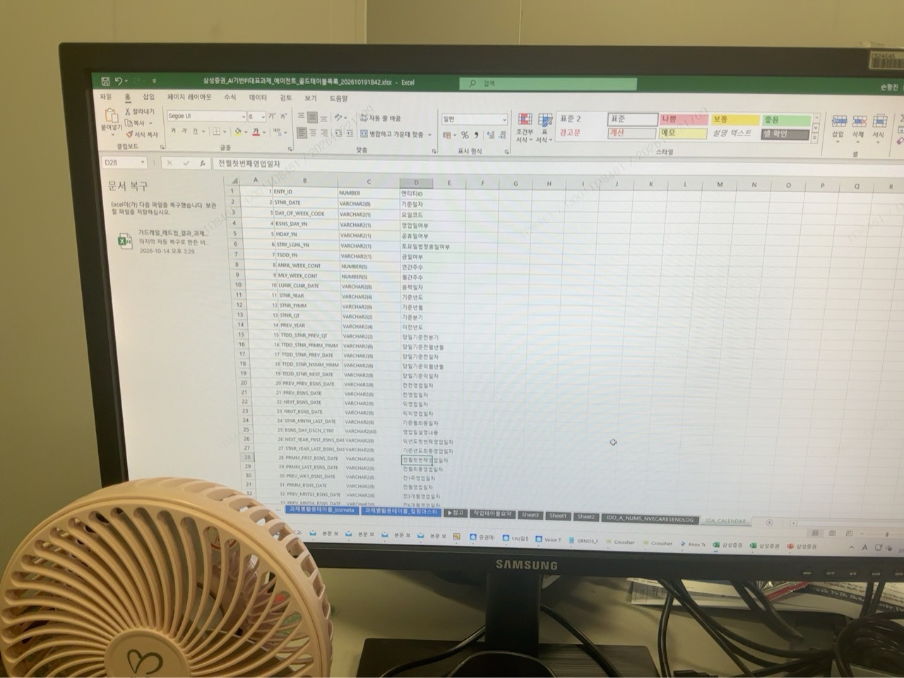

# 골드 테이블 목록·Bizmeta·컬럼 정의 작성 기준

실제 작성 순서와 최근 음성 피드백을 적용할 때는 [2026-10-28 통합 작성 가이드](GOLD_AUTHORING_GUIDE_20261028.md)를 함께 사용한다. 아래는 2026-10-22 사진의 출처와 양식 기록이다.

2026-10-22 사용자가 추가 제공한 **엑셀 화면 사진 7장**을 근거로 한다. 사용자 지시는 “추가적으로 아키텍쳐에서 골드레이어에 만들 스키마를 만들 때 같이 써야 하는 문서”로 기록하고 이미지를 포함하는 것이다. **앞으로 골드 레이어 스키마를 설계·변경할 때 기존 메타마이너 규약과 함께 아래 목록·메타정보·등록 대상·컬럼 정의를 작성한다.**

[아키텍처의 적용 기준](../../../../00_SYSTEM/ARCHITECTURE.md#dataiku-gold-schema-workbook) · [기존 메타마이너 규약·사진 전체 목록](README.md) · [온톨로지 DB 설계 진입점](../../REPORTS/ONTOLOGY_V3_CONTROL_REVIEW_20261022/DATABASE_ARCHITECTURE.md)

화면에는 파일명 중 `에이전트_골드테이블목록_202610191842.xlsx`가 보인다. **XLSX 원본은 제공되지 않았다.** 사진에 보이는 작성 양식과 사례를 기록하며, 숨겨진 열·행·시트·셀 수식·최신 승인 여부는 확인하지 않았다. 원본 사진은 `images/gold_table_workbook/`에 편집·재압축 없이 보존하고 [출처 목록](SOURCE_MANIFEST.json)과 [SHA-256](SHA256SUMS)에 기존 20장과 구분해 추가했다.

## 사진별 내용

| 사진 | 화면에서 확인한 내용 | 설계에 사용할 부분 |
|---|---|---|
| [1](images/gold_table_workbook/01.jpg) | 과제별 활용테이블 목록, 에이전트번호·스키마·테이블명·골드레이어 후보 테이블·비고 | 전체 사용 테이블과 골드 후보를 목록으로 관리 |
| [2](images/gold_table_workbook/02.jpg) | 과제별 활용 데이터 Bizmeta, 작성 항목 설명과 테이블별 업무 메타정보 | 원천·유형·가공 과정·생성 시각을 테이블과 연결 |
| [3](images/gold_table_workbook/03.jpg) | 1차 메타 등록 대상, 2차 추가 검토후 등록대상, 일부 행의 `제외요청건` | 등록 대상·검토 대상·제외 요청을 구분 |
| [4](images/gold_table_workbook/04.jpg) | 테이블·컬럼·순번과 좌우 데이터 타입 대조 | 현재/원천 타입과 적용할 타입의 차이를 컬럼별 검토 |
| [5](images/gold_table_workbook/05.jpg) | 상품 관련 컬럼의 순번·물리명·논리명·타입 | 컬럼 정의서 형식 |
| [6](images/gold_table_workbook/06.jpg) | 발송 이력 관련 컬럼의 순번·물리명·논리명·타입 | 컬럼 정의서 형식 |
| [7](images/gold_table_workbook/07.jpg) | 달력 컬럼의 순번·물리명·타입·논리명 | 열 배치가 달라도 물리명·논리명·타입을 함께 관리 |

## 함께 작성할 설계 자료

아래의 **사진에서 확인한 항목**과 **프로젝트 적용 시 보완할 항목**을 구분한다. 보완 항목은 기존 아키텍처의 원문·권한·버전·저장 책임을 연결하기 위한 것이며 사진 원문에 모두 적혀 있다는 뜻은 아니다.

### 1. 활용테이블 목록 — 사진 1

| 사진의 항목 | 작성 내용 |
|---|---|
| 에이전트번호 | 테이블을 사용하는 과제·에이전트 식별값 |
| 스키마 | 실제 조회·저장 대상 스키마. 화면의 READ·Hidden 등 부가 표기는 원문 그대로 구분 |
| 테이블명 | 해당 스키마의 대상 테이블명 |
| 골드레이어 후보 테이블 | 골드 후보 여부와 판단 상태 |
| 비고 | 용도, 검토 필요 사항, 별도 관리 필요성 |

화면 상단에는 Dataiku 파이프라인을 통해 생성되어 Agent가 읽는 테이블이라는 설명이 있다. 일부 비고에는 Agent 활용 테이블이지만 감사정보 적재 등 별도 관리 필요성을 확인해야 한다는 취지가 보인다. **목록 등재나 후보 표시를 골드 배치 확정·메타 등록 완료·DB 생성 완료로 해석하지 않는다.** 후보 표시의 정확한 셀 값·범례는 XLSX 원본에서 확인할 사항이다.

프로젝트에서는 여기에 **현재 레이어, 목표 레이어, 실제 소비자, 원문/실행 기록 구분**을 연결한다. 에이전트번호와 Dataiku의 에이전트 레이어는 다른 구분이다. 에이전트가 사용하는 테이블이라고 해서 실행 로그까지 골드로 옮기지 않는다.

### 2. 테이블별 Bizmeta — 사진 2

화면의 표에는 다음 열이 있다. 상단 작성 항목 설명에는 필수 여부를 표시하는 칸도 있다. 작은 글씨의 상세 문구나 화면 밖 추가 항목은 추정하지 않는다.

| 사진의 열 | 우리 설계에서 작성할 내용 |
|---|---|
| No.·에이전트번호·스키마·테이블명 | 활용테이블 목록의 같은 대상을 찾을 수 있는 식별 정보 |
| 데이터논리명 | 어떤 업무 데이터를 담는지 설명하는 이름·설명. 사진에는 설명 문장 형태의 예시도 있으므로 컬럼 표준용어의 논리명과 혼동하지 않음 |
| 데이터출처 | 원천 시스템·스키마·테이블 또는 문서 출처와 그 연결 |
| 데이터유형 | 화면의 분류 `MASTER / HISTORY / SNAPSHOT / SUMMARY` 중 실제 저장 방식에 맞는 유형과 선택 이유 |
| 데이터 가공 프로세스 설명 | 입력에서 테이블 생성까지의 추출·변환·결합·집계·필터·갱신 과정 |
| 생성시각 | 데이터 생성·배치 반영 주기와 시각. 실제 운영 계획을 기재 |

`MASTER / HISTORY / SNAPSHOT / SUMMARY`는 **데이터의 저장·갱신 성격 분류**이며 `NUMBER`·`VARCHAR2` 같은 컬럼 타입과 다르다. 사진에는 유형명이 제시되어 있고 상세 판정 기준 전체는 보이지 않는다. 유형·생성 시각을 예시 행에서 복사하지 않고 우리 테이블의 판본·이력 보존과 실제 배치 방식에 맞춰 정한다.

기존 [테이블 Description](../../../../00_SYSTEM/ARCHITECTURE.md#dataiku-gold-schema-convention)의 **1행 단위·PK, 조회 가능한 질문, 포함·제외, 보유 기간, 갱신 완료 기준, 산식·단위, 원천, 주의, 오너, 예시 SQL**을 함께 작성한다. 짧은 Bizmeta 목록이 상세 Description을 대체하지 않는다.

### 3. 메타 등록 대상과 진행 상태 — 사진 3

사진은 **`1차 메타 등록 대상`**과 **`2차 추가 검토후 등록대상`**을 나누며, 오른쪽 목록의 일부 행에는 **`제외요청건`**이 표시되어 있다.

| 사진에서 보이는 A06 항목 | 사진의 목록 구분 |
|---|---|
| `CONCEPT`, `CONCEPT_EDGE` | 1차 메타 등록 대상 |
| `CHUNK`, `CHUNK_EMB`, `DOCUMENT`, `MATCHES`, `OBZEN` | 2차 추가 검토후 등록대상 |

이 표는 사진의 A06 행에서 읽히는 이름 부분을 발췌한 것이다. **우리 코드의 기존 객체와 동일한 테이블이라는 확인이나 앞으로 사용할 물리명 확정이 아니다.** 사진 1에서도 A06의 문서·청크·개념·관계 관련 항목이 보이지만, 이름만으로 스키마 배치·컬럼·권한·실제 연결을 확정하지 않는다.

등록 **대상**과 등록 **완료**, 제외 **요청**과 제외 **승인**을 구분한다. 우리 작업에서는 대상 차수·검토 사유·제외 요청 사유와 함께 메타 신청/승인, DBA 생성 신청/생성, 적재/검증 결과를 각각 기록한다. 사진의 타 과제 제외 요청을 우리 테이블의 제외 승인으로 재사용하지 않는다.

### 4. 컬럼 정의와 타입 대조 — 사진 4~7

사진 5~7은 **컬럼 순번·물리명·한글 논리명·데이터 타입(길이·정밀도 포함)**을 함께 관리하는 예시다. 상품, 발송 이력, 달력 등 업무별 표를 같은 방식으로 작성하며 사진 7처럼 열 순서가 달라도 같은 의미의 항목을 연결한다.

사진 4의 왼쪽에는 `BINARY_DOUBLE`, `DATE`, `NUMBER`, `NVARCHAR2(...)`, 오른쪽에는 `Number`, `BIGINT`, `CHAR(...)`, `VARCHAR(...)`, `DECIMAL(...)`, `NUMERIC(...)` 등 여러 표기가 함께 보인다. **좌우 열의 제목·변환 방향·승인 상태가 보이지 않으므로 이 사진을 일괄 타입 변환표나 실행할 Oracle DDL로 확정하지 않는다.**

우리 컬럼 정의서는 아래 내용을 묶어서 작성한다.

| 항목 묶음 | 작성 내용 | 근거 |
|---|---|---|
| 기본 정의 | 스키마·테이블, 순번, 물리명, 논리명, 타입·길이·정밀도 | 사진 4~7의 양식 |
| 표준 매핑 | 표준단어·표준용어·도메인·인포타입, 승인 여부 | 기존 메타마이너 가이드 |
| 타입 대조 | 원천/현재 타입, 목표 타입, 변경 사유·변환 규칙·확인 상태 | 사진 4의 대조 형식을 프로젝트에 적용 |
| 의미 | 업무 의미, 허용값·코드·범위, 산식 또는 해당 없음 | 기존 컬럼 Description 규약 |
| 데이터 계약 | PK/FK·NULL·기본값·제약, 원문·판본·span·권한 연결 | 기존 프로젝트 데이터 계약에 맞춰 보완 |

타입 결정에는 기존 `NVARCHAR → VARCHAR` 안내, 승인된 도메인·인포타입, 해당 ADB의 한글 길이 기준을 함께 적용한다. 실제 `VARCHAR`/`VARCHAR2` 표기·BYTE/CHAR 단위와 숫자 정밀도·날짜 표현은 승인 모델 및 대상 Oracle 환경에서 확인한다. 사진의 `DATE`와 `CHAR(8)` 병기, ID의 숫자 타입 예시를 모든 날짜·식별자에 적용하지 않는다. 코드의 선행 `0`, 긴 식별자, 원문·해시 값은 기존 계약을 보존한다.

## 우리 아키텍처에 적용하는 순서

1. **저장 책임부터 정한다.** 원문 판본·구조화 데이터·개념·관계·`llm_wiki`는 골드, 질의·판단·실행 로그는 에이전트 레이어 기준으로 테이블의 행 단위와 소비자를 정한다. 재사용 지식은 원문 판본·조항·span에 연결한다.
2. **테이블 목록과 Bizmeta를 함께 작성한다.** 과제/에이전트, 스키마, 물리 테이블, 후보·목표 레이어, 데이터 설명·출처·유형·가공 과정·생성 시각을 연결하고 상세 Description을 보강한다.
3. **표준을 조회하고 컬럼을 정의한다.** 기존 표준단어·용어·도메인·인포타입을 우선 사용하고 미등록 표준은 신청·승인 절차를 따른다. 논리명·물리명·타입 대조 및 데이터 제약을 기록한다.
4. **등록 대상과 승인 상태를 관리한다.** 1차/추가 검토/제외 요청 등 목록 구분과 실제 승인·생성을 별도 기록한다. 이름·타입·스키마가 미확정인 초안을 승인된 운영 모델로 표현하지 않는다.
5. **승인 모델에 맞춰 DDL·소비자 매핑을 확인한다.** 메타 등록·DBA 생성 신청 후 실제 생성·적재·조회 검증 결과를 남긴다. 기존 API 식별자와 물리 컬럼의 매핑, 권한·판본·해시·복원 계약을 확인한다.

이번 작업은 **설계 시 준수할 문서와 원본 사진의 추가 기록**이다. 기존 DDL·스키마 초안의 표준 준수를 새로 인증하지 않았으며 메타마이너 신청·DBA 생성·Dataiku 적재·GENOS 배포를 수행한 기록은 아니다.

## 원본 이미지

### 사진 1 — 활용테이블 목록과 골드 후보

### 사진 2 — 테이블별 Bizmeta 작성 항목

### 사진 3 — 메타 등록 대상과 추가 검토·제외 요청

### 사진 4 — 컬럼별 타입 대조

### 사진 5 — 상품 관련 컬럼 정의

### 사진 6 — 발송 이력 관련 컬럼 정의

### 사진 7 — 달력 컬럼 정의

