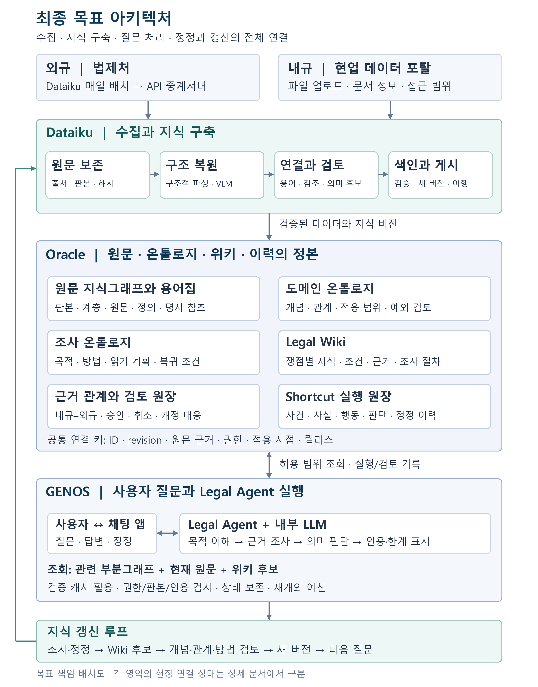
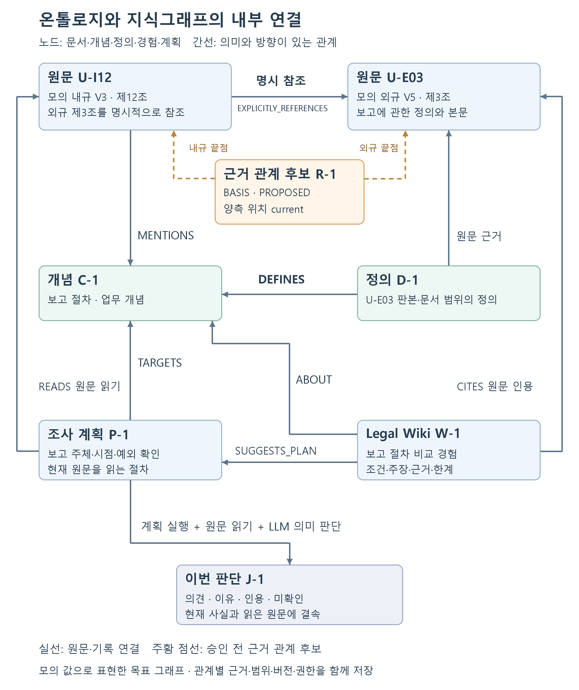

# GENOS와 Oracle 기반 법률 지식 및 온톨로지 아키텍처

2026년 10월 17일 · 최종 목표 구조와 단계별 구현 설계

## 1. 우리가 만들려는 체계

**우리의 목표는 법령과 내규를 축적하고, 그 안의 개념·정의·관계·적용 범위를 연결하며, 에이전트의 조사 경험으로 그 연결을 계속 개선하는 법률 지식 체계다.** 사용자는 GENOS 채팅 앱으로 질문하고, Legal Agent는 Oracle의 원문 지식그래프, Legal Ontology, Legal Wiki를 함께 조회하여 현재 질문에 맞는 근거와 판단을 제공한다. Dataiku는 외규와 내규의 수집부터 구조화·색인·지식 갱신까지 담당한다.

최종 체계에서는 서로 다른 표현으로 들어온 질문도 같은 개념으로 접근할 수 있고, 정의에서 관련 조문·예외·내규–외규 근거로 이동할 수 있어야 한다. 조사 경험은 다음 질문에서 필요한 자료와 확인 항목을 찾는 데 재사용한다. 문서가 개정되면 영향을 받는 개념·관계·위키·조사 계획을 식별하고, 기존 판단이 어느 판본에 근거했는지 추적한다.

이 문서의 중심은 **최종 목표 구조**다. 사용자에게 확인된 인프라, 현재 선택 코드에서 확인한 기능, 앞으로 연결할 설계를 다음과 같이 구분한다.

| 구분 | 기준 |
|---|---|
| 사용자 확인 인프라 | GENOS 채팅·백엔드, Dataiku, Oracle, 법제처 API 중계, 외규 매일 배치, 데이터 포탈 내규 업로드 |
| 확인한 현재 구현 | 로컬 선택 MAIN82 `basis-link-lifecycle-20261016-r1`의 코드·설정과 주요 작업 코드 대조. 실제 현장 배포 증거와는 별도 |
| 최종 목표 설계 | Oracle 안의 지식 계층, 도메인·조사·경험 온톨로지, 부분그래프 조회, 변경 영향 관리, 전체 배치 연결. 논리 모델과 새 기능은 이 범주 |

모든 표의 예시 ID·값은 설명용이다. 물리 테이블명은 별도로 명시한 현재 코드 항목만 실제 구현 이름이며, 나머지는 설계용 논리 객체다.

## 2. 최종 아키텍처 그림



그림은 목표 책임 배치다. Oracle 안의 칸은 지식의 논리 영역이며, 각각 별도 DB나 서버를 뜻하지 않는다. 연결선의 조회·기록은 권한이 있는 서비스 포트를 거친다. 모델이 임의 SQL로 공통 정본을 직접 고치는 구조가 아니다.

| 흐름 | 최종 연결 |
|---|---|
| 외규 입력 | Dataiku 매일 배치 → API 중계서버 → 법제처 신규·갱신 확인 → 원문 확보 |
| 내규 입력 | 현업 → 데이터 포탈 업로드 → Dataiku 연결·원문 확보 |
| 지식 구축 | 원문 보존 → 구조적/VLM 파싱 → 문서·용어·정의·명시 참조 연결 → 해석 관계 후보와 검토 → 색인·버전 게시 |
| 질의 | 사용자 → GENOS 채팅 앱 → Legal Agent → 현재 권한·판본의 개념/위키/원문 조회 → 조사·판단 → 근거와 한계가 있는 답변 |
| 학습과 정정 | 조사·정정 기록 → Shortcut 원장 → Legal Wiki 지식 후보 → 개념·관계·조사 방법 개선 후보 → 검토·새 버전 → 다음 질의 |

구축과 질의는 실행 주기가 다르다. 무거운 구조화·지식 구성·색인 갱신은 배치가 담당하고, 질의는 이미 게시된 버전에서 관련 부분을 읽는다. 사용자의 사건 정정은 즉시 반영하며, 공통 지식의 일반화와 승인은 별도 갱신 흐름으로 연결한다.

원문·탐색 색인의 게시와 해석 관계의 승인은 독립된 상태다. 의미 관계가 아직 미확정이어도 무결성과 접근 범위가 확인된 원문은 제공할 수 있다. 새 원문 버전에 맞지 않는 관계·위키·계획만 사용 제한 또는 재검토 대상으로 표시한다. 승인 대기 때문에 확보한 원문 전체를 숨기지 않는다.

## 3. 각 구성요소의 책임과 입력·출력

| 구성요소 | 역할 | 들어오는 값 | 만들어 내는 값과 소비자 |
|---|---|---|---|
| GENOS 채팅 앱 | 질문·후속 정정·근거 표시 | 질문, 대화 식별자, 선택 문서/팀, 사용자 조작 | 인증된 요청 맥락을 백엔드에 전달하고 답변·출처·진행·미확인을 표시 |
| Legal Agent | 현재 질문의 조사와 판단을 진행 | 질문, 현재 사건 사실, 허용 문서, 기준일, 온톨로지 후보, 위키 후보, 실제 원문 | 조사 계획, 도구 호출, 판단·이유·인용, 남은 확인사항, 실행 기록 |
| Dataiku | 데이터 수집·가공·증분 구축·게시를 조율 | 법제처 변경 목록/원문, 포탈 파일, 선택 용어집, 기존 지식 버전, 정정·검토 큐 | 구조 원문, 연결·색인, 지식 후보, 검증 기록, 새 데이터 릴리스 |
| Oracle 원문 지식그래프 | 무엇이 어느 문서 어디에 있는지 저장 | 원문·문서 메타데이터·계층·용어 출현·정의·명시 참조 | 판본과 위치가 확인되는 근거, 문서 구조, 탐색 경로 |
| 용어집 | 표현과 개념의 접점을 관리 | 표제어·별칭·약칭·문서별 정의·출현 위치·출처 | 후보 개념 ID, 표현 색인, 정의와 원문 위치 |
| Legal Ontology | 개념·관계·범위와 조사 방법을 조직 | 용어/정의, 검토된 의미 관계, 조사 방법, 출처·검토 기록 | 질문에 필요한 개념·관계 부분그래프와 확인할 항목·조사 계획 |
| Legal Wiki | 근거와 조건을 갖춘 지식 단위를 축적 | 조사·정정·판단·원문·개념 연결·미해결 기록 | 쟁점별 설명, 조건, 근거, 예외 검토, 조사 절차, 반례와 활용 제한 |
| Shortcut 원장 | 대화와 조사 과정의 지속 기록·정정 | 수신 발언, 사건 사실, 도구 결과, 판단, 답변, 정정 이벤트 | 사건·갈래·쟁점 상태, revision, 의존 관계, 위키 구성 입력 |
| 근거 관계 원장 | 내규–외규 관계의 제안·승인·개정 추적 | 양쪽 원문 위치·판본, 관계 종류, 이유, 검토자 결정 | 승인 상태와 현재 판본 위치가 분리된 근거 연결 |
| 검토·운영 기능 | 공통 지식의 품질과 사용 상태 관리 | 후보, 충돌, 변경 영향, 실패 기록 | 승인/반려/취소, 재검토 대상, 게시/롤백 영수증 |

GENOS는 내부 모델을 사용하는 실행 환경이다. Dataiku는 배치의 조율 책임을 갖는다. 파서나 VLM이 Dataiku 프로세스 안에서 실행되는지, 별도 내부 서비스로 호출되는지는 현장 배치 설정에 맞춰 결정한다. Oracle 연결도 조회 서비스/ORDS/드라이버를 구체 구현에 맞게 사용하되, 아래의 논리 계약은 동일하게 유지한다.

## 4. 지식그래프·온톨로지·위키의 관계

### 4.1 같은 데이터 위에서 서로 다른 질문에 답한다

원문 지식그래프는 **“이 문서의 이 조항에 어떤 용어가 나오고, 어디를 참조하는가?”**에 답한다. Legal Ontology는 **“이 개념은 무엇을 의미하며, 어떤 개념·조건·범위와 연결되고, 무엇을 확인해야 하는가?”**에 답한다. Legal Wiki는 **“이 쟁점을 어떤 근거와 조건으로 검토했으며, 무엇을 다시 활용할 수 있는가?”**에 답한다.

| 예시 | 원문 지식그래프 | Legal Ontology | Legal Wiki |
|---|---|---|---|
| 같은 표현의 의미 | 표현이 나온 위치와 정의 원문 | 문서별 정의 범위, 같은 개념인지의 검토 상태 | 의미를 혼동했던 사례와 확인 방법 |
| 내규의 외규 근거 | 내규·외규 원문 및 명시 참조 | 관계 종류와 적용 범위, 검토된 근거 관계 | 왜 해당 관계를 선택했는지, 어떤 차이가 남았는지 |
| 새 질문 | 관련 조문·용어·구조 검색 | 질문을 개념과 조사 목적으로 연결 | 유사 쟁점의 근거 위치·조사 절차를 제공 |
| 법령 개정 | 구·신 판본과 구조 위치 | 관계의 판본 유효성 및 영향 범위 | 이전 설명·절차의 재검토 필요 여부 |

온톨로지는 노드 이름과 선의 목록만으로 완성되지 않는다. **관계의 의미, 방향, 허용 대상, 출처, 적용 범위, 검토 상태, 버전, 실제 소비 방법**까지 있어야 시스템에서 사용할 수 있다.

### 4.2 최종 Legal Ontology의 세 영역

| 영역 | 관리하는 대상 | 활용 |
|---|---|---|
| 도메인 온톨로지 | 업무·법률 개념, 문서별 정의, 주체·행위·대상·시점, 정의/적용/예외/참조 관계 | 표현 해석, 관련 근거 확장, 적용 범위와 예외 확인 |
| 조사 온톨로지 | 조사 목적, 검토 방법, 필요한 입력, 선행 확인, 도구, 종료·복귀 조건 | 현재 질문의 조사 계획을 구성하고 도구 실행과 이유를 연결 |
| 경험 지식 연결 | 쟁점, 조건별 지식 단위, 반례·충돌, 조사 절차, 원 경험과 의존 관계 | Legal Wiki를 검색하고 필요한 근거·절차를 현재 질문에 재결속 |

세 영역은 동일한 개념·원문 ID를 공유한다. 예를 들어 도메인의 “보고 의무”와 조사의 “보고 대상 확인”, 위키의 “특정 조건에서 보고 대상을 확인한 경험”은 서로 연결되지만 같은 객체로 합치지 않는다. 개별 사건의 회사명·거래·날짜는 사건 사실에 남기고 공통 개념의 정의로 편입하지 않는다.

### 4.3 원문을 보존하면서 의미를 풍부하게 만든다

현행 MAIN은 원문을 모두 Rule·조건·효과로 재작성하는 구축을 사용하지 않는다. 최종 설계도 이 원칙을 유지한다. 원문·정의·명시 참조를 공통 기반으로 만들고, **업무상 가치가 큰 범위부터** 적용·예외·절차 관계를 근거와 함께 검토해 추가한다.

요건·의무·금지·예외 같은 의미는 선택한 원문에 대한 해석 지식으로 표현할 수 있다. 이를 모든 문서의 필수 파싱 산출물로 강제하거나, LLM 추출만으로 법률 정본으로 승인하지 않는다. 형식 규칙의 자동 합성·증명은 별도의 후속 기능이며, 관계 그래프가 있다는 이유로 이미 구현된 추론 엔진으로 설명하지 않는다.

### 4.4 최종 온톨로지의 공통 개념 틀

도메인마다 다른 표현을 사용하더라도 아래 역할을 공통 축으로 정리할 수 있다. 이는 **최종 논리 모델의 확장안**이며 현행 원문 저장 스키마를 일괄 변경하는 요구가 아니다.

| 개념 역할 | 담는 의미 | 예시 및 구분 |
|---|---|---|
| 주체와 역할 | 누구에게 적용되는가, 어떤 역할인가 | 기관·부서·직무와 특정 사건의 실제 담당자는 구분 |
| 행위와 절차 | 무엇을 하고 어떤 순서로 진행하는가 | 점검·보고·승인이라는 행위와 실제 실행 이벤트는 구분 |
| 대상 | 무엇에 관한 행위인가 | 자산·계약·보고서의 종류와 사건의 특정 문서는 구분 |
| 조건과 사실 | 어떤 조건에서 검토하며 현재 값은 무엇인가 | 공통 조건 슬롯과 사용자 진술·원문 확인값·가정은 구분 |
| 의무·금지·허용 | 원문을 해석한 규범적 성격 | 해당 판본·주체·행위·조건·근거에 결속한 해석 후보/검토 지식 |
| 정의와 분류 | 무엇을 의미하고 어떤 범주인가 | 사전적 유사성, 문서별 정의, 검토된 동일 개념을 구분 |
| 시점과 기간 | 언제 유효하고 어느 기간을 보는가 | 수집시각·시행일·사건 발생일·점검기간을 별도 값으로 관리 |
| 수치와 단위 | 어떤 양을 어떤 기준으로 비교하는가 | 금액·비율·횟수·기간의 단위와 산정 기준을 보존 |
| 예외와 충돌 | 어떤 제한·예외·상반 근거가 있는가 | 발견한 예외와 아직 조사하지 못한 예외 범위를 구분 |
| 근거와 검토 | 왜 이 관계·주장을 사용할 수 있는가 | 직접 원문, 해석 이유, 승인 receipt, 현재성 검사를 구분 |

관계 타입에도 계약이 필요하다. 예를 들어 “정의함”은 정의 원문에서 개념으로 향하며 문서 범위를 가진다. “근거가 됨”은 방향과 적용 범위가 있고, “관련 있음”은 이를 대신할 수 없다. 역방향 조회 가능 여부와 법적 의미의 역관계도 다르다. 전이·상속·대칭성을 임의로 적용하지 않고, 검토된 관계 타입에서만 허용한다.

한 관계의 양 끝점이 존재하는지, 타입이 맞는지, 사용한 근거와 판본이 유효한지는 시스템이 검사한다. “두 개념이 법적으로 동일한가”와 “이 예외가 현재 사안에 적용되는가”는 원문을 읽는 의미 판단과 검토가 필요하다. 이 구분으로 모델의 해석 능력을 사용하면서 검증 가능한 구조를 유지한다.

### 4.5 온톨로지 스키마와 실제 그래프를 구분한다

**온톨로지 스키마는 어떤 종류의 대상이 존재하고 어떤 관계로 연결할 수 있는지 정의한다. 지식그래프는 그 틀에 실제 문서·조항·개념·정의·경험을 넣은 것이다.** 예를 들어 `Concept`는 객체 종류이고, “보고 절차”는 그 종류에 속하는 개념 노드다. `DEFINES`는 관계 타입이고, “모의 외규 제3조에 근거한 정의 D-1이 보고 절차 C-1을 정의한다”는 실제 연결의 예다.

RDB에 들어가는 행도 이 구분을 따른다. 타입과 관계 계약을 관리하는 행, 개별 지식 객체를 관리하는 행, 출처·범위·검토가 결속된 연결 행을 구별한다. 사람에게 보여 주는 그래프와 Agent에 제공하는 부분그래프는 이 정본에서 목적에 맞게 조회한 결과다.

| 객체 종류 | 객체가 표현하는 것 | 주요 속성·연결 |
|---|---|---|
| DocumentFamily / DocumentVersion | 규정의 계열과 특정 개정판 | 문서명·종류·출처·시행일·원본 해시, HAS_VERSION |
| SourceUnit / SourceSpan | 조·항·호·목·표와 그 안의 정확한 근거 | 부모·순서·본문·좌표·판본, HAS_UNIT / PART_OF |
| TermExpression | 표제어·별칭·약칭 등 언어 표현 | 문자열·언어·출처·문맥, DENOTES 후보·MENTIONS 출현 |
| Concept | 법률·업무의 의미 단위 | 개념명·도메인·정의 refs·범위·상하위 관계 |
| Definition | 특정 원문에 근거한 개념 정의 | 정의 내용·적용 문서·판본·범위, DEFINES / EVIDENCED_BY |
| RelationAssertion | 의미 관계를 주장하는 버전 있는 객체 | 관계 타입·양 끝점·방향·이유·범위·근거·검토 상태 |
| Condition / Scope | 관계·주장이 적용되는 조건과 범위 | 주체·행위·대상·시점·단위·미확인 값 |
| InvestigationPurpose / ReviewMethod | 조사 목적과 검토 방법 | 대상 개념·필요 입력·허용 도구·선행 확인·결과 계약 |
| InvestigationPlan | 현재 목적에 필요한 조사 절차 | 목적·방법·대상 개념·필수 읽기·분기·복귀·의존 버전 |
| WikiUnit / Claim | 쟁점별 지식과 그 안의 주장 | 설명·조건·인용·반례·미확인·관련 개념·절차 |
| Case / Fact / Judgment | 개별 사건, 현재 사실, 이번 판단 | 사건/쟁점 revision·사실 출처·판단 이유·현재 원문 refs |
| ReviewReceipt / Release | 검토 결정과 사용 가능한 버전 묶음 | 대상 revision·검토자·결정·사유·해시·게시 기록 |

`Condition`과 `Scope`는 초기 구현에서 별도 노드 대신 관계의 구조화 속성으로 둘 수 있다. 여러 관계가 동일 조건을 공유하거나 조건 자체의 이력을 조회해야 할 때 독립 객체로 분리한다. 그림의 모든 사각형을 별도 서버나 물리 테이블로 일대일 구현할 필요는 없다.

### 4.6 관계 타입과 그래프의 의미

다음 영문 이름은 목표 논리 모델의 관계명이며 현행 wire enum과의 매핑이 필요하다. 관계 타입은 **출발 타입, 도착 타입, 방향, 근거 요구, 범위, 허용 활용**을 함께 가진다.

| 관계 타입 | 출발 → 도착 | 의미와 요구 조건 |
|---|---|---|
| HAS_UNIT / PART_OF | DocumentVersion → SourceUnit / SourceUnit → 부모 | 원문의 구조 관계. 부모·순서·판본을 보존 |
| MENTIONS | SourceSpan → Concept 또는 TermExpression | 해당 위치에 표현이 등장함. 등장만으로 정의·적용 승인하지 않음 |
| DENOTES | TermExpression → Concept | 특정 문맥에서 표현이 개념을 가리킴. 모호하면 복수 후보 유지 |
| DEFINES | Definition → Concept | 정의 원문과 적용 범위가 있는 개념 정의 |
| EVIDENCED_BY | Definition 또는 RelationAssertion → SourceSpan | 정확한 원문이 해당 정의·관계의 근거로 연결됨 |
| EXPLICITLY_REFERENCES | SourceSpan → SourceUnit 또는 DocumentVersion | 원문에 실제 적힌 참조. 해소 상태와 원래 표기를 보존 |
| SUBCLASS_OF / EQUIVALENT_IN_SCOPE | Concept → Concept | 검토된 개념 분류 또는 범위가 제한된 의미 동일성 |
| APPLIES_TO / HAS_EXCEPTION | 해석 주장 → 대상 개념·조건 또는 예외 주장 | 원문과 범위가 있는 해석 관계. 단순 키워드로 확정하지 않음 |
| BASIS | 내규 근거 단위 → 외규 근거 단위 | 공용 근거 원장의 관계 종류·승인·판본 binding을 함께 조회 |
| ABOUT / CITES | WikiUnit → Concept / Claim → SourceSpan | 위키 주제와 주장의 원문 근거를 별도로 표현 |
| TARGETS / USES_METHOD / READS | Plan → Concept / Method / SourceUnit | 무엇을 확인하고 어떤 방법으로 어느 원문을 읽는지 표현 |
| SUGGESTS_PLAN | WikiUnit → InvestigationPlan | 과거 경험이 현재 조사에 제공하는 절차 후보 |
| DEPENDS_ON / CONTRADICTS | 지식 revision → 지식 revision | 변경 영향 또는 상반 근거를 추적. 법적 우열을 자동 결정하지 않음 |
| SUPERSEDES | 새 객체 revision → 이전 revision | 수정 계보. 과거 객체·판단을 삭제하지 않음 |

한 개념에는 여러 문서별 정의가 연결될 수 있고, 하나의 관계에는 여러 근거 span과 여러 검토 이벤트가 붙을 수 있다. 노드 이름이 같아도 개념 ID를 자동으로 합치지 않는다. `SUBCLASS_OF`의 분류 경로로 상위 개념을 탐색할 수 있지만, 그 경로로 법적 의무를 자동 상속하지 않는다. `EXPLICITLY_REFERENCES`와 `BASIS`는 별도 관계다.

그래프는 다음 논리 부분으로 나누어 관리하되 공통 ID와 원문 근거로 연결한다.

| 부분그래프 | 노드·간선 | 사용하는 단계 |
|---|---|---|
| 문서 구조 그래프 | 문서·판본·조항·블록, 부모/자식·순서 | 구조 파싱, 목차 탐색, 부모 문맥 읽기 |
| 용어·정의 그래프 | 표현·개념·정의·출현, DENOTES·DEFINES·MENTIONS | 질문 표현 해석, 정의·관련 원문 조회 |
| 법률·업무 관계 그래프 | 범위 있는 개념·해석 주장·예외, 타입 관계와 근거 | 관련 쟁점 확장, 조건·예외 검토 |
| 참조·근거 그래프 | 명시 참조, 내규–외규 근거 관계, 승인·위치 | 양측 원문 읽기, 대사, 개정 대응 |
| 조사·위키 그래프 | 목적·방법·계획·WikiUnit·Claim, 주제·절차·근거 연결 | 조사 계획과 경험 활용 |
| 계보·실행 그래프 | 사건·사실·판단·검토·버전, 의존·수정·대체 관계 | 멀티턴, 정정, 영향 분석, 재현 |

### 4.7 실제 값이 들어간 그래프 예시



그림은 **모의 문서와 제안 관계명으로 만든 예시**다. 실제 법률의 효력이나 현장 그래프 데이터를 나타내지 않는다. 실선은 예시에서 확인된 원문 연결 또는 기록된 조사 연결이며, 주황색 점선은 아직 의미 승인이 끝나지 않은 근거 관계 후보다. 모든 실선을 법률 의미 승인으로 해석하지 않는다.

| 노드 | 예시 값 | 연결과 활용 |
|---|---|---|
| U-I12 | 모의 내규 V3 제12조, 보고 절차, 외규 제3조 명시 참조 | 원문 구조 탐색과 외규 참조 출발점 |
| U-E03 | 모의 외규 V5 제3조, 보고에 관한 정의·본문 | 정확한 정의와 비교 원문 |
| C-1 | Concept, 보고 절차 | 질문·정의·위키·조사 계획이 공유하는 의미 ID |
| D-1 | Definition, U-E03에 결속한 문서별 정의 | C-1의 뜻과 적용 범위를 원문으로 확인 |
| R-1 | RelationAssertion, BASIS, PROPOSED, 위치 current | 양쪽 원문을 검토할 관계 후보. 승인 근거로 사용하지 않음 |
| P-1 | InvestigationPlan, 보고 주체·시점·예외 확인 | C-1을 대상으로 원문을 읽는 조사 계획 |
| W-1 | WikiUnit, 보고 절차 비교 경험, 조건·근거·한계 | C-1의 쟁점을 설명하고 P-1을 조사 후보로 제시 |
| J-1 | Judgment, 이번 요청의 의견·이유·인용·미확인 | 현재 사실과 실제로 읽은 U-I12·U-E03에 결속한 판단 |

예시 간선은 `U-I12 → EXPLICITLY_REFERENCES → U-E03`, `D-1 → DEFINES → C-1`, `D-1 → EVIDENCED_BY → U-E03`, `W-1 → ABOUT → C-1`, `W-1 → SUGGESTS_PLAN → P-1`, `P-1 → TARGETS → C-1`, `P-1 → READS → U-I12`다. J-1의 인용은 이번 실행에서 읽은 원문에 연결한다.

그림은 읽기 쉽도록 조항 안의 정확한 근거 위치를 조항 노드로 묶어 표시했다. W-1의 `CITES`도 위키 안의 개별 Claim이 해당 원문 위치를 인용하는 연결을 요약한 것이다. 실제 저장·조회에서는 Claim ID와 SourceSpan ID까지 내려가 근거를 구별한다.

R-1은 양 끝점만 있는 단순 간선으로 저장하면 부족하다. 종류·판본·이유·승인·위치 상태를 가진 객체로 저장하고, 그래프 화면에서는 그 객체를 “내규에서 외규로 향하는 근거 관계” 간선으로 표시할 수 있다. 이렇게 해야 같은 양 끝점 사이의 서로 다른 해석과 수정·취소 이력을 보존할 수 있다.

### 4.8 Agent가 그래프를 따라가는 순서

1. 질문의 “보고 절차”를 용어 표현에서 C-1 후보로 연결하고 현재 문서·시점 범위를 정한다.
2. C-1에 연결된 D-1을 찾아 U-E03의 실제 정의 원문과 범위를 읽는다. 개념 이름만 모델에 전달하지 않는다.
3. U-I12의 명시 참조로 U-E03을 확인한다. R-1이 PROPOSED라면 후보라는 상태를 유지하고 현재 승인 근거로 표시하지 않는다.
4. C-1에 관한 W-1을 조회해 P-1의 보고 주체·시점·예외 확인 항목을 참고한다. 현재 조건에 맞지 않는 과거 사실은 가져오지 않는다.
5. P-1이 지정하는 허용 원문을 읽고, 부족한 자료는 기존 구조·전문 검색으로 추가 조사한다.
6. LLM이 현재 사실과 실제 전달된 원문으로 판단한다. 시스템은 J-1의 인용·판본·권한·상태를 결속하고 검증한다.
7. 정정이나 개정이 생기면 `DEPENDS_ON`과 판본·승인 계보로 영향을 받은 W-1·P-1·J-1을 추적한다.

그래프 조회는 입력에서 관련 노드와 연결을 찾는 과정이고, 법률 판단은 그 연결을 통해 확보한 원문을 현재 사안에 적용하는 과정이다. 다중 연결이 발견되면 어느 범위에서 어떤 이유로 관련되는지 함께 전달한다. 경로가 없거나 일부 관계가 미확정이면 해당 범위를 설명하고 원문 탐색을 계속한다.

## 5. 어떤 값을 저장하는가

### 5.1 공통 식별·출처·버전 계약

다음은 최종 논리 필드다. 실제 테이블별 컬럼명은 매핑 과정에서 확정한다.

| 필드 묶음 | 저장 값 | 필요한 이유 |
|---|---|---|
| 식별 | 객체 ID, 객체 종류, revision, 문서 계열 ID, 판본 ID | 같은 개념의 수정과 서로 다른 문서를 구별 |
| 원문 근거 | 문서 ID, 구조 단위 ID, 블록 ID, 정확한 인용/span, 원문 해시 | 근거를 다시 열고 원문 일치를 확인 |
| 시간 | 수집시각, 공포/개정/시행일, 효력 구간, 시스템 기록시각 | 최신 수집본과 특정 시점 적용본을 구별 |
| 범위 | 관할, 내규/외규, 대상 업무·주체, 문서 범위, 조건·미확인 | 같은 표현을 다른 업무·규정에 무조건 적용하지 않음 |
| 신뢰와 검토 | 추출 방식, 후보/검토 상태, 검토자, 이유, 검토 근거 | 파싱 성공·탐색 활용·의미 승인을 구분 |
| 권한 | 소유 범위, 접근 정책 참조, 원문 문서 범위, 반출 가능 여부 | 원문과 파생 지식의 접근 범위를 함께 제한 |
| 계보 | 생성 배치, 파서/모델/프롬프트/설정 버전, 부모 revision, 의존 객체 | 재현·영향 분석·재검토·롤백 |
| 게시 | 데이터 릴리스 ID, 온톨로지 버전, 색인 지문, 게시 상태 | 요청마다 일관된 데이터 묶음 선택 |

파일명 날짜는 법적 시행일과 같은 값이 아니다. `team_id` 역시 문서 선택 메타데이터이며 그 값만으로 접근권한을 부여하지 않는다. 모델이 생성한 confidence가 있다면 보조 관찰값으로만 보존하며 검토 승인을 대신하지 않는다.

### 5.2 원문과 용어의 값

| 논리 객체 | 주요 값 | 활용 |
|---|---|---|
| 문서 계열 | 공식/내부 식별자, 정식명, 문서 종류, 소관 조직 | 여러 개정판을 하나의 계열로 추적 |
| 문서 판본 | 판본 ID, 원본 파일·API 원문 해시, 효력 날짜, 출처, 분류 | 질문의 기준일과 선택 버전 확인 |
| 구조 단위 | 장·절·조·항·호·목·별표, 부모 ID, 순서, 제목 | 목차·부모/형제·전체 범위 탐색 |
| 원문 블록 | 소유 구조 단위, 정확한 본문, 표/페이지/좌표, 원본 해시 | 실제 읽기·표 해석·정확한 인용 |
| 용어와 표현 | 용어 ID, 표제어, 별칭, 약칭, 출처, 표현 검토 상태 | 질문 표현을 후보 개념으로 연결 |
| 정의 | 정의 ID, 대상 용어/개념, 정의 원문, 정의한 문서·조항, 범위 | 같은 용어의 문서별 의미 비교 |
| 출현 | 용어/표현 ID, 문서·블록, 시작/끝 위치 | 관련 문서·조항 역조회 |
| 명시 참조 | 출발 원문 span, 대상 문서·조항, 해소 상태, 후보 | 실제로 적힌 참조를 따라 원문 탐색 |

### 5.3 온톨로지의 값

| 논리 객체 | 주요 값 | 사용 예 |
|---|---|---|
| Concept | 개념 ID, 이름, 정의 refs, 도메인, 범위, 상태 | 질문의 “유동성 관리”를 해당 업무 개념 후보에 연결 |
| ConceptRelation | 출발/도착 ID, 관계 타입, 이유, 범위, 원문 refs, 검토 revision | 어떤 개념의 정의·적용·예외를 함께 확인할지 결정 |
| InvestigationPurpose | 목적 ID, 설명, 대상 개념 타입, 필요한 입력 | 정의 확인, 적용 판단, 내규–외규 비교 |
| ReviewMethod | 방법 ID, 허용 도구/관계, 선행 확인, 결과 계약 | 정의 원문을 읽고 정의의 적용 범위를 기록 |
| InvestigationPlan | 목적·개념, 입력 슬롯, 원문 읽기 범위, 분기, 종료·복귀 조건, 의존 버전 | 정의 → 본문 → 명시 참조 → 예외를 현재 요청에서 조사 |
| ReviewReceipt | 검토 대상·revision, 결정·이유, 검토자, 원문·정책 버전 | 어떤 의미 관계가 어느 범위에서 검토되었는지 확인 |
| OntologyRelease | 포함 개념/관계/방법 revision, 해시, 원문·용어 버전, 게시 기록 | 동일 지식 묶음으로 재현하고 이전 버전으로 복구 |

아래 관계명은 **최종 논리 모델의 예시**다. 현재 운영 enum에 이 이름들이 모두 존재한다는 의미가 아니다.

| 관계 | 의미 | 혼동하지 않을 것 |
|---|---|---|
| 정의함 | 정의 원문이 개념을 특정 범위에서 정의 | 모든 법령에서 동일한 뜻이라는 승인 |
| 상위개념/하위개념 | 검토된 범위에서 개념을 분류 | 모든 상위 규정의 효력이 자동 상속된다는 주장 |
| 명시 참조함 | 원문에 실제 다른 조문·문서 참조가 있음 | 대상 조문 전체의 적용 여부 확정 |
| 적용 범위를 가짐 | 관계·주장의 주체·업무·시점·조건 | 미확인 범위를 무제한 적용으로 처리 |
| 예외 검토가 필요함 | 관련 예외 원문·쟁점을 확인할 경로 | 그래프에 연결이 없으면 예외도 없다는 주장 |
| 근거가 됨 | 검토된 내규–외규 관계와 이유 | 함께 인용됐다는 사실만으로 근거 관계 승인 |
| 조사에 필요함 | 목적 달성을 위해 읽을 자료나 확인 항목 | 그 자료의 법적 우선순위나 결론 확정 |
| 충돌/변형 관계 | 동일 쟁점의 상반 판단 또는 조건 차이 | 하나를 지우거나 다수결로 정답 확정 |

### 5.4 Legal Wiki와 실행 기록의 값

| 저장 단위 | 주요 값 | 소비 방식 |
|---|---|---|
| WikiUnit | 주제, 설명할 질문, 적용 시점/관할, 개념 연결, completeness, unresolved | 관련 쟁점 후보 조회 |
| Claim | 주장, 조건, 정확한 인용·원문 refs, 이유, 예외 확인, 한계 | 현재 근거·조건을 확인한 뒤 판단에 참고 |
| Procedure | 선행 조건, 읽기 도구, 문서/구조 좌표, 순서, 성공 확인, 복귀 지점 | 이전의 탐색 수고를 줄이고 현재 원문을 다시 읽음 |
| Member/Dependency | 원 발언/사실/도구 기록의 위치와 revision·해시 | 지식이 어떻게 구성됐는지 추적하고 변경 영향 계산 |
| Investigation/Issue | 사건, 갈래, 쟁점, 현재 질문, 문서 범위, 상태 | 멀티턴과 다른 쟁점을 분리 |
| Fact | 값, 단위, 출처, 주장/가정/미확인 상태, 유효 시점, revision | 현재 사건의 적용 판단 |
| Action/Observation | 실행 목적, 도구 인자, 성공·실패, 실제 반환 원문, 시각 | 실행 검증·재개·중복 방지 |
| Judgment/Answer | 판단·이유·원문 refs, 사용한 사실 revision, 미확인, 최종 발행 상태 | 사용자 답변과 후속 정정 |

현재 WikiUnit의 `OPEN`, `BOUNDED`, `CLOSED_CANDIDATE`는 설명 범위의 완결성이다. 배포 상태·원문 현재성·법률 의미 검토·재사용 가능 상태를 이 한 값으로 합치지 않는다. 일부 미확인이 남아도 범위를 명시한 지식과 답변으로 보존할 수 있다.

### 5.5 하나의 관계를 저장하는 값의 예

다음 JSON은 설명용 모의 레코드다. **제안하는 논리 필드 예시이며 기존 API에 그대로 전송할 스키마가 아니다.** 업무 개념과 조사 방법을 원문에 연결하는 방식이다.

```json
{
  "relation_id": "REL-DEMO-021",
  "revision": 2,
  "layer": "investigation",
  "subject": {"type": "concept", "id": "C-REPORTING"},
  "predicate": "REQUIRES_REVIEW",
  "object": {"type": "method", "id": "M-CHECK-RECIPIENT"},
  "meaning": "보고 절차를 비교할 때 보고받는 주체를 확인한다",
  "scope": {
    "document_version_ids": ["D-INT-001/V3"],
    "purpose": "내규와 외규의 보고 절차 비교",
    "effective_time": "미확인"
  },
  "evidence": [{
    "document_version_id": "D-INT-001/V3",
    "unit_id": "U-INT-012",
    "source_hash": "실제 저장 시 시스템이 기록하는 원문 SHA256",
    "quote": "설명용 모의 문서의 정확한 인용"
  }],
  "review": {"status": "PROPOSED", "receipt_id": null},
  "usage": "조사 힌트",
  "origin": {"wiki_unit": "W-015/r2", "case": "CASE-042"}
}
```

모델은 관계의 의미와 이유를 제안할 수 있다. 식별자·실제 원문 위치·해시·승인자·시각은 시스템이 결속한다. 제안 상태에서도 정책상 허용된 조사 힌트로 활용할 수 있지만, 이를 승인된 법적 근거 관계로 바꾸어 쓰지 않는다. 실행 시 이 관계는 “보고받는 주체가 누구인지 원문을 읽는 과제”로 소비되어야 하며, 관계가 존재한다는 사실만으로 보고 절차의 적합 여부가 결정되지 않는다.

## 6. Oracle RDB에서 그래프를 표현하는 방법

### 6.1 최종 논리 저장 구조

최종 목표는 Oracle을 원문·공통 지식·검토 이력의 정본으로 두고, 서비스가 필요한 조회 형태를 파생하는 구조다. 아래는 **논리 영역의 매핑안**이며 현장 기존 테이블의 교체 DDL이 아니다.

| 영역 | 객체 또는 관계 | 주요 연결 키 |
|---|---|---|
| 원문 | 문서 계열, 판본, 구조 단위, 블록, 원본 artifact | document_version → unit → block |
| 용어 | 용어, 표기, 출현, 문서별 정의 | concept/term ↔ definition ↔ source span |
| 그래프 | 명시 참조, 검토된 의미 관계, 적용 범위 | source_object/revision → relation → target_object/revision |
| 온톨로지 통제 | 목적, 방법, 조사 계획, 검토 receipt, release | plan → method → concept/relation/source dependencies |
| 지식 위키 | 지식 단위·주장·절차·반례·의존 관계 | wiki revision → claim/procedure → source/event revision |
| 공용 근거 | 내규–외규 관계 revision·승인·판본별 binding | link revision ↔ internal/external endpoints ↔ generation |
| 실행 원장 | 요청·사건·쟁점·사실·행동·판단·이벤트·사용량 | request → issue → fact/judgment/action → evidence |
| 게시·파생 | 데이터 release·색인 자산·manifest·현재 선택 | release → exact version/hash set |

구조적 부모·자식은 `parent_id`, 의미 관계는 타입이 있는 관계 행, 원문 증거는 별도 근거 연결로 표현한다. 모든 객체를 이름 없는 범용 JSON 한 테이블에 넣기보다, 문서·판본·관계·검토·실행의 주요 키와 상태를 명확하게 분리한다. 상세 payload는 기존 계약과 호환되는 구조 필드로 보존할 수 있다.

필수 조회 축은 개념 ID, 문서/판본 ID, 관계 타입과 양 끝점, 효력 범위, 상태, 원문 위치다. 어떤 인덱스가 실제로 필요한지는 현장 실행 계획과 조회 분포로 결정한다. 별도 그래프 DB 도입을 완성의 전제로 두지 않는다.

### 6.2 현재 코드의 Oracle 연결 범위

현재 선택 코드에는 다음 이름이 실제로 있다.

| 코드상 Oracle 테이블 | 저장하는 것 |
|---|---|
| `SIDDA.LEGAL_SRC_DOCUMENT_A` | DATASET_VERSION, DOCUMENT_ID, NAME, SOURCE_ARTIFACT_SHA256, SOURCE_JSON |
| `SIDDA.LEGAL_SRC_SOURCE_UNIT_A` | DATASET_VERSION, DOCUMENT_ID, UNIT_ID, PARENT_ID, SOURCE_JSON |
| `SIDDA.LEGAL_SRC_BLOCK_PAYLOAD_A` | DATASET_VERSION, DOCUMENT_ID, BLOCK_ID, UNIT_ID, TEXT, 원본 hash, SOURCE_JSON 등 |
| `SIDDA.LEGAL_RAG_ASSET_PART_A` | navigation/fulltext/glossary 등 기존 서빙 자산의 분할 데이터와 해시 |
| `SIDDA.LEGAL_RAG_RELEASE_A` | 원문 버전·행 검증·서빙 자산을 묶는 불변 릴리스 레코드 |

이는 **코드가 사용하는 테이블 계약**을 확인한 것이다. 이 다섯 표가 현장 온톨로지 전체 스키마라는 뜻은 아니다. 실제 기존 KG 테이블·키·접근권한은 현장 자료에 맞춰 매핑해야 한다.

현재 `service._resolve_binding()`은 `DP=oracle`이면 `oracle_dp.resolve()`를 선택한다. ORDS 클라이언트로 고정한 Oracle 릴리스의 원문 행과 자산을 가져와, 행 내용·해시를 확인한 조회 캐시를 만들고 기존 Store/TermIndex/fulltext reader로 소비한다. 따라서 **현재 경로는 요청의 모든 그래프 탐색을 Oracle SQL로 실시간 실행하는 방식과 다르다.** Oracle이 정본이고 SQLite는 재생성 가능한 조회 캐시인 경로다.

2026-10-17 설계에서는 불변 원문·대용량 색인의 검증된 캐시 사용을 열어 두었다. **2026-10-19 사용자가 서빙 쪽 데이터 저장 금지를 명시했으므로, 위 전체 로컬 복원 경로는 최종 요구조건에 미준수다.** GENOS 코드서빙은 원문·색인을 파일/SQLite/영속 볼륨에 보관하거나 요청 간 데이터 캐시로 유지하지 않고, 필요한 결과만 Oracle/조회 API에서 받아 요청 처리 중 일시적으로 사용해야 한다. 기본 캐시는 Oracle 내부에서 관리한다. 별도 조회 결과 캐시가 필요한 경우에는 서빙 밖의 데이터 계층에서 버전·권한·갱신 정책과 함께 검토한다. 특정 외부 캐시 서비스가 설치되었다고 가정하지 않는다.

승인 취소·접근권한·현재 사건 revision처럼 즉시성을 요구하는 값은 정본 조회 또는 명시적인 갱신 검사를 거쳐야 한다. Oracle 조회와 외부 캐시는 동일한 소스 ID·판본·해시·권한 계약을 제공하는 저장 어댑터로 묶는다. SQLite 자산을 Oracle에 저장한 것만으로 Oracle 검색이 구현되지는 않으므로 원문·용어 연결·관계·검색·상태 소비자의 실제 조회 경로 전환이 필요하다. 이 요구사항 정정은 런타임 수정이나 GENOS 적용 완료를 뜻하지 않는다.

### 6.3 노드와 간선을 RDB 행으로 저장하는 연결안

아래 이름은 **Oracle 현장 테이블에 매핑할 설계용 논리 이름**이다. 기존 원문·용어·근거 원장을 재사용하고, 부족한 관계 계약만 추가한다. 전체 자료를 범용 그래프 표에 다시 복사하는 이중 정본은 만들지 않는다.

| 논리 테이블/뷰 | 주요 필드 | 연결 방식 |
|---|---|---|
| OBJECT_TYPE / RELATION_TYPE | type_id, 설명, 출발/도착 타입, 방향, 필수 근거, 허용 활용, schema_revision | 온톨로지 스키마를 정의 |
| CONCEPT_REVISION | concept_id, revision, label, domain, scope_ref, status | 용어·정의·계획·위키의 공통 의미 대상 |
| DEFINITION_REVISION | definition_id, revision, concept_id, scope_ref, text_ref | 정의와 개념을 연결하고 정확한 원문은 참조 |
| GRAPH_OBJECT_REF | object_id, type_id, revision, 원래 저장소/키 참조 | 기존 문서·원장·위키 객체를 복사 없이 그래프 끝점으로 조회 |
| RELATION_ASSERTION | assertion_id, revision, relation_type, subject_ref, object_ref, scope_ref, reason, origin | 방향과 의미가 있는 관계 기록 |
| ASSERTION_EVIDENCE | assertion_id, revision, document_version, unit_id, span, source_hash | 관계에서 실제 근거로 연결 |
| ASSERTION_REVIEW | assertion_id, revision, decision, reviewer, receipt, recorded_at | 후보와 검토 상태를 분리해 누적 |
| RELEASE_MEMBER | release_id, object_ref, revision, hash | 특정 지식 버전에 포함되는 객체 고정 |
| DEPENDENCY | consumer_ref/revision, dependency_ref/revision, role | 개정·정정 영향의 역조회 |

`BASIS`는 별도의 새 승인 표를 만들기보다 현재 `basis_revision/basis_binding/basis_event`를 참조하는 뷰/어댑터로 노출한다. WikiUnit과 Claim도 현재 `sw_knowledge/sw_claim/sw_dependency`를 참조한다. 문서·구조 단위는 원문 정본의 키를 사용한다. 그래프 ID와 원래 저장 ID 사이의 매핑을 명시한다.

조회는 “C-1의 현재 범위 정의 찾기”, “U-I12의 명시 참조와 승인 근거 찾기”, “W-1이 의존한 판본 확인”, “개정된 U-E03을 사용하는 관계·위키·계획 역조회”처럼 목적별로 제공한다. 관계 타입·효력·검토 상태·문서 접근 범위를 제한한 SQL 조인과 필요한 범위의 반복 조회로 구현할 수 있다. 실제 SQL·인덱스·페이지 크기는 현장 스키마와 실행 계획으로 확정한다.

그래프 객체·관계·속성의 존재 여부, 끝점 타입, revision, 원문 결속을 먼저 검사한다. 이후 목적별 reader가 허용된 연결만 반환하고 Agent 도구가 소비한다. LLM이 작성한 임의 SQL을 그대로 실행하는 경로는 이 설계의 전제가 아니다. 그래프에서 원문으로 내려간 결과는 기존 READ·인용·상태 계약과 동일해야 한다.

## 7. Dataiku의 수집과 지식 구축

### 7.1 외규의 매일 갱신

| 단계 | 입력 | 처리 | 저장·다음 소비자 |
|---|---|---|---|
| 변경 확인 | 지난 수집 이력, 법제처 조회 조건 | API 중계서버를 통해 신규·변경 여부 확인 | 수집 시도·응답 상태·원천 식별자 |
| 원문 확보 | 변경 대상의 API 응답·첨부 | 원문 바이트·출처·수집시각·해시 보존 | 원본 artifact와 문서 판본 후보 |
| 구조 복원 | XML/HTML/HWPX/DOCX/PDF 등 | 구조적 파싱, 필요한 PDF·표 등의 VLM 보정 | 계층·본문·표·좌표·파싱 한계 |
| 연결 | 선택 용어집과 구조 원문 | 출현·정의·명시 참조 연결, 불명 대상 보존 | 원문 지식그래프와 탐색 색인 |
| 의미 보강 | 원문 관계·위키 후보·기존 온톨로지 | 도메인 의미·적용·예외·조사 계획 후보 구성 | 검토 대상과 근거·범위 |
| 개정 영향 | 구·신 판본·확정 문서 계열·의존 관계 | 위치 이동·내용 변경·미해결 대응 구분 | 근거 binding·위키/계획 재검토 목록 |
| 검증·게시 | 성공 범위·원문·색인·온톨로지 버전 | 계약/해시/범위 검사 후 하나의 릴리스 묶음 게시 | GENOS가 선택할 새 버전과 receipt |

법제처 자료가 어떤 형식으로 들어왔는지에 따라 파싱 경로를 선택한다. 구조가 확보된 문서를 무조건 PDF로 바꾸거나 모든 문서에 VLM을 호출하는 설계는 필요 없다. 사용자가 설명한 구조적 파싱·VLM 파싱은 하나의 구축 흐름에서 문서별 역할을 나눈다.

배치 실패는 “갱신 없음”과 다르다. 변경 확인 실패, 다운로드 실패, 문서별 파싱 실패, 색인 실패, 게시 실패를 구분하고 마지막 성공 버전과 이번 미완료 범위를 남긴다. 새 버전은 검증이 끝난 범위만 명시해 게시하며 이전 완료 버전을 덮어쓰지 않는다.

### 7.2 내규의 포탈 반입

현업이 올린 파일을 포탈의 문서 ID·업로드 revision·관리 조직·접근 정책·원본 해시와 함께 받아 기존 구조화·연결·색인 경로에 넣는다. 파일 업로드 시각, 파일명 개정일, 규정 시행일은 서로 다른 필드다. 동일 원본의 재업로드는 멱등 처리하고, 실제 내용 변경은 새 판본으로 기록한다.

본문과 별첨의 관계, 문서명·계열이 불명확한 파일은 그 상태를 보존한다. 내규가 참조한 외규의 판본이나 조문이 해소되지 않아도 이미 확보한 내규 원문을 삭제하지 않는다. 내규–외규의 의미 있는 근거 관계는 별도 원장에서 후보·승인·현재 위치를 관리한다.

### 7.3 용어집은 전체 흐름의 공통 기반

기존 사전·공개 용어와 문서에서 나온 정의 후보를 함께 관리한다. 용어 목록 확보, 정의 수집, 관계 수집, 검토 완료는 별도 진행 상태다. 신규 문서는 기존 용어와 연결되고, 새 표현·정의는 다음 용어집 버전의 후보가 된다.

“유동성위험”과 “유동성 위험” 같은 표기 연결은 탐색을 도울 수 있다. 같은 단어가 두 규정에서 다르게 정의되었다면 정의를 하나로 덮지 않고 문서·시점·적용 범위를 붙여 보존한다. 동의어·상하위 개념·정의·단순 관련어를 같은 관계로 취급하지 않는다.

## 8. Legal Agent가 최종 체계를 사용하는 방식

### 8.1 질문마다 만드는 실행 맥락

질문 원문, 대화/요청 ID, 현재 사건·쟁점 revision, 신뢰된 사용자와 문서 범위, 내규/외규 선택, 기준일, 데이터·온톨로지·코드 지문, 사용량·deadline을 하나의 실행 맥락에 결속한다. 도구는 이 맥락 안에서만 조회한다.

목표 구조에서는 먼저 용어·문서·질문 목적을 통해 관련 개념과 위키 후보를 좁힌다. 모델에는 전체 Oracle DB나 온톨로지 전체를 넣지 않고 이번 질문에 필요한 부분그래프, 후보의 적용 범위, 실제 원문을 제공한다. 부분 조회 결과를 전체 지식의 부재로 표시하지 않는다.

### 8.2 조사 단계별 입력과 결과

| 단계 | 주된 입력 | 판단·실행 | 결과 |
|---|---|---|---|
| INTENT | 질문·현재 사실·개념/위키 후보 | 목적과 쟁점, 필요한 범위 파악 | 현재 요청 목적·조건·개념 후보 |
| PLAN | 목적·온톨로지 관계·조사 방법 | 확인할 정의·본칙·참조·예외와 도구 계획 | 조사 과제·읽기 범위·복귀 조건 |
| RECALL | 용어·좌표·문서·계획·승인 관계 | 구조/용어/전문/참조로 후보 확보 | 근거 후보와 실제 조회 상태 |
| READ | 선택 문서·구조 단위·허용 범위 | 원문·부모 문맥·표·명시 참조를 읽음 | 정확 본문·좌표·판본·해시 |
| SELECT | 읽은 원문과 질문 | 관련성·범위·추가 조사 필요성 판단 | 사용한 근거·읽은 근거·미확보 사항 |
| ASSESS | 원문·현재 사실·예외·충돌 | 충분성·적용성·차이·조건부 결론 판단 | 의견·이유·인용·한계 |
| COMPOSE | 판단과 검증된 인용 | 사용자에게 읽기 쉬운 답변/비교표 구성 | 답변·출처·미확인·발행 상태 |

이는 논리 체크포인트이며 단계당 모델 한 번 또는 총 일곱 번을 뜻하지 않는다. 실제 실행은 재조회·복귀·결정적 처리·제한된 수정 경로를 가진다. 현재 코드도 이 단계들을 기존 실행기와 원장에 연결한다.

LLM은 원문을 보고 의미를 판단한다. 코드는 ID·위치·인용 일치·권한·판본·revision·중복·예산과 저장 상태를 검사하고 조립한다. 의미 불확실성만으로 읽은 원문 전달을 막거나 무한히 재판단하지 않는다. 원문 확보, 모델 전달, 관련성 판단, 최종 발행은 각각 기록한다.

### 8.3 온톨로지가 실제로 줄여야 할 작업

온톨로지는 “다음에 읽을 수 있는 자료와 그 이유”를 제공해야 한다. 정의와 명시 참조가 이미 연결되어 있다면 같은 위치를 매번 검색으로 재발견할 필요가 줄어든다. 검토한 조사 계획이 있으면 읽을 순서와 범위를 재사용한다. 위키가 알려 주는 확인사항은 현재 질문의 조건으로 다시 확인한다.

어떤 개념이나 계획에 맞지 않는 질문도 기존 원문 탐색으로 조사할 수 있어야 한다. 온톨로지의 범위 부족은 지식 보강 후보가 되며 서비스 전체를 막는 일반 조건으로 사용하지 않는다. 같은 계획이 같은 상태에서 실패했다면 이유를 남기고 다른 조사 경로로 이동한다.

## 9. Legal Wiki의 생성·활용·정정

### 9.1 기록에서 지식 단위로

Shortcut은 발언부터 실패·정정·도구 결과까지 이력을 보존한다. Legal Wiki는 이 기록을 의미 있는 쟁점으로 분리하고, 원문과 조건이 확인되는 지식 단위로 구성한다. 한 대화에서 여러 단위가 생길 수 있고 여러 대화의 공유 원문 지식이 한 단위에 연결될 수 있다.

원 사건의 사실을 다른 사건의 사실과 섞어 새로운 결론을 만들지 않는다. 공통 원문 규칙과 개별 사건 조건을 구분한다. 현재 compiler도 교차 사건의 사실을 섞은 claim을 거부하고, 새 개념 관찰은 `DISCOVERY`로 둔다.

| 활용 수준 | 가져오는 것 | 현재 질문에서 필요한 확인 |
|---|---|---|
| 탐색 힌트 | 관련 개념·문서·조항·질문 | 권한·현재 원문·질문과의 관련성 |
| 조사 절차 | 읽기 좌표·순서·분기·종료/복귀 조건 | 도구 계약·입력 조건·실제 실행 결과 |
| 판단 참고/재사용 | 조건부 주장과 원문 근거 | 현재 사실·원문 버전·예외·충돌·검토 상태 |

위키의 문장 자체를 원문 인용으로 내보내지 않는다. 새 질문에서 실제 읽은 원문과 과거 경험이 알려 준 힌트를 구분한다. 완성되지 않은 답변이나 실패 이력은 개선 자료로 남기되 성공한 지식으로 자동 승격하지 않는다.

### 9.2 즉시 정정과 배치 일반화

“이번 건은 다른 부서다”는 사건 사실 revision을 바꾸고 영향을 받는 판단을 재검토한다. “이 위키의 설명이 잘못됐다”는 해당 지식 revision을 분쟁/보류 대상으로 만들고 근거를 다시 확인한다. “이 개념 관계는 항상 잘못 연결된다”는 공통 온톨로지 변경 후보다.

원 기록은 남기고 현재 사용할 head와 상태를 갱신한다. 사건 정정은 다음 턴에서 바로 반영한다. Dataiku 또는 기존 지식 구성 배치는 변경 큐를 받아 위키 분절·중복 후보·공통 개념/계획 후보를 갱신한다. 현재 존재하는 `action-memory build --mode shortcut-v4` 등의 진입점을 활용하며 별도의 중복 실행기를 기본값으로 늘리지 않는다. 이 배치를 Dataiku 스케줄과 연결하는 것은 목표 통합 작업이다.

## 10. 내규–외규 근거와 개정 영향 관리

내규 조항과 외규 조항이 관련되어 있다는 관찰, 법적 근거라는 판단, 사람이 승인한 관계, 신판에서 대응 위치가 확인되었다는 사실은 서로 다르다. 최종 온톨로지는 이 차이를 유지한다.

현재 MAIN82의 근거 관계 원장은 `PROPOSED/APPROVED/REJECTED/REVOKED`와 위치 상태 `current/review_needed/unresolved`를 분리한다. `RELATED`와 `HISTORICAL_ORIGIN` 승인을 현재의 `BASIS` 승인으로 바꾸지 않는다. 승인자·시각·revision·원문 해시는 시스템이 기록한다.

| 변경 | 처리 | 질의에 미치는 영향 |
|---|---|---|
| 본문·문맥이 유일하게 같은 위치 이동 | 새 판본 binding 추가·기존 승인 이력 보존 | 새 위치의 현재 원문을 읽을 수 있음 |
| 문구/조건 변경 또는 조항 분할·통합 | 재검토 필요로 표시 | 과거 승인으로 새 의미를 확정하지 않고 현행 원문 조사 |
| 대응 위치 불명/중복 | unresolved와 후보·이유 보존 | 연결 불명임을 표시하고 다른 탐색 사용 |
| 승인 취소 | 취소 revision/event 기록 | 후속 사용 시 현재 상태를 확인해 자동 근거 활용 중단 |
| 과거 시점 질문 | 해당 판본과 당시 유효 범위 조회 | 최신판으로 자동 치환하지 않음 |

동일 원리는 정의·온톨로지 관계·WikiUnit·조사 계획에도 확장한다. 어떤 위키가 어떤 정의와 원문을 사용했는지 의존 관계가 있어야 변경 영향 분석이 가능하다. 승인 이력을 배치가 원문 파생 테이블처럼 재생성하거나 지워서는 안 된다.

## 11. 하나의 질문으로 보는 값의 흐름

아래는 **실제 법률 해석이 아닌 모의 데이터 예시**다. 임의 문서명과 식별자를 사용한다.

사용자 질문: “우리 유동성 관리 내규에서 점검 주기와 보고 절차가 외규에 맞게 정해져 있는지 비교해 줘.”

| 계층 | 예시로 들어가는 값 | 다음 단계에서 하는 일 |
|---|---|---|
| 문서 판본 | `D-INT-001/V3`, 모의 유동성관리준칙, INTERNAL | 기준일에 맞는 내규 선택 |
| 외규 판본 | `D-EXT-010/V5`, 모의 외부감독규정, EXTERNAL | 허용 범위의 관련 외규 선택 |
| 구조/원문 | `U-INT-012`, parent `U-INT-CH2`, 블록 `B-120` | 해당 조항·하위 항목·표를 실제로 읽음 |
| 개념 | `C-LIQUIDITY-MGMT`, `C-MONITORING`, `C-REPORTING` | 점검과 보고를 서로 다른 쟁점으로 연결 |
| 정의 | `DEF-007`, `C-REPORTING`, 적용 문서 `D-INT-001/V3` | 내규의 “보고”가 어떤 범위인지 확인 |
| 관계 | `REL-021`, 정의/명시 참조/조사 필요 관계 | 확인할 외규와 관련 항목 후보를 제공 |
| 위키 | `W-015/r2`, “점검 주기와 보고 절차 비교”, 관련 원문 refs | 주기만 보지 말고 대상·수신자·예외도 확인하도록 안내 |
| 사건 | `CASE-042`, issue `ISSUE-MONITOR`, facts revision `r1` | 현재 요청의 대상·기준일·미제공 사실을 유지 |
| 근거 관계 | `BL-003/r4`, 내규/외규 endpoints, approval, binding | 현재 승인·위치를 확인하고 양쪽 원문 우선 읽기 |
| 판단 | 의견, 이유, 내규 인용, 외규 인용, 미확보 항목 | 항목별 비교표와 검토 필요사항을 반환 |

예시 원문이 “담당부서는 점검 결과를 지정된 보고 절차에 따라 보고한다”라면, 파싱은 그 문장과 위치를 보존한다. 온톨로지는 보고 개념·절차·관련 참조를 연결한다. Agent는 실제로 어떤 보고 절차를 가리키는지 읽고, 주기·대상·예외의 확보 범위를 판단한다. Wiki는 조사 방법과 근거 연결을 남긴다. 어느 계층도 이 한 문장만으로 전체 외규 준수를 확정하지 않는다.

후속 정정이 “점검 주기는 다음에 보고, 이번에는 보고받는 주체만 비교해 줘”라면 목적 revision을 바꾸고 영향받는 판단 범위를 좁힌다. 읽은 원문은 보존하고 필요한 부분을 재사용한다. 공통 온톨로지의 정의를 이 정정 때문에 변경하지 않는다.

최종 비교에는 `항목 / 내규 원문 / 외규 원문 / 의견 / 이유 / 인용 / 미확보 내용`을 제시한다. 실제 wire 필드와 상태명은 기존 API 계약에 매핑하며, 이 설명용 표를 새 API 스키마로 자동 도입하지 않는다.

## 12. 실패·권한·버전의 경계

| 상황 | 보존할 값 | 복구 담당과 처리 |
|---|---|---|
| 법제처/중계 통신 실패 | 마지막 성공·요청·페이지·오류·미완료 목록 | 수집 단계가 중복 안전한 범위에서 제한 재시도 |
| 파싱 일부 실패 | 원본·성공 단위·파서 지문·실패 범위 | 구조화 단계가 같은 입력 checkpoint로 재개 |
| 정의/관계가 모호함 | 후보·원문·이유·UNKNOWN/미확인 | 조사·검토로 연결. 확보 원문 반환과 분리 |
| 모델 JSON/필드 오류 | 원 제안·요청 스키마·구체 오류·사용량 | 한 담당 단계의 제한 수정 후 재검증 |
| 권한/해시/상태 훼손 | 실제 binding·오류·중단 위치 | 해당 결과 차단. 모델 재요청으로 우회 금지 |
| Oracle 조회/승인 저장 실패 | 요청 ID·성공/미확정 receipt·원인 | 읽기 실패와 쓰기 결과 불명을 구분. 저장 성공을 확인하기 전 성공 표시 금지 |
| 원문 개정/승인 취소 | 구·신 revision과 의존 관계 | 새 원문 재확인 또는 제한된 활용. 이전 이력 유지 |
| 반복 충돌/예산 소진 | 실제 읽은 근거·남은 부족·누적 사용량 | 다른 조사 경로·한정 답변·실제 필요한 사실 질문·명시 중단 |
| 일부 응답 송신 뒤 실패 | 송신 기록·미완료 상태 | 새 답변을 이어 붙이지 않고 상태를 명확히 표시 |

정본을 수정하는 권한, 후보를 제안하는 권한, 원문을 읽는 권한은 구분한다. 파생 위키와 온톨로지는 근거 문서보다 넓은 접근 범위를 자동으로 갖지 않는다. 여러 원문을 합친 지식은 포함된 근거 모두를 사용할 수 있는 범위에서 제공한다. 모델 입력과 공개 출력에서도 같은 범위를 적용한다.

요청은 시작한 데이터·코드·지식 버전에 결속한다. 승인 취소·권한 변경처럼 현재 상태 검사가 필요한 항목은 실제 사용 시 다시 확인한다. 버전 갱신 때문에 중간 상태를 몰래 새 세대로 바꾸지 않고, 명시적인 재결속 또는 새 실행으로 남긴다.

## 13. 현재 구현에서 출발하는 현실적인 연결 지도

### 13.1 이미 활용할 수 있는 기반과 남은 간격

| 영역 | 현재 코드에서 확인 | 최종 목표에서 추가할 것 |
|---|---|---|
| 서비스 선택 | `service._resolve_binding`의 Oracle DP/명시 세대/로컬 릴리스 선택 | 현장 Oracle 정본·권한·릴리스 운영을 확정하고 실제 워크플로우 검증 |
| Oracle 데이터 | 원문 3표 이관·자산 분할·불변 release·검증 캐시 | 기존 현장 KG/온톨로지 논리 객체와 테이블/조회 포트 매핑 |
| 원문 탐색 | Store/TermIndex·구조·정의·명시 참조·전문검색 | 목표 온톨로지 부분그래프를 기존 도구에 결속 |
| 실행 통제 | `DomainCatalogue`와 7단계 방법·선택 기록 | 업무 도메인 개념·관계의 검토 수집과 질문별 선택/계획 소비 |
| 도메인 내용 | 기본 catalogue는 질문·원문·판단의 시스템 개념이고 `DISCOVERY_UNTIL_REVIEWED_IMPORT` | 법률/업무별 개념·범위·예외·조사 방법을 검토하여 확장 |
| Legal Wiki | `sw_*` 원장·compiler·제한된 회수·재사용 조건 검사 | Dataiku 변경 큐 연결·온톨로지별 검색·공통 검토/영향 관리의 통합 |
| 근거 관계 | `basis-links` 제안·검토·취소·판본 binding·Oracle adapter 주입점 | 현장 테이블 map/인증/트랜잭션/배치 hook 연결·검증 |
| 전체 피드백 | 사건 정정·위키 구성·후보/검토 관련 개별 경로 | 수집부터 지식 개선까지 단일 운영 명세와 통합 상태 추적 |

현재 `DomainCatalogue.select()`는 단계 방법을 시스템 정책으로 고정하고 개념·관계 선택은 빈 `DISCOVERY`로 기록한다. 따라서 “법률 온톨로지가 모든 판단을 이미 통제한다”는 설명은 맞지 않는다. 최종 설계는 이 부분을 실제 개념·관계 조회와 조사 계획 소비로 확장한다.

현재 Wiki 활용에는 기능 플래그와 경로 조건이 있다. `bounded_recall`, `basis_live`, 원문 반환 모드 등에 따라 과거 절차/판단 재사용 경로가 달라진다. 기능 선언만으로 모든 요청에 위키가 사용되었다고 보지 않고 실제 선택·읽기·전달 기록으로 확인한다.

### 13.2 기존 방식과 목표 변화

| 같은 상황 | 기존 방식과 확인 결과 | 최종 방식 | 확인할 결과 |
|---|---|---|---|
| 도메인 개념이 필요한 질문 | 기본 catalogue가 시스템 개념 중심·단계 방법은 결정적으로 선택 | 검토된 도메인 개념과 작은 관계/계획 후보 조회 | 개념 선택·근거 읽기·현재 판단의 연결이 실행 기록에 남음 |
| Oracle 지식 활용 | Oracle 원문/자산을 검증 캐시로 소비하는 코드 존재 | 정본 객체와 파생 조회를 명시적으로 매핑하고 즉시성 정보는 현재 검사 | 직접/캐시 조회의 원문·권한·버전 결과 일치 |
| 유사 질문 재조사 | 위키 힌트/핵심 근거 경로/조건부 재사용 구현 | 개념·조사 목적 중심의 계획 재사용과 부분 적중 후 추가 조사 | 불필요한 재탐색을 줄이되 새 조건·예외를 빠뜨리지 않음 |
| 문서 개정 | 근거 관계의 위치 이행 hook 존재 | 위키·정의·계획까지 의존 관계로 영향 전파 | 영향 대상은 재검토·무관한 지식은 유지·옛 판본 추적 가능 |
| 실제 전체 운영 | 사용자 인프라 확인·로컬 기능/반입 기록은 존재 | Dataiku 배치·Oracle 게시·GENOS 소비·검토 UI를 연결 | 같은 실행 명세의 수집→질의→정정→재조회 증거 확보 |

위 표의 개선 결과는 도입 후 검증할 목표다. 현장 성능이나 아직 실행하지 않은 전체 흐름의 성공을 관측값으로 쓰지 않는다.

## 14. 완성까지의 구현 순서

| 단계 | 구현 범위 | 완료를 판단할 결과 |
|---|---|---|
| 기반 계약 확정 | 실제 Oracle 표/키·원문 판본·권한·Dataiku 배치와 게시 단위 확인 | 동일 문서·근거를 수집/조회/검토에서 같은 ID·hash로 추적 |
| 공통 원문 경로 연결 | 외규 일일 수집과 포탈 내규를 기존 구조화·용어/참조 색인·게시로 연결 | 변경 없음/신규/개정/일부 실패/재개가 구분된 배치 결과 |
| 도메인 범위 확장 | 먼저 사용하는 업무의 개념·정의·관계·범위와 검토 기록 구축 | 실제 질문에서 후보 개념과 원문 경로를 조회 가능 |
| 조사 방법 연결 | 기존 Agent에 부분그래프·조사 계획 제공·필요 원문 읽기와 복귀 연결 | 개념/계획이 실제 READ·판단의 입력으로 소비됨 |
| 위키 피드백 연결 | Shortcut→Wiki→온톨로지 후보·정정/승인/취소·영향 관리 연결 | 잘못된 단위가 후속 요청에서 제한되고 근거와 이력이 보존됨 |
| 동일 코드 검증 | 계약·복구·소비자·원문·권한·판본 무결성 및 효과 비교 | 검증 후보와 통합 코드·설정·데이터 지문 연결 |
| 로컬 MAIN 반영 | 저장소의 ADR/승격 계약에 따라 후보 검증 후 선택 | 포인터·릴리스·실제 로컬 서비스 실행 binding 확인 |
| GENOS 현장 반영 | 코드/설정/배치/테이블 매핑·워크플로우 편집기·리비전 배포 | 워크플로우 테스트 화면에서 실제 내부 모델·Oracle 근거·정정 흐름 확인 |

처음부터 모든 법률의 의미를 완전하게 모델링할 필요는 없다. 실제 업무 범위의 정의·명시 참조·승인 근거를 먼저 연결하고, 그 위에서 사용 가치가 확인된 조사 방법·관계·위키를 확장한다. 범위 밖 질문은 기존 원문 조사로 처리하고 미확인과 개선 후보를 남긴다.

모델·프롬프트·검색 효과 비교를 시작할 때는 기존 ADR 선점·동결·동일 조건 비교 절차를 따른다. 이 문서 작성은 실험 실행·MAIN 승격·GENOS 배포를 수행하는 작업이 아니다. 롤백은 코드·선택 데이터·온톨로지 버전·위키 현재 상태를 각 계약에 맞게 되돌리며 원문과 승인/정정 이력은 삭제하지 않는다.

## 15. 검증과 기대 효과의 기준

| 검증 영역 | 확인할 행동 |
|---|---|
| 구조·근거 | 표·계층·원문 span을 보존하고 답변 인용이 실제 판본과 일치 |
| 온톨로지 | 정의 범위·관계 방향·근거·검토 상태를 구분하며 미확인을 보존 |
| 실행 연결 | 선택한 개념·계획이 실제 조회/읽기에 사용되고 최종 판단으로 추적됨 |
| 위키 재사용 | 조건이 맞으면 해당 범위 활용·다르면 현재 조사·사건 사실 혼합 없음 |
| 개정·정정 | 영향받은 지식만 보류/재검토하고 구·신 판단을 설명 가능 |
| 권한·중복·복구 | 범위 밖 자료 차단·중복 발행 방지·재개 시 사용량과 실패 이력 유지 |
| 의미 품질 | 대표 질문/반례에서 적용성·예외·차이 판단을 원문과 함께 검토 |
| 운영 | 외규 배치와 내규 반입의 성공/부분/실패 상태부터 GENOS 응답까지 연결 |

기대하는 변화는 근거 재발견 비용 감소, 설명 가능한 조사 경로, 개정 시 영향 추적, 정정 가능한 지식 축적이다. 속도·정확도·비용·처리량의 개선 수치는 아직 산정하지 않는다. 현장 원문량·조회 패턴·Oracle/ORDS 지연·모델 응답·검토 인력이 필요하다.

측정할 지표는 요청별 검색/읽기/모델 호출 수와 시간, 실제 전송 토큰, 캐시 준비 시간, 후보 대비 활용된 개념/위키 비율, 개정 영향 누락, 잘못된 관계 활용, 검토 대기량이다. 과도한 그래프 확장·추가 모델 판단·지나치게 큰 부분그래프는 오히려 지연과 비용을 늘릴 수 있다. 재사용으로 줄어든 작업과 새 검토·조회 비용을 함께 측정한다.

## 16. 근거와 확인 범위

사용자 설명을 기준으로 인프라를 정리하고, 아래 코드와 계약으로 현재 구현을 대조했다. 과거 설계의 목표를 현재 기능으로 옮겨 적지 않았다. 선택 릴리스 manifest의 해시와 주요 서비스/Oracle/카탈로그/위키/근거 원장 파일의 작업·선택 코드 일치를 확인했다. 상세 지문은 [근거 기록](EVIDENCE.json)에 남긴다.

읽은 코드 16개 중 선택 서빙 패키지에 포함된 15개는 manifest와 작업 코드의 해시가 일치했다. `basis_lifecycle.py`는 배치 측 작업 코드로 확인했으며 선택 서빙 패키지에 포함되어 있다고 주장하지 않는다. 이 확인은 파일의 동일성 검사이며 새 서비스 질의나 현장 실행 검증이 아니다.

| 근거 | 확인한 내용 |
|---|---|
| [전체 MAIN](../../../../00_SYSTEM/ARCHITECTURE.md)·[PIPELINE](../../../../00_SYSTEM/PIPELINE.json)·[WORKSPACE](../../../../00_SYSTEM/WORKSPACE.json) | 단계 책임·선택 프로필·위키 선언·논리 root |
| [GENOS](../../../../GENOS.md)·[데이터 계약](../../../../00_SYSTEM/DATA_MODEL.md) | 인프라·현장 제약·원문/용어/Oracle/근거 원장 계약 |
| [활성 포인터](../../../../01_DATA/ACTIVE/local/ACTIVE_RELEASE.json)·[서비스](../../../../service.py) | MAIN82 선택과 Oracle DP 우선 분기 |
| [Oracle 원문/조회](../../../../02_BACKEND/semantic_runtime/oracle_dp.py)·[Oracle 표 계약](../../../../02_BACKEND/semantic_runtime/oracle_dp_io.py)·[자산 계약](../../../../02_BACKEND/semantic_runtime/oracle_dp_assets.py) | 원문 행과 파생 캐시·자산/릴리스·해시 검사 |
| [도메인 통제](../../../../02_BACKEND/semantic_runtime/legal_agent/domain_control.py)·[초기 카탈로그](../../../../00_SYSTEM/LEGAL_AGENT/domain-catalogue-v1.json) | 현재 시스템 개념·단계 방법·DISCOVERY와 검토 입력 |
| [원장](../../../../02_BACKEND/semantic_runtime/legal_agent/shortcut_repository.py)·[Wiki compiler](../../../../02_BACKEND/lawrag/pipeline/legal_wiki_compiler.py)·[Wiki 실행](../../../../02_BACKEND/semantic_runtime/legal_agent/wiki_execution.py) | 쟁점·지식·조건·근거 저장과 재사용 소비 |
| [Wiki 회수](../../../../02_BACKEND/semantic_runtime/legal_agent/wiki_recall.py)·[통합 실행](../../../../02_BACKEND/semantic_runtime/legal_agent/unified_runtime.py) | 제한된 후보 전달과 실제 경로 플래그 |
| [근거 관계 계약](../../OPERATIONS/BASIS_LINK_LIFECYCLE_20261016.txt)·[개정 게시 연결](../../../../02_BACKEND/lawrag/pipeline/basis_lifecycle.py) | 제안/승인/위치 분리·배치 hook·현장 미확인 범위 |
| [실패 복구 지침](../../OPERATIONS/AGENT_FAILURE_RECOVERY_POLICY.md) | 검증·담당·예산·상태·발행·실패 경계 |
| [온톨로지 판단 설계](../../REPORTS/LEGAL_AGENT_ONTOLOGY_CONTROL_DESIGN_20261001.md)·[위키 전체 설계](../../REPORTS/SHORTCUT_LEGAL_WIKI_SYSTEM_DESIGN_20261005/README.md) | 도메인 의미와 조사 경로·Shortcut/Wiki의 책임 |
| [온톨로지 조사 계획](../../REPORTS/ONTOLOGY_RAG_LATENCY_DESIGN_20261009/README.md)·[위키 지식 합성 설계](../../REPORTS/LEGAL_WIKI_DEDUCTIVE_COMPOSITION_20261009/README.md) | 후속 개념/계획 확장과 형식 추론의 미구현 경계 |

자체 검토로 개념·역할·입출력·갱신·권한·실패·이행의 일관성을 확인한다. 독립 감독 검토나 실제 성능 인증으로 표시하지 않는다. 현장 테이블 매핑, Dataiku 실제 스케줄/레시피, 내부 모델 질의와 전체 E2E는 현장 확인 범위다.
