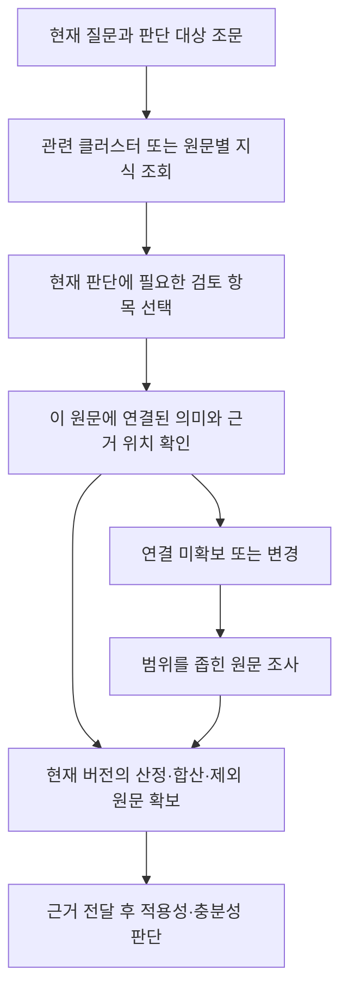

# 근거 기억과 숏컷 최초 진입

[전체 목차](../ONTOLOGY_V3.md)

원래 논의의 절 번호를 유지했습니다. 설계 제안과 구현·검증 상태는 각 절의 구분을 따릅니다.

<a id="v3-6"></a>

## 6. 기억의 단위: 질문·답변보다 ‘근거 필요와 해결 경로’

**2026-10-22 사용자 정정: 일차 저장 단위는 원문이다.** 아래 ‘필요·맥락·해결 경로’는 질문별 지식 묶음의 정본이 아니라, 원문에 연결할 개념·검토 사항과 그 발견 이력이다. 질문은 조회 입력과 Agent 레이어의 실행 기록에 남긴다. [원문 중심 저장과 조회](SOURCE_ANCHORED_STORAGE.md)를 우선 기준으로 적용한다.

사용자가 강조한 핵심은 다음과 같다.

> 핵심은 전체를 탐색하는 것보다 빠르게 정답에 도달할 수 있냐는 것이다.

이를 위해서는 에이전트가 새로운 부족을 발견하는 시점에도 기억을 조회할 수 있어야 한다.

```text
질문 수신 → 일부 조문 확보 → 판단 진행
                          ↓
              “이 판단에는 금액 산정 근거가 필요하다”
                          ↓
               유사한 근거 필요를 해결한 경로 회상
                          ↓
              현재 문서·버전·권한에서 해당 근거 확인
                          ↓
                   판단에 근거를 전달
```

기억에 필요한 최소 내용은 다음과 같다. 이는 설계 항목이며 확정된 저장 스키마가 아니다.

| 기억 요소 | 의미 |
|---|---|
| 필요 | 무엇을 판단하기 위해 어떤 근거가 부족했는가 |
| 맥락 | 판단 대상 조문, 질문 목적, 적용 범위, 시점, 확인된 사실 |
| 해결 위치 | 해당 근거의 문서·조항·본문 범위·표 또는 별표 |
| 해결 경로 | 어떤 연결을 따라 찾았으며 각 단계가 왜 필요한가 |
| 근거의 역할 | 정의·계산식·합산·제외·예외·적용 조건 중 무엇인가 |
| 재사용 조건 | 어떤 질문·문서 범위에 유효하며 언제 다시 확인해야 하는가 |
| 결과와 한계 | 부족이 해소되었는지, 일부만 해소되었는지, 아직 무엇을 모르는가 |

과거 답변 문장을 가져오는 것보다, 과거에 유효했던 근거 경로를 현재 원문에서 확인하는 것이 중심이다. 과거 성공 경험도 법률 정답으로 자동 승인하지 않는다. 실패한 도구 호출이나 근거를 확보하지 못한 탐색을 ‘검증된 숏패스’로 저장하지 않는다.

동일한 문제에는 검증된 구체 경로가 유용하다. 비슷한 문제에는 공통 확인 항목과 후보 경로를 재사용하되, 해당 조문의 바인딩과 적용성을 다시 확인한다. 처음 보는 조문에는 일반 검색이 필요하고, 그 결과가 다음 기억 후보가 된다.

<a id="v3-7"></a>

## 7. 추상화와 구체화 사이의 해법

<a id="v3-7-1"></a>

### 7.1 너무 추상적일 때

> 거래금액이 나오면 산정 방법을 판단하고, 해당 조문과 연결 관계를 봐야 한다.

이런 문장만 저장하면 LLM은 다시 문장을 해석하고, 어떤 조문에 적용하는지 판단하며, 실제 근거를 찾아야 한다. 원문을 읽으면 할 수 있는 말을 반복하는 정도라면 검색 비용을 줄이는 효과가 약하다.

따라서 추상 규칙을 실행에 쓰려면 이름뿐 아니라 **적용되는 판단 유형, 확인할 근거의 종류, 개별 조문과의 연결**이 필요하다. 가능하면 시스템이 식별할 수 있는 ID와 구조로 만들고, 의미 판단이 필요한 부분을 분명히 둔다.

<a id="v3-7-2"></a>

### 7.2 너무 구체적일 때

모든 질문과 데이터 조각에 별개의 지침·답변·본문 복사본을 저장하면 유지 비용이 커지고, 개정 시 여러 곳을 갱신해야 한다. 비슷한 문제에도 각각의 기억을 만들어야 하는 문제가 생긴다.

그러나 원문 위치를 가리키는 바인딩까지 없앨 수는 없다. 숏패스에는 목적지가 필요하다. 줄여야 하는 것은 모든 사례의 답변과 본문을 중복 저장하는 비용이며, 재사용 가능한 관계와 위치 정보까지 없애는 것이 목표는 아니다.

<a id="v3-7-3"></a>

### 7.3 두 층을 연결한다

앞선 논의는 공통 확인 규칙과 조문별 근거 바인딩을 연결하는 구조였다. 2026-10-22 후속 논의에서는 공통 층을 **사용자용 클러스터와 검토 요소의 정리 틀**로 구체화했다. 상세 배경과 온톨로지 생성 과정은 [공통 클러스터에서 온톨로지 구성으로](CLUSTERING_AND_CONSTRUCTION.md)를 따른다.

1. **공통 묶음·표현 틀:** `금액 산정` 아래 산정 대상·범위·합산·제외·시점 등 실제 발견한 요소를 정리한다. 모든 질문에 전부 적용하는 절차는 아니다.
2. **원문별 의미·근거 연결:** A조의 특정 판단에 어떤 금액 정의·계산·조건이 필요한지 원문으로 확인하고 그 위치를 연결한다. 다른 규정의 계산법과는 범위를 구분한다.

질문 또는 이미 확보한 원문에서 관련 지식을 찾고, 현재 판단에 필요한 항목만 선택한다. 이 연결이 맞을 때 필요한 근거의 위치를 처음부터 발견하는 과정을 줄일 수 있다. 효과는 실제 근거 전달·사용까지 확인해야 한다.



공통 규칙을 ‘금액’이라는 단어의 출현만으로 적용하지 않는다. 금액이 단순 설명인지, 실제 결론의 입력인지 원문과 질문 범위를 보고 구분한다. 질문이 대상 기관의 범위만 묻는다면 금액 관련 모든 자료를 무조건 가져올 필요는 없을 수 있다.

<a id="v3-7-4"></a>

### 7.4 같은 조문 안의 숏패스도 의미가 있다

A조의 승인 기준은 제1항, 계산 방법은 제2항, 합산 범위는 별표, 제외 항목은 단서에 있을 수 있다. B조는 이 내용이 한 항 안에 모두 들어 있을 수도 있다.

같은 조문 안이라도 ‘금액 산정 부분은 여기’라고 명시하면 필요한 내용을 놓치지 않도록 돕는다. 다만 조문 전체를 이미 읽었다면 효과는 추가 조회의 감소보다 **중요 부분의 명시, 재독해 감소, 판단 입력의 누락 방지**에서 나타날 수 있다. 이 경우에도 응답시간이 반드시 빨라진다고 단정하지 않는다.

`important: true` 하나보다 ‘이 부분은 기준금액, 이 부분은 합산, 이 부분은 제외’처럼 역할을 붙이는 것이 구체적이다. 원문은 한 번 저장하고 여러 역할이 같은 원문 범위를 참조할 수 있다.

<a id="v3-7-5"></a>

### 7.5 딕셔너리 형태의 설명용 예

아래 ID와 필드는 모두 가상이다. 현행 제품 스키마나 승인된 법률 데이터가 아니다. `source_binding`은 실제 구현 시 문서·버전·해시·권한과 결속되어야 한다.

```json
{
  "judgment_anchor": "demo-rule-A/article-10/paragraph-1",
  "source_binding": "demo-generation-and-document-version",
  "judgment_type": "approval_depends_on_assessed_amount",
  "checks": [
    {
      "check_id": "amount_basis",
      "purpose": "승인 기준과 비교할 금액의 산정 근거 확인",
      "evidence_bindings": [
        {
          "role": "calculation_basis",
          "source_span": "demo-rule-A/article-10/paragraph-2"
        },
        {
          "role": "aggregation_scope",
          "source_span": "demo-rule-C/article-3/paragraph-1"
        },
        {
          "role": "excluded_items",
          "source_span": "demo-rule-A/article-10/paragraph-2/proviso"
        }
      ],
      "reuse_condition": "해당 문서의 해당 승인 판단에 적용",
      "review_status": "illustration_only"
    }
  ]
}
```

조회 결과에는 실제 원문과 위치를 함께 전달한다. 확보하지 못한 역할에 임의의 본문을 채우지 않는다. ‘제외 항목’ 같은 역할도 모든 판단에 존재한다고 가정하지 않고, 실제 원문과 검토 결과에 따라 둔다.

<a id="v3-8"></a>

## 8. 추상 규칙이 필요한 직접적인 이유: 누락과 루프

사용자가 마지막에 분명히 한 이유는 다음과 같다.

> 필요한데 이놈이 안 들고 온다. 자꾸 중요한 근거를 빠뜨리거나 핵심 근거인데 더 필요하다고 막 루프를 돌고 있다.

따라서 추상 규칙의 가치는 ‘금액이 중요하다’는 상식을 저장하는 데 있지 않다. **어떤 판단에 필요한 확인 항목인지 표시하고, 현재 확보한 근거와 대응시켜 누락과 중복 조사를 줄이는 데** 있다.

이 목적에는 규칙만으로 부족하며 실행 상태가 함께 필요하다.

| 확인할 상태 | 구분해야 하는 이유 |
|---|---|
| 경로를 알고 있음 | 위치를 안다고 실제 원문을 읽은 것은 아님 |
| 현재 원문을 확보함 | 과거 버전의 기억이나 실패한 조회와 구분 |
| 판단 담당에게 전달함 | 읽었지만 다음 판단의 입력에서 누락될 수 있음 |
| 의미를 검토함 | 전달했다고 적용성·충분성 검토가 끝난 것은 아님 |
| 추가 확인이 남음 | 필요한 사용자 사실과 아직 찾지 못한 법률 근거를 구분 |

이미 산정 근거를 읽었다면 우선 그 원문을 현재 판단에 다시 연결한다. 같은 상태에서 ‘근거가 더 필요하다’를 반복하기보다, **어떤 조건 또는 구절이 아직 없어 결론을 정할 수 없는지** 구체화한다. 새롭게 필요한 내용이 특정되면 해당 범위만 조사한다.

종료를 ‘모든 슬롯이 채워졌는가’로만 판단하면 새로운 무한 루프를 만들 수 있다. 확인 항목은 누락을 드러내는 도구이며, 미확인 사항이 있다는 이유만으로 확보한 원문의 전달이나 제한된 답변을 막아서는 안 된다.

원문 전달과 판단 완료는 분리한다. 확보한 근거, 현재 가능한 해석, 미확인 사실·근거를 함께 제시한다. 원문 미확보를 곧바로 ‘사용자가 사실을 제공하지 않았다’로 바꾸지도 않는다.

위 상태는 제안하는 구분이며, 현행 상태 enum을 이 문서로 변경하지 않는다. 실제 구현은 [에이전트 실패·복구 정책](../../OPERATIONS/AGENT_FAILURE_RECOVERY_POLICY.md)의 중복 요청·예산·재개·실패 보존 계약과 연결해야 한다.

<a id="v3-9"></a>

## 9. 최초 조문 진입점을 빠르게 찾는 방법

앞의 구조는 조문을 어느 정도 찾은 뒤에 강하다. 사용자가 제시한 다음 과제는 **아직 A조를 모를 때 A조에 빠르게 도달하는 것**이다.

제안하는 진입 단위는 단순한 용어 하나보다 다음의 조합이다.

```text
판단 목적 + 대상 행위·대상자 + 결론을 좌우하는 조건
  → 관련 판단 유형
  → 후보 법령·내규 및 판단 기준 조문
```

예를 들어 ‘거래금액’이라는 단어만으로 검색하면 승인, 보고, 과세, 한도, 위험관리 등 여러 판단이 섞인다. ‘이 계약에 위원회 승인이 필요한가’라는 판단 목적과 대상·조건을 함께 쓰면 승인 기준 조문을 진입 후보로 좁힐 수 있다.

| 질문 상태 | 진입 방법 제안 | 주의점 |
|---|---|---|
| 동일하거나 검증된 재사용 조건에 맞는 질문 | 기존 경로의 판단 기준 조문을 후보로 제시 | 문서·시점·권한·조건 재확인 |
| 유사한 질문 | 공유 판단 유형과 복수의 근접 후보 활용 | 이전 질문의 개별 사실과 법적 결론을 그대로 적용하지 않음 |
| 새로운 질문 또는 기억 없음 | 기존 용어·본문·명시 참조 검색 활용 | 기억이 없다는 이유로 조사 불가능 처리하지 않음 |

이 진입 색인은 용어·본문 검색을 보완한다. 처음 고른 조문에 고착되지 않도록 질문과 맞지 않을 때 다른 후보·다른 법령·일반 검색으로 이동할 수 있어야 한다.

후속 설계는 **질문→지식 후보→원문**과 **질문→일반 검색→원문→연결 지식**의 두 경로를 함께 둔다. 질문 표현에 적중하지 않아도 정확한 원문 anchor에 도달하면 그 원문에 연결된 검토 사항을 찾는다. 후보 검색과 현재 사안의 적용 판단을 분리하며, 원문에 붙은 모든 항목을 강제 조사하지 않는다. [실제 질문의 단계별 예와 구현 경계](QUESTION_MATCHING.md).

분류체계·검색 결합 순위·후보 개수·임계값은 아직 확정하지 않았다. 특히 초기에 잘못 고른 조문으로 이후의 빠른 경로 전체가 잘못 연결될 위험을 평가해야 한다. 현재의 검색어 포함 조회와 연구 후보 실행을 전체 의미 매칭의 구현으로 확대하지 않는다.

---

[이전: 현재 기반과 지식 모델 공리](KNOWLEDGE_MODEL.md) · [목차](../ONTOLOGY_V3.md) · [다음: 새로운 관계 발견과 사례](RELATION_DISCOVERY.md)
