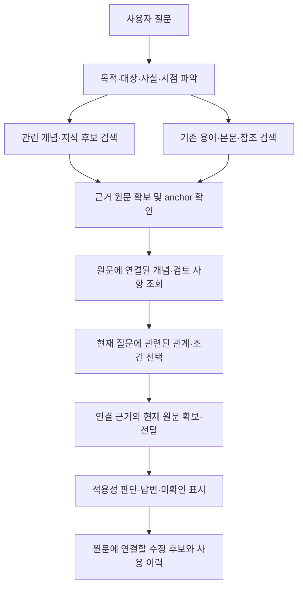

# 질문·원문과 온톨로지 매칭

[전체 목차](../ONTOLOGY_V3.md) · [온톨로지 구성](CLUSTERING_AND_CONSTRUCTION.md) · [원문 중심 저장](SOURCE_ANCHORED_STORAGE.md)

2026-10-22 후속 설계. **질문에서 지식 후보를 찾는 경로와, 검색으로 찾은 원문에서 연결 지식을 조회하는 경로를 함께 둔다. 검색 매칭과 현재 사안의 적용 판단은 분리한다.** 아래 목표 흐름과 확인한 구현 범위를 구분한다.

## 목차

- [1. 질문을 어디에 매칭하는가](#matching-target)
- [2. 질문에서 지식 후보로 진입한다](#question-entry)
- [3. 찾은 원문에서 연결 지식을 조회한다](#source-entry)
- [4. 실제 질문에서 진행되는 과정](#worked-example)
- [5. 미적중·오적중·미확인 처리](#fallback)
- [6. 기존 코드와 연결할 책임](#implementation)
- [7. 검증할 것](#validation)

## 1. 질문을 어디에 매칭하는가

질문 하나에 정답 묶음 하나를 연결하는 구조로 만들지 않는다. 조회 대상은 원문에 연결된 개념·정의·관계·조건·검토 사항·근거 경로다. 클러스터는 이를 찾아보는 보조 묶음이며 한 질문이 여러 묶음의 지식을 필요로 할 수 있다.

| 구분 | 판단하는 질문 | 결과의 의미 |
|---|---|---|
| 검색 매칭 | 이 지식이 현재 질문의 근거 탐색에 도움이 될 후보인가? | 관련성 후보와 진입 근거. 적용 승인이나 법률 결론은 아님 |
| 적용 판단 | 이 관계·규칙이 현재 사건의 대상·사실·시점·조건에 성립하는가? | 적용/비적용 의견, 이유·원문·미확인. 검색 유사도만으로 확정하지 않음 |

조회 결과에는 어느 단서 또는 원문 연결로 제시했는지 남긴다. 제시됨, 선택됨, 원문을 읽음, 판단 입력에 전달됨, 현재 사안에 사용됨을 각각 구분한다.

## 2. 질문에서 지식 후보로 진입한다

먼저 기존 질문 해석 과정에서 판단 목적, 대상 행위·대상자, 명시한 규정, 제공된 사실, 기준 시점과 아직 모르는 내용을 파악한다. 새로운 별도 LLM 호출을 필수로 추가한다는 의미는 아니다. 사용자가 제공하지 않은 사실이나 적용 규정을 추정해 채우지 않는다.

그다음 개념명·별칭·정의·설명·판단 목적·필요 근거 역할을 검색 대상으로 사용해 복수의 후보를 찾는 방향이다.

| 단서 | 후보를 좁히는 예 | 주의점 |
|---|---|---|
| 명시 문서·조항 | 사용자가 지정한 규정과 판본의 지식 | 명시 범위와 현재 권한을 유지 |
| 개념·표현 | 승인/결재, 계약/거래, 금액/합산 | 비슷한 표현이 같은 법적 개념이라는 증거는 아님 |
| 판단 목적 | 승인 필요 여부, 보고 대상 여부, 보유기간 | `금액`이라는 단어 하나보다 구체적인 탐색 단서 |
| 현재 근거 필요 | 확보한 A조의 판단에 필요한 합산 범위 | 원문 위치·필요 역할·현재 확보 상태에 연결 |

용어·동의어·본문 검색에 의미 유사도 검색을 보완하는 방안을 검토할 수 있다. 의미 유사도는 후보 회수 수단이며 권한·판본·적용 조건 검사를 대신하지 않는다. 특정 임베딩 모델·검색 가중치·후보 수·임계값은 이번 문서에서 확정하지 않는다. 현재 코드에 이러한 의미 매칭 전체가 구현됐다는 뜻도 아니다.

LLM은 회수한 후보의 설명·범위·근거를 보고 질문과 관련된 지식을 선택한다. 검색에서 걸러지지 않은 지식 전체를 매 요청마다 읽히지 않으며, 후보가 없거나 맞지 않으면 기존 원문 조사로 이어간다. 같은 질문 표현이 아니더라도 같은 목적·개념·원문을 통해 재사용할 수 있어야 한다.

## 3. 찾은 원문에서 연결 지식을 조회한다

질문 표현에 의존하는 진입을 보완하는 핵심 경로다. 기존 RAG로 실제 원문을 확보한 뒤 **문서 판본 + 조항·span + 관련 개념**을 기준으로 해당 원문에 붙인 검토 사항·관계를 조회한다. 조회는 확보한 원문 anchor로 시작할 수 있으며, 관련 개념을 아직 확정하지 않았으면 연결 후보에서 검토한다.

두 진입 경로를 함께 지원한다는 뜻이며, 두 개의 무거운 검색·모델 실행을 반드시 동시에 수행한다는 뜻은 아니다. 확보한 원문·지식 revision과 기존 요청 상태를 재사용한다.

질문이 지식 색인에 적중하지 않아도 원문에 도달하면 연결 지식을 사용할 수 있다. 원문 anchor가 일치하더라도 붙어 있는 모든 검토 항목이 현재 질문에 필요한 것은 아니다. 예를 들어 승인 처리 기한만 묻는 질문에서 금액 계산 항목 전체를 강제로 조사하지 않는다.

관계 탐색은 필요한 의미·범위·시점으로 좁히고, 방문한 원문·관계 버전과 예산을 유지한다. 한 관계에서 다른 관계를 찾았다는 사실만으로 두 관계의 합성이나 적용을 승인하지 않는다. [새로운 관계 발견](RELATION_DISCOVERY.md#v3-10)과 기존 조사 상태·복구 계약을 함께 따른다.

## 4. 실제 질문에서 진행되는 과정

아래는 [A조 승인·B조 계산·C조 거래 범위의 가상 규정](CLUSTERING_AND_CONSTRUCTION.md#example)을 사용한 실행 설계 예다. 실제 서비스 관측이나 법률 판단 결과가 아니다.

> 같은 프로젝트로 계약을 두 건 맺었는데, 각각 승인 기준보다 작으면 별도 승인 없이 진행해도 되나?

| 순서 | 처리할 내용 | 이때 확정하지 않는 것 |
|---|---|---|
| 질문 해석 | 승인 필요 여부가 목적. 두 계약·같은 프로젝트·각각 기준 미만은 사용자가 제공한 사실 | 같은 프로젝트이므로 반드시 하나의 거래라는 결론 |
| 후보 회수 | 승인 요건·거래금액 산정 후보 검색. 적용 규정이 불명확하면 기존 검색으로 후보 원문 확인 | 비슷한 질문의 과거 답변을 그대로 적용 |
| 원문 진입 | A조를 확보하면 정확한 판본·위치에 연결된 B조·C조의 지식 조회 | A조에 붙은 모든 검토 항목이 이번 질문에 필요하다는 판단 |
| 관련성 선택 | 개별 금액과 합산금액 중 무엇을 비교하는지 질문하므로 합산 범위·계산 근거를 선택 | 검색 적중을 현재 사안의 조건 충족으로 변경 |
| 근거 확보·전달 | B조의 계산법과 C조의 두 조건을 현재 원문으로 읽고 판단 입력에 전달 | 읽기 성공을 모델의 올바른 적용으로 간주 |
| 적용 판단 | 동일 프로젝트뿐 아니라 계약 이행의 상호 조건도 성립하는지 검토 | 부족한 사건 사실을 임의 보충 |
| 응답·기록 | 현재 가능한 조건부 판단, 인용, 미확인과 실제 사용 관계를 기록 | 미확인 하나 때문에 확보한 원문이나 제한 답변을 모두 차단 |

질문에 `합산`이라는 단어가 없어도 승인 조항에 도달한 뒤 계산 의존관계를 통해 B조·C조를 확인할 수 있다. 이것이 원문을 중심으로 연결 지식을 보관하는 직접적인 이유다. 특정 사건의 사실·적용 해석은 Agent 이력으로 남기고, 재사용할 관계의 수정은 Gold 후보의 새 revision으로 검토한다.

## 5. 미적중·오적중·미확인 처리

| 상황 | 이어갈 처리 |
|---|---|
| 질문 검색에 적중 없음 | 기존 원문 검색을 계속하고, 원문 확보 후 연결 지식을 조회 |
| 관련 없는 후보만 회수 | 해당 후보를 적용하지 않은 이유를 남기고 다른 후보·일반 조사로 이동 |
| 읽은 원문에 등록 지식 없음 | 원문으로 판단을 계속하고 새 검토 지식은 후보로 남김 |
| 사건 사실·적용 조건 미확인 | 조건부 설명과 구체적인 미확인 사항을 전달. 필요한 사건 사실은 사용자 확인 대상으로 구분 |
| 법률 근거 미확보 | 기존 조사 경로로 필요한 원문을 찾음. 원문 부족을 사용자의 사실 부족으로 바꾸지 않음 |
| 원문 개정·권한·해시·상태 불일치 | 그 지식·경로의 재사용을 막고 오류를 기록. 허용된 현재 원문 조사와 기존 복구 정책으로 처리하며 모델 수정으로 우회하지 않음 |
| 같은 근거 필요·상태 반복 또는 예산 소진 | 확보·전달 원문을 재사용하고 제한 답변·미확인·종료 사유를 보존. 문구만 바꿔 같은 조사를 반복하지 않음 |

정상적인 의미 불확실성과 무결성 오류는 다르게 다룬다. 미확인 조건 때문에 전체 원문 전달을 막지 않되, 출처·권한·판본 오류가 있는 지식을 일반 후보처럼 사용하지 않는다. 실제 구현 시 재시도·실패 복구 담당은 기존 실행기와 [필수 복구 정책](../../OPERATIONS/AGENT_FAILURE_RECOVERY_POLICY.md)에 결속한다.

## 6. 기존 코드와 연결할 책임

2026-10-22 작업 코드와 완료된 ADR0987 기록을 읽어 확인한 범위다. 새 코드를 실행하거나 선택 릴리스를 변경한 결과가 아니다.

| 구분 | 확인한 상태 | 목표와의 차이 |
|---|---|---|
| 작업 코드 후보 조회 | `Repository.candidates`는 등록 `lookup_terms`가 질문에 포함되는지 SQL `INSTR`로 검색. object ID 순서와 기본 6개 한도를 사용 | 목적·동의어·의미 유사도 기반 순위·선택 전체의 구현이 아님 |
| 작업 코드 계획 조립 | `Service.plan`이 게시 묶음·권한·원문 결속을 확인하고 의존 레코드를 조립. `planning.assemble`은 범위·조건과 미확인을 표시 | 의미 적용의 완료와 다름. 후보 회수와 조건 판단이 분리됨 |
| 작업 코드 RAG 안내 연결 | `knowledge_bridge.prepare`는 질문·source binding으로 계획을 받고 `augment`가 관련 안내를 기존 모델 입력에 붙임 | 이 호출은 질문에서 사건 사실을 자동 추출해 모든 조건에 대입하는 경로가 아님 |
| ADR0987 연구 후보 | 질문→추상 METHOD→원문 METHOD→기존 원문 읽기와 모델 입력 안내를 실제 실행 | 원문 중심 지식은 수작업 구성. 일반 검색으로 새로 읽은 모든 원문의 지식을 추가 조회하는 범용 연결은 미구현 |
| 선택 MAIN | 기록 확인 시 활성 포인터는 MAIN100. ADR0987은 MAIN99에서 동결한 별도 후보 | 해당 후보의 MAIN100 통합·승격을 수행한 기록이 아님 |

코드 근거: [후보 조회](../../../../02_BACKEND/lawrag/legal_knowledge/adapters/repository.py), [계획 서비스](../../../../02_BACKEND/lawrag/legal_knowledge/application/__init__.py), [범위·조건 조립](../../../../02_BACKEND/lawrag/legal_knowledge/application/planning.py), [RAG 안내 연결](../../../../02_BACKEND/semantic_runtime/legal_agent/knowledge_bridge.py). 실행 범위는 [CM E2E 결과](CM_E2E_RESULTS.md)를 따른다.

기존 [구현 단위](../../REPORTS/ONTOLOGY_V3_CONTROL_REVIEW_20261022/implementation/MODULES.md)에 연결할 목표는 다음과 같다. 새 서비스나 중복 실행기를 추가한다는 의미는 아니다.

| 담당 | 입력 → 처리 → 소비자 |
|---|---|
| M03·M04·M05 | 원문 검토 사항 → 개념·관계·조건 후보와 원문 anchor·revision 관리 → 검토·조회 |
| M10 | 같은 지식 참조 → 사용자용 클러스터·문서 보기 → 사람이 탐색·검토하는 화면 |
| M07 | 질문 맥락 또는 확보한 원문 anchor·근거 필요 → 지식 후보·관련 원문 위치 조회 → M08·기존 조사 실행기 |
| M02 | 선택한 근거 필요·경로 → 현재 판본·권한의 원문 조회 → 기존 읽기·판단 입력 |
| M08 | 제시·선택·원문 전달 → 적용/비적용 이유·미확인·최종 주장 연결 → 답변·사용 이력 |
| M11·M12 | 기존 조사 상태·예산과 출처 있는 사실 → 중복 억제·제한된 형식 조건 평가 → 다음 조사·제한 답변 |

## 7. 검증할 것

후속 구현은 같은 뜻의 다른 질문 표현, 직접적인 `합산` 표현이 없는 질문, 같은 원문을 다른 목적으로 묻는 질문, 복수 클러스터가 필요한 질문을 포함해 확인해야 한다. 질문 미적중 뒤 원문에서 지식을 찾는 경로, 아무 지식이 없는 원문, 무관한 후보·구판·권한 변경·반복·예산 소진도 확인 대상이다.

검색의 적중률과 적용 판단의 정확성, 핵심 원문의 실제 입력 전달과 최종 답변 반영을 각각 측정한다. 후보를 더 많이 제시했다는 이유만으로 개선으로 보지 않는다. 코드 계약 검사는 변경 범위에 맞게 수행하고, 모델·검색 효과 비교는 신규 ADR로 사전 동결한다. 현재 문서 갱신은 이러한 실행·검증·승격을 대신하지 않는다.

---

[이전: 공통 클러스터에서 온톨로지 구성으로](CLUSTERING_AND_CONSTRUCTION.md) · [목차](../ONTOLOGY_V3.md) · [다음: 전체 흐름과 구현 검증 과제](INTEGRATION_AND_VALIDATION.md)
