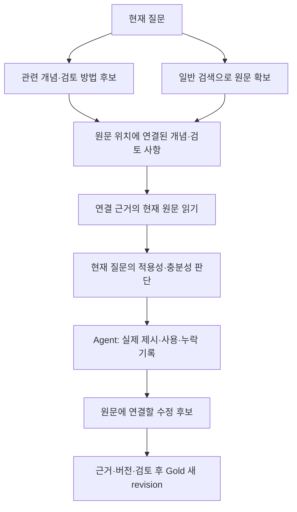

# 원문 중심 저장과 조회

[전체 목차](../ONTOLOGY_V3.md) · [근거 기억](EVIDENCE_MEMORY.md) · [DB 설계](../../REPORTS/ONTOLOGY_V3_CONTROL_REVIEW_20261022/DATABASE_ARCHITECTURE.md)

2026-10-22 사용자 확인: **일차 저장 단위는 원문이다. 질문을 통해 찾은 정보를 원문에 연결하고, 해당 원문·개념을 다룰 때 무엇을 중점적으로 확인할지 알려준다.**

## 저장할 것

| 위치 | 정본과 역할 |
|---|---|
| Gold 원문 | 문서 판본, 조항·항·호·본문 span, 본문 해시, 접근 범위 |
| Gold 원문에 연결된 지식 | 개념, 검토 사항, 조건·수치·식, 연결 근거, 검토 상태·버전 |
| Gold 공통 정리 틀·검토 방법 | 여러 원문·개념에서 반복되는 검토 요소와 의존 관계. 구체적 정의·계산·적용 조건은 각 원문 범위에 둠 |
| Agent 실행 이력 | 발견 질문, 당시 읽은 원문, 판단·정정·미확인, 재사용 제시·선택·실행 기록 |

골드 지식의 논리적 정체성은 `문서 판본 + 원문 위치 + 개념`이다. 같은 원문·개념의 검토 사항이 보완되면 지식 revision을 추가한다. 질문마다 복제하지 않는다. 원문 개정은 새 판본·새 근거 바인딩과 영향 검토로 처리하며, 이전 span을 새 원문에 무조건 붙이지 않는다. 사건별 사실과 결론은 Agent 이력에 남긴다.

원문 위치는 항·호·span까지 좁힐 수 있다. 조문 전체에 하나의 의미만 있다고 가정하지 않는다. 한 span이 여러 개념·역할의 근거가 될 수도 있다.

사용자용 클러스터는 같은 지식 참조를 `금액 산정`, `승인 요건` 등에서 찾아보게 하는 묶음이다. 한 지식이 여러 묶음에 속할 수 있고, 클러스터 소속·이름을 원문 지식의 일차 키나 법적 의미의 동치로 사용하지 않는다. 클러스터는 온톨로지 구성의 재료를 정리하며, 의미 관계·조건 후보는 원문과 별도로 대조·검토한다. [공통 묶음의 역할과 생성 과정](CLUSTERING_AND_CONSTRUCTION.md).

## 실제 보유 자료로 채운 예

다음은 선택된 로컬 원문 세대에 기반한 연구용 검토 후보다. 법률 전문가 승인이나 현행법 인증을 뜻하지 않는다.

| 원문 위치 | 붙일 개념·검토 사항 | 연결할 원문 |
|---|---|---|
| 증권 인수업무 등에 관한 규정 제6조 제2항 | 공동주관 보유비율은 준용 범위가 제14조 **제1항**인지 확인 | 자본시장법 **시행규칙** 제14조 제1항 |
| 같은 규정 제6조 제3항 | 의무취득분의 보유제외 범위를 확인; 분모 자동 차감으로 확대하지 않음 | 코스닥시장 상장규정 제13조 제5항 제1호 |
| 시행규칙 제14조 제1항의 전환사채 부분 | 권면액÷전환 발행가격, 1 미만 단수 제외 | 해당 원문 span과 계산 입력 |
| 코스닥시장 상장규정 제13조 제5항 제1호 나목 단서 | 혁신기술기업과 주선인 사유의 **AND** | 시행세칙 제15조 제5항 |
| 시행세칙 제15조 제5항 | 예비심사신청일 기준 최근3년 내 주선, 해당 기업 상장 후2년 내 지정·폐지 사유 | 제13조의 보유기간 연장 판단 |

‘CM008의 답변’을 원문 정본으로 저장하지 않는다. 그 질문에서 발견한 AND 조건과 세칙 위치를 해당 두 원문에 연결한다. 이후 의무보유 수량·기간을 묻는 CM007이나 다른 질문에도 같은 원문 지식을 제공할 수 있다.

## 두 가지 진입 경로

질문→개념 색인은 최초 진입을 돕는 보조 색인이다. 원문에 도달한 뒤 원문 ID로 검토 사항을 조회하는 경로도 필요하다. 어느 경로든 현재 권한·판본·원문 일치 검사를 유지하고, 미확인 조건 때문에 확보한 원문 전달을 차단하지 않는다.

검색 매칭은 관련 후보를 찾는 일이며 현재 사안에 적용된다는 판단과 다르다. 원문 anchor가 일치해도 현재 질문과 무관한 검토 항목은 적용하지 않을 수 있다. 실제 질문 해석·후보 검색·원문 조회·적용·미적중 전환은 [질문·원문과 온톨로지 매칭](QUESTION_MATCHING.md)에 정리했다.

## 구현과 실험의 경계

연구 후보 ADR0987은 기존 `ShortcutRepository/import_package/rebuild`로 **원문4개에 각각 위키 단위**를 저장하고, 기존 `legal_knowledge.Service`로 **원문 검토 METHOD4개 → 추상 METHOD2개**의 의존 관계와 FIELD2개·APPLICATION1개를 저장한다. 질문별 사례 ID를 원문 단위의 키로 사용하지 않는다. 과거 질문은 별도 `corrected-experiences.json`의 발견 이력으로 연결한다.

현재 실험 후보의 온라인 경로는 질문→추상 방법→원문 검토 단위→기존 원문 읽기다. 일반 검색으로 나중에 발견한 **모든** 원문에 대해 검토 사항을 자동 추가 조회하는 범용 후크까지 구현한 것으로 보지 않는다. 조건 식 검사는 별도 계약 실행이며, 실제 질문의 사건 사실을 LLM이 추출해 자동 대입하는 단계도 별도 검증 대상이다.

[CM 실제 실행 결과](CM_E2E_RESULTS.md): 원문4단위와 온톨로지9레코드를 저장·발행하고,4문항×2조건으로 실제50회 모델을 호출했다. 지식 사용4요청 모두 숏컷이 실행되고 검토 안내가 실제 모델 입력에 들어갔다. 탐색량은 줄었지만 핵심 항목을 모두 설명한 답변은 두 조건 모두0/4였다. 원문별 검토 사항을 최종 판단·답변까지 연결하는 부분은 더 구현해야 한다.

연구용 로컬 SQLite 저장은 데이터 계약과 API 연결을 검증하기 위한 것이다. 운영 저장 대상은 Dataiku Gold/Agent의 Oracle 또는 승인된 조회 API이며, GENOS 서빙에 데이터를 복제하는 설계가 아니다. [실험 기록](../../../../04_EXPERIMENTS/ADR/ADR-0987-cm-source-ontology-native-e2e/README.md)에 실제 호출 결과와 미완료 범위를 기록한다.
