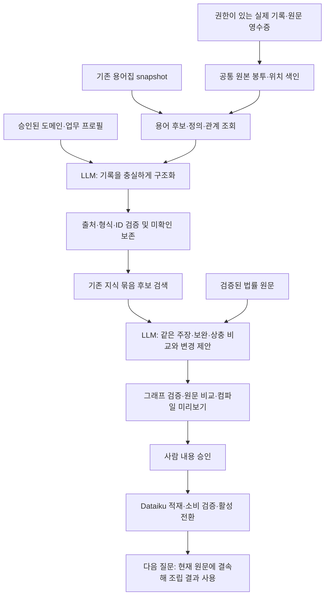

# 용어집 연결·도메인 설정 기반 판단 축적 — 구현·실험 설계

2026-10-29 · 설계 및 실행 준비 명세 · 제품 구현·실험 실행·게시·MAIN 변경 없음

이 문서는 [판단 축적·컴파일 설계](KNOWLEDGE_COMPILATION_DESIGN_20261029.md)를 구체화한다. 후속 사용자 결정인 **에이전트 형식별 수동 어댑터 대신 공통 LLM 구조화**, **초기 도메인 틀 사용**, **용어·개념은 기존 용어집과 연결**을 반영한다. 아래 신규 파일·함수·명령·상태 이름은 제안이며 현재 사용 가능한 API로 표시하지 않는다.

## 1. 구현할 범위와 기존 시스템의 차이

목표는 바뀌는 에이전트 기록을 같은 도메인 문법으로 읽고, 여러 질문의 판단을 기존 지식 묶음에 누적한 뒤 원문 검토·승인을 거쳐 목적별로 컴파일하는 것이다. **용어 정본을 새로 만들지 않는다.** 기존 용어집의 개념 식별자를 참조하되, 특정 규칙과 그 조건·예외의 판본은 별도 지식 묶음으로 관리한다.

확인 기준 D1: 선택 포인터는 MAIN117 `accepted-answer-20261029-r1`. 선택 데이터는 `01_DATA/TERM_RELEASES/latest-selection-20261015-r1/generation`이며 manifest 해시가 릴리스 선언과 일치한다. 용어집 binding은 `glossary-serving-v2`, `glossary/bundle`, `glossary/dictionary.sqlite`, manifest hash `1af468ebbd21456d9e15fd58db68cb02057dad6e5a6dc6a906515376148b0123`이다. 이는 확인 시점의 binding이며 미래 작업의 기본 경로로 하드코딩하지 않는다.

| 같은 상황 | 현재 방식·관측 사실 | 변경 방식·원하는 결과 | 확인 기준 |
|---|---|---|---|
| 에이전트 단계/필드가 변경됨 | `capture`는 현재 investigation 구조, Dataiku 수집은 `ONTOLOGY_WORK_INPUT`에 의존한다. 임의 새 형식의 처리 효과는 미관측 | 공통 원본 봉투와 LLM 구조화기를 사용. 단계명·필드 경로를 의미 매핑표로 유지하지 않음 | 동일 기록의 표현을 바꿔도 주장·반대 의견·출처·미확인 보존 |
| 같은 용어에 여러 규칙이 연결됨 | `Glossary.lookup/inspect/entry_links`가 존재. 카드에는 `canonical_approval=False`. 온톨로지 `schema.published`의 `glossary_ref`는 현재 None | 조회 경로를 재사용해 다대다 용어 참조 저장. 시장·시점·주체·규범·산정이 다른 규칙은 구별 | 같은 용어를 쓴 다른 규칙의 오병합 차단 |
| 도메인별 표현법 변경 | `ontology_work/schema.py`에 프롬프트·출력 구조가 코드 상수로 고정됨 | 승인된 설정에서 프롬프트·스키마·검증·컴파일 명세를 함께 생성 | 동일 설정 hash에서 동일 산출물; 지원 안 되는 의미는 보류 |
| 오답이 반복됨 | 기존 ADR1124 및 MAIN117 후속 기록에 의미 혼동 존재 | 관찰 추출과 채택 규칙 제안을 분리. 반복 오류·철회·정정 원본 보존 | 다수결 채택 없음, 오답을 처음부터 올바른 의견처럼 재작성하지 않음 |
| 승인 후 운영 반영 | 현재 `Repository.publish`는 PUB/ANC 기록 뒤 HEAD를 즉시 활성화 | 새 경로는 내용 승인→staged 게시→적재/소비 확인→활성 전환 | 미검증 snapshot이 독자에게 노출되지 않음 |

용어집 관련 세 모듈과 `ontology_work/schema.py`는 이번 확인에서 작업 코드와 MAIN117 선택본이 같았다. 전체 작업 코드가 선택본과 같다는 뜻은 아니다. 용어집 생성·재수집·새 용어 승인·현장 Oracle 변경은 이 설계의 선행 작업으로 요구하지 않는다.

## 2. 용어집과 지식 묶음의 식별자

### 2.1 기존 용어집 연결 계약

기존 `full_glossary.concept_id(source, node)`는 source/node에서 `concept:` ID를 만든다. label을 hash한 새 용어 ID를 만들지 않는다. `lookup`은 정확 표기 및 토큰 후보, `inspect`는 정의·관계, `entry_links`는 사전 entry 연결을 반환한다. 현재 조회는 세션의 `known`에 등록된 ID를 요구하므로, 저장 ID 재조회에는 원래 source/node 존재를 검증하고 카드를 복원하는 작은 **저장소 조회 포트**가 필요하다. 에이전트 단계별 어댑터와는 별개다.

제안 `GlossaryRef`:

| 필드 | 의미 |
|---|---|
| `source`, `node_id`, `concept_id` | 기존 용어집의 원천·노드·개념 ID. 서버 재계산/존재 확인 |
| `entry_id`, `mapping_id` | 제공된 경우 기존 사전 항목과 연결 근거. 없는 값은 null |
| `binding` | 선택 데이터 세대, glossary manifest/dictionary hash, 조회 코드 버전 |
| `link_state` | `CANDIDATE / CONTEXT_LINKED / AMBIGUOUS / UNRESOLVED / STALE` — 새 온톨로지 연결 상태 |
| `source_status`, `review_ref` | 기존 용어집이 반환한 상태를 그대로 보존. 승인 여부를 새 enum으로 덮어쓰지 않음 |
| `mention_refs`, `reason`, `candidate_receipt` | 어느 기록의 용어인지, 어떤 후보를 보고 연결했는지 |

`CONTEXT_LINKED`는 이 기록이 해당 용어를 가리킨다는 검토 결과이며 용어 정의나 법률 규칙의 정본 승인과 다르다. 원천 관계·번역·모델 SAME 제안은 각각의 지위를 유지한다. `entry_links`가 반환한 후보를 모두 동의어로 승인하지 않는다.

### 2.2 지식 묶음은 새 용어 사전이 아니다

| ID | 소유자·역할 |
|---|---|
| `glossary_concept_id` | 기존 용어집의 개념 정체성 |
| `knowledge_bundle_id` | 해당 개념들에 관한 규칙·조건·예외·목적을 검토하는 축적 단위 |
| `bundle_revision`, `node_id` | 그 지식 묶음의 판본과 의미 요소 |
| `raw_event_id`, `extraction_revision` | 기록의 정체성과 그 기록을 해석한 결과 판본 |

기존 설계의 `concept_id` 중 **축적·승인 단위를 뜻하던 이름은 `knowledge_bundle_id`로 명확히 한다.** 용어집 개념 ID와 혼용하지 않는다. 하나의 용어는 여러 지식 묶음에, 하나의 묶음은 여러 용어에 연결될 수 있다. 예를 들어 같은 등록 용어를 쓰더라도 적용 시장·행위자·판본이 다른 의무는 자동 병합하지 않는다.

미등록 용어는 원래 표기와 원문 위치를 `UNRESOLVED`로 남긴다. 원문에 근거한 지식 초안 작성은 가능하지만, 가짜 glossary ID를 생성하지 않는다. 새 용어 검토가 필요하면 기존 용어집 업무로 후보를 넘기고 그 결과를 다시 연결한다. 용어 연결 실패만으로 전체 원본 기록을 버리지 않는다.

### 2.3 조회와 변경 경계

- 업무 설정의 문서/용어 범위는 탐색 우선순위다. 실제 허용 범위는 인증된 작업 권한과 교집합으로 제한한다. 설정으로 권한을 늘리지 않는다.
- 동일한 selected snapshot의 reader를 주입한다. 로컬은 기존 SQLite reader, 현장은 `oracle_query_glossary.Glossary`와 실제 mapping을 사용한다. 작업자가 선택한 전역 `current_draft`를 RAG snapshot 대신 섞지 않는다.
- 조회 후보에는 `next_offset`, 조회 범위와 미조회 여부를 남긴다. 첫 페이지에 없다는 이유로 미등록/다른 개념을 확정하지 않는다. 제한 초과는 `DEFER_MATCHING`이다.
- 기존 정의 카드의 `text_truncated`를 보존한다. 잘린 정의만으로 용어 동일성을 확정하지 않는다. 법률 규칙 근거는 별도 검증된 원문에서 가져온다.
- 용어집 교체 시 연결 상태와 의존 색인을 다시 검토한다. 원문이 그대로인 경우 모든 판단을 무조건 재생성하지 않는다. 승인된 게시본은 옛 binding을 보존하며 검증 없는 최신 ID 치환은 금지한다.

## 3. 도메인 설정의 구성과 초기 생성

### 3.1 설정 계층

1. **공통 계약:** 출처·권한·판본·원본 인용·타입·참조·작업 상태. 도메인 설정이 약화할 수 없다.
2. **법률 기본 프로필:** 정의/범위/측정/산정/조건/효과/예외, 규범 양태, 의미 필드, 허용 관계, 목적별 필수 검토 항목.
3. **업무 프로필:** 법률 기본 프로필의 exact version/hash를 상속하고 비교 축·조립 목적·검토 사례를 선택한다. 용어·별칭·정의를 복제하지 않고 기존 용어집 binding/참조를 사용한다.
4. **실제 지식:** 원문에서 채택한 값·의미 요소·관계·예외. 설정 파일에 특정 조문 답이나 고정 산정값을 박지 않는다.

임의 다중 상속은 첫 구현에서 제외한다. 업무 프로필은 부모 하나를 고정하고 허용된 추가/선택만 적용한다. 필수 출처 삭제, 승인 우회, 미확인을 임의 기본값으로 채우는 override는 거절한다. 업무 프로필에 넣은 분야명은 표시용이며 용어집 개념 등록을 뜻하지 않는다.

### 3.2 설정 패키지

| 항목 | 내용 | 소비자 |
|---|---|---|
| `manifest` | profile ID/revision, 부모 hash, 상태, 지원 공통 계약/IR/compiler 버전, 검토 영수증 | 작업 예약·재현·활성 선택 |
| `node_types`, `slots` | 역할, 필드 타입, 값/미기록/해당없음 상태, 조건부 필수 규칙 | LLM 출력 스키마·편집 폼 |
| `relations` | 허용 방향·끝점 타입·근거 필요 여부·컴파일 역할 | 관계 검증·의존 조립 |
| `matching` | 용어 참조, 주체·대상·범위·시점·양태·산정 의미 비교 축 | 기존 묶음 후보 비교 |
| `review_rules` | 기계 검사와 의미 검토 질문을 분리한 규칙 목록 | validator·원문 대조 화면 |
| `purposes` | 조립 root 역할, 필요한 조건·정의·산정·예외 검토 | preview·컴파일 |
| `examples` | 올바른 구조화·반례·미확인 사례의 버전 참조 | 구조화 지침; 평가용 정답은 별도 |

동봉 [설정 예시](DOMAIN_PROFILE_DESIGN_20261029/domain-profile.example.json)는 데이터 구조를 구체화한 **비활성 설계 예시**다. [설계 스키마](DOMAIN_PROFILE_DESIGN_20261029/domain-profile.design.schema.json)로 구조를 확인할 수 있다. 실제 제품 loader·등록된 연산자·승인·게시 기능이 구현됐다는 뜻은 아니다.

[업무 설정 예시](DOMAIN_PROFILE_DESIGN_20261029/business-profile.example.json)는 이 기본 틀의 exact hash를 참조해 상장·공시의 목적·비교 축·검토 질문을 선택한다. [업무 설정 설계 스키마](DOMAIN_PROFILE_DESIGN_20261029/business-profile.design.schema.json)도 함께 제공한다. 실제 용어집 ID를 임의 선택하지 않았으며, 빈 선택은 인증된 snapshot 안에서 후보를 찾도록 명시했다. 모든 정의·별칭의 복제 목록은 비어 있다.

설정 생성 함수 제안: `profile.compile_profile(core, domain, business, registry) -> effective_profile, prompt, output_schema, validation_plan, assembly_plan`.

이 함수는 모델 호출 없이 동작한다. hash에는 부모·설정·예시·코드와 생성 산출물을 결속한다. JSON Schema와 프롬프트가 따로 수정되어 어긋나지 않게 한다. 연산자는 구현된 닫힌 registry에서만 선택하며 자유 Python/SQL/eval은 허용하지 않는다. 자연어 의미 검토 규칙을 기계적으로 증명할 수 있는 규칙으로 가장하지 않는다.

### 3.3 처음부터 만들지 않는 초기 절차

- `ontology_semantics`의 연구 스키마와 `CONTROLLED_KNOWLEDGE`를 기본 템플릿 후보로 가져온다. 연구용 권한 표지를 운영 승인으로 바꾸지 않는다.
- 업무 담당자가 최종 조립 목적과 실제 사용하는 용어집 범위를 선택한다. 이미 등록된 용어·관계는 기존 reader로 가져온다.
- 대표 원문과 실제 판단에서 표현되지 않는 의미를 수집한다. 현재 44묶음은 업무 발견 자료이며 실제 판단/정답 44건으로 변환하지 않는다.
- LLM은 프로필 초안·표현 불가 항목·기존 틀과의 diff를 제안한다. 담당자가 의무/조건·예외·산정·시점 구분과 컴파일 결과를 확인한다.
- `DRAFT → VALIDATED → APPROVED → ACTIVE`로 관리한다. VALIDATED는 형식/연산자/참조 검사를 뜻하며 도메인 의미 승인과 다르다. 최초 구현에서는 검토자가 직접 작성한 비활성 프로필로 시작할 수 있으며 프로필 생성 LLM은 필수 단계가 아니다.

새 용어/새 규칙은 지식 또는 용어집 검토 경로로, 새 필드/역할은 프로필 변경으로, 새 실행 의미는 compiler registry 변경으로 처리한다. 지식이 늘어날 때마다 스키마를 바꾸지 않는다.

## 4. 바뀌는 에이전트 기록의 공통 구조화

### 4.1 원본 봉투와 사실 영수증

제안 `raw-observation-envelope-v1`의 최소 필드:

| 필드 | 생산 책임·검증 |
|---|---|
| `namespace`, `run_id`, `raw_event_id`, `sequence`, `parent_refs` | 인증된 exporter가 기록. 단계명이 바뀌어도 유지 |
| `payload_ref`, `payload_hash`, `media_type` | 실제 기록 본문과 내용 hash. 압축 기록은 공통 `journal_storage` reader 사용 |
| `source_receipt_refs` | 실제 읽기·전달·저장 영수증 참조. LLM의 “읽었다” 문장을 성공 영수증으로 대체하지 않음 |
| `source_snapshot`, `producer_binding`, `acl_ref` | 원문 세대·실행 코드·권한. 서버 제공, 본문 주장으로 덮어쓰기 불가 |
| `format_description` | 선택적 형식 설명. 자료로만 읽으며 시스템 규칙보다 우선하지 않음 |

공통 exporter는 임의 JSON의 필드/문자열과 텍스트를 원형 그대로 열거하고 위치를 붙인다. LLM이 어느 부분이 판단·이유·정정·실제 답변인지 해석한다. 현재 의미 필드명에 의존한 새 분기표를 만들지 않는다. 저장 전송 형식 자체가 바뀌거나 영수증 의미가 바뀌는 경우에는 공통 reader/export 계약을 갱신해야 한다. 원본에 없는 이유나 확보 사실은 복원할 수 없다.

### 4.2 구조화 출력

제안 `normalized-observation-v1`:

- `raw_event_refs`, `extraction_revision`, `profile_hash`, `glossary_binding`, `model_receipt`.
- `observation_kind`: 질문/쟁점, 주장, 읽기·연결 결정, 사용자 정정, 최종 사용, 실패/미완료 등 공통 유형.
- `observed_statement`, `observed_reason`, `purpose`, `scope`, `previous_refs`: 각각 원본 locator 또는 `NOT_RECORDED`.
- `semantic_elements`: 프로필의 node kind와 typed slot. 아직 법률 정답이 아닌 기록의 의미 표현.
- `glossary_refs`: 제공 후보에서 선택한 연결과 모호함. 임의 ID 거절.
- `source_claims`: 에이전트가 근거로 주장한 원문. 서버가 확인한 확보/전달 상태는 별도 `verified_source_receipts`.
- `coverage`: 입력 구간마다 `USED / NON_JUDGMENT / NEEDS_CONTEXT`와 출력 참조. 자기신고 ledger의 완전성이 의미 추출의 완전성을 증명하지는 않는다.
- `unresolved`: 원본 미기록, 문맥 부족, 필요한 원문 미확보, 표현 불가, 용어 모호함, 판단 충돌을 구분.

locator는 `payload_hash + JSON Pointer(또는 text 구간) + 시작/끝 위치 + 정확 인용`이다. 위치는 해석된 원본 문자열의 Unicode code point 기준, 끝 제외로 고정한다. 임의 공백 정규화 뒤 매칭하지 않는다. 원문 근거 locator와 기록 인용 locator를 혼용하지 않는다.

`raw_event_id`는 재수집해도 같다. `extraction_revision`은 입력·프로필·후보·구조화기 binding의 hash로 구분한다. 하나의 event를 여러 번 구조화한 것을 독립 의견 여러 개로 세지 않는다. 기존 판단 ID가 원본에 있으면 보존하지만 필수라고 가정하지 않는다. 모델이 새로 분할한 요소 ID는 추출 판본 안의 로컬 ID이며 다른 판본과 동일하다고 자동 간주하지 않는다.

### 4.3 최초 구현의 호출 분리

**N1: 처음에는 구조화 요청과 지식 변경 제안 요청을 분리한다.** 구조화는 틀린 의견도 충실히 추출한다. 다음 요청이 원문을 대조해 `SUPPORTED / CONTRADICTED / PARTIAL / UNKNOWN`을 제안하고 기존 지식의 변경안을 만든다. 서로 상반된 목적을 한 번에 수행하다가 원래 오답을 지우는 위험을 줄이기 위한 설계 선택이며 품질 개선은 미검증이다.

기존 설계의 작은 묶음 한 번 생성 가능성은 후속 비용 최적화 후보로 남긴다. 첫 버전의 합격 전 호출 합치기를 하지 않는다. 입력이 크면 데이터 단위로 나누되 미처리 구간·교차 참조를 유지한다. 분할 수를 예약 전에 고정하고 전체 예산을 공유한다. 문맥이 끊기면 미완료로 남기며 임의 요약으로 지식 완성을 선언하지 않는다.

## 5. 실제 처리 순서와 지식 갱신

| 단계 | 입력/판단 | 산출물·분기 |
|---|---|---|
| 원본 수집 | 기존 events를 checkpoint 이후부터 읽고 압축 복원/권한 검증 | 불변 raw 객체, 재수집 멱등 receipt |
| 용어 조회 | 등록 표기 역매칭과 기존 lookup/inspect. 서버 필터는 허용 범위만 | 제공 후보 목록/hash와 미조회 범위. 새 LLM 동의어를 정본으로 추가하지 않음 |
| 구조화 | 원본+선택 프로필+허용 용어 후보 | 관찰 초안. 원본 미기록·형식 모호함 보류 |
| 비교 후보 검색 | glossary ref, 원문 anchor, 기존 bundle 색인의 합집합 | 같은 용어 없는 관련 규칙도 원문/참조로 후보 가능. 검색 불충분 표시 |
| 누적 제안 | base revision+새 관찰+기존 반례+현재 원문 | SAME/COMPLEMENT/SPECIALIZATION/CONTRADICTION/DIFFERENT_SCOPE/VERSION_CHANGE와 변경 이유 |
| 검토·컴파일 | node/edge diff, 근거, 조건/예외/목적 coverage | 추가·수정·삭제·보류. 연결 없는 필수 조건과 부정확한 조립 차단 |
| 승인·게시 | exact profile/graph/source/glossary hash 승인 | staged snapshot, 적재 receipt, head CAS. 내용 승인과 사용 전환을 분리 |

`SAME`은 새 이력만 추가할 수 있다. `COMPLEMENT`는 같은 묶음의 다음 판본, `CONTRADICTION`은 양쪽 의견 보존과 검토 대기다. 마지막 답변 우선·빈도 다수결은 사용하지 않는다. source scope·시점이 다른 경우에는 하나의 규칙으로 덮어쓰지 않는다. 단순 문자열 비교만으로 같은 의미를 확정하지 않는다.

관찰×묶음×판본의 사용 원장을 둔다. 동일 관찰이 다른 목적의 근거가 될 수 있다. 같은 승인 온톨로지에서 파생된 답변에는 publication lineage를 남겨 자기 강화 횟수를 별도 표시한다.

## 6. 컴파일러까지 연결하는 계약

`ontology-assembly-ir-v1`에 profile hash, glossary refs, knowledge bundle revision을 결속한다. 기존 연구 구조의 node role·typed slot·의존·예외를 시작점으로 삼되, 운영 승인과 소비용 별도 package 버전을 구현한다.

- 관계는 `REQUIRES_INPUT / REQUIRES_CONDITION / REQUIRES_SCOPE / REQUIRES_DEFINITION / MODIFIES` 등 등록 의미로만 컴파일한다. `RELATED_TO`는 탐색 연결이며 실행 의존이 아니다.
- 노드와 간선 각각에 원문 근거를 둔다. 기록 인용만으로 법률 규칙이나 간선을 승인하지 않는다.
- 목적 root에서 필요한 선행 요소와 등록된 예외를 닫힘 집합으로 모은다. 타입·역할·예외 대상을 보존한다. 모르는 선행 조건은 후속 판단에 미확인으로 전파한다.
- 승인된 정확 문장과 typed slot을 함께 보존한다. 문장의 조건을 컴파일러가 새로 해석해 추출하는 호출은 없다. 문장/필드 의미 일치는 별도 검토 항목이다.
- 의미 유형을 새로 만들 때 기존 core role로 손실 없이 매핑할 수 있으면 프로필 확장으로 처리한다. 새 실행 의미는 등록 연산자와 compiler 변경이 필요하다.
- 첫 버전의 계산은 입력·단위·분모·식의 설명과 관계를 조립하는 범위다. 임의 계산식을 실행하지 않는다.
- 원문 일부만 확보한 관찰은 저장 가능하다. 현행 v1 게시가 요구하는 검증된 원문 단위와 범위 조건은 유지한다. 부분 span 지원을 바꾸려면 별도 버전 계약과 소비자를 함께 검증한다.
- 원문 도착 조회와 ON/OFF fallback을 유지한다. MAIN117의 requirement review 및 accepted answer 조립 경로를 우회하지 않는다. 새 package가 실제 ASSESS 입력·claim·최종 답변까지 연결되는지를 별도 측정한다.

## 7. 저장·상태·실패·화면

Dataiku는 작업·진행·재시도·저장·S3를 소유하고 GENOS는 계산한다. 원문 SIDDS, 에이전트/작업 SIDDA의 기존 경계를 유지한다. 프로필·관찰·추출 결과·변경안·게시 패키지는 내용 hash 객체로 관리하고 작은 색인만 DB에 둔다. 실제 표/컬럼 등록과 운영 골드 mapping은 기존 메타데이터 절차로 확정한다. 이 설계는 DDL 실행 지시가 아니다.

기존 WORK/EVT/PUB/HEAD/ANC를 유지하면서 논리적으로 PROFILE, RAW/OBS, GLOSSARY_LINK, BUNDLE_MATCH, USE, JOB 색인이 필요하다. 신규 표와 기존 표 확장 여부는 구현 전 매핑 검토에서 결정한다. 사용자 개인 사실은 공유 규칙에 복사하지 않으며 공개 패키지에는 검증된 일반 지식만 넣는다.

| 실패 | 담당·종료/복구 |
|---|---|
| 원본 형식은 읽히나 의미 불명 | 구조화 단계가 NEEDS_CONTEXT/UNSUPPORTED_SEMANTICS. 원본 보존, 임의 타입에 밀어 넣지 않음 |
| 없는 용어 ID·다의어 | 용어 연결 단계가 거절/AMBIGUOUS. 제공 후보 재검토 또는 기존 용어집 검토. 자동 신규 등록 없음 |
| 인용 위치 오류·필드 누락 | 생성 단계가 같은 허용 입력과 모든 검출 오류를 모아 형식 보완. 최초 출력 보존 |
| 원문/권한/hash 불일치 | 저장·검증 계층이 차단. 모델 보완으로 우회하지 않음 |
| 의미 충돌·해석 오류 | 반대 의견·근거·범위를 보존하고 REVIEW_CONFLICT. 자동 정답 교체 없음 |
| 원문은 일부 확보, 상위 조문만 존재 | 실제 읽은 span 유지. 필요한 하위 원문은 NOT_ACQUIRED. root 존재로 완료 처리 금지 |
| 429 | 공통 전송 클라이언트만 확정429 공급자 전환 담당. 호출/대기 차감 |
| 타임아웃·응답 불명 | UNKNOWN, 같은 요청 자동 재생성 없음. 확인 가능한 receipt만 재개 |
| 모델 성공 뒤 저장 실패 | SAVE_UNCONFIRMED. 보관한 동일 결과 저장/조회만 복구하며 모델 재호출 없음 |
| profile/glossary/base revision 변경 | commit 직전 재검증, STALE_BASE. 승인/head 자동 덮어쓰기 없음 |
| 중복·동시 작업 | raw ID·입력 hash·job lease·CAS로 검증. 동일 ID 다른 payload는 충돌 |
| 취소·예산 소진 | Dataiku가 작업과 사용량을 보존, 미완료 표시. 재개 시 deadline/예산 초기화 금지 |
| 적재 성공 여부 불명 | publication ID로 조회·조정. 새로운 패키지 생성이나 롤백 head 재활성화 금지 |

복구 한도 N2: 논리 생성 작업당 정상 1회와 형식 보완 최대 1회. 배치 전체에 공통 전송 클라이언트를 사용하고 확정429 전환 최대 1회를 공유한다. `J`개 작업의 물리 상한은 `2J+1`, 전환이 없으면 `2J`다. 작은 단일 end-to-end 후보는 구조화+갱신 제안 `J=2`이므로 최대 5회이며, 최초 정상은 2회다. gateway/단계/runner가 같은 보완을 중복하지 않는다. 현장 GENOS 전송 정책은 별도 실제 설정으로 확인하며 이 외부 실험 산식을 그대로 덮어쓰지 않는다.

기존 화면의 `모인 기록 → 초안 만들기 → 검토·승인` 흐름을 유지한다. 업무 프로필 선택은 초안 만들기 설정에 넣고 상세 프로필 편집은 운영자에게만 제공한다. 검토 표에는 용어 연결/모호함, 원래 판단/정정, 변경 요소·관계, 원문, 컴파일 미리보기, 미해결과 영향을 표시한다. 내용 승인 버튼과 골드 반영/사용 전환 상태를 구분한다.

## 8. 파일별 구현 책임과 이행

| 기존/제안 위치 | 구현 책임 | 소비자·보존 항목 |
|---|---|---|
| 기존 `full_glossary.py`, `full_glossary_connections.py`, `oracle_query_glossary.py` | bounded lookup/inspect/entry 링크 재사용. 저장 source/node 검증 조회 포트 검토 | 기존 의미 승인 상태·권한·snapshot 검증 |
| 제안 `ontology_work/glossary_binding.py` | 위 reader 주입, 후보 receipt, 저장 참조 재결속·drift 검사 | 자체 사전/별칭 생성 금지 |
| 제안 `ontology_work/profile.py`, `profile_schema.py` | 프로필 검증·부모 해소·생성 산출물 hash·지원 연산자 확인 | 기존 공통 불변조건과 v1 읽기 |
| 기존 `capture.py`, Dataiku `ingest_agent_events.py` | 공통 raw envelope/export 경로 추가, checkpoint와 반복 수집 | 기존 ONTOLOGY_WORK_INPUT 호환; 현재 heads만으로 과거 의견 대체 금지 |
| 제안 `ontology_work/observations.py` | 임의 JSON/텍스트 위치 색인, 충실한 LLM 구조화, locator 검증 | 원본·압축·실패·이전 판본 보존 |
| 제안 `matching.py`, `accumulation.py` | 후보 검색, 다대다 용어/묶음 연결, 충돌 및 그래프 diff 제안 | 원문·범위·계보·미조회·반례 보존 |
| 기존 `workflow.py`, `repository.py`, `store.py` | 새 단계/job 원장, 작업 잠금과 publication head 분리, staged 전환 | 형식 보완 한도, SAVE_UNCONFIRMED, 동일 결과 멱등 저장 |
| 제안 `assembly_ir.py`, `assembly_compiler.py` | 운영용 typed IR·목적별 closure·새 게시 package | 기존 scenarios v1 및 연구 semantics 계약을 혼용하지 않음 |
| 기존 `configuration.py`, `cli.py`, `ui.py`, Streamlit dashboard/model | 인증된 프로필 선택, 작업/승인/게시 제어와 실제 화면 | actor를 입력 JSON이나 텍스트박스로 지정하지 않음 |
| 기존 `runtime.py`, `ontology_context.py`, `ontology_assessment.py`, `completion_execution.py` | 새 package 조회·현재 원문 결속·ASSESS 소비·답변 추적 | 기본 OFF/빈DB/장애 fallback, 요구 검토, MAIN117 전체 내용 보존 |

제안 CLI는 기존 `06_TOOLS/pipeline.py ontology-work` 아래 `profile-validate / normalize / accumulate / stage-publication / activate-publication`을 추가하는 방향이다. **현재 CLI에는 없으므로 이 이름을 실행 명령으로 안내하지 않는다.** 연구 runner가 frozen candidate를 직접 주입하고, 검증 이후 CLI/UI가 같은 서비스를 호출하게 한다.

v1 레코드는 v1 reader로 계속 읽는다. 새 구조를 기존 `components/text/requires`로 손실 변환해 호환됐다고 처리하지 않는다. 기존 44개 준비 묶음은 별도 발견 자료로 유지하고 실제 기록의 provenance를 만들어 붙이지 않는다. 용어집·원문 전체 재구축은 필요하지 않으며 새 색인·profile·package와 영향받는 연결만 구축한다.

## 9. 구현 순서와 완료 조건

| 단계 | 산출물 | 끝났다고 판단할 조건 |
|---|---|---|
| P0 계약 | 프로필/관찰/용어 참조/IR 스키마, registry, 합성 fixture, 입력 manifest | 정상·미확인·반례를 표현하고 생성 산출물 재현 가능 |
| P1 공통 수집·용어 연결 | 실제 저널 read/export, raw index, 기존 glossary reader 주입 | 압축·중복·과거/현재 판단·허용 범위·다의어·snapshot 변경 확인 |
| P2 구조화 | 프로필 기반 prompt/schema·위치 검증·복구 | 형식 변화 실험 E1 및 원문 오답 보존 기준 확인 |
| P3 누적·컴파일 | 기존 묶음 비교·diff·타입/간선/목적 검토·preview | 여러 질문의 보완·반박·예외가 조립 결과에 반영됨 |
| P4 화면·저장·게시 | 기존 화면 연결·동시성·staged/activate·실패 복구 | 실제 API/CLI→저장→화면→재조회가 같은 판본을 가리킴 |
| P5 작업 통합·선택 MAIN | 필요한 hunk와 pin 통합, 해당 버전 회귀, 승격·롤백 receipt | 선택 포인터·manifest·실제 service OFF/ON빈DB/ON게시자료 확인 |
| P6 현장 | Dataiku 입력·S3·Oracle mapping·권한·GENOS 계산·RAG 조회 | 현장 동일 코드/세대·실제 질문 재사용 확인. 로컬 결과로 대체 금지 |

P2만 완료하고 최종 온톨로지 축적이 완료됐다고 보고하지 않는다. 첫 기능 완료 단위는 **질문 A의 판단 → B의 보완/반박 → 같은 묶음 새 판본 → 검토 승인 → 컴파일 → 질문 C에서 조회·전달·주장 사용 확인**이다.

## 10. 실험 계획 — 실행 전 동결할 내용

동봉 [실험 계획 데이터](DOMAIN_PROFILE_DESIGN_20261029/experiment-plan.example.json)는 PRE_REGISTRATION_DESIGN이며 ADR 동결/실행 기록이 아니다. 실제 실행을 시작할 때 동일 scope reservation을 확인하고 기존 `adr_structure.py new`로 선점한다. 구현 후보는 `adr_candidate.py snapshot/register/freeze/validate`로 격리하고 runner가 exact revision을 주입한다. 이 문서만으로 활성 registry를 바꾸지 않는다.

### 10.1 입력과 정답의 분리

- 합성 자료에는 실제 법률 결론처럼 보이지 않는 가상 문서와 명시적 expected graph를 쓴다. 형식 변환 함수는 원문 문자·기록 순서·영수증 의미를 보존하고 locator 대응표를 만든다.
- 실제 자료는 저장된 event/run·원문·판본을 고정한다. 현재 44개 묶음은 용어/업무 탐색용이며 실제 판단 실험의 대체 표본이 아니다.
- known CM007/009, ADR1124 등 이미 본 실패는 개발 probe다. 같은 질문의 표현 변경·같은 원문의 다른 질문은 독립 holdout으로 세지 않는다.
- 독립 평가는 원문·개념 가족 단위로 분리하고 노출 이력까지 남긴다. 미노출 표본을 확보하지 못하면 decision_eligible=false다.
- 사람 검토 또는 명시적 합성 정답의 원자 주장·정정 관계·출처·예외·기대 조립을 채점 전용 파일에 둔다. 제품 입력 builder의 allowlist에서 제외하고 최종 전송 payload를 확인한다. 실제 자료의 확정 정답이 없으면 의미 점수는 미확정으로 보고한다.

### 10.2 E1: 에이전트 형식 변경에 대한 충실도

목표 N3: **기본 사례 8개 × 표현 3개 = 구조화 작업 24개**. 가상 기본 사례는 의무/조건 혼동, 허용/의무, 추정/간주, 분모·기준일, 조건부 예외, 철회 후 정정, 선택했으나 미확보, 용어 다의어다. 각 사례를 flat JSON / 중첩 JSON / 순서 있는 텍스트 기록으로 표현한다. 판단 이유가 없는 경우에는 모든 표현에서 없는 상태를 유지한다.

모델·프로필·용어 후보·의미·예산을 고정하고 필드명·중첩·단계명만 바꾼다. 원본 형식을 비교 기준으로 하되, 세 출력 모두 별도의 expected observation과 대조한다. 세 결과가 같은 오답인 경우를 성공으로 세지 않는다. 단계명이 없어져도 근거 locator, 판단/정정 구분, 미기록 상태가 같아야 한다.

이 실험은 일반 구조화기의 형식 대응을 평가한다. 모든 임의 로그를 이해한다거나 법률 정답을 찾았다는 증거가 아니다. 표현 24개를 독립 사례 24개로 보고하지 않고 기본 사례 8개 기준과 표현별 결과를 함께 보고한다.

### 10.3 E2: 여러 질문의 누적과 최종 컴파일

목표 N4: **축적 이력 4개 × checkpoint 3개 × arm 2개 = 변경 제안 작업 24개**.

| 이력 | A 입력 | B 추가 | C 추가 | 기대 |
|---|---|---|---|---|
| 보완 | 일반 규칙 | 같은 규칙의 기준일/산정 입력 | 같은 용어의 다른 시장 규칙 | 보완은 같은 bundle 새 판본, 다른 범위 구별 |
| 오답 | 원문과 다른 주장 | 같은 실행 계보의 오답 복제 | 원문과 연결한 정정 | 반복으로 지지 강화 없음, 이전 오답 보존 |
| 예외 | 일반 효과와 조건 | 빈도가 낮은 예외 | 예외가 요구하는 별도 정의 | 목적 closure에 예외·정의 포함 |
| 판본 | 구 원문에 대한 판단 | 개정 원문/적용 시점 | 오래된 작업의 늦은 결과 | 판본 분리, stale 덮어쓰기 거절 |

arm A는 현행 v1 레시피 생성에 매 checkpoint의 동일 누적 자료를 입력하고, arm B는 프로필/이전 bundle/새 관찰로 누적 그래프를 제안한다. arm A에 없는 관찰 포장은 평가 runner의 명시적 비교 입력 변환이며 현행 운영 기능으로 간주하지 않는다. 두 arm이 같은 사실·원문을 받았는지 manifest로 대조한다. 평가 단위는 서로 다른 출력 스키마 자체가 아니라 보존된 원자 의미·관계와 목적별 조립 결과다. B는 구조·누적 방식이 함께 바뀌는 복합 후보이므로 효과를 단일 요소의 인과효과로 주장하지 않는다.

E1의 고정된 canonical 형식 결과 또는 별도 사전 확정 관찰을 양 arm에 공유한다. 구조화 실패 사례는 NOT_READY로 원장/분모에 남기며 성공 사례만 몰래 골라 효과를 계산하지 않는다. 구조화 비용은 공유 전처리로 보고하고 end-to-end 비용에서 제외하지 않는다. checkpoint 입력의 사용자 정정은 실제 관찰이며 채점 정답을 제품에 주입하는 것과 구분한다.

### 10.4 E3: 저장·실제 소비 경로와 분리 평가

먼저 새 모델 없이 실패 주입/합성 응답으로 동시성·재개·ACL·source/glossary drift·원문 하위 범위 누락·staged 실패·롤백·중복 게시를 검사한다. 기존 CLI/UI 및 native API와 같은 서비스를 사용한다. 단위 테스트 성공과 실제 선택 service 연결을 구분한다.

후속 실모델 평가는 고정된 동일 질문·원문 권한·선택 코드에서 일반 RAG(OFF), 기존 게시본, 새 게시본을 비교한다. 조회 성공·모델 입력 전달·claim 사용·최종 답변 보존을 각각 기록한다. MAIN117 requirement review를 유지한다. 회수 후보를 바꾸면 before/added/discarded/after와 golden recall을 별도 원장에 기록한다. 조문 root 회수 외에 필요한 하위 span 확보/전달/답변 반영을 추가 집계한다.

E3 실모델의 표본 수·독립성·expected annotations와 총 예산은 E1/E2 결과 뒤 새 ADR에서 동결한다. 지금 없는 실측이나 holdout을 꾸며 넣지 않는다. 실제 질문 007/009를 자동 재시험하는 계획은 아니다.

### 10.5 통과·실패 기준과 예산

| 축 | 지표와 사전 목표 |
|---|---|
| 출처/권한 | 허용 밖 원문·없는 locator·가짜 용어 ID·hash 불일치를 채택한 건수 0 |
| 충실도 | 기본 합성 사례의 기대 주장·반대 의견·정정·미기록 상태를 전부 보존. 하나라도 의미 변경/누락이면 해당 사례 실패 |
| 형식 강건성 | 각 사례의 세 표현에서 기대 의미가 같고 원본 위치가 각각 유효. 기계 ID 차이는 locator 대응표로 정렬 |
| 용어 연결 | 실제 후보 기반 precision/recall, AMBIGUOUS 유지 여부, 같은 용어의 다른 규칙 오병합 수. 미확정 실제 gold는 점수와 분리 |
| 축적 | 기대 보완/상충/범위 차이·복제 계보·철회 이력을 보존. A/B의 개선·회귀를 사례별로 보고 |
| 컴파일 | 기대 node/edge/예외 closure 전체 보존, 같은 승인 입력의 동일 결과, 모델 호출 0 |
| 상태 | stale/중복/부분 저장으로 승인/head가 잘못 이동한 건수 0. 실패 결과 성공 표시 0 |
| 비용/시간 | 실제 물리 호출, 보완/429/UNKNOWN, 토큰, 보고 비용과 비용 미확인, 구조화/제안/컴파일/검토 시간을 분리 |

N5(제안 예산): E1/E2 각각 논리 작업 24개, 형식 보완 최대 24개, 배치 전환 최대 1개이므로 물리 상한 **49회/실험**. 개별 모델 절대기한 **180초**, batch 전체 **1,800초**, 동시 무거운 작업 **1개**. 시간 예산이 먼저 끝나면 남은 셀을 NOT_RUN으로 보고하며 자동 새 batch로 이어서 예산을 초기화하지 않는다. 입력 한도를 넘는 분할은 이 상한 밖으로 자동 증식하지 않으며 새 계획으로 동결한다. 이 숫자는 성능 예측이 아닌 첫 probe 제안 상한이다.

현재 외부 정책은 Qwen3.8 `qwen/qwen3.8-27b`, Parasail FP8 기본, 확정429만 Near AI FP8 최대 한 번 전환, reasoning none, 출력 토큰 상한 없음이다. 실행 시 정책 파일 hash와 유효 설정을 다시 동결한다. 기존 표준의 역사적 모델/provider 문구를 현재 정책으로 되돌리지 않는다. 채점 LLM을 쓰면 별도 budget/class로 등록해야 하며 첫 합성 probe에는 필수로 두지 않는다.

합성 의미 실패는 해당 후보의 효과 미통과로 기록한다. 기술 반영과 법률 품질 판정을 분리하되 권한·출처·해시·상태의 심각한 오류는 우회하지 않는다. 결과를 본 뒤 프롬프트·스키마·표본·기준을 바꾸면 원결과를 보존하고 새 ADR로 후속 후보를 만든다.

## 11. 비용·일정·남은 확인

시간/금액/개발 인일은 미산정이다. 위 24/49회는 예정 작업량/상한이며 실제 발생 횟수가 아니다. 모델 가격은 실행 receipt의 보고값을 쓰고 UNKNOWN 비용은 0으로 채우지 않는다.

`총 구축비 = 구조화 + 용어 조회 + 지식 제안 + 검토 + 저장/컴파일 + 재처리`다. 프로필이 자주 바뀌거나 모호한 용어/상충이 많으면 재처리와 검토 비용이 늘어난다. 재사용 손익은 기존 설계의 `n(C0-C1) > B+H+U`로 동일 범위에서 측정한다. 입력 형식 변경 시 수동 매핑 수정이 줄어드는 효과는 변경 유형별 수정 파일 수·시간과 의미 회귀로 측정하며 지금 절감률을 주장하지 않는다.

구현 시작 때 확정할 외부 연결은 Dataiku 실제 이벤트 dataset/export 권한, Oracle glossary mapping·snapshot 제공 방식, 운영 골드 프로필/색인 모델, 실제 검토 담당자다. 이들은 로컬 합성 구현의 차단 조건이 아니지만 현장 완료를 선언할 필수 조건이다. 미확정 항목을 기본 admin/공개 범위/자동 승인으로 대체하지 않는다.

## 12. 자체 검토·근거·이번 산출물

같은 작성자의 자체 검토다. 독립 감독 검토·실모델 효과 검증·현장 인증은 수행하지 않았다. 확인한 항목은 기존 용어집 ID/조회/승인 상태, 현재 ontology 입력·게시 계약, 선택 MAIN/data binding, 기존 화면/CLI 진입점이다.

- [용어집 reader](../../../../02_BACKEND/semantic_runtime/full_glossary.py), [정의·관계 reader](../../../../02_BACKEND/semantic_runtime/full_glossary_connections.py), [Oracle reader](../../../../02_BACKEND/semantic_runtime/oracle_query_glossary.py), [용어집 운영 기록](../../OPERATIONS/GLOSSARY_ALIGNMENT.md).
- [현행 ontology schema](../../../../02_BACKEND/semantic_runtime/ontology_work/schema.py), [workflow](../../../../02_BACKEND/semantic_runtime/ontology_work/workflow.py), [repository](../../../../02_BACKEND/semantic_runtime/ontology_work/repository.py), [CLI](../../../../02_BACKEND/semantic_runtime/ontology_work/cli.py), [Dataiku 수집](../../../../08_DEPLOYMENT/DATAIKU/ontology_workflow_20261028_r1/ingest_agent_events.py).
- [연구 semantic 구조](../../../../02_BACKEND/semantic_runtime/legal_agent/ontology_semantics.py), [기존 컴파일](../../../../02_BACKEND/semantic_runtime/legal_agent/ontology_scenarios.py), [의무·조건 구분](CONTROLLED_KNOWLEDGE.md), [화면·골드 설계](STREAMLIT_DATAIKU_GOLD_UI_DESIGN_20261028.md).
- [실패 복구 기준](../../OPERATIONS/AGENT_FAILURE_RECOVERY_POLICY.md), [실험 실행 표준](../../../../04_EXPERIMENTS/LEGACY_ADR/EXPERIMENT_AGENT_PROMPT.md), [실험 기록 표준](../../../../04_EXPERIMENTS/LEGACY_ADR/STANDARD.md), [현재 모델 정책](../../../../00_SYSTEM/EXPERIMENT_MODEL_POLICY.json), [현재 공급자 정책](../../../../00_SYSTEM/EXPERIMENT_PROVIDER_ROUTING.json).

이번 완료 범위는 설계 문서·비활성 프로필 예시/설계 스키마·실험 계획 데이터와 문서 정합성 확인이다. 신규 ADR 예약·제품 후보 구현·모델 호출·품질 실험·MAIN/GENOS 변경은 하지 않았다.
