# 원문·개념별 판단 축적 — 구현·실질문·화면 계획

**2026-10-29 후속 설계:** [판단 축적에서 최종 컴파일까지](KNOWLEDGE_COMPILATION_DESIGN_20261029.md)는 이 계획을 이어, 실제 답변·판단의 유사/상충 비교와 오답 처리, 노드·간선·목적별 조립 계약을 구체화한다. 아래 MAIN112 기준 관측과 최초 계획은 보존한다. 후속도 설계이며 구현·게시·MAIN 변경은 수행하지 않았다.

작성일: 2026-10-28. 상태: **구현 전 설계 / 자체 검토**.

**2026-10-28 화면·골드 절차 보완:** 사용자가 Dataiku Streamlit과 승인 후 골드 이관 절차를 재확인했다. 후속 [Streamlit·골드 이관 상세 설계](STREAMLIT_DATAIKU_GOLD_UI_DESIGN_20261028.md)를 화면/운영 게시의 우선 설계로 따른다. 아래 최초 계획의 `승인 → DB 게시`와 동반 시안은 중간 절차를 축약한 초안이다. 실제 운영은 내용 승인과 표준·모델 승인을 구분하고, 기존 모델 재사용 또는 신청·생성 확인 → 패키지 → Dataiku 적재 → 재조회 검증 → 사용 전환을 거친다. 기존 HEAD를 작업 잠금으로도 사용하는 구현과 단계적 게시를 위한 변경 지점은 후속 설계에 명시했다. 최초 시안과 작성 당시 검증 기록은 보존한다.

이번 산출물은 구현 계획과 화면 시안이다. 제품 코드 수정·모델 호출·데이터 게시·MAIN 승격·GENOS 배포는 실행하지 않았다. 기준은 선택 MAIN112 `vector-initial-20261028-r1`이며, 진입점과 관련 제품 17파일이 작업 코드와 같은 것을 확인했다. 기존 문서와 실패 기록은 수정하지 않는다.

## 1. 만들 기능과 첫 완료 단위

질문을 조사하며 생긴 읽기 판단·연결 판단·사용자 정정을 **같은 원문과 개념의 기존 묶음에 갱신 제안**으로 모은다. 관리자는 원문, 기존 게시 내용, 새 제안을 비교해 수정·보류·반려·승인한다. 승인 뒤 별도로 게시한 새 판본부터 다음 질문에서 사용한다.

첫 구현은 다음 한 바퀴를 완성한다.

1. 조사 기록에서 원문에 결속된 관찰을 중복 없이 수집한다.
2. 원문 좌표와 기존 개념 색인으로 갱신 후보를 찾는다.
3. 현재 게시본과 새 관찰을 함께 읽어 `변경 없음 / 기존 묶음 갱신 / 별도 개념 / 충돌 검토`를 제안한다.
4. 변경분과 전체 조립본을 기존 관리 화면에서 검토한다.
5. 새 작업 판본을 승인·게시하고 다음 요청에서 실제 사용한 게시 ID를 확인한다.

일차 재사용 단위는 문서 판본·조항·span이다. 질문·세션은 발견 이력으로 보관한다. 질문의 성공 여부나 사용자의 정정을 법률 정답으로 간주하지 않는다.

첫 범위에는 범용 새 스키마/DB 컬럼 자동 확장, 수치 실행·조건 변경 영향 계산, 모든 자연어 판단 재지시 실행을 넣지 않는다. 사용자 정정은 **대상 판단을 지정한 검토 의견**으로 먼저 수집한다. 해당 의견을 실제 재조사 명령으로 실행하는 기능은 별도 계약이 필요하다. 기존 질문·사실·검색계획 수정은 유지한다.

## 2. 기존 방식과 바꿀 방식

| ID | 같은 상황 | 기존 방식·확인 근거 | 실제 결과/관측 한계 | 수정 방식 | 원하는 결과·검사 |
|---|---|---|---|---|---|
| K1 | 다른 질문에서 같은 조항을 다시 검토 | `capture`는 현재 조사 읽기 판단을 모으고 `enqueue`는 입력 전체 해시로 묶음 ID를 만듦 | 코드로 확인. 현재 서비스에서 중복 묶음이 몇 개 생겼는지는 미관측 | 관찰 ID와 개념 묶음 ID 분리. 같은 조항은 후보 검색에 사용하고 개념·적용 범위를 대조 | 두 질문이 같은 개념이면 기존 묶음의 새 판본 제안으로 모임. 같은 조항의 다른 개념은 분리 |
| K2 | 여러 실행에 모두 J1이 존재 | 현재 작성 자료의 판단 참조는 각 입력의 로컬 판단 ID | 실행 간 통합 시 충돌 가능성은 설계상 확인, 실제 충돌 사고는 미관측 | 실행·요청·판단 ID·판단 판본을 함께 묶은 영구 관찰 ID | 다른 실행의 J1을 구별하고 동일 이벤트 재전달만 중복 제거 |
| K3 | 연결을 안 따라갔거나 사용자가 정정 | 현재 자동 수집은 `read_judgments`의 유효 head 중심 | 연결 후보·사용자 정정을 모두 통합하는 소비자는 없음 | 실제 연결 선택 receipt와 대상이 특정된 정정 이벤트를 별도 종류로 수집 | 판단 없음·원문 미열람·철회·미확인을 그대로 표시 |
| K4 | 같은 개념에 반대 판단이 들어옴 | 기존 `propose`는 작업 하나에서 새 전체 레시피를 생성 | 기존 묶음과 신규 판단의 비교·충돌 통합은 미관측 | 기존 판본+새 관찰+현재 원문으로 변경 제안. 삭제·예외 변경에는 이유와 인용 요구 | 반대 판단을 덮어쓰지 않고 양쪽 근거와 충돌을 검토자에게 표시 |
| K5 | 제한 답변의 결론을 다시 지식으로 삼음 | ADR1173 CM001 후보는 내부 PARTIAL/LIMITED_ANSWER와 단정적 최종 문장의 불일치 | 실제 실패 기록. MAIN112 실행 결과로 전용하지 않음 | 답변 결론 대신 검증된 원문·판단·미확인을 생성 입력으로 사용 | 미확인 내용이 확정 규칙으로 자동 승격되지 않음. 법률 의미 검토는 사람이 수행 |
| K6 | 게시 후 무엇이 재사용됐는지 확인 | `runtime.acquire`와 게시 receipt는 있으나 축적 검토와 사용 이력이 한 화면으로 이어지지 않음 | 코드·기존 문서 확인. 새 화면 실사용 결과는 없음 | 관찰→작업 판본→게시 ID→다음 요청의 선택 경로를 조회로 연결 | 승인만 된 자료는 미사용, 게시 후 실제 조회·선택된 경우만 사용으로 표시 |

기존 `schema.published`는 `evidence_judgments=[]`이고 시나리오 authoring에 판단 ID를 남긴다. 이번 확장은 단순 화면 목록 추가로 끝내지 않고 영구 관찰 ID의 출처·권한·판본을 별도 계보로 연결해야 한다. 기존 미인증 실험 자료를 승인 데이터로 이행하지 않는다.

## 3. 처리 구조

```mermaid
flowchart LR
  A[질문 조사·판단·정정] --> B[기존 이벤트에 관찰 기록]
  B --> C[Dataiku 수집·중복 제거]
  C --> D[원문·개념별 기존 묶음 후보]
  D --> E[새 관찰과 기존 판본의 변경 제안]
  E --> F[원문·변경분·전체 경로 검토]
  F --> G[새 판본 승인]
  G --> H[승인 모델·매핑 확인 또는 신청·DB 생성]
  H --> H1[패키지·Dataiku 골드 적재·검증]
  H1 --> H2[사용 판본 전환]
  H2 --> I[다음 질문이 같은 원문에 도달]
  I --> J[게시본 조회·선택·사용 이력]
```

RAG 요청 중에는 기존 저널에 관찰을 기록한다. 개념 묶기·시나리오 생성·S3 보관·작업 진행은 Dataiku가 맡는다. GENOS는 요청된 계산만 수행한다. 생성 호출을 질문 응답 완료의 선행 조건으로 만들지 않는다. 저널 기록에도 비용이 있으므로 요청 시간 증가를 측정한다.

### 관찰 계약 — 제안 `ontology-observation-v1`

| 필드 | 계약 |
|---|---|
| `observation_id` | namespace + 권한 경계 + 실행/요청 ID + 원본 이벤트 ID + 판단 ID/판본 + 원문 좌표의 digest. 단순 J1은 영구 ID가 아님 |
| `kind` | READ_JUDGMENT / CONNECTION_DECISION / CONNECTION_PENDING / USER_CORRECTION / JUDGMENT_WITHDRAWAL |
| `origin` | 원본 이벤트·세션·질문·실행 binding 참조. 이름·내용이 아닌 인증된 주체에서 권한 경계 설정 |
| `anchors` | 실제 문서 ID·판본·조항·span·본문 해시. 읽지 않은 연결 대상은 `unread_target`로 분리하고 내용 해시를 만들지 않음 |
| `judgment` | 원래 판단·사유·채택/보류/충돌 상태·근거 참조. 사용자 의견과 모델 판단 구분 |
| `supersedes` | 정정·철회된 이전 관찰 ID. 이전 자료를 삭제하거나 기록을 최신 주장으로 치환하지 않음 |
| `source_state` | VERIFIED_READ / OFFERED_NOT_READ / SOURCE_CHANGED / UNRESOLVED_TARGET |
| `access_scope` | 서버가 확인한 팀/사용자/문서 접근 범위. 질문·업로드 JSON이 지정한 범위를 신뢰하지 않음 |

수집은 이전에 내보낸 관찰 ID 이후의 변화만 기록한다. 과거 이벤트 보충은 별도 backfill 작업으로 출처를 남긴다. 거절된 모델 출력·미완성 판단은 승인된 관찰로 변환하지 않는다. 부분 답변에서도 검증된 읽기·판단은 관찰로 남길 수 있지만 성공 지식으로 자동 게시하지 않는다.

### 같은 묶음인지 결정하는 순서

1. 접근 가능한 문서·작업 경계 안에서 기존 작업/게시 색인을 조회한다. 게시본만 찾는 기존 ANC로는 미게시 초안까지 찾을 수 없으므로 작업용 색인이 필요하다.
2. 원문 좌표·span 겹침, 승인된 개념 ID/용어 참조로 후보를 좁힌다. 같은 조항이라는 이유만으로 합치지 않는다.
3. 여러 조항이 같은 개념을 설명할 수 있고 한 조항에 여러 개념이 있을 수 있다. 개념명 일치나 임베딩 유사도만으로 병합하지 않는다.
4. 모델은 제시된 후보 중 갱신 대상 또는 별도 개념·충돌 검토를 제안한다. 정답표·채점 결과는 입력에서 제외한다. 생성 입력에는 현재 원문·기존 승인 내용·새 관찰만 넣고 전체 질문 답변을 규칙으로 복사하지 않는다.
5. 서버는 후보 ID·원문·판본·권한·구성요소 ID·인용·의존·삭제 이유를 검사한다. 의미상 같은 개념인지는 검토자가 확정한다.

개념 ID와 묶음 ID는 이름 변경 후에도 유지한다. 신규 ID는 작업 예약에서 한 번 발급하고 재개 시 재사용한다. 원문 판본 변경은 별도 검토로 만들고 이전 판본의 승인을 상속하지 않는다.

### 변경 제안 — 제안 `ontology-update-proposal-v1`

`base_bundle_id / base_revision / base_publication_id / input_observation_ids / decision / concept / full_recipe / change_map / unresolved`를 받는다. `decision`은 NO_CHANGE, UPDATE_EXISTING, NEW_CONCEPT, REVIEW_CONFLICT다. full_recipe는 기존 고정 레시피로 컴파일 가능해야 한다.

변경분은 ADD / MODIFY / REMOVE / KEEP로 표시하되 서버가 기존·새 구성요소를 비교해 검증한다. 모델이 말한 “변경 없음”도 실제 본문·의존·경로가 같은지 확인한다. 기존 구성요소의 안정적 ID를 유지해 새 원문 추가와 문구 교체를 구별한다. 미확보 대상과 미해결 의미 충돌은 `unresolved`로 남긴다.

모델 출력에는 새 필드나 실행 코드를 허용하지 않는다. NO_CHANGE는 검토 이력만 남기고 동일 의미의 새 게시본을 만들지 않는다. NEW_CONCEPT/UPDATE_EXISTING은 후보 상태다. 충돌이 있으면 원문을 비교해 명시적으로 해결하거나 보류한다. 독립된 검증 범위만 게시하려면 새 판본에서 제외 범위와 사유를 드러낸다.

## 4. 저장·이행

원문은 SIDDS의 기존 문서/블록, 작업 JSON은 Dataiku S3, 작업·관찰·감사·게시 색인은 개발계 SIDDA에 둔다. 운영 골드 등록은 별도 승인 절차다. 기존 WORK/EVT/PUB/HEAD/ANC를 보존하고 다음 **물리명 후보**를 설계한다.

| 후보 테이블 | 한 행·키 | 주요 메타데이터와 소비자 |
|---|---|---|
| `SIDDA.LGL_ONT_OBS_A` | 관찰 ID 1개 | 원본 이벤트 ID·작업 권한 경계·종류·객체 해시·수집시각. 수집기와 검토함 |
| `SIDDA.LGL_ONT_IDX_A` | 권한 경계+원문 좌표+개념 ID+묶음 ID+작업 판본 | 초안/게시의 원문→묶음 검색. 모든 대상 anchor를 행으로 색인; S3 전체 스캔 금지 |
| `SIDDA.LGL_ONT_USE_A` | 관찰 ID+묶음 ID+작업 판본 | 제안에 포함/제외/보류된 이유·검토 참조. 같은 관찰을 복수 개념에서 사용 가능 |
| `SIDDA.LGL_ONT_JOB_A` | 생성 작업 ID; 멱등 키에 UNIQUE | 대상 판본·관찰 집합·작업 상태·모델 결과 객체 해시·예산·deadline. Dataiku 예약/진행/재개 |

이 이름은 실행 DDL·메타 승인 결과가 아니다. 기존 TABLE_BIZMETA/TABLE_COLUMNS 형식으로 논리명·물리명·도메인·인포타입·30바이트·타입·Description을 작성하고 현장 표준 대조 후 확정한다. 작업 ID·해시는 ASCII VARCHAR2, 한국어 원문/판단은 JSON 객체 또는 CLOB에 보관한다. 보존기간·업무 소유자는 현장 등록에서 확인한다.

작업 입력은 새 v2 계약을 명시하고 v1 읽기 어댑터를 둔다. 현재 `validate_input`은 허용 키를 닫고 있어 기존 JSON에 필드를 몰래 추가할 수 없다. 게시 소비자는 기존 검증된 scenario package를 유지하고 새 관찰 계보는 권한 검사된 별도 조회로 연결한다. 공개 게시본에 비공개 질문·사용자 의견을 복사하지 않는다.

기존 묶음은 ID·revision·approval·publication을 그대로 보존한 채 작업용 색인만 추가한다. 원본 재파싱·전체 원문 복사·재임베딩은 이 기능의 필수 단계가 아니다. 미인증 후보는 미인증 그대로 가져오고, 이전 실패의 본문/해시를 변경하지 않는다.

S3 객체 저장→DB에서 객체 해시/관찰 수신 commit→수집 체크포인트 진행 순서다. 중간 실패 시 같은 관찰 ID로 재수신하고 기존 객체를 확인한다. 체크포인트를 실패 지점 뒤로 넘기지 않는다. 삭제 정리는 이 작업에서 하지 않는다.

## 5. 코드 변경 지도

아래 신규 이름은 모두 **제안**이며 현재 존재하는 API로 안내하지 않는다.

| 기존 진입점 | 변경 책임 | 소비자·검증 |
|---|---|---|
| `legal_agent/read_judgment.py:apply` → `ontology_work/capture.py` | 현재 head 전체 입력 대신 새 판단/정정/철회 관찰의 안정 ID와 원문 좌표 수집 | 기존 저널, Dataiku 수집기. 재개/중복/부분 완료 검사 |
| `legal_agent/relation_cards.py`, `relation_views.py`, 조사 실행 receipt | 실제 연결 행동의 선택/보류와 제시됐지만 미판단인 후보를 구분해 추출 | 관찰 계약. 카드가 보였다는 이유로 실행/열람으로 기록 금지; 실제 commit 지점은 구현 시 호출 추적 확정 |
| `corrected_memory.py`의 이벤트, `judgment_view.py:build` | 사용자 정정의 대상·이전 판단·변경 범위 표시 및 관찰 연결 | 질문 결과의 판단 목록. 현재 실제 계층에서 접근 가능한 기록만 투영 |
| `app.py`의 인증된 세션 입력 처리 | 제안 `POST /v1/rag/ontology-observations`와 상태 조회. 대상 run/판단 소유권·권한·멱등성 검증 후 기존 저널에 기록 | 질문 결과의 ‘검토 의견 남기기’. 기존 feedback endpoint는 판단 대상·소유권 계약이 달라 그대로 재사용하지 않음 |
| `ingest_agent_events.py:ingest` | 기존 이벤트 수집에서 v1/v2 분기, 관찰 upsert, 객체 저장·수신 영수증·체크포인트 | OBS/IDX/USE/JOB 및 S3. 실제 이벤트 dataset 연결은 별도 확인 |
| `ontology_work/repository.py` | 신규 저장/색인, 범위 있는 페이지 조회, 대상 판본 예약·동시성 제어 | 검토함·생성 작업·사용 이력. 기존 256목록 hard-stop을 전체조회로 우회하지 않음 |
| 제안 `ontology_work/accumulation.py` | 후보 검색, 원문·기존판본 결속, 변경 제안 실행, diff 검증·멱등 처리 | 기존 `Workflow`의 새 판본 생성으로 연결 |
| `ontology_work/schema.py`, `workflow.py` | v2 입력 및 update proposal; 명시적 base revision; 보류·충돌은 별도 검토 상태 | 기존 compile→review→publish 계약 유지 |
| `ontology_work/ui.py`, 기존 Streamlit 온톨로지 관리/시뮬레이션 | 검토함·3열 비교·전체 조립 미리보기·게시·사용 이력 | 실제 버튼은 같은 Workflow 메서드 호출. 새 관리자 앱을 별도로 만들지 않음 |
| `ontology_work/runtime.py:acquire`, 시나리오 선택/발행 | 실제 조회/선택/발행된 게시 ID·경로 ID를 기존 이벤트에 기록 | Dataiku 사용 이력. 읽기 지연을 피하도록 RAG에서 추가 동기 쓰기 DB 호출하지 않음 |
| `pipeline.py ontology-work` → `cli.py` | 제안 `collect / accumulate / diff / resume` 액션, 기존 생성·승인·게시 재사용 | 동일 로컬/레시피 구현. 새 독립 실행기를 만들지 않음 |

신규 축적 스위치는 기본 OFF인 제안 `GENOS_ONTOLOGY_ACCUMULATION_ENABLED`로 분리한다. 기존 capture/use ON/OFF와 각각 수집·초안작성·게시본 사용을 제어한다. 설정은 운영자만 바꾸며 사용자 질문에서 변경할 수 없다.

## 6. 실제 질문 한 번으로 확인할 흐름

첫 질문 후보는 등록된 **CM001**이다.

> 벤처금융 및 전문투자자의 100분의 10 한도는 합산 기준인가?  
> (업무 문맥: 신규상장 의무보유 - 코스닥시장 상장규정 제26조)

질문 원문은 `01_DATA/review/cm_core_e2e_v3.json`에서 확인했다. 알려진 사례를 이용한 기능 점검이며 독립 품질 평가가 아니다. 과거 ADR1173 실패는 조사 중 미확인을 보존하는 설계 근거로만 사용한다. 해당 후보 코드를 MAIN112에 적용된 것으로 취급하지 않는다.

| 단계 | 실제 실행 계획 | 화면·저장 결과 | 실패/분기 |
|---|---|---|---|
| 사전 준비 | 구현·계약 검사 후 새 ADR로 코드/데이터/질문/모델/예산/성공기준 동결. 같은 원문의 보관 실제 관찰을 출처 명시해 후보로 수입 | 이전 관찰 표시. 기존 승인 묶음이 있으면 exact receipt로 연결 | 이전 자료가 없으면 신규 묶음 흐름. 합성 자료를 실제 과거 질문으로 표시하지 않음 |
| 질문 1회 | 후보의 실제 로컬 service 진입점에서 CM001 자연질문 실행 | 답변·미확인·실제로 읽은 원문·판단·연결 receipt | 필요한 원문 미도달도 실제 결과로 남김. 답을 맞추려고 목표 조항을 사후 강제하지 않음 |
| 관찰 수집 | Dataiku 레시피와 같은 함수를 로컬 어댑터로 실행 | 원문별 읽기/연결/미판단/충돌 목록, 수신 영수증 | 판본/권한 불일치 관찰 제외와 이유 기록 |
| 기존 묶음 연결 | 같은 원문·개념 후보와 새 관찰 비교 | 기존 갱신 / 신규 / 중복 / 별도검토 | 같은 조항이어도 다른 개념이면 분리 |
| 초안 생성 | 새 관찰+기존 판본+현재 원문으로 한 개념의 변경 제안 | 추가·수정·삭제·유지·미확인과 전체 조립본 | 법률 결론이 불확실하면 확정 규칙으로 채우지 않음 |
| 사람 검토 | 실제 검토자가 원문·변경분을 확인하고 수정/보류/반려/승인 | 검토자·이유·검토판본 기록 | 원문 미확보는 ‘추가 조사 필요’. 승인 클릭을 시뮬레이션해 실제 승인으로 세지 않음 |
| 게시 | 승인한 판본·hash·활성 순번 일치 후 DB 게시 | 게시 receipt와 적용 판본 | 승인 전/승인만 된 초안은 RAG에 미노출 |
| 재사용 기술 확인 | 동일 게시본을 실제 소비자 코드의 저장응답 재생으로 확인 | 조회·선택·출력된 본문/hash. 재생으로 표시 | 새 실제 질문 실행으로 계산하지 않음 |

**한 번의 새 질문으로 증명할 수 있는 것은 수집→변경 제안→사람 검토→게시의 연결이다.** 여러 질문 통합은 보관된 실제 관찰과 새 관찰을 함께 넣어 확인한다. 새로운 질문에서 실제로 재사용되는지는 게시 후 별도 후속 질문 1회가 있어야 확인된다. 같은 질문 반복은 재현 점검, 다른 표현은 동일 사례의 변형이며 독립 법률 품질 표본이 아니다.

검토자가 남길 예시 의견: “합산 여부의 근거가 된 문구를 다시 확인해 주세요.” 이는 UI 설계 예시이며 실제 사용자 정정 이력으로 저장하지 않는다. 첫 실질문 결과가 미확인일 때도 조사 관찰과 보류 후보가 올바르게 남는 것을 기능의 정상 결과로 인정한다.

### 모델과 비용 경계

새 외부 실행은 `ExperimentClient`의 현행 Qwen3.8, Chutes FP8, reasoning none, 출력 상한 없음 정책을 사용한다. 확정 429에서만 클라이언트 수명 동안 Near AI FP8로 한 번 전환하며 두 물리 요청을 센다. 동일 공급자 자동 재시도·다른 오류 전환은 없다. 선택 MAIN112 내장 전송기 정책을 변경한 것으로 보고하지 않는다. 후보의 로컬 모델 주입과 Dataiku의 GENOS 생성 어댑터는 분리한다.

| ID | 지표·종류 | 설계 값/산식 | 확인 방법 |
|---|---|---|---|
| N1 | 질문 예산·기존 설정 | 모델 최대40 / 도구1024 / 1800초. 실제 사용량이 아님 | 기존 gateway·저널 |
| N2 | 한 개념 초안 작성·제안 상한 | 최초1+형식보완 최대1 논리 호출. 클라이언트의 확정429 전환 최대1을 합쳐 물리 최대3 | 모델 전송 영수증. 첫 파일럿은 한 개념만 생성 |
| N3 | 첫 파일럿 물리 호출·계산 상한 | 질문40+초안3=최대43. 질문 재실행·후속 재사용 질문은 포함하지 않음 | 질문·지식작성 비용 별도 집계, 평가모델0 |
| N4 | 요청 중 생성 호출·목표 | 관찰 기록 때문에 추가되는 생성 모델 호출0 | 질문 전송 로그 대조. 저널/직렬화 지연은 별도 측정 |
| N5 | 효과·미확인 | 정확도·시간·검토시간·금액 절감 미산정 | 후속 독립 평가와 실제 검토 소요시간 필요 |

손익은 `재사용 횟수 × 요청당 절감 비용 − 초안 생성/검토/게시 유지 비용`으로 본다. 요청당 절감이 0이거나 새 원문·충돌이 많으면 이익이 없고 비용이 증가할 수 있다. 모델 토큰비용과 검토 인력을 같은 단위로 환산할 자료가 없어 수치 예상치를 만들지 않는다. 초안 작성은 별도 작업 deadline을 설정하고 검토 대기와 생성 실행 시간을 구분한다.

## 7. 화면 구성

기존 화면 위치를 유지한다. 일반 질문자는 조사 결과에서 의견을 남기고, 지식 관리자는 기존 Dataiku Streamlit의 ‘온톨로지 관리’에서 검토한다. 권한에 따라 관리자 링크를 숨기며 채팅에서 공유 지식을 즉시 승인하지 않는다.

### A. 질문 결과

- 위: 기존 답변과 상태, 확인한 것/아직 확인 못 한 것.
- 아래 접힘 영역 ‘이번 조사’: 원문별 판단·근거 구절·읽음/미열람·미확인·연결 선택 이유.
- 판단 행의 ‘검토 의견 남기기’: 대상이 고정된 입력창. 제출 결과는 ‘검토함 전달’이며 답변 수정이나 승인 완료로 표시하지 않음.
- ‘지식 검토 상태’: 수집 대기/전달됨/관리자 검토 중. 관리자만 해당 묶음 상세로 이동.
- GENOS 채팅에 임의 버튼을 넣을 수 있다고 가정하지 않는다. 현장 지원 전에는 조회번호·짧은 상태와 기존 Dataiku 검토함 안내로 제공한다.

### B. 온톨로지 관리 → 검토함

상단 상태 탭은 새 관찰 / 갱신 후보 / 충돌·보류 / 승인·게시로 둔다. 검색은 개념·문서·조항에 한정하고 범위/페이지 조회를 사용한다. 행에는 개념, 연결 원문, 새 관찰 수와 출처 질문 수, 기존 게시 판본, 제안 종류, 미확인을 표시한다. 반복 이벤트와 서로 다른 질문 수를 구분한다. 법률 정확도 점수를 임의로 표시하지 않는다.

### C. 변경 검토 — 핵심 화면

왼쪽: **실제 원문과 발견 이력**. 문서·판본·조항·인용 강조·관련 질문·판단·사용자 의견. 읽지 않은 원문은 미열람 표시.

가운데: **현재 게시 내용과 제안 내용의 차이**. 추가/수정/삭제/유지와 근거 연결. 사용자 의견과 모델 제안의 작성 주체를 구분. 개념이 다르면 ‘별도 묶음으로 분리’; 같은 원문이라는 이유만으로 병합하지 않음.

오른쪽: **검토 결정**. 원문 확인·조건/예외 검토·미해결 항목을 실제 근거와 함께 확인하고 보류/반려/수정 저장/승인을 선택. 승인 후 별도 게시 버튼을 보여준다. 검토 중 다른 사람이 판본을 바꾸면 저장을 막고 최신 차이를 다시 보여준다.

하단 탭: 전체 조립 경로 / 관찰 계보 / 게시·사용 이력. 3열은 작은 화면에서 원문→변경분→결정 순으로 쌓는다. 원문 JSON 입력은 고급 메뉴로 남기고 일상 검토는 변경 항목 편집으로 한다.

### D. 기존 시뮬레이션·사용 이력

시뮬레이션은 ‘이 게시 후보를 선택하면 어떤 조건·예외·산정 설명이 전달되는가’를 미리 본다. 법률 정답 검증 또는 숫자 계산 결과로 표시하지 않는다. 실제 질문으로 검증 버튼은 별도 실행 비용·설정·로그가 생기는 실험 작업으로 연결한다.

사용 이력에는 게시 ID, 사용한 질문/요청, 실제 도달 원문, 조회된 경로, 선택된 경로, 답변 반영, 미확인을 구분한다. 조회만 됐거나 선택됐지만 답변 발행에 실패한 경우를 ‘재사용 성공’으로 합치지 않는다.

동반 시안 `09_ARTIFACTS/AUDITS/20261028-ontology-accumulation-plan/ontology-accumulation-flow.html`의 건수·판본·상태는 **화면 설계 예시**다. 실제 원문이나 법률 결론을 만들어 채우지 않았으며, 버튼은 로컬 시안 상태만 바꾼다. 문서 링크·HTML ID·JavaScript 구문·MAIN 불변은 정적으로 검사했다. 브라우저 실행은 로컬 `libnspr4.so` 부재, 대체 런타임은 WSL 경로 인식 실패로 렌더링·클릭 자동검사를 수행하지 못했다. 시각 배치와 동작을 브라우저 검증 완료로 보고하지 않는다. 상세 검사 기록은 같은 폴더의 `validation.json`이다.

## 8. 실패·복구 계약

| 상황 | 처리 책임·복구 | 보존·사용자 표시 |
|---|---|---|
| 같은 이벤트 재전달/다른 실행의 J1 | 수집기가 영구 관찰 ID로 멱등 처리; 다른 origin은 분리 | 중복 수신과 실제 새 관찰 구분 |
| 원문/권한 변경 | 소스 검증기·조회 계층이 해당 입력/게시 사용 차단 | SOURCE_CHANGED/권한 변경. 내용은 권한 밖 사용자에게 미노출 |
| 다른 개념 오병합 | 모델은 제안만, 검토자가 분리. 확정 전 기존 게시본 유지 | 후보 연결 이유와 반대 근거 보존 |
| 사용자 정정의 대상 모호 | 이름으로 추정 병합하지 않고 NEED_TARGET으로 검토 보류 | 선택 가능한 현재 판단만 제시 |
| 의미 충돌 | 기존·새 주장과 판본·범위·원문을 모두 보존 | 미해결 충돌 표시. 다수결/최근 판단 우선 금지 |
| JSON/참조/인용 구조 오류 | 생성 담당만 같은 입력/오류로 형식보완 최대1 | 원래 응답과 오류 위치 보존; 상위 레시피 중복 재시도 금지 |
| 모델 전송 결과 불명 | JOB=UNKNOWN, 자동 재전송 금지 | 이미 받은 응답/요청 영수증 확인 후 상태 복구 |
| 모델 성공 후 S3/DB 저장 실패 | 저장 단계만 동일 결과로 재개 | 새 모델 생성 금지; SAVE_UNCONFIRMED 보존 |
| 동시 생성·검토·게시 | 예약 멱등 키, 예상 작업 revision, 활성 순번을 commit 직전 검증 | 늦은 제안은 충돌로 보존. 승인 자동 이월 금지 |
| 게시 commit 응답 유실 | 같은 publication ID로 확인 | 새 ID로 재게시하거나 롤백한 HEAD를 되돌리지 않음 |
| 수집 실패/예산 소진 | 질문 답변과 축적 작업 상태를 분리 | 답변은 기존 결과, 축적은 실패/부분 완료. 성공으로 숨기지 않음 |

## 9. 구현·검증·도입 순서

| 단계 | 산출물 | 종료 조건 |
|---|---|---|
| P1 관찰·계보 | v2 입력/관찰 스키마, 기존 이벤트 추출, 대상 고정 의견 입력, 수집 멱등성 | 같은 조항 다른 질문/다른 개념, 같은 J번호 다른 실행, 철회/충돌/미열람·권한·중단 재개 계약 통과 |
| P2 기존 묶음 갱신 | 작업 색인·후보 검색·변경 제안·새 판본·NO_CHANGE 처리 | 기존 게시 불변, 변경과 근거 검증, 중복 생성 방지, 저장 실패 후 모델 재호출0 확인 |
| P3 화면 연결 | 기존 검토함·원문/변경분/결정·게시 이력 | 실제 버튼이 동일 Workflow 호출; 오래된 화면·권한·미게시 비노출 검사 |
| P4 실제 CM001 | 사전 동결한 실제 로컬 질문1회+한 개념 초안 작성 | 입력/원문/모델호출/관찰/초안/검토결과 연결. 미확인/보류도 사실대로 기록 |
| P5 재사용·통합 | 사람이 승인한 게시본의 소비자 재생, 후속 실제 질문, 기존 작업 코드 선택 통합 | 동일 코드·pin으로 테스트, 공식 MAIN plan/apply·포인터·실제 service 확인. 기본 OFF 유지 |
| P6 현장 | Dataiku 레시피/화면/S3/권한/GENOS 모델·배포 | 현장 workflow 화면에서 수집→검토→게시→조회 확인. 로컬 통과로 대신하지 않음 |

모델 실행 전 ADR 절차의 두 표준을 끝까지 읽고 동일 scope reservation 확인→새 ADR 선점→기준/후보/성공기준/예산 동결을 수행한다. 이번 설계 작성 자체로 ADR 실행이나 모델 호출을 시작하지 않는다. 결과 뒤 수정한 후보는 후속 ADR에 남긴다.

새 테스트는 관찰 중복·잘못된 병합·권한·원문 변경·승인/게시 분리·저장/재개처럼 실제 실패를 잡는 계약에 한정한다. 같은 source의 서로 다른 법적 범위, 복수 개념, 같은 관찰의 복수 묶음 사용을 검사한다. 최소 한 검사는 후보의 실제 service 경로와 동일 코드에서 수행한다. 현재 기존 실패와 새 회귀를 항목별 구분한다.

도입은 기존 v1 게시 데이터 읽기를 유지하고 새 작업을 별도 스위치로 연다. 코드·스키마·데이터의 승격을 분리한다. 롤백은 새 축적 쓰기 중지→작업 이력 보존→필요 시 기존 게시 HEAD 복원→공식 이전 코드 선택 순서다. 새 표나 관찰 원본을 삭제하지 않는다. `USER_DIRECTED`나 품질 검증 여부를 실제 승격 절차의 결과와 다르게 표시하지 않는다.

일정은 P1~P3의 실제 구현량과 기존 이벤트 배선 확인 후 산정한다. 현장 계정/메타 등록/리비전 배포 대기를 개발 시간으로 줄여 쓰지 않는다. 첫 구현의 완료 조건은 화면 모양이 아니라 **두 실제 조사 출처가 같은 개념의 새 판본 제안으로 모이고, 검토·게시·사용 이력이 연결되는 것**이다.

## 10. 자체 검토와 근거

| ID | 검토 결과 | 문서 반영 | 구현·검증 상태 |
|---|---|---|---|
| R1 | 입력 hash 기반 ID를 개념 ID로 오인하면 축적 안 됨 | 관찰/개념/작업/게시 ID 분리 | 미구현 |
| R2 | 한 질문1회만으로 다음 질문 재사용까지 증명 불가 | 보관 관찰 통합·기술 재생·후속 질문 구분 | 미실행 |
| R3 | 기존 feedback API에 정정 저장을 얹으면 대상·권한 계약 부족 | 인증된 별도 제안 API와 대상 결속 명시 | 미구현 |
| R4 | 기존 closed schema·DB CHECK에 필드/상태 임의 추가 불가 | v2 입력 어댑터·별도 검토/job 상태·이행 명시 | 미구현 |
| R5 | 의미 검토 없이 승인 UI만 통과하면 실패한 판단 재사용 | 원문/충돌/미확인·사람 검토·게시 분리 | 설계, 품질 미인증 |
| R6 | API/시안 존재를 현장 채팅 버튼 지원으로 오인 | GENOS는 실제 UI 지원 확인 전 상태 텍스트와 Dataiku 검토함 사용 | 현장 미확인 |

검토 기준 파일 및 버전:

- `01_DATA/ACTIVE/local/ACTIVE_RELEASE.json`: generation112, SHA-256 `e44a1e05479f2dff2501a6d380d028937a4b1cb8fe6dd5bd7f098b604d729311`.
- `ONTOLOGY_V4.md`: `54c25e1b65387c9d3bd7dc98045a9104f8eb25eab41513a9e292011f666489b4`.
- `MVP.md`: `2c0df186df3c6e64656f64b267be4ef4211f14276ffe993e601a236207d8bf65`.
- `WORKFLOW_CONNECTED_20261028.md`: `8b42ade1260144f8e2ecf9c35ca49022b164859f51f72c91069ce58bd50cf69f`.
- [전체 아키텍처](../../../../00_SYSTEM/ARCHITECTURE.md), [피드백 책임](../../../../00_SYSTEM/ONTOLOGY_PIPELINE.json).
- [현행 생성·승인·게시 연결](WORKFLOW_CONNECTED_20261028.md), [v4 지식 축적](CONTROLLED_KNOWLEDGE.md), [멀티턴 목표](MULTITURN_LEGAL_AGENT.md).
- [현재 수집](../../../../02_BACKEND/semantic_runtime/ontology_work/capture.py), [작업 생성](../../../../02_BACKEND/semantic_runtime/ontology_work/workflow.py), [스키마](../../../../02_BACKEND/semantic_runtime/ontology_work/schema.py), [저장](../../../../02_BACKEND/semantic_runtime/ontology_work/repository.py), [화면](../../../../02_BACKEND/semantic_runtime/ontology_work/ui.py), [사용](../../../../02_BACKEND/semantic_runtime/ontology_work/runtime.py).
- [Dataiku 수집 레시피](../../../../08_DEPLOYMENT/DATAIKU/ontology_workflow_20261028_r1/ingest_agent_events.py), [기존 로컬 검증](../../../../09_ARTIFACTS/AUDITS/20261028-ontology-workflow-main/결과.txt).
- [CM001 질문 원본](../../../../01_DATA/review/cm_core_e2e_v3.json), [ADR1173 후보 실패 기록](../../../../09_ARTIFACTS/AUDITS/20261028-required-source-execution/구현과_검증결과.txt).

코드·문서·보관 결과에 대한 자체 검토이며 별도 에이전트나 외부 전문가의 독립 검토를 수행한 것이 아니다.
