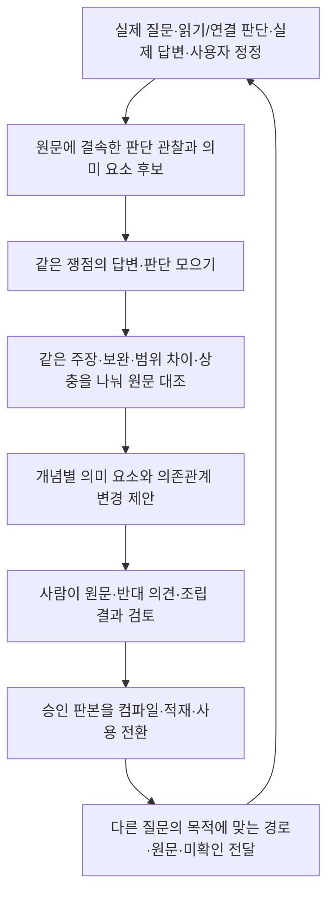

# 여러 질문의 판단을 컴파일 가능한 온톨로지로 축적하는 설계

2026-10-29 · 설계 초안 · 제품 구현·모델 실행·데이터 게시·MAIN 변경 없음

**후속 설계 반영:** [용어집 연결·도메인 설정·구현 및 실험 명세](DOMAIN_PROFILE_IMPLEMENTATION_PLAN_20261029.md). 에이전트 형식별 의미 어댑터 대신 공통 원본 봉투와 프로필 기반 LLM 구조화를 사용한다. 용어·개념은 기존 용어집을 참조하고, 이 문서에서 축적 단위를 뜻하는 `concept_id`는 후속 계약에서 `knowledge_bundle_id`로 명확히 한다. 도메인 설정 예시·기계 판독 설계 스키마·실험 계획을 함께 제공한다.

## 1. 최종 조립 결과부터 정의한다

목표는 여러 질문의 답을 보관하는 데서 끝나지 않고, **검토한 의미 요소와 의존관계를 원문에 붙여 두고 다음 질문의 목적에 맞게 조립하는 것**이다. 아래 단계는 이 최종 산출물을 만들기 위해 설계한다. 사용자가 이번 대화에서 강조한 두 조건, **틀린 답변도 들어온다**와 **비슷한 답변을 모아 비교해야 한다**를 입력의 기본 전제로 둔다.

최종 컴파일 결과에는 선택 목적, 적용 범위, 필요한 정의·측정 입력·산정 방법, 조건, 의무·허용 등의 효과, 관련 예외, 원문 목록, 미확보·미해결 항목이 함께 있어야 한다. 각 항목에서 원문과 그 항목을 발견·수정한 판단 이력으로 돌아갈 수 있어야 한다. 컴파일 성공은 등록된 관계를 빠짐없이 조립했다는 뜻이며 법률 해석의 정답 인증이나 숫자 계산 실행을 뜻하지 않는다.

따라서 다음 순서로 만든다.

**비슷한 답변의 모음은 검토 자료를 늘린다. 법률적 근거는 그 답변들이 가리킨 원문에서 확인한다.** 같은 오답이 여러 번 나왔거나 기존 온톨로지를 그대로 재사용한 경우를 독립적인 지지 근거로 세지 않는다.

## 2. 현재 기반과 실제 차이

확인 기준은 로컬 MAIN117 `accepted-answer-20261029-r1`과 2026-10-29 작업 코드다. 활성 manifest 해시와 온톨로지 관련 선택 파일을 확인했다. `ontology_work` 모듈들은 선택 코드와 같고, 작업 `ontology_io.py`에는 선택 코드에 없는 저장 압축 읽기 수정이 있다. 작업에는 ADR1199/1202 후속 수정도 있으므로 선택 MAIN 전체와 같다고 보지 않는다. 온톨로지 사용 기본값은 OFF다.

| 문제와 같은 입력 상황 | 기존 방식과 관측 결과 | 제안 변경과 원하는 결과 | 확인 방법 |
|---|---|---|---|
| 여러 질문이 같은 개념을 검토 | `capture`는 한 조사의 현재 읽기 판단을 모으고 `enqueue`는 입력 전체 hash로 새 묶음 ID를 만든다. 기존 개념에 자동 갱신하는 기능은 없다. 실제 중복 발생률은 미측정 | 관찰 ID, 개념 ID, 작업 판본을 분리. 새 관찰을 기존 개념 후보에 연결해 변경분 제안 | 질문 A의 개념 ID를 질문 B에서도 유지하고 작업 판본만 증가 |
| 현재 준비함 자료를 실제 판단으로 오인 | D1: 기존 숏컷 50개를 같은 원문 집합의 44묶음으로 구성. `judgments.finding`은 질문 복사이며 실제 판단이 아니다. 이 수집기의 생성 입력은 질문·참고답변을 제외한다 | 실제 실행의 판단·주장·원문·정정을 추출. 기존 44묶음에는 발견 자료라는 지위를 유지 | 가짜 판단 생성 0. 실제 event/run/판단 판본으로 역추적 |
| 오답을 구조화하면 오답도 고정됨 | ADR1124에서 과거 판단의 추정/간주 혼동을 복제했고 환급 가능 표현을 의무로 분류했다 | 관찰 주장과 채택 지식을 분리하고 원문 지지·반박·미확인을 요소별 검토 | 같은 오답 반복·서로 반대 답변을 넣어도 다수결 승인 없음 |
| 조건은 만들었으나 효과에 연결하지 않음 | ADR1124에서 생성한 핵심 조건이 효과의 의존관계에서 빠져 목적별 조립 결과에 누락됐다 | 의미 요소별 관계, 목적별 포함/제외 사유, 필수 의존의 검토표를 함께 생성·검사 | 조건 노드를 고의로 끊으면 관련 경로의 게시가 거절되거나 명시적으로 보류 |
| 같은 원문을 다른 목적에서 다르게 평가 | ADR1201의009는 마목만 확보한 뒤 다른 조사 목적을 이유로 최종 미사용 처리. 조문root 존재가 하위 범위 확보로 집계된 정정 이력이 있음 | 판단마다 조사 목적·실제 본 span·전달/사용 상태를 보존. 답변 미사용을 개념 전체의 불필요로 일반화하지 않음 | 다른 목적의 채택/미사용 판단을 함께 보존하고 미확보 바목을 검증 근거로 쓰지 않음 |
| 구조·인용 검사를 통과해도 의미 오류 존재 | MAIN117 및 후속 실제 실행에서 의무를 적용 조건으로 바꾼 ASSESS 오류가 남았다. ADR1201 advisory AI도 탐지 효과를 통과하지 못함 | 적용 조건·규범 양태·이행 행위·기준·예외를 구별한 구조와 사람의 원문 대조 | “B를 해야 한다”와 “B한 경우”의 변경을 요소별 diff에 드러냄. AI 검토 통과만으로 승인하지 않음 |
| 자유 텍스트 의존의 역할이 사라짐 | `ontology_scenarios.compile_package`는 `requires`로 찾은 선행 요소를 calculations에 모은다. 조건/정의/산정의 타입이 충분히 보존되지 않음 | 타입을 가진 중간 구조와 버전별 컴파일러 도입 | 정의를 계산식으로, 의무를 조건으로 이동시킨 출력 거절 |

이 설계는 위 원인에 대한 변경안이다. 현재 MAIN의 답변 정확도 개선, 모든 의미 누락 발견, 현장 연결 완료를 주장하지 않는다.

## 3. 아래 단계에서 가져올 데이터

### 3.1 실제 실행 관찰과 기준답변을 구분한다

새 입력의 기본 단위는 **특정 실행·판단 판본에서 기록된 의견 하나**다. 최종 답변만 가져오지 않고, 그 의견이 본 원문과 조사 목적을 함께 가져온다. 실제 최종 답변의 주장은 비교용 관찰로 수집한다. 사람이 만든 평가용 기준답변·사후 채점 정답은 생성 입력에 넣지 않는다. 실제 답변도 정답 표시는 하지 않는다.

| 입력 | 가져오는 값 | 용도와 경계 |
|---|---|---|
| 질문·쟁점 | 원래 질문 참조, 해당 조사 목적·쟁점, 범위·시점·사용자 제공 사실의 출처 | 의견의 적용 맥락. 개인 사실을 일반 규칙으로 올리지 않음 |
| 읽기 판단 | finding, reason, use, SET/KEEP/CONFLICT/WITHDRAW, 이전/현재 판본, needs/conflicts | 잠정 의견과 변경 이력. WITHDRAW도 이력으로 보존 |
| 연결 판단 | 출발 원문, 실제 대상 또는 미확인 대상, 선택/보류/제외와 이유, 실행 receipt | 선택했다고 읽은 것은 아님. 확보 상태는 도구 결과로 별도 확인 |
| 최종 판단·실제 답변 | 검증된 ASSESS claims와 final review, 실제 발행 답변의 해당 위치·hash | 잠정 판단과 최종 사용의 차이를 비교. 답변 없음/실패도 기록 |
| 사용자 정정 | 대상 run·판단 판본·의미 요소, 원래 발언, 수정 요구, 후속 조사 결과 | 정정 의견과 검증된 원문을 구분. 대상 불명은 연결 대기 |
| 원문 | 문서·판본·조항·block/span·내용 hash, 실제 읽은/전달한/인용한 범위 | 조문 이름만으로 하위 내용을 확보했다고 보지 않음 |
| 생성 계보 | 모델·코드/데이터 binding, 부모 실행, 재생 여부, 사용했던 온톨로지 게시판본 | 동일 실행 재수집과 같은 지식을 복제한 답변을 구별 |

N1(설계 계약, 후속 정정): `raw_event_id`는 권한경계·원본저널·실행/요청·event 식별자로 안정화한다. 원본에 있는 판단 ID/판본은 보존하지만 없는 형식에 가짜 값을 만들지 않는다. LLM이 분할한 관찰은 추출 판본 안의 로컬 ID로 두고, 입력·프로필·구조화기 binding으로 `extraction_revision`을 구분한다. 동일 raw ID의 다른 payload는 충돌이다. 재구조화를 독립 의견으로 세지 않으며 표시용 J번호만으로 실행 간 동일성을 정하지 않는다.

기존 `READ_JUDGMENT_RECORDED.changes`에는 previous/current와 정확한 basis가 있다. 이를 원형으로 제공하고 현재 heads만 읽어 과거 반대 의견을 잃지 않는다. `REFERENCE_GROUP_DECISION`, `LAW_BRANCH_DECISION`, 최종 `read_judgment_final.retain`을 포함한 기록은 공통 봉투로 전달하며 LLM이 프로필에 맞춰 의미를 구조화한다. 단계별 필드명 매핑을 계속 추가하는 방식은 사용하지 않는다. 선택 이벤트와 실제 읽기 결과는 서버가 확인한 영수증으로 구별한다. 저장 압축은 공통 `journal_storage` 리더로 복원·검증한다.

### 3.2 답변 문장이 아니라 비교 가능한 의미 요소로 나눈다

구조화 결과는 **관찰을 해석한 후보**다. 원래 판단·실제 답변 문장 위치를 유지하고 LLM의 재서술로 원본을 교체하지 않는다. JSON·텍스트의 원본 위치와 실제 영수증은 서버가 제공하고, LLM은 바뀐 필드·중첩·문장을 공통 프로필의 의미 유형에 연결한다. 생성한 각 필드는 정확한 원본 locator 또는 미기록 상태를 가져야 한다. 이 단계에서 오답을 정답처럼 고쳐 쓰지 않는다.

| 의미 요소 | 반드시 구별할 내용 | 손실 시 문제 |
|---|---|---|
| 주체·대상·범위 | 누구, 무엇, 어떤 문서 판본·적용 시점·상황 | 다른 대상/시장/시점의 답변을 같은 규칙으로 합침 |
| 적용 조건 | 규범이 적용되는 전제, AND/OR·선택지·범위 | 복수 요건을 선택 요건으로 바꾸거나 반대로 변경 |
| 규범 양태와 행위 | 의무/금지/허용/재량/추정/간주 등, 행위자·행위·목적물 | 의무를 이미 이행한 경우에만 적용되는 조건으로 축소 |
| 측정·산정 | 입력의 의미·타입·단위·분모·합산 범위·기준일, 방법, 결과 | 같은 금액/비율이어도 의미가 다른 값을 합침 |
| 예외 | 무엇의 적용/행위/계산을 어떤 조건에서 변경하는가 | 예외가 모든 규칙을 지우거나 일반 요건에 섞임 |
| 선행 의존 | 어떤 정의·조건·산정·원문이 있어야 해당 요소를 사용할 수 있는가 | 노드는 있으나 최종 조립에서 빠짐 |
| 근거와 미확인 | 요소별 정확 원문, 발견 판단, 미확보 원문·충돌 해석 | 단순 인용 일치를 의미 지지로 오인 |

스키마의 빈 값을 그럴듯한 추정으로 채우지 않는다. `UNSPECIFIED`(원문에 명시되지 않음), `NOT_ACQUIRED`(필요 원문 미확보), `CONFLICTED`(해석 충돌)를 구별한다. 한 사건의 사실 부족도 별도다.

## 4. 비슷한 답변을 모으는 방법

**같은 쟁점을 다루는 모음**과 **같은 주장을 하는 모음**을 분리한다. 반대 답변도 같은 쟁점 안에 있어야 비교할 수 있다. 긍정문끼리만 묶으면 오답을 발견할 자료를 잃는다.

1. 서버는 허용된 원문 좌표·기존 개념 ID·승인된 용어/별칭·명시 참조를 이용해 후보를 좁힌다. 원문 집합의 완전 일치를 요구하지 않는다. 한 판단이 추가 시행세칙을 봤어도 같은 쟁점 후보가 될 수 있다.
2. 질문·실제 답변의 의미 유사성은 추가 후보 발견 신호로 쓴다. 기존 색인으로 찾을 수 없는 경우의 임베딩 도입은 별도 선택 사항이며 현재 임베딩 배선이 있다고 가정하지 않는다.
3. LLM은 후보를 원문·범위와 대조해 `동일 주장 / 보완 / 특수한 경우 / 상충 / 다른 범위 / 판본 변화`로 제안한다. 일부 같은 주장만 연결할 수 있다. 답변 전체를 한 덩어리로 합치지 않는다.
4. 같은 쟁점의 주장별로 지지 원문·반박 원문·아직 안 본 원문·발견 관찰을 모은다. 후보 검색이 충분하지 않으면 `DEFER_MATCHING`으로 남긴다. 검색 결과 없음이 새 개념임을 증명하지 않는다.
5. 기존 개념에 맞으면 같은 `concept_id`의 갱신 후보로, 개념이 다르면 새 개념 후보로 만든다. 이름이 같다는 이유로 확정하지 않는다. 사람이 최종 범위와 연결을 검토한다.

예를 들어 ‘의무보유 한도’의 합산 방식 질문과 기준일 질문은 서로 다른 판단 요소를 보완할 수 있다. ‘합산한다’와 ‘각각 적용한다’는 동일 쟁점의 경쟁 주장이다. 어느 쪽을 채택할지는 현재 원문으로 판단해야 하며, 이 예시는 실제 법률 결론을 지정하지 않는다.

빈도는 검토 우선순위에 활용할 수 있다. 화면에는 관찰 수, 서로 다른 원문 수, 실행 계보, 같은 게시본을 재사용한 수를 나눠 표시한다. 반복 질문·같은 답의 재생·같은 온톨로지에서 나온 답변은 독립 표본으로 계산하지 않는다. 빈도가 낮아도 예외·반례는 보존한다.

## 5. 틀린 답변과 충돌을 다루는 방법

원본 관찰은 삭제하지 않는다. 오류가 있다는 이유로 전체 실패 실행을 버리지도 않는다. 그 실행에서 확보한 원문·올바른 부분 판단·실패 부분을 분리한다.

| 판정 축 | 상태 예 | 처리 |
|---|---|---|
| 출처 무결성 | 원문 일치 / 판본 변경 / 권한 없음 / 변조 | 기계 검사. 실패 자료는 해당 사용 경로에서 차단 |
| 원문 확보 범위 | 확보 / 일부 확보 / 미확보 | 확보하지 않은 범위를 근거로 제시하지 않음 |
| 원문과 주장의 관계 | 지지됨 / 반박됨 / 일부만 지지 / 불명확 | 처음에는 검토 제안. 검토자·인용·이유를 남긴 확정 기록과 구분 |
| 과거 의견과의 관계 | 동일 / 보완 / 상충 / 정정 / 다른 목적 | 둘 이상의 의견을 보존하며 서로의 적용 범위를 표시 |
| 온톨로지 사용 | 후보 / 채택 / 보류 / 배제 / 폐기된 판본 | 승인·게시 절차가 사용 권한을 결정. 관측 횟수로 승격하지 않음 |

원문이 지지하지 않는 주장은 정상 규칙의 노드로 올리지 않고 ‘배제한 해석과 사유’로 남긴다. 후속 생성 입력에서 이 기록을 반례로 볼 수 있지만, 그 문장을 정상 규칙이나 단정적인 금지 규칙으로 자동 전환하지 않는다. 아직 틀렸는지 확인하지 못했다면 보류한다. 사용자 정정도 원문 검토 없이 법률 정답으로 바꾸지 않는다.

LLM은 원문별 비교표와 정정 제안을 작성한다. 별도 AI가 동의했다는 이유로 승인하지 않는다. ADR1201의 검토 효과 실패를 고려해 자동 평가자의 만장일치도 충분조건으로 삼지 않는다. 최초 적용은 사람이 **의미 요소·의존관계·최종 조립본**을 함께 검토한다.

미해결이 남아도 독립적으로 검증된 부분의 경로는 승인 대상으로 삼을 수 있다. 단, 미해결 노드에 의존하는 효과를 완성된 경로로 표시하지 않는다. 범위와 잔여 필요 원문을 패키지에 유지한다.

## 6. 컴파일러가 받을 중간 구조

제안 계약명은 `ontology-assembly-ir-v1`이다. 기존 운영 API나 등록 스키마가 아니다. 원본 관찰·비교 묶음과 별도 객체로 저장한다. 기존 `ontology_semantics`의 타입·근거·의존·예외 개념과 `ontology_scenarios`의 사전 조립·검증을 재사용하되 연구용 권한 표지를 운영 승인으로 바꾸어 우회하지 않는다.

### 6.1 개념과 노드

`concept_id`는 질문·본문 hash와 독립된 안정 ID다. 의미 범위가 달라지면 별도 개념 후보이며, 동일 개념의 수정은 `revision`으로 표현한다. 기존 용어집 ID는 선택적 연결이다. 새 개념이 곧 승인된 용어나 검색 별칭이 되지는 않는다.

| 구조 | 주요 필드와 계약 |
|---|---|
| 개념 판본 | concept_id, revision, label, definition_scope, applicable_period, glossary_ref, base_revision, approval_ref |
| 의미 노드 | node_id, kind, statement, actor/object, modality, scope, typed_inputs/output, unit/time_basis, source_refs, observation_refs, review_state |
| 조합 표현 | `ALL`, `ANY`, 명시적 비교/범위 등 등록 연산자와 노드 참조. 자유 문자열 코드를 실행하지 않음 |
| 의존관계 | consumer → prerequisite, role, 적용 범위, 정확 근거, 발견 관찰, 검토 상태 |
| 예외관계 | exception → 수정 대상 노드, 예외 조건, 수정되는 범위·효과, 근거. 단순 ‘관련 있음’과 분리 |
| 목적 | purpose_id, 설명, 대상/범위, root 노드, 필요 검토 항목, 포함/제외 근거 |
| 불확실성 | 대상 노드·원문·의존, 사유, 다음에 필요한 원문/판단, 영향받는 목적 |

노드 종류는 정의, 범위, 입력/측정, 산정, 적용 조건, 규범 효과/이행 행위, 예외, 검토 메모로 구별한다. 초판의 고정 타입은 구현 전 스키마 검토에서 확정한다. 표현할 수 없는 의미를 기존 필드에 억지로 넣지 않고 스키마 검토 대기로 남긴다. 임의 스키마·SQL을 모델이 생성·실행하는 기능은 이번 첫 구현에 넣지 않는다.

`statement`는 승인된 설명문이고 구조 필드는 조합 의미다. 문장에 조건이 있지만 관계에는 없거나, 문장은 ‘허용’인데 modality는 ‘의무’인 경우를 검토표에서 드러낸다. 기계 검사는 참조·타입·선언 간 불일치를 다루며 자유 문장의 전체 법률 의미를 자동 증명하지 않는다.

### 6.2 노드만이 아니라 연결도 근거를 가져야 한다

조건 노드가 존재한다는 것과 특정 효과에 필요한 조건이라는 것은 다른 주장이다. **노드의 원문 근거와 간선의 원문 근거를 각각 남긴다.** 간선에는 왜 이 입력·조건이 이 효과에 필요한지, 어느 적용 범위에서 필요한지를 적는다.

각 목적에는 다음 검토표를 결속한다.

| 대상 | 필수 기록 |
|---|---|
| 해당 목적과 관련 있다고 발견한 관찰 | 사용 노드 / 반례 / 범위 밖 / 보류 중 어디로 갔는지 |
| 검토 대상 원문·하위 범위 | 의미 요소로 반영 / 적용 범위 밖 / 미해결 중 하나와 이유 |
| 각 조건·산정·예외 노드 | 어느 효과 또는 독립 목적에 연결됐는지. 미사용이면 이유 |
| 각 효과 노드 | 필요한 주체·범위·조건·이행 기준·예외·위임 원문의 검토 결과 |

검토표와 그래프를 서버가 대조해 선언한 필수 조건의 단절, 출처 없는 간선, 미처리 관찰, 참조 누락, 무근거 삭제를 차단한다. **원문에서 애초에 발견하지 못한 조건까지 이 검사로 발견한다고 주장하지 않는다.** 그것은 원문 역대조·반례 검토·사람 승인에서 확인할 범위다.

### 6.3 목적별 컴파일

컴파일러는 법률 의미를 새로 추론하거나 모델을 호출하지 않는 순수 함수로 둔다.

1. 승인된 개념 판본과 목적 root를 고정한다. hash·승인·출처·타입·참조를 검사한다.
2. root에서 필요한 선행 정의·입력·조건·산정을 따라 모은다.
3. 모인 노드를 대상으로 하는 등록된 예외와 그 예외의 의존관계도 모은다. 일반 경로와 예외 경로를 구분해 함께 검토 가능하게 한다.
4. 필수 의존·예외·목적 검토표가 모두 처리됐는지 확인한다. 순환 의존은 거절하고 단순 관련 관계는 실행 의존으로 따라가지 않는다.
5. 선행 순서로 조립하며 노드 역할을 보존한다. 정의/조건을 일괄 계산 영역으로 옮기지 않는다.
6. 원문 목록, 현재 근거 참조를 붙일 위치, 출처/노드 대응, 미확인과 차단된 후속 요소, 조립 hash를 반환한다.

다른 개념의 정의·산정이 필요한 경우 `concept_id + revision + node_id + package_hash`를 명시적으로 import한다. ‘현재 최신’으로 실행 중 바꿔 끼우지 않는다. 전체 import 집합을 검증한 게시 snapshot을 사용하며 누락된 의존은 UNKNOWN이다. 묶음 수·입력 크기 제한을 넘으면 목적별 분할·게시 계획을 검토하고 관련 조건을 잘라서 통과시키지 않는다.

컴파일은 등록된 업무 목적의 경로를 데이터 구축 시 사전 조립한다. 가능한 모든 사실 조합을 미리 열거하지 않는다. RAG 요청에서는 도달한 원문과 선택 목적에 맞는 게시 경로를 가져와 현재 권한·판본·실제 원문과 결속한다. 해당 경로가 없으면 일반 조사로 돌아간다. MAIN117의 요구 충족 검토와 ASSESS를 유지한다.

숫자 계산은 첫 구현 범위 밖이다. 산정 입력·방법·단위·분모·시점을 조립할 수 있어야 하지만 실제 계산 실행은 별도 타입·연산자·경계값 검증을 거쳐 도입한다.

## 7. 기존 개념 갱신과 게시 상태

한 관찰은 여러 개념에 기여할 수 있다. 관찰 전체에 전역 ‘소비 완료’를 붙이지 않고, 관찰×개념×작업 판본마다 사용/보류/배제 사유를 기록한다.

변경 제안에는 `base_work_revision`, `base_publication_id`, 현재 원문 binding, 사용한 관찰 집합, 개념 후보 집합, 변경 전후 노드/간선, 추가·수정·삭제 이유가 필요하다. 삭제·의무 양태 변경·조건 범위 변경·예외 제거는 화면에서 별도 강조한다. 서버는 실제 diff를 재계산한다.

모델의 작업 결과는 `UPDATE_EXISTING / NEW_CONCEPT / NO_CHANGE / REVIEW_CONFLICT / DEFER_MATCHING`이다. NO_CHANGE도 새 관찰과 판단 근거의 검토 이력은 남긴다. 내용·범위·근거가 바뀌었다면 새 판본이며, 단순히 모델이 ‘같음’이라고 썼다고 생략하지 않는다.

첫 범위에서는 같은 개념의 검토 중 초안을 동시에 여러 개 자동 생성하지 않는다. 새 관찰은 대기열에 보관하고 사용자가 현재 초안을 기준으로 다시 작성할 때 새 작업을 예약한다. 생성 중 base 판본·활성 게시·원문·권한이 바뀌면 결과는 `STALE_BASE`로 보존하고 자동 덮어쓰기를 하지 않는다.

상태는 다음 세 축으로 분리한다.

- 관찰: 수신 → 출처 검증 → 개념 연결 대기/연결/보류.
- 작업: 예약 → 모델 실행 → 제안 저장 → 검토/충돌 보류 → 승인/반려. UNKNOWN·STALE_BASE·저장 불명은 별도 상태다.
- 게시: 승인 패키지 준비 → 적재 → 재조회 검증 → 활성 전환. 승인만으로 활성화하지 않는다.

기존 `Repository.draft`는 게시 HEAD를 작업 잠금에도 쓰고 `publish`는 저장과 활성화를 한 트랜잭션에서 처리한다. 운영 도입 시 **작업 예약/판본 잠금과 게시 HEAD를 분리**하고, 기존 UI·CLI의 직접 publish를 포함해 같은 게시 검증 서비스를 사용해야 한다. 개발용 즉시 게시 경로를 운영 골드 절차로 설명하지 않는다.

## 8. 저장과 화면

Dataiku가 수집·작업·재시도·진행·로그·결과를 관리하고 GENOS는 계산만 수행한다. GENOS→S3 직접 연결이나 영속 job registry를 추가하지 않는다. 원문은 개발 `SIDDS.*_S`, 관찰·작업·검토 색인은 `SIDDA.*_A`, JSON은 Dataiku S3 관리 폴더다. 운영 골드 물리 매핑과 GENOS의 SIDDA/골드 소비 권한은 현장 확인 사항이다.

기존 WORK/EVT/PUB/HEAD/ANC를 보존한다. 이전 축적 계획의 OBS/IDX/USE/JOB 후보는 각각 관찰, 원문·개념 검색, 관찰 사용 계보, 작업 원장을 담당한다. 별도 안정 개념 등록부와 비교 묶음/주장 판본은 논리 계약으로 추가하며, 기존 표 확장과 신규 표 여부는 현장 모델 검토에서 결정한다. 실행 DDL을 이 설계로 확정하지 않는다. 메타마이너 논리/물리명·도메인·인포타입·Description·30바이트 등 기존 등록 규약을 따른다.

원문과 대형 실행 로그를 묶음마다 복제하지 않는다. 원본 참조·내용 hash를 남기고, 생성에 필요한 입력 snapshot은 권한 확인 후 내용 주소로 한 번 보관한다. S3 객체 저장 → DB 수신 영수증 commit → 수집 checkpoint 전진 순서로 처리한다. 부분 실패는 동일 event/객체를 재확인한다. 수집기는 범위 있는 페이지·스트리밍을 사용한다.

기존 화면의 `모인 기록 → 초안 만들기 → 검토·승인` 흐름을 유지한다. 항목 안에서 다음을 볼 수 있게 한다.

1. 같은 쟁점의 질문·판단·실제 답변과 실행 계보. 실제 판단과 질문만 있는 자료를 구분한다.
2. 주장별 지지/반박/미확인 원문. 단순한 ‘일치 건수’ 대신 범위와 차이를 표시한다.
3. 기존 개념과 새 의미 요소/간선의 차이. 의무·조건·단위·분모·예외 변경을 펼친다.
4. 목적을 고르면 컴파일된 순서·원문·남은 부족을 미리 보여준다. 이 결과와 승인 hash를 연결한다.
5. 승인·적재·활성 상태와 실제 다른 질문에서 조회/전달/주장 사용 여부를 각각 표시한다.

개인 질문·사실·정정 발언은 작업 권한 안에서만 보여준다. 공유 게시 패키지에는 원문에 근거한 일반 지식만 넣고 비공개 관찰의 내용은 권한 검사된 계보 조회로 남긴다. 입력 권한을 합집합으로 넓혀 공개하지 않는다.

## 9. 실행과 실패 시나리오

| 상황 | 처리와 저장 결과 | 복구 담당 |
|---|---|---|
| 질문 A의 관찰로 최초 개념, B가 기준일을 보완 | A의 검토·게시 판본을 base로 B의 관찰/원문을 추가. 같은 concept_id의 다음 판본. C가 같은 원문에 도달해 새 경로를 사용 | Dataiku 축적 작업 → 기존 Workflow 확장 |
| 유사 답변 중 일부가 틀림 | 경쟁 주장과 원문 비교. 배제한 주장 이력 보존, 채택한 의미 요소만 컴파일 대상 | 생성 LLM은 제안, 검토자가 판정 |
| 같은 오답이 반복됨 | 반복 계보와 공유 출처를 표시. 빈도 때문에 채택 상태가 바뀌지 않음 | 비교 묶음·검토 UI |
| 원문 일부만 읽음/참조 대상 미확보 | 관찰은 저장하되 해당 범위는 미확보. 필요한 원문 목록을 제안에 남기며 후속 효과를 완성으로 표시하지 않음 | 출처 준비·컴파일러 |
| 조건 노드의 간선 누락 | 목적 검토표와 필수 의존 불일치로 제안 거절/보류. 의미를 코드가 추정해 연결하지 않음 | 구조 검증 → 허용된 형식 보완 또는 사람 검토 |
| 형식·참조 오류 | 같은 입력·판본과 전체 오류를 주어 제한된 보완. 원래 출력/수정 이력 보존 | 작업 실행기 한 곳 |
| 429·타임아웃·응답 불명 | 외부 실험은 기존 공급자 정책을 사용. UNKNOWN은 자동 새 생성 금지, 확보된 결과가 있으면 저장 단계만 재개 | 공통 모델 클라이언트 + Dataiku 원장 |
| DB 저장 응답 유실 | 멱등 키로 작업/판본/hash 조회 후 동일 결과의 저장만 복구. 모델 재호출 없음 | repository |
| 같은 개념의 동시 갱신 | base revision/CAS 검사. 늦은 결과 STALE_BASE, 현재 초안과 신규 관찰을 다시 비교 | 작업 예약·commit |
| 원문 판본/권한 변경 | 해당 제안/게시 경로 재검토. 다른 판본의 동일 문자열로 자동 치환하지 않음 | 원문 리더·게시 검증·RAG |
| 새 게시 일부 실패/중지/롤백 | 검증 전 기존 활성 판본 유지. 중복 publish가 중지·롤백을 되돌리지 않음 | Dataiku 게시 단계 |
| 프로세스 중단·취소 | Dataiku가 취소 요청과 GENOS 현재 계산 종료를 확인. 이미 수신한 결과와 사용량 보존 | Dataiku 작업 소유자 |

N2(후속 제안 호출 계약): 첫 버전은 원래 의견을 충실히 구조화하는 요청과 원문 대조·유사 판단 비교·그래프 변경을 제안하는 요청을 분리한다. 오답 기록이 구조화 중 사라지는 것을 막기 위한 설계이며 효과는 미검증이다. 작은 묶음의 호출 결합은 후속 최적화 후보로 남긴다. 큰 자료는 출처와 미처리 목록을 보존해 분할하고 개념 전체의 조립 검사를 마지막에 수행한다.

N3(후속 제안 한도): 논리 생성 작업당 정상 제안 1회와 형식 보완 최대 1회, 외부 실험 batch 전체 공통 클라이언트의 확정429 공급자 전환 최대 1회를 둔다. J개 작업의 물리 상한은 2J+1이다. 구조화+변경 제안 두 작업이면 최대 5회다. 재개도 같은 원장/예산을 쓰며 분할로 작업 수를 무한 증식시키지 않는다. 첫 probe의 deadline·작업량은 후속 도메인 설계에 제안했고 실제 실행 전 동결한다. 현장 GENOS 설정과 RAG의 기존 예산은 별도로 유지한다.

## 10. 코드 변경 지도

아래 신규 파일·계약 이름은 제안이다. 기존 함수명을 확인했으며, 과거 계획의 `read_judgment.apply` 대신 실제 commit 함수 `record`를 기준으로 한다.

| 기존 위치 | 변경 책임 | 보존할 소비자/계약 |
|---|---|---|
| `legal_agent/read_judgment.py:record`, `ontology_work/capture.py` | changes·이전 판본·정확 span을 관찰로 추출. 현재 heads 전체 재복사 대신 event 결속 | 원문 검증·기존 판단 저장·OFF 동작 |
| `unit_relations.py`의 결정/실행 기록, `law_navigation.py` | 실제 기록·순서·영수증을 공통 봉투로 전달 | 단계별 의미 매핑 없이 선택과 실제 확보를 구분 |
| `read_judgment_final.py:retain`, `completion_execution.py`, `judgment_view.py` | 잠정 의견·최종 사용·실제 답변 위치를 계보로 연결 | MAIN117 전체 내용 보존, 작업 ADR1202의 목적별 변경 근거 및 압축 hunk |
| 기존 인증된 사건/검토 입력, `corrected_memory.py` | 대상 지정 사용자 정정의 관찰 포트 추가 | 현재 자유 대화 입력만으로 특정 판단 변경 확정 금지 |
| `ingest_agent_events.py:ingest`, `ontology_work/store.py` | 버전별 이벤트 수집, checkpoint·중복·내용 주소 저장 | v1 읽기, 압축 원본 복원·해시 검증 |
| 제안 `ontology_work/observations.py`, `profile.py`, `glossary_binding.py`, `matching.py` | 프로필 기반 LLM 구조화, 기존 용어집 연결, 후보 검색, 동일 쟁점/주장 비교 | 원문·권한·실행 계보, 실제 판단 없는 자료 표시, 용어 정본 중복 금지 |
| 제안 `ontology_work/accumulation.py`, 기존 `workflow.py` | 기존 개념판본+새 관찰의 변경 제안, 작업 예약, diff·상태 전환 | 기존 approve/reject 계약과 새 불변 판본 |
| `schema.py`, 제안 `ontology-assembly-ir-v1.schema.json` | 관찰/의미 요소/간선/목적 검토표와 v1 어댑터 | 기존 닫힌 스키마를 몰래 확장하지 않음 |
| `ontology_semantics.py`, `ontology_scenarios.py` 및 제안 compiler | 타입·필수 의존·예외 closure·미확인 전파·게시 패키지 버전 | 기존 v1 패키지 읽기. 새 구조를 v1로 손실 변환하지 않음 |
| `repository.py`, `configuration.py`, `cli.py` | 개념/관찰/작업 색인, 판본 잠금 분리, staged publish, 운영 매핑 | 기존 이력·중지/롤백·모든 쓰기 경로의 동일 게이트 |
| Streamlit `ontology_dashboard_model.py`, `ontology_dashboard.py`, 기존 `ui.py` | 원문 비교·오답/충돌·요소/간선 diff·컴파일 미리보기 | 기존 화면 흐름·인증·권한 검증 |
| `ontology_work/runtime.py`, `ontology_assessment.py`, 발행 경로 | 새 패키지 버전·의존 snapshot·현재 근거 결속, 조회/전달/사용 기록 | ON/OFF, 빈DB/조회 실패의 일반 RAG, 요구 검토 |

새 관찰·작업 스키마를 읽는 호환 어댑터와 v2 게시 소비자를 함께 검증한다. 구 v1은 구 reader로 유지하고 새로운 의미 구조를 읽지 못하는 소비자에게는 활성화하지 않는다. 전체 원문 재파싱·재임베딩은 선행조건이 아니다. 새 개념·의존 색인과 게시 패키지는 구축해야 한다.

## 11. 첫 구현과 검증 순서

첫 완료 단위는 **서로 다른 질문의 실제 판단을 한 개념으로 모으고, 잘못된 주장과 보완 정보를 구분한 뒤, 승인한 의미 구조를 컴파일해 또 다른 질문에서 사용한 한 바퀴**다. 이미 알려진 질문은 기능 점검에 사용할 수 있으나 독립 품질 평가로 세지 않는다.

1. **컴파일 계약부터 고정:** 합성 예제로 정상 효과·필수 조건·산정 의존·예외·미확인을 가진 작은 구조와 기대 조립 결과를 만든다. 노드·간선 삭제, 타입/단위 변경, 판본 변경의 실패를 검증한다.
2. **공통 원본 수집·구조화:** 저장된 읽기/연결/최종 판단과 실제 원문을 가져온다. 수집 단계는 새 모델 없이 계보·범위·권한을 확인한다. 프로필 기반 LLM 구조화는 별도 동결 실험에서 검증한다. 실패 실행·질문만 있는 자료·미기록 이유를 구별한다.
3. **비슷한 판단의 비교·변경 제안:** 같은 개념의 다른 질문, 같은 조문의 다른 개념, 반대 주장, 복제 오답, 새로운 예외를 입력으로 고정한다. 모델/프롬프트/예산을 동결한 별도 ADR에서 실행한다.
4. **검토·판본·게시:** 화면에서 원문과 그래프 차이, 목적별 조립본을 확인하고 승인한다. 중복·동시성·저장 유실·재개·권한 변경·게시 실패를 검사한다.
5. **작업 통합과 MAIN 선택:** 검증 후보의 필요한 변경만 최신 작업 코드에 통합하고 엔진 pin/소비자 목록을 갱신한다. 검증·공식 승격·포인터 확인·실제 로컬 service의 OFF/ON미설정/ON빈DB/ON게시자료를 확인한다. 이 설계 작성은 승격하지 않는다.
6. **현장 연결과 제한 적용:** Dataiku 이벤트 입력·S3·Oracle 모델/권한·GENOS 계산과 조회 경로를 확인한다. 현장 질의는 워크플로우 테스트 화면에서 검증한다. 로컬 SQLite 성공을 Oracle/GENOS 성공으로 대체하지 않는다.

| 검증 단위 | 통과 목표 |
|---|---|
| 원본 관찰 | 실제 원문·event·판단 판본에 결속, 중복 event 재수집으로 새 의미 관찰 증가 없음 |
| 비교 묶음 | 동일 주장과 상충 주장이 같은 쟁점 안에서 구별됨. 같은 용어의 다른 범위를 자동 병합하지 않음 |
| 오답 처리 | 근거와 어긋나는 관찰을 삭제하지 않고 배제/보류. 반복 횟수로 승인하지 않음 |
| 그래프 | 출처 없는 노드/간선·순환·필수 의존 누락·예외 방향 오류·타입 불일치 거절 |
| 의미 검토 | 의무/조건·추정/간주·허용/의무·분모/단위·시점·예외를 원문과 대조. 의미 실패는 별도 기록 |
| 컴파일 | 같은 입력·판본이면 같은 조립 결과. 필수 원문/의존이 없으면 해당 후속 경로가 미완료 |
| 갱신 | 같은 개념 ID의 새 판본, 기존 승인 상속 없음. 늦은 작업/중복 저장이 현행본을 덮어쓰지 않음 |
| 실제 사용 | 관찰 → 의미 요소/간선 → 승인 → 게시 → 다음 요청 조회/전달/주장 사용을 구별해 추적 |

비교 기준은 일반 RAG, 기존 고정 시나리오, 새 축적/컴파일 후보를 구분한다. 독립 평가는 질문 문구 수가 아닌 **원문·개념 가족** 단위로 분리하고 알려진 CM 사례·기준답변의 생성 입력 누출을 막는다. 관측된 의미 오류가 있어도 기술 반영 판단과 분리해 보고하되, 권한·인용·해시·상태·실제 배선의 심각한 오류는 우회하지 않는다.

롤백은 신규 관찰 생성/작업 예약 중지, 진행 작업 정리, 검증된 이전 게시 snapshot으로 복귀 또는 소비 OFF 순서로 한다. 새 schema를 보존할 reader 없이 구 writer로 쓰기를 재개하지 않는다. 관찰·실패·정정·승인 이력은 삭제하지 않는다.

## 12. 기대치와 측정

| ID | 종류 | 지표/값과 근거 | 해석·검증 |
|---|---|---|---|
| D1 | 관측 | 준비함 44묶음, 질문/숏컷50개. 40묶음×1질문 + 2묶음×2질문 + 2묶음×3질문. 실제 판단이 없는 수집 코드 및 `queued.json`의 객체를 확인 | 현재 재료의 성격. 축적 효과·정확도 표본으로 쓰지 않음 |
| D2 | 관측 | `ontology_work` 10모듈은 작업/MAIN117 선택본 동일. 별도 `ontology_io.py` 차이 존재 | 확인 파일 범위. 전체 작업 코드 동일 판정 아님 |
| N1 | 설계 | 안정 관찰 ID와 개념 ID·판본 분리 | 반복 입력과 개념 갱신의 계약. 중복 제거율 미산정 |
| N2 | 설계 | 첫 버전은 충실한 구조화와 지식 변경 제안을 분리 | 후속 호출 결합의 효과·비용은 미측정 |
| N3 | 설계 | J개 논리 작업에서 정상/형식보완 각 최대 J, batch 확정429 전환 최대1 = 물리 최대2J+1 | 실행량 예측이 아닌 제안 상한. 후속 문서의 probe 예산과 결속 |
| N4 | 목표 | 컴파일 중 새 모델 호출0, 원문/권한/hash 오류0 허용 | 알려진 구조와 원문에 대한 기술 기준. 의미 정답률100%를 뜻하지 않음 |

시간·비용 개선율과 개발 인일은 미산정이다. 먼저 수집 시간, 후보 검색 SQL/왕복, 생성 입력/출력·호출·시간·비용, 사람 검토 시간, 컴파일/게시 시간, 실제 질문에서 추가되는 조회 비용을 따로 계측한다. 무거운 실행은 한 번에 하나씩 수행한다.

비용 손익분기는 `재사용 횟수 n × (기존 요청당 비용 C0 − 새 요청당 비용 C1) > 구축비 B + 검토비 H + 갱신비 U`일 때다. 각 값은 동일 통화·동일 범위로 측정한다. `C1 ≥ C0`이면 호출비 절감의 손익분기는 없다. 재사용이 적거나 문서 갱신·충돌이 많으면 비용이 늘 수 있다. 사람 검토비를 제외하고 절감으로 표시하지 않는다. 지연은 컴파일 전처리와 사용자 요청 경로를 나누어 측정한다.

## 13. 자체 검토와 근거

같은 작성자의 코드·문서 대조이며 독립 검토나 실제 성능 인증이 아니다. 이번 설계에서 다음을 명시적으로 바로잡았다.

- 최종 답변의 유사도를 곧 정답 근거로 해석하지 않고 실제 답변을 관찰 자료로 수집한다.
- 현재 44묶음과 실제 에이전트 판단의 축적을 구분한다.
- 개념별 최신 문서만 만드는 설계에서 노드·간선·목적·검토표를 갖춘 컴파일 입력 설계로 확장한다.
- 노드가 있어도 의존관계에서 빠지는 과거 실패, 목적이 달라지며 원문을 버리는 실패, 의무/조건 혼동을 검증 항목에 포함한다.
- 현재 사전 시나리오 컴파일과 연구용 의미 컴파일은 서로 다른 계약이다. 새 운영 패키지/소비자를 함께 구현해야 한다.
- 원문 자체에서 놓친 의미를 자동 완전성 검사로 보장하지 않는다. 실제 원문 대조·반례·사람 검토를 남긴다.

근거와 후속 진입점:

- [v4 목표](../ONTOLOGY_V4.md), [개념과 결정](CONCEPT_AND_DECISIONS.md), [원문·규범 의미와 축적](CONTROLLED_KNOWLEDGE.md), [이전 축적 계획](KNOWLEDGE_ACCUMULATION_PLAN_20261028.md).
- [현재 선택 포인터](../../../../01_DATA/ACTIVE/local/ACTIVE_RELEASE.json), [MAIN117 manifest](../../../../08_DEPLOYMENT/RELEASES/accepted-answer-20261029-r1/release.json).
- [판단 수집](../../../../02_BACKEND/semantic_runtime/ontology_work/capture.py), [작업 흐름](../../../../02_BACKEND/semantic_runtime/ontology_work/workflow.py), [저장·게시](../../../../02_BACKEND/semantic_runtime/ontology_work/repository.py), [Dataiku 수집](../../../../08_DEPLOYMENT/DATAIKU/ontology_workflow_20261028_r1/ingest_agent_events.py).
- [읽기 판단 원장](../../../../02_BACKEND/semantic_runtime/legal_agent/read_judgment.py), [최종 검토](../../../../02_BACKEND/semantic_runtime/legal_agent/read_judgment_final.py), [사전 시나리오 컴파일](../../../../02_BACKEND/semantic_runtime/legal_agent/ontology_scenarios.py), [연구 의미 컴파일](../../../../02_BACKEND/semantic_runtime/legal_agent/ontology_semantics.py).
- [44개 준비 기록](../../../../09_ARTIFACTS/AUDITS/20261028-ontology-real-shortcuts/현재상태.txt), [준비함 객체 목록](../../../../09_ARTIFACTS/AUDITS/20261028-ontology-real-shortcuts/queued.json), [해당 수집/입력 코드](../../../../02_BACKEND/lawrag/research/candidates/adr_1187/shortcut-intake/revisions/rev-002/snapshot/02_BACKEND/semantic_runtime/ontology_work/shortcuts.py).
- [의미 생성과 의존 누락 실패](../../../../04_EXPERIMENTS/ADR/ADR-1124-ontology-explicit-exception-contract/artifacts/실험결과.txt), [의무/조건 오류 관측](../../../../09_ARTIFACTS/AUDITS/20261029-main117-live-test/실험결과.txt), [31조 실제 확보 범위 정정](../../../../09_ARTIFACTS/AUDITS/20261029-final-original-coverage-review/9번_31조_확보범위_정정.txt), [목적별 판단·참조 후속 작업](../../../../09_ARTIFACTS/AUDITS/20261029-reference-bundle-purpose-review/수정과_검증결과.txt).
- [실패·복구 기준](../../OPERATIONS/AGENT_FAILURE_RECOVERY_POLICY.md), [운영 골드·화면 설계](STREAMLIT_DATAIKU_GOLD_UI_DESIGN_20261028.md).
