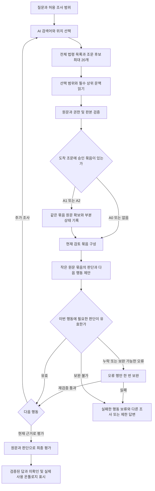

# 온톨로지 MVP의 입력 구성과 조사 복구 구현 계획

<!-- MAIN104_SQL_FOLLOWUP -->
**2026-10-27 — MAIN105 반영·실제 서비스 확인 완료:** [전체 반영·실제 실행·온톨로지 후속](MAIN_SQL_AND_ONTOLOGY_FOLLOWUP_20261027.md). 최초211초 원인의 MAIN104 SQL 수정에 반복 원문 확인 재사용과 네 연결 TEMP VIEW의 ID 점조회를 더했다. 보관응답1회 재생의 동일 계측35화면736.500→93.718초(87.275% 감소), 원문·행동·최종 답변 동일, 새 모델 호출0회다. 신규237조건·관측보조1,345조건을 구분한 ADR1081 검증 후 MAIN105 `navigation-validation-20261027-r1`을 선택했고 실제 서비스19확인(HEALTH·모의 HTTP1회·새 모델0회)이 통과했다. 작업 코드 통합에서 새4검사 통과, 기존7실패는 변경 전후 동일하다. 온톨로지는1074 부분실패→1077 상태 전환 수리→MAIN105 결합1079 실모델1셀/10호출을 완료했다. 두 원문의 판단 보존을 확인했지만 근거 연결 보완1회·제한 답변으로 품질 효과는 미인증이다. MAIN105 최종 누적본433파일·첨부4개를 삼성메일 SENT `1a17ae4c6976a0f7`로 발송·확인했다. 설치144명령·SQL18·상태13쌍을 통과했으며 MAIN104 첨부를 대체한다. P0~P4 전체 구현·전체 응답시간 개선·법률 품질·온톨로지 MAIN·GENOS 현장 배포 완료로 확대하지 않는다. 아래 이전 상태 기록과 구분한다.
<!-- /MAIN104_SQL_FOLLOWUP -->

**2026-10-27 — 211초 원인·최적화 확인:** [상세 측정과 결과](NAVIGATION_211S_ROOT_CAUSE_20261027.md). 정의 연결 조회의 전체 참조 VIEW 조립과 권한 ID 목록 반복이 원인이었다. 동일 계측의8개 대응 구간236.744→19.891초(91.598% 감소), 원래 화면·행동·전달 원문8/8 일치, 신규 모델 호출0회. 당시 SQL 두 수정은 작업 코드에 통합했고 선택 MAIN103·GENOS 배포는 유지했다. 이후 MAIN 반영 상태는 문서 상단 최신 기록을 따른다. 초기 준비·전체 응답시간·온톨로지 품질·GENOS 속도와 구분한다. 아래2026-10-26 상태는 선행 단계 기록이다.

**2026-10-26 성능 구현·실험 상태:** [상세 결과](NON_MODEL_LATENCY_IMPLEMENTATION_RESULT_20261026.md) · [전체 계획](NON_MODEL_LATENCY_OPTIMIZATION_PLAN_20261026.md). 격리 후보에 P0 계측·P1 일부와 온톨로지 재표시 오류 수정을 구현했다. 반복 스키마 검사96.17% 감소는 국소 비교이며 전체 서비스 개선율이 아니다. 초기 준비17.605초의98.266%를 이름 있는 구간에 귀속했고 연결 매칭·구조 결속10.676초가 가장 컸다. 실모델1회는 불완전 출력/연속 공백으로 중단, 온톨로지 효과와 전체 최적화는 미확인이다. P2/P3/P4·기본 작업 코드 통합·MAIN103·GENOS 반영은 미완료다. 과거 실험과 실패는 보존한다.

<!-- ADR1066_LIVE_STATUS -->
**2026-10-26 실제 모델 관찰: 부분 중단.** 사전 동결한 3문항×3조건 중 첫 문항 A0/A1은 제한 답변, A2는 원문 재표시의 상태 결속 오류로 중단했다. 나머지6셀은 미실행이다. 제품27호출·관찰 비용$0.17853620·제품 실행 합계762.10초, 채점 모델0회다. 관찰한 행동 응답19회에서 이전 필수 항목 누락과 입력 문자 차단은 재현되지 않았고, A1/A2 승인 묶음 실제 전달도 확인했다. 전체 성공·법률 정답·온톨로지 개선 인증은 아니다.

같은 원문 카드의 `presentation_id` 갱신이 전체 source hash를 바꿔 동일 온톨로지 페이지의 내용 변경으로 오인됐다. 별도로 조문 선택과 목적 불일치, 탐색 화면 구성 지연, 구형 gate의 evidence-ID 카드 감사 호환 문제가 남았다. 원문 검증을 끄지 않으며 결과 후 코드·점수를 수정하지 않았다. MAIN103·GENOS·운영 골드는 미변경이다. [결과·원인·원시 기록](../../../../04_EXPERIMENTS/ADR/ADR-1066-ontology-input-unlimited/artifacts/POST_RUN_DIAGNOSIS.md). **아래 구현 당시의 “실모델0회·미실행” 표기는 과거 시점 기록이다. 이는2026-10-26의 관찰이며, 현행 상태는 [MAIN105 및 후속 실험 기록](MAIN_SQL_AND_ONTOLOGY_FOLLOWUP_20261027.md)을 따른다.**
<!-- /ADR1066_LIVE_STATUS -->

2026-10-26. 상태: **구현 전 설계**. 사용자의 “온톨로지와 결합되는 상세 계획” 요청에 대한 문서다. 이 문서를 작성하면서 제품 코드·모델 설정·선택 릴리스를 변경하거나 실험을 재개하지 않았다.

**2026-10-26 후속 기준:** 위 상태와 아래 수치·실행 순서는 최초 작성 당시의 계획이다. 현재 개발의 행동별 입력·응답, 서버 복원과 모델 판단의 경계는 [행동별 최소 입력·응답 계약](ACTION_CHOICE_CONTRACT_20261026.md)이 우선한다. ADR1066에서 입력 문자 hard-stop은 해제했으며 출력 토큰 상한 없음과 기존 호출·도구·시간 예산은 유지한다. 행동 계약은 743파일 rev-002에 구현했고 동일 동결본 합성 계약/API 80개 검사를 통과했다. 실모델 생성·법률 품질은 미확인이다. 실제 결과는 [구현 상태](MVP_EXECUTION_REPAIR_STATUS_20261026.md)를 따른다. 과거 ADR의 스키마·한도·결과를 소급 수정하거나 아래 111셀 계획으로 실모델을 자동 재개하지 않는다.

목표는 **질문에 필요한 원문으로 이동하고, 도착한 조문에서 승인 온톨로지를 사용하며, 작은 입력으로 필수 판단을 끝내는 것**이다. 입력 문자 수만 낮추거나 서비스 응답만 성공시키는 것을 완료로 보지 않는다. 필수 판단·원문·권한·판본·상태 검사는 유지한다. 검토하지 않은 자료를 검토 완료로 바꾸지 않는다.

핵심 변경은 세 가지다. 첫째, 검색 후보와 실제 읽을 원문을 분리한다. 둘째, 원문 확보·모델 전달·검토·답변 사용을 따로 관리한다. 셋째, 판단 누락은 해당 원문과 오류만 보내 보완하며, 다른 원문의 미검토 때문에 유효한 다음 조사 전체를 폐기하지 않는다. 온톨로지 원문도 이 동일한 경로를 따른다.

## 1. 기준과 변경하지 않는 결정

문서 우선순위는 사용자 결정 → [AGENTS.md][agents] → [MVP.md][mvp] 및 실패 복구 정책이다. 이 계획의 새 입력 구성·검토 단위·수치 기준은 **구현 제안**이며 이미 실행한 정책으로 읽지 않는다. 과거 실험의 동결 계약은 그대로 보존한다.

| 항목 | 이 계획에서 고정할 내용 |
|---|---|
| 실험 자료 | 승인 묶음 31개, 기존 37문항, 현재 원문 세대, 검토된 FSC 기준답변. 기준답변·정답 좌표는 평가 전용 |
| 조사 범위 | 승인 묶음도 기존 조사 범위와 접근권한 안에서만 읽음. 범위 밖 본문·값·내용 메모는 보내지 않음 |
| 미확보 | FSC003의 누락 법령 두 개를 포함해 현재 데이터의 부족을 보존. 데이터 추가는 이번 계획에 포함하지 않음 |
| 모델·예산 | Qwen3.8, 출력 토큰 상한 없음. 요청당 기존 총 40회 물리 호출·1,024회 도구·1,800초 한도와 종료 예산을 공유 |
| 제공자 | ADR1059의 사용자 승인 429 전환 계약을 후속 실험에 명시적으로 재결속. 다른 모델 전환·숨은 fallback·임의 제공자 추가 없음 |
| 원문 중심 저장 | 문서 판본·조항·span이 지식의 기준. 질문은 발견 이력이며 질문별 정답 묶음으로 치환하지 않음 |
| 운영 지식 | 에이전트 판단·로그는 에이전트 레이어, 작업 JSON은 S3, 승인·SQL 적재한 지식은 골드. GENOS 서빙의 전체 자료 로컬 복원은 도입하지 않음 |
| 실험용 예외 | 현재 승인 스냅샷 주입은 MVP의 격리 실험 계약이다. 이를 운영 골드 적재 완료 또는 운영에서 승인만으로 사용 가능하다는 뜻으로 확대하지 않음 |
| 적용 상태 | 기준 후보는 ADR1059 `dense-input-r1/rev-001`. MAIN103과 GENOS는 별도이며 자동 변경하지 않음 |

설계의 구현·검증을 시작할 때 새 ADR을 선점한다. 현재 문서 작성과 저장된 기록의 읽기 전용 진단은 신규 모델 실험이 아니다. 기존 실행 승인·데이터 반출 승인은 다시 묻지 않되, 이 요청을 즉시 실험 재개 지시로 확대하지 않는다.

## 2. 확인한 문제와 수정 후 동작

근거는 ADR1059의 실제 요청·저널과 ADR1060의 원문 전달 감사다. 경로·파일 해시·오류·입력 크기는 [진단 근거 JSON][evidence]에 보존했다. 아래 결과는 모두 격리 후보의 관측이며 MAIN의 성능이 아니다.

| 문제 | 기존 방식과 관측 결과 | 수정 방식 | 같은 상황에서 확인할 목표 |
|---|---|---|---|
| 선택 전에 원문이 많아짐 | 질문의 정의·명시 참조를 시스템이 먼저 수집. 세 사례에서 자동 수집 대상 각각 7·10·16개. 관련성 판단 전 원문이 검토 대상으로 들어감 | 정의도 최초에는 위치·용어·연결 단서의 후보로 제시. 모델이 선택한 범위와 그 필수 상위 문맥만 읽음 | 선택하지 않은 정의·서식 본문을 첫 조사 입력에 넣지 않음. 필요한 정의는 동일 도구로 읽을 수 있음 |
| 검토 누락이 조사 전체를 막음 | CM023 최초 읽기 판단은 필수 원문 묶음 7개 중 1개만 작성. 선택과 검토를 일괄 검증하여 다음 행동을 거부. 세 사례 모두 `READ_CHOICE_SELECTED` 0건 | 이번 검토 작업의 의무와 요청 전체의 미검토 의무를 분리. 행동의 출발 판단은 검증하되 무관한 미검토는 보존 | 필수 출발 판단이 통과한 읽기는 정확히 한 번 실행. 남은 검토는 사라지거나 자동 승인되지 않음 |
| 짧은 보정이 연결되지 않음 | 읽기 단계의 보정은 `FULL_DECISION`. CM023 마지막 보정은 8행을 냈지만 ID 중복·누락·근거 불일치로 거부 | 기존 복구 담당 안에 읽기 판단 행 보완을 추가. 정상 행과 다음 행동을 고정하고 오류 행만 교체 | 보완 대상 밖 값은 불변. 합친 객체를 전체 재검증. 한 오류에 보완 한 번 |
| 압축 뒤에도 큰 입력 | CM023 최대 요청 88,877자. 원문·상태·도구 목록 58,233자, 지침 8,513자, 응답 형식 11,856자 | 현재 단계의 필드만 구성하고 최종 전송 요청을 먼저 측정. 원문은 요청 안에서 한 번, 도구 목록은 현재 행동 종류에 맞게 제한 | 정해진 입력 예산 안에서 전송. 줄인 범위와 미전달 상태를 기록. 입력 한도 상향으로 통과시키지 않음 |
| 온톨로지 효과 미검증 | 최근 세 사례는 모두 A0, 온톨로지 전달 관측 0건 | A0/A1/A2 설정·실제 묶음 확보·전달·최종 답변 사용을 각각 계측 | A1/A2가 켜졌다는 설정만으로 성공 처리하지 않음. 도착이 없었는지, 붙이기 실패인지 분리 |
| 원문 부족의 원인이 가려짐 | FSC008 모델은 제159조를 확인하려 했지만 다른 원문 검토 누락으로 행동이 거부됨. 최종 응답은 근거 부족 | 종료 원인에 선택 거부·검색 미도착·원문 부재·범위 제한을 각각 기록 | “못 찾음” 대신 어느 단계에서 무엇을 못 했는지 사용자와 평가자가 확인 |

검토 누락이 읽기 선택을 막았다는 인과는 저널의 거부 → 보정 실패 → 제한 종료와 코드로 확인했다. 입력량이 모델의 의미 판단을 얼마나 악화시켰는지, 이를 고치면 정답률이 얼마나 오르는지는 아직 측정하지 않았다.

## 3. 목표 흐름과 책임

도식의 상자는 책임 구분이며 각각 별도 LLM 호출을 추가한다는 뜻이 아니다. **검토와 다음 행동 제안은 기존 조사 호출 하나에서 함께 처리**한다. 원문 읽기·온톨로지 회수·컴파일·기본 설명·입력 크기 계산은 코드가 한다. 추가 모델 호출은 실제 새 조사 판단과 허용된 보완에만 쓴다.

역할은 다음처럼 고정한다.

- **LLM:** 검색 표현, 어떤 후보가 질문에 필요한지, 읽은 내용의 관련성·적용성·충분성·예외·충돌, 다음 조사 목적을 판단한다.
- **코드:** 후보·원문·판본·권한·좌표를 결속하고, 선택된 범위를 읽으며, 승인된 관계를 컴파일한다. 누락 판단을 만들거나 자동으로 `EXCLUDE`·`DEFER`로 판정하지 않는다.
- **검증기:** 구조·필드 일관성·근거·권한·상태를 검사한다. 법률적 불확실성과 데이터 무결성 오류를 같은 중단 사유로 합치지 않는다.
- **실행기:** 요청 전체 예산·중복·재개를 관리한다. 세부 단계가 실패했다는 이유로 새 요청과 새 예산을 만들어 재호출하지 않는다.

적용 대상은 공통 조사 실행기를 사용하는 단독 법령 RAG와 내규·외규 자식 조사다. 대사 부모는 자식의 원문 확보와 판단 완료를 분리해 받아야 하며, 자식의 미완료를 부모의 성공으로 덮지 않는다. 공통 helper를 사용하는 v5~v8 계약은 회귀 검사하되 새 실행은 동결한 v6 경로로 검증한다. 문서 수집·온톨로지 적재 등 별도 파이프라인을 이번 변경에 섞지 않는다.

## 4. 검색과 최초 원문 선택

### 4.1 첫 검색

기존 `request_entry`의 모델 판단에서 검색어를 만든다. 질문의 중요한 대상·행위·조건을 검색식에 담고, 현재 후보의 AND/OR·인용 표현 보존 기능을 이어 쓴다. 코드가 AND를 임의로 OR로 바꾸거나 질문에서 정답 조문을 하드코딩하지 않는다. 검색 실패는 구체 오류와 함께 다음 탐색 입력으로 전달한다.

검색 결과 화면의 계약은 유지한다.

1. **법령 목록:** 허용 범위에서 검색된 모든 법령의 번호·이름·걸린 검색어를 별도로 제공한다. 이름·검색어는 공통 사전으로 한 번만 보낸다. “상위 법령 3개만”으로 다시 제한하지 않는다.
2. **조문 후보:** 한 화면 최대 20개. 문서·조문명·일치한 항호 좌표·짧은 원문 일치 구간·조회 번호를 준다. 이 구간은 탐색 단서이며 본문 전체를 읽었다는 근거로 쓰지 않는다.
3. **더 보기:** 다음 페이지 토큰을 원래 검색식·데이터 세대·범위·정렬 순서에 결속한다. 다음 화면은 이전 20개를 다시 누적하지 않는다. 이전 후보는 서버에 보존한다.
4. **읽기:** 모델이 후보 번호와 필요한 항·호 또는 구조 범위를 선택한다. 선택 항목의 상위 본문 조건을 포함하되 형제 항목은 자동으로 펼치지 않는다. 정확한 항호를 못 고르면 구조 목록을 먼저 보여준다. 모델이 전체 조를 명시 선택한 경우만 전체 조 읽기를 허용하고 범위·크기를 기록한다.

전체 법령의 간결한 목록만으로도 입력 예산을 넘으면 몰래 일부 법령을 삭제하지 않는다. 본문 없는 검색식 재구체화 단계로 돌아가 `CATALOGUE_TOO_LARGE`와 전체 개수를 전달한다. 원래 전체 목록은 조회 산출물에 보존하며, 재검색은 모델이 새 검색식을 명시한 새 행동으로 기록한다. 같은 검색식 반복은 차단한다.

### 4.2 정의 원문 자동 선읽기 변경

`definition_entry.acquire_initial()`이 질문에 걸린 정의를 전부 실행하는 현재 방식을 **후보 제공**으로 바꾼다. 정의 위치와 검증된 명시 참조 위치를 후보로 제공하되 본문은 선택 후 읽는다. 기존 용어집·공식 동의어·문서 별칭은 같은 승인·데이터 범위에서 유지한다. 새 용어·별칭을 임의 승인하거나 착지 예시 색인을 새로 구축하지 않는다.

명시적으로 선택한 조항을 읽은 뒤 필요한 정의 문맥을 제공하는 `definition_context`도 같은 확보 원장과 검토 대기열을 사용한다. 온톨로지가 이미 확보한 동일 원문을 다시 읽거나, 서로 다른 경로가 같은 자료를 별도 필수 판단으로 중복 등록하지 않는다. 온톨로지에 없는 정의는 일반 후보이며 별도로 필요성을 판단한다.

**첫 도착과 온톨로지 효과는 별개다.** 올바른 묶음 구성원에 도착하지 못하면 A2라도 자동으로 정답 조문을 알 수 없다. 검색 개선은 A0/A1/A2 공통이며, 씨앗의 정답 좌표를 검색 순위에 넣지 않는다.

## 5. 승인 온톨로지를 결합하는 정확한 계약

### 5.1 회수 시점과 범위

원문 읽기 receipt가 저장되고 무결성 검증을 통과한 뒤 기존 `ontology_context.acquire()`를 호출한다. 도착은 **실제로 확보한 own-block 범위와 묶음 provision의 원문 범위가 겹치는 것**으로 판정한다. 같은 법령명·같은 조 번호의 제목만 검색됐다는 이유로 하위 항 본문 도착으로 처리하지 않는다.

묶음 구성원 어느 곳에 도착해도 해당 묶음을 찾는다. 질문 ID·기준답변으로 묶음을 찾지 않는다. 같은 요청·판본·묶음 revision의 반복 도착은 기존 plan과 receipt를 재사용한다. 자동 확보한 연결 원문으로 다른 묶음을 연쇄 실행하지 않는다. 다른 묶음은 조사 LLM이 해당 원문을 명시적으로 선택하여 새로 도착한 경우에 처리한다.

MVP에서는 도착한 승인 묶음의 등록된 provision 집합을 그대로 확보 대상으로 삼는다. 질문에 맞춘다고 승인 묶음을 몰래 잘라 새 지식 단위로 만들지 않는다. **확보 대상 전체와 한 번에 모델에게 전달할 페이지를 구분**한다. 여러 묶음이 동시에 맞으면 bundle_id 순서로 대기열을 만들고 공통 원문은 재사용한다. 화면에 안 들어간 묶음은 미전달 상태와 다음 페이지로 남긴다.

각 provision은 접근권한 → 기존 조사 범위 → 문서 판본 → exact own-block → 원문 해시 순으로 확인한다. 상위 조건이 별도 provision으로 등록돼 있으면 함께 묶는다. 구조적으로 필요한 상위 문맥이 승인 묶음에 빠졌으면 일반 읽기 규칙에서 허용되는 문맥만 확보하고 `general_context`로 구분한다. 이것을 승인 온톨로지의 새 관계라고 저장하지 않는다. 상위 문맥도 범위 밖이면 미확보를 남기고 해당 세부 규정의 적용을 확정하지 않는다.

기존 온톨로지 자동 확보 한도인 요청 전체 128개 읽기 키·최대 24,000자 예약은 유지한다. 입력 페이지를 바꾸거나 프로세스를 재개해도 초기화하지 않는다. 이 확보 한도에 걸린 provision은 `ONTOLOGY_CONTEXT_BOUND`로 남고, 단순 다음 페이지가 원문을 이미 확보한 것처럼 표시하지 않는다. 모델이 그 조항의 필요성을 판단해 일반 조사로 명시 선택한 경우에는 기존 요청 전체 도구·시간 예산 안에서 읽되, 자동 온톨로지 확보와 별도 출처로 기록한다. 부분 묶음의 전역 review_notes는 현재 계약대로 모든 등록 원문 확보 전까지 본문 안내에 사용하지 않는다.

### 5.2 A0와 A1과 A2

| 조건 | 원문 확보 | 모델에게 주는 형태 |
|---|---|---|
| A0 | 일반 조사로 선택한 원문만 | 묶음 ID·승인 메모·관계·컴파일 안내 없음 |
| A1 | 도착한 승인 묶음의 허용 원문 | 등록 순서의 조각 목록, 역할·값·메모·관계·미확보. 조립 설명 없이 제공 |
| A2 | A1과 동일한 확보 정책 | 같은 조각·메타데이터를 법이 정한 것 → 위임받은 내용 → 조건 → 예외 등의 기존 결정적 규칙으로 배열 |

같은 도착·원문 receipt 상태의 A1/A2는 **원문·역할·값·관계·메모·미확보 정보 집합이 같아야 한다**. A2에만 답변 힌트·추가 요약·법률 결론을 넣지 않는다. 페이지 구성은 A1/A2 중 더 큰 직렬화 비용으로 잡아 어느 한 조건만 원문을 더 받지 않게 한다. 각 조건의 실제 탐색 경로가 달라진 이후까지 동일 원문을 억지로 강제하지 않고, 달라진 도착·선택·전달을 기록한다.

저장용 컴파일 객체와 모델 입력은 분리한다. 현재 컴파일 결과의 `payload.provisions[].text`, `presentation.text`, 조사 `sources`에 같은 원문이 겹칠 수 있으므로, **모델 요청은 원문 공통 저장 영역을 한 번만 포함**한다. A1/A2 표현은 그 원문 참조와 순서만 사용한다. 사용자 화면은 같은 plan에서 읽기용 문장을 렌더링한다. 원문을 없앤 요약만 전달하거나 설명과 실제 실행 대상을 따로 생성하지 않는다.

`ontology_compiler.compile_bundle()`의 v0 승인 데이터와 순수 컴파일 책임은 유지한다. 입력에 넣는 표현만 새 버전으로 관리한다. 새 필드를 승인 묶음에 소급 추가하지 않는다.

### 5.3 이번 세 문항에서 기대하는 연결과 한계

아래 조문은 기존 평가 자료에 있는 기대 경로다. **제품 프롬프트에 넣을 지시나 새로운 법률 해석이 아니다.**

| 문항 | 승인 묶음 | 도착 후 확보할 등록 범위 | 남겨야 할 미확인 |
|---|---|---|---|
| FSC005 겸직 | `cb-1a8f9c604513`, provision 11개 | 지배구조법 제29조 및 등록 호, 시행령 제24조의 등록 항호 | 시행령 제20조제2항과 자산총액 판단시점의 추가 근거는 묶음 밖. A2만으로 완전 답변을 보장하지 않음 |
| CM023 상장차익 증여 | `cb-764ad7c91f3f`, provision 28개 | 상증법 제41조의3, 시행령 제31조의3의 등록 항호 | 28개 provision을 28번 판단하게 하지 않음. 같은 조문의 선택 범위와 상위 조건을 묶어 검토하고 전달 범위를 기록 |
| FSC008 사업보고서 | `cb-d10a24aab57f`, provision 7개 | 자본시장법 제159조제1항, 시행령 제167조의 등록 항호목 | 제167조제1항제1호의 증권 목록과 소유자 수 계산방법 고시는 묶음 밖. 남은 조사로 유지 |

스냅샷의 일부 메모에는 승인 전 작성한 “사용자 미승인 초안” 문구가 남아 있다. 승인 여부는 별도 사용자 승인 영수증과 스냅샷의 `APPROVED`로 판단한다. 역사적 메모를 바꾸거나 그 문구만으로 승인 상태를 뒤집지 않는다. 승인 역시 법률 의미·현재 사건 적용성 검증을 뜻하지 않는다.

### 5.4 조사 기록에서 다음 온톨로지로

이번 수정은 MVP-1의 실행과 기록을 완성한다. MVP-2는 같은 실행 중에 승인 묶음을 덧쓰기하는 방식으로 연결하지 않는다. 원문별로 유효한 읽기 판단, 실제 따라간 연결, 선택하지 않은 이유, 사용한 주장, 미확보·실패를 구분해 에이전트 레이어에 남긴다. 새 미검토 상태에는 생성된 판단 ID를 꾸며 붙이지 않는다.

MVP-2 제안 작업은 종료한 실행의 유효 기록을 읽어 기존 `ontology-bundle-v0` 또는 `ontology-schema-proposal-v0` 후보를 별도 revision으로 만든다. 실패·미검토는 제안의 한계이지 승인된 연결의 증명이 아니다. 사람이 검토하고, 실험이면 새 승인 스냅샷·새 ADR로, 운영이면 S3 작업 JSON → 승인·매핑 → SQL 적재 → 골드 조회로 연결한다. 기존 31개와 현재 실험 결과는 그대로 보존한다. 실제 제안 생성·승인 화면·골드 적재 구현은 이 조사 복구의 완료 조건과 구분한다.

## 6. 원문과 판단의 상태를 분리

다음은 기존 조사 checkpoint 안에 추가할 **제안 계약 `navigation-review-tasks-v1`**의 논리 상태다. 외부 API의 기존 enum을 무계획하게 교체하는 뜻이 아니다.

| 축 | 상태와 전환 | 완료가 뜻하는 것 |
|---|---|---|
| 확보 | `CANDIDATE → ACQUIRED` 또는 사유별 `UNACQUIRED` | 코드가 실제 원문을 읽고 검사함 |
| 전달 | `NOT_SENT → SENT` + 실제 request/view receipt | 그 호출에 정확한 원문 범위가 포함됨 |
| 검토 | `PENDING → VALIDATED` 또는 `REPAIR_PENDING / INCOMPLETE` | 모델 판단이 계약 검증을 통과함. 법률 정답 인증은 아님 |
| 답변 사용 | `UNDECIDED → USED / NOT_USED / UNRESOLVED` | 최종 평가가 현재 주장과 원문·판단을 연결함 |

`ACQUIRED`를 `SENT`로, `SENT`를 `VALIDATED`로 자동 승격하지 않는다. 모델이 검토하지 않은 행에는 `DEFER`라는 의견도 만들어 넣지 않고 시스템 상태 `PENDING`을 둔다. 실패한 행의 원문과 정상 행의 검증 결과는 모두 보존한다.

검토 작업 키는 요청 binding, 문서 판본, source_id, 실제 span·내용 해시, 관련 쟁점, 이전 판단 revision으로 만든다. 표시 순서·짧은 별칭·새 request ID만으로 같은 오류의 보정 예산을 다시 주지 않는다. 내부 DB revision이 다른 자료 때문에 올라간 것만으로 해당 판단을 다시 작성시키지 않는다.

검토 단위는 기존 `read_judgment`의 **원문 source 묶음**을 유지한다. 하나의 항·호 또는 온톨로지 provision마다 새 판단 ID를 만들지 않는다. 같은 source의 새 범위가 추가되면 기존 판단의 변경 검토로 연결한다. 이미 본 범위와 새 범위, 유지·수정·철회·충돌을 구분한다.

### 필수 판단을 어느 시점에 검사하는가

1. **현재 검토 작업:** 한 번에 최대 3개 source 묶음을 제공한다. 각 묶음의 선택 원문·필수 상위 조건을 함께 제공한다. 이 작업의 모든 필수 행은 검토하거나 미완료로 남겨야 한다.
2. **다음 행동:** 그 행동이 근거로 삼은 판단 행과 원문·대상·권한·상태는 실행 전에 모두 유효해야 한다. 다른 source의 미검토는 이 행동의 근거로 사용할 수 없다.
3. **요청 전체:** 아직 검토하지 않은 원문·부족·충돌을 대기열에 유지한다. 전체를 검토한 것처럼 종료하지 않는다. 최종 답변이 사용하는 원문과 판단은 반드시 검증한다.
4. **완전 답변 표시:** 필요한 판단·핵심 gap·관련 조건/예외가 미해결이면 `COMPLETE`로 표시하지 않는다. 미검토 원문이 남은 경우 그 사실을 최종 범위 설명에 남긴다. 완전 답변을 주장하려면 미검토를 해소하거나 모델이 근거와 함께 불필요함을 판단해야 한다.

이것은 **모든 원문 검토가 끝날 때까지 어떤 조사도 못 하는 현재 연결을 바꾸는 계약 변경**이다. 필수 판단 내용을 제거하는 변경이 아니다. 원문·인용·권한·상태 오류가 있는 행을 검토 누락과 함께 통과시키지 않는다.

## 7. 판단 누락을 짧게 보완하는 절차

기존 `read_judgment_repair.py`는 최종 평가의 판단–주장 연결 보완용이다. 그 경로를 전체 읽기 판단의 보완이 구현된 증거로 쓰지 않는다. 새 읽기 보완은 `output_contract.bounded_decision()`의 기존 담당 안에 전략으로 연결하고 별도 재시도 루프를 추가하지 않는다.

### 7.1 독립 검증과 실행 순서

1. 응답 완료·JSON·스키마를 확인한다. 이어서 각 판단 행과 행동을 독립적으로 검사해 오류 전체를 수집한다.
2. 유효한 행을 판단 저장소에 commit한다. 유효하지 않은 행은 제안 원문과 오류를 보존하고 head로 채택하지 않는다. 부분 commit과 원래 응답 hash를 연결한다.
3. 행동의 참조 판단이 모두 유효하면 그 행동만 기존 도구 실행기에 넘긴다. 다른 미완료 행은 대기열에 남긴다. 행동 자체의 대상·권한·버전 오류는 이 규칙으로 우회하지 않는다.
4. 행동에 필요한 행이 빠지거나 보완 가능한 오류이면 행동을 `WAITING_REVIEW`로 보류하고 아래 작은 보완을 한 번 수행한다. 다른 행동으로 바꾸어 같은 도구를 먼저 실행하지 않는다.
5. 보완 결과를 서버가 원래 제안에 합치고 전체 관련 계약을 재검증한다. 판단 commit 직전과 도구 실행 직전에 revision을 다시 확인한다.
6. 보완 성공이면 보류 행동을 정확히 한 번 실행한다. 실패하면 그 행동은 실행하지 않고 `INCOMPLETE`로 닫는다. 유효한 다른 조사 경로가 있으면 기존 제어기가 선택하게 하고, 없으면 검증된 근거의 제한 답변으로 끝낸다.

부분 commit 뒤의 revision을 보완 계획의 기대 revision으로 고정한다. 원래 응답 hash, 정상 행 commit receipt, 보완 대상과 허용 원문 hash를 함께 묶고, 그 이후 외부 상태 변경이 있으면 patch를 적용하지 않는다. 원래 응답 전체를 `ACCEPTED`로 위장하지 않고 `review_status=PARTIAL`과 `action_status=READY/BLOCKED/EXECUTED`를 별도 내부 receipt에 남긴다. `choose_read`의 후속 검증·record·도구 실행은 이 검증된 전이 receipt를 소비한다. 기존의 전역 required 검사를 다시 호출하여 같은 오류를 되살리지 않는다. 최종 평가 소비자는 partial 상태와 남은 작업을 반드시 받는다.

### 7.2 보완 요청에 포함할 것

현재 질문·대상 쟁점, 보완할 판단 ID, 그 판단의 실제 원문과 상위 문맥, 기존 판단이 있다면 그 내용, 문제 필드 경로·오류 코드·허용 근거 ID, 보류 행동의 짧은 목적만 보낸다. 정상 판단·전체 검색 후보·전체 도구 메뉴·과거 실행 전문·무관한 온톨로지 묶음은 넣지 않는다.

보완 출력은 지정된 판단 행만 허용한다. source ID·판본·좌표·hash·정상 행·다음 행동의 대상은 바꿀 수 없다. 오류 행의 finding·reason·use·missing·근거 선택 등 허용 필드는 명시한다. 기존 부족·충돌을 지우려면 원래의 명시적 해결 계약과 실제 근거가 필요하다.

제안 오류 코드는 `READ_REVIEW_MISSING_ROW`, `READ_REVIEW_DUPLICATE_ROW`, `READ_REVIEW_WRONG_SOURCE`, `READ_REVIEW_STALE_REVISION`으로 구분한다. 누락·잘못된 행 대응처럼 경계가 정해진 오류만 보완 대상으로 삼는다. 권한 위반·원문 변조·판본 불일치·stale 상태는 의미 보완으로 우회하지 않는다. 중복 ID의 어느 의견이 맞는지 코드가 골라 합치지 않는다.

JSON 전체를 파싱하지 못해 행을 특정할 수 없으면 작은 **해당 검토 작업 전체**를 한 번 다시 요청한다. 이전의 거대한 조사 입력 전체를 재전송하지 않는다. JSON 복구와 행 보완은 같은 보정 1회 예산을 공유하며 각각 1회씩 주지 않는다.

보완 대상들을 합친 최소 원문이 T03 안에 들어가지 않으면 여러 보완 호출로 우회하지 않는다. 해당 보완은 미전송으로 기록하고 행동을 보류한다. 이후 범위를 나누는 것은 새 원문 검토 작업이며 이미 실패한 같은 행의 보정 예산은 그대로 이어받는다.

### 7.3 대기열과 반복 제한

행동에 필요한 판단의 보완이 실패하면 그 행동 signature를 차단 목록에 넣는다. 다음 탐색 호출에는 현재 질문, 실패 이유, 아직 유효한 후보와 허용 도구만 준다. 출발 판단이 필요 없는 질문 기반 SEARCH/LOCATE 또는 다른 검증된 판단에 근거한 행동만 선택할 수 있다. 같은 차단 행동을 별칭만 바꾸어 재선택하면 모델을 또 부르지 않고 그 경로를 닫는다. 선택 가능한 새 경로가 없으면 최종 평가로 넘겨 확인 범위만 답한다.

- 이번 행동의 출발 판단을 우선한다. 나머지는 최초 전달 순서로 검토한다. 새로운 조사 행동을 연속 2회 실행한 뒤에는 가장 오래된 미검토 작업을 먼저 제시하여 밀리지 않게 한다.
- 같은 원문·쟁점·오류의 보완은 최대 1회다. 실패 행은 새 원문 또는 실제 관련 판단 변경 없이 자동 재시도하지 않는다. 설명 문구만 바꾸거나 다른 무관한 원문을 추가한 것으로 재시도를 허용하지 않는다.
- 성공한 원문 읽기와 도구 receipt는 재사용한다. 과거 판단을 유지하면 기존 `KEEP` 방식으로 서버가 내용을 보존하며 재작성시키지 않는다.
- 최종 평가는 필요한 원문·판단·미해결 목록을 실제로 받은 뒤 한다. 단순히 전에 모델에게 보냈다는 기록만으로 이번 호출이 그 본문을 알고 있다고 가정하지 않는다.

## 8. 단계별 입력과 출력 계약

아래 표는 최초 설계의 단계 구분이다. 현재 행동별 필드와 복원·보완 규칙은 [새 계약 2~5절](ACTION_CHOICE_CONTRACT_20261026.md#2-행동별-필요한-정보)을 적용한다. 원문·필수 판단·전역 pending을 보존하는 원칙은 이어 사용한다.

아래 명칭은 입력 구성 모드이며 별도 제품 API를 늘리는 계획이 아니다. 기존 조사·평가·답변 실행기에서 필요한 모드를 선택한다.

| 모드 | 보내는 내용 | 보내지 않는 내용 | 모델 출력 |
|---|---|---|---|
| 질문 진입 | 현재 질문, 권한 범위의 간단한 설명, 필요한 실제 대화 사실, 검색 도구 계약 | 기준답변·정답 조문·온톨로지 전체 | 쟁점과 검색 표현·정확한 위치 요청 |
| 후보 탐색 | 현재 검색식·결과 상태, 전체 법령의 간결한 목록, 조문 최대 20개, 더 보기 정보 | 정의와 조문 본문 전체, 과거 후보의 누적 전문 | 후보·범위 또는 검색 수정 선택 |
| 원문 검토와 다음 행동 | 현재 최대 3개 source 묶음, 관련 온톨로지 관계·조건·미확보, 관련 기존 판단·gap, 현재 실행 가능한 도구 | 다른 원문의 전문, 닫힌 판단 전체, 다른 종류의 도구 설명 | 현재 판단 변경분과 다음 행동 제안 |
| 판단 보완 | 지정 오류 행과 그 원문·상위 조건·필드 오류 | 전체 읽기 선택지·정상 판단 재작성 | 지정 행의 patch |
| 최종 평가 | 주장에 필요한 실제 원문, 검증된 판단, 사용자 사실, 조건·예외·충돌·미해결 목록 | 전체 탐색 이력·후보 목록·같은 원문의 중복 | 기존 ASSESS 계약의 주장·근거·부족·판단 사용 결과 |
| 답변 구성 | 검증된 주장·원문 인용과 남은 미확인, 표시용 출처 | 검색 도구·미채택 모델 제안 전체 | 검증된 내용의 답변 표현 |

모든 호출에는 기존 `step_state`를 이어 사용하여 현재 단계·남은 질문·확인한 범위·이번에 해야 할 작업·실패 또는 미확보·남은 예산을 직접 제공한다. 진행 상태를 알아내려고 별도 도구 호출을 하게 만들지 않는다. 서버가 확정한 값은 모델이 다시 쓰지 않는다.

초기 계획은 응답 스키마의 공통 검토 필드를 행동별 `anyOf` 밖에 한 번 두도록 정했다. ADR1065의 실제 생성 실패 뒤 이 전송 구조를 현재 계약에서 대체한다. **현재는 각 행동 분기에 완전한 `properties`·`required`·`additionalProperties`를 둔다.** 현재 행동의 필요 필드만 요구하고 확정값을 서버가 복원한 뒤 원래 canonical 검증을 수행한다. 정상·preview·전체 객체 보완은 같은 compiler/decoder와 현재 메뉴를 사용한다. 온톨로지 저장 스키마의 역할·관계 타입·필수 근거는 줄이지 않는다.

## 9. 입력 예산과 분할 규칙

아래 값은 **최초 후보의 초기 목표와 당시 전송 기준**으로 보존한다. ADR1066의 `candidate_navigation.enforce_input_character_limits=false`에서는 이 단계 상한과 최외곽 상한으로 요청을 차단하지 않는다. 현재 계약은 [입력 정책](ACTION_CHOICE_CONTRACT_20261026.md#1-현재-적용-기준)을 따른다. 단위는 system·user·response_format·provider 필드를 포함한 canonical JSON 문자 수이며 제공자 토큰 수와 다르다. 실제 크기·해시는 계속 기록하고 출력 토큰 상한도 없다.

| 수치 ID | 구성 모드 | 초기 전송 상한 |
|---|---|---:|
| T01 | 질문 진입·후보 탐색 | 24,000자 |
| T02 | 원문 검토와 다음 행동 | 48,000자 |
| T03 | 판단 보완 | 16,000자 |
| T04 | 최종 평가 | 64,000자 |
| T05 | 답변 구성 | 32,000자 |
| T06 | 모든 모드의 기존 최외곽 안전 한도 | 100,000자 유지 |

실제 전송 preview와 물리 호출의 동일성 검사는 유지한다. 아래 상한 검사·초과 처리 절차는 당시 계획이며, 문자 cap을 끈 현재 후보의 실행 조건이 아니다. 현재도 원문 선택·구조 페이지·필수 문맥과 미전달 상태는 보존한다.

당시 계획의 초과 처리 순서는 다음과 같다.

1. 같은 요청 안의 동일 원문 범위·문서명·좌표·고정 설명을 참조화한다. 문서·판본·span이 다른 같은 문자열은 근거로 합치지 않는다.
2. 현재 단계 allowlist 밖 필드를 제거한다. 제거는 서버 원장 삭제가 아니며 제외 필드·대상을 기록한다.
3. 검토 작업 수를 3개에서 2개, 1개로 줄인다. 덜어낸 대상은 `NOT_SENT/PENDING`으로 남긴다.
4. 한 작업도 크면 원문 구조에 따라 페이지를 나누고 상위 조건·참조된 정의·예외의 연결을 유지한다. 관계와 원문 집합이 같은 A1/A2는 동일한 페이지 범위를 사용한다. 후속 페이지가 남으면 전체 검토 완료를 금지한다.
5. 최소한의 의미 있는 원문과 필수 문맥이 한도 안에 들어가지 않으면 `MINIMUM_REVIEW_PACKET_TOO_LARGE`로 해당 작업을 멈춘다. 자동 요약·조건 삭제·한도 확대는 하지 않는다. 다른 유효한 작업은 진행할 수 있고 최종 답변에는 미검토 범위를 남긴다.

최종 평가가 큰 경우에는 쟁점별로 기존 ASSESS를 분할한다. 각 평가에 필요한 원문·관련 조건·예외·쟁점 간 공유 규칙을 포함하며, 이 평가 호출들도 총 40회 예산을 사용한다. 전체 결론을 바꾸는 쟁점 간 충돌은 별도 통합 검토에 양쪽의 실제 원문을 넣는다. 통합할 근거가 예산 안에 들어가지 않으면 쟁점별 확인 범위까지만 제한 답변으로 반환한다. 주장 요약만 이어 붙여 전체 충분성을 만들어내지 않는다.

줄어든 입력과 늘어난 호출의 비용을 함께 측정한다. 총 입력은 `모든 물리 호출의 제공자 input_tokens 합계`다. 요청 한 번의 입력이 줄어도 호출 증가로 합계가 늘 수 있다. 비용·지연·정답률 개선은 실행 전에는 미산정이다.

## 10. 실패와 중단 및 재개

| 상황 | 복구 담당과 처리 | 유지할 상태와 최종 표시 |
|---|---|---|
| 검토 행 누락·보완 가능한 행 대응 오류 | 조사 단계 담당이 해당 행만 1회 보완 | 정상 행·원문·보류 행동 보존. 실패 행은 미완료 |
| 의미 불확실성·상충하는 규정 | LLM이 양쪽 원문과 범위를 검토하고 추가 조사 또는 보류 | 법률 정답을 코드가 결정하지 않음. 불확실성만으로 실행기 장애 처리하지 않음 |
| 원문 범위 밖·권한 없음 | 읽기 전에 차단. 권한 없는 본문·값·내용 메모를 내보내지 않음 | 범위 밖과 원문 미존재를 구분. 허용된 공개 표시 범위에서 사유만 반환 |
| 묶음 판본·내용 변경 | 해당 온톨로지 plan을 `NEEDS_REVIEW`로 격리 | 이미 확보한 유효 원문은 일반 조사에 보존. 바뀐 묶음으로 예전 승인 값을 사용하지 않음 |
| 원문 변조·stale 상태 | commit·도구 실행·발행 차단 | 모델 재호출로 우회하지 않고 원래 binding과 오류 보존 |
| 묶음 원문 일부 읽기 실패 | 기존 읽기 도구 담당의 receipt 확인 후 허용된 복구만 수행 | 부분 확보·미전달·실패를 구분. 성공 원문 롤백하지 않음 |
| 초기 계획의 입력 예산 초과 | 당시 입력 구성 담당이 위 분할 규칙 적용, 전송 전에 차단. ADR1066의 앱 문자 cap 해제 경로에서는 비활성 | 과거 미전송·초과량 기록 보존. 실제 제공자의 문맥 거절은 전송 실패로 별도 기록 |
| 429 | 승인된 gateway 제공자 전환만 사용, 같은 요청 예산·deadline 공유 | 실제 provider·시도·미수락 여부·비용 누락 보존. 모델 변경 없음 |
| 연결 종료·결과 불명 | 기존 전송·저널에서 수락·완료 상태를 확인 | 결과 불명을 미실행으로 바꾸어 셀을 다시 돌리지 않음 |
| 총 호출·도구·시간 소진 | 기존 종료 예산으로 검증된 범위만 발행 | 부족·미검토·중단 사유 보존. 예산 초기화 없음 |
| 중복 요청·프로세스 재개 | 기존 request binding·checkpoint·receipt로 재개 | 성공한 도구·판단·답변을 중복 실행하지 않음. 최초 deadline 복원 |
| 최종 저장·스트리밍 실패 | 기존 발행 담당이 동일 결과만 멱등 복구 | 일부 표시를 완성 답변으로 확정하거나 새 답변을 덧붙이지 않음 |

사용자에게 보여줄 종료 원인은 `검색에서 미도착`, `원문을 확보하지 못함`, `범위 제한`, `판단 보완 실패`, `조건·예외 미확인`, `입력/호출/시간 한도`, `전송 장애`로 나눈다. 기존 API disposition은 유지하고 세부 사유를 버전 있는 메타데이터로 연결한다. HTTP200·원문 검증·조사 완료·답의 정확도를 각각 집계한다.

개발 중 사용자에게 확인해야 하는 것은 기존 결정으로 해결할 수 없는 **조사 범위 확대, 데이터·승인 묶음 변경, 모델 정책 변경, 새 의미 자동 보정**이다. 알려진 법률 불확실성이나 일부 원문 미확보는 기존 지시대로 기록하며, 그것만으로 매번 사용자 확인을 요구하지 않는다. 알 수 없는 오류나 사용자 결정과 충돌하는 요구가 발견되면 해당 변경과 후속 실험을 멈추고 근거와 선택지를 제시한다.

## 11. 파일과 소비자 변경 지도

아래 파일명은 `02_BACKEND/semantic_runtime/legal_agent/` 기준이다. **현재 작업 트리에는 온톨로지·새 입력 최적화 파일 일부가 없고 ADR1059 후보 안에만 있다.** 후보 전체를 작업 트리에 덮어쓰지 않는다. 변경 지도는 실제 동결 후보의 함수를 기준으로 한다.

| 기존 파일·함수 | 구현 책임 | 소비자와 검증 |
|---|---|---|
| `request_entry.py`, 후보의 `fulltext_query.py` | 모델 검색어·검색식 보존·구체 오류 | 기존 fulltext, 조문 후보와 전체 법령 목록 |
| `definition_entry.py: acquire_initial`, `definition_context.py` | 최초 자동 원문 읽기를 후보로 전환, 후속 정의 중복 확보 방지 | 기존 조사 실행기. 정의 필요 질문의 회수 회귀 검사 |
| `unit_reading.py`, `query_scope.py`, `structure_query.py` | 선택 항호·상위 조건·exact 원문 및 범위 검사 | 일반 읽기와 온톨로지 읽기가 동일 계약 사용 |
| `ontology_context.py: acquire/attach`, `ontology_compiler.py: compile_bundle` | 기존 승인 스냅샷·도착·확보·컴파일을 검토 페이지와 결속 | A1/A2 동일 정보 집합, source pool과 사용자 렌더링 |
| `law_navigation.py: register_read/view/run/execute_tool` | 단일 확보 원장·미검토 대기열·행동 보류와 재개·구체 종료 원인 | 모든 READ/READ_SCOPE/FOLLOW_CONNECTION 경로와 최종 평가 |
| `read_judgment.py: context/validate_review/record` | 현재 작업의 required와 전역 pending 구분, 행별 검증·부분 commit | 판단 head·needs·conflicts·최종 사용 검토 |
| `decision_projection.py: choose_read` | 작은 검토 입력, 현재 행동의 판단 참조 검증, 실행과 전역 미검토 분리 | 기존 선택·도구 실행 경로. 선택 이벤트와 실제 receipt 대조 |
| `output_contract.py: bounded_decision`, `request_repair.py` | 동일 담당 안의 오류 행 보완 전략·단일 예산 | 기존 JSON/전체 객체 복구와 중복 재시도 없음 |
| 제안 helper `read_review_patch.py` | 읽기 오류 행의 prepare/merge/receipt. 별도 모델 클라이언트 없음 | 기존 `read_judgment_repair.py`의 ASSESS 연결 보완과 역할 구분 |
| `model_input_projection.py`, `input_guidance.py`, `navigation_values.py`, `step_state.py` | 단계 allowlist·원문 1회·상태 안내·기존 가역 표현 검증 | 실제 gateway 전송 preview와 감사 복원 |
| `completion_execution.py`, `read_judgment_final.py`, `read_judgment_repair.py` | 현재 질문에 대한 사용 판단·부족·쟁점별 평가·기존 최종 연결 보완 | COMPOSE와 제한 답변 소비자 |
| `repository.py`, `case_repository.py`, 발행·표시 모듈 | 검토 대기·실패·원문/판단 receipt 저장과 사용자 표시 | 재개·중복·상태 해시·저장/화면 일치 |
| 상위 `research_state.py`와 대사 부모 소비자 | 자식의 확보·판단·부족 상태를 분리 수신 | 내규·외규 연결 순서와 부모의 완료 판정 회귀 |
| 기존 matrix 실행기와 `collect_metrics.py` | A0/A1/A2 arm 결속, 온톨로지 활성 경로와 실패 원인 계측 | 실행 manifest·질문별 결과·원문 전달 감사 |

실제 진입점은 기존 동결 실행기의 `service.service → POST /v1/rag/ask`다. 별도 질의 파이프라인을 만들지 않는다. `PIPELINE.json`·엔진 JSON·프로필 pin·candidate manifest를 수정한 코드와 함께 갱신하여 실제 API가 그 파일을 로딩하는지 확인한다.

원문·fulltext 색인·승인 온톨로지 JSON 스키마 재구축은 필요하지 않다. 검토 작업·입력 표현 버전은 새 요청에 적용한다. 과거 완료 기록은 불변이고, 과거 진행 중 checkpoint는 원래 코드로만 재개한다. 새 상태를 과거 코드가 읽게 하거나 과거 상태를 조용히 새 버전으로 바꾸지 않는다.

## 12. 구현 순서와 각 단계의 완료 조건

아래 표는 최초 계획의 구현·실험 순서다. 현재 ADR1066 개발 범위·완료 조건은 [행동 계약](ACTION_CHOICE_CONTRACT_20261026.md)과 [구현 상태](MVP_EXECUTION_REPAIR_STATUS_20261026.md)를 따른다. 이전 실행 승인이나 이 표의 9셀·102셀 계획을 이번 실모델 재개 승인으로 해석하지 않는다.

| 순서 | 작업 | 다음 단계로 넘어갈 조건 |
|---|---|---|
| 0 | 실제 작업 트리·ADR1059·MAIN103 해시 차이와 해당 scope reservation 확인. 표준 runner로 새 ADR 선점 | 완료 부모 `ADR-1059-experiment-v1/compact-input`과 감사 ADR1060 관계, 적용할 후보·데이터·모델·실패 계약 기록 |
| 1 | 후보에서 정상 판단과 행동의 의존 범위를 분리하고 전역 pending을 보존 | CM023의 “7개 중 1개” 합성 재현에서 다른 미검토를 잃지 않고 유효한 행동을 실행. 무효 출발 판단의 행동은 미실행 |
| 2 | 읽기 판단 오류 행 보완과 단일 재시도 예산 연결 | 정상 행 불변·오류 행 1회 보완·재검증·실패 종료·재개·중복 검사 통과 |
| 3 | 최초 정의 선읽기 정리, 단계별 입력·출력·예산·페이지 적용 | 후보 20개와 전체 법령 목록 유지. 실제 전송 크기 검사, 원문·권한·조건·미전달 보존 |
| 4 | 승인 온톨로지 확보와 입력 페이지·판단 대기열 결합 | A0 무전달, A1/A2 실제 전달, 동일 정보 집합, 다른 묶음 비재귀, 미확보·변조·범위 회귀 통과 |
| 5 | 최종 평가·표시·실행기·지표 소비자 연결 | API→원문→판단→답변→저널에서 같은 binding과 상태 확인. 실제 입력을 독립 감사로 복원 |
| 6 | 아래 무모델 실패 검사와 동결 후보의 실제 API 합성 검증 | 새 결함 0, 기존 실패는 수정 전 재현으로 분리, 후보 manifest 밖 import 0 |
| 7 | 결과를 보기 전에 새 37×3 실행 전체와 첫 9셀 진행 기준 동결 | 아래 조건 통과 시에만 모델 실험 시작. 기존 결과를 덮어쓰지 않음 |
| 8 | 첫 9셀 점검 후 같은 코드로 남은 102셀 순차 실행·평가 | 완료/실패 모두 보존, `validate --final`과 graph 검사, 상태별 결과 보고 |

단계 1~6은 하나의 공통 후보 안에서 통합한다. API가 서로 다른 수정 버전을 섞어 쓰지 않게 한다. 실모델 결과를 본 뒤 코드를 고쳤으면 새 ADR·새 revision으로 분기한다. 최초 9셀을 고친 코드의 102셀과 합쳐 “같은 111회”로 보고하지 않는다.

## 13. 구현 검사와 실험의 통과 기준

### 13.1 모델 호출 없는 계약 검사

아래 원검사 목록과 수치 ID는 당시 계획으로 보존한다. 현재 행동 계약에서는 최소 응답 복원·의미 무생성·출발 판단·정상/보완 동일 계약·실제 API 연결을 확인한다. 문자 상한 이내라는 조건은 현재 통과 기준이 아니며, 입력 크기는 계측값으로 남긴다.

| 검사 ID | 주입할 상황 | 반드시 확인할 결과 |
|---|---|---|
| V01 | 한 판단만 유효하고 다른 원문 검토 누락 | 유효한 출발 판단을 가진 행동은 1회 실행, 다른 검토는 pending |
| V02 | 행동의 출발 판단 누락 | 행동 미실행, 해당 판단만 보완 입력에 포함 |
| V03 | 보완 성공 | 정상 행·행동 불변, 대상 행 결합 후 전체 재검증, 도구 1회 |
| V04 | 보완 실패·같은 응답 반복 | 추가 보정 없음, 최초 오류와 미완료 유지 |
| V05 | 중복 판단 ID·다른 문서 근거·새 주장 삽입 | 정확한 오류 행 식별, 자동 의미 병합·정상 처리 없음 |
| V06 | 이전 판단 KEEP·생략·새 missing 빈 배열 | 이전 내용·부족·충돌 유지, 재작성·자동 해소 없음 |
| V07 | 권한 철회·원문 해시 변조·stale revision | commit/도구/발행 차단, 모델 보완으로 우회 불가 |
| V08 | 후보 21개 이상과 다수 법령 | 조문 20개+더 보기, 전체 법령·검색어 보존, 페이지 중복 없음 |
| V09 | 범용 정의·긴 서식이 검색에 걸림 | 미선택 본문은 입력에 없음, 필요한 정의는 선택 가능 |
| V10 | 항·호만 읽기와 전체 조 명시 선택 | 상위 조건 보존, 무관한 형제 자동 추가 없음, 전체 선택은 명시 기록 |
| V11 | A0/A1/A2 같은 합성 source-entry | A0 무묶음, A1/A2 같은 원문·관계·미확보, A2만 배열 차이 |
| V12 | 실제 승인 스냅샷의 세 대상 묶음 | 등록 범위만 확보, 28개 provision을 불필요한 28회 판단으로 분해하지 않음 |
| V13 | 묶음 일부가 범위 밖·누락·판본 변경 | 부분/검토 필요 분리, 미확보 본문·값 유출 0, 일반 확보 원문 보존 |
| V14 | 같은 조문 반복 도착·묶음 중첩·연결 순환 | 중복 읽기 없음, 자동 다른 묶음 확장 없음, 계획 계보 유지 |
| V15 | 묶음 확보 성공 후 일부 미전달 | 확보와 전달 구분, 다음 페이지 재사용, 미전달 검토 완료 금지 |
| V16 | 큰 원문과 상위 조건·예외 | 최종 전송 기준 분할, 조건 삭제 없음, 최소 묶음 초과는 명시 실패 |
| V17 | 실제 보완 요청의 입력 크기 | T03 이하, 오류 원문만 포함, 정상 전체 입력 재전송 없음 |
| V18 | 프로세스가 읽기·판단 commit 전후에 종료 | receipt·예산·deadline 복원, 중복 호출/도구 없음 |
| V19 | 429·타임아웃·부분 출력·비용 누락 | 기존 전송 정책만 사용, 재시도 담당 중복 없음, unknown 보존 |
| V20 | 최종 평가의 조건·예외 부족과 판단 연결 오류 | 기존 연결 보완 유지, 검증된 주장만 사용, 전부 해결 표시 금지 |
| V21 | 쟁점 분할 평가의 상충 결론 | 실제 원문을 이용한 통합 또는 충돌 보존. 요약만 합쳐 확정 금지 |
| V22 | 실제 API·저장·사용자 표시·재사용 소비자 | 한정 답변·미검토·온톨로지 사용 상태가 일치, 실패를 성공 지식으로 등록하지 않음 |
| V23 | 가역 입력 표현과 audit 복원 | 코드·원문·상태·실제 전송 해시 일치, 재정렬된 사전으로 원래 전송을 추정하지 않음 |
| V24 | 내규·외규 자식의 부분 성공과 v5~v8 공통 소비자 | 원문 전달은 유지하고 판단 완료를 조작하지 않음, 현재 v6 API와 공통 회귀 모두 확인 |

테스트는 목표 동작을 검증한다. 검증기를 끄거나 모델 모의 응답을 무조건 완전한 다중 판단으로 만들어 현재 결함을 가리지 않는다. 특히 V01~V05는 실제 실패에서 나온 “일부 판단만 작성하는 응답”을 사용한다.

### 13.2 새 실험의 실행 순서

본 실험은 **37문항 × A0/A1/A2 = 111셀**이다. 같은 후보 코드·데이터·모델·예산을 사용하고 온톨로지 조건만 바꾼다. 모든 셀·질문 순서·평가 계약을 첫 호출 전에 동결한다.

첫 세 문항은 FSC005, CM023, FSC008이다. 조건 순서는 각각 `A0→A1→A2`, `A1→A2→A0`, `A2→A0→A1`로 고정한다. 나머지는 고정한 문항 목록 순서에 같은 순환을 적용한다. 하나의 무거운 프로세스로 순차 실행한다.

첫 9셀은 전체 111셀의 앞부분이며 별도의 성공 결과만 골라 재사용하는 시험이 아니다. 다음 조건을 모두 만족해야 같은 동결 실행의 나머지 102셀로 진행한다.

- **안전:** 권한·원문·hash·stale·잘못된 인용 사용 0건, 입력을 조용히 삭제하여 통과한 건 0건.
- **제어:** 단순 검토 누락 때문에 무관한 다음 행동까지 중단한 건 0건. 복구 실패가 있으면 원인과 제한 범위가 기록되고 동일 실패 자동 반복이 없어야 함.
- **당시 입력 기준:** 모든 전송이 해당 모드 상한 이내. 예산 초과로 핵심 묶음을 전혀 검토하지 못한 셀은 진행 기준 실패였다. ADR1066 이후 앱 문자 상한은 비활성이며 현재 계약의 필수 원문·판단 보존과 실제 전달을 확인한다.
- **온톨로지:** 세 질문의 A1/A2 각각에서 기대 묶음 구성원 도착, 실제 묶음 원문 확보·전달을 확인. A0는 묶음 전달 0건. A1/A2에서 도착이 없으면 `LANDING_MISS`로 분류하여 먼저 검색 경로를 수정해야 하며 “온톨로지 효과 없음”으로 결론 내리지 않음.
- **근거:** A1/A2의 위 세 묶음에서 권한·원문 존재 조건을 만족하는 등록 범위가 전달되어야 함. 묶음 밖의 알려진 미확보는 실패로 지우지 않음.
- **답변:** 의미 오답·부분 답변은 별도 채점한다. 세부 오답 하나를 자동 실행 중단으로 삼지는 않지만, 유효 근거가 전혀 답변 평가에 도달하지 않은 제어 결함은 진행 기준 실패.

진행 기준이 실패하면 시작한 셀과 원인을 보존하고 추가 셀을 시작하지 않는다. 원인별 구현을 수정하면 새 ADR에서 다시 동결한다. 예상하지 못한 장애는 임의 재시도하지 않는다. 알려진 범위의 429 전환은 기존 승인 정책을 따른다.

### 13.3 지표와 보고 분모

**검증 목표:** 같은 후보 안에서 온톨로지 유무와 표현 차이를 비교한다. 입력 제어·검색·복구를 함께 바꾼 후보를 과거 A0 세 셀과 비교해 그중 한 변경만의 인과 효과라고 설명하지 않는다. 과거 입력은 결함 재현과 크기 구성 진단에 사용한다. 최적화만의 인과 비교가 필요하면 별도 사전 동결 대조군을 둔다.

필수 지표는 다음과 같다.

- 조문 후보 → 본문 확보 → 실제 전달 → 판단 유효 → 답변 인용의 단계별 회수 원장. canonical article-root 단위와 실제 span 전달 비율을 함께 기록한다. 기준 근거는 제품 선택을 마친 뒤 평가에서만 결합한다.
- arm별 온톨로지 도착률, 도착한 경우의 묶음 전달률, 실제 답변 사용률. 분모를 구분한다. `설정 A2`를 `사용 성공`으로 세지 않는다.
- CM 27·FSC 7의 34문항 정확도와 근거만 평가하는 3문항의 확보 결과를 분리한다. 37문항의 짝 비교와 공통 묶음을 쓰는 문항 가족을 표시한다. 111셀을 독립 질문 111개로 세지 않는다.
- A0→A1은 추가 승인 정보의 효과, A1→A2는 같은 정보의 조립 효과로 해석한다. 신규 정답·회귀·둘 다 정답·둘 다 오답을 분리한다.
- 서비스 오류·입력 한도·판단 보완 실패·검색 미도착·실제 원문 미확보·의미 오답을 각각 집계한다. 제한 답변을 서비스 실패와 합치지 않는다.
- 모드별 system/user/schema/포장 문자 수, 제공자 입력·출력 토큰, 정상·보완 호출 수, 비용, 지연, peak RSS. 최대 한 요청과 요청 전체의 합계를 함께 보고한다.

현재 질문과 씨앗은 이미 사용한 인샘플이다. `decision_eligible=false`를 유지한다. 법률 정답률 개선량·일반화·MAIN 승격 자격을 사전에 보장하지 않는다. 오류 없는 시스템이라는 절대적 보장은 하지 않고 위 재현 결함과 경계 검사의 통과 여부로 판단한다.

### 13.4 결과를 판정하는 규칙

구현 안정성의 통과 조건은 V01~V24의 해당 검사 통과, 실제 API 결속, 그리고 실행한 셀에서 권한·원문·상태 보존 위반 및 검토 누락에 의한 무관한 행동 차단 0건이다. 알려진 데이터 미확보·모델 의미 오답은 별도 분류한다. 전송 실패 등으로 111셀의 비교 자료가 빠졌으면 그 분모와 미완료를 공개하고 완전한 37문항 짝 비교라고 부르지 않는다.

온톨로지의 주 지표는 **필수 근거 본문 도달률**이다. 문항별로 동결 평가 자료의 필수 조문 집합을 중복 제거하고, 그중 실제 읽기 도구로 확보하여 모델에 본문 span을 전달한 조문의 수를 전체 필수 조문 수로 나눈다. 제목만 또는 검색 미리보기만 보낸 경우는 분자에 넣지 않는다. 일부 본문 전달과 전체 범위 전달을 별도 열에 기록하므로 본문 도달을 근거 충분성으로 해석하지 않는다. 37개의 문항별 비율을 단순 평균하며, 데이터에 없는 필수 조문도 분모에 남기고 별도 미확보 원장에 표시한다. 이것만으로 답변 의미를 오답 처리하지 않는다. 실제 제공 가능한 조문만의 보조 도달률도 별도로 보고한다.

A2가 A0보다 주 지표가 높고 34문항 정확도가 낮아지지 않았을 때에만 “이 표본에서 온톨로지의 추가 정보 효과를 관측”했다고 쓴다. A2와 A1도 같은 방식으로 비교하고 차이가 없으면 컴파일 효과는 확인하지 못한 것으로 기록한다. 이는 통계적 비열등성·일반화의 증명이 아니다. 누락 셀이 있으면 완전한 짝만의 보조 결과로 표시하고 이 전체 표본 판정을 내리지 않는다.

효과가 관측돼도 신규 오답 사례를 모두 열어 의미 오류와 무결성 오류를 구분한다. 총 토큰·호출·시간이 늘면 증가분을 함께 보고한다. 입력 상한 통과만으로 성능 최적화 완료를 선언하지 않는다. 세부 정확도 실패가 있다는 이유만으로 모든 구현을 폐기하지도 않는다. 이번 결과는 후속 후보 판단 자료이며 운영 채택은 별도다.

## 14. 저장공간과 도입 및 되돌림

원문·색인은 동일 해시의 읽기 전용 파일을 공유한다. 필요한 코드만 후보에 포함하고 원문 DB를 여러 프로세스에 동시에 적재하지 않는다. 실행·회귀 검사는 무거운 작업 하나씩 수행한다.

초기 자원 중단 기준은 제안값으로 고정한다: 실행 worker RSS 5GiB 초과, 시스템 가용 RAM 3GiB 미만, 실행 전 대비 swap 사용량 512MiB 초과 증가, 작업 디스크 여유 20GiB 미만 중 하나가 발생하면 새 도구·모델 호출을 예약하지 않고 checkpoint를 보존한다. 실행기가 이미 진행 중인 호출의 완료/불명 상태를 회수한 뒤 멈춘다. 정상 종료가 불가능하면 강제 종료 사실과 receipt 불명 범위를 남긴다. 기준 변경은 실행 후 결과에 맞춰 소급하지 않는다.

원시 요청·응답·실패 저널은 한 곳에 저장한다. 문서는 경로·해시·요약만 참조한다. 종료한 runtime은 기존 정책에 따라 무손실 압축·원본 해시·복원 방법으로 보존하며 원본 데이터·실패 이력을 삭제하지 않는다.

실험 후보를 선택 MAIN으로 설명하지 않는다. 신규 후보 문제가 생기면 신규 실행을 멈추고 원래 후보를 다시 선택하는 것이 실험 차원의 되돌림이다. MAIN103은 이 과정에서 변경되지 않는다. 이후 MAIN 반영을 요청받으면 검증 코드의 검토본을 기존 개발 경로에 필요한 파일별로 통합하고 별도 승격 기준·pin·선택 포인터·실제 서비스 binding·rollback receipt를 확인한다. 현재 인샘플 결과만으로 자동 승격하지 않는다. GENOS의 Oracle·워크플로우·내부 모델 검증은 별도다.

## 15. 수치의 의미와 완료 판정

| ID | 수치·종류 | 분모·근거와 해석 |
|---|---|---|
| O01 | 최대 55,053 / 88,877 / 82,292자 — 관측 | ADR1059 세 A0 요청 각각의 최대 canonical 전송 크기. 토큰 수 아님 |
| O02 | CM023 58,233 + 8,513 + 11,856 + 10,275 = 88,877자 — 관측·계산 | user + system + response_format + JSON 포장/기타 필드. 원문·상태·도구가 user 안에 함께 있음 |
| O03 | 21회 호출, 부분 답변 1·근거 부족 2 — 관측 | 기존 세 A0 셀. 새 코드 효과·온톨로지 효과의 수치가 아님 |
| O04 | 자동 정의 확보 7·10·16개, 읽기 선택 채택 0·0·0건 — 관측 | 각 셀의 저널 이벤트. 모델이 제안한 다음 행동이 실행되지 않은 근거 |
| O05 | 승인 묶음 31개, 예시 provision 11·28·7개 — 관측 | 동일 승인 스냅샷. provision 수와 모델 호출 수는 다름 |
| T01~T06 | 모드별 24k/48k/16k/64k/32k 및 최외곽 100k자 — 당시 목표 | ADR1066에서 강제 차단 비활성. 최종 요청 기준의 과거 목표이며 실측 절감률 또는 제공자 토큰 한도가 아님 |
| T07 | 현재 검토 최대 3 source, 보완 최대 1회, 연속 새 조사 2회 뒤 대기 검토 — 제안 계약 | 검토 대기열과 호출 폭증·기아 방지. 총 40회 예산을 늘리지 않음 |
| C01 | 37×3=111셀, 최초 3×3=9셀, 잔여 102셀 — 계산 | 한 동결 실행에서 진행 기준 점검. 코드 수정 후 결과 혼합 금지 |
| U01 | 정확도·전체 토큰·비용·지연 개선량 — 미산정 | 정해진 후보와 A0/A1/A2 실제 실행으로 측정해야 함 |

보완 호출의 손익분기는 `새 본 호출 토큰 합 + 새 보완 토큰 합 < 기존 본 호출 토큰 합 + 기존 보완 토큰 합`이다. 작은 입력이지만 호출이 늘면 총 비용이 악화될 수 있다. 온톨로지가 추가 원문을 주는 A1/A2는 A0보다 입력이 커질 수 있으므로 입력 감소만으로 채택하지 않고 근거·답변 개선과 함께 판단한다.

초기 계획은 다음 행동의 유효 판단, 필수 미검토·미확보 보존, 입력 상한·원문 무결성, A1/A2 실제 사용, 최종 답변·저널·표시 일치를 구현 완료 기준으로 삼았다. **현재는 입력 상한 통과를 요구하지 않고 [행동별 계약](ACTION_CHOICE_CONTRACT_20261026.md)의 정확한 복원·의미 무생성·실행 연결을 확인한다.** 당시 111셀 계획과 실제 실행한 실험의 완료 분모를 구분하며, 합성 검사로 실모델 생성·법률 품질·온톨로지 효과를 확정하지 않는다. MAIN·GENOS 적용은 각각 별도 완료다.

## 16. 자체 검토와 근거

이 계획은 동일 작성자가 코드·실행 기록·문서 계약을 대조한 자체 검토다. 독립 에이전트 검토나 실제 구현 검증으로 표현하지 않는다. 다음 충돌을 설계에 반영했다.

- 전체 검토를 없애는 대신 현재 행동의 검증과 전역 미검토 기록을 분리했다.
- 온톨로지 전체 확보 정책과 한 호출의 작은 전달 페이지를 구분했다.
- A1/A2가 서로 다른 양의 원문을 받아 비교가 깨지지 않도록 같은 상태의 공통 페이지 범위를 정했다.
- 최초 정의 자동 선읽기를 줄여도 용어집·정의의 선택 가능성과 상위 조건을 유지했다.
- 원문이 이전 호출에 등장했다는 이유로 현재 의미 판단에서 본문을 생략하지 않도록 했다.
- 9셀 확인 뒤 코드 수정 없이 계속하는 경우와 수정 후 새 ADR로 가는 경우를 구분했다.
- 승인 스냅샷·작업 후보·MAIN103·운영 골드·GENOS를 서로 다른 상태로 유지했다.

근거 문서와 코드:

- [진단 근거 JSON][evidence]: 실제 세 셀의 요청·저널·원문 감사 경로와 해시, 오류 행 수, 입력 크기, 승인 묶음, 후보/작업 코드 차이.
- [MVP 정본][mvp], [에이전트 안내](MVP_AGENT_BRIEF.md), [저장·스키마·승인 계약](CONTROLLED_KNOWLEDGE.md), [조문 도착과 컴파일](SOURCE_ENTRY_COMPOSITION.md), [랜딩](LANDING.md).
- [실패 복구 정책][recovery], [실험 실행 표준 프롬프트][experiment], [ADR 표준][standard].
- [ADR1059 결과][run], [ADR1060 실제 전송·원문 감사][audit], [ADR1055 최종 판단 연결 보완][repair1055].
- [후보의 원문 검토 검사][readcode], [후보의 전체 객체 보정][repaircode], [후보의 온톨로지 연결][ontocode], [후보의 컴파일러][compilercode].

[agents]: ../../../../AGENTS.md
[mvp]: MVP.md
[evidence]: MVP_EXECUTION_REPAIR_EVIDENCE_20261026.json
[recovery]: ../../OPERATIONS/AGENT_FAILURE_RECOVERY_POLICY.md
[experiment]: ../../../../04_EXPERIMENTS/LEGACY_ADR/EXPERIMENT_AGENT_PROMPT.md
[standard]: ../../../../04_EXPERIMENTS/LEGACY_ADR/STANDARD.md
[run]: ../../../../04_EXPERIMENTS/ADR/ADR-1059-compact-input-guidance-binding/README.md
[audit]: ../../../../04_EXPERIMENTS/ADR/ADR-1060-exact-wire-reference-audit/README.md
[repair1055]: ../../../../04_EXPERIMENTS/ADR/ADR-1055-judgment-link-delta-repair/README.md
[readcode]: ../../../../02_BACKEND/lawrag/research/candidates/adr_1059/dense-input-r1/revisions/rev-001/snapshot/02_BACKEND/semantic_runtime/legal_agent/read_judgment.py
[repaircode]: ../../../../02_BACKEND/lawrag/research/candidates/adr_1059/dense-input-r1/revisions/rev-001/snapshot/02_BACKEND/semantic_runtime/legal_agent/output_contract.py
[ontocode]: ../../../../02_BACKEND/lawrag/research/candidates/adr_1059/dense-input-r1/revisions/rev-001/snapshot/02_BACKEND/semantic_runtime/legal_agent/ontology_context.py
[compilercode]: ../../../../02_BACKEND/lawrag/research/candidates/adr_1059/dense-input-r1/revisions/rev-001/snapshot/02_BACKEND/semantic_runtime/legal_agent/ontology_compiler.py
