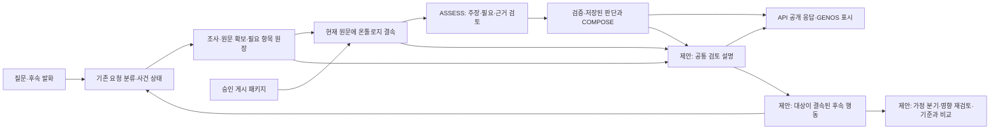

# 검토 실패·미확인 설명과 온톨로지 what-if — 구현 계획

작성 기준: 2026-11-02, 로컬 선택 MAIN132 `final-review-multiturn-20261102-r1`. 작성 당시 상태: **설계 완료, 이번 계획의 제품 구현·실모델 시험·승격·현장 배포는 미수행**. 작성자 자체 검토이며 독립 감독 검토가 아니다.
후속 구현: 2026-11-02 작업 코드에 반영하고 합성 기능·회귀를 검증했다. [구현·검증 결과](../../../../../09_ARTIFACTS/AUDITS/20261102-review-explanation-implementation/구현과_검증결과.txt) · [사용 방법](../../../../../09_ARTIFACTS/AUDITS/20261102-review-explanation-implementation/사용방법.txt). MAIN132 승격·현장 배포와 실모델 시험은 수행하지 않았다. 아래 본문은 구현 전 설계와 당시 근거를 보존한다.

사용자 요구는 사용자가 결과를 보고 **무엇이 실패했는지, 무엇을 더 확인해야 하는지, 다음에 무엇을 할 수 있는지** 알게 하는 것이다. 온톨로지를 사용했다면 어떤 규칙·조건·예외·원문으로 조립했는지 드러내고, 그 중 무엇을 바꾸면 어느 판단이 달라지는지 비교할 수 있어야 한다.

이를 위해 기존 조사·판단·게시 기록을 공통 설명 자료로 연결한다. 화면 설명을 만들기 위한 별도 모델 호출은 추가하지 않는다. what-if는 사건 사실을 바꾸는 비교와 규칙 자체를 가정으로 바꾸는 비교를 구별하고, 현재 승인된 원문과 기준 결과를 보존한다.

## 1. 확인한 현재 상태

### 1.1 기준과 증거의 범위

- `ACTIVE_RELEASE.json`을 직접 확인했다. MAIN132이며 `quality_certified=false`다. 이번 계획의 주요 분석 파일은 작업 코드와 선택 릴리스 코드의 바이트 일치를 대조했다. 대상·해시는 [evidence.json](evidence.json)에 기록한다. 전체 작업 트리의 일치를 주장하지 않는다.
- MAIN132의 실제 다중 턴 시험 ADR1277은 합성 규정·온톨로지 OFF 조건이다. 첫 답변의 검토 실패와 후속 사실 보완을 확인하는 근거이며, 온톨로지 표시나 what-if 성공 증거는 아니다.
- `domain-profile-v1.json`은 `DRAFT`, `runtime_enabled=false`인 기본 템플릿이다. 실제 RAG 사용은 승인·게시 패키지와 현재 설정·원문 결속으로 확인해야 한다. 템플릿이 존재한다는 이유로 운영 지식이 활성화됐다고 표시하면 안 된다.
- 별도 `legal_knowledge` 계열의 기본 설정도 `management_enabled=false`, `consumer_mode=off`다. 이 계열의 평가기가 코드에 있다는 사실과 채팅에서 실행된 사실을 구분한다.
- GENOS 현장 소비자·실제 NFS·Oracle 전체 경로는 이번 문서에서 재시험하지 않았다. 과거 안내 문서의 MAIN 번호보다 현재 선택 포인터와 대조한 코드를 기준으로 삼았다.

### 1.2 현재 컴파일 가능한 도메인

| 구분 | 코드에서 확인한 기능 | 현재 한계와 이번 설계의 연결 |
|---|---|---|
| 도메인 프로필 | DEFINITION, SCOPE, MEASURE, CALCULATION, CONDITION, EFFECT, EXCEPTION 역할 및 검토 슬롯 | 도메인/업무 프로필은 의미 구조와 검토 항목을 정한다. 실행 연산을 자유롭게 추가하는 설정은 아니다. |
| 목적별 조립 | applicability, required-action, calculation-basis 목적에서 필요한 정의·범위·입력·조건·효과·예외를 모은다. 노드·간선의 원문과 미확인 슬롯을 보존한다. | `calculation-basis`는 산정 근거 조립이다. 현재 `assembly_compiler`는 `numeric_execution=False`다. |
| 관계 | REQUIRES_INPUT/CONDITION/SCOPE/DEFINITION은 선행 요건, MODIFIES는 예외가 변경하는 대상, RELATED_TO는 탐색 연결 | 관련 개념이라는 이유만으로 계산 의존 관계를 만들지 않는다. 의존 순환은 거절된다. |
| 현재 원문 결속 | `assembly_compiler.bind_current`가 원문 좌표·본문·해시와 현재 evidence refs를 결속한다. 부족하면 경로를 `withheld`로 남긴다. | 원문이 모두 있더라도 의미 슬롯은 PARTIAL일 수 있다. 조립 가능, 전달 완료, 결론 확정은 서로 다른 상태다. |
| 기존 시나리오 패키지 | 승인된 문장·조건·결과 경로를 미리 조립하고 현재 원문에 결속한다. 일부 경로에서 모델이 선택한다. | `ontology_scenarios`도 숫자 계산기가 아니다. 현재 요구 충족 검토가 켜진 경로는 일반 ASSESS를 유지한다. |
| 별도 타입 평가기 | `lawrag.legal_knowledge.ontology.evaluate`: 논리, 비교, 집합 포함, 제한된 산술, 날짜 전후 비교. 입력·식 해시와 결과를 남긴다. | 기존 검토 지식 계획에 사용되는 평가기다. assembly IR 및 채팅의 가정 편집·차이 비교와의 연결은 새 구현이 필요하다. |

기존 평가기의 정확한 범위는 다음과 같다. `all/any/not`, `eq/in`, `lt/lte/gt/gte`, `add/subtract/multiply/divide`, `before/after`를 등록해 놓았다. 타입·단위가 맞아야 하며 곱셈·나눗셈은 단위 없는 decimal로 제한된다. 0 나눗셈, 단위 불일치, 반올림 정책이 필요한 부정확 계산은 미확인으로 남긴다. `min/max`, 날짜+기간, 통화 환산, 업무별 집계·반올림은 이 목록만으로 지원된다고 말할 수 없다. 원문의 `expression` 설명 문자열을 이 평가기에 곧바로 실행하면 안 된다.

### 1.3 현재 실행 경로와 빠진 연결

`ontology_assessment.project`에는 현재 원문에 결속한 `assembly_catalog`와 `PREPARED_NOT_SENT` 메타데이터가 있다. `completion_execution`은 온톨로지 입력 해시와 workspace 게시 참조를 assessment basis에 보존한다. `unified_runtime.result_port`와 `judgment_view.build`는 판단·미확인·출처를 공개 응답으로 만든다. 다만 일반 ASSESS 경로의 **패키지 → 목적/노드 → 최종 claim** 연결과 실제 전달 여부를 사용자가 읽을 수 있는 공통 표시 계약은 부족하다. 별도 `legal_knowledge` 사용 메타데이터는 검토 안내의 사용 기록으로 구분해야 한다.

실제 채팅 입력은 `genos_rag_chat._request_body → service.py → semantic_runtime.app.create_app/execute_ask_admitted → 기존 unified 사건 실행`으로 들어간다. DP=oracle의 Factory도 같은 `app.create_app`을 호출한다. `lawrag/api/routers/rag.py:Ask`는 이번 선택 릴리스에 포함되지 않은 다른 경로이므로 이번 변경 진입점으로 삼지 않는다. 현재 앱은 추가 요청 필드를 거절하고 사건 요청에 `use_llm=false`를 허용하지 않는다. 따라서 action 필드를 화면에 붙이는 것만으로 모델 없는 후속 실행이 연결되지 않는다.

## 2. 문제별 기존 결과와 변경 목표

| 문제 | 기존 방식과 실제 결과 | 제안 변경 | 원하는 결과·검증 |
|---|---|---|---|
| 무엇이 실패했는지 불분명 | MAIN132는 복구 가능한 최종 검토 실패를 원문 제공 응답으로 바꾼다. 공개 문구는 “주장과 근거의 연결을 검증하지 못했다 / 추가 사실이나 쟁점을 알려 달라” 수준이다. 내부에는 구조화 실패 코드·경로가 있다. | 실패 단계와 검증 대상, 사용자에게 미치는 영향, 시스템이 할 행동을 허용된 구조화 값에서 설명한다. | 원문 부족과 시스템의 검토 연결 실패를 구별한다. 시스템 오류를 사용자의 사실 누락으로 바꾸지 않는다. |
| 확보한 자료를 다시 요청 | ADR1277 첫 보관 응답에는 실제로 제공한 제1·2조에 대해 “원문을 확보하여 … 확인해야 한다”와 “없음. … 모두 확보하였다”가 함께 미완료 목록에 나온다. | 필요 항목의 최초 목적·확보 상태·전달 상태·최종 검토 상태를 따로 투영한다. 과거 문구는 이력에 남기고 현재 행동 목록은 현재 상태로 만든다. | 이미 확보한 범위는 “확보 완료, 최종 연결 검토 미완료”. `없음`을 할 일로 표시하지 않는다. 같은 문장을 단순 삭제하는 대신 다른 필요 항목의 정체성을 유지한다. |
| 온톨로지 사용이 보이지 않음 | 카탈로그와 원문 참조는 모델 입력에 있지만 일반 응답의 목적·경로별 채택 근거 표시는 미연결이다. 이번 ON 실모델 출력은 미관측이다. | 조립 출처·게시 판본·목적·조건·효과·예외와 조회/전달/채택 영수증을 공개 설명에 연결한다. | 패키지를 조회만 했으면 “최종 답변에 사용”으로 표시하지 않는다. 미확보 경로와 채택되지 않은 경로도 이유를 확인할 수 있다. |
| 사용자가 다음에 할 일이 막연함 | 자유 발화는 FACT_UPDATE/RESEARCH_REPLAN/RESEARCH_REENTER 등으로 해석한다. ADR1277 후속 사실 보완은 성공했지만 미확인 항목을 눌러 이어가는 입력은 없다. | 현재 필요·쟁점·원문·판단에 결속된 행동을 제공하고, 실행 가능한 입력만 받는다. | “추가 자료를 주세요” 대신 “해당 예외의 대응 원문 찾기 / 기존 원문으로 연결 검토 다시 하기 / 사건 날짜 입력” 중 실제 필요한 행동을 표시한다. |
| what-if와 실제 정정 혼동 | FACT_UPDATE는 실제 사건 상태의 정정이다. 가정별 분기·기준 비교·조립 패키지의 타입 평가 연결은 확인되지 않는다. | 불변 기준에서 가정 분기를 만들고 사건값 변경과 규칙 가정 변경을 구분한다. | 가정 결과에 표시를 유지하며 실제 사건·승인 규칙·다른 사용자의 결과는 바뀌지 않는다. |
| 모델 호출 범위가 불명확 | ADR1277 후속은 route/resolve/command-check/assess 호출을 거쳤다. 렌더링·단순 값 비교에도 모델이 필요한 설계는 아니다. | 확정된 버튼/필드 입력은 서버 계약으로 검증하고, 의미 해석·새 원문 검토가 필요한 단계만 모델을 호출한다. | 설명 조회·타입 계산·동일 요청 재표시의 추가 모델 호출은 0을 목표로 검사한다. 전체 후속 호출이 항상 1회라는 약속은 하지 않는다. |

앞의 표시 결함은 보관 응답과 현재 코드를 연결해 확인했다. 나머지 what-if 결과는 설계 목표이며 실제 구현 결과로 보고하지 않는다. `NO_PROGRESS` 같은 조사 종료 이력만 보고 전체 실패로 분류해서도 안 된다. ADR1277 후속에는 그 이력이 남아 있어도 최종 결과는 `COVERED`다.

## 3. 사용자에게 보여줄 내용

### 3.1 답변 바로 아래의 검토 상태

긴 진단 로그 대신 다음 내용을 기본으로 표시한다. 기술 상세와 이력은 펼쳐 보기로 둔다.

1. **현재 결과:** 답변 확정 / 일부만 답변 / 원문만 제공 / 입력 대기 / 실행 결과 확인 중. 이 문구들은 UI 표현 제안이며 기존 wire 상태를 무단 교체하지 않는다.
2. **완료한 범위:** 어떤 자료의 어느 부분을 읽었고, 어떤 주장까지 검증했는지.
3. **완료하지 못한 것:** 쟁점·필요 항목·원문 범위 또는 판단 연결을 구체적으로 지정한다.
4. **결론에 미치는 영향:** 영향을 받는 claim/목적/분기와 현재 확정할 수 없는 내용. 영향 관계가 없으면 “영향 범위 미확인”이라고 표시한다.
5. **다음 행동:** 대상·실행 주체·필요 입력·가능 여부. 사용자가 제공할 사실과 시스템이 복구할 검토를 구별한다.

각 미확인 항목은 최소한 `대상 / 현재 상태 / 이유 / 영향 / 다음 행동`을 갖는다. 원문 대상이 아직 식별되지 않았으면 조문 번호를 만들지 않는다. 예: “해당 규정에서 위임한 보고 기한의 대응 조문 찾기 — 문서·조항 미특정”. 권한 밖 문서의 제목·내용을 노출하지 않는다.

### 3.2 실패 유형별 표시와 행동

| 실제 상태 | 사용자 설명 예 | 가능한 다음 행동·담당 |
|---|---|---|
| 원문 위치가 특정됐지만 미확보 | “예외 조항의 해당 범위를 아직 읽지 못해 면제 여부를 판단하지 못했습니다.” | 기존 탐색 대상 ID로 범위 읽기. 재조회·해시·권한 검사는 서버 담당. |
| 필요한 내용은 알지만 대상 미특정 | “보고 기한을 정하는 대응 규정을 아직 찾지 못했습니다.” | 현재 필요 항목으로 검색. 위치를 아는 사용자는 자료를 지정할 수 있음. |
| 원문 확보, 최종 검토 실패 | “해당 원문은 확보했습니다. 질문의 요구와 최종 주장·근거의 연결 검토를 완료하지 못했습니다.” | 시스템의 검토 다시 하기. 사실이 실제로 빠진 경우에만 별도 사실 입력 제시. |
| 사건 사실 미제공 | “적용 기준일이 없어 어느 판본을 적용할지 결정하지 못했습니다.” | 날짜 입력. ‘모름’도 유효한 응답이며 미확인 유지. |
| 의미·판단 충돌 | “이 조건을 예외로 보는 판단과 일반 요건으로 보는 판단이 함께 남아 있습니다.” | 충돌한 근거·범위를 비교 검토. 사용자 선택만으로 법적 정답 승인하지 않음. |
| 미지원 연산·의미 | “산정 근거는 조립했지만 이 집계·반올림 방식은 실행 규칙으로 등록돼 있지 않습니다.” | 설명만 제공하고 식의 검토·등록 요청. 임의 수치 생성 금지. |
| 오래된 판본·철회·권한 변경 | “기준으로 사용한 게시본을 현재 그대로 사용할 수 없습니다.” | 허용 범위 재확인 및 새 판본으로 재기준 설정. 과거 출력에는 당시 기준 표시. |
| 전송 결과 UNKNOWN | “검토 요청의 응답 완료 여부를 확인하지 못했습니다.” | 기존 실행 상태 조회/조정. 같은 모델 요청 자동 재전송 금지. |
| 저장 결과 불명·CAS 충돌 | “결과 저장 여부 또는 최신 상태를 확인해야 합니다.” | 동일 operation ID로 조회·조정. 확보한 모델 결과를 다시 생성하지 않음. |

사용자에게 표시할 실패 이유는 `output_contract.diagnostics`의 코드와 **서버가 결속한 현재 ID**를 번역한다. 거절된 모델 제안의 사실·주장·인용을 확정 정보로 옮기지 않는다. raw 오류 문자열·프롬프트·traceback을 공개하는 방식으로 구체성을 확보하지 않는다.

### 3.3 온톨로지 조립 내역

기본 화면에는 “온톨로지 조립 사용”, 목적, 채택 여부, 남은 미확인을 짧게 보여준다. 상세에는 다음 표와 관계도를 제공한다. 표는 그래프가 표시되지 않는 환경에서도 같은 정보를 제공해야 한다.

| 표시 | 내용 |
|---|---|
| 지식의 출처 | 도메인/업무 프로필, 게시 묶음·판본, 승인/미승인 구분. 내부 해시는 상세 감사 항목. |
| 검토 목적 | 적용 여부 / 해야 할 행동 / 산정 근거 중 실제 선택된 목적. |
| 조립 요소 | 정의·범위·측정 입력·계산 방식·조건·효과·예외. 각 요소의 정확 원문과 좌표·판본. |
| 관계 | 어떤 조건·입력에 의존하는지, 예외가 무엇을 바꾸는지. 탐색 연결은 별도 표시. |
| 상태 | 조회됨 / 원문 미확보로 보류 / 입력 준비 / 실제 전달 / 채택 연결 확인 / 전달했지만 채택 미확인 또는 미사용. |
| 최종 결과 연결 | 어떤 최종 주장에 어떤 경로·노드가 사용됐는지. source 인용의 일치만으로 온톨로지 채택을 추정하지 않음. |
| 변경 가능 항목 | 사건값 입력, 가정 분기 만들기, 원문·관계 검토 제안. 지원하지 않는 편집은 이유 표시. |

기존 `PREPARED_NOT_SENT`를 전송 완료로 해석하지 않는다. 전송 journal의 요청 해시·카탈로그 해시·정상 응답 영수증으로 실제 전달을 확인한다. UNKNOWN 요청은 “전송 시도, 검토 완료 미확인”이다. 캐시 재사용이면 이번 새 전송이 아니라 어느 과거 영수증을 재사용했는지 구분한다.

일반 ASSESS에 선택 가능한 패키지·경로·노드 ID를 제공하고 같은 응답에서 claim별 사용 참조를 받을 수 있게 확장한다. 서버는 제시된 집합·원문 refs·판본과 대조한다. 기존 응답에 연결 정보가 없으면 `채택 미확인`으로 보존한다. 이 참조는 모델이 보고한 사용 관계와 구조 검증이지 의미적 정답 인증이 아니다.

## 4. 공통 설명·행동 계약

아래 이름은 **신규 제안**이다. 기존 실패·필요·판단 원장을 대체하는 두 번째 정본을 만들지 않고, 현재 head와 영수증을 참조하는 표시 스냅샷으로 설계한다.

| 계약 | 핵심 내용 | 생성자 → 소비자 |
|---|---|---|
| `review-explanation-v1` | case/revision, 현재 판단 hash, 결과 상태, 미확인 항목, 허용 행동, 온톨로지 조립 내역, 설명 hash | 공통 설명 projector → API·GENOS·후속 요청 해석 |
| 미확인 항목 | issue/need/target ID, 사실/자료/검토/실행 구분, acquisition/delivery/review 상태, 이유 코드, 영향 refs, next action IDs | 검증된 ledger·실패 진단 → 현재 할 일 목록 |
| 조립 내역 | package/profile/publication refs, purpose/path/node IDs, 현재 source refs, 전달 receipt, claim refs, unresolved | ontology binding·전송 journal·accepted ASSESS → 표/관계도·what-if 기준 |
| `review-action-v1` | 서버 발급 action ID, 종류, 대상 refs, 허용 입력, case/branch revision, view hash, operation ID | 설명 projector → 기존 요청 진입점·실행 담당 |
| `scenario-branch-v1` | 기준 case·facts·source·package·profile hash, 기준일, 변경값, 변경 유형, 실행 결과 refs, 비교 결과 | 시나리오 담당 → 저장·평가·재검토·화면 |

현재 의미 상태와 실행 상태는 분리한다. 원문을 읽은 사실만으로 필요 항목을 RESOLVED로 바꾸지 않는다. 자료는 있으나 주장의 채택 관계가 틀린 경우에는 검토가 남은 것이다. 반대로 질문 해결에 필요 없다고 검토된 연결을 계속 자료 요청으로 노출하지 않는다.

행동은 서버의 현재 상태에서 제공한 것만 실행한다. UI의 임의 문자열로 source ID·판단 ID·권한·예산을 정하지 않는다. 식별 가능한 버튼/구조화 입력은 같은 `/v1/rag/ask` 경로에 선택적 필드로 수용하는 안을 우선한다. 기존 자연어 입력은 유지하고 모호한 대상은 기존 명령 해석으로 연결한다.

GENOS 요청 생성기의 전달 필드, service의 세션 결속, 현재 앱의 필드 allowlist·실행 분기를 함께 변경해야 한다. 모델 없는 구조화 행동도 현재 인증·권한·예산·revision 검증을 거친다. 자유 발화의 의미 검사까지 생략하는 우회를 만들지 않는다. 이미 있는 `branch_id`는 조사/분기 계약과의 관계를 확인하고 가정 분기의 식별자와 혼용하지 않는다.

`FACT_UPDATE`, `RESEARCH_REPLAN`, `RESEARCH_REENTER`, `HISTORY_EXPLAIN`은 기존 메서드를 활용한다. 특정 필요/원문만 조사하는 action binding과 가정 분기는 새 계약이 필요하다. 일반 RESEARCH_REENTER가 이미 항상 그 대상만 처리한다고 가정하지 않는다. `JUDGMENT_OVERRIDE`는 과거 설계에 있으나 현행 method 목록에서 확인되지 않았으므로 기존 구현으로 취급하지 않는다.

실패한 검토를 다시 하겠다는 명시적 행동은 기존 전송의 재전송과 구분한다. 확정 종료한 이전 실패를 보존하고 새 검토 이벤트·사용자 의도·예산에 결속한다. 동일 action+operation의 중복은 기존 결과를 반환하며, UNKNOWN 또는 저장 불명 상태는 상태 확인부터 한다. 새 revision을 반복 생성해 복구 한도를 초기화하는 우회도 차단한다.

## 5. what-if의 실행 범위

### 5.1 바꾸는 대상의 구분

| 사용자 의도 | 처리 |
|---|---|
| “실제 금액을 잘못 입력했다” | 현재 사건 FACT_UPDATE. 실제 정정 이력과 원래 값을 보존. |
| “금액이 다르면?” | 기준 사건에서 가정 분기. 다른 가정 및 실제 사실은 유지. |
| “규정 한도가 달랐다면?” | 규칙 가정 분기. 원래 승인 규칙과 가정한 규칙을 함께 표시. 결과는 가정하의 검토임을 유지. |
| “잘못 연결된 예외를 고쳐라” | 근거를 포함한 지식 변경 제안. 기존 workspace/profile 검토·컴파일·승인·게시 경로. 시나리오 실행만으로 공유 패키지를 교체하지 않음. |

가정 결과를 실제 사건에 반영하려면 별도의 명시적 정정 행동을 거친다. 규칙 변경은 사용자의 가정 동의와 원문에 근거한 지식 승인을 구분한다.

### 5.2 실행 절차

1. 기준 결과의 사건 사실·판단 head·원문 판본/해시·게시 패키지·프로필·기준일을 고정한다. 이미 미완료인 기준도 그대로 미완료로 표시한다.
2. 편집 가능한 사실/규칙 가정 필드를 제시한다. 값의 의미·타입·단위·기준 시점·근거/사용자 진술을 보존한다. 숫자가 같아도 개념·분모·기간이 다르면 같은 필드로 합치지 않는다.
3. 변경한 필드와 등록된 의존 관계에서 영향 후보를 찾는다. 예외가 변경하는 대상도 포함한다. 영향 후보 발견과 최종 결론 변경을 구분한다.
4. 승인된 타입 식이 있는 영향 노드만 기존 평가기로 재평가한다. 설명 문자열만 있으면 “계산 불가, 의미 검토 필요”로 남긴다.
5. 조건 변경으로 새 분기가 열렸는데 원문·관계가 부족하면 해당 부분의 자료 확인 행동을 만든다. 이미 확보한 원문은 현재 권한·판본·해시를 확인해 재사용한다. 필요한 부분만 기존 조사·ASSESS에 연결한다.
6. 전후 차이를 `변경값 / 영향을 받은 조건 / 계산·판단 변화 / 사용 근거 / 여전히 미확인`으로 표시한다. 영향받지 않았다는 근거는 등록된 의존 범위에 한정하며 전 법령에 대한 완전성을 주장하지 않는다.
7. 기준이나 게시본이 바뀌면 stale로 표시한다. “당시 기준 재현”과 “현재 기준으로 다시 검토”를 구분한다. 권한은 재현에서도 현재 권한을 따른다.

숫자 실행을 위해서는 별도의 versioned 실행 명세가 필요하다. 제안 `ontology-evaluation-plan-v1`은 node ID → 타입 식(AST) → 입력 fact ID → 원문 근거 → 단위/기간/반올림 정책 → evaluator revision을 결속한다. 기존 `ontology-assembly-package-v1`의 설명 문자열을 실행식으로 암묵 전환하지 않는다. 기존 패키지는 설명·조립 전용으로 계속 읽는다. 실행 명세 생성은 원문 검토·승인 과정에 두며, 사건값 변경 때마다 모델이 식을 다시 만들게 하지 않는다.

기존 평가기의 TRUE/FALSE/VALUE/UNKNOWN/CONFLICT 결과를 보존한다. `all(False, unknown)`처럼 전체 논리 결과를 확정할 수 있어도 누락 입력 기록을 지우지 않는다. 계산 결과가 TRUE라는 사실을 최종 법률 판단의 확정으로 확대하지 않는다. 임의 코드 실행, 자유 SQL, 모델 생성 Python은 사용하지 않는다.

### 5.3 화면 예시 — 합성 자료, 법률 판단 예제가 아님

**예시 E1:** 원문에 “비용 ≤ 한도”라는 비교가 있고 이를 타입 식으로 검토·등록했다는 가정이다. 비용 150만 원, 기준 한도 100만 원에서 가정 한도 200만 원으로 변경한다. 이 숫자는 화면 설계용이며 실측이나 실제 규정값이 아니다.

| 항목 | 기준 | 가정 | 설명 |
|---|---|---|---|
| 비용 | 150만 원 | 150만 원 | 같은 사건 입력 |
| 한도 | 100만 원 | 200만 원 | 승인 규칙은 유지하고 이 분기에서만 변경 |
| 금액 조건 | FALSE | TRUE | 등록된 비교식의 계산 결과 |
| 별도 승인 요건 | 미확인 | 미확인 | 대응 원문이 아직 없다는 설정 |
| 최종 처리 가능 여부 | 미확정 | 미확정 | 금액 조건의 변화만으로 승인 요건을 해결하지 않음 |

화면 문구: “가정한 한도에서는 금액 조건을 충족합니다. 별도 승인 요건은 확인하지 못해 최종 처리 가능 여부는 아직 판단할 수 없습니다. 다음 행동: 승인 요건의 대응 원문 찾기.”

현재 문장 조립 패키지만 있는 경우에는 위 표의 계산 결과를 생성하지 않는다. 대신 “한도 관련 근거를 조립했습니다. 계산 가능한 규칙 등록이 필요합니다”를 표시한다.

## 6. 변경 지도와 저장·이행

아래 모듈 이름의 경로는 별도 표기가 없으면 `02_BACKEND/semantic_runtime/` 기준이다. 신규 이름은 구현 시 기존 책임과 맞춰 확정한다.

| 변경 지점 | 책임과 실제 소비자 연결 |
|---|---|
| `legal_agent/completion_execution.py`, `output_contract.py`, `read_judgment_final.py`, `need_continuity.py` | 최초 실패·보완·최종 검토 상태를 현재 대상 ID에 결속. 실패 이유를 판단 결과로 바꾸지 않으며 accepted/rejected 원본 보존. |
| **신규 제안** `legal_agent/review_explanation.py` | 현재 ledger·head·영수증에서 공통 설명 생성. 같은 자료에서 UI·후속 문맥이 일치하도록 관리. 큰 원본 복제 대신 refs/hash 사용. |
| `legal_agent/completion_contracts.py`, `judgment_view.py`, `corrected_memory.py` | generic 한계 문구를 구체 항목으로 연결. 과거 필요와 현재 상태를 분리하고 다음 턴에 현재 할 일 전달. COMPOSE 무결성 계약과 함께 갱신. |
| `legal_agent/ontology_assessment.py`, `ontology_context.py`, `ontology_work/assembly_compiler.py`, `ontology_work/runtime.py` | 현재 조립·보류·게시 상태와 source refs를 추출. 일반 ASSESS에 사용 참조 메뉴를 추가. 게시 철회/권한 재검증 유지. 컴파일러는 순수 조립 책임 유지. |
| `legal_agent/unified_runtime.py`, `unified_publication.py` | API의 `assembly.term_agent` 아래 선택적 `review_explanation` 노출. 저장 head·응답·재사용의 hash를 검증. 임의 공개 데이터 추가를 허용하지 않음. |
| `service.py`, `app.py:execute_ask_admitted`, `legal_agent/request_entry.py`, `memory_methods.py`, `corrected_memory.py` | 현재 선택된 API의 필드 allowlist·세션 결속과 구조화 실행 분기에 action 연결. scope·대상·revision·operation ID 검증 후 기존 실행 담당 호출. 자유 발화와 혼합할 때 불일치면 확인 상태 반환. |
| `app.py:legal_error_payload`, `08_DEPLOYMENT/GENOS/workflow/genos_rag_chat.py` | 성공/제한 답변뿐 아니라 실패 경로에도 검증된 설명을 전달. `_request_body`에 action 전달 연결. 공통 설명으로 실패·미확인·온톨로지 표/관계도·가정 비교 표시. 기존 `public_response`의 민감정보 필터를 유지하며 허용된 구조화 설명만 통과. 액션 불가 환경에는 번호와 동일 action 참조를 제공. |
| `app.py`의 로컬 RAG 페이지 | 같은 공개 설명을 기본 텍스트·표로 소비하도록 연결. GENOS 전용 renderer만 고쳐 로컬 소비자가 일반 실패 문구에 머무는 경우를 검사. |
| **신규 제안** `legal_agent/scenario_branch.py`, `ontology_work/evaluation_plan.py` | 가정 분기·기준/변경 hash·의존 영향·타입 식 연결·차이 결과. 기존 `lawrag/legal_knowledge/ontology.evaluate` 재사용. 기존 계획 서비스의 안내용 상태를 최종 답변으로 오인하지 않도록 어댑터 분리. |
| 기존 계약 schema·PIPELINE·릴리스 pin | 공개 포트가 새 선택 필드를 수용하도록 버전/검증자와 실제 소비자를 같이 갱신. 기존 패키지 v1 호환 유지. 공식 prepare/apply 전에 동결된 코드/pin과 후보를 대조. |
| 기존 사건/조사 저장 계층·Oracle Agent records·NFS 상세로그 | 설명/시나리오의 필수 상태·영수증은 구조화 정본에 저장. 프롬프트·raw·상세 trace는 기존 상세로그 정책 유지. 새 물리 테이블/컬럼 필요 여부는 매핑 검토에서 확정하며 이번 계획은 DDL을 요구하지 않는다. |

기존 최종 답변·실패 원본·게시본을 소급 재작성하지 않는다. 새 설명은 새 revision으로 생성하고 과거에 없었던 사용 관계는 `NOT_RECORDED`로 남긴다. 원문/벡터/용어집 전체 재구축은 이 표시 기능의 전제가 아니다. 숫자 실행은 검토된 대상 묶음에만 새 실행 명세를 추가한다.

가정별로 온톨로지와 원문 전체를 진행 snapshot에 복제하지 않는다. 기준 참조와 변경값·필수 영수증을 저장하고, 렌더링용 캐시는 정본으로 취급하지 않는다. Oracle layout4 및 기존 CAS/lease·재개·예산 계약을 그대로 통과해야 한다. 새 분기 저장 뒤 구버전 복구가 필요한 경우에는 해당 reader 호환성을 포함한 릴리스를 사용한다.

설정은 설명 표시·구조화 행동·숫자 what-if의 활성화를 분리하는 안으로 한다. **새 설정명은 아직 확정하지 않았다.** 온톨로지 OFF, 조회 결과 없음, 조회 실패, 게시 철회는 각각 구별해 표시한다. 기능을 숨기는 설정으로 저장된 가정 결과를 실제 답변으로 바꾸지 않는다.

## 7. 구현 순서와 완료 조건

| 순서 | 구현 범위 | 다음 단계로 넘어갈 조건 |
|---|---|---|
| A — 현재 실패·미확인 설명 | 공통 설명 계약, 실패 대상 결속, 확보/전달/검토 분리, generic 목록 정리, API·GENOS 동시 연결 | ADR1277 보관 사례에서 확보 완료 항목을 다시 요청하지 않고 실패 단계·영향·시스템 행동이 나타남. 모델 호출 없이 재표시 가능. |
| B — 온톨로지 조립 공개 | 목적·노드·관계·원문·게시 판본, 보류·전달·채택 구분, 기존 ASSESS 안의 사용 참조 | ON/OFF/미확보/전달 실패/미채택/철회 각각을 정확히 표시. 최종 claim 사용은 영수증과 일치. |
| C — 구체적인 후속 행동 | 현재 상태에 결속한 구조화 action, 기존 메서드 연결, 사용자 사실 입력·시스템 재검토, 중복/CAS 복구 | 동일 행동 중복은 새 호출 없이 같은 결과. 오래된 action은 갱신 안내. 자연어와 구조화 요청이 같은 상태 전이를 사용. |
| D — 가정 분기와 비교 | 기준 보존, 사실/규칙 가정 구별, 영향된 의미 검토·필요 원문만 재개, 전후 표 | 실제 사건·공유 규칙 불변. 미완료 기준·새 분기 원문 부족·해석 충돌을 숨기지 않음. |
| E — 제한된 숫자 what-if | 승인된 타입 식 명세·기존 evaluator 연결, 단위/기간/반올림 정책, 결과 차이 | 등록된 연산만 실행. 미지원·충돌·부족을 정상 상태로 반환하고 수치 결과와 최종 결론을 분리. |
| F — 선택 경로·현장 확인 | 변경 코드/pin 동결, 계약/API 검사, 필요 시 사전 등록한 Qwen 시험, 공식 MAIN/Gold 결속 및 실제 소비자 확인 | 기술 통과·실모델 결과·로컬 MAIN·GENOS 현장 상태를 각각 기록. 현장 확인 전 배포 완료로 보고하지 않음. |

A~C가 사용자에게 당장 필요한 개선이다. D~E는 기존 도메인 컴파일 설계를 실행 가능한 what-if로 연결하는 후속 범위다. 일정은 미산정이며, 별도 숫자 연산 확장의 범위와 GENOS action 전달 지원을 확인한 뒤 산정한다. 이 문서는 새로운 모델 시험을 시작하지 않는다.

## 8. 검증 계획과 실패 경계

실제 시험을 시작한다면 현행 ADR 선점·후보 동결 절차를 적용한다. 평가용 정답·실패 주입은 제품 입력과 분리하고, 같은 원본 사건과 같은 버전에서 기준/후보를 비교한다. 논리 사례를 독립 단위로 세고 그 안의 API assert 수를 성공 사례 수로 부풀리지 않는다.

| 사례 | 필수 관찰·통과 기준 |
|---|---|
| 확보 완료, need 검토 누락 | 실패 대상 연결 또는 연결 미확인을 정확히 표시. 사용자에게 불필요한 사실·원문을 요구하지 않음. 거절 제안의 claim 수는 증가하지 않음. |
| 실제 원문 미확보 / 대상 미특정 | 정확한 범위 또는 미특정 상태와 탐색 행동. 없는 문서·조문·인용을 생성하지 않음. |
| 중복·충돌 선택 | 같은 필요/대상은 중복 실행하지 않으며 서로 다른 의도는 유지. 충돌 판정과 복구 실패가 설명에 남음. |
| ontology 일부 미확보 / 슬롯 미확인 | `withheld`와 PARTIAL을 구별. 일부 원문 확보로 전체 경로/질문을 완료 처리하지 않음. |
| ontology 준비 / SENT·UNKNOWN / 정상 전달 / 캐시 재사용 | 준비≠전달≠완료. 이전 전달 재사용을 이번 새 호출로 세지 않음. |
| 경로 전달됐으나 claim에서 미사용 | 채택 미확인 또는 미사용. package/source ID만 맞는 허위 채택 참조는 거절. |
| 비용·한도 변경 / 새 예외 분기 | 등록된 의존 범위만 재평가, 새 필요 원문 제시. 기준/다른 분기 hash 불변. |
| 단위·개념·분모·기준일 불일치 | 자동 환산·임의 기본값 없음. UNKNOWN/CONFLICT 및 이유 보존. |
| 연산 미지원 / 0 나누기 / 반올림 필요 / 의존 순환 | 원인과 수정 가능한 입력을 표시하고 실행 불가를 정상 결과로 보존. 모델 계산으로 조용히 대체하지 않음. |
| 동일 operation 재전송 / 다른 값의 같은 ID / 두 탭 동시 수정 | 기존 결과 재사용, payload 충돌 거절, CAS로 최신 상태 확인. 새 모델·새 분기를 중복 생성하지 않음. |
| 모델 성공 뒤 저장 실패 / 전송 UNKNOWN | 같은 receipt 조회·저장 복구. 모르는 결과를 성공/실패로 합성하거나 새 모델 요청으로 덮지 않음. |
| 권한 축소·게시 철회·원문 판본 변경 | 접근 불가 내용 비노출, 새 사용 차단, 현재 기준 재검토 안내. 과거 사용 이력은 보존. |
| SSE 중단·새 프로세스·페이지 재방문 | commit 상태와 표시 내용 일치, 설명 hash 검증, 실제 가능한 action만 재제공. |
| 기존 클라이언트·온톨로지 OFF | 기본 답변·출처·기존 메서드 유지. 새 기능의 사용 여부를 정확히 표시. |

기존 `test_need_continuity*`, `test_genos_judgment_view.py`, `test_domain_profile_*`, `legal_knowledge/test_conditions.py`와 해당 단계의 API·복구 검사를 재사용한다. 저장·권한·실제 API consumer 연결까지 검증하며 문자열만 맞추는 테스트로 완료하지 않는다. 코드에서 지원되지 않는 연산을 기대하는 fixture를 넣어 구현을 과장하지 않는다.

Qwen 시험은 A의 실패 설명, B의 온톨로지 ON 사용/미사용, C의 후속 행동, D/E의 가정 변화로 나눠 사전 고정한다. 기존 ADR1277은 합성/OFF이므로 B~E 통과를 대신할 수 없다. 실패한 ADR1275를 성공 기록으로 바꾸거나 기존 질문 재실행 결과만 합산하지 않는다. 공급자 UNKNOWN이 남으면 그 이후 효과는 미측정으로 둔다.

## 9. 기대치와 측정 방법

| ID·분류 | 수치 또는 목표 | 분모·근거·한계 |
|---|---|---|
| O1 관측 | ADR1277 후속 모델 호출 4회 | 한 합성 사건의 자유 발화 후속. route/resolve/command-check/assess. 평균이나 온톨로지 what-if 기준값이 아님. |
| T1 목표 | 설명 조회·관계도 표시·등록 타입 식 재계산의 추가 모델 호출 0회 | 해당 기능의 실행 구간으로 측정. 자료 탐색·의미 판단까지 포함한 전체 요청에는 적용하지 않음. |
| T2 목표 | 동일 action+operation 중복의 추가 모델 호출 0회 | 최초 결과가 확정 저장됐거나 기존 결과를 조회하는 경로. UNKNOWN은 상태 확인 대상으로 유지. |
| T3 목표 | 공개된 미확인 항목 모두에 대상/이유/영향/행동 또는 행동 불가 이유 제공 | 표시 항목 전체가 분모. 의미적으로 올바른지는 별도 원문·사례 검토가 필요. |
| E1 가정 예시 | 비용 150만 / 기준 한도 100만 / 가정 한도 200만 | 화면 예시의 비교식만 계산. 실측·법적 기준·성과 수치 아님. |
| U1 미측정 | 422 감소율, 평균/p95 시간, 토큰/비용, 저장량 변화 | 새 구현 전 수치 없음. 계약 오류·실행 오류·법률 미확인을 나누어 요청 단위로 집계. HTTP200 비율만 성공 지표로 삼지 않음. |

증분 실행의 손익분기는 `기존 전체 재검토 비용 > 영향 탐색 + 재검증 + 영향 부분 재검토 + 추가 저장 비용`이다. 등록 의존이 충분하고 변경 범위가 작을 때 유리하다. 대부분의 조건이 영향을 받거나 게시본·권한이 바뀌면 전체 검토에 가까워지고 추가 표시·저장 때문에 더 느릴 수도 있다. SQL/원문 조회/모델/렌더링 시간을 각각 측정하고 고정 속도 개선율은 제시하지 않는다.

## 10. 근거와 자체 검토

- [기존 컴파일·시나리오 설계](../COMPILATION_AND_SCENARIOS.md), [지식 컴파일 설계](../KNOWLEDGE_COMPILATION_DESIGN_20261029.md), [도메인 프로필 계획](../DOMAIN_PROFILE_IMPLEMENTATION_PLAN_20261029.md): 계획의 의미·연결·실행 경계를 재확인했다. 과거 계획을 현행 구현으로 간주하지 않았다.
- [도메인 프로필](../../../../../00_SYSTEM/ONTOLOGY_PROFILES/domain-profile-v1.json), [목적 조립 컴파일러](../../../../../02_BACKEND/semantic_runtime/ontology_work/assembly_compiler.py), [현재 입력 결속](../../../../../02_BACKEND/semantic_runtime/legal_agent/ontology_assessment.py), [별도 타입 평가기](../../../../../02_BACKEND/lawrag/legal_knowledge/ontology/__init__.py): 지원 범위를 코드로 확인했다.
- [검토 실행](../../../../../02_BACKEND/semantic_runtime/legal_agent/completion_execution.py), [현재 제한 안내](../../../../../02_BACKEND/semantic_runtime/legal_agent/completion_contracts.py), [공개 응답](../../../../../02_BACKEND/semantic_runtime/legal_agent/unified_runtime.py), [GENOS 소비자](../../../../../08_DEPLOYMENT/GENOS/workflow/genos_rag_chat.py): 저장된 상태부터 실제 표시까지 추적했다.
- [실제 API 앱](../../../../../02_BACKEND/semantic_runtime/app.py), [Oracle Factory](../../../../../02_BACKEND/semantic_runtime/oracle_query_service.py): 로컬/NFS와 Oracle의 현재 진입점 및 새 요청 필드의 통과 지점을 확인했다.
- [현재 메서드](../../../../../02_BACKEND/semantic_runtime/legal_agent/memory_methods.py), [기존 검토 지식 연결](../../../../../02_BACKEND/semantic_runtime/legal_agent/knowledge_bridge.py): 실제 정정·자유 발화·검토 안내의 경계를 확인했다.
- [MAIN132 결과](../../../../../09_ARTIFACTS/AUDITS/20261102-final-review-main132/수정과_멀티턴_실제검증_메인반영결과.txt), [ADR1277](../../../../../04_EXPERIMENTS/ADR/ADR-1277-qwen-followup-derived-context/README.md): 기존 실측과 이번 설계 목표를 구분했다. 첫·후속 보관 응답은 압축 원본을 읽기만 했으며 hash를 evidence.json에 남긴다.

자체 검토 결과: 화면 설명만 추가해서 원장과 불일치하는 설계, 현재 문장 조립을 숫자 실행으로 오인하는 설계, 조회된 온톨로지를 채택으로 표시하는 설계, 실제 사실 정정으로 가정을 덮어쓰는 설계를 배제했다. 남은 구현 전 확인은 GENOS 구조화 action의 실제 전달 방식, 공개 schema의 호환 전략, 실행 명세의 승인 UI·저장 매핑, 현재 게시 지식 중 타입 식으로 검토 가능한 범위다. 이들은 구현 단계의 확인 항목이며 이번 문서의 완료를 구현 완료로 확대하지 않는다.
