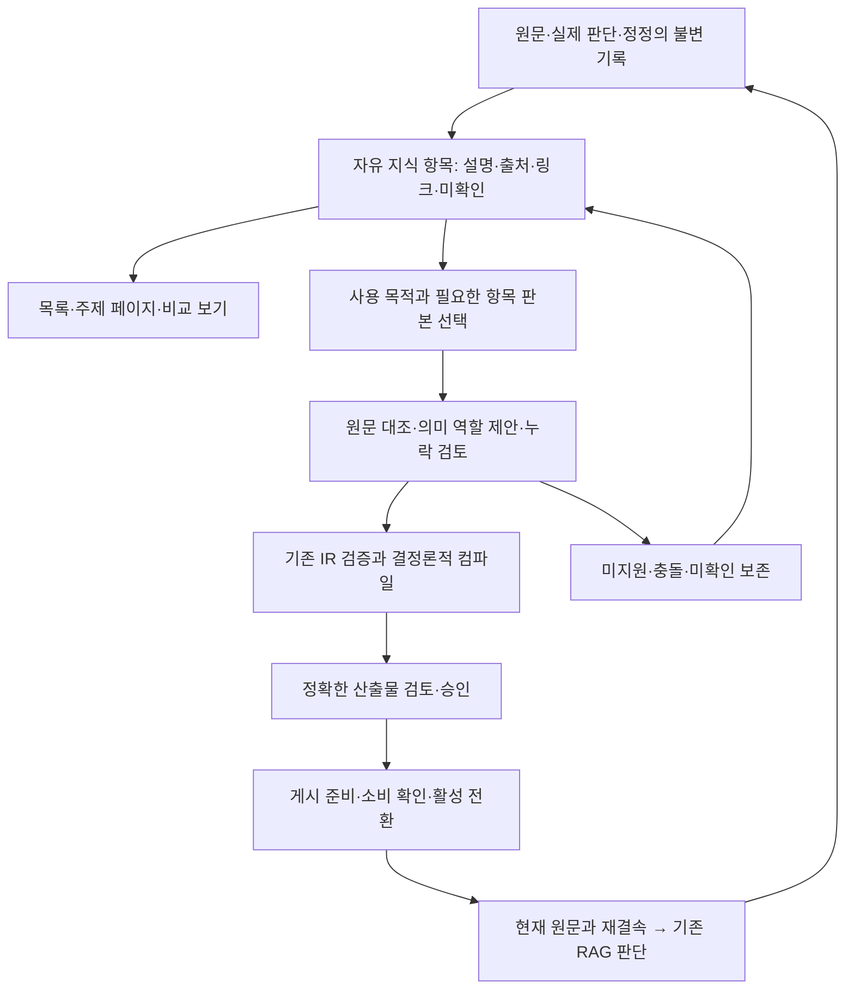

# 자유롭게 축적하고 승인한 의미를 컴파일하는 온톨로지 설계

2026-10-30 · 설계 제안 R1 · 기준 MAIN129/oracle-safe-records-20261030-r1

**결정 제안:** 현재 원문 검증·검토·게시·결정론적 조립·RAG 결속을 유지한다. 그 앞에 **프로필을 먼저 선택하지 않아도 저장·연결·분할할 수 있는 지식 작업공간**을 둔다. LLM은 작업공간의 제한된 변경안을 작성하고, 서버는 변경과 출처를 검증한다. 재사용할 부분을 선정할 때 승인 프로필에 맞는 의미 구조로 변환하고 기존 컴파일러로 조립한다. 주제 목차와 페이지 배치는 바뀔 수 있고, 게시된 의미와 근거는 판본으로 고정한다.

이 문서는 실제 코드에 근거한 구현 설계다. 제품 구현, 모델 호출, 품질 실험, DB 변경, MAIN 전환, GENOS 배포는 수행하지 않았다. 새 파일·명령·상태는 아래에서 **제안**으로 구분한다. 독립 감독 검토는 수행하지 않았으며 마지막 검토는 작성자의 자체 검토다.

## 1. 확인 범위와 현재 상태

[코드 지문 원장](SOURCE_AUDIT.json)에서 확인한 선택 포인터는 MAIN129다. 릴리스 manifest의 파일 수는 495이며 포인터의 manifest SHA-256과 실제 파일 해시가 일치했다. 조사한 49개 파일 중 선택 릴리스에 포함된 41개는 작업 파일·선택 사본·manifest 해시가 같았다. 나머지 8개는 로컬 연결기·화면·수집기·평가 안내 등 별도 작업 자료다. 495개 전부의 코드 동작을 시험한 결과가 아니다.

| 근거 ID | 종류·확인 내용 | 범위와 한계 |
|---|---|---|
| E1 | 관측: MAIN129, manifest 495파일, 조사49/선택41/해시불일치0 | SOURCE_AUDIT.json; 읽기 전용 파일 대조. 서비스 재실행 아님 |
| E2 | 관측: 현재 일반 profile-unified-v6의 온톨로지 기본 OFF, 별도 Gold 설정 ON | 설정 파일 확인. 실제 요청·DB·현장 상태를 새로 검사하지 않음 |
| E3 | 과거 관측: MAIN122 실제 정규화·누적은 저장됐으나 의무/조건 혼동과 없는 이유 복사로 내용 미통과 | [1226 결과](../../../../../09_ARTIFACTS/AUDITS/20261029-main122-authoring-revalidation/재검증결과.txt) |
| E4 | 과거 관측: MAIN123 원문 독립 분석·원래 이유 부재 보존; 실제 누적 제안에서 불일치 탐지, 최초 SAME 등으로 정식 누적 저장0 | [1231 결과](../../../../../09_ARTIFACTS/AUDITS/20261030-source-semantics-main123/수정과_실제실험_결과.txt). 현재본에서 재실험하지 않음 |
| E5 | 과거 관측: Gold 온톨로지 실제 게시·원문 전달은 확인됐지만 전체 답변 성공은 미입증 | [게시 기록](../../../../../09_ARTIFACTS/AUDITS/20261030-gold-ontology-publication/게시와_확인결과.txt), [1245 결과](../../../../../09_ARTIFACTS/AUDITS/20261030-main128-oracle-records-live/실제실험_결과.txt) |

### 현재의 서로 다른 경로

1. **시나리오 작성 경로:** 기존 CLI `06_TOOLS/pipeline.py ontology-work` 또는 Streamlit → `Workflow.enqueue/propose/save` → `schema.recipe_for` → `ontology_scenarios.compile_package` → 검토 → `Repository.publish` → 원문 도착 시 조회. 시나리오 components/paths 계약을 사용한다.
2. **프로필 기반 누적 경로:** 같은 CLI의 `domain_cli.run` 또는 `domain_ui` → `DomainWorkflow.ingest` → `normalize` → `accumulate` → `save_accumulation` → `preview/review` → `stage_publication/verify_publication/activate_publication`. RAW는 프로필 없이 저장할 수 있지만 정규화부터 승인 프로필이 필요하다. UI는 승인 프로필이 없으면 원본 가져오기 부분까지 내려가지 못한다.
3. **RAG 소비 경로:** `ontology_context.acquire` → `ontology_work.runtime.acquire` → `Repository.lookup` → 실제 원문 확보 → `ontology_assessment.project` → `assembly_compiler.bind_current` → 기존 ASSESS/답변. assembly_catalog는 일반 ASSESS 입력이고 scenario_catalog의 전용 선택 경로와 구별된다.
4. **기존 경험 위키:** `action_memory` → `legal_llm_wiki.export_wiki`. 경험 DB를 Markdown으로 보여주는 투영이며 함수는 새 모델을 호출하지 않는다. `online_wired=false`이고 페이지 편집으로 지식 승인이 바뀌지 않는다.
5. **기존 쟁점 메모리 컴파일러:** `legal_wiki_compiler`는 shortcut/unified memory의 쟁점·사건·claim 계약을 사용한다. 온톨로지 프로필/게시 경로와 동일하지 않다. 이 설계를 위해 세 번째 자동 게시 파이프라인으로 연결하지 않는다.

기존 원문 수집·용어집 파이프라인과 폐기된 `LEGAL_SCHEMA.json` 의미 스키마도 구분한다. 구 스키마를 새 자유 축적의 기본형으로 재도입하지 않는다.

## 2. 무엇을 유지하고 무엇을 바꾸는가

| 영역 | 유지할 것 | 바꿀 것 |
|---|---|---|
| 정본·출처 | 원문 불변, 문서/판본/좌표/hash, 실제 확보·전달 영수증, 원기록 보존 | 자유 설명의 출처와 법률 주장에 대한 원문 근거를 별도 필드로 표현 |
| 지식의 단위 | 원문에 붙는 재사용 지식, 질문은 발견 이력 | 전체 누적 묶음에 앞서 안정 ID를 가진 작은 지식 항목을 독립 저장 |
| 분류·목차 | 승인 용어집 ID·별칭과의 결속 | 이름·태그·목차·페이지 묶음은 파생 탐색 화면. 필수 상위 분류 없음 |
| 의미 구조 | 조건·행위·양태·예외를 구분할 수 있는 현재 프로필 | 프로필을 축적의 선행조건에서 컴파일할 부분의 표현 계약으로 이동 |
| LLM의 역할 | 원문 독립 분석, 의미 제안, 틀린 원기록 보존 | 모든 이전 그래프 재작성 대신 선택 항목의 변경안. 미분류 문장을 허용 |
| 컴파일 | 기존 의존 순서·예외 포함·미사용 사유·정확 본문·해시·출처 결속 | 항목 판본을 선택해 기존 IR로 변환하는 전처리와 선택 근거 영수증 추가 |
| 승인·게시 | 정확한 revision/hash 검토, stage→소비 확인→activate, CAS | 자유 작업 저장·내용 검토와 컴파일 산출물 승인을 별도 객체로 분리 |
| 읽기·적용 | 현재 권한/원문 재확인, 기존 ASSESS·gaps·보완·예산 | 새 작업 항목을 곧바로 RAG 지식으로 주입하지 않고 게시본만 소비 |
| 작업 저장 | Dataiku S3 관리 폴더 JSON + Oracle 작업/감사 메타, 승인 후 Gold | 작은 항목·변경집합·색인·컴파일 선택명세를 같은 저장 추상화에 추가 |
| 운영 기록 | DP=oracle 구조화 Oracle / 상세 진단 NFS, MAIN129 v3 reader | 신규 기능도 실제 연결별 저장 계약 확인. 새 로컬 미러·서빙 영속 위키 없음 |

### 문제별 전후 비교

| ID·같은 상황 | 기존 방식과 실제 결과 | 변경 방식 | 원하는 결과와 검증 |
|---|---|---|---|
| P1 새 기록의 의미 유형을 아직 모름 | RAW 저장은 가능. normalize는 승인 프로필을 요구하고 graph_schema는 노드와 목적을 최소 하나 요구. 새로운 자유 지식 항목의 별도 수명주기는 없음; 실사용 손실률은 미관측 | 프로필 없이 ENTRY 저장, 미분류 내용·불확실성 보존. 선정된 일부만 typed projection 생성 | 유형 미정 항목이 저장·검색되고 프로필 미설정 때문에 사라지지 않음. 게시본에는 자동 포함되지 않음 |
| P2 일부 내용만 추가 | accumulate가 이전 전체 그래프를 출력하도록 요구. E4의 SAME/참조 오류는 실제 저장을 막았음 | 제한된 원자 변경안을 서버가 기존 판본에 적용하고 최종 그래프를 검증 | 제목 변경·문단 추가에 기존 관계 재생성 불필요. 변경하지 않은 의미 항목 hash 동일 |
| P3 관련 자료가 새로 들어옴 | match는 cb-kb- 목록을 읽어 glossary ID/anchor 겹침으로 후보를 찾음. Repository.list 기본256 한도, 초과 시 더 좁은 범위 요구. 규모 지연은 미측정 | 권한별 작업 색인에서 anchor/용어/명시 링크 후보 조회, 새 항목/기존 항목/보류를 제안 | 전역 전체본문 스캔을 하지 않고 조회완료 범위·cursor·미검색을 표시. 검색 실패를 새 개념의 증명으로 쓰지 않음 |
| P4 같은 설명에 의무와 조건이 섞임 | E3 실제 의미 오류. E4 독립 원문 분석으로 일부 오류를 지적했지만 전체 의미 품질은 미통과 | 자유 설명과 원문 분석을 모두 보존. 컴파일 전 선택 문장을 명시적 역할과 연결하고 독립 원문 대조 유지 | 미분류 내용을 CONDITION으로 강제 변환하지 않음. 지원하지 못한 의미는 해당 경로의 미해결 항목으로 남음 |
| P5 페이지 분할·합병 | 현재 안정적인 위키 항목/문장과 화면 배치를 분리한 계약이 없음; 기존 묶음의 profile/판본 변화는 별도 묶음 요구 | statement ID·revision과 entry/view ID 분리. 합병은 표시 구성 변경, 의미 동일성은 별도 검토 | 화면 재배치로 기존 승인 claim/근거/게시본이 바뀌지 않음 |
| P6 새 지식이 기존 게시본을 반박 | 현재 withdraw/activate와 원문 재결속은 있음. 새 자유 항목과 게시본의 역의존은 없음 | 투영 영수증·역의존 명세와 명시적 disputed/retracted 작업을 연결 | 철회한 의미 항목을 쓰는 활성 게시본은 원자적으로 사용 중지. 평범한 초안 수정은 기존 승인본 유지 |
| P7 모델 출력은 저장됐지만 작업 반영 실패 | DomainWorkflow._job/_save/reconcile에 READY 재사용·SAVE_UNCONFIRMED 복구 기반 있음 | 같은 변경집합 ID와 기대 판본으로 저장 결과를 재조정 | SQL commit 응답 불명 뒤 새 모델 재전송 없이 같은 객체로 복구 |

P1~P7 중 새 경로의 개선 효과는 목표이며 실측이 아니다. 특정 조문의 단서는 지식 내용으로 추가하고, 반복되는 의미 손실만 표현 계약 확장 후보로 올린다. 구조 검사로 원문에서 발견하지 못한 모든 예외를 보장할 수는 없다.

## 3. 목표 구조: 하나의 작업공간, 두 가지 산출물

페이지·목차는 지식을 보는 방식이다. 제목·폴더 위치·주제 군집은 적용 법률이나 필수 의존관계를 결정하지 않는다. 항목은 여러 보기에 동시에 등장할 수 있다. 컴파일은 승인한 표현과 관계를 목적별로 조립하며 법률 결론 자동 증명·수치 실행을 뜻하지 않는다.

### 제안 계약과 안정 ID

아래 이름은 아직 미구현이다. [합성 예시](CONTRACT_EXAMPLES.json)는 설계 설명용이며 현재 API 입력·실제 게시 데이터가 아니다.

| 객체 | 최소 계약 | 의미 |
|---|---|---|
| `knowledge-entry-v1` | entry_id/revision, namespace/ACL, title, body_sections, statement_refs, navigation_links, origin_refs, open_items | 자유 설명과 자료 배치. profile_id·법률 역할·상위 폴더 필수 아님 |
| `knowledge-statement-v1` | statement_id/revision, namespace/ACL, text, origin_refs, source_basis, epistemic_status, semantic_revision_hash | 원기록 주장·분석 제안·미확인의 안정 단위. 법률 역할 미정 허용 |
| `knowledge-change-set-v1` | change_id, expected_revisions/hashes, operations, input_receipt, candidate_search_receipt | 여러 항목의 원자 변경. 서버가 ID를 예약하고 실제 diff 재계산 |
| `knowledge-projection-v1` | projection_id/revision, selected_statement_revisions, profile_hash, source snapshot, scope, purposes, typed_graph, coverage_decisions, import_manifest, compiler_binding | 컴파일할 정확한 입력과 변환 결과. 자유 페이지 전체를 승인한 것으로 해석하지 않음 |
| `knowledge-view-v1` | view_id/revision, title, member_refs, view_rules | 목차·주제 보기. 의미 승인과 독립, 재생성 가능 |
| `knowledge-index-v1` | namespace/ACL, generation/hash, shards/cursor, anchor/term/entry/ref index, reverse publication dependencies | 작업 탐색·영향 계산용. 원본을 대신하는 정본 아님 |

origin_refs는 원래 행동·판단·정정의 계보이고 source_basis는 주장을 검토하는 실제 원문 좌표다. 둘을 같은 근거로 사용하지 않는다. statement의 “검토됨”은 사람의 특정 범위 판단이며 법률 정답 인증이 아니다. 원래 없던 reason/purpose는 nullable 또는 NOT_RECORDED로 보존한다.

statement는 어느 페이지에 표시되는지와 무관하게 자체 namespace/ACL을 가진다. 의미 판본의 canonical hash에는 text·origin_refs·source_basis·epistemic_status와 의미를 한정하는 모든 필드를 포함하고, entry 제목·배치·view membership은 포함하지 않는다. 객체 전체 hash는 별도로 보관한다. 새 의미 필드가 생기면 hash에서 누락되지 않도록 계약 버전을 갱신한다.

자유로운 링크는 임의의 설명과 연결 대상 ID를 가질 수 있지만 `navigation_only=true`로 저장한다. 등록된 컴파일 관계로 승격할 때는 방향·대상·근거·검토가 별도로 필요하다. LLM이 만든 새 관계명은 자동 실행 연산자가 아니다. 원자료·페이지 안의 지시문은 데이터로 취급한다.

제안 변경 연산은 CREATE_ENTRY, REVISE_ENTRY, ADD_STATEMENT, REVISE_STATEMENT, CREATE_VIEW, REVISE_VIEW, LINK, UNLINK, MOVE_MEMBERSHIP, MARK_DISPUTED, RETRACT다. 새 객체 ID는 사전 예약 핸들에서 서버가 발급한다. 삭제 대신 새 판본·철회와 이유를 남긴다. 합병·분할 시 원 statement ID를 유지하며 동일 제목/용어가 같은 법률 규칙임을 뜻하지 않는다.

### 읽을거리와 컴파일할 지식의 경계

자유 설명은 검토 화면에서 언제든 읽을 수 있다. 설명에서 사용하려는 문장을 선택하면 원문·관찰 계보와 함께 typed projection을 만든다. 문장 자체를 컴파일 노드의 정확 text와 결속하며, LLM이 다르게 해석했다면 새 statement 후보로 표시해 검토한다. 자유 설명이 옳다고 자동 승인하거나 원래 오답을 고쳐 덮어쓰지 않는다.

선정 범위의 모든 statement에 `INCLUDED / CONTEXT_ONLY / CONTRADICTED / OUT_OF_SCOPE / UNRESOLVED`와 이유를 남긴다. 이러한 상태는 제안 계약이다. 모델이 선정 범위 밖의 중요한 내용을 발견하면 projection 범위 확대 제안을 만든다. 평가 정답으로 숨은 포함 목록을 제공하지 않는다. 필요한 내용의 미처리를 단순 OUT_OF_SCOPE로 숨기는 것은 의미 검토 대상이다.

## 4. 컴파일을 유지하는 구체적인 방법

### 첫 도입은 기존 v1 컴파일러를 그대로 사용

제안 `wiki_projection.py`가 선택한 항목의 판본과 원문을 고정하고 현재 profile·observation·graph 계약으로 변환한다. 이 변환에는 LLM 의미 제안이 들어갈 수 있다. 서버가 임의로 법률 역할을 추정하지 않는다. 기존 `normalize`의 정확 원기록/인용 계약, `SOURCE_ANALYSIS`의 원문 독립 분석, `accumulation`의 근거/ID 검사를 사용해 투영을 검증한다. 이 작업은 재사용 대상으로 선택한 범위에서 수행한다.

그 뒤 현재 `assembly_compiler.compile_package`를 실행하고 v1 assembly_package를 만든다. source/observation ID는 검증된 실제 자료에서 가져오며, 새 자유 문장에 가짜 observation을 만들어 주입하지 않는다. 기존 v1 normalized observation이 없으면 선택된 원기록에서 명시적으로 생성하거나 해당 투영을 미완료로 남긴다. 원문만으로 작성하는 별도 모드는 현재의 필수 observation_refs 계약과 구분해 후속 계약으로 설계한다.

초기에는 새 패키지 키를 현행 `ontology_context.configuration`에 몰래 추가하지 않는다. 그 함수는 허용 키 집합이 닫혀 있다. projection→package 결속 영수증은 작업·감사 객체와 게시 작업에 두고 v1 consumer에는 검증된 v1 envelope만 전달한다. 전체 envelope/원문을 확인하는 기존 검사를 통과해야 한다.

### 반드시 보존할 현재 동작

- DEPENDENCY는 선행 노드를 먼저 조립한다. MODIFIES는 해당 대상과 연결된 예외를 함께 회수한다. RELATED_TO는 실행 의존으로 따라가지 않는다.
- 정확한 승인 문장, 타입별 slots, 간선·slot의 일치, 명시적 미사용 이유, 원문 인용과 hash를 유지한다.
- `READY/PARTIAL`은 등록 경로의 조립 상태다. `APPROVED/PREVIEW`는 검토 권한 상태이고, 이번 질문에 대한 정답·충분성과 다르다.
- 현재 `bind_current`는 필요한 원문이 없으면 path를 withheld로 분리한다. PARTIAL 경로도 실제 원문이 갖춰지면 전달할 수 있다. PARTIAL을 전부 실패로 바꾸지 않고 미해결을 함께 전달한다.
- 원문만 전달할 수 있는 상황에서는 기존 조사·답변 경로를 유지한다. 새 구조화 실패를 이미 확보한 원문의 차단 사유로 쓰지 않는다.
- current source/evidence refs를 재결속하고 최종 요구-claim 연결·원문충족·UNKNOWN/예산 처리를 우회하지 않는다. 과거 NEED_TARGET_INCOMPLETE 같은 실패를 이 설계로 해결됐다고 간주하지 않는다.

### 여러 항목을 함께 조립할 때

자유 링크를 모두 따라가지 않는다. 검토된 projection의 import_manifest에 명시된 statement/entry revision만 참조한다. 최초 버전은 선택 범위를 하나의 제한된 v1 그래프로 물질화한다. import된 의존·예외의 닫힌 범위를 확인하고 결정적인 지역 ID 매핑표를 보관한다. 미지원 관계·필수 대상 누락은 해당 범위의 미해결 사유다.

실행 의존 순환은 거절하되 자유 탐색 링크의 순환은 허용한다. 서로 반대되는 해석을 단일 결론으로 합치지 않는다. 별도 목적 경로 또는 검토 대상으로 보존한다. 선택 범위를 넘는 독립 항목의 미해결은 다른 경로에 자동 전파하지 않고, 실제로 의존하는 항목의 미해결은 숨기지 않는다. 현재 v1의 graph.unresolved는 모든 경로를 PARTIAL로 만들므로 처음에는 독립 범위를 별도 projection으로 분리한다.

### v1 코드 결속을 깨지 않는 확장

현재 `profile.verify_profile`은 profile.py/profile_schema.py/assembly_ir.py/assembly_compiler.py와 스키마 파일의 현재 바이트로 profile을 재생성한다. 네 파일을 제자리에서 수정하면 과거 profile_hash/게시본 검증이 실패할 수 있다.

따라서 초기 작업공간과 변환기는 **별도 모듈로 추가**하고 이 v1 파일들을 유지한다. 새 법률 역할이나 실행 의미가 반드시 필요해지면 v2 모듈·스키마·명시 버전 dispatcher를 함께 도입하며 v1 reader/compiler를 보존한다. 새 프로필에서는 예전 승인·source analysis를 재사용할 수 있는 범위를 명시적으로 검증한다. 코드 hash를 새 값으로 덮어써 승인 효력을 상속하지 않는다.

## 5. 저장·갱신·검색 설계

작업 정본은 기존 Dataiku 관리 폴더의 내용 주소 JSON이다. 기존 Oracle WORK/EVT에 kind와 객체 hash를 기록한다. SQL 상태 CHECK의 INPUT/DRAFT/APPROVED/REJECTED를 늘리지 않고 workspace phase는 JSON 안에 둔다. ENTRY의 내용 검토와 PROJECTION의 게시 승인은 별도 ID에 결속한다. 자유 항목에 APPROVED가 붙어도 컴파일 게시 승인으로 해석하지 않는다.

**초기 범위에서는 신규 물리 테이블 없이 기존 저장 추상화를 재사용하는 것을 목표로 한다.** 작은 namespace별 색인/역의존 명세도 내용 주소 JSON과 WORK 판본으로 저장한다. 전체 폴더를 매번 읽지 않고 색인 shard만 조회한다. 현재 2,000,000바이트 작업 객체 한도, 목록·게시 조회 한도는 자동 확대하거나 조용히 자르지 않는다. 한도에 닿으면 cursor 또는 명시적 partition 계획을 요구한다. 대규모 SQL 색인 필요 여부는 후속 측정 후 메타 등록·DBA 신청으로 결정한다.

권한 필터는 제목·키워드·개수·출처 메타를 반환하기 전에 적용한다. 섞인 권한의 항목은 모든 기여 자료를 볼 수 있는 범위에 한정한다. 사건의 개인 사실과 원래 내부 판단을 공개 법률 지식으로 자동 일반화하지 않는다. 별도 공개 projection은 공개 가능한 원문으로 다시 작성·검토하고 원기록 계보의 권한도 보존해야 한다.

### 여러 항목을 한 번에 바꾸는 트랜잭션

기존 `_save` 여러 번 호출은 원자적 다중 항목 갱신을 보장하지 않는다. 제안 `Repository.commit_workspace_change`는 1의 객체 사전 저장을 마친 뒤 **2~4를 하나의 SQL 트랜잭션**에서 처리해야 한다. S3와 SQL의 분산 트랜잭션을 전제하지 않는다.

1. 검증된 변경 후 객체와 변경집합 객체를 관리 폴더에 먼저 put/read-back한다.
2. 작업 전용 namespace의 operation·catalog·항목 키를 일정한 순서로 잠그고 모든 기대 revision/hash를 대조한다.
3. 기존 변경집합이 완료됐다면 같은 입력·결과 hash의 영수증을 반환한다. 같은 ID의 다른 내용은 충돌이다.
4. 새 항목 판본, 새 catalog/역의존 판본, 감사 이벤트, 완료 operation 기록을 함께 저장한다.
5. SQL commit 뒤 Markdown/목차 투영을 갱신한다. 투영 실패는 작업 실패와 구분해 재생성하며 모델을 재호출하지 않는다.

S3 객체 업로드 성공 후 SQL 실패는 미참조 객체가 생긴 상태다. 성공한 지식 갱신으로 표시하지 않는다. 저장 결과 불명은 operation ID와 객체 hash로 reconcile한다. 즉시 삭제나 다른 의미의 새 생성으로 덮지 않는다. SQL 커서를 공유하는 내부 원자 연산을 구현해야 하며, 현재 session별 메서드들을 별도 트랜잭션으로 순서대로 호출한 것을 원자성으로 설명하지 않는다.

### 오래된 게시본과 철회

LLM은 상충·철회를 제안할 수 있다. 실제 활성 게시본을 중지하는 작업은 해당 namespace의 게시 관리 권한과 사전에 정한 검토 규칙으로 검증한다. 임의의 원기록 문장이나 자유 링크가 게시 상태를 바꾸는 명령이 되지 않는다.

일반 초안 편집은 기존 승인본을 유지한다. 명시적 DISPUTED/RETRACTED 또는 검증된 원문 판본 변화는 영향을 받는 게시본을 사용 중지하고 검토 대기시킨다. 문장 revision→projection→publication의 역의존 catalog를 게시 활성화와 같은 SQL 트랜잭션에서 갱신한다. 철회 작업도 같은 catalog 잠금을 사용해, 새 게시 활성화와 경합하더라도 관련 게시본을 빠뜨리지 않게 한다.

제안 `activate_workspace_projection`은 기존 stage/consumer 검증을 재사용하면서 현재 항목 판본·철회 상태·의존 snapshot을 다시 확인하고 활성 포인터와 역의존을 함께 commit한다. `withdraw_workspace_dependents`는 영향받는 게시본의 HEAD를 같은 트랜잭션에서 비활성화한다. 역의존 정보가 오래되거나 불완전하면 해당 namespace의 새 활성화를 보류하고 권위 있는 게시명세로 복원한다. 추정한 부분 목록으로 성공 처리하지 않는다.

RAG는 승인 게시본의 실제 원문과 권한을 다시 확인한다. 요청 중에는 package snapshot을 고정하되, 최종 사용 직전에 revocation/current publication 여부를 재확인하는 경계를 추가한다. 철회됐으면 해당 묶음을 제외하고 이미 확보한 원문을 기존 조사 경로로 전달한다. 재개에서도 철회 상태를 다시 확인한다. 이런 소비 경계가 구현되기 전에는 자동 철회 안전성을 완료로 표시하지 않는다.

모델 호출 도중 철회가 확인되면 이미 생성한 후보 답변에서 참조만 지우고 내보내지 않는다. 영향을 받은 claim을 사용 보류하고, 실제 확보 원문만으로 다시 지지되는지 기존 검증 경로에서 확인한다. 새 생성이 필요하면 현재 예산·UNKNOWN 정책을 적용하며, 확인을 마치지 못한 부분은 미완료로 남긴다. 원문 전달 유지와 철회된 해석의 재사용 중단을 함께 확인해야 한다.

### 물리 저장 책임

- 에이전트 질문·사실·판단·정정·구조화 상태: 현재 DP=oracle이면 Oracle 기록 저장 계약 유지.
- 온톨로지 작업 ENTRY/PROJECTION/INDEX JSON: Dataiku 관리 폴더. 메타·검토·감사: Agent owner의 기존 온톨로지 WORK/EVT.
- 승인 게시: 현재 온톨로지 PUB/HEAD/ANC 추상화와 실제 Gold 매핑 사용. 승인과 Gold 사용 전환은 구분.
- 전체 프롬프트·전송 요청·원시 응답·상세 진단: MAIN128/129의 상세 NFS 정책을 신규 경로에도 명시 적용. 미설정·저장 실패를 성공으로 꾸미지 않음.

주의: 읽은 `configuration.workflow`와 `authoring_model`은 authoring 요청·응답을 work store에 기록하는 경로를 포함한다. 일반 RAG의 상세 NFS 정책이 이 경로까지 이미 통일됐다고 가정할 수 없다. 신규 생성기를 연결할 때 구조화 복구 결과와 상세 wire 자료의 저장 위치를 실제 어댑터에서 확인·분리한다. structured response가 내구 저장됐다면 상세 NFS 진단 실패만으로 같은 모델 요청을 다시 보내지 않는다.

## 6. 코드 변경 지도

| 변경 지점 | 현재 책임 | 제안 변경·소비자 |
|---|---|---|
| `ontology_work/observations.py`의 envelope/export_journal/check_locator | 원기록과 정확 좌표, 전체 이벤트 페이지 | 원기록 계약 유지. workspace ingest도 같은 정체성·권한·cursor 사용 |
| `capture.py` / Dataiku `ingest_agent_events.py` | 현재 읽기 판단 INPUT 수집·enqueue | 기존 수집 보존. 전체 정정/철회 이력을 처리하는 export_journal 소비 모드를 같은 Dataiku 작업에 추가. downstream commit 후 cursor 전진 |
| **제안** `ontology_work/wiki_contracts.py` | 없음 | ENTRY/STATEMENT/CHANGE_SET/PROJECTION 계약. 법률 역할 미정 상태 허용 |
| **제안** `ontology_work/wiki_workspace.py` | 없음 | 후보 조회→국소 변경 제안→검증→다중 항목 commit. 기존 저장/생성기/운영자 권한 주입 |
| **제안** `ontology_work/wiki_index.py` | 없음 | scope별 shard 조회·catalog CAS·역의존. 검색 누락/부분 상태 표시 |
| **제안** `ontology_work/wiki_projection.py` | 없음 | 선택 판본→원문 독립 분석·typed projection→v1 컴파일. coverage/import/계보 영수증 |
| `domain_workflow.py` | 프로필 기반 normalize/accumulate/게시 | 기존 경로와 복구 계약 유지. 새 경로는 composition으로 필요한 기능 사용; 모든 ENTRY를 normalize하지 않음 |
| `repository.py` / `store.py` | 단일 작업 CAS·S3 내용 주소·게시 | 다중 항목/operation/catalog 트랜잭션, 현재게시 재확인 포트 추가. S3 put/read-back·크기 제한 유지 |
| `domain_cli.py`, `cli.py`, `06_TOOLS/pipeline.py` | 기존 ontology-work 진입점 | workspace 명령을 같은 진입점에 등록. 별도 새 수집 서비스 없음 |
| `configuration.py` | 운영자·저장·source/glossary/model 연결 | workspace 로딩은 승인 프로필 없이 가능하게 별도 factory 추가. 필요할 때만 프로필/용어집 포트 연결 |
| `domain_ui.py`, `ui.py`, 기존 Streamlit 앱 | 프로필 먼저 선택, JSON 업로드·누적 검토 | 기본 동선은 목록→내용/원문/변경 비교→재사용 준비. 프로필 JSON·ID는 고급 설정으로 이동 |
| `ontology_work/publication.py` | assembly envelope/소비 확인 | v1 envelope 유지, 외부 작업 영수증에서 projection lineage 결속. 신규 activate wrapper와 연결 |
| `ontology_work/runtime.py`, `ontology_assessment.py`, 최종 사용/재개 경계 | DB lookup·현재 원문 refs 결속·ASSESS 전달 | 게시 철회 재확인 결과 반영. 자유 초안 직접 주입 금지. 미사용 이유와 ordinary RAG 복귀 유지 |
| `gold_connection_engine_r12/physical_mapping.py` | 실제 Gold PUB/HEAD/ANC와 Agent WORK/EVT 매핑 | 신규 repository 포트의 동일 의미 구현/검증. 표 이름·DTLS/VCTR_SCTN 매핑을 추정 변경하지 않음 |
| 기존 `legal_llm_wiki.py` | 경험의 사람용 Markdown 투영 | 렌더링·출처 표시 방식 참고. 정본/승인/새 RAG 라우터로 전용하지 않음 |
| `00_SYSTEM/PIPELINE.json`, 설정 schema, release file list | 선언·실제 실행 binding | 구현 시 단계/명령/산출물/consumer·새 파일 pin 연결. 문서 단계에서는 변경하지 않음 |

현행 `configuration.glossary_binding`의 기본 factory는 sqlite-local에 한정되고 원격에는 인증된 Oracle 포트 주입을 요구한다. 별도 Gold 연결기에는 `glossary_binding/source_reader` 포트가 있지만 도메인 authoring factory로의 일반 연결이 자동 완료된 것은 아니다. Dataiku/GENOS 도입 전 이 주입과 인증/맵핑을 필수 연결 항목으로 검증한다.

### 제안 명령과 화면

기존 `06_TOOLS/pipeline.py ontology-work`에 `workspace-ingest`, `workspace-propose`, `workspace-apply`, `workspace-list`, `workspace-lint`, `workspace-preview`, `workspace-compile`을 추가하는 안이다. 아직 실행 가능한 명령이 아니다. 승인·게시 단계는 기존 stage/verify/activate와 새 원자 활성화 wrapper를 통해 연결한다.

화면은 기존 목록 중심 결정을 유지한다. 항목명·상태·근거·마지막 변경을 보고 행을 선택하면 자유 설명, 원문, 변경 이유, 연결, 미해결을 확인한다. 사람이 먼저 법률 상위 유형이나 bundle ID를 입력할 필요가 없다. “재사용 준비”에서 목적과 범위를 선택하면 컴파일될 문장·포함 의존·제외 이유·미확인을 보여 준다. “작성 중”, “내용 검토됨”, “재사용 묶음 승인”, “게시 사용 중”은 구별해서 표시한다. 그래프 화면은 필수가 아니다.

## 7. 실행 시나리오와 실패 경계

| 상황 | 실제로 이어야 할 처리 | 저장·화면·복구 |
|---|---|---|
| 새 판단이 들어옴 | Dataiku가 인증된 event envelope를 수집, 원문/기존항목 후보 확인, workspace 변경 제안 | 원래 판단과 새 해석을 분리. 적용이 완료된 이벤트까지만 checkpoint 전진 |
| 어디에 넣을지 모호함 | 새 항목 또는 기존 여러 항목 후보를 보류 상태로 저장 | 제목·분류 선택 실패가 원기록 손실이 되지 않음. 후보 부재는 원문 부재와 다름 |
| 제목 변경·문단 이동 | layout revision과 membership만 변경 | statement semantic hash/기존 package 유지. 새 모델 없이 가능한 편집은 코드로 처리 |
| 오답의 반복·상충 | 원기록 각각 보존, 동일 run/재생/게시본에서 나온 계보 표시 | 독립 지지 수로 세지 않음. 상충 내용은 합쳐 단일 법률 규칙으로 만들지 않음 |
| 컴파일 대상에 미지원 의미 | 선택 범위에서 typed 표현 가능 여부 확인 | unsupported item은 보존. 독립 경로는 만들 수 있으나 의존하는 경로의 부족은 표시 |
| 원문 미확보 | source_reader와 기존 원문 조사로 필요한 범위 확인 | 위키 설명을 실제 읽은 원문으로 대신하지 않음. 해당 path 보류·일반 조사 계속 |
| 원문·ACL 변경 | ingest/저장/검토/활성/사용 경계마다 현재 결속 확인 | source snapshot 다른 항목은 별도 판본. 권한 위반/변조는 해당 자료 차단 |
| 모델 응답 INVALID/UNKNOWN | 기존 authoring의 단일 보완 담당·예산·상태 저장 사용 | 형식 보완과 새 조사 구분. UNKNOWN 자동 재전송 없음. 실패 초안도 정상 지식으로 승격하지 않음 |
| 여러 페이지 중 일부 저장 실패 | content store 객체 보존 후 하나의 SQL commit 확인 | SQL은 전부 반영 또는 전부 미반영. 불명은 operation 기반 reconcile |
| 승인 중 새 수정 | 기대 revision/hash와 input snapshot 대조 | 기존 승인 화면 stale 표시. 새 출력으로 승인 hash 자동 교체 없음 |
| 게시 후 철회 | 역의존 catalog와 활성 포인터를 원자 갱신 | 기존 게시내용 보존, 새 조회/최종 사용에서 제외. 이미 발행한 과거 답변 이력은 보존 |
| 불완전 색인 | catalog generation/coverage/cursor 확인 | 조회범위 부족 표시; index 복구는 원본 기반. 조용한 전체 스캔이나 무관 자료 전송 없음 |

source analysis의 의미 오분류와 자유 설명의 환각은 잔여 위험이다. 출처가 있다는 사실만으로 주장이 지지된다고 인증하지 않는다. 반례 검토·원문 대조·사람의 내용 검토를 유지한다.

## 8. 골든셋과 도입 검증

**제품이 학습할 정답집을 만드는 작업으로 확대하지 않는다.** 현재 AGENTS 지침상 CM/risk_cm 기준답변·판정은 제품 모델 입력에 넣지 않는다. 설계자는 개발 사례의 실패를 분석해 일반 계약을 개선할 수 있지만, authoring/검색/RAG에 정답 문장을 제공하지 않는다. 별도 승인된 원문·실제 판단·사용자 정정을 축적 자료로 쓴다.

평가용 골든셋은 컴파일의 필수 근거·허용 해석·필수 조건/예외·보류 범위를 오프라인에 둔다. risk_cm은 현재 안내상 question_only이며 정답률 평가를 위한 준비가 끝난 자료로 취급하지 않는다. 이미 사용한 CM 질문은 미사용 holdout으로 이름만 바꾸지 않는다. 새로운 평가 쟁점 가족과 노출 이력을 먼저 고정한다.

### 실행 전 동결할 비교안

- 기준 A: 현재 DomainWorkflow의 프로필→정규화→전체 그래프 누적→게시 경로.
- 후보 B: 자유 항목→국소 변경→선택 범위 typed projection→동일 v1 compiler→동일 소비 경로.
- 선택 C: 위키 자유 축적만 수행해 읽기/검색 대상으로 쓰는 비교군. 필요 시 별도 실험으로 두며 B의 일부 효과와 혼합하지 않음.
- 같은 허용 원문·입력 순서·권한·모델/공급자/예산으로 비교한다. 여러 변경이 함께 들어가므로 단일 원인의 효과라고 주장하지 않는다.
- 가족 단위로 누적 입력의 일부를 설계에 사용하고, 다른 사건/쟁점·조건 변형의 평가를 분리한다. 동일 원문·같은 게시본을 재사용한 의역 질문을 독립 표본으로 과대 계산하지 않는다.
- 품질 비교는 향후 사용자 실행 지시와 저장소 ADR 선점·동결 절차 후 시작한다. 이 문서 작성에서 실험을 실행하지 않았다.

### 검증 항목

| 검증군 | 목표·확인 단위 |
|---|---|
| 자유 축적 | 승인 프로필 없이 원기록/미분류 항목 저장, 여러 보기·분할/합병 후 statement 계보 보존 |
| 변경 무결성 | 편집하지 않은 statement 불변, 다중 항목 CAS 충돌, 결과불명 reconcile, 색인/본문 commit 일치 |
| 원문 의미 | 의무/조건 혼동·예외 누락·다른 시점/범위 혼합·없는 reason/purpose를 별도로 채점 |
| 컴파일 | 동일 projection→동일 package, 필수 의존/예외 포함, navigation-only 미실행, 순환·미지원 처리 |
| 승인·철회 | 초안의 게시 우회 차단, 편집/활성 경합, 철회/활성 경합, 요청 중 철회·재개 후 차단 |
| 호환성 | 기존 v1 profile/package 재검증, 현재 scenario 경로·OFF/ON빈DB 동작·기존 RAG 원문 전달 유지 |
| 실제 소비 | 같은 선택 코드의 source arrival→lookup→원문/evidence 재결속→ASSESS 전달→실제 claim 연결을 단계별 확인 |
| 개인정보·범위 | 제목·색인·출처 메타의 권한 누출, 사건 사실의 공통 규칙 승격, 외부 전송 범위 검사 |
| 자원 | 신규/수정/조회당 모델 호출·토큰·SQL·bytes·검토시간, 누적크기별 분포. RAM과 저장 한도 포함 |

기계적 안전 목표는 원기록 손실·권한 누출·무승인 게시·확인된 철회 재사용 0건이다. 유한 검사에서 0건은 실제 오류확률 0을 증명하지 않는다. 의미 품질과 검토시간의 허용 회귀 기준·표본 수는 평가 설계에서 검토자와 고정해야 하며 아직 수치 약속을 하지 않는다.

## 9. 기대치·비용·작업 순서

정량 개선율과 일정은 미산정이다. 현재 비용 로그는 새 workspace의 비교 근거가 아니며 대형 스키마 감소율을 전체 비용 감소율로 바꾸지 않는다.

| ID | 종류·지표 | 식/측정 계획·악화 조건 |
|---|---|---|
| F1 | 목표: 편집 후 의미 보존 | 제목/분류 편집 전후 statement semantic hash 동일, package 재생성 불필요 여부 확인 |
| F2 | 계산식: 기간당 추가 작성 비용 | N×(Cedit + p×Cprojection + Crepair + Creview) + Cindex + Cmigration. N=유입 변경 수, p=실제 컴파일 비율. 각 C는 같은 통화의 건당 또는 기간 비용으로 환산 |
| F3 | 계산식: 손익분기 | 기존 전체누적 기간비용 Cold보다 F2가 작아야 비용 이득. 재사용 빈도가 낮거나 후보 검색·검토가 늘면 악화 가능 |
| F4 | 미확인: 요청 지연 | 게시 조회·원문결속·최종 철회확인 추가 SQL을 포함해 측정. 구축 시 컴파일을 요청 모델 호출 절감으로 자동 환산하지 않음 |
| F5 | 미확인: 저장량 | 고유 객체 bytes + SQL 메타 + 게시 package bytes + 상세 진단 bytes를 분리. 항목화로 본문 중복은 줄어도 메타·판본은 증가할 수 있음 |
| F6 | 미확인: 정확성 | 원문 지지·조건/예외 보존·미확인 표시와 최종 답변을 별도 평가. 자유 배치만으로 의미 오류 해결을 보장하지 않음 |

### 구현 순서와 완료 조건

| 단계 | 구현 범위 | 종료 조건·책임 |
|---|---|---|
| D0 계약 확정 | ENTRY/STATEMENT/변경집합/투영, 합성 예시, 현재 저장 어댑터·권한 경계 | 개발·법률 검토자가 손실 없는 표현과 컴파일 범위를 확인. 이번 문서는 D0 설계안 |
| D1 자유 저장·화면 | 같은 CLI/UI 안에서 profile 없는 항목, 원기록 수집, 변경집합 CAS, namespace 색인 | 개발: 원본/부분 실패/분할·합병/재개 계약 통과. 기존 게시 소비는 그대로 |
| D2 컴파일 연결 | 선택 항목→현재 typed observation/graph→v1 compiler, preview/선택근거 | 개발: 기존 패키지 호환과 범위/미지원/재현성 확인. 법률 검토자는 내용 판단 |
| D3 게시·무효화 | stage/소비 확인, 원자 활성·역의존·철회, 최종 사용/재개 재확인 | 개발·DB 담당: 동시성·현재권한·Gold 어댑터 실제 연결 검사 |
| D4 품질 비교 | 사전 동결한 개발/평가 분리, 같은 원문·코드·모델 조건 | 평가 담당: 내용·비용·검토시간·새 질문 재사용을 판단. 미통과 결과 그대로 보존 |
| D5 MAIN 통합 | 작업 통합→동일 후보 검증→선택 manifest/pin→공식 prepare/apply→로컬 서비스 경로 | 저장소 승격 절차 충족 후 수행. GENOS 배포·Dataiku Flow는 현장 담당의 별도 설치·검증 |

원문 전체 재파싱·재임베딩·Gold 테이블 재생성을 선행조건으로 두지 않는다. 기존 승인 묶음은 읽기 호환으로 유지하고, 자유 작업공간에 가져오더라도 기존 게시 ID·승인·원문을 보존한 참조 항목으로 만든다. 원문/프로필이 달라졌을 때만 새 투영·검토를 요구한다.

롤백은 새 workspace 기능을 끄고 기존 게시 snapshot을 선택하는 범위로 한다. 이미 발생한 철회·권한 변경을 무시하는 옛 consumer로 되돌리지 않는다. MAIN129의 Oracle v3 BODY writer 이후 v2 전용 MAIN128로 단순 복귀하지 않는 기존 제약도 유지한다. 새로운 모드의 작업·실패·철회 기록은 보존한다.

## 10. 자체 검토에서 보완한 사항과 남은 확인

- RAW도 저장할 수 없다는 부정확한 진단을 피하고, 실제 제약을 “자유 지식 항목/화면과 프로필 기반 누적의 결합”으로 한정했다.
- PARTIAL을 전부 게시/전달 차단으로 설명하지 않았다. 현재 compiler/consumer의 미확인 보존과 실제 원문 전달을 유지했다.
- 기존 profile의 코드 바이트 결속을 확인하고 v1 파일을 수정하지 않는 첫 도입안을 선택했다.
- 하나의 S3 객체 저장을 다중 항목 원자성으로 오인하지 않도록 SQL transaction과 재조정 계약을 명시했다.
- 임의 링크의 컴파일 승격, 초안 내용의 자동 RAG 주입, page 제목/합병으로 의미 승인을 바꾸는 경로를 배제했다.
- 현재 Dataiku 수집기는 ONTOLOGY_WORK_INPUT만 소비하고 전체 journal 수집은 별도 포트라는 점을 반영했다.
- 별도 Gold 포트와 일반 authoring의 원격 glossary factory 미연결, 상세 NFS와 work store의 경계 확인을 도입 조건에 넣었다.
- 새 RAG 사용 경계의 철회 재확인·역의존 catalog 원자 갱신을 필수 구현으로 추가했다.
- 모델 호출·실험·DDL·MAIN 변경 없이 코드/자료를 읽고 설계를 작성했다. JSON/링크/지문 검사는 문서 무결성 확인이며 제품 계약·법률 품질 시험이 아니다.

남은 결정은 업무에서 허용할 재사용 목적, 새 미지원 의미의 검토 책임, 평가 사례의 노출 분리, 현장 Oracle glossary·S3·NFS 연결이다. 현재 정보로 방향과 변경 경로를 설계했으며 이 항목들을 구현 완료로 간주하지 않는다.

## 11. 주요 근거

- [현재 선택 포인터](../../../../../01_DATA/ACTIVE/local/ACTIVE_RELEASE.json), [현재 릴리스](../../../../../08_DEPLOYMENT/RELEASES/oracle-safe-records-20261030-r1/release.json)
- [프로필 기반 작업](../../../../../02_BACKEND/semantic_runtime/ontology_work/domain_workflow.py), [프로필 계약](../../../../../02_BACKEND/semantic_runtime/ontology_work/profile.py), [생성 스키마](../../../../../02_BACKEND/semantic_runtime/ontology_work/profile_schema.py)
- [원기록과 이벤트 수집](../../../../../02_BACKEND/semantic_runtime/ontology_work/observations.py), [누적 검증](../../../../../02_BACKEND/semantic_runtime/ontology_work/accumulation.py), [원문 독립 분석](../../../../../02_BACKEND/semantic_runtime/ontology_work/authoring_semantics.py)
- [IR 검증](../../../../../02_BACKEND/semantic_runtime/ontology_work/assembly_ir.py), [컴파일/현재 원문 결속](../../../../../02_BACKEND/semantic_runtime/ontology_work/assembly_compiler.py), [게시 소비 확인](../../../../../02_BACKEND/semantic_runtime/ontology_work/publication.py)
- [SQL 작업/게시 저장소](../../../../../02_BACKEND/semantic_runtime/ontology_work/repository.py), [작업 JSON 저장소](../../../../../02_BACKEND/semantic_runtime/ontology_work/store.py), [RAG DB 조회](../../../../../02_BACKEND/semantic_runtime/ontology_work/runtime.py), [최종 입력](../../../../../02_BACKEND/semantic_runtime/legal_agent/ontology_assessment.py)
- [설정 factory](../../../../../02_BACKEND/semantic_runtime/ontology_work/configuration.py), [도메인 화면](../../../../../02_BACKEND/semantic_runtime/ontology_work/domain_ui.py), [기존 CLI](../../../../../06_TOOLS/pipeline.py), [Dataiku 수집기](../../../../../08_DEPLOYMENT/DATAIKU/ontology_workflow_20261028_r1/ingest_agent_events.py)
- [Gold 실제 매핑 어댑터](../../../../../08_DEPLOYMENT/LOCAL/gold_connection_engine_r12/physical_mapping.py), [Gold 연결기](../../../../../08_DEPLOYMENT/LOCAL/gold_connection_engine_r12/connect.py)
- [경험 위키](../../../../../02_BACKEND/lawrag/pipeline/legal_llm_wiki.py), [쟁점 메모리 컴파일러](../../../../../02_BACKEND/lawrag/pipeline/legal_wiki_compiler.py), [경험 위키의 원래 범위](../../../OPERATIONS/LEGAL_LLM_WIKI.md)
- [기존 지식 축적 설계](../KNOWLEDGE_COMPILATION_DESIGN_20261029.md), [프로필 구현 설계](../DOMAIN_PROFILE_IMPLEMENTATION_PLAN_20261029.md), [risk_cm 평가 상태](../../../../../01_DATA/GOLDEN/risk_cm/README.md)
- [Karpathy LLM Wiki 원안](https://gist.github.com/karpathy/442a6bf555914893e9891c11519de94f): 불변 원문·LLM 작성 위키·함께 발전시키는 작성 규칙, ingest/query/lint와 색인/이력을 참고했다. 자유 배치의 실무 패턴이며 법률 의미나 결정론적 조립의 증거는 아니다.
- [nashsu/llm_wiki 공식 저장소](https://github.com/nashsu/llm_wiki): 출처가 연결된 증분 페이지 갱신, 목적/스키마, 검토 항목과 목차 갱신을 참고했다. README/공개 설계 설명 확인이며 내부 코드 전수 검토·성능 재현·법률 품질 검증은 하지 않았다.
