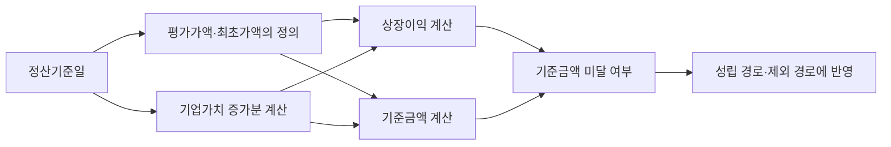

# CM023 원문에서 시나리오로 연결되는 구조

[의문점 목록](README.md) → 원문 연결 → [모델 입출력](02_CM023_모델입출력.md)

**질문:** 상장차익 증여의제는 어떤 요건에서 성립하는가?

**데이터:** 저장 법령 판본의 원문 28조각·구성요소 22개·시나리오 5개. 아래 원문 번호 P1~P28은 [실험 패키지](../../../../../04_EXPERIMENTS/ADR/ADR-1150-scenario-complement-candidate-check/artifacts/package.json)의 번호다. 이 레시피는 연구용 미승인 자료다.

## 1 실제 등록된 조문 연결

법 = 상속세 및 증여세법, 시행령 = 같은 법 시행령. 원문 묶음에 등록된 관계 4개는 모두 `DELEGATES_TO`다.

| 출발 원문 | 연결 원문 | 확인할 내용 |
|---|---|---|
| 법 제41조의3 제10항 | 시행령 제31조의3 제1항 | 상장이익 계산방법 |
| 법 제41조의3 제1항 | 시행령 제31조의3 제2항 | 대상 증권시장 |
| 법 제41조의3 제1항 단서 | 시행령 제31조의3 제3항 | 적용 제외 기준금액. 저장된 출발 좌표는 제1항. |
| 법 제41조의3 제1항 제2호 | 시행령 제31조의3 제4항 | 25% 이상 소유자의 범위 |

이 4개는 [해당 묶음의 저장 관계](../../../../../01_DATA/ONTOLOGY_WORK/bundles/cb-764ad7c91f3f/r1.json)이며 전체 지식그래프의 관계 수가 아니다.

## 2 원문을 읽고 조립해야 하는 의미

| 구성요소 | 실제 근거 | 함께 필요한 내용 |
|---|---|---|
| 적용 대상·취득 경로·상장 조건 | P1~P6, P19, P23 | 최대주주등·특수관계인·취득 경로·기간·시장 |
| 정산기준일 | P7, P9 | 상장일부터 3개월, 그 전 사망·증여·양도 시 기준일 |
| 평가가액·최초가액·기업가치 증가분 | P16~P18, P24~P26 | 평가 시점, 증가분 계산·서류·대체 계산 범위 |
| 상장이익 계산 | P15~P18 | 평가가액에서 최초가액과 기업가치 증가분을 차감한 뒤 주식 수를 곱함 |
| 기준금액 미달 제외 | P1, P20~P22 | 이익 계산식과 기준금액 계산식을 함께 사용 |
| 가액 하락 환급 | P8, P27 | 가액 하락·기준 충족·환급 가능 범위를 별도 경로로 확인 |
| 혼재재산 추정·담보 차입 간주 | P6, P10 | 같은 조문 안에서도 조건과 법률 효과가 다름 |

아래 화살표는 **레시피에 명시한 선행 의존 → 사용 구성요소**다. 위 4개 저장 관계와 구분한다.

근거: [레시피의 `requires`와 원문 인용](../../../../../04_EXPERIMENTS/ADR/ADR-1150-scenario-complement-candidate-check/artifacts/recipe.json). 마지막 시나리오 반영은 레시피의 경로 구성이다.

## 3 미리 조립한 5개 경로

| 경로 | 질문의 용도 | 들어가는 내용 |
|---|---|---|
| PATH1 성립과 정산 | 일반 성립 요건 | 대상·취득·상장 조건 + 정의·산식 + 정산 처리 + 확인 범위 |
| PATH2 기준금액 미달 제외 | 적용 제외 여부 | 관련 조건 + 이익·기준금액 산식 + 제외 처리 |
| PATH3 가액 하락 환급 | 환급 요건 | 하락 조건 + 계산 기준 + 환급 가능 범위 |
| PATH4 혼재재산 취득의 추정 | 증여재산과 다른 돈이 섞인 경우 | 불분명한 취득 조건 + 추정 효과 |
| PATH5 담보 차입 취득의 간주 | 증여재산을 담보로 빌린 돈으로 취득 | 담보 차입 취득 조건 + 간주 효과 |

**28 → 22 → 5는 구성 단위의 변화이며 압축률이 아니다.** PATH1에도 제외 조건 일부가 포함돼 있어 경로 간 내용은 겹친다. 신주·전환사채·부정행위·무상주 확장과 묶음 밖 세부 정의는 모두 펼치지 않았으며, 관련 질문은 추가 원문 확인이 필요하다.

## 4 실제로 줄이려는 작업

| 매 질문에서 반복하던 작업 | 사전 조립 시점으로 옮기는 작업 |
|---|---|
| 계산식에 필요한 조문을 다시 연결 | 구성요소의 선행 의존 명시 |
| 성립·제외·환급 조건을 다시 구분 | 업무별 경로와 확인 범위 작성 |
| 조건·산식·결과를 다시 문장화 | 원문 인용을 붙인 본문 작성·검토 |

모델에는 이미 조립한 후보 경로를 주고 필요한 경로와 충분성을 판단하게 한다. [실제 입력과 선택 결과](02_CM023_모델입출력.md).
