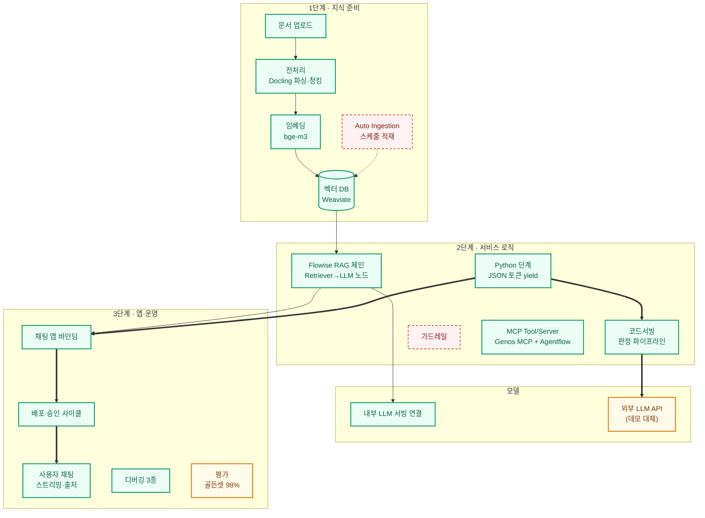

> 출처 보관본: infocz/main @ `7b42bc4cbf9b7ccef6dfea522d20370cedb237ce`의 `docs/genos/coverage-map.md`.
> 날짜·환경·과제별 관찰 기록이며 현재 8-AGENT의 실행 지침이 아닙니다. 먼저 [GENOS.md](../../../../GENOS.md)를 읽습니다.
> 본문은 보존하고 이미지·미포함 자료 링크만 원본 커밋으로 연결했습니다.

# 🗺️ GenOS 전체 체인 vs 검증 범위

문서 삽입 → 챗봇 앱까지의 GenOS 표준 구축 체인에서, 과제6(불완전판매) e2e(8/4) + 지식준비·RAG 풀체인 e2e(8/6) + MCP function call(8/7)로 **검증된 구간(✅)과 미검증 구간(❌)** 표시.
삼성 실환경은 **V1.8.6** — 전 구간 재확인 필요. (HTML 버전: [`coverage-map.html`](https://github.com/infoczAI/agent8/blob/7b42bc4cbf9b7ccef6dfea522d20370cedb237ce/docs/genos/coverage-map.html))

> **2026-09-01 — 실환경 V1.8.6에서 커스텀 경로가 재검증됐다.** 정식 투입 1일차에 과제6이
> 코드서빙 → 워크플로우 → 채팅 앱 e2e를 실환경에서 완주. **아래 지도는 여전히 데모 v1.9.1 기준**이고,
> 실환경 결과는 각 행의 "V1.8.6" 표기와 [`../onprem/day1-runbook.md`](https://github.com/infoczAI/agent8/blob/7b42bc4cbf9b7ccef6dfea522d20370cedb237ce/docs/onprem/day1-runbook.md)
> "Day-1 실행 결과"에 있다. ⚠️ **워크플로우 Python 단계만 규약이 정반대로 갈렸다** —
> 이 지도의 초록이 실환경 초록을 보장하지 않는다는 실례다.
> **RAG 풀체인(1단계 지식 준비 + Flowise RAG 체인)은 실환경 미확인** — Phase 7에서 재확인 대상.
>
> ⚠️ **2026-09-03 — 데모 GenOS로 돌아가 확인하는 길이 닫혔다.** 투입 전 검증에 쓰던 **외부망 계정은
> 삼성증권 PB팀이 쓰던 것을 빌린 것이었고 회수됐으며, 추가 계정 요청도 거부**됐다(동국 16:53).
> 즉 이 지도의 ❌ 칸은 **더 이상 "데모에서 미리 해 보면 되는 것"이 아니라 전부 실환경에서만 풀린다**.
> [`../onprem/unverified.md`](https://github.com/infoczAI/agent8/blob/7b42bc4cbf9b7ccef6dfea522d20370cedb237ce/docs/onprem/unverified.md) A절("데모에서 지금이라도 검증 가능")은
> **사실상 소멸**했고, 남은 데모 자산은 이 저장소의 문서·스크린샷(`img/`)뿐이다.

**범례**: 초록 = 검증 완료(실배포·실행) · 빨강 점선 = 미검증 · 노랑 = 부분/대체 검증

## 구간별 상세

| 구간 | 상태 | 근거 / 비고 | 주로 필요한 과제 |
|---|---|---|---|
| 문서 업로드·전처리·청킹 | ✅ 검증(8/6) + ✅ **V1.8.6(9/2, 과제2)** | 감전재해 PDF 라이브 완주 — 적재용 전처리기 v2.2.4, 벡터 37개. **한글 PDF 파싱 노이즈 관측**(조항번호 깨짐) → 정제 적재 권장. **V1.8.6 실측(9/2)**: 전처리기는 **파이썬 단일 파일** 규약이고 **벡터 청크만 반환할 수 있다**(RDB 반환 경로 없음 → 정형 데이터는 전처리기가 코드서빙 API를 따로 불러 적재). ⚠️ **GenOS가 원본 파일명을 `Document-38423`으로 넘긴다** → [`knowledge.md` §정석 경로 실환경 실측](knowledge.md) | 2·3 RAG형, 문서비교(1·4·5) 대상 |
| 임베딩 · 벡터 DB | ✅ 검증(8/6) + ✅ **V1.8.6(9/2, 과제2)** | bge-m3(1923)→Weaviate(1024차원). text+summary 이중 임베딩 스키마. **V1.8.6 실측(9/2)**: 임베딩 = **`kure-v1` 단일**(bge-m3 없음 → 데모 검색 품질 수치는 전량 재측정 대상). ⚠️ 컬렉션 이름이 곧 **인증키** · 본문·name이 **AES-256-GCM 암호화** · **`chunk_id`·`content_hash` 속성 없음** · 기본 속성 20개 이름이 **복수형** · kure-v1과 bge-m3가 **둘 다 1024차원**이라 적재/질의 모델 불일치가 **에러 없이 검색만 망친다**. **9/7 갱신**: GenOS 컬렉션도 **`vector`·`keyword`·`hybrid` 모두 동작**(암호화는 배포를 타는 사실 — 암호문 배포에서만 BM25가 0건) · **hybrid는 거리 없이 융합 점수만** 주므로 절대 임계 불가 → 코사인 별도 계측 | 2·3 |
| Auto Ingestion | ❌ 미검증 | 기능 존재 확인만. 켤지 여부는 데이터 공급 프로세스 먼저 | 2 (상품 갱신) |
| Flowise RAG 체인 | ✅ 검증(8/6) | 자체 워크플로우 5500 — Chatflow 템플릿이 RAG 프리와이어링, Weaviate Host=**벡터DB 픽커** | 2·3·5 |
| 워크플로우 Python 단계 | ✅ 데모(8/4) + ⚠️ **V1.8.6 재검증(9/1) — 규약 정반대** | 데모 v1.9.1: `json.dumps({"event":"token"…})` yield / **실환경 V1.8.6: dict `return`** (`{"text": …}`). yield하면 `000200003`, **판정은 성공하고 채팅만 실패**하며 로그에 단서 없음 → [`knowledge.md` §★](knowledge.md). **9/7 보강(과제8)**: dict 반환에 **소켓 `emit` 병행**이 가능해 **진행 단계 블록**을 띄울 수 있다(렌더 조건: token 청크 · `nodeId`+`status:FINISHED` · 반환 dict에도 `agentFlowExecutedData` · 마지막 `end`). **emit은 워크플로우 런타임 전용** — 코드서빙엔 `main_socketio`가 없다. ★ **9/8 완결(과제8)**: 위 4조건은 **필요조건일 뿐**이었고 **5번째 = 블록 모양 화이트리스트**가 마지막 열쇠였다 — 채팅 '추론' 패널은 **`nodeLabel=="Visible Reasoner"` + `content={"visible_rationale": 문자열}`인 블록만** 렌더하고 커스텀 모양은 프레임이 나가도 무시한다(사내 참조 워크플로우 514 대조). ⇒ **프론트엔드 없이 워크플로우만으로 추론 단계 노출 성립**(전 과제 재사용 가능) | 전 과제 공용 |
| 코드서빙 | ✅ 데모(8/4) + ✅ **V1.8.6(9/1)** | 생성→push→리비전→env→배포→승인→트래픽→게이트웨이 e2e. **V1.8.6 차이**: 내장 Git=Gitea(첫 push `--force`)·게이트웨이가 **FastAPI 경로 그대로 프록시**(`/chat`, `/json` 아님)·인증키 허용 IP는 **내부 대역 CIDR** | 로직 무거운 과제 |
| 내부 LLM 서빙 연결 | ✅ 데모(8/6) + ✅ **V1.8.6(9/1) — 코드서빙 아웃바운드 포함 완결** | 데모: 워크플로우 노드(ChatGenos→gemini) 경유는 키 없이 작동. **실환경: `LLM_*` env 교체만으로 코드서빙 아웃바운드 동작**(코드 무수정, 리비전 env `GENOS_LLM_TOKEN`). 사전 발급 3종 = gemma-31b-full-context(325·VLM)/Qwen3.5-122B-A10B-FP8(226·VLM)/**kure-v1(19·임베딩)** | 전 과제 |
| 외부 LLM 대체 | ⚠️ 대체 (데모 한정 — **역할 종료**) | OpenAI로 파이프라인 검증. 9/1 내부 서빙이 붙으면서 실환경에서는 불필요 | — |
| 채팅 앱 (바인딩→배포→승인) | ✅ 데모(8/4·8/6) + ✅ **V1.8.6(9/1)** | 재배포 사이클 실측 + **문서형 테마 출처 렌더**(파일명·조항·페이지) + 신규 앱 "배포까지 한번에". **V1.8.6에서 "파일 기반 대화" 플러그인 + 텍스트/txt e2e 정상**. ~~❓ 오디오 STT·`.xlsx` 직접 업로드는 미검증~~ → ★ **9/10 실측(과제6): `.xlsx` 직접 업로드는 «안 된다»** — 프론트 첨부의 **허용 확장자 목록에 xlsx가 없다**. 우회는 **선형 텍스트 → docx 변환 후 첨부**. ⚠️ 층이 둘이다 — **기본 챗봇 테마는 첨부 버튼 자체가 없고**(9/3, 테마 설정 권한 필요) 테마를 열어도 **확장자에서 한 번 더 걸린다**. ★★ **9/11 실측(과제6) — 「업로드 파일이 코드서빙에 어떻게 오는가」가 풀렸다: «전문»도 «파싱 텍스트»도 아니라 «nfs 파일 경로»(`uploadFiles[].path`)** 다. 즉 전처리기가 붙지 않은 채팅 업로드는 **플랫폼이 파싱해 주지 않고, 파일을 열어 읽는 일이 우리 코드 몫**이다(과제6은 `pypdf`로 직접 추출, 발화 276 — 같은 실측에서 **코드서빙이 그 nfs 경로를 읽을 수 있다**는 것도 확인됐다. 단 **쓰기·영속은 C11 미검증**). ⇒ **docx 파싱 충실도는 판단 대상에서 빠졌다** — 우회가 **엑셀→PDF**(pdf는 허용 목록에 있고 엑셀→PDF는 현업 네이티브 동작)로 굳었고 파싱도 우리 추출기가 하므로, 남는 물음은 **«우리 추출기가 무손실인가»** 다. **규명 기법**: `"__echo__"` 입력 시 수신 `data`를 덤프하는 임시 프로브를 심고 한 번 호출 — 문서에 없는 페이로드 규약이 한 번에 드러난다. **여전히 미확인**: 전체 허용 확장자 목록 · **xlsx를 허용 목록에 넣는 설정이 가능한지**([`../onprem/unverified.md`](https://github.com/infoczAI/agent8/blob/7b42bc4cbf9b7ccef6dfea522d20370cedb237ce/docs/onprem/unverified.md) C10 · [`knowledge.md`](knowledge.md) 함정 표). ❓ 오디오 STT는 미검증 유지 | 챗봇형 전 과제 |
| 디버깅 (이용·컨테이너 로그) | ✅ 검증 + ⚠️ **V1.8.6 한계 발견(9/1)** | 실전 사용 (스트리밍 규약도 이걸로 규명). **단 브릿지가 예외를 글자로 바꿔 200으로 끝내면 세 로그 모두 정상으로 보인다** — 9/1 `000200003`은 **브라우저 네트워크 탭**에서만 나왔다 | 전 과제 |
| 평가 | ⚠️ 부분 | 골든셋+자동 채점은 로컬 완성(98%). GenOS 내장 평가지표(LLM judge)는 메뉴 확인만 | 전 과제 |
| MCP Tool/Server | ✅ 검증(8/7) | 도구 등록(FastMCP 폼)→서버 배포→Agentflow `Genos MCP`→**배포된 채팅 앱에서 선택적 function call** 실측 (앱단 e2e). [`mcp-runbook.md`](mcp-runbook.md). ⚠️ **9/9 현행화 — 실제 수요자가 줄었다**: 과제8은 **impyla 직접 실행**, 과제4는 **Dataiku 경로**로 가면서 MCP 후보에서 이탈했고, 과제5도 9/9 기준 **과제3과 공유하는 RAG 파이프라인** 경로다 — MCP는 **«RFP 원문 요건으로 남아 있으나 현재 어느 과제도 쓰고 있지 않은» 상태**다 | ~~과제5(리스크)·과제8(NL2SQL)·DW~~ → **현재 사용 과제 없음**(과제5가 RFP function call 요건을 실제 구현할 때 재등장) |
| 가드레일 · Knox 메일 | ❌ 미검증 (**Knox는 «보류»가 아니라 «키 대기»로 성격이 바뀜**) | Knox는 ①④. ~~⚠️ **8/27 현업미팅에서 과제1의 Knox 메일 전송 자체가 보류** — 장진산 수석이 전체 아키텍처를 구상 중이고 그 결과에 따라 결과 리턴 방식이 달라질 예정이라, Knox 검증은 그 결론 전까지 착수 대상이 아니다~~ → ★ **9/3 보류 해제 — 아키텍처가 확정됐다**: `Knox Portal 업로드 → Dataiku → 파싱 → GenOS 코드서빙 → **결과를 Knox 메일로 발송**`([`../onprem/unverified.md`](https://github.com/infoczAI/agent8/blob/7b42bc4cbf9b7ccef6dfea522d20370cedb237ce/docs/onprem/unverified.md) C2). ★ **9/9~9/10 현재 — 과제1 e2e는 «메일 전송만 빼고» 정리 완료이고, 남은 것은 녹스 메일 API key 발급뿐**이다(한지운 선임 문의). 키가 나오는 날 바로 배포 가능 상태 ⇒ 이 칸의 ❌는 **설계 미상**이 아니라 **키 미수령**을 뜻한다. **가드레일은 여전히 손대지 않았다** ([`../project/overview.md`](https://github.com/infoczAI/agent8/blob/7b42bc4cbf9b7ccef6dfea522d20370cedb237ce/docs/project/overview.md) §3 9/9·9/10 행) | ①④·공통 |

> ⚠️ **버전 주의**: 위 검증은 데모 **v1.9.1**. 삼성 실환경 **V1.8.6** — 투입 첫날(9/1) 재확인 대상이던
> 3가지 중 **Python 단계 응답 규약은 정반대로 갈렸고**(dict return), **"배포까지 한번에"는 동일**,
> **Chatflow RAG 템플릿은 아직 미확인**(Phase 7 = RAG형 과제 ②③ 착수 시). 상세: [`../onprem/unverified.md`](https://github.com/infoczAI/agent8/blob/7b42bc4cbf9b7ccef6dfea522d20370cedb237ce/docs/onprem/unverified.md) C5
>
> 📌 **위 mermaid 도식과 `coverage-map.html`은 아직 데모 v1.9.1 상태**다 — 9/1 실측은 표에만 반영했다.
> 실환경 기준 도식이 필요해지면(RAG 풀체인까지 실환경 확인이 끝난 뒤가 적기) 그때 다시 그린다.
