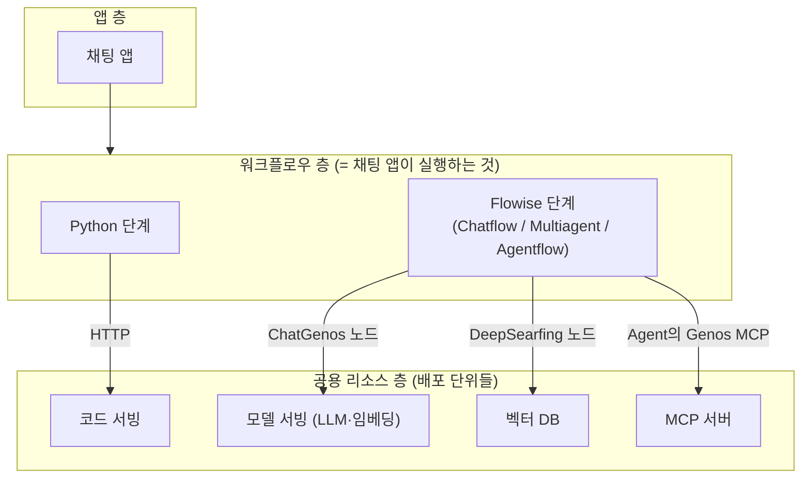

> 출처 보관본: infocz/main @ `7b42bc4cbf9b7ccef6dfea522d20370cedb237ce`의 `docs/genos/glossary.md`.
> 날짜·환경·과제별 관찰 기록이며 현재 8-AGENT의 실행 지침이 아닙니다. 먼저 [GENOS.md](../../../../GENOS.md)를 읽습니다.
> 본문은 보존하고 이미지·미포함 자료 링크만 원본 커밋으로 연결했습니다.

# GenOS 용어 사전

플랫폼을 쓰다 보면 **① GenOS 고유 개념 ② 내장된 오픈소스(Flowise)의 용어 ③ 업계 표준(MCP·A2A)** 이 뒤섞여 나온다. 이 문서는 그 셋을 구분해가며 정의한다. 전부 데모(v1.9.1~1.9.2)에서 실물을 확인하고 쓴 정의다.

## 0. 큰 그림 — 용어들이 놓이는 위치

한 문장 요약: **채팅 앱은 워크플로우를 실행하고, 워크플로우 속 노드들이 공용 리소스(서빙·벡터DB·MCP서버·코드서빙)를 참조한다.**

## 1. 플랫폼 공통 개념 (GenOS 고유)

| 용어 | 정의 | 실전 메모 |
|---|---|---|
| **GenOS** | GenON(MNC)의 LLMOps 플랫폼. 모델·코드·워크플로우·앱을 등록→배포→운영하는 콘솔 | 데모 genos.genon.ai(v1.9.1~1.9.2), 삼성 실환경 V1.8.6 (온프렘 구축형) — **2026-09-01부터 실환경 접속 중** |
| **관리 그룹** | 리소스의 소유·공유 단위. 모든 리소스 생성 시 필수 지정 | 우리는 `인포시즈-테스트페이지`. 픽커 목록 노출 범위도 이 단위 |
| **리비전** | 배포 단위의 버전. 코드서빙·워크플로우·서버 등 모두 "리비전을 만들고 그걸 배포"하는 구조 | ⚠️ **배포 중인 리비전은 env·설정 잠김** — 수정하려면 미배포 리비전에서 |
| **배포 / 승인** | 배포 신청 → 승인(운영>승인 메뉴) → 컨테이너 기동. 자기 신청을 자기가 승인 가능(self-approve) | 워크플로우·채팅앱 일부는 승인 생략됨. **9/1 실환경: 승인 절차 정상 진행 확인. 단 self-approve 가능 여부는 여전히 미기록** ([`version-gap.md`](version-gap.md) §②-0) |
| **컨테이너 / 인스턴스 타입** | 배포 = k8s 컨테이너 기동. 인스턴스 타입 = CPU/메모리 스펙(micro 0.2core / smicro 1core…) | ⚠️ 워크플로우 저장 시 인스턴스 타입 미지정이면 **조용히 저장 거부** |
| **게이트웨이 / 인증 키** | 배포된 리소스를 외부에서 호출하는 진입점 + Bearer 키 | `POST /api/gateway/code_serving/{id}/json` 식. 키는 리소스 상세의 "인증 키" 탭에서 발급. ⚠️ **V1.8.6 실측(9/1): 경로가 `/json`이 아니라 FastAPI 경로 그대로 프록시**(`…/{id}/chat`) + **인증키 발급 시 허용 IP는 개별 IP가 아니라 내부 대역(CIDR)**(호출자가 파드 재시작마다 IP가 바뀌는 워크플로우 컨테이너) |
| **코드스페이스** | 브라우저 VS Code/Jupyter 개발환경 (클러스터 내부에서 실행됨) | 삼성은 노트북 반입 불가 → **여기가 실제 개발 자리**. **9/1 실물**: 이미지 `template-code space-slim:v1.8.6-cve-260820`, small = 1 CPU / 8GB, **python 3.11.15** (⚠️ 워크플로우 컨테이너는 **3.10**으로 더 낮다) |
| **카탈로그** | 만든 리소스(워크플로우·MCP 도구)를 조직에 공개 등록하는 목록 | "카탈로그 보기/등록" 버튼 |

## 2. 배포 단위 4종 — "무엇을 배포하나"

| 용어 | 정의 | 언제 쓰나 |
|---|---|---|
| **모델 서빙** | LLM·임베딩·리랭킹 모델을 API로 띄운 것. GENON이 이미 띄워둔 것을 골라 씀 | 직접 만들 일 거의 없음. 워크플로우 노드에서 **픽커로 선택**하면 키 없이 사용. **9/1 실환경 사전 발급 3종**: `gemma-31b-full-context`(325·VLM) · `Qwen3.5-122B-A10B-FP8`(226·VLM) · `kure-v1`(19·임베딩). `qwen3.8`은 AI솔루션팀 별도 발급 대기 |
| **코드 서빙** | 임의 파이썬 코드를 API로 배포. 진입점 `async def service(config, data)`, 내장 Gitea에 push | 로직이 무거운 커스텀 과제(과제6 판정 파이프라인). 호출 시점을 **우리가** 정함. **9/1 실환경 Gitea**: `http://llmops-gitea-service:3000/llmops/<저장소ID>.git`, 인증 = 계정ID + accessToken. ⚠️ 반입 zip에 `.git`이 없어 `git init`부터 하고, 저장소가 초기 커밋과 함께 생성돼 **첫 push는 `--force`** |
| **워크플로우** | 단계(step)들의 실행 파이프라인. **채팅 앱이 바인딩하는 대상**. 콘솔 표기는 "워크플로우 패키지" | 모든 챗봇형 과제의 몸통. 단계 = Python 단계 or Flowise 단계. ⚠️ **Python 단계 응답 규약이 버전마다 정반대다** — 데모 v1.9.1 = SSE 이벤트 yield / **실환경 V1.8.6 = dict `return`**([`knowledge.md` §★](knowledge.md)) |
| **MCP 서버** | MCP 도구들을 묶어 배포한 컨테이너. LLM이 **스스로** 호출하는 도구 제공처 | function call 과제(5 리스크규정·8 NL2SQL) |

## 3. Flowise 계열 (내장 오픈소스 — 혼동 최다 구역)

| 용어 | 출처 | 정의 |
|---|---|---|
| **Flowise** | 오픈소스 | 로우코드 LLM 플로우 빌더. GenOS가 iframe으로 내장(`/flowise300/`). "Flowise 단계"가 이걸 실행 |
| **Flowise 단계** | GenOS | 워크플로우 단계 타입 중 하나. 추가 시 엔진 3종 중 택1: **Chatflow / Multiagent / Agentflow** (v3.1.3) |
| **Chatflow** | Flowise | **고정 체인형** 플로우. 노드를 선으로 이은 순서대로 실행. 기본 템플릿이 RAG 프리와이어링 → 감전재해 RAG 챗봇이 이것 |
| **Agentflow** | Flowise | **에이전트 그래프형** 플로우. Start→Agent 구조로, Agent가 런타임에 도구·분기를 **스스로 선택**. MCP function call이 이것 |
| **Multiagent** | Flowise | 멀티 에이전트 협업형 (미검증) |
| **공용 / 전용 Flowise** | GenOS | 플로우를 돌리는 Flowise 인스턴스가 공유형이냐 전용 배포형이냐. ⚠️ **한번 고르면 비가역** |
| **캔버스** | Flowise | React Flow 기반 노드 편집기. ⚠️ **리비전 수정 모드에서만 편집 가능**, 노드는 팔레트에서 **드래그**로만 추가, 저장은 상위 페이지 버튼 |
| **노드** | Flowise | 캔버스 위 블록 (Start, Agent, LLM, Retriever, Condition, Tool…). "agentic workflow"라는 말의 실체 = Agentflow에서 Agent 노드가 도구를 골라 쓰는 것 |

### Genos 커스텀 노드 (Flowise 표준에 없는, GenOS가 심은 커넥터)

| 노드/항목 | 역할 |
|---|---|
| **ChatGenos** | GenOS **모델 서빙**에 연결하는 채팅 LLM 노드. Connection Type = Direct Serving(서빙 직결) / Service Router. **키 불요** — 플랫폼이 서버측 주입 |
| **Genos (OpenAI) Embeddings** | 임베딩 서빙(bge-m3 등) 커넥터. ⚠️ 적재 때 쓴 모델과 동일해야 검색됨 |
| **DeepSearfing** | Weaviate 리트리버 노드. **Weaviate Host 필드가 사실상 벡터DB 픽커** (선택하면 Index 자동) |
| **Genos Unified RAG Chain** | 검색결과+질문→LLM 호출을 묶은 RAG 체인 노드. sourceDocuments(출처) 반환 |
| **Genos MCP** | **Agent 노드 Tools 안의 항목**. 배포된 MCP 서버·도구를 픽커로 연결. ⚠️ 팔레트에 "MCP 노드"는 따로 없음 — 여기가 유일한 입구 |
| **Genos Rerank** | 리랭킹 서빙 커넥터 |

## 4. MCP · A2A (업계 표준 프로토콜)

| 용어 | 출처 | 정의 |
|---|---|---|
| **MCP** | Anthropic 표준 | Model Context Protocol — LLM에게 도구(함수)를 표준 규격으로 노출하는 프로토콜. 와이어에선 `initialize`/`tools/list`/`tools/call` |
| **MCP 도구** | GenOS | 파이썬 함수 1개. 폼의 ACE 에디터에 **FastMCP 문법**(`@mcp.tool()` async def)으로 직접 입력. **docstring = LLM이 읽는 도구 설명서** |
| **function call (tool call)** | 업계 공통 | LLM이 답변 생성 중 "이 도구를 이 인자로 호출하겠다"고 판단·실행하는 것. 서버 로그의 `tools/call`이 그 순간 |
| **A2A** | Google 표준 | Agent-to-Agent 프로토콜 — 에이전트가 다른 에이전트에게 **작업을 통째로 위임** (MCP=도구 호출과 대비). 자기소개 명세 = **Agent Card**(콘솔 컬럼명 "보유 기술"). GenOS 실물 3곳: `에이전트 > A2A 에이전트` 메뉴(등록 사례 3건 확인) · Agent 노드 "서브에이전트(A2A)" 슬롯(선택적 위임) · 팔레트 "A2A Agent" 노드(고정 1회 실행). 같은 워크플로우를 MCP 서버로도 A2A 에이전트로도 노출 가능(test2 사례). 위임 실행은 미검증 |
| **워크플로우의 "MCP 도구" 탭** | GenOS | ⚠️ 헷갈림 주의 — MCP를 *쓰는* 곳이 아니라 **이 워크플로우를 남의 MCP 도구로 노출**하는 역방향 스위치 |

## 5. 지식 준비(RAG 데이터) 계열

| 용어 | 정의 | 실전 메모 |
|---|---|---|
| **벡터 DB** | 문서 임베딩 저장소. 백엔드 = **Weaviate**(1024차원), doc-level+summary-level 이중 임베딩 스키마 | `데이터 > 벡터 DB`에서 생성 |
| **전처리기** | 문서 파싱·청킹 부품. **적재용**(벡터DB행)과 **첨부용**(채팅 첨부행) 구분 | 표준 v2.2.4(Docling 기반). ⚠️ **V1.8.6 실측(9/2, 과제2) — 커스텀 전처리기는 «도커 패키지 + admin 등록»이 아니라 «파이썬 단일 파일»이다**(데모 전제가 실환경에서 성립하지 않은 항목. 과제2가 적재 코드를 한 파일로 합치는 번들러를 만들어 실제 적재까지 완주 — [`../onprem/unverified.md`](https://github.com/infoczAI/agent8/blob/7b42bc4cbf9b7ccef6dfea522d20370cedb237ce/docs/onprem/unverified.md) B1 해소). 남은 제약 = **전처리기는 벡터 청크만 반환할 수 있다**(RDB 반환 경로 없음 → 정형 적재는 코드서빙 API 별도 호출). 규약 전체는 [`knowledge.md`](knowledge.md) §정석 경로 실환경 실측 |
| **문서 업로드** | 벡터DB에 문서 넣는 2단계 마법사 = 임베딩 서빙 + 전처리기 + Chunk Size/Overlap 지정 → 파일 드롭 | 상태: 실행중→완료됨+벡터 개수 |
| **Auto Ingestion (자동 적재)** | 스케줄 기반 자동 문서 적재 | 미검증 (A2) |
| **임베딩 서빙** | 텍스트→벡터 모델 서빙 (bge-m3 등) | 적재와 검색에서 **같은 모델**을 써야 함 |

## 6. 앱 · 운영 계열

| 용어 | 정의 | 실전 메모 |
|---|---|---|
| **채팅 앱** | 최종 사용자용 챗 UI. **워크플로우 1개에 바인딩**해 만든다 | 생성 시 "배포까지 한번에 진행하기" 체크로 절차 단축 |
| **테마 (문서형 등)** | 채팅 앱 UI 프리셋. **문서형** = 답변 밑에 근거 문서 카드(파일명·청크·페이지) 자동 렌더 | RAG 출처 표시 요건이 테마 기본기능으로 해결됨 |
| **플러그인 (워크플로우 상세 탭)** | 워크플로우에 얹는 부가기능 2종. ①**파일 기반 대화** — 채팅에서 사용자가 올린 파일로 대화: 파일 업로드(Flowise 단계 1개일 때 동작)·AI 드라이브 참조·이미지 업로드(VLM 전용)·**PDF 이미지 처리**(표/그림 문서를 이미지로 렌더해 VLM 분석)·업로드분 즉석 임베딩(서빙+전처리기+Top K+**Alpha 0=키워드~1=벡터 하이브리드**)·**검색 전용 모드**(끄면 짧은 문서는 전문을 컨텍스트에 통째로)·보관 기간(자동 삭제). ②**가드레일** — 입력/출력 각각 활성화 + 가드레일 리소스 목록 부착 | ⚠️ 저장 후 **재배포 필요**. UI 확인 완료, 실행 미검증(A2·A3) |
| **이용 로그** | 리소스별 호출 이력 (시각·소요시간·Success/Fail·세션 ID) | 디버깅 1선: **소요시간으로 실행 여부 판별**. MCP는 `tools/call` 여부로 호출 추적 |
| **컨테이너 로그** | 배포 컨테이너의 stdout/스택트레이스 | 디버깅 2선: 스트리밍 규약도 이걸로 규명했음 |
| **테스트 (버튼)** | 배포 전/후 리소스를 콘솔에서 직접 실행하는 다이얼로그. 워크플로우(`{"question":…}`)·MCP 서버(파라미터 폼)·캔버스 Chat FAB | 디버깅 3선: 앱 없이 검증하는 지름길 |
| **가드레일 (리소스)** | 별도 메뉴에서 제작하는 입출력 필터 리소스 — 기존 사례 구성: **정규식(개인정보 마스킹) → Prompt Injection 방지 → LLM 가드 모델(Llama4 Guard)** 체인. 탐지 로그 메뉴 별도 | 워크플로우 플러그인 탭에서 부착. 실행 미검증(A3) |
| **평가지표 워크플로우** | 내장 LLM judge 평가 도구 (미검증, A5) | |
| **추론 패널 / 진행(“조리”) 블록** | 채팅 UI가 답변 위에 그리는 **단계 진행 표시**. 워크플로우가 소켓으로 `agentFlowExecutedData` 항목을 emit하면 렌더된다 | ★★ **V1.8.6 실측(9/7~9/8, 과제8) — 프론트엔드 수정 없이 워크플로우만으로 노출된다.** ⚠️ **범용 장치가 아니라 화이트리스트다**: 항목이 **`nodeLabel == "Visible Reasoner"` + `content == {"visible_rationale": <문자열>}`** 형태여야만 '추론' 패널로 그려지고, 커스텀 라벨·구조화 dict는 소켓에 나가도 **조용히 무시**된다. ⇒ 단계마다 사람이 읽을 문자열 하나로 눌러 담아 그 블록으로 위장해야 한다. 전 과제 재사용 가능 기법. 상세·전제 5조건은 [`knowledge.md`](knowledge.md) §진행 단계 |
| **서비스 라우터** | 여러 서빙을 묶는 라우팅 계층. ChatGenos의 Connection Type 선택지 중 하나 | Direct Serving만 검증 |
| **프롬프트 라이브러리** | 프롬프트 저장·공유 메뉴 (메뉴 실존만 확인) | |

## 7. 자주 헷갈리는 것 정리

- **"워크플로우" ≠ "Flowise"**: 워크플로우는 GenOS의 배포 단위(그릇), Flowise는 그 안의 한 단계 타입(내용물). Python 단계만으로 된 워크플로우도 있다.
- **"Agentflow" ≠ "agentic workflow"(일반 용어)**: Agentflow는 Flowise의 특정 엔진 이름. 일반 용어로서의 agentic workflow(에이전트가 도구를 골라 쓰는 패턴)를 GenOS에서 구현하는 수단이 Agentflow다.
- **MCP "도구"와 Agent "Tools"**: MCP 도구는 콘솔에 등록하는 파이썬 함수, Agent 노드의 Tools는 그걸(외 여러 도구를) 꽂는 슬롯. 연결 항목 이름이 `Genos MCP`.
- **서버 픽커에 안 보이면** = 그 MCP 서버가 미배포/오프라인이라는 뜻.
- **채팅 앱에는 MCP 설정이 없다** — 앱은 워크플로우만 알고, MCP 연결은 캔버스 속 Agent 노드에 있다.
