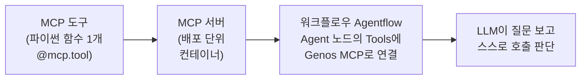

> 출처 보관본: infocz/main @ `7b42bc4cbf9b7ccef6dfea522d20370cedb237ce`의 `docs/genos/mcp-runbook.md`.
> 날짜·환경·과제별 관찰 기록이며 현재 8-AGENT의 실행 지침이 아닙니다. 먼저 [GENOS.md](../../../../GENOS.md)를 읽습니다.
> 본문은 보존하고 이미지·미포함 자료 링크만 원본 커밋으로 연결했습니다.

# MCP Tool/Server 런북 — 등록→배포→Agent function call

> 2026-08-07 데모 **v1.9.2**에서 전 과정 라이브 검증 — **배포된 채팅 앱에서의 function call(앱단 e2e)까지** 확인.
> **과제 직결**: **과제5** 리스크규정 Agent("MCP Tool로 내규 검색, 질문에 따라 function call" 원문 요구) · **과제8** ~~오퍼링 NL-to-SQL(오브젠 실행기 래핑 후보)~~ · **과제4** ~~장외파생 **DW 조회**~~.
> ⚠️ **2026-09-09 현행화 — 이제 실제로 MCP를 쓸 후보는 과제5뿐이다.** 과제8은 **`impyla`로 코드서빙에서 임팔라를 직접 실행**하는 경로로 갔고(9/7 실행 모드 완성), 9/5부터 **기존 서비스 통합 기여**로 방식이 바뀌어 MCP 래핑 구도가 사라졌다. 과제4는 9/3 아키텍처 확정으로 **Knox Portal → Dataiku → GenOS 코드서빙**이 정본 경로가 됐고 DW 조회도 그 안에서 일어난다([`../onprem/unverified.md`](https://github.com/infoczAI/agent8/blob/7b42bc4cbf9b7ccef6dfea522d20370cedb237ce/docs/onprem/unverified.md) C4·C9). 두 항목은 **이력**으로 읽는다.
> (~~"발행어음 DW 조회"~~ 는 8/10에 폐기된 팀 리넘버링의 잔재였다 — DW 조회는 **과제4 장외파생**이고 과제7 발행어음은 딜 자료·NAS 기반이라 DW를 쓰지 않는다. 번호는 RFP 정본 기준, 2026-09-02 정정)

## 개념 한 장



- **코드서빙과의 차이**: 코드서빙은 *우리가* 정한 시점에 호출하는 고정 파이프라인, MCP는 *LLM이* 대화 중 필요하다고 판단할 때 호출.
- 서버 타입 3종: **MCP 도구**(폼에서 코드 등록) / **MCP 패키지**(.whl류) / **외부 서버 연결**(기존 MCP 서버 URL).
- 역방향도 존재: 워크플로우 상세의 "MCP 도구" 탭 = **이 워크플로우를 MCP 도구로 노출** (워크플로우 기반 서버의 정체).

## A. MCP 도구 등록 (코드 = 폼 입력, .whl 불필요)

`배포 > 도구 > MCP 도구 > MCP 도구 생성`

- 제목 / 상세 설명 / 관리 그룹 / 패키지(선택 — PyPI 픽커) / 행위 유형 / **코드**(ACE 에디터)
- 템플릿은 **FastMCP 표준**. 시그니처와 **docstring이 곧 LLM에게 보이는 도구 명세**다 — "언제 이 도구를 써야 하는지"를 docstring에 명령형으로 쓰면 호출 판단 정확도가 올라간다:

```python
@mcp.tool()
async def search_internal_rule(keyword: str) -> str:
    """
    사내 리스크관리 내규에서 키워드로 조항을 검색한다.
    파생상품, 투자 한도, 위험관리 규정에 대한 질문에 답하기 전에
    반드시 이 도구로 근거 조항을 조회해야 한다.

    Args:
        keyword (str): 검색 키워드

    Returns:
        str: 일치하는 내규 조항 원문(조항 번호 포함)
    """
    ...  # 표준 라이브러리 로직
```

- 검증용 팁: 반환값에 **고유 마커**(존재할 리 없는 조항번호 등)를 심으면, 답변이 LLM 창작인지 도구 결과인지 확실히 구분된다.

## B. MCP 서버 생성·배포 (코드서빙과 동일 사이클)

`배포 > 도구 > MCP 서버 > MCP 서버 생성` — 3단계 마법사:

1. 제목·설명·관리 그룹·**서버 타입**(MCP 도구)
2. **도커 이미지**(`mnc/mcp-server:latest` 하나뿐) · **인스턴스 타입**(smicro면 충분) · **MCP 도구**(등록한 도구 픽커) · 복제본/큐/동시실행(기본값 OK)
3. 데이터 소스(선택) → 생성

배포: 상세(`/tools/mcp/server/detail/<id>/`)에서 **배포 → 승인(운영>승인, 자체승인 가능) → 컨테이너 온라인** (~1분).
상세 페이지 구성은 코드서빙과 동일: 리비전 이력·컨테이너 상태·인증 키·**이용 로그**.

### 서버 단독 테스트 (워크플로우 없이)

상세의 **테스트** 버튼 → 도구 파라미터 폼이 자동 생성됨 → 값 입력 → 실행 결과 확인.
*워크플로우에 붙이기 전에 도구 로직만 먼저 검증할 수 있는 지점.*

## C. 워크플로우 Agent에 연결 (핵심)

1. 워크플로우 생성 → 리비전 수정 → **Flowise 단계 추가 → "Agentflow 3.1.3"** 선택 (Chatflow/Multiagent/Agentflow 3종 중; 공용/전용 선택은 비가역)
2. 캔버스는 **수정 모드에서만 편집 가능** (add/generate/chat/validation 버튼이 수정 모드에서 나타남)
3. add → 팔레트에서 **Start**와 **Agent**를 캔버스로 **드래그** (클릭으론 안 놓임) → Start→Agent 연결
4. Agent 노드 설정:
   - **Model** = `ChatGenos` → Connection Type `Direct Serving` → 서빙 픽커에서 내부 LLM 선택 (키 불요)
   - **Tools > Add Tools** → Tool = **`Genos MCP`** → Genos MCP Parameters:
     - **Genos MCP Server** 픽커 → 배포한 서버 선택 (배포된 서버만 목록에 뜸)
     - **사용가능한 도구** → 도구 선택 / 타임아웃(초)
5. 상위 페이지 **저장** (캔버스에 저장 버튼 없음 — `*` 미저장 마커 확인)

> 팔레트에 "MCP" 노드는 없다 — MCP는 **Agent 노드 Tools 안의 `Genos MCP` 항목**이다. `Custom MCP`/`Custom MCP Server`(외부 MCP 직결)도 있다.

## D. function call 검증 (배포 없이 캔버스 chat으로)

수정 모드 캔버스의 **Chat FAB** → 실제 Agent 실행 (공용 Flowise라 워크플로우 배포 전에도 동작).

| 질문 | 기대 | 실측 (v1.9.2, gemini 3 flash 서빙) |
|---|---|---|
| "파생상품 거래 한도는? 근거 조항과 함께" | 도구 **호출** | ✅ Process Flow에 `search_internal_rule` 표시, 답변에 마커·제99-7조 그대로 인용 |
| "안녕하세요! 오늘 기분 어때요?" | 도구 **미호출** | ✅ Process Flow에 도구 없음, 일반 응답 (과잉 호출 없음) |

서버 측 교차 증거: MCP 서버 상세 > **이용 로그**에 `initialize` / `tools/list` / **`tools/call` Success**가 시각·소요시간과 함께 남는다 (Agent는 매 턴 `tools/list`로 도구를 탐색하고, 실제 사용 시에만 `tools/call`).

[원본 이미지: Agent 캔버스 chat — 도구 호출과 마커 인용](https://github.com/infoczAI/agent8/blob/7b42bc4cbf9b7ccef6dfea522d20370cedb237ce/docs/genos/img/mcp_chat_result.png)
[원본 이미지: MCP 서버 이용 로그 — tools/call Success](https://github.com/infoczAI/agent8/blob/7b42bc4cbf9b7ccef6dfea522d20370cedb237ce/docs/genos/img/mcp_usage_log.png)

## E. 앱단 e2e 검증 — 배포된 채팅 앱에서의 function call (8/7 완주)

워크플로우 5525 배포(승인 불요, ~1분) → 채팅 앱 2888 생성(워크플로우 바인딩 + "배포까지 한번에" 체크 + 승인 1회) → 실사용자 채팅 URL에서 질의.

| 질문 | 응답 시간 | 결과 |
|---|---|---|
| "파생상품 거래 한도는? 근거 조항과 함께" | **6.0초** | ✅ 마커·제99-7조 인용 — 앱→워크플로우→Agent→MCP 서버 풀체인 통과 |
| "안녕하세요! 오늘 기분 어때요?" | **2.3초** | ✅ 도구 미호출, 일반 응답 (시간 차 3.7초 ≈ 도구 왕복+추론) |

서버 이용 로그 교차: 질문 시각에 `initialize→tools/list→tools/call Success`(동일 요청 ID로 묶임), 인사말 시각엔 `tools/call` 없음. **앱 경로 호출엔 세션 ID가 붙어** 채팅 세션↔도구 호출 추적 가능.

**UX 상 중요한 차이**: 캔버스 chat에서 보이던 **Process Flow(도구 호출 표시)는 실사용자 앱에선 숨겨진다** — 사용자는 최종 답변만 본다. 도구 호출 여부를 사용자에게 보여주려면 답변 텍스트에 출처를 포함하도록 프롬프트/도구 반환값을 설계해야 한다.

[원본 이미지: 배포된 앱에서의 MCP 답변](https://github.com/infoczAI/agent8/blob/7b42bc4cbf9b7ccef6dfea522d20370cedb237ce/docs/genos/img/mcp_app_answer.png)
[원본 이미지: 서버 로그 — 세션 ID와 tools/call](https://github.com/infoczAI/agent8/blob/7b42bc4cbf9b7ccef6dfea522d20370cedb237ce/docs/genos/img/mcp_app_log.png)

## 스크린샷

| 파일 | 내용 |
|---|---|
| `img/mcp_node_palette.png` | Agentflow 노드 팔레트 (MCP 노드 없음 — Agent가 입구) |
| `img/mcp_genos_mcp_params.png` | Genos MCP 파라미터 (서버·도구·타임아웃) |
| `img/mcp_tool_options.png` | 서버→도구 픽커 |
| `img/mcp_connected.png` | Start→Agent 연결 |
| `img/mcp_test_result.png` | 서버 단독 테스트 결과 |

## 함정·미확인

- **함정**: 캔버스 편집은 리비전 수정 모드에서만 / 노드는 드래그로만 추가 / 저장은 상위 페이지 버튼 / MCP 서버는 배포·온라인 상태여야 픽커에 뜸
- **미확인 (다음 소진 대상)**: 도구 여러 개 등록 시 선택 정확도 / `Custom MCP`(외부 서버 직결) / MCP 패키지(.whl) 타입 / **V1.8.6에 Agentflow 3.1.3·Genos MCP가 있는지** — ⚠️ **9/1 Day-1을 완주하고도 확인 기록이 없다**(그날 확인된 건 코드서빙·워크플로우·채팅앱·Gitea·파일기반대화 플러그인까지고, 벡터DB·전처리기 메뉴와 함께 **MCP도 미확인으로 남았다**). 이 런북 전체가 **데모 v1.9.2 기준**이므로 구버전이면 기능 자체가 없을 수 있다 — **과제5가 MCP를 쓰기로 확정되는 순간 콘솔에서 메뉴 존재부터 확인할 것**. ⚠️ **9/9 현행화 — 기준 날짜 「10/12 주 오픈」은 폐기됐다**: 9/4부터 전 과제 공통 기준이 **9/21 코드프리징 → 10월 초 운영계 배포**이고([`../project/overview.md`](https://github.com/infoczAI/agent8/blob/7b42bc4cbf9b7ccef6dfea522d20370cedb237ce/docs/project/overview.md) §3), 과제5는 9/9 e2e 중간점검에서 **과제3과 한 묶음으로 "ingestion 파이프라인 개발 완료·앱 연결 오류, 9/10 오전 마무리 전망"**으로 보고됐다 — 즉 **착수는 이미 지났고 현재 경로는 MCP가 아니라 과제3과 공유하는 RAG 파이프라인**이다. ⇒ 이 확인은 **과제5가 MCP function call 요건(RFP 원문)을 실제로 구현할 때** 하면 된다

## 이번 검증에서 만든 리소스 (정리 대상)

| 리소스 | ID | 상태 |
|---|---|---|
| MCP 도구 `[A8-DK] search_internal_rule` | 1499 | — |
| MCP 서버 `[A8-DK] rule-search-server` | 506 | **배포·온라인 (컨테이너 실행 중)** |
| 워크플로우 `[A8-DK] mcp-agent-test` | 5525 | **배포 완료 (컨테이너 실행 중)** |
| 채팅 앱 `[A8-DK] MCP 규정검색 챗봇` | 2888 | ~~**정리(삭제) 예정**~~ — 검증용, 8/7 제보 (URL ystb_m3da_je06) |

> ~~정리 시 같은 검증 세트(도구 1499 · 서버 506 · 워크플로우 5525)도 함께 정리 대상인지 확인할 것.~~
> ⚠️ **9/9 현행화 — 이 정리 작업은 더 이상 우리가 할 수 없다.** **9/3에 외부망(데모) GenOS 계정이 회수**되고 추가 계정 요청도 거부돼 데모 콘솔 접근 경로가 닫혔다([`coverage-map.md`](coverage-map.md) · [`../onprem/unverified.md`](https://github.com/infoczAI/agent8/blob/7b42bc4cbf9b7ccef6dfea522d20370cedb237ce/docs/onprem/unverified.md) A절). 위 리소스 4종은 **데모 콘솔에 그대로 남아 있을 것**으로 보고, 표는 «무엇을 만들어 검증했는가»의 이력으로만 읽는다.
