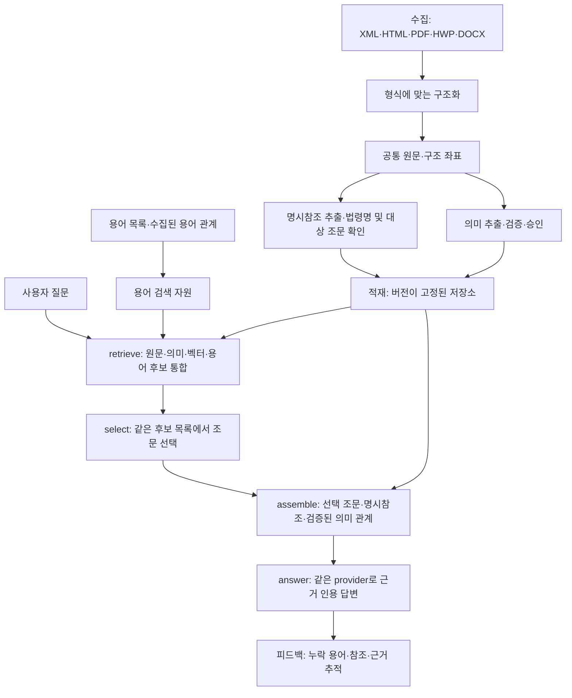

# 용어와 조문을 잇는 기존 통합 파이프라인

**시스템은 하나의 통합 파이프라인이다.** 조립 정본은 `00_SYSTEM/PIPELINE.json`이며,
질의 실행은 기존 `legal-rag`의 `retrieve → select → assemble → answer`를 따른다.
용어 처리는 그 안의 검색 입력이고, 명시참조 처리는 같은 실행의 조립 단계다.
선택기·답변기·provider를 용어 검색용으로 별도 생성하지 않는다.

이 문서는 ADR-0361 연구 후보의 연결 계약이다. 운영 release는 아직 이 후보를 선택하지 않는다.
기존 API 모양을 바꿨거나 운영에서 자동 로드된다는 뜻은 아니다.

Anthropic/GENOS는 같은 선택·답변 단계의 provider 설정이다. 입력 형식과 독립적인 축이다.

## 질문이 조문으로 가는 경로

1. 질문에서 현재 용어 목록과 일치하는 표현을 찾는다. 원래 질문은 보존한다.
2. 수집이 완료되고 hash가 검증된 용어 관계 패키지가 있으면 방향이 명시된 동의어·관련어를
   한 단계만 후보로 보탠다. 반의어·상하위어·알 수 없는 관계를 동의어로 바꾸지 않는다.
3. 선택한 용어를 **현재 RAG 저장소의 원문에서 다시 검색하고 원문 일치 위치를 검증**한다.
   이전 XML 원장의 문서 ID·블록 번호를 현재 저장소의 좌표로 재사용하지 않는다.
4. 원문·의미·벡터 검색 후보와 기존 순위 통합에서 합친다. 용어 출현은 검색 근거이며,
   그 조문이 해당 사안을 규율한다는 판정은 아니다.
5. 기존 선택기가 같은 후보 목록을 고른다. 선택된 조문의 본문·단서를 함께 읽고, 거기에서
   명시한 법령명과 조문 좌표를 현재 법령 목록·구조에 대조한다.
6. 대상이 유일하고 실제 존재하며 요청 범위 안에 있을 때 한 단계의 참조 원문을 가져온다.
   기존 Rule/Proviso/LegalRelation 조립도 같은 `assemble` 안에서 계속 실행한다.
7. 기존 답변기가 합쳐진 원문을 인용한다. 인용 ID·문자열 검증도 기존 것을 사용한다.

## 제한과 근거 기록

- 질의 용어 최대 8개, 용어당 관계 후보 최대 4개.
- 참조 확장 깊이 1, 서로 다른 대상 조문 최대 4개.
- 이 부품이 추가하는 조문 문맥은 최대 128블록/40,000자. 기존 조립 문맥까지 합친 전체
  답변 입력 상한이라는 뜻은 아니다. 조문이 상한을 넘으면 일부를 잘라 통과시키지 않고 미해소로 기록한다.
- `제N조제M항`을 조 단위로 가져오면 `ARTICLE_FALLBACK`으로 표시한다.
  특정 항·호가 정밀 해소됐다고 주장하지 않는다.
- 법령명 충돌, 조문 부재, 요청 범위 밖, 삭제·빈 조문, 예산 초과는 미해소 사유를 남긴다.
- 참조 표면형·source hash·원문 위치·대상 좌표를 보존한다. 단순 인용에서 위임·면제·우선적용 등
  법률 의미를 만들어내지 않는다. 의미 관계는 기존 검증·승인 경로가 소유한다.
- 선택·답변 LLM을 부품 내부에서 추가 호출하지 않는다. 원문 검색 모드의 실제 모델 호출은 0이다.

## 현재 수집 데이터에서 가능한 범위

법령용어/법령지식용어 217,402개는 질의의 용어 후보를 찾는 데 쓴다. 일상용어 220,376개의
목록에는 관계 조회 링크가 있지만, 목록만으로 일상어와 공식 용어의 연결 내용이 생기지는 않는다.
ADR-0361 동결 시점에는 관계 패키지가 없어 실제 질의 실행은 `NOT_COLLECTED`로 표시한다.
가상 관계 패키지로 연결 계약을 검증한 결과를 실제 법제처 관계 수집 실적으로 세지 않는다.

일상 표현이 어떤 용어에도 걸리지 않으면 같은 retrieve의 기존 원문·벡터 경로가 남는다.
후보를 찾지 못한 상태에서는 닫힌 목록을 고르는 LLM도 새 근거를 만들어낼 수 없다.
따라서 자연스러운 모든 질문을 용어집만으로 해소할 수 있다는 보장은 없다.

다음 수집은 광범위한 전수 관계 수집보다 실제 질의에서 자주 쓰이는 일상어의 `dlytrmRlt`,
실제 근거에 나타나는 공식 용어의 `lstrmRlt`부터 진행한다. `lstrmRltJo`는 명칭 일치로
찾기 어려운 조문의 추가 후보로 검토하되, 현재 버전의 원문 좌표를 다시 검증한다.
정의 상세 데이터는 설명·동음이의어 구분에 이용한다. 수집·증분 관리는 기존
`pipeline.py glossary`와 ADR-0356이 소유한다.

현재 207문서 저장소에는 같은 제목을 가진 문서 그룹이 37개 있다. 본문과 여러 부칙의
동일 조번호도 중복된다. 이름과 조번호만으로는 연결이 충분하지 않으므로 후속 resolver는
법령 ID·시행 버전·본문/부칙 영역을 함께 확인해야 한다. 지금 후보는 충돌 시 선택을 보류한다.
또한 `다른`, `회사`, `계약` 같은 넓은 용어가 질문에 걸린다. 이들의 적중을 자연어 의미
이해 성공으로 세지 않고, 실제 질의 평가에서 문서 빈도·쟁점 적합성과 선택 결과를 확인한다.

## 구현과 적용 상태

- 기존 실행 클래스: `02_BACKEND/semantic_runtime/pipeline.py`.
- 후보의 변경 지점: 생성자에 명시적으로 주입된 grounding, retrieve 후보 통합 전의 용어 route,
  assemble 내부의 선택 조문/참조 문맥 추가. `run()`의 네 단계 실행 루프는 그대로다.
- 연구 부품: ADR-0361의 동결된 `semantic_runtime/term_grounding.py`.
- 용어 원장 공급: ADR-0360의 hash 고정 SQLite. 참조 추출 함수도 해당 동결본을 명시적으로 주입한다.
- 운영은 연구 폴더·환경변수로 후보를 자동 탐색하지 않는다. 적용 시 실제 runtime generation과
  용어/관계 패키지 hash를 release에 결속하고, 검토된 부품을 기존 엔진 manifest의 파일 목록에
  등록해야 한다. 미해소 관계 수집, 독립 질의 품질·비용 평가, rollback 가능한 승격이 남아 있다.

실행 원장과 제한은 [ADR-0361](../../../04_EXPERIMENTS/ADR/ADR-0361-grounded-term-article-rag/README.md)이 정본이다.
