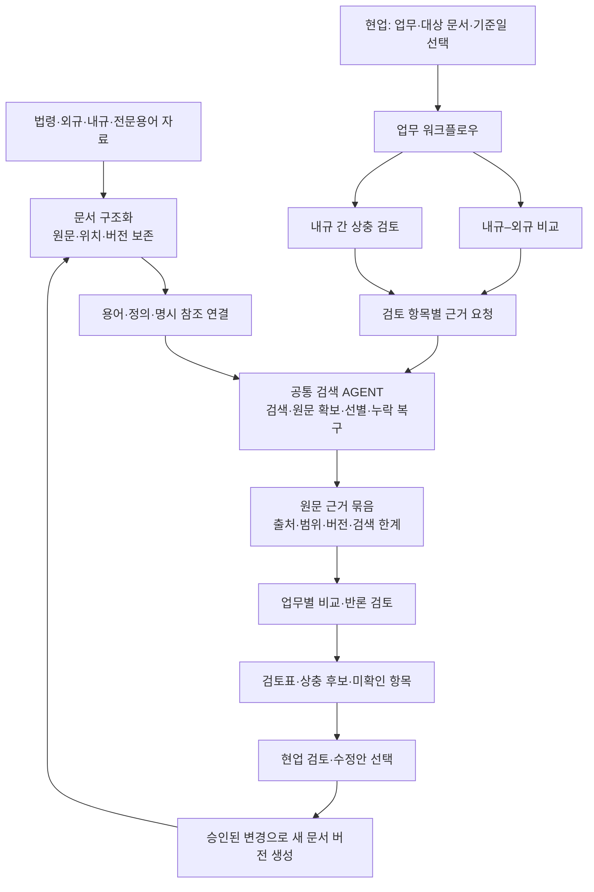
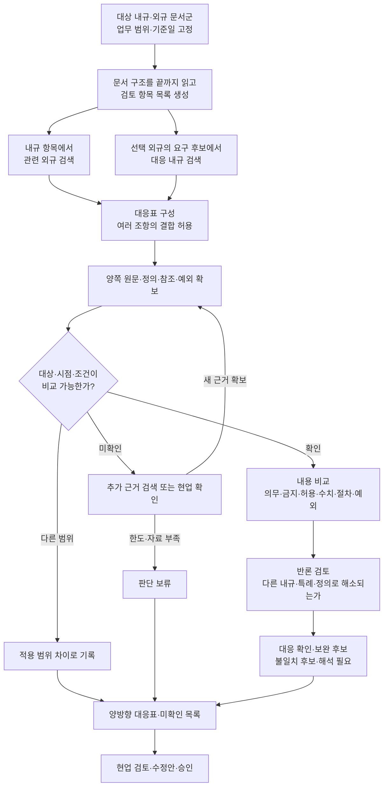
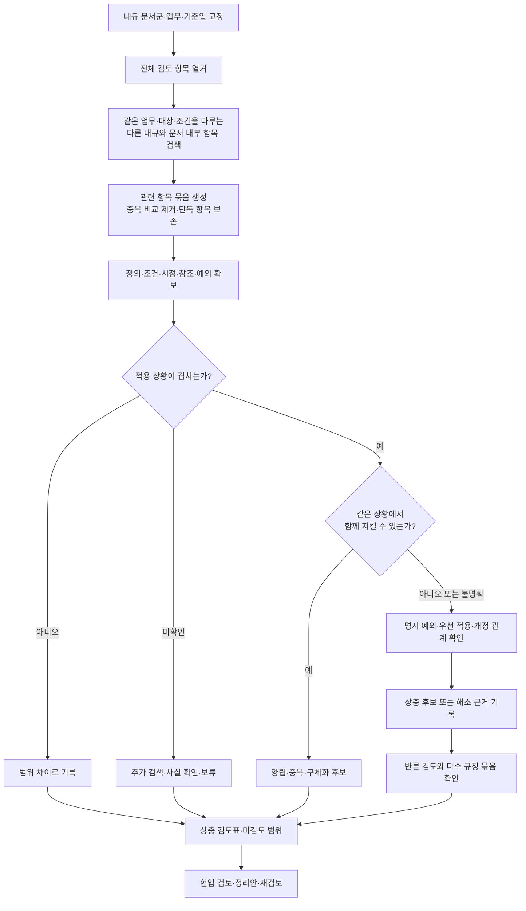

# 검색 기반 AGENT와 규정 검토 워크플로우 — 통합 설명·구현 설계

작성일: 2026-09-26. 이전 AGENT 설명에 내규–외규 비교와 내규 간 상충 검토를 합친 전체 원고다. 사용자가 설명한 현재의 강점인 검색을 공통 기반으로 삼는다. 두 업무 워크플로우의 아래 연결·계약·화면은 구현 제안이며, 이번에 코드 구현·모델 실험·배포를 수행한 것은 아니다.

## 1. 프로젝트를 설명하는 중심 문장

**법령·규정의 원문과 용어를 연결해 근거를 잘 찾는 AGENT를 만들고, 그 위에 내규–외규 비교와 내규 간 상충 검토 워크플로우를 얹는다.**

검색 기반은 ‘검토에 필요한 근거를 어디에서 찾고 어떻게 보존할 것인가’를 담당한다. 업무 워크플로우는 ‘무엇과 무엇을 비교하고, 어떤 기준으로 검토하며, 어떤 결과를 현업에 전달할 것인가’를 담당한다.

이 구조에서 업무가 추가될 때마다 별도의 검색 시스템과 문서 DB를 다시 만들 필요는 없다. 같은 원문·용어·참조 탐색을 사용하면서 업무별 입력, 비교 항목, 필수 확인, 보류 조건, 결과 양식을 추가한다. 다만 업무별 품질과 문서 범위는 별도로 검증한다.

현재 검색 기반의 구현·선택 상태와 업무 워크플로우의 완성·배포 상태는 구분한다. ‘검색이 잘된다’는 사용자의 제품 방향과 강점 설명으로 반영하며, 이번에 새 정확도 수치를 측정한 것은 아니다.

## 2. 전체 구조: 공통 검색 위에 업무 흐름을 올린다



### 세 층의 책임

| 층 | 책임 | 다음 층에 넘기는 것 |
|---|---|---|
| 지식 기반 | 원문·문서 구조·용어·정의·참조·버전 보존 | 탐색 가능한 문서와 관계 |
| 공통 검색 AGENT | 업무가 요청한 관련 근거를 찾아 읽고 보존 | 원문 근거, 경로, 확보 범위, 미확인 사항 |
| 업무 워크플로우 | 대상 나누기, 비교 상대 찾기, 적용 범위 확인, 비교·검토·취합 | 업무별 검토 결과와 현업 확인 사항 |

하네스는 세 층을 가로질러 자료 범위, 필수 원문 확인, 허용 행동, 예산, 상태와 승인 이력을 관리한다. 새 업무 워크플로우는 검색 엔진의 교체가 아니라 검색을 호출하는 상위 업무 절차의 추가다.

## 3. PART 0의 개념을 이 구조에 맞추기

### 지식그래프: 무엇과 무엇이 연결되어 있는가

문서–조항–본문, 용어–정의, 용어–출현 위치, 원문–명시 참조, 근거–원본 위치를 연결한다. 이 구조가 같은 업무를 서로 다른 표현으로 작성한 규정 사이에서 비교 상대를 찾는 기반이 된다. 특정 그래프 DB 제품을 사용했다는 뜻은 아니다.

### 하네스: 업무가 끝났다고 말하려면 무엇을 확인해야 하는가

질의응답에서는 질문의 요구와 답변 근거를 확인한다. 내규–외규 비교에서는 선택한 내규의 검토 단위와 외규 요구사항의 대응 여부를 확인한다. 내규 상충 검토에서는 같은 상황에 적용되는 규정들이 양립 가능한지 확인한다.

공통 실행 하네스가 자료·도구·실제 전달·반복·예산·상태를 관리하고, 업무 하네스가 비교 목적·필수 확인·결과 분류를 관리한다.

### 경로 선택: AI가 맡는 판단

AI는 어떤 검색 표현과 원문이 관련되는지, 어떤 조항끼리 대응하는지, 어떤 조건 차이가 중요한지 제안한다. 시스템은 실제 원문 존재, 인용 위치, 동일 버전, 처리 범위, 상태 전이를 검사한다. 법적 의미와 업무 적용의 최종 확인은 현업 검토로 연결한다.

### 경로 추적: 오류가 난 위치를 찾는 기반

업무 결과 → 비교 항목 → 검색 작업 → 원문 근거 → 문서·조항·버전을 연결한다. 모델 내부 사고를 복원하는 것이 아니라, 실제 입력·자료·도구·선택·검토 이력을 보존하는 것이다.

## 4. 공통 검색 기반: 두 워크플로우가 함께 쓰는 기능

### 4.1 지식 준비

문서를 반입하고 출처와 버전을 고정한다. 장·절·조·항·호·표·부칙 등 문서 구조를 복원하고, 원문과 위치를 보존한다. 용어집을 공통 기반으로 문서 내 정의와 용어 출현을 연결하고 명시 참조를 색인한다. 원문 구조화 자체는 용어집과 독립적으로 진행할 수 있다.

정의와 연결은 검색 단서다. 원문을 전부 조건·효과의 정본 규칙 DB로 재작성하는 과거 스키마를 복원하지 않는다.

### 4.2 업무에서 검색을 요청하는 단위

‘이 문서 전체가 문제없는가’라는 질문 한 번으로 끝내지 않는다. 선택된 문서의 구조를 전체 열거하고, 조항·하위 항목별 검토 작업을 만든다. 여러 항목이 같은 쟁점을 다루면 묶고, 하나의 항목 안에 여러 의무·조건이 있으면 원문 구간을 유지한 하위 검토 항목으로 나눈다.

각 항목은 원문에 결속된 질문이다. 예를 들어 ‘이 내규의 보존기간과 같은 대상·기산점에 적용되는 외규를 찾아라’처럼 비교 목적과 범위를 전달한다.

### 4.3 검색 AGENT가 반환할 원문 근거 묶음 — 제안 계약

| 필드 | 의미 | 소비자 |
|---|---|---|
| 검색 작업 ID·부모 검토 ID | 어느 검토 항목의 근거인지 | 진행 상태·감사·재개 |
| 선택 코드·원문·색인 세대 | 무엇을 읽었는지 고정 | 재현·변경 감지 |
| 허용 문서 범위 | 검색·원문 읽기에 적용한 범위 | 접근·범위 검사 |
| 원문 ID·문서 ID·조항 위치 | 결과를 원본까지 연결 | 비교·현업 원문 열람 |
| 원문 구간·원문 해시 | 실제 비교에 쓴 텍스트 | 인용·무결성 검사 |
| 정의·참조·주변 문맥 | 비교에 필요한 관계 근거 | 적용 범위·예외 검토 |
| 회수·선별·실제 전달 기록 | 검색의 어느 단계까지 완료했는지 | 누락 진단 |
| 검색 범위·페이지 완료·한도 도달 | 어디까지 조사했는지 | 부분 완료·누락 후보 판정 |
| 미해결 참조·판본 미확인 | 근거 사용의 한계 | 보류·추가 확인 |

이것은 업무용으로 추가할 구조화 출력이다. 현재 `/v1/rag/search` 하나가 곧바로 이 계약 전체를 제공하는 것은 아니다. 완성 답변을 원문처럼 다시 사용하는 대신 실제 원문과 전달 기록을 받아 비교해야 한다.

## 5. 워크플로우 A — 내규와 외규 비교

### 5.1 목적과 입력

**선택한 업무 범위에서 외규의 요구가 내규에 어떻게 반영되어 있는지, 어떤 조항을 보완하거나 다시 확인해야 하는지 검토한다.**

입력은 대상 내규, 비교할 외규 문서군, 기준일, 법인·부서·업무·상품 범위, 검토 목적, 실행 예산이다. 전체 정기 점검과 특정 외규 개정 영향 점검을 구분한다. 대상 문서군이 한정되어 있다면 그 범위를 결과 표지부터 표시한다.

기준일은 단순 파일 수정일이 아니다. 원문의 시행일·개정 이력·적용 기간의 근거가 필요하며, 확인되지 않은 항목은 적용 시점 미확인으로 남긴다. 업무상 비교를 위한 기준일 필터·승인 메타데이터는 추가 구현 범위다.

### 5.2 실행 플로우



### 5.3 왜 양방향으로 검색해야 하는가

내규 조항을 출발점으로 외규만 찾으면, 내규에 아예 없는 요구는 검색 질문조차 만들어지지 않을 수 있다. 두 방향을 함께 둔다.

- **내규 → 외규:** 이 내규가 어떤 외규와 관계되는지, 내용을 잘못 옮기거나 다르게 정했는지 검토한다.
- **외규 → 내규:** 선택한 외규의 요구가 어느 내규·절차에 반영되는지 찾는다. 대응 근거를 찾지 못한 항목은 누락 검토 후보가 된다.

이때 외규 요구 후보 목록도 검색 상위 결과에서만 만들면 안 된다. 선택 외규 문서군을 구조적으로 끝까지 훑고, 처리·제외·미확인 항목과 이유를 기록한다. 아직 적용 외규 문서군을 확정하지 못했다면 ‘전체 준수 점검’이 아니라 ‘선택 범위의 비교’로 결과를 표시한다.

### 5.4 비교 단위와 비교표

한 외규 조항이 여러 내규에 나뉘어 반영되거나 여러 외규가 하나의 내규에 연결될 수 있다. 따라서 대응 관계는 1:1로 제한하지 않는다.

| 비교 축 | 확인 내용 |
|---|---|
| 주체·대상 | 같은 법인·부서·업무·자료·상품에 적용되는가 |
| 시점 | 같은 기준일과 사건 시점에 유효한가 |
| 행위·효과 | 의무·금지·허용·승인 등이 무엇을 대상으로 하는가 |
| 조건 | 적용되는 전제와 발생 조건이 같은가 |
| 수치 | 단위·기산점·최소/최대·이상/초과가 같은가 |
| 절차 | 수행자·승인자·순서·시기·증빙이 어떻게 대응하는가 |
| 예외·참조 | 다른 조항의 특례나 위임·참조를 함께 읽어야 하는가 |
| 자료의 지위 | 법령·규정·지침·해설 등의 성격과 적용 근거가 확인되는가 |

외규라는 폴더 분류만으로 모든 자료에 같은 구속력이나 우선순위를 부여하지 않는다. 차이를 해소하는 우선 적용 관계는 원문 또는 확인된 업무 기준의 출처가 있어야 한다.

### 5.5 결과 분류

| 결과 | 의미 | 현업의 다음 행동 |
|---|---|---|
| 대응 확인 | 검토한 요구가 내규 근거와 대응함 | 근거 확인·검토 종료 |
| 보완 후보 | 일부 요건·기준·절차가 충분히 반영되지 않은 것으로 보임 | 다른 문서의 반영 여부 확인·수정 검토 |
| 불일치 후보 | 동일 적용 범위에서 양쪽 내용이 맞지 않는 근거가 있음 | 적용·예외·수정 필요성 검토 |
| 대응 근거 미발견 | 확인한 내규 범위에서 대응 원문을 찾지 못함 | 검색 범위·원문 누락·다른 절차 확인 |
| 범위 차이 | 대상·시점·조건이 달라 직접 비교하지 않음 | 제외 사유 확인 |
| 해석 필요·보류 | 적용이나 근거가 불충분함 | 현업 사실 확인·추가 조사 |

‘더 엄격한 내규’는 차이의 한 유형이다. 그것만으로 문제가 있거나 없다고 자동 판단하지 않는다. 가능한 재량·상한·다른 제한과 업무 적용을 함께 확인한다.

### 5.6 설명용 가상 예시

아래 숫자는 실제 법령이나 내규에서 가져온 것이 아니다.

| 외규 원문 가정 | 내규 원문 가정 | 검토 결과 예시 |
|---|---|---|
| 같은 자료를 같은 기산점부터 최소 5년 보존 | 최소 3년 보존 | 내규 최소기준 보완 후보. 실제 3년 만에 폐기했다는 사실이나 즉시 위반으로 단정하지 않음 |
| 업무 X를 수행하기 전에 승인 | 승인에 대한 조항을 찾지 못함 | 대응 근거 미발견. 다른 승인 규정·절차와 검색 범위를 확인 |
| 일반 업무에 적용 | 특정 예외 업무에만 적용 | 비교 전 범위 차이를 확인하고 직접 불일치 판정을 보류 |

### 5.7 최종 산출물

내규–외규 대응표, 외규 요구별 반영 상태, 내규별 관련 외규, 보완·불일치 후보, 원문 병렬 보기, 미확인 항목, 수정안 초안, 검토 범위와 실행 기록을 제공한다. 수정안은 근거 있는 제안으로 생성하며 승인 전 원문을 변경하지 않는다.

## 6. 워크플로우 B — 내규 간 상충 검토

### 6.1 목적과 입력

**같은 업무 상황에 함께 적용되는 내규들을 모아 동시에 지킬 수 없는 내용, 적용 우선순위가 불명확한 내용, 정합성이 깨진 절차를 찾는다.**

입력은 대상 내규 문서군, 기준일, 업무·조직 범위, 현행·개정안 구분, 검토 목적이다. 한 문서 내부의 서로 다른 항목도 비교 대상이다. 부서 간 검토는 요청한 업무 범위와 실제 허용 문서 범위를 별도로 확인한다.

### 6.2 실행 플로우



### 6.3 후보를 잘 만드는 방법

모든 조항을 서로 비교하면 작업량이 크게 늘어난다. 우선 같은 업무·행위·대상·관련 용어·명시 참조를 이용해 관련 항목을 찾고 묶는다. 문장이 비슷한 정도만으로 후보를 정하면 의무와 금지처럼 반대 표현의 관계를 놓칠 수 있으므로 검색 질의도 여러 방향으로 구성한다.

각 항목에서 검색하고, 같은 항목 조합은 한 번만 비교한다. 대응 후보를 못 찾은 항목도 삭제하지 않고 ‘관련 항목 미발견’으로 남긴다. 기존 기본 검색 상한을 그대로 문서 전수 점검의 완료 기준으로 사용하지 않는다.

검색으로 줄인 후보가 모든 상충을 포함한다는 보장은 없다. 전체 항목 처리율과 별도로 상충 후보 회수율을 검증하고, 후보 밖 누락을 검사할 표본을 마련한다.

### 6.4 상충 여부는 ‘함께 지킬 수 있는가’로 검토한다

| 유형 | 확인 내용 |
|---|---|
| 의무–금지 | 같은 조건에서 동일한 행위를 해야 하면서 하지 말아야 하는가 |
| 수치·기간 | 같은 단위·기산점의 허용 범위가 겹치는가 |
| 권한 | 동일 결정의 최종 권한을 배타적으로 다르게 정했는가 |
| 절차 | 순서·선행 조건을 동시에 만족할 수 있는가 |
| 정의 | 같은 표현에 다른 뜻을 부여해 동일 업무에서 충돌하는가 |
| 참조 | 폐지·이동한 조항을 가리키거나 연결을 해석할 수 없는가 |
| 적용 우선순위 | 겹치는 규정을 어떻게 적용할지 근거가 있는가 |

수치 차이나 승인자 차이는 상충 후보의 출발점이다. 예를 들어 ‘팀장 승인’과 ‘본부장 승인’은 순차 승인일 수도 있으므로 이름이 다르다는 이유만으로 상충으로 분류하지 않는다.

참조 오류, 정의 불일치, 중복은 실제 양립 불가능과 구분한다. 업무가 요구하면 한 보고서에서 보여주되 서로 다른 결과 유형으로 보존한다.

### 6.5 쌍 비교와 묶음 비교

두 조항만 비교해도 드러나는 상충이 있고, 여러 조항을 함께 보아야 드러나는 상충도 있다. 예를 들어 같은 조건에서 A 승인 뒤 B, B 뒤 C, C 뒤 A를 요구한다면 각 문장 쌍만 보아서는 전체 절차의 순환을 놓칠 수 있다.

첫 구현에서는 쌍 비교를 기본으로 하고, 동일 쟁점 묶음을 한 번 더 검토한다. 원문에서 검토된 순서·수치 조건만 코드 검사에 전달하며, 명확한 조건은 순환·구간 교집합을 검사할 수 있다. 추출·단위·조건이 미확인이면 계산 결과로 상충을 확정하지 않는다. 임의의 법률 자연어 전체를 형식 논리로 판정하는 엔진을 전제로 하지 않는다.

### 6.6 결과 분류와 가상 예시

아래 숫자는 흐름 설명용 가상 값이다. 동일 자료·기산점·기간·예외 없음이 확인된 상황을 가정한다.

| 내규 A | 내규 B | 검토 결과 |
|---|---|---|
| 최소 5년 보존 | 최대 3년 이내 폐기 | 두 조건을 함께 만족할 수 없어 상충 후보 |
| 최소 3년 보존 | 최소 5년 보존 | 5년 이상으로 함께 만족 가능. 차이만으로 상충 아님 |
| 모든 업무에 일반 절차 적용 | 특정 업무에 명시 예외 절차 적용 | 예외의 대상·유효성 확인 후 해소 가능 |
| 현행 조항 | 과거 효력이 끝난 조항 | 기준일 검토 후 개정 이력으로 구분 |

결과는 ‘상충 후보’, ‘우선순위 해석 필요’, ‘양립 가능’, ‘예외로 해소’, ‘범위 차이’, ‘정의·참조 정비 필요’, ‘근거 부족’으로 나눈다. AI 제안과 현업 확인 상태는 별도 필드다.

## 7. 두 워크플로우가 공유할 비교 계약

### 7.1 검토 항목은 실행별 관측이다

모델이 원문에서 정리한 주체·행위·조건·수치·예외는 해당 검토 실행의 해석 후보로 저장한다. 각 값에는 원문 구간과 확인 상태를 붙이고, 원문에 없는 값은 `unknown`으로 남긴다. 이것을 전 문서의 정본 규칙으로 승인하거나 기존 원문 DB를 덮어쓰지 않는다.

### 7.2 제안 산출물

| 산출물 | 주요 내용 | 소비자 |
|---|---|---|
| ReviewRequest | 워크플로우 종류, 대상 문서 ID, 기준일, 업무 범위, 실행 예산 | 업무 실행기 |
| ReviewPlan | 문서·구조 항목 목록, 분할·병합 근거, 제외 항목, 미확인 목록 | 작업 분배·범위 집계 |
| EvidenceBundle | 원문·정의·참조·버전·검색 상태·전달 기록 | 항목 해석·대응·비교 |
| ReviewObservation | 원문별 비교 항목과 인용, 해석 확인 상태 | 비교기 |
| ComparisonCase | 다대다 대응 원문, 같은 적용 상황인지, 비교할 쟁점 | 비교·반론 검토 |
| ReviewFinding | 차이·상충 후보, 근거, 해소 근거, 미확인 사항 | 현업 검토·보고서 |
| ReviewDecision | 승인·기각·수정 요청, 검토자·사유·시각 | 개선 후보·재검토 |
| ReviewReport | 결과표, 범위·누락·보류·실패, 원문 열람, 상태·버전 | 현업 화면·내보내기 |

문서·원문 식별자는 기존 계약을 사용한다. 새 검토 결과는 별도의 버전 있는 계약으로 만든다. 실행 산출물과 정본 지식을 분리한다.

### 7.3 상태는 분리해서 표시한다

하나의 ‘통과’ 값에 모든 의미를 넣지 않는다.

- 실행 상태: 대기 / 실행 중 / 부분 완료 / 완료 / 실패 / 취소.
- 적용 상태: 적용 범위 일치 / 범위 다름 / 미확인.
- 분석 결과: 대응 확인 / 보완 후보 / 상충 후보 / 해석 필요 등.
- 근거 상태: 확보 / 부분 확보 / 추가 원문 필요 / 판본 미확인.
- 현업 상태: 미검토 / 확인 / 기각 / 수정 요청.

‘실행 완료’는 선택한 계획의 항목이 각각 결과 또는 보류 상태를 가졌다는 뜻이다. 전 법령 준수나 전 내규 무상충을 인증하지 않는다.

## 8. 현업이 보는 결과 화면과 업무 마감

### 시작 화면

현업은 ‘내규–외규 비교’ 또는 ‘내규 상충 검토’를 선택한다. 대상 문서, 기준일, 업무 범위를 지정하고 검토 계획을 확인한다. 범위 누락이나 분류 미확인 문서는 화면에 별도로 표시한다.

### 실행 화면

진행 상태는 ‘대상 항목 준비 → 근거 검색 → 비교 → 검토 → 보고서’로 표시한다. 처리한 원문 단위, 비교 완료 항목, 근거 부족·보류·실패 항목을 구분한다. 단계별 처리율을 전체 준수율이나 상충 없음의 확률처럼 표시하지 않는다.

### 검토 화면

| 결과 항목 | 화면에 보일 내용 |
|---|---|
| 쟁점 | 어느 업무·조건의 무엇이 다른가 |
| 양쪽 근거 | 문서명·조항·원문 구간·버전 |
| 비교 | 같은 점, 다른 점, 적용 범위 |
| 제안 | 보완·상충·해석 필요 등의 후보 결과 |
| 반론 | 이 차이가 해소될 수 있는 정의·예외·다른 규정 |
| 확인 필요 | 추가 사실·원문·판본·검토 범위 |
| 현업 조치 | 확인 / 기각 / 추가 조사 / 수정안 요청 |

### 수정과 재검토


관련 결과만 다시 확인하는 증분 검토를 도입할 수 있다. 다만 정의·적용 범위·우선순위가 바뀌거나 새 조항이 생기면 기존 관계에 없던 영향을 놓칠 수 있다. 직접 의존 항목뿐 아니라 해당 업무·문서군의 후보 검색도 다시 실행하며, 영향 범위가 불명확하면 전수 재검토한다.

## 9. 실제 코드에 연결할 구현 지도

아래 새 API·프로필·클래스 이름은 제안이다. 현재 존재하는 기능과 구분한다.

### 9.1 기존 연결과 제약

- 현재 질의응답은 `service.py → semantic_runtime.app → Pipeline.run → ServingLegalAgent.open_session → Coordinator/StageRunner`를 사용한다.
- 문서 목록·목차·원문 페이지·참조 조회가 이미 있으며 문서 범위와 팀 선택을 전달할 수 있다.
- 현재 `/v1/rag/ask`는 허용 필드가 닫혀 있다. `workflow_type`, `as_of_date`를 임의로 넣으면 거절된다.
- `ServingLegalAgent.retrieve(..., use_llm=True)`는 요청 세션 없이 사용할 수 없다. 모델 기반 조사에는 기존 요청별 세션·예산·원문 기록을 유지해야 한다.
- 현행 RAG Coordinator는 retrieve/select/assemble/answer의 네 단계 이름을 검사한다. 비교 단계를 기존 노드 목록에 단순히 붙일 수 없다.
- 기존 답변 gate는 미해결 상충과 연결된 결론을 제외한다. 상충 검토 결과를 이 gate의 일반 답변 주장으로만 내보내면 발견 내용을 잃을 수 있다.
- 현재 로컬 선택 경로는 후보 안의 제한적 선별·복구다. 전수 검토에 필요한 추가 검색은 상위 작업의 새 하위 검색 실행으로 계획해야 하며, 무제한 루프를 전제로 하지 않는다.

### 9.2 연결 방식

**같은 서비스·실행 명세 안에 업무 프로필과 상위 실행을 추가하고, 공통 검색을 하위 단계로 호출한다.** 별도의 문서 파이프라인이나 독립 검색 서버를 만들지 않는다.

| 현재 파일·함수 | 재사용할 기능 | 추가할 책임 | 소비자·이행 |
|---|---|---|---|
| `semantic_runtime/app.py:create_app` | 기존 앱·오류·문서 조회 | 제안 `/v1/reviews` 생성·조회·결정 API | 기존 `/v1/rag/ask` 계약 유지 |
| `document_browser.documents/outline/read` | 문서 분류·구조·전체 페이지 읽기 | 검토 범위 전체 열거·페이지 완료 기록 | ReviewPlan 생성. 상한을 완료로 오인하지 않음 |
| `Pipeline.plan`, `team_scope.select_documents` | 선택 세대의 명시 문서 범위 | 승인된 내규·외규 문서 집합의 교집합 계산 | 모든 하위 검색·읽기에 같은 범위 전달 |
| `ServingLegalAgent.open_session` | 모델 결속·세대·범위·요청 원장 | 원문 근거 묶음 수집 어댑터 | 검색 하위 작업 ID와 부모 검토 ID 연결 |
| `BoundedSourceSession` 및 원문 회수·선별 코드 | 현재 선택된 검색 알고리즘 | 답변 생성에 종속되지 않은 근거 반환 경계 추출 | 알고리즘·상한·전달 기록 보존. 별도 계약 검증 필요 |
| `StageRunner.execute`, `00_SYSTEM/PIPELINE.json` | manifest·입출력 검증 | 업무별 프로필·단계·계약 등록 | RAG 4단계 Coordinator는 유지. 공통 StageRunner 위 상위 업무 실행 추가 |
| 제안 `semantic_runtime/review_workflow.py` | 기존 파이프라인 객체·자료 접근 | 계획·항목 분배·집계·일시중단·재개 | 외규 비교와 내규 상충의 공통 실행 제어 |
| 제안 `review_compare.py`, `review_contracts.py` | 기존 원문 ID·모델 gateway 사용 | 원문 기반 비교·반론·결과 검증 | 원문을 확인하는 업무용 결과 계약 |
| 제안 `review_repository.py` | workspace runtime root·해시·이벤트 방식 | 부모 실행·항목·대응·결정의 별도 journal | 기존 RAG journal을 임의 확장하지 않음 |
| 기존 `feedback.record_feedback` | 답변 피드백의 원문·실행 결속 방식 | 검토 결과용 별도 ReviewDecision 어댑터 | 기존 함수에 다른 결과 형식을 억지로 전달하지 않음 |
| `service.py`, GENOS 워크플로우 브릿지 | 기존 서비스·중계 경로 | 제안 REVIEW_CREATE/STATUS/DECIDE 허용 경로 | 코드서빙과 편집기 워크플로우 반영을 각각 확인 |

검토용 결과 gate는 ‘상충이 없다’를 통과 조건으로 삼지 않는다. **양쪽 원문을 확보했고, 같은 적용 상황인지 검토했으며, 상충 주장 자체가 그 근거로 뒷받침되는지**를 확인한다. 상충은 시스템 오류가 아니라 검토 업무의 결과일 수 있다.

### 9.3 제안 API 예시

```json
{
  "workflow_type": "internal_external_review",
  "internal_document_ids": ["internal-document-version-id"],
  "external_document_ids": ["external-document-version-id"],
  "as_of_date": "2026-09-26",
  "business_scope": {"team_id": "risk_team", "process": "검토할 업무"},
  "review_mode": "selected_scope_full_review"
}
```

이 입력은 **새로 제안한** `POST /v1/reviews`용이며 현재 `/v1/rag/ask`의 유효 요청이 아니다. 내규 상충 검토에서는 `workflow_type=internal_conflict_review`와 내규 문서군을 받는다.

제안 동작은 접수 시 실행 ID와 상태를 반환하고, 상태·결과 조회와 현업 결정을 별도 요청으로 처리하는 것이다. 장시간 검토는 프로세스 메모리의 임시 스레드에만 맡기지 않고 영속 작업 원장과 재시작 가능한 worker를 둔다. GENOS의 실제 저장소·worker 실행 조건은 현장 확인 후 선택한다.

서버가 허용 문서·선택 세대를 해석해 고정한다. 클라이언트가 적은 ID·팀명·모델 응답 자체가 접근 권한을 부여하지 않는다. 외부 공개 자료 검색의 모델 승인을 내부 내규 비교에 확대하지 않는다.

### 9.4 데이터·설정 영향

원문 DB와 기존 용어·참조 색인은 재사용한다. 워크플로우 제어와 결과 계약을 추가하는 것만으로 전 원문을 다시 구조화할 필요는 없다. 다만 시행일·권위·우선 적용 관계 등 필요한 메타데이터가 없는 경우에는 원문과 검토 근거에 결속한 별도 메타데이터를 추가해야 한다.

새 원문 또는 잘못된 구조·참조를 수정하면 새 데이터 세대와 관련 색인이 필요하다. 기존 완료 세대는 수정하지 않는다. 선택 코드·프로필·모델·검색 상한·비교 프롬프트·스키마·문서군·기준일은 실행에 고정한다.

새 업무 프로필은 명시 선택으로 도입한다. 비활성화하면 기존 질의응답 경로를 유지하고, 검토 결과와 이전 승인 이력을 삭제하지 않는다.

## 10. 정상·실패·재개 시나리오

| 상황 | 동작 | 현업에 보이는 결과 |
|---|---|---|
| 정상 비교 | 계획의 항목을 검색·비교·검토하고 취합 | 대응표·후보·근거·범위 |
| 대응 원문 없음 | 정의·참조·다른 표현으로 제한된 추가 검색 | 대응 근거 미발견과 검색 범위 |
| 후보·원문·문맥 한도 도달 | 무제한 확장하지 않고 미처리 항목 보존 | 부분 완료·보류 사유 |
| 모델 호출 실패 | 같은 입력 버전으로 제한 재시도, 성공 항목 보존 | 실패 항목과 재개 위치 |
| 비교 중 새 문서 버전 등장 | 기존 실행은 고정 스냅샷으로 유지·새 버전 알림 | 현재 기준과 갱신 필요 |
| 선택 세대의 파일 자체가 변경됨 | 해시 불일치로 중단 | 자료 무결성 오류 |
| 기준일·예외·기산점 불명 | 비교 결론 보류 | 필요한 확인 항목 |
| 접근 권한 축소 | 계속 읽기·결과 열람 전 재검증 | 중단·비공개 처리. 스냅샷으로 권한 우회 금지 |
| worker 중단 | 항목별 checkpoint와 lease로 재개 | 완료 항목 유지·실행 재개 |
| 같은 요청 중복 접수 | 사용자·자료 범위·요청 해시를 포함한 멱등키로 식별 | 기존 실행 반환 또는 명시 새 실행 |
| 현업이 결과를 기각 | 원결과를 보존하고 사유·근거를 새 이벤트로 기록 | 기각 이력·후속 수정 후보 |

재개는 같은 코드·입력·문서 세대·모델 설정·프롬프트로 완료 산출물을 재사용한다. 달라졌다면 이전 결과와 연결한 새 실행을 만든다. 중단 중 모델 호출의 결과가 확정되지 않았다면 완전한 중복 호출 방지를 보장하지 말고 시도 ID와 채택 여부를 남긴다.

내규 상충 비교의 중복키는 정렬한 항목 ID 집합, 원문 버전, 적용 상황, 비교 정책 버전을 포함한다. 쟁점이나 조건이 다르면 같은 조항 쌍이라도 다른 검토가 될 수 있다.

## 11. 검증과 비용을 어떻게 판단할 것인가

### 필요한 검증

1. 선택 문서의 구조 항목을 끝까지 열거하고 페이지 상한·누락을 처리하는가.
2. 원문의 여러 의무를 분리할 때 조건과 예외를 잃지 않는가.
3. 내규→외규와 외규→내규의 대응 후보를 모두 찾는가.
4. 내규가 여러 문서에 나뉘어 대응하는 사례를 처리하는가.
5. 같은 뜻의 다른 표현과 반대 의미 표현을 후보로 회수하는가.
6. 범위·기준일·정의·단위·예외 차이를 실제 상충과 구분하는가.
7. 상충 후보를 잘못 배제하거나 단순 차이를 상충으로 과장하지 않는가.
8. 여러 규정을 함께 볼 때 생기는 절차 순환 등을 검토하는가.
9. 결과의 모든 주장을 양쪽 원문으로 추적할 수 있는가.
10. 일부 실패·재시작·자료 변경·권한 변경에서 결과가 섞이지 않는가.

구조 계약 테스트와 업무 의미 평가를 구분한다. 평가 정답은 검토자가 양쪽 원문·적용 조건·판단 이유를 확인한 사례로 구성한다. 같은 조항을 바꿔 쓴 질문들을 독립 사례로 과대 계산하지 않는다. 새 모델·검색·비교 방식의 효과를 실제 비교할 때는 저장소 실험 표준과 ADR 절차를 별도로 따른다. 이번에는 평가를 실행하지 않았다.

### 지표의 분모

| 지표 | 분모와 해석 |
|---|---|
| 구조 처리율 | 선택 범위에 실제 존재하는 검토 대상 구조 항목 중 상태가 부여된 항목. 적합률 아님 |
| 외규 요구 대응 검토율 | 검토된 외규 요구 후보 중 내규 대응을 조사한 항목. 요구 추출의 완전성은 별도 평가 |
| 후보 회수율 | 평가자가 확인한 실제 관련·상충 사례 중 후보에 포함된 사례 |
| 상충 후보 정밀도 | 시스템이 제안한 상충 후보 중 검토자가 타당하다고 확인한 사례 |
| 놓친 상충 비율 | 별도 평가에서 확인한 상충 중 시스템이 놓친 사례 |
| 현업 검토 부담 | 사례별 확인 시간·기각 사유·추가 조사량 |

### 계산 가능한 작업량과 아직 모르는 성능

검토 항목이 N개라면 전수 쌍 비교는 N(N−1)/2개의 조합이다. 항목별로 k개의 후보를 검색하는 정책을 선택하면 중복 제거 전 후보 제안은 최대 N×k개로 제한할 수 있다. 단, k의 제한은 회수율을 떨어뜨릴 수 있으며 쌍 후보 축소만으로 품질이나 속도 개선을 보장하지 않는다. 다수 규정 묶음 검토는 별도 비용이다.

모델 비용은 항목 해석 + 검색 계획·선별 + 비교 + 반론 검토 + 실패 재시도 + 보고서 종합의 입력·출력 토큰 비용으로 합산한다. 원문 조회와 현업 검토 시간도 별도로 측정한다. 동일 근거 재사용은 문서 세대·범위·정책·질의가 같은 경우에만 적용한다.

순 시간 절감은 기존 수작업 시간에서 새 실행 대기·현업 검토·오탐 확인·오류 복구 시간을 뺀 값이다. 오탐과 보류가 많으면 검색 재사용의 이점보다 검토 부담이 커질 수 있다. 현재는 새 워크플로우의 정확도·지연·비용·인일을 산정할 실측이 없어 미산정으로 둔다.

## 12. 구현 순서와 단계별 완료 기준

| 단계 | 구현할 것 | 완료 확인 |
|---|---|---|
| 1 공통 근거 계약 | 전체 항목 열거, 세대·범위 고정, 검색 근거 묶음 어댑터 | 기존 검색 결과·원문·한계가 손실 없이 연결됨 |
| 2 내규–외규 비교 | 양방향 후보, 다대다 대응, 비교·반론, 결과표 | 선택 범위의 누락·조건·예외·보류 사례 검증 |
| 3 내규 상충 검토 | 항목별 후보 검색, 중복 제거, 쌍·묶음 검토 | 양립 사례와 실제 상충·순환 사례 구분 |
| 4 현업 검토 | 원문 병렬 보기, 확인·기각·추가 조사·수정안 | 결과 버전과 결정 근거 보존 |
| 5 변경 영향 재검토 | 새 문서·정의·범위 변경의 영향 탐색 | 직접 의존과 새로 생긴 관계를 다시 검사 |
| 6 현장 적용 | 내부 모델·권한·영속 작업·GENOS 중계 결속 | 워크플로우 테스트 화면에서 E2E 확인 |

모델을 여러 개 동시에 실행하는 멀티에이전트 구조를 필수로 두지 않는다. 계획·검색·비교·검토 역할을 논리적으로 나누고 같은 모델을 단계별로 호출해 시작할 수 있다. 같은 모델의 반복 오류는 별도 업무 평가와 원문 검사로 확인한다.

## 13. 기존 덱과 합치는 구성

전체 덱 29장 구조를 유지하려면 CASE 2에서 공통 기반을 보여주고 PART 2에서 그 위에 올라가는 업무를 구체화한다.

| 장 | 제목 제안 | 담을 내용 |
|---|---|---|
| 15 | 법률·규정: 근거를 찾는 AGENT에서 업무 검토로 | 프로젝트·역할·공통 검색과 두 워크플로우 소개 |
| 16 | 법령 원문·용어·정의를 연결해 비교할 근거를 찾는다 | 문서 구조·용어·정의·명시 참조·원문 확보 |
| 17 | 하네스로 근거의 사용과 판단의 범위를 관리한다 | 질문·근거·상태·예산·조건·예외·보류 |
| 18 | 경로를 따라 오류를 찾고 검증한 변경을 반영한다 | 도면 사례와 법률 사례의 공통 추적·수정 |
| 19 | 잘 검색하는 시스템 위에 업무 워크플로우를 얹는다 | 전체 구조도, 공통 검색과 업무 절차 분리 |
| 20 | 내규와 외규를 양방향으로 연결해 반영 여부를 검토한다 | 워크플로우 A 플로우·대응표·누락 후보 |
| 21 | 같은 상황에 적용되는 내규가 함께 지켜질 수 있는지 확인한다 | 워크플로우 B 플로우·상충과 단순 차이 |
| 22 | 업무가 바뀌어도 지식·검색·근거·검토 구조를 재사용한다 | CASE 1 설비 업무와 CASE 2 규정 업무의 공통 계약 |
| 23 | 현업은 검토할 범위·기준·예외·결과를 정의한다 | 업무 모델링, 원문 검토, 수정안·승인 |
| 24~27 | 의사결정: 후보를 만들고 비교하고 배운다 | 검색 누락·비교 오류·현업 부담을 나눠 검증 |
| 28 | 구현 범위와 추가 워크플로우의 연결 계획 | 현재 기반과 제안 업무 흐름·현장 검증 구분 |
| 29 | 근거를 찾는 능력을 재사용 가능한 업무 시스템으로 확장한다 | 공통 기반·하네스·워크플로우·수정 가능성 |

이 구성에서는 기존 21번 설비 점검 업무를 22번의 사례 비교로 옮긴다. 도면 사례의 새 운영 성과를 가정하지 않고 첨부에 있는 범위만 사용한다.

### 15~23번 발표 본문

**15 — 법률·규정: 근거를 찾는 AGENT에서 업무 검토로**

법률·규정 프로젝트에서는 현업의 표현을 관련 개념과 원문에 연결하는 검색 기반을 구축했다. 법령과 내규의 구조·정의·참조를 보존하고, 답변에 필요한 근거를 찾아 검토할 수 있도록 만들었다. 이 기반 위에 내규와 외규를 비교하고, 내규끼리 상충하는 내용을 검토하는 업무 흐름을 얹는 구조로 확장한다.

**16 — 법령 원문·용어·정의를 연결해 비교할 근거를 찾는다**

원문의 구조와 위치를 보존하고 용어·정의·명시 참조를 연결했다. 질문이나 검토 항목이 들어오면 용어·본문·문서 구조·참조를 이용해 관련 원문을 확보한다. 검색에서 발견한 자료, 선별한 자료, 실제 전달한 자료를 구분해 기록한다. 이 근거 묶음을 질의응답뿐 아니라 비교 업무에서도 사용한다.

**17 — 하네스로 근거의 사용과 판단의 범위를 관리한다**

검색된 원문을 곧바로 결론으로 바꾸지 않는다. 하네스는 어떤 자료를 사용할 수 있는지, 무엇을 반드시 확인해야 하는지, 언제 추가 검색이나 현업 확인이 필요한지를 관리한다. 실행 기록과 원문 대조를 통해 AI가 제안한 판단의 근거를 확인하고, 부족한 부분은 보류로 남긴다.

**18 — 경로를 따라 오류를 찾고 검증한 변경을 반영한다**

도면에서는 객체·연결·매뉴얼을, 법률·규정에서는 조항·정의·참조를 따라 원본으로 돌아간다. 원본 인식, 연결, 검색, 선별, 전달, 해석 중 어느 단계의 오류인지 구분한다. 수정 후보와 검토 근거를 남기고, 검증한 변경은 새 버전으로 반영한다.

**19 — 잘 검색하는 시스템 위에 업무 워크플로우를 얹는다**

업무가 달라져도 원문을 찾고 근거를 보존하는 기능은 공통으로 쓴다. 워크플로우는 대상 문서를 검토 항목으로 나누고, 검색 AGENT에 필요한 근거를 요청한 뒤 업무 기준에 따라 비교하고 결과를 모은다. 검색은 공통 기반으로 유지하고 업무의 목적·절차·출력 형식을 추가한다.

**20 — 내규와 외규를 양방향으로 연결해 반영 여부를 검토한다**

내규에서 관련 외규를 찾아 내용 차이를 확인하고, 외규의 요구에서 대응 내규를 찾아 빠진 반영 사항을 확인한다. 같은 대상·시점·조건인지 먼저 검토하고, 의무·수치·절차·예외를 원문으로 비교한다. 결과는 대응 확인, 보완 후보, 불일치 후보, 근거 미발견, 판단 보류로 나누어 현업에 전달한다.

**21 — 같은 상황에 적용되는 내규가 함께 지켜질 수 있는지 확인한다**

같은 업무를 다루는 내규를 검색해 비교 묶음을 만든다. 문장이 다르다는 이유만으로 상충으로 보지 않고, 같은 상황에서 규정들을 동시에 지킬 수 있는지 검토한다. 정의·시점·예외·명시된 우선 적용 관계를 확인한 뒤 상충 후보와 해소 근거를 함께 보여준다.

**22 — 업무가 바뀌어도 지식·검색·근거·검토 구조를 재사용한다**

도면의 설비 점검과 규정 비교는 대상이 다르지만, 검토 대상을 정하고 관련 근거를 찾은 뒤 조건과 예외를 확인하는 구조를 공유한다. 원문과 지식을 관리하는 기반, 검색 도구, 근거 기록, 검토와 변경 관리를 재사용한다. 업무별 정의와 필수 확인 항목은 새로 검증한다.

**23 — 현업은 검토할 범위·기준·예외·결과를 정의한다**

현업은 어떤 문서를 어떤 시점과 업무 범위에서 비교할지, 어떤 차이를 확인해야 할지, 무엇이 부족하면 보류할지를 정한다. AI는 근거 검색·대응 제안·비교·설명을 수행하고, 시스템은 실행과 기록을 관리한다. 현업은 원문과 후보 결과를 보고 확인·기각·수정 요청을 남긴다. 이를 업무 정의로 재사용하는 관리 기능은 단계적으로 구현한다.

## 14. 완성형 프로젝트 소개문

이 프로젝트는 금융·법률 문서를 근거로 답하는 AGENT를 구축하고, 그 검색 능력을 여러 규정 검토 업무에 재사용하는 구조다. 문서의 원문·구조·버전을 보존하고 용어·정의·명시 참조를 연결해, 현업의 질문과 검토 항목에 필요한 근거를 찾는다. 하네스는 자료의 사용 범위, 실제 원문 전달, 질문과 근거의 연결, 검토·보류·종료 상태를 관리한다.

그 위에 두 가지 업무 워크플로우를 구성한다. 내규–외규 비교는 내규에서 외규를 찾는 방향과 외규의 요구에서 내규를 찾는 방향을 함께 사용해, 반영 상태와 보완 후보를 검토한다. 내규 간 상충 검토는 같은 상황에 적용되는 규정들을 모아 동시에 지킬 수 있는지 확인하고, 단순 표현 차이와 실제 상충 가능성을 구분한다. 두 업무 모두 원문·조건·예외·버전·검토 범위를 결과에 연결한다.

현업은 결과와 양쪽 원문을 함께 확인하고, 후보를 승인·기각하거나 추가 조사와 수정안을 요청한다. 변경은 새 버전으로 보존하고 영향받는 항목을 다시 검토한다. 검색 기반을 공통으로 유지하면서 업무별 대상·기준·절차·출력 형식을 추가하므로, 지식과 기능을 재사용하는 확장 구조로 설명할 수 있다. 현재 검색 기반의 구현과 두 업무 워크플로우의 구현 제안·현장 검증은 구분한다.
