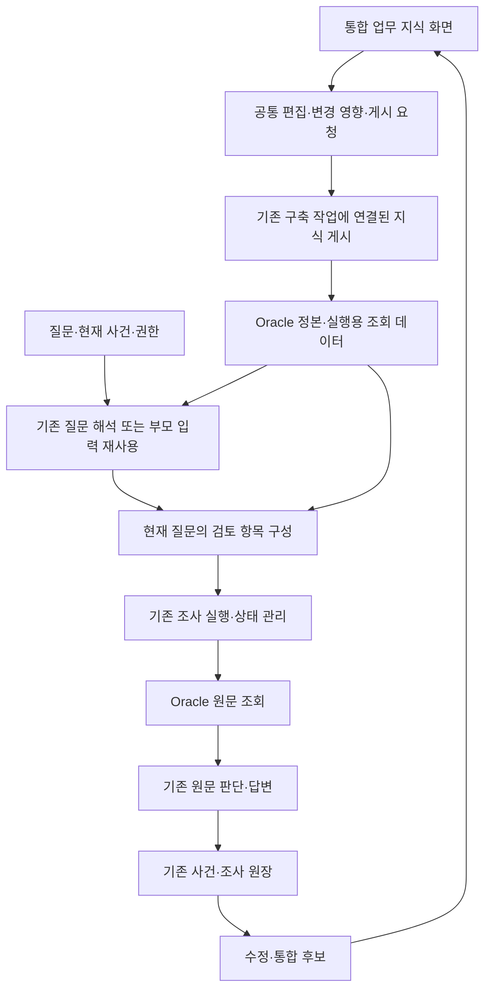

# CM 법률 지식 시스템 세부 설계

CM 업무에서 반복되는 조사 판단을 지식으로 관리하고, 현업이 한 화면에서 수정한 내용을 기존 에이전트 실행에 연결한다. 온톨로지는 검토에 쓰는 값의 의미와 방법을 정의하고, Legal Wiki는 적용 범위가 있는 지식과 근거 경로를 제공하며, 숏컷은 사건 사실과 실제 조사·정정 기록을 보존한다.

**상태는 구현 제안이다.** 코드·MAIN·GENOS·데이터 정본을 변경하지 않는다. 신규 구성요소·계약·API 연산명은 모두 제안이며 현재 기능과 구분한다. 2026년 10월 20일 작업 코드와 질문 등록 자료를 기준으로 작성했다. 자체 검토이며 독립 검토나 법률 정답 인증은 아니다.

## 읽는 순서

- 이 문서: 설계 결정, 실제 연결 지점, 화면, 실패 처리, 도입 순서.
- [데이터와 실행 계약](CONTRACTS.md): 필드·조건·방법·위키·계획·API·저장 계약.
- [CM 질문 대응표](QUESTION_REQUIREMENTS.tsv): CM 51문항과 Risk CM 105문항 각각의 검토 조합·조사 범위·주의점.
- [확인 근거](EVIDENCE.json): 질문과 확인한 코드의 경로·해시·관측 시점.
- [문서 검사 결과](VALIDATION.json): 질문 ID·유형·참조·예시 구문 등 산출물 검사. 제품 테스트 결과가 아니다.

## 설계의 우선순위

1. 현업은 업무 용어·확인할 사항·조건·예외·근거를 편집한다. 도구 함수·SQL·JSON·프롬프트 작성은 요구하지 않는다.
2. 같은 지식의 정본은 하나다. 화면, 실행용 색인, 사람이 읽는 Wiki는 같은 ID와 개정번호를 참조한다.
3. 현재 질문 해석 호출에 필요한 선택을 통합한다. 이미 호출이 생략되는 경로에는 새 호출을 만들지 않는다.
4. 조건 정리·영향 계산·실행용 데이터 생성은 게시 경로에서 수행한다. 질문 중 전체 그래프나 전체 지식을 검사하지 않는다.
5. 원문 확보와 법률 판단 완료는 별개다. 미확인 때문에 확보한 원문·부분 결과 전달을 막지 않는다.
6. 조회·버전·권한·인용의 필요한 검사는 기존 경계에 통합한다. 같은 검사를 에이전트마다 반복하지 않는다.
7. 현업 수정이 기존 실행으로 이어져야 한다. 별도 데모 실행기만 구현한 상태는 완료가 아니다.

## CM에서 도출한 검토 방법

아래 코드는 설계 대응표의 식별자다. 서로 배타적인 질문 분류가 아니며, 한 질문은 여러 방법을 사용한다. 코드는 현업의 기본 화면에 표시하지 않는다.

| 코드 | 검토 방법 | 필요한 결과 |
|---|---|---|
| LOOKUP | 관련 규정·근거 위치 찾기 | 문서·판본·좌표와 요청 범위에 맞는 원문 |
| DISTINGUISH | 개념·대상 구분 | 각 개념의 정의 범위, 공통점·차이, 혼동하면 안 되는 기준 |
| APPLICABILITY | 적용 대상·요건 확인 | 적용 조건, 예외, 현재 사실과 미확인 조건 |
| QUANTITY | 수치·기간·비율 확인과 계산 | 값의 의미·단위·기준시점·산정식·비교 기준·계산 결과 |
| PROCEDURE | 절차·권한·기한 확인 | 발생 상황, 필요한 단계, 담당 주체, 순서·기한·생략 후 남는 절차 |
| RESPONSE | 사건·트리거별 대응 | 발동 조건, 적용 단계, 대상별 조치와 후속 절차 |
| COMPARE | 규정·조건·주장 비교 | 비교 축, 양측 근거, 적용 범위 차이, 충돌 후보와 남은 해석 |
| HISTORY | 개정·판본 변화 조사 | 비교 기간, 판본 연결, 변경 위치·내용, 확인하지 못한 판본 |
| REDRAFT | 해석 검토와 문구 개선 | 현행 문구, 모호성, 해석 의견, 별도 수정 제안 |

`enumerate`와 `corpus`는 조사 범위다. “전체”를 별도 법률 개념으로 만들거나 Wiki 검색 결과 수로 전체 조사의 완료를 판단하지 않는다.

질문 대응표의 분류는 작성자의 설계 판단이다. 정답 라벨·원문 근거 승인·모델 평가 데이터로 자동 전환하지 않는다. Risk CM은 question_only 상태이며 054·055·101의 전사 문제와 075·084의 중복 관계를 유지한다. 기존 질문·정답 후보·평가 주석은 운영 프롬프트에 넣지 않는다.

## 현재 기반과 바꿀 부분

| 문제와 입력 | 기존 방식과 관측 사실 | 변경 방식 | 원하는 행동과 확인 기준 |
|---|---|---|---|
| 서로 다른 질문에서 같은 검토 필요 | `DomainCatalogue.select()`는 단계 방법을 고정하고 개념·관계는 빈 DISCOVERY로 기록한다. 업무 검토 방법이 현재 선택 결과에 연결되지 않는다 | 게시된 검토 방법과 업무별 적용 항목을 조회해 요청의 검토 항목을 구성 | 다른 질문에서도 같은 방법 ID를 사용하되 사실·판본·결론은 각 요청에 결속 |
| 금액·비율·기간의 조건 판단 | Wiki 제안의 field는 자유문 문자열이고 비교 연산은 제한적이다 | 범위가 명확한 입력 ID와 타입·단위 계약, 제한된 계산식 추가 | 같은 단어의 다른 금액을 합치지 않고, 근거가 연결된 식만 계산 |
| 서로 다른 업무 간 지식 재사용 | 기존 정확 일치 절차 기억과 근거 경로, 제한된 Wiki 탐색 경로가 함께 존재한다 | 각 경로를 하나의 요청 계획에 결합하고 부분 적중을 기록 | 같은 원문 읽기를 합치고 부족한 항목만 기존 조사로 연결 |
| 전체 규정 비교 | `wiki_recall`은 소수의 기록을 제공하는 탐색 보조다 | 조사 범위 목록과 검토 결과의 범위 계약 추가 | 소수 기록 적중과 전체 비교 완료를 구분 |
| 개정 전후 조사 | 기존 경로는 출처·세대 일치 여부를 확인한다 | 질문의 기준시점과 판본 계열을 별도로 결속 | 과거 질문에 현재판만 읽고 답하지 않음 |
| 업무 지식 유지보수 | 원장·관리 API·위키 컴파일·도메인 카탈로그가 개별 경로로 존재한다 | 공통 ID·버전과 통합 화면·게시 경로 연결 | 화면의 수정이 실행에서 선택한 버전·행동으로 확인됨 |

표의 현행 사실은 코드 계약에 관한 관측이다. 위 CM 문항으로 현행 모델 응답을 실행해 결함이나 성능을 측정한 것은 아니다.

기존 `ONTOLOGY_PIPELINE.json`·`lawrag.ontology`에는 구축 상태·정의 projection·과거 그래프 경로가 있다. 일부는 배치와 상태 화면의 의존성이므로 임의 삭제하지 않는다. 해당 파일이 있다는 사실을 현행 RAG가 업무 온톨로지로 추론한다는 증거로 쓰지 않는다. 모든 원문을 구 의미 프레임으로 재작성하는 파이프라인을 복원하지 않는다.

## 정본의 책임

| 영역 | 저장하는 내용 | 저장하지 않는 내용 |
|---|---|---|
| 원문·용어 기반 | 문서 계열·판본·원문 위치·용어 표현·정의·명시 참조 | LLM의 사건 결론을 원문 사실로 저장하지 않음 |
| 온톨로지 | 범위 있는 개념, 입력 항목의 의미, 검토 방법, 업무별 방법 적용, 항목 간 연결·제한 | 개별 거래의 금액·주체·날짜와 질문별 답변 |
| Legal Wiki | 적용 범위 있는 설명·주장·산정식·예외·근거·탐색 경로 | 출처 없는 자동 확정 규칙, 다른 사건의 사실 |
| 숏컷 | 발언·사실·쟁점·적용 방법·사용 지식·도구 결과·정정·부분 완료·최종 답변 | 실행 성공만으로 승인된 일반 법률 규칙 |
| 실행용 조회 데이터 | 게시된 정본에서 만든 후보 색인·짧은 방법 요약·좌표·연결 | 별도 편집 가능한 지식 정본 |

온톨로지의 방법은 “한도 검토에 어떤 값과 근거가 필요한가”를 정의한다. 특정 준칙의 한도값과 산정식은 Wiki의 근거 있는 지식이다. 현재 거래의 금액은 숏컷의 사건 사실이다. 세 값은 공통 입력 ID와 범위로 연결한다.

처음부터 모든 조건을 별도 그래프 노드로 만들지 않는다. 다른 곳에서 공유하거나 독립 개정해야 하는 개념·입력·방법은 식별자를 부여하고, 한 객체에만 쓰는 조건은 그 객체의 구조화된 속성으로 둔다.

## 전체 실행 구조

편집·조회·실행은 같은 제품 안의 기능이다. 별도 온톨로지 에이전트, Wiki 에이전트, 숏컷 에이전트를 요청마다 순차 호출하지 않는다. 상태의 소유자는 기존 실행기와 journal/checkpoint다.

최종 운영에서 원문·지식·실행용 조회 데이터는 Oracle와 승인된 조회 API에서 제공한다. GENOS 코드서빙에는 전체 데이터, 로컬 SQLite 복제, 요청 간 데이터 캐시를 두지 않는다. 현재 외부 NFS/CIFS 기반 실행 기록과 Oracle 상태 포트는 별도 이행 항목이다. Oracle 상태 포트가 존재한다고 `sw_*`의 모든 트랜잭션이 이행됐다고 보지 않는다.

## 질문을 처리하는 순서

| 단계 | 입력 | 수행과 출력 | 추가 LLM |
|---|---|---|---|
| 요청 고정 | principal, 질문, 사건 revision, 기준일 | 원문 릴리스·지식 릴리스·권한·예산·기한 결속 | 없음 |
| 좁은 후보 조회 | 질문 표현·기존 사건 범위 | 방법·업무 적용·Wiki 후보를 제한된 묶음으로 조회 | 없음 |
| 질문 해석 | 현재 질문과 후보 | 기존 호출에서 목적·조건·필요 결과·조사 범위 선택. 인용 가능한 사용자 사실과 원문을 구분 | 기존 호출 재사용 |
| 검토 항목 구성 | 선택 결과와 준비된 방법 | 필요한 항목만 연결하고 타입·범위·의존 조건 확인 | 없음 |
| 알려진 경로 적용 | 방법 적용 항목, Wiki, 정확 일치 숏컷 | 사용 가능한 근거 경로 결합·중복 제거·현재 원문 읽기 | 도구 선택을 대체할 수 있는 범위에서 없음 |
| 남은 조사 | 미확인·새로운 쟁점·실패한 경로 | 기존 조사 루프와 예산으로 수행 | 기존 조사에 필요한 호출 |
| 판단·답변 | 실제 원문·현재 사실·계산 결과·미확인 | 기존 판단 단계에서 적용·차이·충돌을 설명 | 기존 호출 재사용 |
| 기록·피드백 | 실제 적용 내역 | 기존 원장에 참조와 결과를 기록. 일반화 후보는 응답 뒤 생성 | 응답 중 없음 |

부모 워크플로우가 유효한 조사 항목을 전달해 `entry_proposal`로 질문 해석을 생략하는 경로는 유지한다. 새 계약은 그 부모 입력에 투영하며, 자식에게 다시 같은 분해를 요청하지 않는다.

후보 조회가 부정확하면 기존 해석·탐색을 계속한다. 해석 후 새로 식별된 ID의 필요한 세부 정보만 묶어 조회할 수 있지만, 후보가 없다는 이유로 ontology→wiki→shortcut을 반복 검색하는 새 루프는 만들지 않는다.

## 검토 방법을 조합하는 규칙

방법은 입력·출력과 근거 요구를 가진 작은 그래프다. 모든 질문 조합을 미리 생성하지 않고 공통 방법과 업무별 연결을 게시한다.

- 출력의 입력 ID·범위·단위가 다음 항목과 일치해야 연결한다.
- 문서 간 정의나 산정법을 옮길 때는 범위와 근거가 있는 연결 관계가 필요하다.
- 같은 주제, 유사 단어, 함께 검색됨은 계산법·법적 효과의 동일성을 뜻하지 않는다.
- 의존 조건은 질문에 필요한 항목에만 붙인다. 전체 방법의 모든 항목을 무조건 실행하지 않는다.
- 조건이 불명확하면 조사를 이어가며, 불확실한 조건으로 생략·자동 계산·결론 재사용을 하지 않는다.
- 준비된 방법에 없는 법률 의미는 기존 LLM 조사와 판단이 처리한다. 새 방법 후보는 별도로 남긴다.
- 코드가 수행하는 범위는 조회 구성·단위가 맞는 계산·중복 제거·명시 조건 분기다. 법률 충돌의 결론이나 근거의 충분성을 코드 상태값만으로 확정하지 않는다.

## 대표 실행 시나리오

### Risk CM 037부터 039까지

공통 조사에는 거래 목적·기존 한도·기존 금액·신규 금액의 의미 확인, 적용되는 금액 산정 기준, 전결 조건과 예외 확인이 포함될 수 있다. 039에는 가능한 신규 금액이나 기존 금액 조정의 역산 요구가 추가된다.

방법은 공유하되 질문별 사실은 별도다. Wiki에서 산정식과 적용 조건이 근거에 결속돼 확인된 경우에만 계산 노드를 실행한다. 식이 없거나 비교하는 금액의 의미가 불명확하면 수치 결과를 만들지 않고 해당 근거를 조사한다. 이 설계에는 해당 질문의 법률 정답이나 실제 전결권을 넣지 않는다.

### Risk CM 042

`신용위험 측정용 익스포져`와 `전결 판단용 금액`을 서로 다른 범위를 가진 값으로 둔다. 한쪽 산정법이 다른 쪽에도 적용된다는 검토된 근거 관계가 있어야 전환한다.

관계가 없으면 “적용할 수 없다”로 자동 결론 내리지 않는다. `COMPARE + APPLICABILITY`로 양쪽 정의·명시 참조·관련 조문을 조사하고, 확인한 범위와 해석 의견을 반환한다. 관계 없음은 조사 필요이며 법률상 부정의 증거가 아니다.

### Risk CM 036과 052

생략 가능한 행위와 생략 이후에도 필요한 행위를 분리한다. `절차 A 생략 조건`이 성립해도 다른 절차의 결과를 완료로 표시하지 않는다. 사용자가 생략 여부만 물었으면 상세 전체 프로세스를 강제 실행하지 않고, 답변에 필요한 잔존 절차를 포함한다.

### Risk CM 096과 097

지정 문서 또는 확인 가능한 문서 범위를 고정하고 조항·별첨·명시 참조의 조사 목록을 만든다. 후보 검색, 원문 열람, 의미 비교의 상태를 각각 기록한다. 모든 문서 쌍을 무조건 비교하지 않고 같은 목적·대상·조건의 비교 후보를 구성한다.

범위 탐색 자체는 누락되지 않게 유지하되 의미 비교는 근거 있는 후보에 집중한다. 후보 목록을 다 읽었다는 사실만으로 전 문서에 충돌이 없다고 확정하지 않는다. 예산에 도달하면 비교된 범위와 남은 부분을 반환한다.

### Risk CM 055와 098부터 099까지

현재판·직전판·특정 과거판의 연결이 필요하다. 번호 변경과 내용 삭제를 구분하고 본문·별첨·흐름도를 동일 위치라고 가정하지 않는다. 판본이 빠졌다면 “삭제됨”을 확정하지 않는다.

055의 대상 문구는 전사가 미완이다. 특정 문구의 최초 추가일을 만들지 않고 대상을 구체화할 필요를 표시한다. 동시에 확보할 수 있는 문서 판본 목록은 조사할 수 있다.

### Risk CM 035

해석 검토와 문구 수정 제안을 별도 결과로 둔다. 원문은 그대로 유지하고, 제안한 문구가 실제 개정 규정처럼 Wiki·원문에 들어가지 않도록 `PROPOSAL` 역할과 출처를 보존한다.

### CM 001과 051

비율의 분자·분모·합산 범위·기준시점·주체를 확인한다. 같은 비율 숫자가 나타났다는 이유로 동일 계산식을 적용하지 않는다. 한도 문구 설명만 요구한 질문과 사건의 수치를 실제 계산하는 질문을 구분한다.

## 현업 관리 화면

한 화면에서 업무 주제와 해당 지식의 연결을 편집한다. 기본 진입은 PF, 기업신용공여, 운용한도, RP, 위기대응, IPO, 내부통제 같은 업무 탐색과 검색이다. 검토 방법은 별도 시스템 메뉴가 아니라 각 업무에 연결된 항목으로 나타난다.

| 영역 | 표시와 행동 |
|---|---|
| 왼쪽 목록 | 업무 주제, 검색, 내 담당, 수정 후보, 원문 변경 영향 대상 |
| 가운데 개념과 조건 | 용어·입력의 의미, 적용 범위, 조건·예외, 연결된 정의 |
| 가운데 검토 방법 | 필요한 확인, 입력·결과, 선행 확인, 생략·재조사 조건 |
| 가운데 지식과 근거 | Wiki 설명·조건·원문·탐색 경로를 같은 맥락에서 편집 |
| 오른쪽 적용 사례 | 연결된 질문 ID, 실제 실행, 사용한 판본, 미확인·정정 |
| 오른쪽 변경 영향 | 적용될 업무·영향받는 지식, 추가·생략될 조사, 충돌·누락 |
| 상단 상태 | 초안 저장, 게시 전 확인, 게시, 사용 중지, 이전 버전 복원 |

기본 화면에서 JSON과 그래프 편집을 요구하지 않는다. 고급 관계 보기와 기술 진단은 접어 둔다. 필요한 조건은 선택형 입력으로 편집하며 자연어 편집 지원은 선택 기능이다. 자연어를 구조화하는 모델 호출은 편집 경로에서만 수행하고, 실행할 조건을 미리 보여준다.

게시 확인은 내용과 변경 영향을 한 번에 보여준다. 의미 검토·게시 권한이 같은 담당자에게 있다면 중복 승인 단계를 추가하지 않는다. 여러 팀에 영향을 주는 공통 방법은 지정된 책임자가 게시한다. 일반 현업이 바꿀 수 있는 업무 지식과 개발자가 추가해야 하는 계산 연산·도구 연결은 구분한다.

미리보기의 기본값은 저장된 상황·입력에 대한 조건 적용 차이다. 모델을 다시 호출하지 않는다. 실제 원문을 새로 조사하는 미리보기는 별도 실행이며 시간·예산·기록을 표시한다. 저장된 질문만으로 법률 답의 정확성을 인증하지 않는다.

## 저장과 게시

정본은 객체별 책임을 유지한다. 기존 용어·정의 ID와 Wiki `unit/revision`, 숏컷 사건·쟁점·사실·trace ID를 재사용한다. 새로 필요한 입력·방법·업무 적용 계약만 별도 개정 객체로 추가한다.

Oracle의 논리 저장 설계는 [계약 문서](CONTRACTS.md)에 있다. 현재 테이블에 새 항목이 이미 존재한다고 가정하지 않으며, 최종 물리 이름·권한·인덱스는 현장 스키마와 매핑해야 한다. 읽기 전용 게시 데이터와 편집·실행 상태를 분리한다.

게시 흐름은 `초안 → 영향 계산·관련 검사 → 게시 준비 완료 → 활성 포인터 교체`다. 전체 원문을 복제하거나 다시 파싱하지 않고 변경된 지식과 의존하는 조회 데이터를 구축한다. 원문 릴리스와 지식 릴리스를 함께 선택할 수 있는 binding을 원자적으로 게시한다. 진행 중인 요청은 시작할 때 선택한 조합을 유지한다.

현재 Oracle 조회 릴리스는 자체 manifest hash와 row 계약을 가진다. 지식 편집마다 전체 원문 행을 새 릴리스로 복제하는 설계는 채택하지 않는다. 지식 릴리스는 원문 릴리스를 참조하고, 요청 binding이 두 버전을 결속하게 확장한다. 현행 독자는 새 manifest를 오인하지 않도록 별도 버전과 기능 선택을 사용한다.

권한 축소·명시 철회는 진행 중 요청에도 기존 경계에서 적용한다. 이전 버전 복원은 활성 선택을 되돌리며 과거 실패·정정·철회 기록은 지우지 않는다. 원문/권한이 달라졌다는 이유로 오래된 근거를 조용히 계속 쓰지 않는다.

## 변경 지도

경로는 저장소 루트 기준이다. 아래 새 함수명은 제안이며 아직 존재하지 않는다.

| 기존 경로와 진입점 | 변경 책임 | 소비자와 이행 |
|---|---|---|
| `00_SYSTEM/PIPELINE.json` | 지식 구성·게시·질의·피드백의 생산자/소비자, 기능 모드·계약 버전 선언 | 실제 CLI/API와 함께 연결. 선언만으로 완료 표시 금지 |
| `00_SYSTEM/LEGAL_AGENT/domain-catalogue-v1.json`, `legal_agent/domain_control.py` | v1 시스템 개념 유지. 새 방법·입력·업무 적용 조회와 `resolve_review_plan` 연결 | `UnifiedRag`·부모 워크플로우가 같은 계약 소비. 기존 v1 읽기 유지 |
| `legal_agent/request_entry.py`와 `memory_binding.py` | 기존 질문 해석·정정 경로에 방법 선택과 입력 참조 추가 | 새 질문·후속 정정·부모가 공급한 입력 모두 같은 계획으로 연결 |
| `lawrag/pipeline/wiki_proposal.py`, `legal_wiki_compiler.py` | Wiki의 개념·방법·입출력·범위 참조, 후보 통합·차이 보존 | 기존 `sw_*` 새 revision. 기존 기록과 승인 상태 보존 |
| `legal_agent/wiki_recall.py` | 목적·업무·입력 의미별 조회 projection 추가 | 짧은 후보 제공. 전체 조사 범위의 정본으로 사용하지 않음 |
| `legal_agent/core_evidence_route.py`, `procedure_memory.py` | 정확 일치 경로 유지, 요청 계획에 연결해 중복 실행 방지 | 기존 binding이 맞는 경우만 재사용. 유사 질문에 정확 일치 제한을 단순 제거하지 않음 |
| `legal_agent/reuse_policy.py`, `wiki_execution.py` | 새 타입·조건·계산 계약, 부분 적용·실패 범위별 복귀 | 기존 원문 조사와 판단 입력. 프롬프트 통과를 근거 검증으로 취급하지 않음 |
| `research_state.py`, `legal_agent/investigation_chain.py` | 기존 need/task에 방법·입력·범위 참조 추가 | journal/checkpoint가 유일한 가변 실행 정본. 별도 상태 DB 금지 |
| `legal_agent/completion_execution.py`와 답변 소비자 | 계산·조사 범위·미확인·제안의 표시 | 원문 인용과 계산/해석을 구분. 의미 미완으로 원문 반환 차단 금지 |
| `legal_agent/shortcut_repository.py`, `shortcut_commands.py` | 지식 연결·적용 기록·초안/게시 연산의 revision·멱등성 | 기존 사건·권한·불변 기록 유지. SQL backend 이행은 별도 |
| `semantic_runtime/app.py`, `ad_gateway.py`, `ad_backend.py`, `ad_jobs.py` | UI와 채팅의 공통 query/command, 게시·후처리 작업 연결 | 기존 AD 권한을 우회하지 않는 인증된 UI 세션 추가 |
| `oracle_query_catalog.py`, `oracle_query_service.py`, `lawrag/pipeline/oracle_query_publish.py` | 원문/지식 릴리스 결속, 페이지 조회·게시 검증 | Dataiku 게시와 GENOS 요청별 읽기. 로컬 복원 경로 추가 금지 |
| `lawrag/api/viewer/`의 기존 관리 화면 기반 | 업무 지식 화면·영향·실행 연결 표시 | 화면만 별도 저장하는 구현 금지. 공통 API 소비 |

`legal_agent/` 등 축약 경로는 `02_BACKEND/semantic_runtime/` 아래다. `lawrag/`는 `02_BACKEND/` 아래다. 새로운 독립 실행기·배치 큐·데이터베이스 제품을 기본값으로 추가하지 않는다.

## 실패와 복구

| 상황 | 담당 | 처리와 최종 상태 |
|---|---|---|
| 후보 없음·조건 미확인 | 기존 조사 실행기 | 해당 자동 적용을 하지 않고 일반 조사. 원문·미확인 유지 |
| Wiki 일부가 오래됨 | 지식 조회/적용 경계 | 그 지식의 계산·결론 재사용만 해제. 나머지와 확보 원문 유지 |
| 법률 의미 충돌 | 기존 판단 단계 | 양측 근거·범위 보존. 별도 근거 또는 해석 의견·미확인 반환 |
| 잘못된 방법의 반복 적용 | 기존 조사 상태 소유자 | 같은 상태·방법 버전의 실패 기억. 새 근거나 조건 없이 재시도하지 않음 |
| 원문 도구 실패 | 기존 도구/gateway 담당 | 기존 총예산 내 담당 재시도. 확보 성공이나 부재 증명으로 기록하지 않음 |
| 필수 사용자 사실 부족 | 기존 판단/질문 흐름 | 구체 사실만 요청. 먼저 조사 가능한 원문은 조사 |
| 예산 소진 | 기존 실행기 | 확보 범위의 제한 답변 또는 명시 실패. 실패 경로를 성공 숏컷으로 등록하지 않음 |
| 권한·해시·낡은 revision | 해당 저장/발행 경계 | 영향받는 데이터·변경 거부. 모델 재작성으로 우회하지 않음 |
| 게시 중 실패 | 게시 작업 담당 | 기존 활성 버전 유지. 같은 작업 ID로 완료 여부 확인 후 재개 |
| 저장 응답 유실 | 명령 처리 담당 | 멱등성 키·입력 hash로 상태 조회. 새 요청 ID로 중복 게시하지 않음 |
| 편집 충돌 | 편집 API | 409와 변경 요약. 다른 담당자 수정을 덮어쓰지 않음 |
| 재개·중복 요청 | 기존 실행 원장 | 같은 버전·누적 사용량·최초 기한·실패 이력을 복원 |

새 계층은 추가 재시도 루프를 소유하지 않는다. 기존 실패 복구 정책의 단계별 담당·물리 호출 한도와 결속한다. 의미 불확실성은 자동 중단 조건이 아니다.

## 속도와 운영 비용

| ID | 기준 | 종류와 단위 | 측정·계산 방법 |
|---|---|---|---|
| P1 | 질문마다 새 분류·검증 모델 호출을 추가하지 않음 | 설계 목표, 호출/요청 | 기존 호출과 새 호출의 phase·request binding 비교 |
| P2 | 첫 응답과 전체 응답의 지연 비회귀 | 도입 목표, 초/요청 | 같은 환경·모델·데이터에서 유형별 중앙값과 p95 비교 |
| P3 | 실제 불필요한 탐색 감소 | 미측정, 조회·읽기/요청 | 같은 원문 구간의 중복 읽기, 후보 순회, 복귀 횟수 |
| P4 | 응답 경로의 추가 비용 | 미측정, 초/요청 | 후보 조회·조립·직렬화·인용/권한 확인의 각 소요 시간 |
| P5 | 유지보수 부담 | 미측정, 분/변경·수정 객체/변경 | 현업 편집부터 게시까지 시간, 개발자 개입, 중복 규칙 수 |
| P6 | 전체 요구 대응표 | 관측, 등록 문항 수 | cm 51 + risk_cm 105 = 156. 독립 평가 사례 수가 아님 |

손익분기식은 `추가 시간 = 조회 + 계획 조립 + 늘어난 입력 처리 + 실패 복귀 - 생략된 기존 작업`이다. 평균 신규 모델 호출은 `기존 호출 - 실제 생략한 호출 + 추가 호출`로 계산한다. 호출 수 감소를 전체 시간 감소로 간주하지 않는다.

매 요청에서 전체 catalogue, 전체 Wiki, 전체 사례를 로드하지 않는다. 후보 수·본문 크기·관계 전개·조회 횟수는 버전 있는 profile 한 곳에서 제한한다. 기존 Wiki 후보 상한은 탐색 단서의 상한이며 전체 근거 범위를 잘라 충분하다고 표시하는 데 사용하지 않는다.

게시 검사도 구분한다. 참조·타입·조건·변경된 실행 경로의 작은 검사는 기본이고, 모델/검색 효과 비교는 관련 기능 릴리스에서 수행한다. 오탈자 수정마다 전체 CM 모델 실행을 요구하지 않는다. 실제 실험은 저장소 ADR 절차로 기준과 표본을 호출 전에 동결한다.

첫 질의와 재사용 질의, 적중·부분 적중·미적중을 따로 측정한다. 범위를 덜 읽어 빨라진 사례와 실패를 빨리 반환한 사례를 정상 속도 개선에 합산하지 않는다. 지연 목표 미충족 시 해당 기능을 활성화하지 않고 기존 경로를 유지한다. 고정 밀리초·개선율·일정은 근거가 없어 산정하지 않는다.

## 도입과 검증

| 단계 | 산출물 | 완료 기준 |
|---|---|---|
| 계약 확정 | 입력·방법·적용·Wiki 참조·계획의 새 계약 | CM 전체 유형과 반례를 표현하고 기존 기록을 그대로 읽을 수 있음 |
| 저장·화면 연결 | 공통 편집 API·초안·영향·버전 | 현업이 기술 필드 없이 수정하고 같은 ID로 근거·사례를 확인 |
| 실행 연결 | 기존 질문 해석·조사·답변의 실제 소비 | 새 별도 실행기 없이 방법이 실제 조회/읽기/생략/기록에 반영 |
| 게시 연결 | Dataiku/Oracle 지식 릴리스와 요청 binding | 부분 게시·충돌·권한 변경·복구를 실제 소비 경로에서 확인 |
| 효과 비교 | 유형별 기준/후보 비교 | 속도 비회귀와 사전 합의한 의미 품질 기준 충족. 모든 정답 100%를 자동 조건으로 삼지 않음 |
| 로컬 MAIN | 통합 코드·검증 후보·선택 릴리스 지문 | 동일 코드 검사 → 승격 → 선택 포인터 → 실제 service 진입점 확인 |
| GENOS | 현장 코드·워크플로우·Oracle 연동 | 워크플로우 테스트 화면에서 내부 모델·권한·원문·상태 연결 확인 |

도입 대상은 특정 위임 사례가 아니다. 계약은 CM의 모든 검토 유형을 지원하고, 게시할 지식의 범위는 근거와 현업 검토가 확보된 부분부터 늘린다. 미등록 범위는 기존 조사로 처리한다.

필수 검증은 실제 서비스와 동일한 binding으로 정상·부분 적중·조건 미확인·판본 변경·권한 축소·후속 정정·중복 요청·재개·게시 실패를 연결하는 검사다. 단순 JSON 통과는 법률 의미나 근거 적합성의 증명이 아니다.

질문 대응표를 작성하면서 모든 질문을 이미 확인했으므로 미사용 holdout이라고 부르지 않는다. 유사 문항과 파생 질문은 같은 평가 묶음으로 관리하고 독립 사례 수를 부풀리지 않는다. 내부 CM 질문·원문은 외부 모델에 전송하지 않는다.

## 남은 확인과 책임

- 현업 책임자: 업무별 정의·검토 방법·예외·적용 범위, 공통 방법의 게시 책임.
- 개발 담당: 기존 실행 연결, 타입·단위·멱등성·호환성, 외부 저장소 어댑터와 UI.
- 데이터 운영 담당: Oracle 물리 매핑·권한·Dataiku 게시·원문 변경 이벤트.
- 도입 책임자: 비교 기준·지연 비회귀 확인·MAIN 선택·현장 반영.

현장 Oracle의 실제 온톨로지 표·키·권한과 GENOS 현장 상태는 이 환경에서 직접 확인할 수 없다. 논리 계약을 현장 자료와 매핑하는 작업이 남는다. 현재 소스 확인 시 작업 workflow 1.19.2와 선택 MAIN90/workflow 1.16.0이 달랐으며, 작업 코드의 존재를 선택 릴리스나 현장 기능으로 계산하지 않는다.
