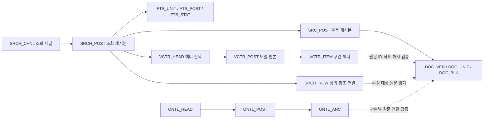

# 골드 레이어 재설계 R11 — 소프트 FK·벡터·전문검색

작성 기준: 2026-10-29. **설계 후보이며 DB 생성·데이터 이관·제품 코드 반영은 하지 않았다.** R10의 등록 명명안과 현재 코드, 벡터 Silver R3 전달본을 비교한 설계다. 메타 표준 승인·실제 Oracle 실행·성능 검증은 별도다.

## 1. 제안

**최종 골드는 16개 테이블·88개 컬럼으로 설계한다. 기존 10개에 벡터 3개와 전문검색 3개를 추가한다.** 기존 49개 컬럼의 이름·타입·정의·PK·필수 여부는 보존하고, 기존 표에 조회 경로를 위한 일반 컬럼 3개를 추가한다. 벡터는 기존 Oracle의 native VECTOR 타입을 사용하는 구조로 설계하며 별도 벡터 DB 제품 도입을 전제하지 않는다.

물리 FK 대신 **연결 ID + 일반 인덱스 + 게시 전 일괄 검증**을 사용한다. DB의 PK·NOT NULL은 유지한다. FK를 소프트하게 바꿔도 SQL JOIN과 원문→정의→참조→예외 탐색은 가능하다. 달라지는 것은 DB가 매번 관계를 강제하는 방식이며, 관계 데이터와 조회 경로를 없애는 것이 아니다.

Oracle 카탈로그에서는 NOT NULL도 제약 유형 C로 나타날 수 있다. 여기서 ‘CHECK 없음’은 별도 업무 CHECK 식을 만들지 않는다는 뜻이며, 실제 스키마 검사에서 NOT NULL까지 금지하지 않는다.

벡터의 활성 선택은 별도 HEAD 테이블의 PK로 관리한다. 검색·필터·결합에 자주 쓰는 값은 일반 컬럼으로 꺼내고, 원문 좌표·설정·부가 정보는 JSON에 보존한다. 기본 DDL에는 물리 FK, CHECK, PK 외 UNIQUE, 함수 인덱스를 넣지 않는다. PK 인덱스는 `X0_테이블명`, 일반 인덱스는 `X1_테이블명` 이후로 명명한다.

이 설계는 기존 **B03/B05·ONTL·POST** 명명을 유지한다. 두 엑셀은 공통 논리모델의 등록 명명안이며 같은 데이터를 두 벌 적재하라는 뜻이 아니다. 실제 대표 등록 과제·공유 권한·Oracle owner는 생성 신청 때 확정해야 한다.

## 2. 테이블 구성

실제 이름은 `IDD_B03_LGL_접미사` 또는 `IDD_B05_LGL_접미사`다. 아래 PK의 컬럼명·타입·인덱스 전체는 엑셀과 [MODEL.json](MODEL.json)에 있다.

| 영역 | 접미사 | 1행의 단위 | 컬럼 수 | 변경 |
|---|---|---|---:|---|
| 원문 | DOC_VER | 데이터 판본 안의 문서 | 5 | R10 유지 |
| 원문 | DOC_UNIT | 판본·문서 안의 구조 단위 | 5 | R10 유지, 상위 구조는 소프트 FK |
| 원문 | DOC_BLK | 판본·문서 안의 본문 조각 | 9 | 본문 순서 번호 추가 |
| 게시 | SRC_POST | 검증된 원문 게시본 | 4 | R10 유지 |
| 게시 | SRCH_POST | 검증된 조회 게시본 | 4 | 원문 게시 ID·데이터 판본 컬럼 추가 |
| 관계 | SRCH_ROW | 게시본·종류별 검색/연결 데이터 행 | 9 | 종류·조회키·소유키·대상키·문서키 유지 |
| 게시 | SRCH_CHNL | 조회 채널의 선택 상태 | 3 | PK·변경순번 유지 |
| 온톨로지 | ONTL_POST | 게시된 지식 묶음 | 5 | R10 유지 |
| 온톨로지 | ONTL_HEAD | 개념그룹의 선택 상태 | 3 | PK·변경순번 유지 |
| 온톨로지 | ONTL_ANC | 지식 게시본과 원문 위치의 연결 | 5 | 원문 해시·구조 ID 유지 |
| 벡터 | VCTR_POST | 원문 판본·모델 설정에 결속한 벡터 게시본 | 7 | 신규 |
| 벡터 | VCTR_ITEM | 게시본 안의 임베딩 구간 | 7 | 신규 |
| 벡터 | VCTR_HEAD | 조회 게시본의 벡터 선택 상태 | 3 | 신규 |
| 전문검색 | FTS_UNIT | 조회 게시본 안의 검색 단위 | 7 | 기존 unit·length를 전용 컬럼으로 투영 |
| 전문검색 | FTS_POST | 게시본·토큰·단위·필드의 위치 목록 | 7 | 기존 posting을 전용 컬럼으로 투영 |
| 전문검색 | FTS_STAT | 조회 게시본의 전문검색 전체 통계 | 5 | 기존 stats·설정 투영 |

시행 순서는 A: 기본 골드+벡터 **13표·69컬럼**, B: 전문검색 전용 투영 **3표·19컬럼**이다. 최종 대상은 16표다. A에서는 현행 SRCH_ROW 전문검색 저장을 유지할 수 있고, B에서는 manifest가 선택한 전용 저장을 소비한다. 새 게시본에 같은 FTS 데이터 두 벌을 영구 적재하지 않는다. 과거 게시본과 과거 reader는 롤백·기록 조회를 위해 보존한다.

질문·실행·판단·실패 로그, 임베딩 작업 lease, 미완성 작업 상태, 검증 영수증은 Agent/Dataiku 작업 영역에 둔다. Gold의 게시/HEAD는 재사용 데이터의 판본 선택에 필요한 서비스 메타데이터다. 이 설계는 온톨로지 의미 교정이나 별도 LLM Wiki 구현을 완료했다고 주장하지 않는다.

## 3. 관계와 읽기 경로

모든 화살표는 논리 연결이다. 요청 시작 때 조회 게시본을 고정하고, 그 게시본과 결속한 원문 판본·전문검색·벡터만 사용한다. HEAD가 도중에 바뀌어도 진행 중인 요청의 판본을 바꾸지 않는다. 현재 요청의 문서 권한과 원문 해시·좌표 검증도 유지한다.

`DOC_ID`, 구조의 `STRC_UNIT_ID`, 탐색의 `SRC_UNIT_ID`는 다르다. 벡터와 FTS의 `SRC_UNIT_ID`는 현재 `navigation source.id`다. 값이 우연히 같아 보인다는 이유로 구조 ID에 직접 연결하지 않는다. 게시본→판본→문서/구조/탐색 원문 단위 순서로 검증한다.

`SRCH_ROW`의 소유/대상 ID는 행 종류에 따라 의미가 달라진다. 전체 컬럼에 일괄적으로 문서 FK를 걸지 않는다. 확정 대상·후보·미해결·외부 참조 상태를 보존하며, 미해결 참조를 관계 검증 실패라고 모두 삭제하면 탐색 기능이 바뀐다. 직접 관계 16개 외 이런 조건부 관계는 엑셀 `20_코드검증`에 별도로 명시했다.

## 4. 벡터 상세

### 4.1 컬럼

| 테이블 | 컬럼 |
|---|---|
| VCTR_POST | `VCTR_POST_ID` PK, `RFRN_POST_HASH_VALU`, `MNFST_HASH_VALU`, `MODL_PRFL_HASH_VALU`, `VCTR_CNT`, `VCTR_POST_IFMN_CTNT`, `RGSN_AITM` |
| VCTR_ITEM | `(VCTR_POST_ID,VCTR_SEG_ID)` PK, `DOC_ID`, `SRC_UNIT_ID`, `INPT_HASH_VALU`, `VCTR_META_CTNT`, `EMBD_VCTR_VALU VECTOR(*,FLOAT32)` |
| VCTR_HEAD | `RFRN_POST_HASH_VALU` PK, nullable `VCTR_POST_ID`, `CHAN_NO` |

벡터 META에는 원래의 `document_id/source_id/unit_id/block_id/start/end/source_sha256/block_sha256/input_sha256`를 보존한다. 원문 본문을 벡터 메타에 다시 저장하지 않는다. 일반 컬럼으로 꺼낸 ID·입력 해시는 META와 일치해야 한다.

모델 profile에는 모델명, 불변 revision, 차원, endpoint 해시, L2 정규화, COSINE 거리, 현재 800자 분할·100자 중첩 설정을 보존한다. 이 숫자는 R3의 현재 계약이며 새 최적 설정을 평가한 결과가 아니다. 같은 차원의 다른 모델 벡터를 섞지 않는다. `VECTOR(*)`는 가변 차원 저장 후보 타입일 뿐, 한 검색에서 혼합 차원을 허용한다는 뜻이 아니다.

### 4.2 선택과 검색

현재 R3의 두 표·여섯 컬럼 구조는 문서·원문 ID를 JSON에 두고 함수 인덱스로 조회하며, 활성 게시본은 JSON 조건의 UNIQUE 함수 인덱스로 보호한다. 이를 그대로 골드 DDL에 복사하면 이번 규칙과 맞지 않는다.

R11은 `VCTR_HEAD`의 조회 게시 ID PK로 **게시본당 선택 슬롯 한 행**을 만든다. 벡터 선택 없음은 NULL이고, 변경순번은 선택·해제 때마다 증가한다. 전환은 이전 게시 ID와 순번을 모두 비교하는 CAS로 처리한다. 최초 INSERT 충돌은 PK로 감지하고 재조회 후 명시적으로 경쟁 상태를 처리한다. A→B→A로 돌아와도 이전 순번의 변경 요청은 성공하지 않는다.

문서 권한과 선택 게시본으로 벡터 범위를 제한한 뒤, 기존처럼 **문서·원문 단위별 `MIN(VECTOR_DISTANCE(...,COSINE))`를 먼저 집계하고 순위**를 매긴다. 긴 조문의 청크 여러 개가 결과 슬롯을 모두 차지하지 않게 하는 현재 계약이다. `DOC_ID/SRC_UNIT_ID` 일반 인덱스는 필터·결합을 돕지만, 벡터 거리 계산 자체를 ANN으로 만드는 것은 아니다.

기본안은 정확 검색이다. ANN을 추가하려면 실제 DB 버전·권한·동일 차원·게시본/ACL 필터 동작과 **원문 단위별 회수율**을 별도로 검증한다. ANN 청크 top-k 후 단순 그룹화는 기존의 그룹별 정확 top-k와 동등하지 않다. 함수 인덱스 제한을 native VECTOR 타입 또는 모든 벡터 인덱스 금지로 확대하지 않는다. 현장 VECTOR/ANN 지원은 아직 확인하지 않았다.

## 5. 전문검색과 연결 탐색의 성능 설계

### 5.1 전용 FTS 투영

`FTS_UNIT`은 문서·원문 단위·토큰 길이를 일반 컬럼에 둔다. 기존 `unit.json` 문자열은 CLOB에 그대로 보존한다. `FTS_POST`는 토큰과 단위·필드를 PK에 두고 위치 목록을 CLOB에 둔다. 발생 위치마다 별도 행을 만들면 행 수가 크게 늘 수 있어, 기존의 묶인 위치 배열을 유지한다. `FTS_STAT`은 전체 검색 단위 수와 토큰 수·토큰화 설정을 보존한다. 여기서 전체 단위 수는 법령 문서 수가 아니다.

새 reader는 토큰 PK 범위를 먼저 찾고 해당 위치 배열만 `JSON_TABLE`로 확장한다. 단위 메타는 일반 컬럼으로 결합하며, 선택한 결과 페이지의 hit payload만 읽는다. 조인·필터 조건을 전부 JSON_VALUE로 다시 작성하면 새 컬럼을 추가한 이점이 없어지므로 실제 SQL 경로까지 변경한다.

현행 FTS5의 질의 `unicode61`, 구축의 토큰화 경계, 문구 위치·반복 토큰·BM25·동점 키·전체 건수·페이지 커서를 보존한다. 현행 Oracle BM25는 **권한 필터 전 전체 색인에서 구한 문구 document frequency**를 사용한다. 결과 후보는 권한 범위를 제한하되, 계산 비용을 줄인다는 이유로 df까지 ACL 이후 값으로 바꾸면 순위가 달라진다. global df 계산과 허용 결과 계산을 구분한다. 한 단어의 TERM_FREQ를 여러 단어 문구의 빈도로 대체하지 않는다.

신규 투영은 unit/length/posting/stats의 원천 논리 값을 재구성해 대조하고, 새 투영 해시를 만든다. 새 저장 형식의 행 ID와 과거 generic record ID가 같다고 주장하지 않는다. 과거 논리 묶음의 digest·원천 파일 digest·전환 영수증을 결속하고, 과거 release와 원장은 보존한다.

### 5.2 페이지 반복 계산과 요청 범위 재사용

현행 `_page`는 `COUNT(*) OVER()`로 페이지 내 별도 count 재실행은 줄였지만, 페이지마다 `_matches`의 점수 계산 CTE를 다시 실행한다. 새 설계는 같은 요청·검색 조건의 적중 ID와 점수를 재사용하고 표시 본문은 페이지 선택 후 읽도록 한다.

재사용 키에는 요청 ID, 조회 게시본, FTS 설정/버전, 정규화된 검색 조건, 허용 문서/원문 단위, 결과 형태를 포함한다. TTL·크기·eviction·실패 시 재계산을 명시하고, 범위가 달라진 커서는 거절한다. 제한을 넘으면 기존 정확 SQL로 되돌아가며 조용히 상위 k개만 저장해 전체 건수·이후 페이지를 바꾸지 않는다. 큰 결과의 보관이 필요하면 서빙 밖 Agent/Temp 저장 계약을 별도로 구현한다. 코드서빙 로컬 파일/SQLite에 전체 원문·색인을 복원하지 않는다.

### 5.3 문제별 전후 비교

| 문제 | 기존 방식·실제 확인 | 수정 방식 | 원하는 결과·검증 |
|---|---|---|---|
| soft FK 해석 | 사진은 코드 무결성 검증을 권고. FK 제거만으로 읽기 성능이 개선된 실측은 없음 | 배치 적재 후 anti-join/집계/해시 검사, 봉인 뒤 불변 | 관계 누락 0, 실패 게시본 미노출. 검증 비용 포함 적재시간 비교 |
| 벡터 JSON 조회/선택 | R3 DDL의 JSON 함수 인덱스와 UNIQUE 활성식, 짧은 표 잠금 확인. 내부 현장 성능 미관측 | 문서/원문 일반 열, 별도 HEAD PK·CAS | 함수 인덱스 없는 필터·선택, 권한·모델·그룹 순위 동일 |
| 전문검색 메타 복원 | Oracle가 posting 및 길이 JSON을 해석. 페이지마다 scoring 재실행 | 전용 일반 열+선택 토큰 위치 확장+요청 범위 ID/점수 재사용 | phrase/tf/score/정렬/total/cursor 보존, JSON 처리·재계산 감소. Oracle 실측 필요 |
| 관계 전체 구성 | 과거 전체 VIEW/JSON을 만든 뒤 ID 제한. 로컬 재생 35화면 736.500→93.718초 기록 존재 | 기존 ID 선제 제한을 보존, Oracle IN/JOIN도 일반 키 범위 SQL로 연결 | 실제 권한 VIEW·어댑터에서 점/범위 조회, 반환량·왕복 측정. 기존 로컬 개선을 이번 설계 성능으로 계산하지 않음 |
| 본문 과다 읽기 | 과거 위치 메뉴 생성에 수천 본문을 조회한 원인 기록 | 메타 먼저, 선택 페이지와 READ에서 본문 | 메뉴에서 전체 본문 읽기 재발 없음, 선택 원문·좌표 동일 |
| 반복 원문/journal 확인 | 과거 근거 80개 준비에서 journal SQL 401→2 기록 | 기존 요청 범위 배치/재사용 유지 | 권한·판본·span·저장소 수명 변화 시 재검증. soft FK 때문에 매 행 원격 EXISTS를 추가하지 않음 |

저장된 원문을 충분히 찾지 못하거나 ASSESS가 조건을 누락하는 최근 007/009 문제는 별도 조사·의미 판단 문제다. 이번 골드 테이블 변경으로 해결됐다고 보고하지 않는다.

## 6. 적재·무결성·동시성

### 6.1 게시 절차

1. 입력 판본·허용 원천·profile을 고정하고 Agent 제어 레코드에서 writer lease와 증가하는 fencing token을 확보한다. 제어키는 실제 공유 PK 공간에 맞춘다. 원문 공용 행은 명세해시값, 조회 행은 조회 게시 ID, 벡터 행은 벡터 게시 ID로 묶는다. 다른 게시 ID가 같은 원문 판본에 동시에 쓰는 경우도 통제한다. 기존 제어 저장소를 사용할 수 있는지 매핑/권한을 구현 단계에서 확인한다.
2. 부분 데이터는 비활성 게시 ID 아래 배치 적재한다. 원문·JSON·BLOB·길이를 자르지 않는다. 매 배치가 현재 fencing token을 확인하고 검증된 행만 쓰며, 재개는 동일 입력/설정과 이미 쓴 행의 내용 일치가 확인된 경우만 허용한다.
3. 같은 제어키의 `BUILDING→VALIDATING` 전환으로 새 쓰기를 막고 진행 중 배치를 정리한 뒤, 같은 읽기 기준으로 전체 건수·부모 존재·중복·원문 해시·vector profile/입력/차원·FTS 통계/위치 등을 배치 검증한다. 검증 중 다른 writer가 수정할 수 없어야 한다.
4. 성공한 경우에만 완료 manifest/검증 결속을 INSERT해 게시본을 봉인한다. 대량 적재 전체에 Gold HEAD 잠금을 잡지 않는다. 이미 봉인된 게시본을 수정하지 않는다.
5. 짧은 트랜잭션에서 HEAD의 이전 값·순번을 비교하고 전환한다. 선택 경쟁 실패는 게시 완료와 별도 기록한다. 봉인은 됐지만 선택되지 않은 게시본은 재사용 가능한 비활성 상태다.
6. 실제 consumer가 새 매핑/manifest를 읽는지 확인한다. 기존 요청은 고정한 판본을 계속 사용한다.

원문/조회 데이터도 완료 manifest를 읽기 관문으로 삼는다. child 행이 먼저 들어가도 manifest가 없으면 서비스에서 읽을 수 없어야 한다. 직접 SQL 소비자까지 이를 보장하려면 봉인 게시본과 결합하는 조회 VIEW/API와 계정 권한을 적용한다. 물리 FK가 없으므로 임의 DML을 허용한 상태에서 위 규칙이 자동으로 보장되는 것은 아니다.

lease 시간 만료만 보고 새 작업을 시작하면 이전 프로세스가 뒤늦게 쓸 수 있다. 모든 배치의 fencing 확인과 봉인 상태 전환을 실제 DB 트랜잭션/접근 계정에 연결해야 한다. 코드상의 `if` 또는 메모리 mutex만으로 여러 Dataiku 실행을 제어하지 않는다. 이 제어는 이번 문서에서 설계한 요구이며 현재 구현 완료 상태가 아니다.

### 6.2 관계 검사

직접 부모 존재는 행별 원격 호출 대신 게시 ID로 좁힌 `NOT EXISTS`/anti-join으로 한 번에 검사한다. 복합 키 전체와 같은 판본을 사용한다. nullable 상위 단위·HEAD는 NULL 계약을 지키고, 부모 순환은 별도 검출한다. JSON 구문·중복 키·허용값·정수 범위·행 수를 코드로 검사한다. `DOC_BLK.BODY_SLC_ORD_NO`의 문서 내 유일성은 배치 검증하며 추가 UNIQUE 제약을 만들지 않는다.

원문 순서는 현재 실제 원천 순서를 옮긴다. 현재 숫자 block_id 정렬과 동등성을 확인하되 임의의 문자열 ID를 숫자로 추정하거나 순서 번호로 바꾸지 않는다. ID와 순서는 별도 값이다.

게시본은 기본적으로 물리 삭제하지 않는다. 향후 정리 기능은 HEAD 참조·진행 요청/보존 이력·다른 게시본 연결을 함께 확인하고 같은 게시 제어키로 삭제와 게시의 경쟁을 막아야 한다. 캐스케이드 삭제를 코드로 자동 흉내 내지 않는다.

온톨로지 게시/HEAD/ANC는 Gold, WORK/EVT는 Agent에 매핑한다. 동일 Oracle DB/연결에서 두 스키마를 한 트랜잭션으로 갱신할 수 있는 권한이 있어야 한다. 다른 DB/API 트랜잭션이라면 outbox·재처리·중복 방지 계약을 먼저 설계해야 하며 두 번 호출하고 원자적이라고 간주하지 않는다.

## 7. 실제 코드 변경과 이행

상세 변경 지도는 엑셀 `21_변경지도`에 있다. 주요 작업은 다음과 같다.

| 경계 | 실제 위치 | 필요한 변경 |
|---|---|---|
| 물리 계약 | `02_BACKEND/semantic_runtime/physical_mapping.py`, `00_SYSTEM/ORACLE/physical_mapping.yaml` | Gold용 새 매핑·fingerprint·PK/일반 인덱스 확인·소프트 무결성 영수증 계약. 현행 dev_silver의 FK/CHECK 검사를 일괄 완화하지 않음 |
| 적재 | `02_BACKEND/lawrag/pipeline/oracle_migration.py`, `oracle_query_publish.py`, `oracle_full_package.py` | writer·reader·manifest 형식을 함께 변경. 부분 상태 비노출·봉인·범위별 배치 검증 |
| 관계 | `02_BACKEND/semantic_runtime/oracle_query_db.py`, `oracle_query_index.py` | 일반 lookup/owner/target/doc 컬럼을 실제 IN/JOIN까지 사용. 전체 payload 복원 회귀 방지 |
| FTS | `02_BACKEND/semantic_runtime/oracle_query_fulltext.py` | 새 3표 어댑터·정확한 토큰/문구/BM25·요청 범위 재사용 |
| 벡터 | R3 `payload/02_BACKEND/semantic_runtime/initial_vector.py`, `vector_publish.py`, `payload/vector_silver/publisher.py`, `schema.py` | Gold 이름·일반 열·HEAD·제어 상태 분리. R3의 2표/6컬럼 및 함수 인덱스 필수 검사를 새 계약으로 교체 |
| 온톨로지 | `02_BACKEND/semantic_runtime/ontology_work/repository.py`, `runtime.py`, `schema.py`; `legal_agent/ontology_compiler.py` | Gold/Agent 교차 매핑과 실제 commit 경계 검증 |
| 실제 실행 | `service.py`, `oracle_query_service.py`, GENOS workflow | 승인 매핑+manifest+서빙 코드 pin 동시 선택·신규 요청 전환·기존 요청 고정 |

현재 원문/조회/벡터 어댑터에는 512 BYTE 입력 상한이 남아 있다. R10의 1000 BYTE 컬럼을 유지한다고 API 입력 상한을 자동 확대하지 않는다. 512 초과 실제 데이터가 있다면 writer와 reader·JSON_TABLE 선언·커서·권한 필터를 함께 변경하고 경계 검증해야 한다. 현재 DOC_NAME은 R10의 2250 BYTE를 유지하지만 기존 원천 CLOB이 그 안에 들어가는지 측정하지 않았다. 초과 시 중단하고 적합한 도메인을 재설계하며 자르지 않는다.

전용 FTS 전환은 조회 manifest를 바꾸므로 새 조회 게시 ID를 발급한다. 기존 벡터 manifest와 segment ID도 조회 ID를 포함하므로 **새 게시/구간 ID로 다시 결속**해야 한다. 모델 profile과 정확한 입력 해시가 동일하면 저장 벡터 숫자는 복사·검증하여 재사용할 수 있다. 원문 변경이나 profile 변경을 단순 이름 변경으로 처리하지 않는다. 재임베딩을 기본 전제로 비용을 발생시키지 않는다.

이행은 새 표에 적재→검증→실제 reader 확인→선택 전환 순서다. 기존 표·manifest·원장은 유지한다. 되돌릴 때는 **코드 매핑과 조회 채널·벡터 선택을 호환되는 한 묶음으로** 되돌리고 진행 요청은 기존 판본을 마치게 한다. 새 FTS 전용 게시본을 구형 generic reader에 연결하지 않는다.

## 8. 기대치와 검증 기준

소프트 FK가 줄일 수 있는 것은 DB의 쓰기 시 참조 검사 비용이다. 새 배치 검증·인덱스 유지·제어 비용이 더 크면 전체 적재는 느려질 수 있다. 조회 성능은 WHERE/JOIN·인덱스·선택도·통계·왕복·JSON 처리에 달린다. 이번에는 실제 Oracle 실험을 하지 않았으므로 향상률·p95·처리량·구현 인일은 미산정이다.

| ID | 구분 | 값·산식·범위 | 근거와 한계 |
|---|---|---|---|
| N1 | 설계 집계 | 49 기존 +3 추출 +17 벡터 +19 FTS =88컬럼, 16표 | MODEL·두 XLSX·DDL 상호 일치 검사. 생성된 운영 표 수가 아님 |
| N2 | 과거 관측 | 35화면 736.500→93.718초 | MAIN105 이전/후 동일 계측 로컬 보관응답 재생. Oracle/새 골드/전체 서비스 성능이 아님 |
| N3 | 과거 관측 | 근거80개 입력 준비 journal SQL 401→2 | 기존 배치 조회 사건 기록. Gold FK 효과가 아님 |
| N4 | 계산 | FLOAT32 벡터 숫자 최소 용량 = `구간수 N × 차원 d × 4 byte` | 메타·PK/B-tree·LOB/Oracle overhead·복제·이전 게시본 제외. N,d 실측 전 용량 미산정 |
| N5 | 계산 | 정확 벡터 거리 연산은 대상 구간수와 차원에 대략 비례 | B-tree로 후보를 줄여도 허용 범위가 크면 전체 거리 비용이 남음. ANN 효과 미측정 |
| N6 | 손익분기식 | 적재 개선 = 기존 FK/JSON 비용 절감 − 새 검증·제어·추가 인덱스 비용 | 0보다 커야 순개선. 실제 Oracle 비용 계측 필요 |
| N7 | 손익분기식 | 반복 FTS 절감 = `(반복횟수−1)×점수계산비용 − 저장/읽기/검증/정리비용` | 반복 1회면 재사용 이득 없음. 적중 수 증가 시 결과 저장비용 증가 |

현재 정확 벡터 검색은 N이나 d가 두 배가 되면 숫자 저장량도 두 배가 된다. 실제 지연은 I/O·필터·캐시·병렬 실행에 영향을 받아 단순 두 배로 단정하지 않는다. FTS 위치를 occurrence마다 행으로 펼치지 않은 이유는 토큰 수가 많을수록 인덱스/행 저장 비용도 커지기 때문이다.

구현 후 **동일 원문·권한·질문·판본**을 고정해 다음을 비교한다. 새 품질 실험은 별도 요청 범위에서 진행한다.

| 검증 묶음 | 통과 조건 |
|---|---|
| 구조·이관 | 기존49컬럼 의미 보존, 길이 초과/중복 키/잘못된 JSON/NULL·부모 누락 검출, 잘린 값 0, 봉인 전 노출 0 |
| 관계 | 정/역방향·순환·미해결·후보·범위 제한 결과 동일, 현재 권한 밖 원문 반환 0, 판본 혼합 0 |
| 전문검색 | 한글·반복 토큰·다단어 문구·빈 검색·동점·앞뒤 페이지·total/cursor 동일. 점수 비교 허용 오차는 실행 전 수치 표현 차이에 맞춰 고정 |
| 벡터 | 동일 profile/input, 실제 VECTOR 차원/형식 검증, 원문 단위별 정확 순위와 범위 동일. ANN 도입은 별도 recall·필터·그룹 평가 |
| 쓰기 경쟁 | 최초 HEAD 충돌, stale revision, A→B→A, lease 상실, 검증 중 지연 배치, 선택 직전 장애에서 중복 활성/부분 노출 0 |
| 성능 | 실제 Oracle SQL 실행수·왕복·반환량·JSON 처리·plan·첫/다음 페이지·정확 벡터·원문 검증·전체 비모델 시간을 분리. 통과 SLA는 실제 기준선 확인 후 사전 고정 |
| 실제 소비자 | 선택한 코드/매핑/hash, Dataiku writer와 GENOS reader, ontology Gold/Agent transaction, 재개·롤백 경로 검증 |

## 9. 근거·검토 상태

프로젝트 근거는 [SOURCES.json](SOURCES.json)에 파일 경로와 SHA-256으로 남겼다. R10 두 엑셀, 작업 Oracle 코드, 선택 MAIN117 포인터, R3의 실제 payload를 구분했다. 루트 작업 디렉터리의 오래된 벡터 구현을 R3 구현으로 간주하지 않았다. 생성 산출물은 [VALIDATION.json](VALIDATION.json)에서 검사 범위를 확인할 수 있다.

관련 프로젝트 문서:

- [R10 수정 안내](../DATAIKU_GOLD_REGISTER_20261028_R10/R10_수정안내.txt)
- [기존 골드 작성 규약](../../ARCHITECTURE/DATAIKU_GOLD_METADATA_20261022/GOLD_AUTHORING_GUIDE_20261028.md)
- [MAIN105 SQL·원문 검증 후속 기록](../../ARCHITECTURE/ONTOLOGY_V4/MAIN_SQL_AND_ONTOLOGY_FOLLOWUP_20261027.md)
- [벡터 Silver R3 전달본](../../../../08_DEPLOYMENT/DATAIKU/vector_silver_20261029_r3/GUIDE.txt)

기술 근거는 Oracle 공식 문서를 사용했다. JOIN은 조건·인덱스·통계에 따라 처리되며, FK가 없어도 연결 조건을 명시해 조회할 수 있다. [Oracle Joins](https://docs.oracle.com/en/database/oracle/oracle-database/26/sqlrf/Joins.html). JSON 경로 조회의 인덱스와 성능 특성은 [JSON 성능 가이드](https://docs.oracle.com/en/database/oracle/oracle-database/26/adjsn/overview-performance-tuning-json.html), VECTOR 저장과 정확 검색은 [VECTOR 테이블](https://docs.oracle.com/en/database/oracle/oracle-database/26/vecse/create-tables-using-vector-data-type.html), [정확 유사도 검색](https://docs.oracle.com/en/database/oracle/oracle-database/26/vecse/perform-exact-similarity-search.html)을 참조했다. 이 문서 링크의 버전이 실제 현장 DB 버전이라는 뜻은 아니다.

**검토는 자체 검토다.** 스키마 일관성·R10 보존·소프트 관계 타입·B03/B05 일치·물리 제약/인덱스 목록을 정적으로 확인한다. Oracle DDL 컴파일, Excel 자체 렌더링, 현장 권한, native VECTOR 지원, 데이터 최대 길이, 실행계획·성능은 미검증이다. DDL의 `{{APPROVED_GOLD_OWNER}}`는 의도적인 미확정 값이다.

실제 생성 전 남는 항목은 새 용어/도메인·VECTOR 승인, owner/공유 권한, 실제 문자셋·인덱스 키 한도, 원천 최대 길이·벡터 차원/규모, Gold/Agent 제어 트랜잭션, reader/writer 동시 연결이다. 문서를 만든 것만으로 MAIN117·GENOS 또는 현장 Silver가 변경되지는 않는다.
