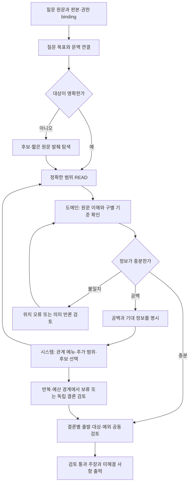

# 원문 이해와 탐색 제어를 분리하는 도메인·시스템 하네스 설계

작성일: 2026-09-21. 상태: **설계만 작성, 구현·신규 모델 호출·실험·MAIN 변경 없음**.

## 1. 결론과 범위

현재 문제는 원문 부족 하나로 설명되지 않는다. CM003에서는 제26조 전체가 모델에 전달되었지만, 모델이 제2호의 문언을 제3호로 설명하고, 질문에 직접 필요하지 않은 관계를 반복해서 펼쳤다. 입력 구성, 원문 해석, 다음 행동 선택을 각각 검증할 수 있어야 한다.

제안은 기존 서빙 파이프라인 안에서 동작하는 두 하네스다.

| 구분 | 책임 | 최종 산출물 |
|---|---|---|
| 도메인 하네스 | 질문의 구별 기준, 원문 위치와 의미의 대응, 적용 범위·예외·관계의 법적 역할, 결론별 근거와 반론 검토 | 근거 위치에 묶인 이해 관찰, 채택·기각·보류 판단, 관계 의존성, 검토된 주장 |
| 시스템 하네스 | 필요한 정보의 제시, 허용 행동, 정확한 페이지·수신 기록, 예산, 반복 제어, 저장·복구·출력 | 다음 행동이 가능한 제한된 뷰, 실행 영수증, 상태 전이, 감사 기록 |

시스템은 모델의 해석을 사실로 승인하지 않는다. 도메인 하네스도 원문을 더 받았다는 이유만으로 이해를 완료 처리하지 않는다. 원문과 다른 위치를 인용하는 오류는 기계적으로 차단하고, 의미를 잘못 읽는 오류는 근거 비교와 검토를 통해 발견하도록 한다. 이것만으로 Qwen의 법률 이해 능력이 개선된다고 보장할 수는 없다.

사용자가 요청한 동작은 다음과 같이 반영한다.

- 입력이 한도를 넘기 전에 경계에서 나누고, 남은 정보와 이어보기 행동을 제공한다.
- 더 볼 필요가 있다는 판단은 무엇이 부족한지, 어느 자료가 그 공백을 채우는지를 함께 남긴다.
- 관계가 많으면 원문 전체를 붙이지 않고 관계 종류·출발 위치·대상 이름·연결 이유를 보고 선택하게 한다. 기본 선택 주체는 탐색 모델이며, 자료만으로 결정할 수 없는 업무 사실은 사용자에게 확인할 수 있다.
- 대상이 명확하고 권한·판본이 확인되면 바로 READ한다. 모든 질문을 검색부터 시작시키지 않는다.
- 준용뿐 아니라 정의, 용어, 출현, 구조, 개념 연결을 다룬다. 탐색 단서와 법적 적용 근거를 구분한다.
- 채택·기각·보류 이유를 다음 판단, 검토, 최종 화면까지 전달한다.

범위는 MAIN의 **용어 기반 RAG 서빙 단계**다. 용어집 구축 → 입력·구조화 → 문서–용어 연결 → 색인이라는 상위 단계의 정본 계약을 대체하지 않는다. 런타임 이해 관찰을 구 `Rule/SemanticClause/Proviso` 의미 스키마나 정본 법률 규칙으로 저장하지 않는다. 잘못 연결된 색인은 근거와 세대가 붙은 피드백 후보로 보내고, 검증 전 정본을 바꾸지 않는다.

## 2. 확인한 기준과 실제 연결 상태

### 2.1 현재 코드, 실험, 활성 릴리스

| 기준 | 확인 상태 | 해석 범위 |
|---|---|---|
| 작업 코드 | `legal-agent-tools-v3`가 선택 실행 방식으로 존재. 기본 엔진은 v2 계열이며 v3의 선택 실행과 구분 | 이 보고서의 정적 코드 진단 대상 |
| 완료 실험 | ADR-0487의 `paging-v3/rev-001` 스냅샷. CM003·018·038, 외부 Qwen | 실패가 실제 발생한 경로의 증거 |
| 로컬 활성 포인터 | `document-navigation-rag-20260921-v1`, generation 17, `quality_certified=false` | 작업 파일의 v3 수정과 별도 상태 |
| GENOS | 현재 세션 접근 불가, 현장 실행 미확인 | 외부 실험을 현장 성능으로 해석하지 않음 |
| 제안 v4 | 이 문서에만 존재 | 코드·스키마·엔진 등록 전 |

작업 트리는 기존 변경이 많은 상태다. Git HEAD만으로 현재 코드를 재현할 수 없으므로 [BASELINE.json](BASELINE.json)에 조사 대상 파일 해시를 남긴다. 이것은 설계 근거 목록이지 실행 가능한 실험 스냅샷이 아니다.

실제 연결은 `service.py` → `semantic_runtime.app` → `Pipeline.run` → `ServingLegalAgent.open_session` → 요청별 session → `StageRunner`의 retrieve/select/assemble/answer → journal·publication outbox → HTTP 결과·감사 화면이다. `Coordinator` 및 session의 compose/review 계약도 같은 실행 수명에 묶인다. 새 독립 실행기를 만들지 않고 이 경로 안에서 교체한다.

`open_session`은 선택된 데이터 manifest, 문서 scope, 도메인·프로필 해시, 모델 binding, index·glossary binding, `PIPELINE.json` 해시, release를 묶는다. 재시작 시 현재 `publication.recover`는 `COMMIT_READY`의 결과 발행을 복구하고, 소유자를 잃은 `RUNNING`을 `INTERRUPTED`로 기록한다. **진행 중 LLM 판단을 자동 재개하는 기능은 현재 없다.**

기존 [추가 구현 설계](../TOOL_EXPLORATION_AUDIT_RELATIONS_20260921/DESIGN.md)의 목적·판단·관계 감사 계약과 이후 페이지 처리 개선을 계승한다. 초기 하네스의 전역 issue ledger처럼 모든 자료와 모든 관계의 평가를 강제하는 방식은 되살리지 않는다. 이번 제약은 현재 질문·현재 결론에 필요한 판단 단위에 적용한다.

### 2.2 기존 실패와 이미 고친 부분

ADR-0485에는 루트 핸들 READ 오류, 뷰 조립 후 한도 초과, 감사 요약의 스키마 한도 초과가 있었다. ADR-0487 후보에는 READ 분할, 관계 선택 메뉴, durable 이어보기, fulltext 후보의 페이지 단위 생성, 감사 표시 상한, READ 대상 오류 안내가 반영되었다.

ADR-0487에서는 실행 예외 없이 끝났지만 답변 품질 기준은 통과하지 못했다. 따라서 위 개선을 철회하거나 “아직 분할이 전혀 없다”고 설계하지 않는다. **이미 있는 분할을 의미 있는 선택·이해·진전 판정에 연결하는 것**이 후속 범위다.

## 3. 관측 수치와 해석의 한계

| ID | 값 | 종류·근거·분모 | 해석 |
|---|---|---|---|
| N01 | 이전 0/3, 후보 0/3 | 관측. ADR-0487 README, 저장 기준답·Qwen 단회 평가, CM 3문항 | 정확도 개선을 확인하지 못함. 모집단 성능 추정이 아님 |
| N02 | 후보 제품 호출 20회, 입력 383,407·출력 7,039·합계 390,446 tokens, 기록 비용 $0.1319157 | 관측. 동일 README의 제품 호출 합계 | 새 평가자 호출과 과거 baseline 호출 제외. 현재 요금표를 뜻하지 않음 |
| N03 | CM003 8회·99.661초, CM018 6회·56.657초, CM038 6회·64.295초 | 관측. `artifacts/run-001/diagnostics.json` 후보 결과, 문항별 1회 | 초기 로딩 포함 전체 시간. 반복 분산·동시 실행 부하 미측정 |
| N04 | CM003 세 번째 요청: 뷰 59,531자, `last_action_results` 43,784자, `exact_evidence` 7,425자, 관계 메뉴 5,951자 | 관측. 해당 `request.json`의 compact JSON, Unicode 문자 수 | 필드별 직렬화 크기. 토큰 수와 다름 |
| N05 | 해당 요청의 실제 원문 1,873자, 입력 31,857·출력 453 tokens, 종료 `stop` | 관측. exact evidence 본문과 `response.json` | 원문 전체가 있었고 출력 길이 제한 종료도 아니었음 |
| N06 | 43,784 / 59,531 ≈ 73.55% | 계산. N04 기반 | 이전 행동 결과가 뷰에서 차지한 비율. 이것만으로 실패 원인을 입증하지 않음 |
| N07 | 후보 원문 READ/제시: 3/3, 0/0, 2/2; 채택·최종 주장 모두 0 | 관측. ADR-0487 diagnostics, 문항 순서 CM003·018·038 | 전달과 평가 사이가 끊긴 사례 |
| N08 | 현재 설정: 모델 시도 14, 종료 예약 3, 도구 56, 도구 종료 예약 4, 제어기 시간 300초, 무진전 2회 | 설정 관측. `profile-tools-v3.json` | 최적값이라는 뜻이 아님. 초기화 이전부터 300초를 보장하는 설정도 아님 |
| N09 | 현재 READ 이후 관계 family 6종을 순회 | 코드 관측. `FAMILIES`와 `execute/drain` | 예산이 있으면 READ 외에 family별 도구 실행이 추가됨. 실제 지연 기여율은 미측정 |
| N10 | 정확도 향상폭·절감률·개발 소요일 | 미확인 | 이번 설계에서 수치를 약속하지 않음 |

출처: [ADR-0487](../../../../04_EXPERIMENTS/ADR/ADR-0487-qwen-v3-paging-cm3-retest/README.md), [진단 집계](../../../../04_EXPERIMENTS/ADR/ADR-0487-qwen-v3-paging-cm3-retest/artifacts/run-001/diagnostics.json), [CM003 세 번째 요청](../../../../04_EXPERIMENTS/ADR/ADR-0487-qwen-v3-paging-cm3-retest/artifacts/run-001/cm-003/relations-v3/calls/call-003-product-e948c75291da/request.json), [세 번째 응답](../../../../04_EXPERIMENTS/ADR/ADR-0487-qwen-v3-paging-cm3-retest/artifacts/run-001/cm-003/relations-v3/calls/call-003-product-e948c75291da/response.json).

### 3.1 무엇이 확인됐고 무엇은 아직 가설인가

**확인:** 위 응답의 최상위 `reason`은 “제3호는 '최대주주등이 소유하는 주식등을 취득한 자'”라고 기술한다. 전달된 고정 판본에서 이 문언은 제2호다. 제3호에는 “상장신청인이 제3자 배정 방식으로 발행한”이라는 구별 문언이 있다. 원문 위치와 모델 설명의 불일치가 확인된다. 도구별 `expected_information`만 보면 이 오류가 드러나지 않으므로 최상위 이유도 보존해야 한다.

**확인:** 이후 모델은 제26조 제8호에서 출발하는 정의 참조로 이동했다. 마지막에는 실제 표제어가 ‘이하’인 사전–Wikidata 매핑을 주식등/주주등의 관계라고 설명하며 같은 `inspect_relation`을 반복했다. 첫 메뉴에서는 표제어가 빠졌지만, 뒤의 상세 뷰에는 ‘이하’가 있었다. 따라서 첫 선택의 정보 부족과 상세를 받은 뒤의 오해·반복을 구분해야 한다.

**가설:** 긴 행동 결과, 반복 메타데이터, 모든 도구를 한꺼번에 보여주는 프로토콜이 이해와 판단을 방해했을 수 있다. Qwen 자체의 해당 문언 이해·비교 능력도 원인일 수 있다. 현재 기록만으로 기여율을 분리할 수 없다. thinking off는 고정 실험 정책이며, 이를 원인으로 확정하거나 설계에서 몰래 변경하지 않는다.

이 문서는 해당 실험 판본을 진단하며 최신 법령에 대한 적용 결론을 제공하지 않는다.

## 4. 코드에서 추가로 확인한 문제

표의 ‘정적 확인’은 해당 분기와 계약이 코드에 존재한다는 뜻이다. 실제 사용자 실패 빈도나 성능 영향까지 측정했다는 뜻은 아니다. 우선순위 P0는 근거·완료 판정의 무결성, P1은 판단 진행과 정보 품질, P2는 자원·운영 개선 기준이다.

| ID·우선순위 | 상태와 문제 | 코드·실행 근거 | 설계 대응 |
|---|---|---|---|
| F01 P1 | 실행 확인. 원문을 받은 뒤 의미·위치 대응을 남기지 않고 탐색을 계속할 수 있음 | CM003 응답; `relations_session.apply_turn`, `assessments=[]` 허용 | D1·D2: 현재 판단 대상의 이해 관찰과 공백 근거 |
| F02 P1 | 실행 확인. 핵심 원문보다 오래된 행동 결과가 뷰를 대부분 차지함 | N04–06; `relation_views.build_view` recent/chunks | S1: 이해/탐색 뷰 분리, 상태 변화 중심 제시 |
| F03 P1 | 실행·정적 확인. 메뉴에서 용어·개념 표제어와 출발 문언이 빠짐. 관계 ID 순서가 질문 관련도 순서는 아님 | `relation_views.menu_card:7`, `relations_repository.notices:39`, `repository.heads:101` | D3·S2: 이름·출발 좌표·역할·선택 이유·정렬 근거 |
| F04 P1 | 정적 확인. 메뉴의 `notice_presented=false`가 항상 고정되고 일부 블록만 읽어도 후보 `content_read=true` | `relation_views:13`, `relations_tools.candidate:107` | S4: 카드 형식, 실제 제시, 부분/전체 읽기를 분리 |
| F05 P1 | 정적 확인. 무진전 해시에 관계 평가가 없음. 반대로 결과 없는 새 검색 인자는 진전으로 셀 수 있음 | `tools_session.progress_key:129` | S3: 정보·판단·공백 변화와 행동 이력을 별도로 계산 |
| F06 P0 | 정적 확인. 채택 E의 모든 outgoing 필수 관계를 요구. 호 단위 근거와 무관한 참조까지 결론을 막을 수 있음 | `relations_session.relation_requirements:153`, `relation_cards.references:96` | D4: 주장 근거 범위와 적용 문맥을 기준으로 의존성 계산 |
| F07 P0 | 정적 확인. 부분 검색 결과도 observation ID가 과거 뷰에 있으면 묶음 전체를 이전 제시로 취급 가능 | `relation_views:65`, `relations_session:99` | S4: item/range/hash별 제시 영수증, 미제시는 계속 미제시 |
| F08 P0 | 정적 확인. 첫 관계가 너무 크면 `witness_spans`·`targets`를 비운 notice를 기록하고 다음 offset으로 이동 | `relations_tools.relation_page:217`, `record_notice` | S2·S4: 원본 관계와 제한된 투영 분리, 관계 자체의 상세 페이지 |
| F09 P1 | 정적 확인. 관계 내용 hash에 후보의 읽기·판단·route 등 동적 표시 상태가 포함됨 | `materialize:203` → `candidate:107`; `relations_repository.record_notice:42` | S4: 관계 사실 hash와 뷰 상태 hash 분리. 재물질화 시 불필요한 버전·의존성 무효화 방지 |
| F10 P1 | 정적 확인. scan 키는 anchor/family뿐. direction이 다른 스캔이 기존 상태를 덮어씀. offset까지 재순회하다 시간 제한에 걸리면 같은 cursor 위치가 반복될 수 있음 | `relations_tools:217–258,365`, `journal-v3.sql:288` | S5: 범위·방향·색인 버전별 scan, 안정적인 seek와 무진전 커서 처리 |
| F11 P0 | 정적 확인. compose 뷰에서 필수 원문·관계를 한 번에 넣지 못하면 `commit_draft`의 주장별 보류 분기 전에 예외 | `relation_views:101`, `relations_session.commit_draft:193` | D4·S1: 주장별 검토 묶음, 묶음만 보류하고 독립 주장 진행 |
| F12 P1 | 정적 확인. 같은 turn의 assessment를 기록한 뒤 question update가 같은 질문의 새 assessment까지 무효화함 | `relations_session.apply_turn:107–132` | D1·S4: 질문 revision을 먼저 확정하고 그 revision에 판단 결속 |
| F13 P1 | 정적 확인. 재귀 trim이 모든 `text` 필드를 삭제함. 개념 label의 `text` 등 의미 필드까지 잃을 위험 | `relation_views:48–57`; 개념 labels 구조 | S1: 타입별 serializer, 의미 필수 필드의 손실 금지. 이 경로의 실제 실패 사례는 미확인 |
| F14 P2 | 정적 확인. 모든 READ에서 6 family 순회, 정의 전체 순회·구조 전체 순회, fulltext 외 일부 검색은 페이지 전에 모든 카드 생성 | `relations_tools:130,356`, `relation_cards:108,142`, `exploration_tools.search:276` | S6: 인덱스별 지연 페이지·공정 스케줄링. 속도 개선량 미확인 |
| F15 P1 | 정적 확인. schema가 요청에 두 번 포함되고 repair 때 전체 잘못된 응답이 추가됨. 원래 뷰가 맞아도 repair 입력은 넘칠 수 있음 | `gateway.request:20`, `generate:74–86` | S1·S6: phase별 작은 schema와 repair 전용 예산 |
| F16 P1 | 정적 확인. 질문의 구두점/개행 분할과 의미상 질문 단위를 같은 ID로 사용 | `context.question_pieces:15`, CM003 Q1/Q2 | D1: 불변 원문 조각과 업무 질문·문맥을 분리. 문맥을 별도 답변 의무로 만들지 않음 |
| F17 P2 | 정적 확인. 자원 초기화 후 요청 deadline을 만들고 종료용 도구·모델 횟수만 예약. 남은 wall time은 보장하지 못함 | `legal_agent_adapter.open_session:69–81`, `context.create:43`, `drain:390` | S6: 접수 시각부터 E2E 예산, 초기화·탐색·종료 시간 분리 |
| F18 P1 | 실행 확인. CM018의 검색 cursor를 browse에 사용한 오류는 차단했지만 이후 같은 검색 반복으로 끝남 | ADR-0487 diagnostics; `validate_action`, `cursor_position` | S3·S5: 실행 가능한 원래 이어보기 제시, 오류 후 판단 복구 |

추가 경계 검토: 허용 핸들을 뷰 전체 문자열 재귀 수집으로 판단하는 방식은 명시적 action 카드 목록보다 약하다. 현 코드의 `resolve`와 scope 검증이 있어 곧바로 권한 우회가 확인된 것은 아니다. S3에서 `offered_actions`를 명시하고, 원문 속 문자열이 도구 선택 허가가 되지 않게 한다. 모델 응답 `SUCCEEDED` 또한 현재 수신 완료 의미와 schema·실제 모델 검증 완료 의미가 분리되지 않아 S4에서 각각 기록한다. 기존 ‘제시’ 영수증 자체가 곧 거짓이라는 주장은 하지 않는다.

## 5. 두 하네스의 실행 흐름

도메인 단계와 시스템 단계는 책임 구분이며 모델 두 개를 항상 호출한다는 뜻이 아니다. 한 번의 응답에서 짧은 근거 기반 이해 관찰과 다음 행동 제안을 함께 받을 수 있다. 시스템은 이해 관찰의 형식·위치·버전 계약을 검증한 뒤 행동을 승인한다. 의미 해석의 참·거짓을 ID 검사로 대신하지 않는다.

## 6. 도메인 하네스 상세

### D1. 원문 질문 조각과 판단 목표를 분리

`question_pieces`는 원문 복원용 불변 좌표로 유지한다. 별도의 `QuestionFrame`에 목표와 업무 문맥을 둔다.

- `goal_id`, `revision`, `source_piece_refs`: 어떤 원문 요청에서 나온 목표인지.
- `task_kind`: 비교·정의 확인·절차·수치·목록 등. 모르는 종류도 허용한다.
- `context_piece_refs`: 시장, 업무, 시점, 문서명 등 목표에 적용할 문맥.
- `known_facts`: 사용자 제공 사실과 출처. 모델이 보충한 추정을 사실로 섞지 않는다.
- `unknown_facts`: 투자자 지위, 취득 시점 등 적용 판단에 필요하지만 주어지지 않은 사실.

CM003의 괄호 속 업무 문맥은 비교 목표에 연결한다. 원문 Q2를 없애는 것이 아니라 동일 목표의 문맥으로 표시한다. 질문 변경 시 revision을 먼저 올리고 새 이해·평가는 그 revision을 대상으로 받는다. 이전 revision의 주장은 의존성에 따라 stale 처리한다.

### D2. READ 결과의 이해 관찰

`UnderstandingObservation`은 요청 안에서 사용하는 잠정 해석이다. 긴 사고 과정 대신 짧은 주장, 정확한 문언, 부족한 정보만 기록한다.

| 필드 | 계약 |
|---|---|
| `understanding_id`, `goal_id`, `question_revision`, `version` | 동일 질문의 어떤 이해인지 식별 |
| `evidence_refs`, `source_binding` | 실제 READ 및 제시한 원문·판본에 결속 |
| `findings[]` | 주장할 내용, 선택한 span ID, 해당 위치, `EXPLICIT / INFERRED / UNKNOWN` 구분 |
| `comparison_axes[]` | 이번 질문에서 구별할 기준과 각 원문의 문언. 특정 법률 조건 필드를 모든 질문에 강제하지 않음 |
| `missing_information[]` | 무엇이 없고 결론에 어떤 영향을 주는지 |
| `disposition`, `reason` | 현재 목표에 대한 ADOPT / REJECT / DEFER. 지원·반론·문맥 역할 별도 |
| `next_need` | 추가 원문·관계·사용자 사실 확인 중 무엇이 필요한지, 또는 NONE |

비교형 CM003이라면 취득 경로, 주체의 법정 분류, 기간의 기산점, 예외·제외 문구를 구별 기준 후보로 삼을 수 있다. 이 기준은 고정 정답이나 강제 법률 DSL이 아니다. 모델이 실제 문언에 근거해 선택하고, 근거 없는 항목은 UNKNOWN으로 남긴다.

서버는 조·항·호 위치와 인용 span의 대응을 검증한다. 조문 내부의 호가 현재 구조 데이터에 따로 없으면, 원문 줄 경계·번호 표기에서 만든 검증 가능한 span selector를 제공하되 이를 승인된 의미 구조로 간주하지 않는다. 좌표가 모호하면 `COORDINATE_UNRESOLVED`로 표시하고 범위를 확인한다. 위치를 추정해 정답을 고정하지 않는다.

**READ 뒤 규칙:** 현재 초점 원문을 이해 뷰로 제시한 후, 다음 원문으로 넘어가려면 그 결과의 잠정 판단 또는 구체적인 보류 사유가 있어야 한다. 형식 계약만 확인한 판단은 아직 최종 채택이 아니다. 시스템이 자동 수집한 모든 원문·관계를 즉시 평가하도록 강제하지 않는다. 원문이 너무 크거나 현재 판단에 불필요하면 사유와 남은 범위를 기록하고 넘길 수 있다.

### D3. 관계의 종류별 의미 계약

현재 6개 family를 유지하고, 하위 predicate의 법적 역할을 구분한다.

| family | 현재 수집 가능한 관계 | 선택 메뉴에 필요한 정보 | 결론에서 허용할 사용 |
|---|---|---|---|
| `reference` | 명시 참조, 준용 역할 hint, 공식 위임, 별표 참조, incoming/outgoing | 출발 조·항·호와 연결 문구, 대상 판본·좌표, 역할의 출처·확실성 | 출발·대상·적용 범위를 읽고 해당 역할을 검토한 후 의존 근거 |
| `definition` | 문서/사전에 있는 정의 label 후보 | 표제어, 정의 출처, 적용 범위, 본문 위치 | 같은 단어라도 해당 규정 범위에 적용되는지 확인 필요 |
| `term` | 동의·반의·상위·하위·관련어 | 양쪽 표제어, 방향, 코드 출처·승인 상태 | 검색·비교 단서. 동의어를 법적 동일 개념으로 자동 승인하지 않음 |
| `occurrence` | 동일 용어가 출현하는 다른 원문 | 용어와 실제 출현 위치, 문서명 | 다른 근거를 찾는 단서. 출현만으로 적용 규정이라고 판단하지 않음 |
| `structure` | 부모·자식·형제 단위 | 문서 계층과 좌표, 현재 범위와의 관계 | 단서·예외·정의의 문맥 보완. 형제 조항을 직접 적용 근거로 자동 승격하지 않음 |
| `knowledge` | 사전–개념 매핑, 개념 간 외부 관계 등 현재 선택 색인에 존재하는 연결 | 출발·대상 이름, relation label, 출처·승인·원문 유무 | 개념 탐색 단서. 외부 개념 그래프를 규정상 권위로 취급하지 않음 |

‘예외’, ‘치환’, ‘적용 제외’, ‘우선 적용’, ‘상충 가능성’은 이 여섯 family와 같은 저장 종류라고 단정하지 않는다. 원문에 존재하는 경우 도메인 관찰이 해당 span과 함께 기록할 **법적 역할·검토 쟁점**이다. 현 색인에 없으면 관계가 없다고 처리하지 않고 원문 확인이 필요하다고 남긴다. 개정 전후·판본 연결도 제공 데이터가 있을 때만 표시하며, 모든 세대에 그런 edge가 구현되었다고 가정하지 않는다.

### D4. 결론별 필요한 관계만 공동 검토

`ClaimEvidenceBundle`의 출발점은 E 전체가 아니라 **주장에 사용한 span + 그 span을 지배하는 적용 문맥**이다. 제3호만 사용해도 조문 머리의 공통 대상, 해당 호의 단서, 연결된 예외가 영향을 주면 포함해야 한다. 단순 span 교집합만으로 필요한 관계를 제외하지 않는다.

관계별 상태는 `REQUIRED / POSSIBLY_RELEVANT / NOT_RELEVANT / UNASSESSED`다. NOT_RELEVANT에는 질문·근거 범위 기준의 제외 이유를 둔다. 모든 reference를 전체 질문의 의무 목록에 넣지 않고, source span과 공통 문맥을 포함한 후보 집합을 확인한다. 검토자는 제외 목록의 타당성도 검토한다. 관련 없는 항목을 모두 개별 모델 호출로 평가하지 않고, 동일 출발 범위의 관계 묶음과 공통 제외 이유로 기록할 수 있다. 묶음의 구성 ID·hash는 남긴다.

준용에 의존하는 주장을 확정하려면 다음이 같은 검토 묶음에 있어야 한다.

1. 출발 규정의 정확한 적용 문언과 필요한 공통 문맥.
2. 대상의 판본·조항과 실제 원문.
3. 치환되는 용어·주체·절차, 적용하지 않는 부분, 예외에 관한 원문 또는 근거 부족 표시.
4. 대상 선택·적용 범위 판단과 반론.

정의·위임·별표 등도 역할에 맞는 필수 항목을 사용한다. 모든 관계에 준용 치환 필드를 억지로 채우지 않는다. 개념 후보는 그 자체로 법적 효과가 없다는 상태를 유지한다.

묶음 하나가 너무 크면 근거를 조용히 줄여 검토 통과시키지 않는다. 정확한 작은 범위를 다시 선택하거나 그 주장만 보류한다. 독립 주장은 별도 묶음으로 검토한다. 여러 검토 결과를 합칠 때 질문·판본·의존성이 동일해야 하고, 주장 간 모순 검토도 거친다.

### D5. 판단과 검토의 분리

처음 읽은 모델의 해석은 잠정 판단이다. 검토자는 원문–좌표 대응, 질문 사실과 추정의 구분, 선택한 비교 기준, 제외 관계의 이유, 불리한 원문을 확인한다. 검토자가 제시한 반론도 정확한 span에 묶고 틀릴 가능성을 허용한다. 원문을 보지 못한 검토자는 통과를 선언할 수 없다.

분쟁은 기존 bounded rebuttal/cycle 계약을 확장해 처리한다. 동일 주장에 대해 새 근거 없는 찬반 반복은 진전이 아니다. 합의하지 못하면 해당 주장만 보류한다. 사용자에게는 확정 가능한 내용, 확인이 필요한 사실, 어떤 원문·관계 때문에 멈췄는지를 전달한다.

### D6. 잘못된 색인의 피드백

잘못된 정의 연결·관계 역할·판본 선택이 의심되면 `FeedbackCandidate`에 source generation, edge ID/hash, 실제 witness, 문제 유형, 발견한 질문 목표를 결속한다. 사용자 질의의 반출 제한을 유지하고 기존 feedback 단계가 소비하도록 한다. 런타임 판단을 자동 정답·용어 정본으로 승격하지 않는다. 정본 수정이 필요한 경우 glossary/색인 담당 단계에서 별도 검증·재구축하며 현재 답변 경로와 분리한다.

## 7. 시스템 하네스 상세

### S1. 읽기와 탐색의 입력 목적을 나누기

뷰는 같은 원장으로부터 서로 다른 목적의 투영으로 만든다.

| 뷰 | 앞에 보여줄 내용 | 뒤로 보내거나 이어보기로 둘 내용 | 응답 계약 |
|---|---|---|---|
| `READ_FOCUS` | 질문 목표, 현재 READ 원문, 정확한 좌표, 비교에 필요한 직전 원문, 미확인 사실 | 오래된 검색 카드, 관련도 낮은 관계 상세, 전체 영수증 | Understanding + 잠정 판단/구체적 공백 + 다음 행동 제안 |
| `EXPLORE` | 목표와 공백, 후보의 실제 발췌, 관계 선택 메뉴 | 이미 평가한 원문 전체, 원본 검색 receipt의 대형 문서 목록 | 카드 선택·검색·locate·READ·추가 페이지 |
| `CLAIM_REVIEW` | 해당 주장, 출발·대상 원문, 적용/제외 판단, 반론 | 다른 독립 주장의 원문, 탐색 역사 전체 | 승인·수정·보류·추가 근거 필요 |
| `RECOVER` | 무엇이 반복/실패했는지, 이미 제시한 내용, 남은 공백, 실행 가능한 대안 | 같은 전체 결과의 재전송 | 기존 결과 평가·다른 범위 선택·보류 |

기존 canonical E는 그대로 보존한다. 새로운 wire representation은 원문 텍스트와 동일 내용을 가진 span text를 중복 직렬화하지 않고, 본문과 검증 가능한 offset/hash로 표현할 수 있다. **이는 v3의 exact equality 계약을 그대로 쓰면서 필드만 지우는 변경이 아니다.** v4의 evidence projection 검증기를 함께 정의해 원문 재구성이 byte/text 수준에서 일치하는지 확인한다.

한도는 완성된 요청의 UTF-8 bytes를 기준으로 검증하고 모델 토큰 한도도 binding의 검증된 방법으로 확인한다. 토크나이저가 없으면 보수적 byte 한도를 유지한다. 시스템 프롬프트·schema·도메인 설정·이어보기 정보·수정 응답까지 예산 항목으로 둔다. 잘라낸 원문은 새 정확한 범위 ID로 표현하고 기존 E의 text/hash를 변경하지 않는다. 문장/단서 경계가 잘리면 경계 상태와 인접 범위 요청을 보여준다.

phase별 작은 schema를 사용하되 provider가 schema만으로 제약을 따르는지는 확인 후 중복 스키마를 줄인다. 의미 필수 필드는 타입별 projection 계약으로 보존한다. 남은 예산이 부족하면 원본 사전 label의 `text`를 지우는 식의 재귀 필터를 쓰지 않는다.

### S2. 원문을 열기 전에 선택할 수 있는 관계 메뉴

`RelationMenuCard` 필수 필드:

`relation_id`, `semantic_hash`, `family`, `predicate`, `direction`, `source_label`, `source_coordinate`, `witness_excerpt`, `target_labels`, `target_kind`, `resolution`, `scope_status`, `authority_status`, `coverage_status`, `presentation_status`, `assessment_status`, `priority_reasons`, `detail_action`.

원문 전체를 넣지 않는다. 출발 연결 문구의 짧은 정확 발췌와 양쪽 이름만으로 무엇을 열지 구별할 수 있게 한다. `target_kind=CONCEPT`는 법령 원문 target 개수와 별도 계산한다. 개념 edge의 `targets=[]`를 “연결 대상 없음”으로 표시하지 않는다.

정렬은 다음 증거를 사용한다: 질문에서 지정한 문서/좌표, 미해결 공백과의 연관, 주장 근거 및 공통 문맥의 직접 참조, 정의 범위 적합성, 실제 문언의 일치. ID는 최종 동률 결정에만 쓴다. 정렬 이유를 남기고 낮은 순위의 관계도 family별 이어보기로 접근 가능하게 한다. 이 순위는 법적 적용 결정이 아니다.

큰 관계는 정본 `RelationFact`에 대상 전체와 witness를 보존하고 메뉴에서 `detail_status=PARTIAL`, `remaining_target_count`, 상세 cursor를 반환한다. 큰 원본을 매번 한 덩어리로 만들 수 없는 경우에도 원본 edge ID·고정 색인 binding으로 상세를 재조회할 수 있어야 한다. 빈 목록으로 대체한 notice를 완전한 관계 사실로 저장하지 않는다.

### S3. 실행 가능한 행동과 의미 있는 진전

뷰에 `offered_actions`를 명시한다. 각 카드에는 도구, 허용 핸들, cursor, 요청/scope/binding, 가능 범위가 있다. 원문에 등장한 문자열은 이 목록을 늘리지 않는다. 서버의 실제 타입·권한 검증도 유지한다.

도구 호출에는 `goal_id`, `gap_id` 또는 현재 판단 목적, `expected_change`를 둔다. 목적 설명만 새로 쓰고 같은 정보 상태의 같은 행동을 다시 실행하는 것은 진전이 아니다.

진전은 다음 축으로 기록한다.

- 새 정확한 원문 범위가 **제시**됨.
- 필요한 관계의 대상·scope 불확실성이 줄어듦.
- source/relation 이해·평가가 근거 있는 새 버전으로 바뀜.
- 미확인 사실이 확인되거나, 근거 없는 가정이 철회됨.
- 필요한 페이지의 실제 미제시 범위가 감소함.
- 독립 주장의 검토가 완료됨.

`attempt_history`와 `semantic_progress`를 분리한다. 빈 결과도 첫 탐색에서 해당 가설을 배제하는 정보가 될 수 있지만, 근거 없는 검색어 변형은 자동으로 진전으로 세지 않는다. 관계 평가도 반드시 진전에 포함한다. 문구만 바꾼 reason이나 DEFER 반복은 상태 변화로 세지 않는다.

같은 `(tool, normalized args, cursor, relevant state hash)` 요청은 저장 결과를 반환하고 새 결과처럼 취급하지 않는다. 결과가 미제시라면 제시하고, 이미 제시되었으면 `RECOVER`에서 평가·다른 공백·보류 중 선택한다. 원문/판본/권한/목표가 바뀌었다면 새로운 상태로 재요청할 수 있다. 재시도 한도는 profile에 두되 의미 평가를 강제로 ADOPT로 바꾸지 않는다.

### S4. 저장된 정보와 실제 제시 범위의 분리

상태를 단일 `read/presented` boolean에 합치지 않는다.

| 계층 | 예시 상태 | 의미 |
|---|---|---|
| 발견 | CANDIDATE / RESOLVED / RESTRICTED / MISSING | 무엇이 존재하거나 제한되는지 |
| 읽기 | NONE / PARTIAL / COMPLETE | 요청 extent 대비 원문 span 합집합 |
| 수신 | NOT_SENT / SENT_UNKNOWN / RECEIVED | 해당 view의 실제 모델 호출 결과 |
| 제시 | MENU_ONLY / DETAIL_PARTIAL / DETAIL_COMPLETE | 어떤 item·range·hash를 보냈는지 |
| 판단 | UNASSESSED / ADOPT / REJECT / DEFER / STALE | 현재 목표와 revision의 판단 |
| 검토 | NOT_REVIEWED / PASSED / DISPUTED / BLOCKED | 주장의 의존 근거까지 검토했는지 |

`PresentationReceipt`는 view와 attempt에 더해 item ID, source/relationship semantic hash, exact range, payload hash, 수신 상태를 가진다. 검색 40개 중 4개만 보여주었다면 그 4개만 제시 상태다. 관측 ID가 같다는 이유로 나머지를 본 것으로 처리하지 않는다. 모든 후보를 반드시 읽도록 강제하지도 않는다. 보지 않은 후보를 남겨두고 종료할 때는 미제시·미평가 범위를 별도로 표시한다.

`RelationFact.semantic_hash`에는 고정된 출발·대상·witness·역할/출처·판본만 넣는다. 읽기 여부·이전 판단·선택 route 등 동적 상태는 `RelationProjection`에 둔다. 사실이 바뀌면 의존 판단을 stale 처리하지만, 같은 원문을 더 읽었다고 관계 사실 버전을 바꾸지 않는다.

모델 호출도 `transport_received`, `model_binding_valid`, `schema_valid`, `decision_applied`를 분리한다. receipt가 있다고 의미 판단까지 통과했다고 보고하지 않는다. 늦은 응답은 해당 request revision과 종료 상태를 확인해 저장만 하고 적용하지 않는다.

### S5. cursor·scan의 정확한 범위와 이어보기

cursor는 서버가 발급한 불투명 ID로 유지한다. 내용은 `run_id + binding_hash + operation + normalized_args + section + snapshot_hash + range/seek_key`에 결속한다. 임의 cursor를 다른 도구에 옮겨 쓰면 거부하면서, 현재 허용된 원래 이어보기 행동을 알려준다. 자동으로 다른 도구 인자로 변환하지 않는다.

scan 상태의 키는 `anchor_semantic_extent + family + direction + scope_hash + index_hash + filter_hash`다. 수집한 구간을 합쳐 계산하며 `COMPLETE_SELECTED_INDEX`와 관계 전체가 존재하지 않는다는 판단을 구분한다. incoming scan이 outgoing/both 완료 상태를 덮어쓰지 않는다.

가능한 색인은 안정적인 keyset seek로 다음 페이지를 읽는다. 그렇지 않은 어댑터는 고정 ID 목록 snapshot을 한 번 만들고 페이지에서 카드만 생성한다. 시간 제한으로 다음 offset에 도달하지 못하면 동일 cursor를 끝없이 반환하지 않고 `SCAN_STALLED`와 미완료 범위를 남긴다. 원본 관계가 누락되지 않는 더 작은 범위/다른 인덱스 선택을 안내한다.

이어보기 snapshot은 suffix 전체를 매번 복제하지 않고 content-addressed snapshot + 범위로 저장한다. 저장 용량 상한을 넘기면 오래된 미제시 항목을 몰래 삭제하지 않고 재조회 가능 상태 또는 보류로 전환한다. 재조회 시 binding이 바뀌면 stale cursor로 거부한다.

### S6. 자동 관계 안내와 예산

READ 뒤 관계 안내는 유지한다. 다만 모든 family의 무거운 상세 생성을 동기적으로 끝내야 다음 판단을 할 수 있는 구조는 바꾼다.

- 검증된 직접 참조와 현재 원문에 연결된 관계의 가벼운 목록을 먼저 제공한다.
- 정의·용어·출현·구조·개념은 지연 페이지와 family별 진행 상태로 제공한다. 조회하지 않은 family는 `NOT_SCANNED`, 없는 family는 검증된 `EMPTY_SELECTED_INDEX`로 구분한다.
- 관계가 많거나 아직 전체 범위를 모르면 선택 모드로 들어간다. 직접 대상이 명확하고 현재 claim/gap에 필요하며 예산이 허용할 때만 제한된 선읽기를 한다.
- 읽었다는 이유로 준용 채택을 자동 생성하지 않는다. cycle 방문 키는 판본·정확 범위를 포함하고, 재진입은 cycle edge 기록 후 정지한다.
- 모델 행동, 관계 목록 조회, 자동 READ, format repair, 의미 복구, 최종 검토에 각각 소비 이유를 기록하되 전체 호출·시간 한도를 공유한다.

요청 접수 시각부터 `E2E deadline`을 두고 초기화·대기·탐색·검토·발행 시간을 나누어 기록한다. 최종화 예약은 횟수와 예상 wall time을 함께 본다. 내부 모델의 검증된 지연이 없으면 시간을 보장한다고 말하지 않고 보수적으로 중단한다. 탐색을 자를 때 이미 판단 가능한 독립 주장에는 검토 기회를 남긴다. 형식 수정도 원래 뷰와 실패 응답의 필요한 부분만 넣은 별도 예산으로 처리하고, 넘치면 범위를 줄이거나 종료 사유를 기록한다.

### S7. 명확한 대상의 바로 READ

질문에 문서명·판본/업무 범위·조항이 명확하면 기존 navigator/matcher의 locator로 후보를 확인한다. 유일한 target과 scope 검증이 끝나면 시스템 정책 actor가 READ를 실행할 수 있다. 이는 모델에게 불필요한 검색 선택을 요구하지 않는 경로다.

동명 문서·여러 판본·여러 좌표이면 구조화된 후보와 발췌를 보여준다. 정답을 사전 입력하거나 질문에 없는 조항을 강제로 주입하지 않는다. 직접 READ 경로도 purpose·선택 근거·actor·binding·제시 receipt가 동일하게 남아야 한다.

### S8. 화면과 감사 출력

최종 결과에는 검토된 답변과 함께 ‘어떤 원문을 어떤 이유로 사용했는가’, ‘어떤 관계를 제외/보류했는가’, ‘무엇을 아직 보지 못했는가’를 분리해 표시한다. 조사 완료와 모든 법적 쟁점 해결을 같은 `complete`로 표기하지 않는다.

요약 항목 한도는 유지하고 상세는 run의 감사 저장소로 연결한다. 화면을 열 때도 원문·관계의 권한을 재검사한다. 권한 제한 대상은 허용된 수준의 사유와 상태만 표시한다. 비공개 대상 이름·원문을 오류 메시지나 요약에 유출하지 않는다. 외부 모델 전송은 기존 source fingerprint·문서·모델 범위의 반출 계약을 그대로 따른다.

## 8. 핵심 상태 전이와 실패 처리

제안 내부 phase는 `EXPLORE → READ_FOCUS → ASSESS → EXPLORE/CLAIM_REVIEW → PUBLISH`이며 오류·반복 시 `RECOVER`, 종료할 수 없는 주장은 `DEFERRED`로 남긴다. 실제 구현에서는 기존 retrieve/select/assemble/answer라는 외부 단계 안에 이 세부 상태를 둔다. 새 phase는 현재 journal의 CHECK 제약에 없으므로 schema 변경 없이 문자열만 추가하면 안 된다.

| 조건 | 허용 전이 | 차단할 전이 |
|---|---|---|
| 정확한 원문을 처음 제시 | READ_FOCUS → 잠정 이해·공백 기록 | 의미 대응 없이 같은 검색 반복 |
| 호 번호와 인용 span 불일치 | 위치 오류 반환 → 올바른 selector로 정정/보류 | 틀린 좌표로 주장 확정 |
| 의미가 불확실하지만 위치는 맞음 | 잠정 해석·반론·추가 근거 요청 | 서버의 span 통과를 법적 정답 승인으로 간주 |
| 관계 상세의 일부만 제시 | DETAIL_PARTIAL → 해당 cursor 이어보기 또는 범위 보류 | 전체 관계를 읽음으로 처리 |
| 의존 관계가 권한 제한/미해결 | 주장 보류, 독립 주장 진행 | ‘관계 없음’으로 종료 |
| 반복 행동과 새 정보 없음 | RECOVER → 평가/대안/보류 | 동일 상태의 같은 원격·도구 호출 무한 재실행 |
| 요구 원문 묶음이 너무 큼 | 더 작은 정확 범위 선택 또는 해당 주장 보류 | 필수 문언을 임의 요약한 후 공동 검토 통과 |
| 질문·판본·관계 사실 변경 | 영향받는 이해·평가·주장 stale | 과거 판단을 새 조건에 그대로 재사용 |

## 9. 저장·복구·호환 계약

### 9.1 제안하는 v4 추가 계약

명칭은 구현 전 설계 명칭이다. `tool-exploration-v4.schema.json`, `domain-v4.json`, `profile-tools-v4.json`, `journal-v4.sql`로 명시적인 새 버전을 만들고 v3 파일을 덮어쓰지 않는 방안을 채택한다.

| 저장 객체 | 생성자 → 소비자 | 유효성·무효화 조건 |
|---|---|---|
| `QuestionFrame` | 도메인 질문 정리 → 이해·검토 | 원문 piece 복원, revision; 질문 변경 시 새 버전 |
| `UnderstandingObservation` | READ_FOCUS 모델 응답 → assessment·claim review | 실제 제시 span·판본·목표에 결속, source/question 변경 시 stale |
| `InformationGap` | 이해·검토 → 다음 도구 선택·복구 | missing fact/evidence/relation 유형, 종료 조건과 연결. 이유만 바꿔 재개 금지 |
| `RelationFact` | 기존 색인 어댑터 → 메뉴·공동 검토 | 사실 hash, source/index binding. UI 상태 변화로 무효화하지 않음 |
| `RelationProjection` | view builder → 모델·화면 | projection hash, 표시 범위·생략 사유. 사실 정본을 대신하지 않음 |
| `PresentationReceipt` | gateway/repository → assessment gate·감사 | attempt/view/item/range/hash별 수신. 일부를 전체로 합산 금지 |
| `ProgressEvent` | 상태 reducer → controller | 무엇이 바뀌었는지와 이전/다음 semantic state hash |
| `ClaimEvidenceBundle` | source/relation 판단 → compose/review | 필요한 공동 원문, 제외 근거, revision과 dependency closure |
| `ScanCoverage`·`PageSnapshot` | source adapter → 이어보기·종료 판단 | 범위/방향/색인 버전, stable seek, 미제시 구간 |
| `AuditProjection` | 최종 원장 → Result·UI | 조사 종료 상태와 법적 미해결 상태를 분리 |

현재 `entity_version/entity_head/dependency`, evidence, observation, attempt, action receipt, publication을 가능한 한 재사용한다. 새 kind/phase의 DB 제약, 영수증 테이블, schema validation, trace exporter를 함께 변경한다. JSON에 필드만 더하고 소비자가 무시하는 변경은 완료로 보지 않는다.

### 9.2 트랜잭션 순서

1. immutable binding과 현재 질문/판단 revision을 검증한다.
2. 제공한 action 목록과 모델의 선택·span·목표를 검증한다.
3. 질문 revision 변경을 먼저 적용하고, 그 revision에 이해·평가를 기록한다. 변경 전 revision을 기준으로 생성된 판단은 재제시한다.
4. progress와 의존성 invalidation을 같은 transaction에 기록한다.
5. 승인한 도구 intent를 idempotency key로 기록하고 실제 도구를 실행한다.
6. 결과·원문·관계 사실·scan·시스템 후속 작업을 atomic하게 기록한다.
7. 실제 wire view와 receipt를 보존하고 다음 판단에 전달한다.

여러 행동을 한 응답에서 받았을 때 앞 행동 결과가 뒤 행동 선택에 필요하면 순차 승인을 분리한다. 아직 보지 못한 결과를 이용한 후속 인자를 같은 묶음에서 추정 실행하지 않는다.

### 9.3 복구와 이행

- v3 완료 journal은 그대로 읽는 과거 기록이다. 신규 이해 관찰을 만들어 과거 실험을 개선된 것처럼 채우지 않는다.
- v4 reader를 `publication.recover`의 버전 분기에 추가하고, 오래된 writer가 v4 journal을 열지 못하게 한다.
- `COMMIT_READY`는 기존 no-clobber outbox 절차로 같은 결과 hash만 발행한다. 충돌 시 덮어쓰지 않는다.
- 소유자를 잃은 진행 요청은 우선 `INTERRUPTED`로 닫는다. 후속 재개는 **새 run**과 부모 run 연결로 만든다. 동일 binding의 보존 evidence/관계 사실을 참조할 수 있으나, 새 모델에 제시하기 전에는 새 run에서 ‘제시됨’으로 취급하지 않는다.
- `SENT_UNKNOWN`인 모델 호출을 자동 재전송해 성공/비용을 이중으로 계산하지 않는다. 재호출이 필요하면 별도 attempt로 기록하고 원래 불확실 상태를 유지한다.
- 권한이 바뀐 상태로 이어보기·후속 run을 열면 당시 접근 가능한 자료만 다시 묶는다. 과거 receipt가 현재 접근 허가를 대신하지 않는다.
- core source/term 색인 계약을 그대로 소비하는 1차 구현은 기존 RAW·TERM 세대의 재구축이 필요 없다. 성능을 위해 새 관계 lookup index를 추가한다면 새 derived generation·manifest·hash와 소비자 binding을 만들고 기존 색인을 덮어쓰지 않는다.

외부 `term-runtime-v1` Request/Result는 유지하되 `assembly.term_agent`의 버전 구분 확장 메타데이터를 사용한다. 제안 키는 `exploration_v4`다. 현 외부 스키마의 `Assembly.term_agent`는 내부 필드를 닫지 않은 object여서 이 위치의 확장이 가능하다. 바깥 Assembly는 `additionalProperties=false`이므로 새 필드를 바깥에 두면 안 된다. 현 UI는 `exploration_v3`를 명시적으로 읽으므로 v4 출력만 추가해서는 화면 연결이 완료되지 않는다. 지원 버전 협상과 v3 과거 기록 렌더링을 함께 둔다.

## 10. 실제 코드 변경 지도

아래는 **향후 변경 예정**이며 이번 작업에서 수정한 코드 목록이 아니다. 파일 경로는 저장소 root 기준이다. 신규 모듈은 기존 package 안에 두고 파이프라인을 복제하지 않는다.

| 경로·현재 책임 | 변경할 사항 | 소비자·검증 |
|---|---|---|
| `02_BACKEND/semantic_runtime/legal_agent/context.py` | 원문 piece 보존, 의미 목표 revision 연결, 접수 deadline 전달 | session·review; 질문 문맥/복원 검사 |
| `.../legal_agent/relations_session.py`, `tools_session.py` | source/relation 이해, gap, semantic progress, 주장별 묶음 orchestration | retrieve/select/assemble/answer; 기존 v2 경로 회귀 |
| 신규 `.../legal_agent/understanding.py`, `claim_bundles.py` | 잠정 이해·위치 검증, 적용 문맥·의존성 closure | session·review; 원문-호 오귀속·공동 검토 검사 |
| `.../legal_agent/relation_views.py`와 제안 v4 view 모듈 | phase별 투영, item/range receipt, typed serializer | gateway·모델·audit; 의미 필드·한도 검사 |
| `.../legal_agent/relations_tools.py`, `relation_cards.py`, `exploration_tools.py` | fact/projection 분리, 의미 메뉴, 정확 범위 scan, lazy 페이지 | view·relation review; 큰 관계·cursor·scope 검사 |
| 신규 `.../legal_agent/progress.py` 또는 session 내부 reducer | 실행 이력과 실제 진전 분리, bounded recovery | investigate loop; 반복/관계 판단 진전 검사 |
| `.../legal_agent/relations_repository.py`, `repository.py`, 신규 `journal-v4.sql` | 새 kind/phase, fact/hash, receipt/range, revision transaction | recovery·trace·publication; 재실행·원자성 검사 |
| `.../legal_agent/gateway.py` | 작은 phase schema, wire bytes·repair 한도, 수신/형식/적용 상태 분리 | repository·transport; 모델 binding·입력 한도 검사 |
| `.../legal_agent/publication.py`, `coordinator.py` | v4 복구 dispatch, 주장별 완료·outbox 계약 | app startup·export; 중단/중복 발행 검사 |
| `02_BACKEND/semantic_runtime/legal_agent_adapter.py`, `pipeline.py`, `stage_runner.py` | 기존 경로의 v4 opt-in 연결, E2E 타이밍·binding | 실제 API와 engine pipeline; manifest→실행 경로 검사 |
| `service.py`의 implementation 허용 목록·프로필 선택 | 명시적 v4 선택과 해당 profile 검증 연결. v3까지만 허용하는 현재 분기 확장 | 서비스 시작 → adapter 연결. 기존 기본값 유지 |
| `00_SYSTEM/SCHEMAS/tool-exploration-v4.schema.json` 및 `LEGAL_AGENT/*-v4.json` 신규 | 이해·관계·view·audit·profile의 명시적 계약 | protocol validators·packager·모델 |
| `02_BACKEND/ENGINES/legal_agent/4.0.0` 신규, `06_TOOLS/COMMANDS/legal_agent_contracts.py`, `00_SYSTEM/PIPELINE.json` | 신규 선택 엔진·계약 hash 배선. 기본/활성 자동 교체 금지 | frozen candidate·서빙 선택 경로 |
| `02_BACKEND/semantic_runtime/app.py`, `08_DEPLOYMENT/GENOS/workflow/genos_rag_chat.py`, `audit_summary.py` | 감사 출력 버전·부분 제시·보류 이유·권한 처리 | HTTP·로컬 화면·GENOS 반입 코드; 현장 별도 검증 |
| `06_TOOLS/COMMANDS/legal_agent_trace.py`, 기존 테스트 package | 새 상태/receipt 조회 및 계약·회귀 fixture | 디버깅·실험 기록. 완료 ADR 수정 없음 |

`PIPELINE.json` 등록, 엔진 manifest와 artifact hash, adapter의 implementation 선택, app profile 식별, source-only 경로, UI 소비자를 같은 변경 단위에서 점검한다. v4 이름만 등록하고 v3 session으로 실행되는 배선 오류를 검증 항목에 포함한다.

## 11. CM003에 적용했을 때의 예상 진행

이는 **실행 결과가 아닌 설계 시나리오**다. 정답을 제품 context에 넣지 않는다.

1. 질문의 문서명·제26조가 유일하게 해결되면 바로 READ한다. 판본이 여러 개면 먼저 선택 후보를 받는다.
2. READ_FOCUS에는 제26조 원문, 질문의 제3호/제4호 비교 목표, 필요한 업무 문맥을 제시한다. 오래된 검색 결과 전체를 같이 넣지 않는다.
3. 이해 관찰이 제3호를 설명하면서 제2호 span을 선택하면 위치 불일치를 반환한다. 위치는 맞지만 해석이 틀리면 도메인 검토에서 문언 비교와 반론을 요구한다.
4. 시행세칙 제46조를 읽었다면 실제 출발이 규정 제50조의 실권주 처리임을 원문에 연결해 평가한다. 제목이 비슷하다는 사실만으로 제26조의 예외라고 확정하지 않는다.
5. 제26조 제8호→제2조 관계는 출발 위치와 목적을 메뉴에 표시한다. 현재 비교에 필요한 이유가 없다면 제외/보류하고 비교 목표를 계속한다.
6. ‘이하 → 이하’ 사전–Wikidata 매핑은 양쪽 표제어와 비법적 탐색 단서 상태로 표시한다. 모델이 주주등 정의를 찾겠다고 선택하면 실제 선택 대상과 기대 정보가 다르다는 복구 자료를 제공한다. 관련성이 있을 수 있다는 의미 판단까지 서버가 문자열 일치만으로 단정하지는 않는다.
7. 취득 방식만으로 적용을 확정할 수 없는 사실이 남으면 필요한 사실과 영향 범위를 남긴다. 출발·대상·예외 검토를 마친 주장만 답변하고, 미확인 부분을 숨기지 않는다.

## 12. 실패 시나리오와 검증 설계

이 절은 향후 구현 검증 계획이다. 이번 작업에서는 테스트 실행이나 새 평가를 하지 않았다.

| 검증 ID | 입력/고장 주입 | 기대 결과 | 관련 문제 |
|---|---|---|---|
| V01 | 제3호 설명에 제2호 span 지정 | 좌표 불일치 차단, 올바른 원문 선택 또는 보류. ADOPT 강제 없음 | F01 |
| V02 | 원문 전체 제공 후 아무 판단 없이 같은 탐색 반복 | READ_FOCUS/RECOVER에서 판단·공백 또는 보류. 같은 상태 재호출 억제 | F01·F05 |
| V03 | 관계 메뉴만으로 서로 다른 정의·개념을 구분해야 함 | 출발/대상 이름·좌표·역할이 보존되고 전체 원문은 생략 | F03·F13 |
| V04 | E 일부 읽음, 검색 묶음 일부만 제시 | PARTIAL 및 미제시 항목 유지. 전체 완료로 승격 금지 | F04·F07 |
| V05 | 첫 관계에 큰 witness/많은 대상 | 원본 사실 손실 없이 상세 페이지로 접근 가능 | F08 |
| V06 | 같은 관계를 대상 READ 전후 다시 물질화 | semantic hash·기존 유효 판단 유지. 표시 상태만 변경 | F09 |
| V07 | outgoing 완료 후 incoming 부분 scan; 높은 offset 시간 초과 | 서로 상태를 덮어쓰지 않고 stalled 기록·실행 가능한 대안 | F10 |
| V08 | 같은 turn에서 질문 revision 변경과 새 평가 | 새 revision의 유효 판단 또는 명시적 stale rejection. 조용한 자기 무효화 없음 | F12 |
| V09 | 원문 A는 작고 독립, B의 공동 검토 묶음은 한도 초과 | A 검토 진행, B만 범위 축소/보류 | F06·F11 |
| V10 | 준용 A→B→A, 미해결 대상, 권한 제한, 다중 후보 | cycle/미해결/제한/선택 상태 보존. 자동 확정·무한 선읽기 없음 | D3·D4·S6 |
| V11 | 문맥 괄호·개행·복수 질문 | 원문 복원 유지, 문맥은 관련 목표에 연결, 실제 복수 목표는 각각 검토 | F16 |
| V12 | 잘못된 JSON이 크거나 schema repair 직전 예산 부족 | 완성된 repair 요청 한도 검사, 제한된 복구 또는 설명 가능한 종료 | F15 |
| V13 | cursor를 다른 도구·scope·run·판본으로 이동 | 거부와 허용된 원래 이어보기, 권한 우회 없음 | F18 |
| V14 | 수신 후 적용 전 중단, 도구 실행 중 중단, COMMIT_READY 후 중단 | 불확실 attempt 보존, 중복 판단/부작용 방지, 같은 결과의 outbox 복구 | S4·저장 계약 |
| V15 | 초기화 지연·대형 관계·여러 동시 요청 | E2E/제어기 지연 분리, 공유 예산·종료 여력·메모리 상한 확인 | F14·F17 |
| V16 | 관련 없는 호에 많은 참조, 공통 머리문장에는 중요한 예외 | 무관한 호 참조는 제외 가능하되 공통 예외는 검토 의존성에 남음 | F06 |
| V17 | 원문 속 도구 지시·우연한 핸들 문자열 | 자료로만 처리, offered_actions와 권한이 허용한 행동만 가능 | S3 |
| V18 | v4 엔진 선택, use_llm=false, v2 선택, 과거 journal 표시 | 각각 해당 경로·계약 사용, 신규 버전의 자동 기본 선택 없음 | 배선·호환 |

관계 의미별로 정의 범위가 다른 동명 용어, 출현만 같은 문서, 상위어/동의어, 구조상 형제 조항, 비승인 개념 매핑, 명시 참조지만 역할 미확정인 fixture를 포함한다. 단순히 필수 키가 존재하는 테스트로 법률 정확도를 인증하지 않는다.

## 13. 원인을 분리할 후속 실험 계획

새 실험은 사용자가 실행을 요청한 뒤 진행한다. 기본 외부 모델은 정책에 고정된 **Qwen / qwen/qwen3.5-122b-a10b / OpenRouter FP8 / thinking off**, 공통 호출은 `ExperimentClient`다. 다른 모델/provider 자동 fallback은 없다. 실제 provider·model·token·latency·원응답을 보존한다.

### 13.1 먼저 원문 이해 자체를 분리

같은 고정 원문과 질문을 사용하되 gold·정답 해설을 제품 입력에 넣지 않는다.

| arm 제안 | 바꾸는 것 | 확인하려는 가설 |
|---|---|---|
| U-base | 원문과 질문만 주고 짧은 문언 비교를 요청 | 복잡한 도구 없이도 호·주체·취득 경로를 혼동하는가 |
| U-grounded | 같은 원문에 서버 span selector와 이해 관찰 계약 적용 | 위치 근거와 구별 기준 제시가 오귀속을 줄이는가 |
| I-focus | 기존 v3와 같은 도구·도메인 판단, 뷰 구성만 분리 | 긴 행동 기록·메뉴 구조의 영향 |
| C-state | 같은 입력 설계에 local 판단/진전/복구 계약 적용 | 이해 후 다음 행동과 종료까지 연결되는가 |
| H-combined | 검증된 도메인·시스템 후보 통합 | 전체 파이프라인 품질·비용·회귀 |

U-base/U-grounded는 알려진 원문을 제공한 **이해 진단**이며 검색 성능이나 전체 서빙 성공률로 합산하지 않는다. I/C/H는 검색부터 최종 답변까지 같은 입력 접근 조건으로 비교한다. 각 효과 비교는 변경한 요소만 다르게 하고, 결과를 보고 바꾼 프롬프트·코드·재실행은 새 ADR로 남긴다.

### 13.2 측정할 것

- 위치 정확성: 검증 가능한 인용 중 문서·조항·span 귀속이 맞는 비율.
- 의미 정확성: 사람/별도 평가 기준으로 actor·취득 경로·기산점·예외 등을 맞게 읽었는지. schema 통과율과 구분.
- 이해→행동 연결: 이미 있는 정보 대신 불필요한 도구를 선택한 비율, gap 해소율, 반복 발생률.
- 범위 정확성: 필요한 관계를 누락한 주장, 불필요한 관계 때문에 막힌 주장, 근거 없는 확정 건수.
- 전달 무결성: 미제시를 제시로 처리한 건수, witness/대상 손실, stale 판단 사용.
- 전체 결과: 문항별 정답/부분 답변/정당한 보류/잘못된 확정, 원문 인용 정확성.
- 비용·시간: 초기화 포함 E2E, 제어기 시간, 모델/도구별 시간, 입력·출력·repair tokens, 호출 수, peak 메모리·journal 크기.

CM 3문항은 이미 본 실패 사례이므로 진단용 in-sample로 유지한다. 승격 평가는 새 질문뿐 아니라 다른 조문·관계 구조·긴 원문·판본 모호성·예외·권한 제한을 포함한 out-of-sample 분할이 필요하다. 실제 내부 자료는 GENOS에서만 평가하고 외부 모의 사례를 현장 품질로 합산하지 않는다. 최소 표본 수·반복 수·허용 회귀 폭은 실제 평가 데이터와 예산을 확인해 **첫 호출 전에** 동결한다. 지금 임의 숫자를 성능 보장처럼 제시하지 않는다.

실험 시작 전 동일 scope reservation 확인 → 새 ADR 선점 → 부모의 완료 arm·전체 파이프라인 binding 확정 → snapshot/register/freeze → 제품 실행 → 격리 evaluator → validate --final·graph 순서를 따른다. ADR-0487은 실패 분석 부모로 참조할 수 있어도 Accepted 후보처럼 취급하지 않는다. graph의 기존 전역 오류는 해당 실험의 결과와 분리해 기록한다.

## 14. 기대효과·비용·성립 조건

| 변경 | 기대효과 | 성립 조건·반대 시나리오 |
|---|---|---|
| READ_FOCUS·작은 schema | 불필요한 입력과 선택 부담 감소 | 필요한 공통 문맥을 빼면 정확도가 나빠질 수 있음 |
| 위치가 붙은 이해 관찰 | 호 오귀속을 드러내고 검토 가능 | 모델이 정확한 span으로도 잘못 추론할 수 있음 |
| 의미 있는 관계 메뉴 | ‘이하’ 같은 엉뚱한 연결 선택 감소 가능 | 모델의 관련성 판단이 약하면 메뉴 개선만으로 부족 |
| 주장별 의존성 | 무관한 관계로 전체 답변이 막히는 현상 완화 | 공통 단서 누락 시 잘못된 확정 증가 가능 |
| 진행 상태 기반 반복 제어 | 같은 조회 반복과 비용 낭비 억제 | 복구 제약이 과하면 정당한 탐색도 조기 종료 |
| lazy scan·별도 projection | 불필요한 원문 생성·저장 감소 가능 | 인덱스 추가·영수증 관리 비용, 재조회 지연 증가 가능 |

총 모델 비용의 비교식은 다음과 같다. 가격은 실험 당시 실제 receipt의 입력/출력 단가와 비용을 쓰며 N02를 현재 고정 가격으로 재사용하지 않는다.

`C = Σ(input_tokens × input_price + output_tokens × output_price) + 별도 과금 항목`

위 식의 price 단위는 token당 금액이다. receipt 단가가 백만 tokens 기준이면 각 token 수를 백만으로 나눈 후 곱한다.

`ΔC = 새 이해·복구·검토 호출 비용 + 추가 출력 비용 − 제거된 반복 호출 비용 − 감소한 입력 비용`

손익분기는 제거한 반복·입력 비용이 추가 이해·복구·검토 비용보다 클 때다. 같은 응답 안에서 이해 관찰을 받으면 호출 추가를 줄일 수 있지만 출력량은 늘어난다. 이해 확인에 매번 별도 호출을 추가하면 오히려 N02보다 비용·시간이 늘 수 있다. 도구·DB 자원 비용은 모델 과금과 별도로 측정한다.

`T_e2e = 초기화·대기 + Σ모델 호출 시간 + Σ동기 도구/저장 시간 + 최종 검토·발행`

현재 자료에는 지연 분산, 부하별 peak 메모리, journal 증가량, 새 계약의 실제 호출 수가 없다. 절감률·정확도 개선폭·개발 일정을 산정하지 않는다. 구현 작업량은 다음 절의 의존 순서와 완료 조건으로 관리하고, 첫 수직 연결 이후 측정된 복잡도에 따라 산정한다.

## 15. 구현 순서와 중단·롤백 기준

1. **원장 무결성:** fact/projection, item/range receipt, cursor/scan 범위, 질문 revision transaction부터 연결한다. F07·F08·F09·F10·F12 검증이 통과해야 다음 단계로 간다.
2. **작은 수직 연결:** 명확한 대상 READ → READ_FOCUS → 잠정 이해/공백 → 기존 select까지 실제 adapter에서 연결한다. source-only와 v2 회귀를 확인한다.
3. **관계 선택과 반복 복구:** 여섯 family의 의미 메뉴, offered actions, semantic progress, 종료 예약을 같은 루프에 연결한다.
4. **결론별 검토:** 질문 범위·공통 문맥·출발/대상·예외를 묶고 큰 주장만 보류하는 compose/review/publication 경로를 완성한다.
5. **출력·복구·성능:** v4 outbox 복구, 감사 UI, 지연 scan과 자원 계측을 연결한다.
6. **새 ADR 검증:** 이해 진단과 전체 파이프라인 비교를 분리해 수행한다. 통과 전 기본 엔진·활성 릴리스·GENOS를 바꾸지 않는다.

보존 근거 손실, 잘못된 제시 완료, 권한/판본 혼합, 미검토 관계에 의존하는 확정, 독립 주장 차단이 재현되면 후보 완료를 중단한다. 성능만 좋아졌다는 이유로 무결성 실패를 허용하지 않는다. 기존 v3의 입력 분할·감사 요약 한도와 v2 선택 실행을 회귀 대상으로 유지한다.

후보 중단은 v4 opt-in 선택을 해제하고 이전 엔진 binding으로 되돌린다. v4 journal·실험 결과는 지우지 않는다. 새 derived index가 있다면 소비자 binding도 이전 세대로 되돌린다. 제품 MAIN 승격은 Accepted·out-of-sample·decision_eligible·complete 및 hash 고정 promotion 절차의 별도 결정이다. Git 병합·ADR 상태·데이터 CURRENT·제품 MAIN·GENOS 배포를 구분해 보고한다.

GENOS 반입 단계에는 코드 revision과 작업 파일 manifest, 의존성 lock, v4 도메인·프로필·모델 binding의 이름과 hash, 선택 데이터/index 세대, 서비스 선택 방법, source-only 점검, 내부 모델 실행·중단·outbox 복구·롤백 절차를 함께 인계한다. 포장은 `GENOS.md`의 기존 code_ship 절차를 사용하고 별도 배포기를 만들지 않는다. 외부 Qwen binding을 내부 모델 설정으로 재사용하지 않는다. 현장 담당자가 내부 모델·토크나이저·입력 한도·한글 원문·권한·감사 UI를 확인한 기록이 있어야 현장 검증 완료로 표시한다.

## 16. 근거 파일과 확인 방법

주요 코드 진입점:

- [adapter](../../../../02_BACKEND/semantic_runtime/legal_agent_adapter.py), [pipeline](../../../../02_BACKEND/semantic_runtime/pipeline.py), [StageRunner](../../../../02_BACKEND/semantic_runtime/stage_runner.py)
- [관계 session](../../../../02_BACKEND/semantic_runtime/legal_agent/relations_session.py), [기존 도구 session](../../../../02_BACKEND/semantic_runtime/legal_agent/tools_session.py)
- [뷰 구성](../../../../02_BACKEND/semantic_runtime/legal_agent/relation_views.py), [관계 도구](../../../../02_BACKEND/semantic_runtime/legal_agent/relations_tools.py), [관계 카드](../../../../02_BACKEND/semantic_runtime/legal_agent/relation_cards.py)
- [관계 repository](../../../../02_BACKEND/semantic_runtime/legal_agent/relations_repository.py), [공통 repository](../../../../02_BACKEND/semantic_runtime/legal_agent/repository.py), [gateway](../../../../02_BACKEND/semantic_runtime/legal_agent/gateway.py), [journal-v3](../../../../02_BACKEND/semantic_runtime/legal_agent/journal-v3.sql)
- [질문·deadline](../../../../02_BACKEND/semantic_runtime/legal_agent/context.py), [복구·발행](../../../../02_BACKEND/semantic_runtime/legal_agent/publication.py), [v3 프로필](../../../../00_SYSTEM/LEGAL_AGENT/profile-tools-v3.json)
- [전체 MAIN](../../../../00_SYSTEM/ARCHITECTURE.md), [PIPELINE](../../../../00_SYSTEM/PIPELINE.json), [데이터 계약](../../../../00_SYSTEM/DATA_MODEL.md), [활성 포인터](../../../../01_DATA/ACTIVE/local/ACTIVE_RELEASE.json)
- [앞선 상세 진단](../CM003_TOOL_LOOP_DIAGNOSIS_20260921.md), [v3 설계](../TOOL_EXPLORATION_AUDIT_RELATIONS_20260921/DESIGN.md), [source-first 설계 이력](../LEGAL_AGENT_SOURCE_FIRST_DOUBLE_HARNESS_20260920/DESIGN.md)

원문·행동의 사실 확인은 완료 ADR의 `journal.sqlite`, `request.json`, `response.json`에서 읽기 전용으로 했다. F01의 잘못된 인용은 모델 응답 최상위 reason에서 확인했고, 입력 길이 N04–06은 저장 JSON의 compact 직렬화로 재계산했다. 코드의 함수·조건을 읽은 정적 진단을 실제 실패 재현이라고 표현하지 않았다.

[SELF_REVIEW.md](SELF_REVIEW.md)는 작성자의 자기 검토다. 독립 감독 검토나 성능 인증을 대신하지 않는다. [BASELINE.json](BASELINE.json)은 조사 코드·계약·활성 포인터의 해시와 문서 작성 후 비교 결과를 보존한다.
