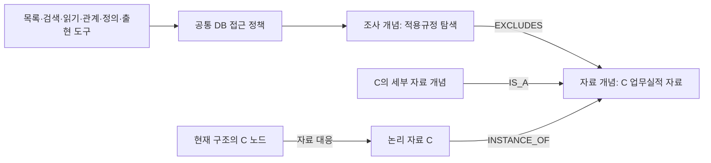

# 조사 개념의 제외 관계를 여러 도구에 적용 — 2026-09-29

사용자 요구: ‘적용규정’이라는 조사 맥락에서 C를 제외한다는 관계를 DB에 저장한다.
새 질문이 해당 맥락에 연결되면 전체 목록·검색·다른 도구에서 같은 관계를 사용한다.
프롬프트의 금지 문구 대신 공통 데이터 접근부가 저장된 관계를 적용한다.

## 관계 표현과 실제 저장

`concept`은 PURPOSE / DATA_CLASS를 구분하고, `relation`에 EXCLUDES / IS_A와
원인·근거 영수증·조건·적용할 접근 동작·상태·버전을 저장한다.
`membership`이 INSTANCE_OF를 표현하며 논리 자료와 자료 개념, 원문 버전을 연결한다.
`node`는 현재 데이터 세대 노드와 논리 자료를 연결한다. 특정 노드 ID는 제외 관계의 식별자가 아니다.
기존 정본 용어집이나 원문 참조 색인을 수정하지 않았으며 폐기된 법률 의미 재작성 스키마를 복원하지 않았다.

같은 조사 개념의 ACTIVE 제외 관계를 찾고 하위 자료 개념까지 재귀 SQL로 해석한다.
이 결과를 SQL 허용 범위에 적용한 후 도구 어댑터를 호출한다. 도구 결과에도 같은 범위를 검증한다.
직접 READ·다른 도구 이름으로 C를 요청해도 같은 접근 경계에서 차단한다.
조건을 만족하지 않거나 다른 PURPOSE라면 해당 관계는 적용하지 않는다.

## 다른 도구가 사용하는 방식

| 현재 도구 예 | 공통 접근 동작 | 연결할 대상 |
|---|---|---|
| Fulltext·literal·title·향후 vector 검색 | discover | 검색 backend에 전달할 허용 source 집합 |
| browse·문서 목록·목차 | list | 허용 자료 및 자식 목록 |
| follow_reference·follow_relations | traverse | 관계 대상 및 자동 선읽기 대상 |
| read·read_node | read | 현재 원문 대상과 읽기 범위 |
| lookup_definition | definition | 정의의 원문 출처 |
| term_occurrences | occurrences | 용어 출현의 원문 출처 |

툴 이름은 어댑터가 공통 동작으로 변환한다. 그래프 코어는 Fulltext 등의 이름을 분기하지 않는다.
현재 구현의 ‘여섯 어댑터’는 허용 ID 목록을 받아 되돌려주는 합성 계약 어댑터다.
실제 검색·정의·참조 함수나 SQLite FTS5/벡터 backend를 실행한 결과는 아니다.
자료 계열이 섞인 노드·원문 개정·분류 미확인·현재 세대 매핑 누락은 재검증 오류로 남긴다.
해당 자료를 조용히 제외하거나 과거 분류를 자동 승인하지 않는다.

## 구현과 검사

- [격리 후보](../../../02_BACKEND/lawrag/research/candidates/adr_0565/graph/revisions/rev-001/snapshot/02_BACKEND/lawrag/core/investigation_graph.py): DB 관계·버전·자료 소속·현재 노드 투영·공통 접근 경계.
- [연구 소비자](../../../06_TOOLS/EXPERIMENTS/adr_0565/audit.py), [합성 어댑터](../../../06_TOOLS/EXPERIMENTS/adr_0565/fixtures.py), [검사](../../../06_TOOLS/EXPERIMENTS/adr_0565/test_contracts.py).
- [DB](../../../04_EXPERIMENTS/ADR/ADR-0565-investigation-ontology-empty-policy/artifacts/run-001/investigation-ontology.sqlite), [관계 원값](../../../04_EXPERIMENTS/ADR/ADR-0565-investigation-ontology-empty-policy/artifacts/run-001/ontology.json), [접근 정책 원값](../../../04_EXPERIMENTS/ADR/ADR-0565-investigation-ontology-empty-policy/artifacts/run-001/result.json).
- 25개 합성 계약 통과. 여섯 동작, 이름이 다른 검색 어댑터, 관계의 영속성·재열기, 하위 개념,
  노드 재명명, 다른 맥락의 C 접근, 조건, 미활성 관계, 직접 읽기 우회, 권한 범위, 개정·분류 충돌,
  provenance 변조와 append-only 관계 해제를 확인했다.
- 첫 [ADR-0564](../../../04_EXPERIMENTS/ADR/ADR-0564-investigation-ontology-access/README.md)는
  계약18/25·실패7개였다. 빈 제외 집합을 SQL NOT IN (NULL)로 구성해 다른 맥락의 범위가 사라졌다.
  실패 후보와 원값을 보존하고 [ADR-0565](../../../04_EXPERIMENTS/ADR/ADR-0565-investigation-ontology-empty-policy/README.md)에서
  빈 경우에 해당 조건만 생략했다. 동일25개 계약으로 확인했으며 실패 기준을 바꾸지 않았다.

## MAIN에 연결할 지점과 남은 일

생성 책임은 MAIN 피드백 루프다. 행동의 목적·현재 조건·제외 판단·원문 근거를 관계 후보로 저장한다.
‘과거 답변에서 사용되지 않았다’는 사실만으로 ACTIVE 제외 관계를 만들지 않는다.
자료 소속과 원문 매핑의 생산자는 구축 단계이며 새 세대의 현재 자료에 대응·버전을 검증해야 한다.
신규 관계는 별도 조사 그래프 계약이고 Request/Result·정본 용어·원문 generation 계약을 변경하지 않는다.

실제 도구 소비자는 `workflow_relations_tools.RelationsTools.execute`와 각 handler의 자료 범위다.
`SourceRecall`의 직접 `FulltextIndex.rank` 호출, `SYSTEM_POLICY` 자동 선읽기와 별도 목록 분기도
같은 경계를 사용해야 한다. 도구 결과를 받은 후에만 필터링하면 검색 비용은 이미 발생하므로
backend가 지원하는 범위 필터를 실행 전에 전달하고 반환 검증을 함께 둔다.
현재 FTS의 범위 필터는 일부 구간에서 결과 생성 뒤에 적용되므로 실제 SQL/NFS 비용 단축은 별도 검증이다.

현재는 명시 PURPOSE ID를 합성 조사 상태로 전달했다. 자연어 질문·판단 근거에서
해당 맥락을 인식하는 기능, 실제 자료 자동 분류·이행, MAIN 도구 배선, 실제 예외/근거 보존,
Fulltext 횟수·속도·법률 품질·GENOS 실행은 미구현/미검증이다.
모델·실제 검색 호출0회이며 MAIN·CURRENT·GENOS 배포는 unchanged다.
후보 검증·개별 ADR final 검사는 통과했고 전역 graph에는 기존 오류6개가 남아 있다.
운영 롤백은 접근 어댑터를 해제하고 기존 회수를 유지한다. 관계 해제는 새 버전으로 남기며 과거 근거를 삭제하지 않는다.
