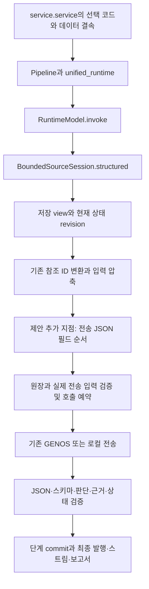

# MAIN62의 품질과 복구 기능을 보존하는 KV 캐시 최적화 설계

기준일: 2026-10-14. 대상은 활성 포인터가 선택한 `schema-recovery-20261014-r1`, generation 62의 법률 RAG 서빙 경로다. **정상 완료·답변 근거·최근 스키마 복구·재개·표시 성능을 유지하는 것이 먼저이며, 캐시 적중률 상승만으로 도입하지 않는다.**

첫 구현 후보는 같은 법령 탐색 단계에서 전송하는 **JSON 객체의 최상위 필드 순서만** 변경한다. 모델 지침, 출력 스키마, 참조 ID, 배열 순서, 원문, 도구, 검색 정책, 판단·복구 로직은 그대로 둔다. 앞선 대화의 ID 안정화·원문 누적·보정 메시지 재구성은 이번 첫 후보에 포함하지 않는다.

문서 상태는 설계 완료다. 제품 구현, 새 ADR 예약·실험·모델 호출, MAIN 승격, GENOS 변경은 수행하지 않았다. 자체 검토는 [REVIEW.md](REVIEW.md), 실제 파일 대조는 [EVIDENCE.json](EVIDENCE.json), 문서 검사는 [VALIDATION.json](VALIDATION.json)에 기록한다.

## 1. 현재 MAIN을 확인한 범위

| 대상 | 확인 결과 | 해석 범위 |
|---|---|---|
| 활성 포인터 | `01_DATA/ACTIVE/local/ACTIVE_RELEASE.json`이 MAIN62 선택 | 저장된 선택 정본 |
| 릴리스 manifest | SHA-256 `f806b479865d26c6173c3fbe2b593d20579c0aadfe1d0d05dadf76d5ad6e1e90` 일치 | 선택 코드의 출처 확인 |
| 서빙 파일 | manifest의 302개 전부 선택 파일 해시 일치, 작업 코드와도 전부 일치 | 앞선 7개 핵심 파일 확인을 전체 서빙 파일로 확대 |
| 데이터 | 선택 데이터 manifest 해시 일치. 원문 generation `term-source-8729f978a28924cb8c5b` | 모든 대용량 원문 파일을 새로 전수 해싱한 검사는 아님 |
| 프로필 | `legal-agent-unified-v6`, `investigation-completion-v8`, `fused-title-v1`, `grounded-narrative-v1` | 실제 프로필 내용 확인 |
| 서비스 실행 | ADR0777의 `main-service-smoke.json`과 구현 기록 존재 | 당시 WSL 실제 service.service 확인 기록. 이번 설계에서 새 서비스를 실행한 결과가 아님 |
| GENOS | MAIN62 인계 자료와 현장용 차이 기록 존재 | 실제 현장 배포 코드·내부 모델 설정·캐시 성능은 미확인 |

`ARCHITECTURE.md` 상단의 MAIN61 설명은 갱신이 늦은 요약이다. 현재 선택은 활성 포인터·릴리스 manifest로 판정했다. 이전 복구 설계의 PLAN/HISTORY/REVIEW에 남은 “미구현”은 당시 기록이며, 현행 구현 상태는 IMPLEMENTATION_RESULT와 선택 코드로 판정한다.

MAIN의 전체 책임은 **용어집 기반 → Document Ingestion → 문서–용어 연결 → 색인 → 용어 기반 RAG → 피드백**이다. 이번 변경의 담당은 그중 RAG의 모델 입력 표현이다. 원문 구조화·용어집·색인·피드백 저장 계약을 새로 만들거나 데이터 generation을 재구축할 필요는 없다. AD와 구축 모델 경로는 첫 적용 대상에서 제외하지만 공통 코드의 회귀 검사 대상에는 포함한다.

## 2. 보존할 성능의 정의

사용자의 “지금 성능 유지”를 다음 네 가지로 분해한다. 하나를 개선했다고 다른 항목의 악화를 상쇄하지 않는다.

1. **업무 결과:** 정상 완료와 제한 답변의 구분, 질문의 요구사항·조건·예외 보존, 근거 회수·채택·인용, 최종 설명의 충실성.
2. **복구 안정성:** JSON/스키마/판단 충돌 진단, 전체 결정 교정, 교정 담당과 예산, 결과 불명·부분 성공·재개 처리.
3. **사용자 체감:** 질문 완료 시간, 첫 유효 출력까지의 시간, 대기·오류 안내·스트림과 저장 답변의 일치.
4. **자원:** 물리 모델 호출, 보정 횟수, 입력·출력 토큰, 메모리·큐 대기. 캐시 적중률 자체는 보조 지표다.

최근 ADR0777의 **합성 계약 410/410, 알려진 회귀 817통과, 과거 모듈 수집 제외 1개**는 보존 기준이다. 이 수치는 기존 실행 기록에서 인용하며 이번에 재실행한 결과가 아니다. 실제 법률 정답률이나 모델 오류 발생 빈도의 측정값으로 사용하지 않는다. baseline의 기존 판단 미스까지 완전 정답으로 고쳐야 하는 작업은 아니지만, 이번 최적화 때문에 새로 나빠진 판단·복구·소비자 동작은 허용하지 않는다.

프롬프트에서 같은 정보를 다른 순서로 배치해도 모델 판단이 달라질 수 있다. 따라서 **데이터 동등성 검사는 필요조건이며, 실제 모델 품질 보존을 증명하지는 않는다.** 미검증 상태에서는 현재 MAIN62를 유지한다.

## 3. 실제 연결 경로



구체 진입점은 다음과 같다. 경로는 저장소 루트 기준이다.

| 파일·함수 | 현재 책임 | 설계상 취급 |
|---|---|---|
| `service.py:_resolve_binding/_local_release/application` | 선택 릴리스·데이터 해시 확인, effective profile 구성, 서비스 binding 공개 | 기존 선택·검증 유지. 새 layout이 effective profile hash에 포함되는지 확인 |
| `legal_agent_adapter.py:ServingLegalAgent.open_session` | scope·모델·profile·pipeline binding, UnifiedRepository 및 BoundedSourceSession 생성 | 현재 ACL 유지. 명시 layout 정책만 내부 binding에 함께 결속 |
| `legal_agent/unified_runtime.py:open_cases` → `memory_binding.py:RuntimeModel.invoke` | 기존 사건·요청 수명과 모델 호출 연결 | 변경 없음 |
| `law_navigation.py:Investigation.view/bounded_model_view/request_decision` | 실제 메뉴·원문·state·출력 스키마와 탐색 교정 | 결과 객체·순서·교정 경로 변경 없음 |
| `bounded_source_session.py:structured/_Gateway.request` | source_stage·view 저장, 역할별 교정 담당, ID·입력 projection, messages 생성 | 첫 layout 연결 지점 |
| `gateway.py:ModelGateway.generate` | 물리 호출 예약, 전송, JSON/스키마, usage·실패 원장 | 기존 동작 유지. layout 식별 계측만 별도 추가 가능 |
| `relations_repository.py:reserve_attempt` | 저장 view를 다시 projection해 실제 `messages[1].content.view`와 비교 | 기존 검사를 유지하며 layout 순서·정책 대조 추가 |
| `output_contract.py`와 `request_repair.py` | 엄격 JSON, typed 오류, 동일 중복만 보정, DecisionJournal | 보호 대상, 변경 없음 |
| `completion_execution.py`, `completion_v5`~`v8` | ASSESS/COMPOSE, 원문 gap·조건/예외·근거·제한 응답 | 첫 대상 아님. 이전 계약 reader도 그대로 유지 |
| `transport.py`, `local_gemma.py`, `model_contract.py` | 내부/외부 전송, provider schema 변환, 종료·입력 계측 | 모델·라우팅·전송 schema·retry 변경 없음 |
| `request_report.py`, `observability.py` | 안전한 진단 필드·최종 요청 보고 | 추가할 scalar layout 정보와 기존 usage의 소비 경로 확인 |

표의 `legal_agent/`는 `02_BACKEND/semantic_runtime/legal_agent/`다. `request_report.py`, `observability.py`, `legal_agent_adapter.py`는 그 상위 `semantic_runtime/`에 있다.

PIPELINE의 legal-rag node에는 `profile-tools-v5.json` 참조도 남아 있지만, 실제 `service.application()`은 선택 implementation이 v6일 때 `profile-unified-v6.json`과 선택 transport로 실행 profile을 구성해 전달한다. 따라서 PIPELINE의 한 파일명이나 `max_calls`만 읽어 실제 모델 예산·복구 정책을 판정하지 않는다. 선택 profile과 effective binding을 함께 비교한다.

## 4. 문제별 전후 비교

| 같은 입력 상황 | 기존 방식과 관측 사실 | 수정 방식 | 원하는 결과와 확인 방법 |
|---|---|---|---|
| 같은 탐색에서 원문은 같고 행동 메뉴만 달라짐 | `encoded()`가 키 이름순으로 전송. actions/articles/base_state_revision 등은 sources보다 앞에 위치. 실제 캐시 손실량은 미관측 | 질문·원문을 먼저, 메뉴·revision을 뒤에 배치 | 바뀌기 전까지의 공통 입력이 길어지는지 후속 ADR에서 확인. 실제 cached_tokens·지연도 확인 |
| 같은 원문에 상태·표시 ID가 바뀜 | NavigationReferences는 현재 view의 ID들을 정렬해 짧은 ID를 배정. sources 내부 메타데이터·순서도 바뀔 수 있음 | 첫 후보에서는 기존 변환을 그대로 둠 | 개선 한계를 측정하되 ID·근거 결속 손상 0. 부족하면 별도 후속 설계 |
| 스키마 오류 뒤 전체 결정 교정 | 단계별 DecisionJournal과 full correction. schema/원장/상태를 현재 요청에 결속 | 메시지 수·repair payload·schema·owner를 유지하고 최상위 키 순서만 동일 규칙 적용 | 같은 오류의 동일 담당·동일 예산·동일 검증 결과. 재개 시 교정 횟수 증가 허용 안 함 |
| ASSESS에서 COMPOSE로 이동 | 서로 다른 system, schema, 입력 표현 사용 | 첫 후보는 두 단계 모두 기존 전송 바이트 유지 | 단계 간 캐시 공유를 위해 판단 역할을 섞는 회귀 방지 |
| cache 사용량이 응답에 없음 | `_response_diagnostics`는 cached_tokens 누락을 None으로 보존 | unknown과 0을 구분해 보고 | 적중률 분모와 usage 보고율을 함께 표시. 누락을 miss로 처리하지 않음 |
| 같은 endpoint 뒤에 여러 모델 서버가 있음 | 앱에서는 실제 KV 보유 서버·캐시 용량·eviction 확인 불가 | 플랫폼 확인 후 별도 서버 설정 후보 | 요청 배치·메모리·큐를 포함한 실제 지연 개선. endpoint 고정만으로 KV 공유 보장하지 않음 |

현재 원문 RAM/SQLite/검색 캐시는 모델 GPU의 KV 캐시와 다른 계층이다. 이를 크게 잡았다는 사실로 KV 적중이 높다고 판단하지 않는다.

## 5. 첫 후보의 전송 계약

### 5.1 적용 범위

제안 정책명은 `navigation-prefix-v1`이다. 아직 구현된 기능명이 아니다.

- 선택 profile이 명시적으로 이 정책을 지정한 v6의 compact 입력에서만 사용한다.
- `source_stage`가 현재 생성 규칙 `source-law-navigation-<정수>` 또는 그 `-repair`일 때만 적용한다. 임의의 비슷한 phase 문자열까지 자동 확대하지 않는다.
- request-entry, 명령 해석, 원문 선별, 명시 참조, ASSESS, COMPOSE, AD, 구축에는 기존 canonical 직렬화를 사용한다.
- 일반 gateway의 옛 v1~v5 경로를 일괄 변경하지 않는다. 후보의 새로운 API·별도 실행기는 만들지 않는다.

### 5.2 변경 허용 범위

기존 pipeline이 만든 view를 저장하고, 현재 NavigationReferences와 `compact_wire_view`를 그대로 수행한 결과를 `V`라고 한다. 후보는 `V`의 **최상위 객체 키의 출력 순서**만 바꾼다.

```text
system 메시지: 현재 코드가 만든 문자열 그대로
user 메시지: 기존 {"view": {...}} 구조 그대로

view에서 먼저 출력할 키, 존재할 때만:
  input_projection
  completion_contract
  control_contract
  reading_rule
  question
  current_request
  issues
  sources
  exact_evidence
  evidence_options

그 밖의 모든 키:
  기존 이름순으로 뒤에 출력
  actions, articles, adopted_evidence, budgets, state_version,
  base_state_revision, evidence_revision, source_stage, view_id,
  rejected_decision, contract_error, repair_contract 등도 삭제하지 않음
```

`reading_rule`, `issues` 등도 실제로 변하면 캐시가 그 지점에서 끊긴다. 이를 숨기거나 이전 값을 붙잡지 않는다. 위 순서는 첫 비교 후보이며, 결과를 보고 새 순서를 고르면 후속 ADR로 분리한다.

각 키의 **값 전체는 기존 `encoded(value)`로 직렬화**한다. 따라서 중첩 객체의 기존 정렬·escaping·Unicode 처리와 배열의 항목 순서가 보존된다. wrapper는 한 개 user 메시지에 있는 `view`로 유지한다. 다중 메시지·새 role·새 안내문·빈 필드 채우기를 도입하지 않는다.

개념식은 다음과 같다. 실제 구현 코드는 아니다.

```text
K = 존재하는 우선 키 + 나머지 키의 기존 정렬
user_content = '{"view":{' + join(encoded(k) + ':' + encoded(V[k]), K) + '}}'
```

기존 저장용 `repository.encoded()`와 canonical digest는 변경하지 않는다. 기존 필드 집합의 순열이므로 같은 view에서 문자열 값·JSON 토큰의 구성 요소·UTF-8 길이는 보존 가능하다. 그러나 tokenizer 경계가 달라질 수 있어 **모델 입력 토큰 수까지 같다고 가정하지 않는다.**

### 5.3 반드시 검사할 불변조건

| 계약 | 검사 |
|---|---|
| 동일 데이터 | 엄격 decode 후 후보 객체와 기존 projection의 canonical digest 동일. 타입·값·배열 순서 모두 동일 |
| 동일 원문 | sources·exact_evidence·text_ref·좌표·법률 숫자·부호·개행의 값 보존 |
| 동일 ID | NavigationReferences mapping receipt 및 decode 결과 동일. 새 별칭 사전 없음 |
| 동일 system | 공백·줄바꿈·scope notice를 포함해 바이트 동일 |
| 동일 출력 계약 | schema_name, 원래 schema, provider 전송 schema와 response_format이 동일 |
| 동일 요청 옵션 | model, temperature, max_tokens, thinking, stream, provider route 동일 |
| 동일 envelope | messages 수·role·순서 동일. 허용 차이는 대상 user.content 내부 view의 최상위 키 순서뿐 |
| 동일 저장 의미 | MODEL_VIEW, DecisionJournal identity·schema·owner, 완료 receipt 의미 동일 |
| 알려지지 않은 필드 | 삭제·요약 없이 tail에 보존. 기존 검증에서 거부할 값은 그대로 거부 |
| 정책 꺼짐과 비대상 단계 | 기존 request 바이트 그대로. 전역 기본값을 몰래 바꾸지 않음 |

같은 synthetic response를 양쪽 입력에 공급했을 때 도구 선택 수락/거부, 후검증, commit, 공개 결과가 같아야 한다. 이 검사는 실제 모델의 출력 동등성과 별개다.

### 5.4 원장 검증과 저장 비용

현재 `RelationsRepository.reserve_attempt`는 저장 view를 다시 ID 변환·압축한 뒤 `json.loads(messages[1].content)['view']`와 비교한다. 필드 순서는 객체 의미를 바꾸지 않아 기존 비교를 유지할 수 있다. 여기에 선택 profile의 layout으로 직렬화한 문자열과 실제 전송 문자열의 일치를 검사한다. layout 선택 근거를 클라이언트가 보내는 임의 필드에서 받지 않는다.

이를 위해 `ServingLegalAgent.open_session`이 **명시적으로 설정된 경우에만** 내부 run binding에 layout 식별자를 넣고, `ModelGateway.generate`가 attempt 예약 인자로 동일 정책을 전달한다. repository는 그 인자와 저장 binding을 대조한 뒤 source_stage에 따른 실제 적용 여부를 다시 결정한다. 임의 인자 하나만 믿고 통과시키지 않는다. 구 profile의 binding에는 새 key를 자동 삽입하지 않는다. 정책이 후보여도 비대상 단계에서는 canonical 문자열을 기대한다.

`WIRE_PROJECTION=compact-v5-v1`은 기존 의미 projection을 가리키므로 그 뜻을 바꾸지 않는다. 별도 layout 식별자와 user 문자열 SHA-256을 기존 attempt에 연결한 작은 이벤트로 기록한다. 원문·전체 view를 보고서마다 복제하지 않는다. 실제 request는 이미 `model_attempt.request_json`에 보존되며, content가 문자열이므로 바깥 객체 canonical 정렬이 안쪽 순서를 다시 정렬하지 않는다.

layout 정보는 모델 content에 넣지 않는다. 새 timestamp, request ID, 해시를 prompt 앞에 삽입해 캐시를 다시 끊는 구현을 피한다. 전송 전 원장/입력 대조 실패는 `ContractError` 계열로 중단하고 모델 교정을 요청하지 않는다. 캐시가 miss라는 이유로 재호출하지 않는다.

## 6. 최근 복구 기능의 보호 목록

이 목록은 스키마 검사 통과만으로 대체할 수 없다. 근거는 기존 복구 설계의 I01~I15와 MAIN62 구현이다.

| 보호 영역 | 반드시 보존할 현재 동작 | 회귀를 막는 주요 검사 |
|---|---|---|
| 엄격 JSON | 중첩 중복 key, NaN/Infinity, 잘린 JSON, 크기·깊이 한계 구분 | `test_output_contract_recovery.py`, ADR0777의 기존 JSON/종료 계약 |
| 구조와 판단 | 원래 schema, 필드 간 충돌, 공백 사유, 같은 ID의 상충 결정을 구분 | output contract, navigation state, wire repair |
| 안전한 보정 | 완전히 동일한 결정만 중복 제거. 다른 사유·근거·상태를 합치지 않음 | output contract, main50 request repair |
| 원문과 채택 | preview≠원문, READ≠ADOPT, DEFER/EXCLUDE 보존, current view의 근거만 사용 | sources, navigation input, numbered source 검사 |
| 전체 결정 교정 | 현재 control 경로의 full decision. sparse patch·keyed decision 미활성 상태 유지 | law navigation one repair 및 기존 patch 이력 회귀 |
| 단일 owner | 탐색은 law-navigation, ASSESS는 assessment, COMPOSE는 composition 등 현재 owner_for 유지 | `DecisionJournal` 및 역할별 실제 소비자 검사 |
| 물리 예산 | 최초·교정·전송 시도가 요청 총예산과 최초 deadline 공유 | output contract, unified memory recovery |
| unknown과 재개 | RESERVED 뒤 결과 불명은 자동 재호출 안 함. ACCEPTED 재검증. REJECTED의 교정 횟수 복원 | 영속 상태 계약 및 실제 저장 재개 |
| 부분 도구 성공 | 완료 receipt·committed revision 유지. 실패를 원문 부재로 변환 안 함 | main50 request repair, batch reference navigation |
| 원문 gap | MISSING_SOURCE+REQUEST_FACT의 좁은 보정과 실제 원문 조사. 사용자 사실 창작 금지 | `test_assessment_gap_action.py` |
| 조건·예외·규범 | AND/OR/UNKNOWN, 예외·주체·의무/허용, v8 source_ref 원문 결속 유지 | completion v4 및 native completion consumer, v8 관련 현재 계약 |
| 상태·권한·hash | stale revision, 다른 scope·판본·변조·늦은 응답 거부 | memory adapters, unified legal agent, 실제 API |
| 스트림·발행 | length/DONE/EOF 구분, 일부 송신 뒤 대체 생성 연결 금지, 저장·화면 일치 | genos answer/model stream, token stream, narrative answer |
| shortcut·wiki | 정상 발행·현재 route/revision·근거를 통과한 결과만 기존 정책으로 재사용 | unified memory와 publication 소비자 |
| AD·구축 | 명령 lease/검증과 recipe/reference의 기존 owner·예산 유지 | ADR0777 regression-selection의 AD·reference·recipe 항목 |

전체 회귀 목록은 [기존 regression-selection.json](../../../../04_EXPERIMENTS/ADR/ADR-0777-schema-recovery-main/artifacts/design/regression-selection.json)을 참조한다. 현재 통과하는 검사를 이번 변경 때문에 skip/xfail 처리하지 않는다. 기존 수집 제외 1개는 통과로 계산하지 않고, 제외 사유와 해당 사용자 동작을 보장하는 현행 검사를 함께 남긴다. 검사 개수만 맞추지 말고 node ID·목적·실행 모듈 hash를 비교한다.

## 7. 설정과 재개 호환성

제안 설정은 profile의 선택 항목 `model_input_layout`이다. 미지정은 기존 canonical 동작, 명시 후보값은 `navigation-prefix-v1`이다. 정확한 명칭은 구현 ADR에서 동결한다.

현재 `workflow_tiers_policy.profile()`은 unknown key를 거절하며 DEFAULT_PROFILE의 추가 항목을 정수 한도로 검사하는 부분도 있다. 따라서 JSON 파일에 값만 추가할 수 없다. validator에서 이 선택 문자열을 별도로 검사하고, 기존 한도 검증과 분리해야 한다.

**구 profile에 새 기본 key를 자동 주입하지 않는다.** 미지정 구 profile의 정규화 결과와 digest를 기존과 같게 유지한다. 명시 후보 profile은 새 값이 effective hash와 run binding에 들어가며, 이 차이를 숨기지 않는다. 지원하지 않는 값은 서비스 초기화에서 거부한다.

같은 요청 도중 layout을 토글하지 않는다. 현재 `completion_budget.restore()`는 input/execution binding이 달라진 재개를 거부한다. 이 검사를 유지한다. 기존 요청을 새 profile로 옮겨 재개하거나 request ID를 바꿔 예산을 초기화하지 않는다. 서로 다른 후보의 run binding·DecisionJournal key가 달라지는 것은 정상이다. 보호하는 것은 같은 run 안의 identity·schema·owner·예산 일관성이며, 서로 다른 binding의 완료 receipt를 합치는 것이 아니다.

배포 시 기존 binding의 진행·재개 대상은 그 코드와 profile로 처리해야 한다. 구 실행기를 함께 유지할 수 없다면 진행·재개 요청의 종료/처리 방안이 마련될 때까지 전환하지 않는다. 지원하지 않는 무중단 버전 간 재개를 새 기능인 것처럼 약속하지 않는다.

## 8. 실행과 실패 시나리오

| 상황 | 처리와 저장 | 종료·복구 책임 |
|---|---|---|
| 첫 질문·캐시 없음 | 현재 scope로 검색·읽기, 기존 view 저장, 대상 호출만 새 순서로 전송 | 기존 모델 호출 1회. cache miss는 정상 |
| 같은 탐색의 다음 호출 | 기존 pipeline이 계산한 새 view 사용. 같은 prefix가 있으면 서버가 재사용 가능 | 재사용을 위해 새 view의 사실·상태를 과거 값으로 바꾸지 않음 |
| 새 원문 추가·본문/순서 변경 | 현재 sources 배열을 그대로 전송. 일치하지 않는 지점부터 miss 허용 | ID 재배정·원문 제거를 캐시 로직이 개입해 보정하지 않음 |
| 공백 사유·중복·상충 출력 | MAIN62의 typed 오류, 허용된 동일 중복 처리, 담당 단계의 전체 결정 교정 | 같은 owner·총예산·최대 교정 횟수 유지 |
| 보정 실패·반복 충돌 | 기존 원인·제안·교정 이력을 보존하고 현재 종료 정책 적용 | layout을 바꿔 재시도하는 추가 경로 없음 |
| 원장과 전송 입력 불일치 | 호출 전에 거부, 변경 전 상태와 진단 보존 | 런타임 계약 실패. 모델에게 고치라고 하지 않음 |
| 권한·원문 판본·revision 변경 | 현재 binding/ACL/원문/stale 검사 적용 | 캐시 적중을 검증 통과 근거로 사용하지 않음 |
| 429·timeout·결과 불명 | 기존 전송 분류·단일 담당·deadline 사용 | cache warmup이나 다른 provider fallback을 추가하지 않음 |
| 재시작 후 재개 | 같은 profile/layout/binding과 기존 원장·deadline으로 복원 | 캐시는 사라져도 기능상 재개 가능. 캐시 유무가 업무 상태가 아님 |
| 최종 답변 일부 송신 후 실패 | 기존 미완료 상태·송신 원장·공개 안내 유지 | 새 응답을 이어 붙이거나 shortcut 성공으로 저장하지 않음 |
| 계측 항목 미지원 | unknown 및 집계 제외 사유 표시. 기존 업무 결과 보존 | usage 누락과 0 적중을 구분 |

새 layout helper의 코드 예외를 포괄 except로 감싸 canonical 재전송하는 경로는 만들지 않는다. 사전 정책상 비대상 단계의 canonical 선택과, 실패 뒤 조용히 다른 방식으로 재호출하는 것은 다르다. 계측이 대용량 원문을 추가 복사하거나 새 모델 호출을 유발해서도 안 된다.

## 9. 캐시와 지연을 측정하는 방법

기존 `gateway._response_diagnostics()`는 `usage.prompt_tokens_details.cached_tokens`를 기록하고 누락은 None으로 둔다. `request_report`는 cached_tokens를 허용한다. 그러나 이 수치만으로 현재 단계별 적중률·TTFT가 검증됐다고 보고할 수 없다.

| 지표 ID | 정의·분모 | 수집과 한계 |
|---|---|---|
| M01 | 보고된 재사용 비율 = Σ cached_tokens / Σ prompt_tokens | 두 수치가 유효한 같은 호출 집합. provider·단계·모델별 분리. 분모 0은 미산정, cache>prompt 등 비정상 usage는 별도 오류 |
| M02 | usage 보고율 = 두 값이 유효한 호출 수 / 실제 전체 모델 시도 수 | 실패·거절·stream 누락도 전체 분모에 포함. M01 옆에 반드시 표시 |
| M03 | 계산된 입력 토큰 = prompt_tokens−cached_tokens | 해당 provider가 cached를 prompt에 포함한다는 정의가 확인될 때만 계산 |
| M04 | 첫 모델 content 도착 시간 / 첫 사용자 표시 시간 | 서로 다른 시각. 탐색의 비스트리밍 응답시간을 TTFT로 표기하지 않음 |
| M05 | 질문 전체 wall time과 성공 완료 p50/p95 | 성공·제한·실패·timeout 건수와 함께 보고. 빨리 실패한 요청으로 속도 개선을 만들지 않음 |
| M06 | 물리 시도·교정·tool 수 / 원래 사용자 요청 | resume run과 streaming 조각을 중복 호출로 세지 않음 |
| M07 | 유효한 답변·근거·정상/제한/실패·오류 유형 | 결정론 검사와 실제 모델 의미 검토를 분리 |
| M08 | 서버 queue·prefill·decode·cache eviction·메모리 | 플랫폼이 제공하는 동일 시간창·동일 backend 지표만 사용. 앱 RAM 수치를 GPU KV로 전용 안 함 |
| M09 | 인접 요청의 공통 입력 길이 | 저장 request를 로컬에서 비교하는 구조 지표. 실제 토큰/template 없으면 바이트·문자로만 표기하며 KV hit로 부르지 않음 |

M09의 전체 prefix 비교는 요청의 실시간 경로에서 수행하지 않는다. 접근 통제된 기존 원장을 사용하는 후속 진단/실험에서 계산하고 본문을 로그에 반복 기록하지 않는다. 집계용 단계 이름은 `source-law-navigation-N`을 탐색 그룹으로 묶을 수 있지만, 원장의 실제 source_stage와 교정 identity는 바꾸지 않는다.

## 10. 비교 설계와 도입 차단 조건

### 10.1 두 종류의 검증

**결정론 검증:** 기존 MAIN62와 후보에 동일 view·동일 응답·동일 실패를 넣어 데이터, 호출 수, 상태 전이와 소비자 결과를 비교한다. 이 단계는 캐시 또는 법률 품질 실측이 아니다.

**모델 검증:** 동일 모델·provider·데이터·검색 정책·예산에서 실제 전체 질문을 비교한다. 같은 자료도 입력 순서에 따라 판단이 달라질 수 있으므로 생략하지 않는다. known regression 질문과 독립 평가 질문을 분리한다. 질문 하나의 여러 의역·여러 단계 호출을 독립 질문 수로 부풀리지 않는다.

후속 실행에서는 저장소의 실험 표준 두 문서를 끝까지 읽고 동일 scope reservation을 확인한 뒤, **구현 수정/첫 호출 전에 새 ADR**을 예약한다. 완료된 ADR0777의 run·결과·기준을 수정하거나 재실행하지 않는다. 기존 계약 사례를 쓰면 알려진 회귀라고 표시하고 새 ADR 산출물에 결과를 저장한다.

baseline은 완료된 `ADR-0777-schema-recovery-main/recovery`와 현재 MAIN62의 정확한 binding이다. 구현 시작 전에 MAIN이 더 진전되면 새 최신 MAIN의 수정과 대조하고 그 위에 통합한다. 과거 snapshot 전체를 작업 코드에 덮어쓰지 않는다. 기준 변경 시 평가 입력·성공 기준을 호출 전에 다시 동결한다.

### 10.2 초기 후보와 변경 범위

| 후보 | 변경 | 목적 |
|---|---|---|
| A 기준 | 현재 MAIN62 전송 그대로 | 기준 동작·품질·지연 |
| B 첫 후보 | 탐색 view 최상위 키 순서만 변경 | 메뉴/상태 앞부분 차이로 끊기는 prefix 개선 가능성 |
| C 이후 조건부 | ID mapping/자료 순서/원문 구간 분리 등 | B의 개선이 부족할 때 별도 새 ADR. 이번 묶음에 자동 추가하지 않음 |
| S 별도 서버 후보 | prefix caching·요청 배치·캐시 메모리 설정 | 앱 B와 혼합하지 않고 원인별 효과 확인 |

한 번에 B와 S를 모두 바꾸면 원인을 분리할 수 없다. 캐시가 없는 첫 호출, 같은 질문 안의 반복, 서로 다른 질문의 반복 지침, 실제 다중 세션 부하를 구분한다. A/B를 독립 캐시 풀에서 같은 조건으로 비교하는 것이 가장 명확하다. 그것이 불가능하면 실행 순서를 교차·무작위화하고 warm 상태와 이전 호출을 기록하며, 오염된 결과를 순수 효과로 단정하지 않는다. 운영 캐시를 임의 flush하거나 독립성을 위해 실제 prompt에 실험 ID를 삽입하지 않는다.

### 10.3 통과 기준

다음은 결과를 보기 전에 후속 ADR에서 구체 표본·측정창·집계법과 함께 동결할 기준이다. 허용 악화 폭을 사후에 늘려 후보를 통과시키지 않는다.

| Gate | 조건 | 미충족 시 |
|---|---|---|
| G01 입력 보존 | 모든 대상 view에서 값·타입·배열·원문·ID·schema·system 보존. 비대상/꺼짐 요청 바이트 동일 | 수정 후 새 코드로 전체 관련 검사 |
| G02 최근 복구 | 410개 기존 복구 계약의 보장 내용 유지, 817개 기존 통과 회귀에 새 실패 0. 제외·목적 변경 투명 기록 | MAIN 반영 차단 |
| G03 실제 소비자 | 같은 candidate pin의 service/API→저장→표시/실패 보고/shortcut에서 정상·복구·중단·재개 동작 유지 | MAIN 반영 차단 |
| G04 실제 모델 품질 | baseline이 처리한 요구·근거·조건/예외·주체를 후보가 잃지 않음. 정상→제한/실패, 신규 인용/권한/판단 회귀 없음 | 원인 분석. aggregate 점수 개선으로 개별 중대 회귀 상쇄 금지 |
| G05 복구 비용 | 정상 경로의 추가 호출 0. 같은 재현 실패에서 교정·도구·물리 시도 증가 0. 실제 모델 오류/보정 빈도 악화 없음 | 캐시 적중률과 무관하게 차단 |
| G06 지연·자원 | cold와 warm, 대표 동시성별 성공 완료 p50/p95·오류율·물리 호출·메모리·큐에서 악화가 없고, 목표 warm 경로의 시간 절감 확인 | 불충분/악화면 MAIN62 유지 |
| G07 캐시 설명력 | 실제 cached_tokens 또는 서버 지표와 입력 변화가 개선 설명을 뒷받침. usage 정의·누락률 공개 | 시간 개선만 있으면 원인 미확인으로 표시. KV 효과 인증 불가 |
| G08 실행 결속 | 작업 통합 코드=검증 후보=선택 릴리스. profile/layout/data/schema/search/model/서비스 binding 연결 | 배선 완료로 보고하지 않음 |

실제 모델은 temperature=0이어도 항상 같은 출력을 보장하지 않는다. 관측된 단일 차이는 원문으로 검토하되 실패를 지우거나 유리한 재시도만 고르지 않는다. 반복 수·질문별 묶음·통계 방법은 사전 동결한다. 예를 들어 지연 비율의 상한이 1 이하임을 확인하는 보수적인 판정과, 오류/품질의 악화 방향 차이를 배제하는 판정을 사용할 수 있다. 표본이 부족해 그 판단을 못 하면 “유지 확인”이 아니라 “판정 불충분”이다. 유한 표본에서 미래 모든 질문의 무회귀를 보장하지는 않는다.

표본 수를 임의의 소수 질문으로 정하지 않는다. 사용할 기존 baseline의 변동 자료가 없으면 별도 기준 측정 ADR에서 분산·오류 빈도·대표 부하를 확인하고, 그 결과로 후속 qualification의 표본 수·측정창·반복 수·신뢰수준을 첫 후보 호출 전에 고정한다. 인용·권한·상태 등 중대 오류는 통계 평균과 별개로 한 건이라도 재현되면 차단한다. 실제 모델 결과의 실패율 감소와 입력 prefix 증가를 동일 지표로 합치지 않는다.

G04는 새 질문의 정답 100%를 요구하는 규칙이 아니다. 사용자 지침에 따라 기존 일반화 한계는 별도 기록하되 **이 최적화 때문에 악화된 결과를 도입하지 않기 위한 비교 기준**이다.

외부 모델 비교는 승인된 공개/명시적 합성 입력으로 고정 정책의 Qwen3.8/Parasail FP8/effort none/fallback 없음과 공통 ExperimentClient를 따른다. 실제 서비스 호환성 검사는 같은 candidate의 기존 LocalQwen38Transport 경로도 별도로 확인한다. 실험 wrapper가 입력 layout이나 provider schema를 다른 방식으로 만들면 서비스 검증으로 인정하지 않는다. 내부 CM/risk_cm·계약·증거는 외부로 보내지 않으며 실제 내부 품질은 GENOS에서만 평가한다.

## 11. GENOS 모델 서버와의 책임 경계

앱의 순서 최적화가 효과를 내려면 서버가 같은 토큰 prefix의 KV를 재사용할 수 있어야 한다. 확인할 항목은 실제 모델·추론 엔진/버전·chat template/tokenizer·prefix caching 설정·캐시 수명/메모리·replica 배치·usage 정의다. 모델 architecture에 따라 재사용 단위와 제약이 다를 수 있으므로 일반 vLLM 옵션을 현장에 그대로 적용했다고 가정하지 않는다.

서버가 캐시를 공유하지 않는 여러 replica로 요청을 분산하면 같은 prefix도 miss할 수 있다. 플랫폼이 지원한다면 같은 prefix의 요청을 해당 캐시를 보유한 서버로 보내는 정책을 검토한다. 그러나 과도한 고정 배치로 queue가 늘면 체감 성능이 나빠질 수 있다. 보안·tenant별 캐시 격리 경계를 완화하지 않으며, 앱에서 내부 worker를 추측해 직접 호출하지 않는다.

현재 Codex에서는 GENOS에 접속할 수 없다. 확인 자료는 플랫폼 담당자가 제공하는 설정·로그·지표와 사용자의 워크플로우 테스트 결과다. 현장 질의와 warmup은 **워크플로우 테스트 화면**으로 검증하며 코드서빙 직접 테스트 UI/API를 요구하지 않는다. 기존 데이터 WARMUP을 모델 KV warmup으로 오인하지 않는다. 첫 후보에 KV 선행 채움용 모델 호출을 추가하지 않는다.

## 12. 기대 효과와 한계

현재 MAIN62의 단계별 prefill 비중·실제 cached_tokens 분포·GENOS 캐시 설정은 측정되지 않았다. 따라서 개선율, 적중 목표 백분율, 구축 인일과 완료 날짜를 수치로 약속하지 않는다.

| 수치 ID | 종류·단위 | 근거와 산식 | 현재 결과 |
|---|---|---|---|
| N01 | 관측: 파일 수 | 이번 manifest 전수 대조, 선택/작업 파일 | 302개 일치. 실행 성능 수치 아님 |
| N02 | 과거 관측: 계약 사례 | ADR0777 result·regression selection | 410/410, 817통과·1수집 제외. 이번 재실행 아님 |
| N03 | 목표: 추가 정상 모델 호출/요청 | layout은 직렬화만 담당 | 0회 |
| N04 | 목표: 구조·근거·복구 신규 회귀/고정 검사집합 | G01~G05 | 0건 |
| N05 | 계산식: 초/요청 | 순절감 = 줄어든 prefill 시간 − 추가 직렬화/검증/queue 시간 − 추가 decode·보정 시간 | 입력값 미측정으로 미산정 |
| N06 | 계산식: 시간 개선의 이론적 범위 | prefill 비중을 f, 그중 절감 비중을 h라고 할 때 다른 비용 불변이면 전체 절감 비중은 f×h | 설명식. 선형 토큰→시간 환산이나 실측 예측으로 사용 안 함 |
| N07 | 미확인: 현장 효과 | 같은 GENOS binding의 cold/warm/동시성 비교 필요 | 미산정 |

손익분기는 N05=0이다. cache가 꺼져 있거나 원문·ID·schema 주입 prefix가 계속 바뀌면 절감이 없을 수 있다. 모델 출력이 길거나 검색·queue가 병목이면 입력 재사용이 늘어도 전체 개선이 작다. 순서 변경 때문에 모델이 상태를 놓쳐 보정이 늘면 N05는 음수가 될 수 있으므로 즉시 제외한다.

일반 prefix caching은 입력 처리(prefill)를 재사용한다. 서로 다른 질문의 뒤쪽에 같은 문서가 등장한다는 사실만으로 문서 구간을 독립 재사용하지 않는다. 생성 문장 자체의 decode 시간을 줄이는 기법과도 구분한다. [vLLM 기능 설명](https://docs.vllm.ai/en/stable/features/automatic_prefix_caching/)과 [prefix hash 설계](https://docs.vllm.ai/en/stable/design/prefix_caching/)는 이 원리의 근거이며, GENOS가 해당 버전/구현이라는 증거는 아니다.

## 13. 구현 파일과 완료 순서

| 변경 패키지 | 파일·연결 | 산출물과 종료 조건 |
|---|---|---|
| 정책 | `workflow_tiers_policy.profile`, 선택 profile, 해당 엔진·PIPELINE pin | optional layout 검증. 구 profile normalization/digest 보존 |
| 표현 | 기존 `model_contract.py`의 명시 opt-in helper 또는 legal_agent 내부 작은 순수 helper, `_Gateway.request` | 기존 projection 이후 최상위 순서만 변경. 공통 AD 호출은 opt-in하지 않음 |
| 무결성 | `relations_repository.reserve_attempt`, gateway의 attempt 식별 정보 | 기존 semantic 대조 + 선택 layout 문자열 대조. 실제 request hash와 연결 |
| 진단 | `gateway`, `request_report`, `observability` | 모델 본문 없는 scalar 지표. 새 필드가 필터로 사라지지 않는지 확인 |
| 검사 | 기존 복구/서빙 회귀와 새 layout 계약 | 모듈 경로·pin receipt, 정상·실패·재개·비대상 동작 |
| 서비스 | 루트 `service.py`, `service/service.py`, 선택 release 및 generation | 기존 실제 진입점이 선택한 코드/profile/layout을 HEALTH binding으로 확인 |

새 helper를 만들면 frozen engine manifest의 의존 파일에도 포함한다. 라이브 import graph와 release packaging을 대조하고 누락된 파일이 작업 checkout에서 우연히 import되어 통과하지 않게 한다. 공통 module을 수정하면 AD/구축이 그대로 동작하는지도 확인한다.

진행 순서는 다음과 같다.

1. **기준 확정:** 구현 시점의 활성 MAIN 및 작업 차이를 재확인하고 최신 복구 수정 보존 목록을 동결한다. 전체 MAIN의 상위 단계는 같은 버전에 결속한다.
2. **ADR 격리:** 표준 reservation → 부모/가설/실패기준/데이터/코드·모델·profile 동결 → snapshot/register/freeze. 이 문서 작성은 이 실행을 대신하지 않는다.
3. **좁은 구현:** 첫 후보 B만 구현. layout 기본 꺼짐. 보호 대상 코드/스키마·ID·배열·원문이 바뀌면 설계 범위 위반으로 검출한다.
4. **계약과 실제 모델 검증:** G01~G07. 최근 복구 사례는 알려진 회귀, 새 질문은 별도 독립 평가로 표시한다. 평가 과정에서 바꾼 후보는 후속 ADR로 분리한다.
5. **작업 통합:** 검증된 변경 파일만 기존 개발 경로에 통합한다. 통합 후 바이트가 후보와 다르면 동일 코드로 재검증하고 기존 성공 결과를 전용하지 않는다.
6. **MAIN 배선:** Accepted·out-of-sample·decision_eligible·complete인 arm에 대해서만 표준 promotion의 hash 고정 plan/check/apply와 명시 `--confirm-main` 절차를 따른다. 포인터·receipt·데이터 불변·effective profile/layout을 확인한다.
7. **실제 로컬 입구:** 선택된 동일 pin의 `service.service`로 HEALTH, 검색/목록, 모델 연결, 정상/복구/실패 소비자를 확인한다. 앱의 `_APP` 캐시가 이전 binding을 붙잡지 않도록 새 프로세스에서 선택 결과를 기록한다.
8. **GENOS 인계·현장:** 실제 설치 inventory에 최신 복구와 현장 전용 차이를 보존해 파일별 패치를 만든다. 기존 `~/DEV` 적용, 새 코드서빙 리비전·필요한 SSE 프로세스 재시작, 워크플로우 테스트와 내부 모델 지표를 따로 확인한다. 데이터 재구축은 없다. 워크플로우 편집기 변경은 이 layout만으로 필수는 아니며 실제 소비자 변경 여부로 판단한다.

GENOS ZIP/실행 TXT를 만들 때는 업로드한 실제 TRANSFER 폴더에서 `./정확한파일명`으로 실행하는 기존 규칙을 따른다. 이번 문서는 인계 ZIP이 아니며 현장 명령을 실행하지 않는다.

## 14. 롤백과 후속 범위

롤백 목표는 **최근 복구가 포함된 검증 기준 릴리스**다. 현재 설계에서는 MAIN62다. MAIN61로 되돌려 최근 수정까지 잃는 것을 KV 롤백으로 취급하지 않는다.

- promotion plan에 기준 포인터·manifest·profile·layout과 후보 포인터 예상값을 저장한다. rollback 실행 직전 현재 포인터가 그 후보인지 확인한다.
- 표준 rollback이 실제로 MAIN62를 가리키는지 receipt로 확인한 뒤 실행한다. 단순히 “이전 릴리스”라는 이유로 blind rollback하지 않는다.
- 신규 요청의 선택만 복구하고 진행 요청의 binding·deadline·예산을 바꾸지 않는다. 완료·실패·원문 기록을 삭제하지 않는다.
- GENOS도 KV 변경 직전의 **스키마 복구가 포함된 현장 설치본**을 백업하고 정확히 복원한다. 로컬 MAIN62와 현장 설치본 전체가 같다고 가정하지 않는다.

ID를 영속적으로 배정하는 방식, sources 배열의 누적/정렬, 변동 메타데이터 분리, system과 단계 지침 재배치, 출력 schema 고정·축소, sparse correction, 모델/양자화 교체, KV offload·공유 저장소 도입은 별도 후속이다. 첫 후보의 부족한 효과를 메우기 위해 몰래 포함하지 않는다.

## 15. 근거

- [활성 포인터](../../../../01_DATA/ACTIVE/local/ACTIVE_RELEASE.json), [선택 릴리스 manifest](../../../../08_DEPLOYMENT/RELEASES/schema-recovery-20261014-r1/release.json)
- [전체 MAIN 책임](../../../../00_SYSTEM/ARCHITECTURE.md), [실행 선언](../../../../00_SYSTEM/PIPELINE.json), [workspace](../../../../00_SYSTEM/WORKSPACE.json)
- [필수 복구 지침](../../OPERATIONS/AGENT_FAILURE_RECOVERY_POLICY.md)
- [최근 복구 구현 결과](../SCHEMA_FAILURE_RECOVERY_DESIGN_20261014/IMPLEMENTATION_20261014.txt), [구현 구조화 기록](../SCHEMA_FAILURE_RECOVERY_DESIGN_20261014/IMPLEMENTATION_RESULT.json)
- [복구 설계의 불변조건](../SCHEMA_FAILURE_RECOVERY_DESIGN_20261014/PLAN.md), [과거 실패·설계 이유](../SCHEMA_FAILURE_RECOVERY_DESIGN_20261014/HISTORY.md)
- [ADR0777 결과](../../../../04_EXPERIMENTS/ADR/ADR-0777-schema-recovery-main/artifacts/run-001/result.json), [기존 회귀 선택](../../../../04_EXPERIMENTS/ADR/ADR-0777-schema-recovery-main/artifacts/design/regression-selection.json), [당시 실제 서비스 binding](../../../../04_EXPERIMENTS/ADR/ADR-0777-schema-recovery-main/artifacts/main-service-smoke.json)
- [GENOS 진입점](../../../../GENOS.md), [최근 인계의 검증·한계](../../../../08_DEPLOYMENT/GENOS/handoffs/schema_recovery_20261014_r1/VALIDATION.json)
- 위 표에서 참조한 현재 코드의 정확한 파일 hash와 선택 일치 여부는 [EVIDENCE.json](EVIDENCE.json)에 연결한다.
