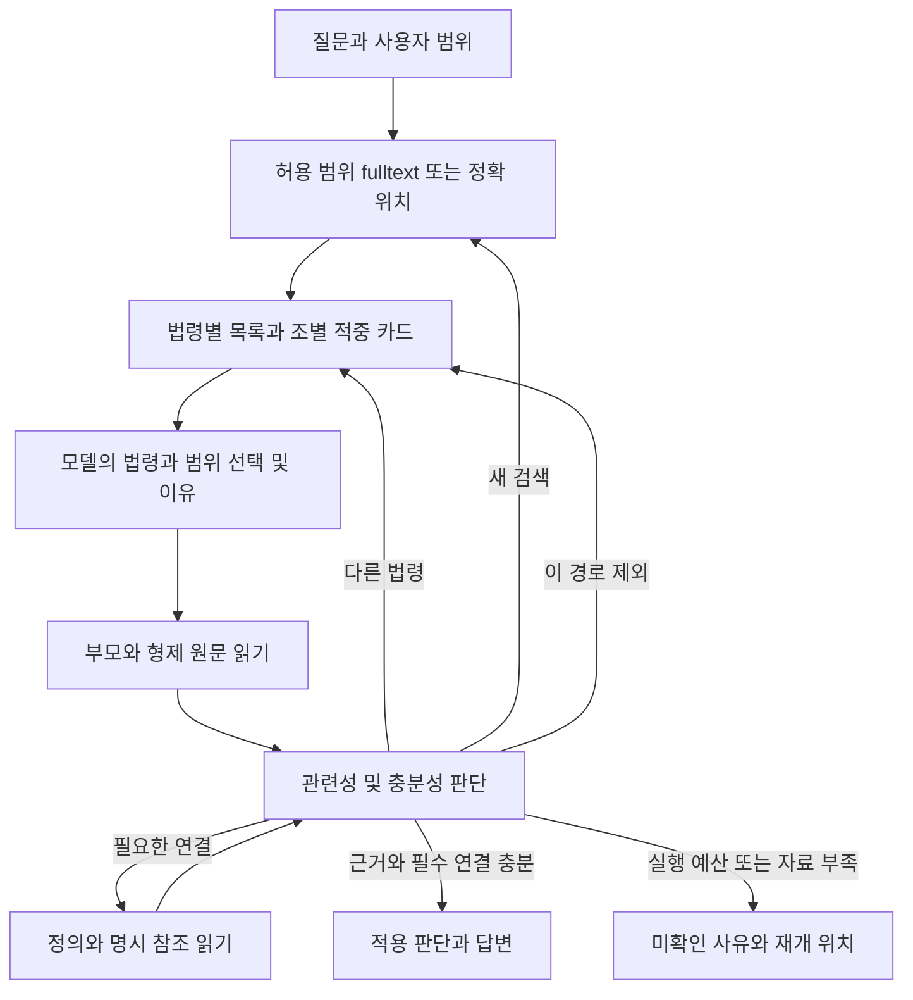

# 법령별 후보 탐색과 부모 범위 읽기 설계

법령별로 검색 후보를 묶어 보여주고, 모델이 실제 적중 원문을 보고 조사할 법령과 읽을 범위를 이유와 함께 선택한다. 선택한 목·호·항은 바로 위 부모의 본문과 형제를 함께 읽는다. 조사 중 다른 법령 후보로 이동하거나 전체 허용 범위에서 재검색할 수 있으며, 채택한 근거의 필수 연결이 미확보된 경우에는 답변 완료를 허용하지 않는다.

대상은 기존 MAIN의 RAG 서빙 단계 `legal-agent-unified-v6`다. 2026년 10월 6일 WSL 작업 코드에 근거한 설계 제안이며, GENOS의 설치 코드·선택 세대·내부 모델 품질을 확인한 결과는 아니다. 구현·품질 실험·릴리스 전환은 별도다. 원문과 최소 단위 색인, 용어집, 명시 참조를 그대로 활용한다.

## 1 핵심 결정

| 구분 | 설계 결정 |
| --- | --- |
| 저장·색인·인용 | 조·항·호·목의 소유 본문과 exact span 유지 |
| 후보 묶음 | 저장된 문서 판본 → 조 → 적중 단위. 법령명만 같다는 이유로 판본을 합치지 않음 |
| 모델의 첫 판단 | 법령 목록과 조별 적중 원문을 함께 보고 복수 법령·읽기 묶음을 선택. 법령명만으로 본문 후보를 제거하지 않음 |
| 선택 후 기본 READ | 적중 단위의 바로 위 부모 subtree와 상위 도입문. 부모 범위가 길면 원문 순서대로 이어읽기 |
| 검색 점수 | BM25를 법령 내부의 적중 결과 정렬·이어보기에 사용. 모델 입력과 적용 판단에서 제거 |
| 다른 법령 이동 | 기존 후보 목록으로 돌아가기와 새 검색을 별도 행동으로 제공 |
| 연결 보류 | 해당 탐색 경로에 귀속. 다른 경로의 조사를 허용하고 최종 채택 근거의 필수 연결만 완료 관문에서 확인 |
| 반복 제어 | 같은 검색·같은 후보·같은 읽기 범위의 무변화 반복을 거부. 새 법령·새 후보 페이지·새 근거·새 쟁점 검토는 진행으로 기록 |
| 파이프라인 | 기존 일곱 checkpoint와 native journal 사용. 별도 검색 에이전트·실행기·정답 평가 LLM 추가 없음 |

사용자가 기대하는 흐름은 `검색 → 어느 법령에 걸렸는지 보기 → 왜 그 법령을 조사하는지 선택 → 부모 묶음 읽기 → 부족하면 다른 법령/재검색 → 근거 확인 후 답변`이다.

## 2 현재 코드에서 확인한 제약

| 근거 | 확인한 현재 동작 | 변경 필요 |
| --- | --- | --- |
| `unit_fulltext.py`, `UnitFulltextIndex.rank_units()` | 소유 본문을 OR 검색하고 FTS rank 순으로 모든 hit의 JSON을 리스트에 담음. `rank()`는 조 ID로 투영 | 본문 전체 hit 리스트를 생성하기 전에 법령·조별 목록과 페이지를 조회 |
| `source_recall_global.py`, `SourceRecall.discover()` | 검색 순위의 역수 점수를 합산하고 후보 수 제한으로 READ 대상 조를 선정 | 새 모드에서는 점수 합산·전역 상위 조 제한으로 법령 목록을 소실시키지 않음 |
| `source_recall.py`, `_discover_articles()` | 전역·문서 중심 회수를 합친 후보에서 선택. 정확 구조 위치가 맞으면 우선 직접 진입 | 직접 진입도 전체 허용 corpus로 돌아갈 수 있게 하고 문서명 힌트와 사용자 문서 제한을 분리 |
| `unit_reading.py`, `discover()` | 회수에서 선택된 조의 최소 단위 hit만 다음 단계에 남김 | 법령 디렉터리를 먼저 생성하고 필요 조의 hit를 지연 조회 |
| `unit_reading.py`, `group_hits()`, `_offer_plan()` | 같은 조의 적중 단위를 묶고 적중 경로의 상위 도입문을 포함. 검색에 안 걸린 형제 본문은 기본 제외. 조별 묶음 순환은 존재 | 선택한 최소 단위의 부모 subtree를 기본 READ로 제공하고 법령별 순환 추가 |
| `unit_selection.py`, `_select_batch()` | 실제 preview와 `laws` 대응표·단위 행을 보고 scope와 이유 선택. 법령 선택 이유는 독립 계약이 아님 | 법령·조 계층 카드와 법령 선택 이유, 경로 상태, 다음 행동을 같은 판단에 포함 |
| `unit_relations.py`, `navigate()` | 선택된 원문의 span을 기준으로 연결 메뉴·필수 읽기·보류 상태 관리 | 연결 탐색을 재개 가능한 한 페이지/작업 단위로 내어 전역 후보 탐색과 교대로 실행 |
| `unit_selection.py`, `_select_batch()` | 연결 pending이 있으면 새 검색보다 연결 계속하기 우선 | 이동·재검색을 허용하되 필수 연결 보류는 유지 |
| `memory_rag.py`, `NativeExecution.stage()` | `needs_fulltext`면 RECALL 재진입. fulltext 후 새 검색어가 없으면 거부 | 검색어 변경뿐 아니라 후보 페이지 이동·검색 범위 변화·경로 상태를 검사 |
| `corrected_memory.py`, `Memory._execute()` | 한 요청의 RECALL 재진입이 한 번을 넘으면 `additional search budget exhausted` | v6의 새 모드는 진행 상태에 결속한 탐색 예산으로 변경. 기존 모드 계약은 유지 |
| `corrected_memory.py`, SELECT progress | READ payload를 포함한 progress hash로 checkpoint 복원 | 재검색이 READ payload를 바꿔도 조사 전체의 활성/보류/제외 상태를 이어받는 checkpoint 계약 필요 |
| `wiki_execution.py`, `ProcedureMemory` | 실제 모델 입력·정책·코드/세대 결속이 동일하면 탐색 판단 재사용 | 새 메뉴·부모 범위·경로 상태와 계약 버전을 재사용 키에 포함 |

현재 로컬 활성 포인터는 `sql-ad-mode-v6-20261006-r1`, generation 41을 가리킨다. 해당 릴리스의 데이터 경로는 `pecab-only-public-main-20260929-v1/generation`이다. 이 관측은 로컬 포인터 확인이며 위 작업 코드와 frozen 릴리스가 전부 같다는 의미가 아니다. `PIPELINE.json`의 v6 프로필에는 과거 `activation=NOT_ACTIVATED` 선언도 남아 있으므로 이 선언만으로 실행 중인 릴리스를 판단하지 않는다. GENOS는 별도 리비전·세대 확인이 필요하다.

## 3 입력에서 최종 답변까지



기존 checkpoint는 `INTENT → PLAN → RECALL → READ → SELECT → ASSESS → COMPOSE`를 유지한다. RECALL은 목록·커서·검색 결속, READ는 현재 표시할 적중 preview의 정상 원문 확보, SELECT는 법령 선택·부모 범위 READ·연결 읽기·다음 후보 탐색을 맡는다. 기존 SELECT 안에서 추가 READ하는 연결을 재사용한다. RECALL 재진입은 새 검색이 필요한 경우에만 수행한다.

법령 선택용 호출과 조 선택용 호출을 매번 따로 만들지 않는다. 첫 SELECT 입력에 법령 목록과 실제 조별 preview를 함께 넣고, 같은 응답에서 법령 선택 이유와 READ 대상을 반환한다. 아직 본문 preview가 없는 법령은 OPEN_LAW로 내용을 요청할 수 있지만, 제목만 보고 법적 적용이나 최종 부적합을 확정할 수 없다.

## 4 범위 계약

세 종류의 범위를 서버가 구분한다.

| 범위 | 생성자 | 의미와 변경 |
| --- | --- | --- |
| `authorized_scope` | 인증 어댑터 | 사용자가 접근할 수 있는 문서 판본 집합 |
| `requested_scope` | 현재 사건 상태와 명시 사용자 요청 | 사용자가 지정한 문서·팀·내규/외규 필터 등의 교집합. 변경은 기존 사건 수정 계약을 따름 |
| `search_view` | 모델의 조사 행동 | 일시적으로 보는 법령·조·검색 조건. `effective_scope` 안에서 이동·확장 가능 |

`effective_scope = authorized_scope ∩ requested_scope`다. 모델이 우선 조사한 법령명은 search_view에만 반영한다. 이름·약칭 적중 또는 PLAN의 law_names만으로 requested_scope를 줄이지 않는다. 반대로 사용자가 특정 법령만 지정한 요청에서는 ‘전체 재검색’도 그 제한 안에서 수행한다. 질문 수정으로 제한을 풀려면 기존 요청 해석·권한 검사를 다시 거친다.

문서 판본 ID, source ID, unit ID, source artifact hash, 원문/store/navigation/fulltext hash, 질문 revision, 적용 시점(알려진 경우)을 모든 조회와 판단에 결속한다. 법령명·조번호가 같아도 다른 판본·실제/모의·내부/공개 문서를 합치지 않는다. 저장된 시행일이 없으면 미확인으로 표시한다.

## 5 검색 결과의 법령별 목록

### 목록을 먼저 만들고 본문은 필요한 페이지만 조회

최소 단위 적중 결과에 전역 top-k를 적용한 뒤 법령별로 묶으면 이미 빠진 법령을 복구할 수 없다. 새 모드는 아래 순서로 처리한다.

1. 현재 승인된 fulltext expression과 effective_scope로 검색한다.
2. 본문 JSON을 전량 적재하지 않고 문서 판본별 `COUNT(DISTINCT unit.key)`와 `COUNT(DISTINCT source_id)`를 집계한다. OR 검색의 중복 hit는 query 집합 내에서 중복 제거한다.
3. 법령 목록을 페이지로 반환하고 전체 법령 수·제시 수·미제시 수·목록 cursor를 남긴다. 실제 집계가 완료되기 전 total은 UNKNOWN이며 추정치를 exact count로 표시하지 않는다.
4. 첫 후보 팩은 법령별로 서로 다른 조의 preview를 순환 제시한다. 같은 법령의 다음 조는 다른 법령의 첫 조 뒤에 제시한다. 긴 법령은 후보 수가 많아도 첫 팩을 독점하지 않는다.
5. 법령을 열면 그 법령의 조별 후보·적중 단위를 조회한다. 미선택 법령은 동일 검색의 cursor로 계속 접근할 수 있다.

이 묶음은 기존 구조 키를 사용하며 추가 임베딩이나 LLM 군집화를 요구하지 않는다. 법령 목록은 명시 위치·문서명 적중을 우선 표시한 뒤 저장 제목과 판본 ID로 안정 정렬한다. hit 수는 검색 현황이며 법적 관련성 점수가 아니다. 법령 내부 조·적중의 노출 순서는 lexical rank와 안정 ID로 정렬할 수 있지만 rank를 모델에게 적용 근거로 전달하지 않는다.

복수 검색어는 독립 query fingerprint를 보존하고 법령 목록은 합집합으로 구성한다. 하나의 적중 단위에 여러 query가 맞으면 match_paths로 모으고 카드는 중복 생성하지 않는다. 동일 법령명에 여러 판본이 있으면 각각 표시하고 버전 선택을 미확인 상태로 둘 수 있다.

### 모델과 화면에 주는 카드

법령 카드: `law_handle`, 실제 문서 판본 ID의 서버 대응, 정식명, 판본 정보, 적중 조·단위 수, 해당 검색어, 조 카드 페이지와 cursor, 실제 읽기/제시 현황.

조 카드: `article_handle`, 표제, 적중 좌표 목록, 실제 적중 발췌와 상위 도입문, 전체 형제 목록, 부모 READ handle, 읽기 완료 범위·미읽기 범위, 추가 조/적중 cursor. preview는 `start_cp/end_cp`, original text hash, 부분 여부를 가진다. 예산상 모든 hit를 한 카드에 담을 수 없으면 미제시 개수와 다음 페이지를 명시한다.

카드의 예시는 다음과 같다. 예시 규정명과 내용은 합성이며 실제 법령이 아니다.

```text
예시 규정 A  [판본 A]
  제10조  신청 대상
  적중: 제2항제1호가목
  상위 도입문: 다음 각 목의 구분에 따라 대상자를 정한다.
  적중 원문: 가. 사업을 새로 시작하는 신청자 …
  함께 읽기: 제2항제1호 전체  [가목·나목·다목]
  나목·다목: 아직 본문 미열람

예시 규정 B  [판본 B]
  제5조  변경 신청
  적중: 제1항
  적중 원문: 기존 신청자가 내용을 변경하는 경우 …
```

모델이 A의 적중 원문을 읽고 현재 쟁점과 맞는 이유를 기록한다. B는 A의 조사를 시작했다고 사라지지 않는다. 모델의 선택 이유는 현재 쟁점과 실제 제시 원문을 연결한 짧은 설명이며 내부 사고 과정 전체를 요구하지 않는다.

## 6 부모와 형제 원문의 기본 읽기

| 선택된 적중 단위 | 기본 읽기 |
| --- | --- |
| 목 | 부모 호의 도입문·모든 목·부모 호 안의 단서 |
| 호 | 부모 항의 도입문·모든 호와 그 아래 목·부모 항 안의 단서 |
| 항 | 부모 조의 도입문·모든 항과 하위 구조·조 안의 단서 |
| 조 | 그 조 전체 |
| 단위가 없는 블록 | 해당 블록·원래 source 범위. 존재하지 않는 부모를 생성하지 않음 |

직접 소유 본문만 필요한 원문 제공 요청은 exact READ를 선택할 수 있다. 일반 법률 적용 질문에서는 부모 묶음이 기본이다. 원문 좌표가 이미 명확한 직접 진입에도 같은 정책을 적용한다.

읽기 묶음의 ID는 `(generation, document_version, canonical_source, parent_unit, scope_policy)`로 서버가 생성한다. 같은 부모 아래의 여러 적중 목은 하나의 묶음으로 합친다. 여러 부모에 적중하면 여러 묶음을 유지하며, 읽은 block/span 합집합으로 중복 READ를 줄인다. 모델이 여러 페이지를 보더라도 묶음 ID는 유지한다.

읽기에는 상위 항·조의 직접 도입문도 붙인다. 이는 `ensure_context()`의 원문·span 검증을 활용한다. 다른 항의 예외, 별표, 시행령, 별도 정의 등 부모 밖의 조건은 연결 탐색/상위 범위 확장 대상이다. 부모 묶음을 읽었다는 이유로 해당 법령의 모든 예외를 확인했다고 표시하지 않는다.

### 긴 부모 묶음

부모 subtree의 실제 원문 순서·목록·전체 block 범위를 먼저 알려준다. page payload는 원문 경계를 보존하며 분할하고, 표에는 실제 저장된 표제·행열 제목·주석을 함께 읽는다. 필요한 맥락이 구조에 저장되지 않았다면 미확인으로 남긴다.

첫 page는 적중 지점만 잘라 전체인 것처럼 보내지 않는다. `group_complete=false`, 읽은/미읽기 좌표, 다음 READ scope/cursor를 표시한다. 실제 model delivery receipt와 span coverage를 분리하며, 서버가 읽었지만 모델에 안 보낸 원문을 판단 완료로 세지 않는다. 해당 묶음을 근거로 적용 판단을 채택하려면 기본 부모 묶음과 상위 조건의 전달·검토가 완료돼야 한다. 조사를 보류하거나 다른 법령으로 이동하는 것은 부분 읽기 중에도 가능하다.

작업 팩의 크기는 이어보기 단위다. 이번 설계에서 제거된 전역 모델 입력 바이트 제한이나 데이터 총량 제한을 재도입하지 않는다. 실제 모델 문맥 길이와 요청 전체 deadline·호출 예산을 넘으면 pending과 정확한 재개 위치를 남긴다. 모든 형제 원문을 하나의 모델 요청에 억지로 넣지 않는다.

## 7 모델의 선택과 다음 행동

동봉한 `navigation-decision-v1.draft.schema.json`은 새 모드의 모델 출력 초안이다. 현재 provider/schema에 등록한 계약이 아니다. 예시는 `DECISION_EXAMPLES.json`에 있다.

모델 입력에는 현재 질문·쟁점, 제시된 법령/조/READ/연결 handle, 실제 원문 preview, 현재 활성·보류·제외 경로 요약, 부족한 근거, 미제시 후보와 다음 cursor가 들어간다. BM25·조별 합산 점수·관련성 임계값은 전달하지 않는다. 모델은 서버 장부·hash·법령명·좌표를 새로 작성하지 않고 handle을 선택한다.

| 행동 | 의미 | 서버 확인 |
| --- | --- | --- |
| `READ_PARENT` | 선택한 적중의 부모 묶음 시작·이어읽기 | 해당 source 안의 검증된 범위, 신규 span 또는 미전달 page |
| `READ_SCOPE` | 제시된 exact·상위 subtree 범위 읽기 | scope가 해당 단위의 READ offer이며 이전 원문·세대와 일치 |
| `OPEN_LAW` | 현재 검색의 다른 법령 후보 열기 | 제시된 law handle, effective_scope 안의 문서 |
| `NEXT_LAWS` | 다음 법령 목록 보기 | 같은 query set와 scope에 결속한 서버 page handle |
| `NEXT_ARTICLES` | 해당 법령의 다음 조 보기 | 해당 law/version의 page handle |
| `NEXT_HITS` | 해당 조의 나머지 적중 위치 보기 | 해당 article의 page handle |
| `FOLLOW_CONNECTION` | 다음 연결 메뉴 또는 선택한 대상 읽기 | 제시된 연결 handle, witness·방향·required extent와 기존 읽기 정책 |
| `RESEARCH` | 새 검색 또는 허용된 전체 범위로 재검색 | 제시된 search-view handle과 queries. 검색 지문이나 누락 회수 상태가 달라야 함 |
| `PENDING` | 근거·자료·실행 예산 부족으로 조사 보류 | 부족 항목·원인·재개 위치 저장. 적용 결론 완료 처리 금지 |
| `FINISH` | ASSESS로 진행 요청 | 서버의 근거·필수 연결·부분 READ·쟁점 coverage 확인 |

`law_decisions`는 조사/보류 법령과 이유다. 법령을 최초 조사 선택할 때 현재 쟁점과 실제 제시 원문/카드에 연결한 이유를 필수 기록한다. 이미 조사한 법령은 새 근거 때문에 선택 이유가 바뀌면 새 이벤트를 남긴다. 복수 법령 조사 가능하며 단일 법령 enum으로 닫지 않는다.

`branch_decisions`는 실제 조사 경로의 유지·보류·제외와 이유다. 제목·검색 점수·읽기 오류·자료 미확보만으로 EXCLUDE할 수 없다. EXCLUDE에는 제시·검토된 원문 refs와 현재 질문의 불일치 설명이 필요하다. 미열람·모호함·조건 미확인은 DEFER다. 제외 상태는 현재 질문 revision에만 적용하며 해당 법령을 corpus에서 영구 제거하지 않는다.

스키마는 형태를 검사한다. 서버는 handle 소유권·제시 여부·질문 revision·issue refs·근거 refs·이유의 공백·행동별 targets/queries/sufficient 조합을 추가 검사한다. 이런 검사는 선택 이유의 법률적 정확성을 인증하지 않는다. 사유가 원문과 사실상 맞는지는 비교 검증 대상이다.

행동별 조합은 다음과 같이 닫는다. OPEN/READ/NEXT/FOLLOW는 제시된 해당 종류의 targets가 있어야 하며 queries는 비운다. RESEARCH는 search-view target과 실제 검색어를 요구한다. FINISH/PENDING은 targets와 queries를 비운다. FINISH만 evidence_sufficient=true와 충분성 이유·현재 근거 refs를 요구하고, 나머지 행동은 false다. EXCLUDE와 READ가 같은 경로에 동시에 지정된 모순 응답은 reader 실행 전에 거부한다. law/branch ID 중복, 타 presentation의 handle, 제시되지 않은 basis/issue refs도 거부한다.

초안 JSON Schema는 저장·검토용이다. 실제 모델 호출에서는 현재 메뉴로 handle enum을 닫고 provider가 지원하는 구조화 출력 형태로 투영한다. 저장 스키마에 있는 uniqueItems/pattern 등을 provider가 지원한다고 가정하지 않고 서버에서 다시 검사한다. 빈 메뉴는 enum=[] 대신 maxItems=0과 서버 검증을 사용한다.

## 8 다른 법령으로 이동하면서 필수 연결을 보존

현재 `selected` 집합과 연결 pending을 하나의 전역 상태로 취급하면 잘못 들어간 경로의 참조가 계속 조사를 붙잡을 수 있다. 새 모드는 조사 경로를 다음처럼 관리한다.

```text
법령 A / 부모 묶음 G-A / 경로 B-A  : DEFERRED
  읽은 원문: 보존
  정의 참조 R-A: 미해결
  부족한 점: 신청 대상이 현재 질문의 대상과 같은지 미확인

법령 B / 부모 묶음 G-B / 경로 B-B  : ACTIVE
  읽은 원문: 확보
  현재 쟁점의 근거 후보
```

A의 R-A가 보류돼도 B의 후보를 열 수 있다. 그러나 A 원문을 최종 근거로 남기면 R-A는 완료 관문에서 계속 미해결이다. 자료가 없다는 이유로 A를 적용 대상이 아니라고 자동 판정하지 않는다.

연결은 `obligation_id`, 출발 evidence/span, 의존하는 경로와 쟁점, 목표 extent, 적용 판단·원문 refs, 상태를 가진다. 하나의 obligation을 여러 활성 경로가 참조할 수 있다. REQUIRED와 CHECK_APPLICABILITY/FOLLOW 범위 검증은 기존 `relation_read_policy.py`를 유지한다.

모델이 B-A를 EXCLUDE하고 서버가 다음 조건을 확인했을 때만 그 경로의 의무를 최종 완료 집계에서 분리한다.

- 제외 이유가 실제 전달·검토한 원문과 현재 사실/쟁점에 연결돼 있다.
- 해당 원문이 다른 활성 경로의 근거·필수 의존·반대 근거로 남아 있지 않다.
- 제외한 경로만으로 확인하던 필수 쟁점이 비어 있으면 그 쟁점은 OPEN으로 되돌아간다.
- 채택한 원문이 요구하는 정의·준용·위임·예외를 제거하기 위한 경로 제외는 거부한다. 공유 의무는 활성 의존이 남으면 유지한다.

분리한 의무는 삭제하지 않고 `DETACHED_BY_BRANCH_EXCLUSION`과 제외 결정·원문 refs·당시 question revision을 남긴다. 이는 법령 자체의 법적 적용 여부가 확정됐다는 뜻이 아니다. 경로를 다시 활성화하거나 조건·판본이 바뀌면 관련성을 재검토하고 필요한 의무를 복구한다.

READ 장부는 누적 보존한다. 최종 채택 집합은 경로 상태에 따라 바뀔 수 있다. 현재 코드의 ‘이미 읽은 범위를 좁히지 않는다’ 제약은 READ coverage에는 유지하지만, 그것을 ‘한번 선택한 원문은 최종 근거에서 뺄 수 없다’로 적용하지 않는다. ASSESS에 보내는 원문과 claims의 source IDs는 현재 채택 집합만 포함한다.

## 9 반복과 예산 및 중단 재개

### 반복의 기준

검색 지문은 compiled fulltext terms/expression, query set, effective_scope, search_view, index hash로 만든다. 단순 띄어쓰기·검색어 순서만 바꿔 같은 OR expression을 만드는 요청은 새 검색으로 세지 않는다. 기존 좁은 search_view에서 전체 effective_scope로 확대하거나, 기존 결과의 미제시 페이지를 여는 경우는 검색어가 같아도 새로운 정보 회수다.

행동 지문에는 question revision, issue refs, law/group/connection handle, 요청 범위·cursor, 입력/정책 hash를 포함한다. 같은 행동 지문과 같은 현재 상태에서 이미 전달된 span만 다시 요청하면 중복으로 판단하고 가능한 다른 법령·다음 페이지·새 검색을 모델에 제시한다. 같은 원문을 새로운 쟁점에 적용하는 판단은 issue 상태가 바뀌므로 허용한다. 이유 문장만 바꾸는 반복은 진행으로 보지 않는다.

진행은 새 후보 페이지의 실제 제시, 새 evidence/span 전달, 묶음 coverage 진전, 연결의 해소, 원문에 근거한 경로/쟁점 상태 변화로 기록한다. 각 진행의 fingerprint를 보존하여 상태 왕복만으로 예산을 우회하지 못하게 한다. 모델 호출 timeout·실행 오류는 진행으로 세지 않는다.

현재 `reentries>1` 상수는 새 v6 모드의 중단 기준으로 사용하지 않는다. 대신 선택 프로필의 실제 전체 deadline·model calls·READ actions와 명시 `search_rounds_per_request` 설정을 함께 사용한다. 이 설정의 숫자는 GENOS 내부 모델/문맥·실제 workload 확인 후 비교 계획에서 고정하며 이 설계에서 임의 기본 성능값을 선언하지 않는다. continuation에서도 현재 요청 예산은 재진입으로 초기화하지 않는다.

### 저장과 재개

조사 checkpoint는 `(case_id, goal_id, question_revision, effective_scope_hash, source_binding, policy_version)`에 결속한다. 기존 stage_progress를 이용하되 새 계약 namespace와 현재 RECALL/READ head refs를 저장한다. 검색 round별 child checkpoint는 query-set fingerprint로 분리한다. 재검색해도 활성/보류/제외 경로, 후보 cursor, 읽은 coverage, 의무 의존관계는 상위 조사 checkpoint에서 유지한다.

서버 handle은 실제 ID와 binding으로 안정 생성한다. 매 팩의 `U001` 같은 표시용 번호는 UI 별칭으로만 사용한다. 출력 handle은 현재 제시된 목록으로 닫고 cursor는 서버가 발급한 opaque handle을 선택한다. 모델이 raw cursor·문서 ID·블록 범위를 만들게 하지 않는다.

수락한 모델 결정은 READ 실행 전에 operation ID와 입력 hash로 저장한다. 실행된 page/evidence는 현재 reader 검증과 coverage 원장에 기록한다. 성공 receipt 저장 후 checkpoint가 중단된 경우 재개 시 operation과 evidence receipt로 합집합을 복구하고 재전송 여부를 확인한다. 다른 요청이 question revision을 바꾸면 기존 lease/revision 검사로 늦은 판단 적용을 거부한다. 모델 호출 동안 장기 SQL write lock을 잡지 않는다.

판본·원문/hash·정책·권한이 바뀌면 이전 결정의 직접 재사용을 거부한다. 유효한 예전 원문도 새 질문의 적용 여부는 재판단한다. procedure replay는 같은 메뉴·전달 원문·쟁점·경로 상태·정책일 때만 허용한다. 과거 답변을 정답이나 적용 근거로 자동 사용하지 않는다.

## 10 완료와 미확인 응답

FINISH는 모델의 요청이며 서버는 다음을 확인한다.

1. 현재 질문의 필요한 쟁점마다 근거 상태와 검토 이유가 존재한다. 모델이 제안하는 쟁점 목록은 요청 요구를 삭제하지 못하며 기존 질문 요구 추적과 결합한다.
2. 채택한 원문은 현재 판본·범위에서 검증된 evidence이며 실제 모델에 전달된 범위다.
3. 채택 부모 묶음의 필요한 페이지·상위 조건이 완료되고 현재 claim에 필요한 필수 연결이 해소됐다.
4. 채택 근거의 적용 여부를 바꾸는 미검토 예외·보류 연결·공유 의존이 남아 있지 않다.
5. 법령 선택 이유·원문 범위 이유·충분성 이유를 현재 원문 refs에 결속했다.

남은 검색 후보가 있다는 이유만으로 전부 읽도록 강제하지 않는다. 반대로 후보/메뉴/예산을 다 썼다는 사실은 근거 충분성을 뜻하지 않는다. 완료는 이번 질문·읽은 근거·발견된 필수 연결에 대한 상태이며 모든 법령의 모든 예외를 탐지했다는 보장이 아니다.

PENDING은 `UNREAD_GROUP_PAGES`, `ACTIVE_REQUIRED_CONNECTION_PENDING`, `NO_MATCH_FOR_QUERY`, `AMBIGUOUS_VERSION`, `STRUCTURE_GAP`, `MODEL_FAILURE`, `DEADLINE`, `NO_PROGRESS` 등의 실제 원인과 부족한 쟁점·재개 handle을 저장한다. ‘이 검색에서 적중 없음’을 ‘관련 법령 없음’으로 바꾸지 않는다. 부분 확인이 가능한 내용은 근거와 함께 표시할 수 있지만 부족한 쟁점의 적용 결론은 확정하지 않는다.

API에서는 기존 미확인/오류 응답 경로와 분리해 소비자가 조사 보류를 식별할 수 있도록 버전 있는 내부 investigation status를 추가한다. 엄격한 `term-runtime-v1` Request/Claim에 임의 필드를 추가하지 않는다. 반환 위치는 확장을 허용하는 assembly.term_agent의 신규 버전 payload로 지정하고 실제 port schema 검사 후 이행한다. 기존 필드가 확장을 허용하지 않는 위치면 내부 상태와 기존 unresolved/error 표현을 사용한다. 정상 완료의 answer/claims 인용 계약은 유지한다.

PENDING은 checkpoint를 저장하고 ASSESS/COMPOSE와 READY publication 전에 중단한다. 현재 `Memory._execute()`의 마지막 route 생성·READY 갱신을 그대로 통과시키지 않는다. 이미 존재하는 과거 답변 route는 역사 기록으로 유지하되 이번 요청의 pending 답변으로 자동 재게시하지 않는다. 내부 investigation status와 현재 request/ref를 public adapter와 workflow가 같은 상태로 표시하도록 연결한다.

## 11 화면과 감사 로그

처음에는 법령별 결과 트리를 보여준다. 각 법령 아래 조별 적중 위치를 모으고 펼치면 실제 적중 원문·부모 목록·읽기 현황을 표시한다. 검색 점수는 기본 화면·모델 입력에서 숨기고 진단 로그에만 남길 수 있다.

조사를 진행할 때는 기존 Reasoner 요약을 갱신한다. 항·호·목마다 새로운 카드를 누적하지 않는다. 최종 judgment_view에는 다음 내용을 기존 단계와 같은 route/hash 결속으로 투영한다.

- 조사한 법령과 선택 이유, 실제 근거로 채택한 법령의 구분.
- 적중 위치와 실제 부모 READ 범위·형제 원문·완료 여부.
- 다른 법령으로 이동·재검색·경로 보류/제외 이유.
- 필수 연결의 해소/보류·현재 완료 판정에 포함되는 의무.
- 표시하지 않은 후보·미열람 원문·중단 원인과 전체 감사 기록 위치.

표시용 선택 이유를 별도 LLM으로 생성하지 않는다. 이유가 저장되지 않았으면 그 사실을 원장에 표시하고 새 결정에서 이유를 받는다. 과거 완료 응답에 새 이유를 추정해 붙이지 않는다. 외부 전달 가능한 공개 로그와 GENOS 내부 질문/원문 로그는 기존 접근·반출 계약을 따른다.

## 12 변경 지도

아래 신규 함수 이름은 구현 제안이다. 기존 모듈 안에 연결하며 runtime/research 이중 실행 경로를 만들지 않는다.

| 파일과 기존 책임 | 제안 변경 | 소비자·이행 |
| --- | --- | --- |
| `service.py`, `service/service.py` | 기존 명시 generation·v6 진입 유지. candidate policy binding 검증 | 기존 `/v1/rag/ask`, GENOS workflow. 별도 API 실행기 없음 |
| `unit_fulltext.py`, `UnitFulltextIndex` | `law_groups_page`, `article_groups_page`, `hit_page` 추가. 그룹 집계와 본문 페이지 분리 | `SourceRecall` 새 모드. `rank/rank_units`는 legacy 호환 보존 |
| `fulltext.py` reader 선택 | unit/article manifest별 grouped reader capability 노출 | 기존 조 FTS도 지원. 최소 단위 hit가 없는 세대에 가짜 unit hit 생성 금지 |
| `source_recall.py`, `unit_reading.discover` | `law-first-navigation-v1`일 때 grouped 조회 사용. 전역 점수 합산 top-k로 후보 법령을 제거하는 경로 우회 | RECALL의 versioned catalogue payload. 실제 미제시 후보 cursor 유지 |
| `unit_reading.py`, `offer_plan/read/ensure_context` | 부모 묶음·형제 목록·block coverage·page delivery 계약 추가 | SELECT READ. 정확한 기존 span·차집합 READ 검증 유지 |
| `unit_selection.py` | 계층 카드·law 이유·branch 상태·next action의 통합 판단. 점수 projection 제거 | SELECT 최종 selected_originals/selected_evidence와 신규 investigation payload |
| `unit_relations.py`, `navigate` | 한 번에 처리할 연결 메뉴/읽기를 checkpoint 가능한 step으로 분리 | SELECT가 다른 법령 탐색과 교대로 호출. 기존 witness와 scope 검증 유지 |
| `relation_read_policy.py` | 관계별 REQUIRED/CHECK_APPLICABILITY 판단 규칙 유지 | obligation의 활성 의존관계를 별도 집계. 스킵 우회 추가 없음 |
| `memory_rag.py`, `NativeExecution.stage` | 조회/READ/SELECT 새 계약 연결, 다른 법령 OPEN과 RESEARCH 분리, 활성 근거로 ASSESS 구성 | 기존 일곱 checkpoint와 기존 인용 검증 |
| `unified_rag.py`, `UnifiedRag` | 신규 탐색 코드·계약·정책·fulltext reader를 source binding/code hash에 결속 | checkpoint와 procedure의 과거 결정 재사용을 정확히 무효화 |
| `corrected_memory.py`, `Memory._execute` | 새 namespace의 조사 progress와 search round 저장, v6 새 모드의 재진입 상수 교체 | v5/legacy 기본은 유지. 재개·revision·publication 관문 연결 |
| `shortcut_cases.py`, `wiki_execution.py`, `procedure_memory.py` | 새 contract/policy/menu/branch 상태를 shortcut·procedure 결속에 포함 | 같은 v4 DB generation에 새 payload namespace 저장. 과거 경험을 새 정책으로 무검증 replay 금지 |
| `workflow_tiers_policy.py`, 선택 profile, `PIPELINE.json` | 신규 `candidate_navigation` 필드의 명시 allowlist·타입·정책 hash 검증 | 현재 profile의 unknown-field 거부를 함께 수정. 유효한 후보 profile에만 opt-in |
| `judgment_view.py`, `readable_log.py`, GENOS workflow | 법령 트리·이유·부모 READ·전환·미확인 원인 렌더링 | 기존 최종 답변·AD 화면·누적 요약 유지. workflow 변경 시 편집기에 별도 반영 |

신규 candidate_navigation 설정에는 mode, grouping/order 정책, parent read 정책, page 크기, search round 예산, progress contract 버전을 넣는다. 페이지 크기는 기존 READ/모델 실제 문맥과 함께 설정하며 값을 품질 인증 수치로 해석하지 않는다. 설정을 바꾸면 policy hash와 procedure replay binding도 바뀐다.

## 13 데이터와 계약 이행

원문·navigation·용어집·unit fulltext의 저장 데이터는 재구조화/재색인 없이 읽는다. 현행 unit table에 문서/source 키가 있어 grouped 집계가 가능하다. 물리 쿼리의 속도는 아직 측정하지 않았으며 FTS rank를 GROUP BY 집계 점수로 억지 사용하지 않는다. 그룹 counts 쿼리와 해당 법령 내 적중 정렬 쿼리를 나눈다. 기존 DB에 새 index를 직접 추가하지 않는다. 물리 최적화가 필요하면 별도 파생 세대와 manifest/hash를 만든다.

조 단위 FTS 호환 모드는 조별 적중과 source store의 실제 자식 구조를 보여준다. 항·호·목 적중이 없는 색인에서는 ‘조 적중’으로 표시하고 자식 단위 본문이 fulltext에 걸렸다고 추정하지 않는다. 선택 뒤에는 실제 구조를 사용해 부모/조 범위를 읽는다. 부모가 모호하거나 canonical source 밖이면 해당 READ offer를 보류하고 구조 미확인을 표시한다.

검색 cursor는 query expression/hash·scope·generation·정렬 키·계약 버전에 결속한다. 여러 요청 간 connection 객체나 Python 메모리 리스트에 의존하지 않으며 opaque page handle로 재개한다. 과거 exact count와 새 query count를 혼용하지 않는다. 실패한 집계는 pending으로 남기고 숨은 top-k 결과로 정상 완료를 대체하지 않는다.

새 checkpoint는 기존 SQL store의 versioned payload로 시작한다. 별도 Redis나 NFS의 임시 파일 DB를 도입하지 않는다. 테이블/열 변경이 실제 구현에서 필요해지면 새 SQL store generation과 migration receipt를 사용하고 기존 store pointer·snapshot으로 롤백한다. 기존 승인 경험·completed journal·ADR은 수정하지 않는다. 후보 raw-hit 대량 배열을 checkpoint나 model journal에 반복 복사하지 않는다.

## 14 대표 실행과 실패 시나리오

| 시나리오 | 실행과 저장 | 완료 또는 복구 |
| --- | --- | --- |
| A의 가목 적중, 나목이 적용 대상을 구분 | 법령 선택 이유 → 부모 호 묶음 → 가/나/다목 정상 READ·전달 → 관련성 검토 | 형제 조건을 포함해 쟁점 판단. 가목 preview만으로 FINISH 거부 |
| A의 적중 단위가 많은데 B가 실제 대상 | 법령별 목록에 A/B 유지 → 서로 다른 법령 preview → B OPEN | A의 hit 수나 전역 순위만으로 B 소실 금지 |
| A를 먼저 읽고 틀린 경로임을 발견 | 실제 원문 refs로 A 경로 제외 → B OPEN → 최종 채택 변경 | READ 감사는 유지, A의 독립 의무는 detached. B 의존·반대근거면 의무 유지 |
| A의 정의 연결이 미해결 | A DEFER → B 조사 → 필요 쟁점 재검토 | A를 근거로 쓰면 pending 지속. 단순 보류만으로 필수 정의를 해소했다고 표시 금지 |
| 같은 검색어로 다른 법령 보기 | 저장 후보의 OPEN/NEXT 또는 좁은 view 확장 | 검색어 변경 없이 이동 가능. 의미 없는 같은 page 재요청은 거부 |
| 새 검색어가 같은 OR expression | query fingerprint 대조 | 기존 결과 다음 page 또는 다른 실제 검색 표현 요청 |
| 법령 B가 현재 검색에서 안 걸림 | 현재 결과로 근거 부족 확인 → RESEARCH로 원문 표현/쟁점 변경 | 현재 적중 없음으로 관련 법령 부재 결론 금지 |
| 부모 항이 길거나 표 포함 | 부모 구조 목록·page cursor → 정상 원문 이어읽기 | 미읽기/미전달 page를 완료 처리하지 않음. 다른 법령 이동 가능 |
| 두 판본이 같은 제목·조번호 | 별도 law handle·판본 hash·적용 시점 표시 | 판본 불명확이면 질문/자료 미확인. 자동 병합 금지 |
| 사용자 문서 제한/권한 감소 | effective_scope 변경 → handle·decision binding 무효화 | 제한 밖 B 표시·읽기·재사용 거부 |
| 모델이 잘못된 handle/빈 이유 반환 | 현재 동일 input/menu에서 계약 오류 수정 요청 | reader 실행 전에 거부. 수락/거부 출력 모두 기록 |
| 모델이 제외를 반복해 중요한 예외 제거 시도 | 의무의 채택 span·공유 의존 확인 | active 필수 연결 남으면 FINISH 거부. 의미적 오판 잔여 위험은 별도 평가 |
| READ 성공 직후 프로세스 중단 | operation/evidence receipt·coverage 복원 | 같은 질문·세대이면 이어읽기. 늦은 revision에는 적용 거부 |
| 추가 검색이 더 필요 | 실제 진행과 request budget 확인 → 다음 round | 일률적 두 번째 재검색 거부 제거. 실제 한도 종료는 pending |

## 15 검증과 도입 순서

### 구현 계약 검사

법령 A에 적중이 집중된 입력에서 B가 후보 목록·후속 OPEN에 남는지, 같은 부모 hit가 한 묶음인지, 부모/형제/상위 도입문이 실제 span으로 확보되는지, partial/delivered 상태를 구분하는지, branch 제외가 공유 의무를 제거하지 않는지, 같은 검색어 이동과 무변화 반복이 구분되는지 확인한다. 반드시 조 FTS·unit FTS, unit 없는 블록, 서로 다른 판본, 긴 표, 권한/세대 변경, 중단 재개를 포함한다.

기존 compact 용어집 reader, AD R2, 판단 표시, 연결 범위 검증, 차집합 READ, 기존 7단계 payload 소비자, shortcut/procedure 재사용의 회귀도 확인한다. 코드 ZIP 검사는 설치된 predecessor 보존과 manifest/engine pin 결속까지 별도로 필요하다.

### 품질 비교 계획

이 문서는 실험을 시작하지 않는다. 구현/모델 비교를 실행하기 전 실험 표준 두 문서를 끝까지 읽고 동일 scope reservation을 확인한 뒤 신규 ADR을 선점한다. baseline은 실제 선택 릴리스·코드·데이터·정책 hash로 고정하고 변경하지 않은 단계도 결속한다. 현재 설계는 부모로 사용할 완료 arm이나 승격 자격을 주장하지 않는다.

독립 표본은 원문 근거가 확인된 업무 쟁점/사례다. 같은 사례의 의역을 별개 독립 질문으로 과대 계산하지 않는다. 비교 조건에는 ‘A가 lexical로 우세하지만 B가 적용 대상’, 형제의 조건/예외, 긴 부모 묶음, 여러 법령의 결합, unresolved link, 좁은 사용자 범위를 포함한다.

| 지표 | 분모와 측정 방식 | 도입 판단 |
| --- | --- | --- |
| 필요한 법령 후보 보존 | 정답 근거 법령별로 목록·후속 OPEN 가능 여부 | 모델 판단과 별도로 구조적 탈락 검사 |
| 최종 근거/조건 확보 | 사례별 전문가 원문 근거와 모델에 실제 전달된 span 비교 | 원문·형제 조건·필수 참조 누락 회귀 허용치를 사전 고정 |
| 잘못된 첫 진입에서 회복 | 의도적으로 첫 후보가 틀린 독립 사례 | 다른 법령으로 이동·올바른 근거 채택·pending의 정직성 |
| 반복 | 사례별 동일 행동 지문, 신규 정보 없이 호출한 횟수 | 예산 상향으로 반복을 숨기지 않음 |
| 자원·지연 | 요청별 실제 model calls/input/output tokens, READ 신규 문자, peak RSS, SQL 시간, 총 elapsed | 모델 내부와 외부·WSL/GENOS를 구분. 평균으로 p95를 추정하지 않음 |
| 전체 답변 | 같은 사례의 근거·적용·제한 사항에 대한 독립 판정 | preview 선택 성공만으로 최종 품질 통과 처리 금지 |

GENOS 실제 내부 데이터·모델의 성능은 현장 검증한다. 외부 비교는 허용된 공개 범위 또는 계약이 같은 명시 모의 데이터만 사용하고 승인 source/model 범위를 넘기지 않는다. 실험 evaluator는 offline 판정만 수행하며 제품 원문·답변을 수정하지 않는다.

### 도입 패키지

구현 후보는 명시 policy/profile로 선택하며 기본 registry에 자동 연결하지 않는다. 계약 검사 후 품질 비교·전체 연결 검증을 거쳐 별도 MAIN 승격 절차를 적용한다. GENOS 반입 시 현장 실행은 `python3`, 기본 checkout은 `~/DEV`다. 코드 백업/apply, 실제 generation gate, Git commit/push, 코드서빙 새 리비전 배포, workflow 편집기 반영, workflow 테스트 질의는 별도 receipt로 확인한다.

롤백은 이전 코드/profile·서빙 리비전·필요 시 SQL store generation을 함께 선택한다. 원문/NFS generation은 이번 읽기 정책만으로 변경하지 않는다. 신규 버전 checkpoint는 이전 reader가 실행하지 않게 하고 이전 완료 기록은 보존한다. 기존 코드가 새 profile 필드를 모르는 상태에서 policy만 되돌리는 불완전 롤백은 금지한다.

## 16 기대효과와 비용의 판단

법령별 목록 보존·형제 원문 확보·다른 법령 이동은 구현 계약으로 확인할 목표다. 실제 적용 판단의 개선·호출/시간 절감은 미측정이며 보장하지 않는다. 부모 묶음은 호출을 줄일 수 있으나 긴 항/조에서는 입력 token과 SQL/READ가 늘 수 있다. 별도 법령 gate 호출은 추가하지 않지만 조사 이동·재검색은 호출을 늘릴 수 있다.

| ID | 지표와 종류 | 단위·분모와 식 | 현재 판단 |
| --- | --- | --- | --- |
| C1 | 비용 차이, 계산식 | 요청당 비용 차이 = Σ모델 호출(input tokens×실제 입력 단가 + output tokens×실제 출력 단가)의 후보−기준 + SQL/READ/상태 저장 운영 비용 차이 | 실제 token·내부 운영 단가 미확인, 금액 미산정 |
| C2 | 묶음 이득, 계산식 | 기준의 별개 단위 읽기/판단 비용 − 후보의 부모 묶음 읽기/판단 비용 | 절감이 양수인 조건에서 이득. 큰 부모·낮은 관련성에서는 악화 가능 |
| C3 | 상태 크기, 목표/미확인 | 요청별 checkpoint bytes·peak RSS. raw hit 전체 배열 복제를 없애고 선택 page·상태·refs 저장 | SQL 집계 임시 공간·실제 RSS는 구현 후 측정 |
| C4 | 일정, 미확인 | grouped 조회, READ 정책, selector/의무 상태, 재개, 표시, 계약/품질 검증, 반입의 작업량 합 | GENOS 내부 모델·현장 대기 포함 일정 미산정 |

손익분기는 기존의 단위별 반복 비용 절감이 추가 형제 원문·전환·저장 비용과 같아지는 지점이다. 같은 비용이라도 중요한 조건 누락을 줄이는지를 별도 판정한다. 성능 회귀가 있으면 부모 페이지 단위·candidate presentation을 조정하되 원문 미열람을 완료로 바꾸거나 법령 후보를 조용히 버리는 방식은 사용하지 않는다.

## 17 자체 검토와 남은 위험

자체 검토는 설계 내부의 연결·계약 대조이며 독립 감독 검토나 실제 품질 인증이 아니다. 핵심 잔여 위험은 모델이 이유를 써도 법령 관련성·예외 적용을 틀릴 수 있다는 점이다. 서버 검사는 출처·범위·의존·완료 상태를 보장하는 경계만 맡는다.

추가 구현 전 확인할 사항은 grouped SQL의 큰 corpus 쿼리 계획과 peak RSS, provider의 실제 문맥/출력 계약, 기존 journal에서 새 checkpoint refs를 저장하는 방식, partial/pending의 정확한 응답 port, GENOS의 실제 code/data binding이다. 계약 초안 예시의 스키마 검증은 실행 가능한 제품 구현이나 실제 법률 정확도 검증을 뜻하지 않는다.

근거 경로와 관측 파일 SHA256은 [SOURCE_EVIDENCE.json](SOURCE_EVIDENCE.json)에 보존한다. 기존 [원문 관계와 최종 출처표 설계](../../ARCHITECTURE/SOURCE_RETRIEVAL_AND_PROVENANCE.md)의 exact span·서버 생성 출처 원칙을 유지하며, 그 과거 관측을 현재 완료 기능으로 승계하지 않는다. 현재 진입점은 [MAIN](../../../../00_SYSTEM/ARCHITECTURE.md), [GENOS](../../../../GENOS.md), [데이터 계약](../../../../00_SYSTEM/DATA_MODEL.md), [최소 단위 fulltext](../../OPERATIONS/MINIMUM_UNIT_FULLTEXT_20261002.md), [조사 루프 R3](../../../../08_DEPLOYMENT/GENOS/handoffs/rag_control_flow_20261006_r3/README.md)다.
