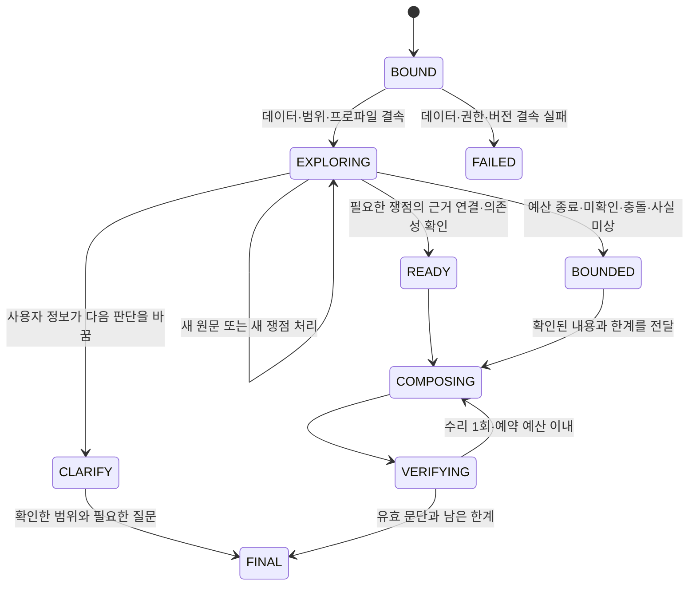

# Agent Legal 더블하네스 상세 진단·구현 설계

- 문서 상태: 제안 v1, 2026-09-19. 제품 코드·활성 릴리스·진행 중인 ADR을 변경하지 않은 설계 산출물이다.
- 판정: **두 하네스의 책임 분리는 유지하고, 원문 구간·판단 상태·예산·서빙 계약을 연결하는 실행기를 구체화한다.**
- 작성 방식: 원자료·동결 코드·저장된 모델 요청을 대조한 자체 검토. 신규 모델 실행·재채점·성능 비교 실험은 수행하지 않았다.
- 기준: Git `a3ac254cc8fba708e39cf37482707a5570fd388d`와 작업 문서, 완료 ADR-0472 rev-001, 진행 ADR-0473 rev-001. 자세한 해시는 `sources.json`에 보존한다.

## 1. 결정할 구조

도메인 하네스는 **질문에 필요한 법률상 확인 사항, 근거 자격, 미확인·충돌의 의미**를 정한다. 에이전트 프로파일은 **모델·문맥·읽기 순서·도구 수·재시도·표현 방식**을 정한다. 실행기는 두 설정을 받아 실제 상태와 자원을 관리한다. 실행기는 별도 도메인 판단이나 세 번째 하네스를 소유하지 않는다.

현재 문제는 규칙 문구의 양보다 경계의 불일치에 있다. 서버가 읽은 자료, 모델이 받은 자료, 모델이 채택한 자료, 조립기에 들어간 자료, 최종 주장이 인용하는 자료가 서로 다르다. 이 경계를 정확히 기록하고 보존하는 것이 장부 확대보다 먼저다.

제안의 주요 결정은 다음과 같다.

1. 원문을 `조 ID + 앞 6,000자`로 넘기지 않고 **원문 블록·구간과 해시**로 전달한다.
2. 확인 장부는 질문에 필요한 항목만 관리한다. 모든 후보나 모든 유형의 칸을 채워야 답할 수 있는 구조는 채택하지 않는다.
3. 답변 관문은 **충분한 범위의 답변 / 한계를 밝힌 부분 답변 / 추가 질문 / 시스템 실패**를 구분한다. 예산 부족을 규정 부재로 바꾸지 않는다.
4. 모델은 채택·제외·쟁점 연결을 제안하고 서버가 상태를 바꾼다. 제목을 열었다고 법률 근거로 자동 승인하지 않는다.
5. 자유 서술 조립기를 유지한다. 원문 핸들 검증, 주장별 출처 연결, 누락·충돌 상태 표시를 코드로 붙인다. 체크리스트 전체를 다시 작성시키는 조립 감사 호출은 기본 경로에서 제외한다.
6. 기존 `/v1/rag/ask`와 retrieve → select → assemble → answer를 재사용하되 **명시적인 어댑터와 엔진 선택 변경**을 한다. 프로파일 이름만 추가해 호환된다고 간주하지 않는다.

첫 적용 범위는 현재 완료 후보가 다룬 공개 출처의 저장 판본 질의다. 실제 내규의 사용자별 권한, 과거 시행일별 법률 적용, 판례 해석, 사람 피드백의 검색 반영은 각각 선행 계약을 갖춘 뒤 확장한다. 제목이나 출처 문자열만으로 권한·시점·법적 효력을 확정하지 않는다.

## 2. 현재 실행 경로와 설계상 연결 공백

### 2.1 작업 코드의 서빙 경로

```text
GENOS 채팅 workflow.call_code_serving
  → service.service → _normalize → _call
  → semantic_runtime.app.ask
  → Pipeline.run [현재 legal-rag 고정]
  → stages.retrieve → Pipeline.plan → 선택된 agent.retrieve
  → stages.select [state.selected_ids로 후보 필터]
  → stages.assemble → term_agent.assemble
  → stages.answer → term_agent.answer
  → app가 run JSON 저장 → workflow.render
```

`Pipeline.__init__`는 `navigation-loop-v1`, `document-navigation-v1`, `definition-scope-harness-v1`, `term-agent-v1`만 선택한다. `Pipeline.run`은 `legal-rag`를 고정 참조하며 각 단계의 스키마·엔진 manifest·코드 해시를 확인한다. `stages.module()`은 assemble/answer를 `term_agent` 모듈로 고정 연결한다.

따라서 새 JSON 프로파일만 등록하면 실행된다는 기존 문서의 설명은 불충분하다. 프로파일 선택 또는 구현 분기, 새 결과의 변환, 단계별 실행 횟수, 엔진·스키마 해시 갱신까지 포함해야 한다.

### 2.2 현재 실험 후보 경로

```text
06_TOOLS/EXPERIMENTS/adr_0472/run_loop.py
  → 동결 후보 패키지를 sys.path 우선 삽입
  → LegalIndex + ReferenceResolver + Search + Locator
  → Loop.run [탐색과 조립을 한 번에 수행]
  → answer_from_evidence → compose → render → check
  → {answer, cards, trace, evidence_source_ids, usage ...}
```

후보의 `Answer{text,citations,findings,composition}`는 서빙 `Answer`와 다르다. 서빙에는 query/generation/store 해시, claims.source_ids, unresolved, provider_receipt가 필수다. 양쪽 최상위 스키마는 추가 속성을 허용하지 않는다. `citations`나 `ledger`를 최상위에 그대로 추가할 수 없다.

### 2.3 실제 선택 상태

로컬 활성 포인터는 `document-navigation-rag-20260917-v2`, generation 16, quality_certified=false다. 이 설계는 포인터를 변경하지 않는다. GENOS 현장 접속·프로세스·모델 결과는 확인하지 않았다. 현재 작업 코드의 연결 결함을 현장 장애가 발생했다는 사실로 일반화하지 않는다.

ADR-0473은 검토 기준 시점 in_progress다. S1 위임 짝 자동 편입은 관문에 미달하여 `c4_on_for_loop4_flash=false`다. 완료 여부와 최종 성능은 그 ADR의 확정 기록을 다시 확인해야 한다. 진행 후보를 새 설계의 완료된 부모 arm으로 지정하지 않는다.

## 3. 추가로 확인한 문제와 이전 판정 보정

이전 검토의 DH-01~07은 유지하며 새 근거를 연결한다. 문서에서 대기로 표시한 장부·분류·피드백은 별도의 구현 선행 조건이다.

| ID | 심각도 | 확인한 문제 | 영향·근거 | 이번 설계의 대응 | 문서 / 코드 상태 |
|---|---|---|---|---|---|
| DH-01 | 높음 | 미확인과 규정 부재가 혼재하고 프로파일별 문구가 판단 조건을 바꾼다 | harness.STATUSES, composer.ANSWER_RULES_V3 | §5 장부와 도메인 불변 조건 | 설계 반영 / 미구현 |
| DH-02 | 높음 | 없는 인용 핸들은 지워도 문장은 남는다. 부정 반전 검사도 없다 | 기존 모의 검사 재현; citations.render/checker.check | §9 문단 단위 주장·인용 검사 | 설계 반영 / 미구현 |
| DH-03 | 높음 | 탐색에서 본 구간을 조립 때 다시 조 앞부분으로 바꾼다 | Loop의 article.text()[:6000] | §6 구간 보존·커버리지 | 설계 반영 / 미구현 |
| DH-04 | 높음 | 명시적으로 버린 카드도 채택 0 fallback에서 근거가 된다 | rev-003과 rev-004 fallback | §7 명시 제외 재승인과 부분 답변 | 설계 반영 / 미구현 |
| DH-05 | 중간 | 카드 몫 0에서 `rest[-0:]`가 전체 목록이 된다 | 상한 2·채택 2·잔여 1 모의 검사에서 3장 | §8 문맥·시도 예산 | 설계 반영 / 미구현 |
| DH-06 | 중간 | 생성 카드 수를 모델 노출 수로 기록 | 저장된 요청 356개와 최종 원장 비교 | §12 전달 영수증 기준 계측 | 실제 차이 확인 / 미구현 |
| DH-07 | 중간 | 금액 누락을 비용 0으로 집계, 호출 지연과 문항 지연 혼동 | Gemini usage 176개 금액 필드 없음 | §13 비용 종류·분모 명시 | 환산 반영 / 기존 기록 미수정 |
| DH-08 | 높음 | GENOS 브릿지의 channel/session_id/user_id/request_id가 질의 본문으로 전달되지만 app·Request는 거부 | 실제 _normalize를 모의 입력에 실행하고 현재 Request로 검증해 거부 재현 | §10 전송 메타데이터와 질의 본문 분리 | 설계 반영 / 미구현 |
| DH-09 | 중간 | 브릿지는 claims.evidence_ids를 읽지만 현재 답변 계약은 claims.source_ids | 현재 계약의 모의 응답에서 미사용 context까지 출처에 표시됨. 기존 테스트도 옛 evidence_ids 형태 사용 | §10 표시 코드와 fixture 동시 수정 | 설계 반영 / 미구현 |
| DH-10 | 높음 | 인접 문서 단서가 기존 해소값을 부정해도 새 대상 조문이 없으면 기존 오연결을 유지 | 「다른법」 제9조를 가리키나 그 조가 없을 때 기존 다른 문서 조문이 already_resolved로 남는 모의 검사 | §6 참조 무효화·미해소 보존 | 재현·설계 반영 / 미구현 |
| DH-11 | 구현 선행 | 새 프로필만으로 서빙 계약에 연결되지 않음 | Pipeline 고정 선택, stages 고정 소비자, 후보 Answer의 실제 스키마 거부 | §10 단계별 포트 어댑터 | 설계 반영 / 미구현 |
| DH-12 | 구현 선행 | 수집 시점·세대 식별과 법적 시행일·사건 기준일이 분리되어 있지 않음 | 후보 EvidenceUnit에 효력 기간 없음; locator의 구법 문자열 제외는 역사적 적용 해결책이 아님 | §5 시점 상태·§6 문서 버전 결속 | 설계 반영 / 미구현 |

**실제 로그로 좁힌 결론:**

| 저장된 rev-003 기록 | Gemini | Qwen | 단위·해석 |
|---|---:|---:|---|
| 생성된 카드 | 963 | 903 | 문항×조문 쌍, 전 코퍼스 고유 조문 수 아님 |
| 모델 요청 payload에 들어간 카드 | 906 | 849 | 문항별 여러 턴의 합집합 |
| 생성됐으나 payload에 안 들어간 카드 | 57 | 54 | 생성과 노출이 다름을 확인 |
| 결정 조문 생성 / payload 노출 | 68 / 68 | 65 / 64 | 결정 조문 총 75쌍 기준 |
| 조립 입력 6,000자 절단 | 1 | 1 | 각 arm의 근거 투입 건수 기준 |
| 절단으로 기존 카드의 20자 이상 원문 조각이 빠진 기록 | 0 | 0 | 제한된 문자열 검사. 법적 필요 정보의 완전 보존을 증명하지 않음 |

DH-03은 모의 조건에서 실제 실패 경로가 재현됐지만, 현재 CM 오답이 그 잘림 때문에 발생했다고 확인되지는 않았다. DH-06 역시 Gemini 결정 조문 수는 과대 계상되지 않았고 Qwen에서 1건 차이가 확인됐다. 측정 결과보다 넓게 실패 원인을 단정하지 않는다.

## 4. 두 하네스의 책임과 설정 계약

| 영역 | 도메인 하네스 소유 | 프로파일 소유 | 서버가 집행하는 조건 |
|---|---|---|---|
| 확인 항목 | 유형별 가능한 항목·추가 트리거·완료 의미 | 한 턴에 보여 주는 항목 수·우선순위 | 질문 관련 항목만 활성화, 삭제 대신 사유 있는 비적용 |
| 근거 자격 | 규범/해석/참고 역할, 범위·시점·충돌 처리 | 카드 읽기 순서·창 크기 | 출처 확인과 함의 판단을 분리 |
| 부재·미상 | 검색 실패는 부재가 아님, 사실 미상은 조건부 | 설명의 길이·표현 방식 | 불확실성을 숨기는 표현 불허 |
| 위임·예외 | 신호가 만드는 확인 의무 | 자동 선읽기 수·표시 순서 | 선읽기와 근거 채택은 다른 전이 |
| 모델 | 도메인에 없음 | provider/model/thinking/schema 형식 | 실제 공급자·모델과 요청 설정을 영수증에 기록 |
| 예산 | 필수 확인의 의미만 | 호출·시간·문맥 상한과 종합 예약 | 소진은 부분 답변/미확인으로 종료, 규칙 완화 안 함 |
| 권한·반출 | 법률 하네스에 공개 출처 문자열을 하드코딩하지 않음 | 권한을 변경하는 설정 없음 | 배포 정책·신뢰 경계가 최종 허용 집합 결정 |

프로파일이 도메인 문구를 삭제하고 대체하는 방식은 없앤다. `DomainSpec`의 논리 규칙은 두 모델에 동일하고, `PromptRenderer(profile)`가 동일 정보를 모델별로 표현한다. 법적 정책이 달라졌다면 DomainSpec 새 버전이다. Gemini v2/Qwen v3의 성능 차이는 표현 차이를 시험할 근거이며 서로 다른 부재 정의를 허용하는 근거가 아니다.

`ExecutionBinding`은 controller 코드 해시, domain ID/해시, profile ID/해시, 원문 세대·store 해시, navigation·FTS·참조 overlay 해시, provider 모델 식별, 권한 집합 해시를 함께 고정한다. `loop_revision` 이름표만 바꿔 구현이 전환된다고 보지 않는다. 미지원 필드와 버전은 시작 전에 거부한다.

## 5. 질문·쟁점·사실의 상태

새 개념들은 **요청 안의 판단 상태**다. 원문 전체를 Rule/SemanticClause로 재작성하는 폐기된 의미 스키마를 부활시키지 않는다. 도메인 메타데이터와 원문은 별도로 보존한다.

### 5.1 질문 해석

- 명확한 기능·목록·좌표 직독은 결정론으로 처리한다. 법률 내용 질문인지 애매하면 탐색으로 보낸다.
- 문서명은 검색·적용 범위의 단서이며 자동 직독·자동 범위 제외 조건이 아니다.
- 질문 구간에는 서버가 `Q1, Q2…`를 붙인다. 모델은 구간 ID와 과업 유형을 제안한다. 문자 start/end를 모델이 계산하게 하지 않는다.
- 별도 계획 호출은 기본 0회다. 첫 탐색 호출에 과업 유형·필수 질문 항목 제안을 합친다. 복합 질문에서 분리 호출이 유리한지는 별도 후보로 측정한다.
- `UserFact`는 값뿐 아니라 question_segment_id와 stated/unknown/assumed 구분을 보존한다. 모델이 추정한 사실은 stated로 승격하지 않는다.
- 기준일이 명시되면 그 질문 구간을 붙인다. 기준일이 없고 효력 검증도 없으면 “저장된 판본에서 확인한 내용”으로 표시한다. 현재 법령이라고 임의 확정하지 않는다.

### 5.2 확인 항목

`Issue`는 `issue_id, kind, question_segment_ids, required, origin, evidence_state, fact_state, evidence_refs, search_attempt_ids, reason`을 가진다. ID는 서버가 발급하고 같은 질문·종류·출처 신호를 중복 생성하지 않는다.

| evidence_state | 뜻 | 허용 전이·필수 조건 |
|---|---|---|
| OPEN | 미탐색 또는 아직 처리 안 됨 | 생성 기본값 |
| EVIDENCE_LINKED | 읽은 근거와 쟁점이 연결됨 | 실제 제시 span·채택 기록·관련성 설명 필요. 법적 진실 인증 아님 |
| SEARCHED_UNRESOLVED | 시도했으나 결론을 낼 근거 부족 | 항목에 결속된 검색/참조 기록과 미해소 이유 필요 |
| CONFLICTED | 근거·시점·범위가 충돌함 | 충돌한 양쪽 근거 보존. drop으로 삭제 불가 |
| NOT_APPLICABLE | 이 질문에는 해당 항목이 불필요 | 도메인 규칙 ID·원문 또는 질문 단서·사유를 검사, 항목 삭제 안 함 |

`fact_state`는 not_needed/stated/unknown으로 분리한다. 규범을 찾았어도 사실이 없으면 해당 여부는 확정하지 못한다. `EVIDENCE_LINKED + fact_state=unknown`은 조건부 답변이다.

“규정 없음”의 전역 상태는 두지 않는다. `CoverageRecord`에는 조사한 문서·버전·조문·항·검색어·명시 참조의 범위와 미해소를 기록한다. 전수 확인한 제한된 구조의 부재는 “이 판본의 제X조에 해당 항이 없음”처럼 그 범위만 서술한다. 단 한 번 검색했거나 top-k가 비었다고 법규의 부재를 확정하지 않는다. 명시적으로 금지/허용하는 원문은 부재와 별도의 긍정 근거다.

### 5.3 종합 관문



READY는 조사 완료 조건을 충족했다는 뜻이지 정확도 인증이 아니다. 중요한 예외가 OPEN인데 예산이 끝났으면 BOUNDED로 전환하고 결론을 제한한다. 확보된 근거가 전혀 없으면 원문 부재를 단정하지 않고 조사 실패 범위와 추가 질문을 제시한다. “모든 후보를 판정해야 완료” 조건은 두지 않는다.

## 6. 원문·참조·버전 계약

### 6.1 EvidenceSpan

서버 내부 계약(제안):

```text
EvidenceSpan {
  span_id, source_id, generation_id, source_store_sha256,
  document_id, source_artifact_sha256, unit_id,
  block_id, start, end, text_sha256,
  role: normative | interpretive | reference,
  temporal_status: verified | unknown,
  valid_from?, valid_to?
}
```

- start/end는 **보존된 source_block.text의 유니코드 코드포인트** 기준 반열린 구간이다. 검색 정규화 문자열의 offset을 쓰지 않는다. 위치는 서버가 산출한다.
- 여러 블록에 걸치면 여러 span으로 구성한다. 연결용 줄바꿈은 원문 span에 포함시키지 않고 렌더러의 표시 문자로 구분한다.
- span_id는 세대·원문 artifact·블록·offset·text 해시의 canonical JSON 해시에서 만든다. 기존 article source_id는 외부 호환·집계용으로 유지한다.
- source_id가 같아도 새 세대·원문 해시가 다르면 같은 증거로 재사용하지 않는다. document 이름만 같은 판본은 자동 병합하지 않는다.
- 모델용 E1 등의 핸들은 **요청 내 불변 매핑**이다. 숨김·재표시·펼치기 때문에 이전 핸들을 다른 본문으로 재배정하지 않는다. 추가 구간에는 새 핸들을 준다.
- 모델은 span_id/offset을 만들지 않는다. 서버가 보여 준 근거 핸들 또는 문장·호 단위 ID를 고른다.

### 6.2 범위 커버리지와 포장

`EvidenceBundle`은 채택된 span, 관련 원칙·예외·위임 span, 반드시 같이 봐야 하는 의존성, 생략된 범위 목록을 가진다. 조립 입력은 이 bundle에서 생성하며 조 전문의 앞부분을 다시 잘라 쓰지 않는다.

포장 순서는 필수 근거 → 연결된 예외·조건 → 변수 정의 → 추가 설명이다. 문맥이 부족하면 낮은 우선순위의 자료를 제외하고 omission을 기록한다. 필수 span 묶음이 들어가지 않으면 임의 중간 절단하지 않고 관련 항·호 단위로 분할하거나 BOUNDED로 전환한다. 큰 항 자체가 상한을 넘으면 source_block 단위 연속 페이지로 읽고 next_cursor를 제공한다.

소수·날짜의 마침표를 문장 경계로 단순 처리하지 않는다. 한국어 문장 분할은 표시 편의에만 쓰고 증거 동일성은 블록·offset·해시로 검증한다. 900자/2,400자/6,000자 절단값을 없애는 대신 **창 단위 예산과 생략 정보**를 둔다.

### 6.3 참조와 신호

현재 `Resolution → edges(dict[str,set])` 변환은 mention 위치·목표 항호·해소 근거를 잃는다. 제안 `ReferenceLink`는 source_span, target_document_id, target_locator, target_span_ids, resolution_status, resolver_hash, relation_hint를 보존한다.

- 명시 단서가 기존 해소값과 충돌하면 기존 값은 INVALIDATED다. 새 조문이 없으면 UNRESOLVED_TARGET으로 남긴다. DH-10처럼 기존 오연결로 돌아가지 않는다.
- 같은 이름의 문서가 여러 버전이면 name→단일 ID dict를 만들지 않는다. 후보 목록에서 버전/범위로 좁히고 남으면 ambiguous다.
- forward reference와 reverse reference를 나눈다. 단순 역인용을 법적 위임이라고 부르지 않는다.
- “다만”, “불구하고”, “준용”, “정하는” 등의 신호는 조사해야 할 원문 위치를 만든다. 정규식만으로 예외 효과·위임 계층·적용 결론을 확정하지 않는다.
- 위임 후보는 권위 관계 메타데이터와 원문 양쪽 mention으로 확인한다. `document_name.startswith(...)`만으로 하위 법령을 결정하지 않는다.
- 순환 참조는 `(generation, source_span, target_locator, issue_id)` 방문 키와 예산으로 제어한다. 동일 원문 재조회는 진척이 아니다.
- 준용은 원문 조건·치환 사항을 함께 읽어야 한다. target 조문을 그대로 적용하는 자동 추론을 하지 않는다.
- 판례 다리는 관련 규범을 찾는 후보 경로다. 판례 본문의 인용은 별도의 interpretation issue와 판본 연결을 통과해야 한다. 현행 번호로 해소되지 않는 과거 인용을 현행 조문으로 자동 대체하지 않는다.

### 6.4 재구축

원문 SQLite는 변경하지 않는다. span은 기존 source_block에서 요청 시 생성할 수 있다. 참조 overlay·약칭·문서 버전/권위 메타데이터는 source_store와 builder 해시에 결속한 **새 파생 파일**로 만든다. manifest에서 명시 선택한다. 원문이 바뀌면 기존 색인뿐 아니라 참조 overlay·span 캐시·승인된 피드백의 유효성을 다시 검사한다.

`legal_agent.index`가 별도 전체 코퍼스를 매번 적재하는 경로를 기본 서빙으로 복사하지 않는다. 검증된 Store/TermIndex의 원문·blocks를 사용하고, 필요한 불변 lookup만 세대별로 공유한다. 필요한 block/provenance 필드가 후보 Article에서 사라졌으므로 이 어댑터 작업은 필수다.

## 7. 탐색 제안과 서버 전이

서버 이벤트 순서는 `DISCOVERED → MATERIALIZED → PRESENTED → ADOPT_PROPOSED → ADOPTED → PACKED → CITED`다. MATERIALIZED는 파일을 읽었다는 의미이고 PRESENTED는 특정 모델 요청에 포함됐다는 의미다. 둘을 합치지 않는다.

| 행동 | 서버 처리 | 거절·보류 시 전달 |
|---|---|---|
| 목록 L 핸들 열기 | 범위 검사 후 원문 materialize, 다음 턴에 presented | not_authorized/unknown_id/budget_exhausted |
| 목록 L 핸들 바로 채택 | `open + pending_adopt`로 수리. 실제 본문을 받은 다음 턴에 채택 확인 | 원문 미확인임을 표시. 같은 턴의 채택 완료로 만들지 않음 |
| E/C 핸들 채택 | presented receipt, 원문 무결성, scope, 쟁점 연결 검사 | 읽은 구간 누락·충돌·관련성 이유 요구 |
| 제외 | not_relevant/scope_mismatch/superseded 등의 사유와 issue 범위 기록 | 무효 핸들은 상태 미변경 |
| 재고 | 새 근거·문맥과 이전 제외 사유를 함께 표시하고 새로운 결정 생성 | 이전 제외 이력 보존 |
| 펼치기 | 새 span과 새 핸들 추가, 이전 span 보존 | 부분 성공·다음 cursor |
| 재검색 | issue_id와 query hash·scope·결과를 기록 | 같은 쿼리+scope 반복은 진척 0 |
| 종료 제안 | 서버의 관문을 평가 | 남은 필수 항목 또는 BOUNDED 종료 |

rev-004의 C1 수리는 잘못된 핸들을 조용히 무시하던 문제를 해결하지만 제목만 보고 채택 완료하는 의미를 남긴다. 제안은 사용자 의도를 유지하는 pending_adopt로 수리한다. 추가 확인 턴의 비용·회귀는 별도 비교가 필요하다.

채택 0 마지막 고르기는 선택적 복구다. 명시적으로 제외한 원문을 설명 없이 재투입하지 않는다. 기존 제외를 재검토할 때는 새 정보와 이유를 붙인다. 끝내 선택하지 못하면 상위 2개 자동 근거 fallback 대신 **검색한 범위·미확인 사유·원문 조회 선택지**를 응답한다.

## 8. 모델·문맥·시간 예산

새 설계는 `CallBudget` 하나가 물리 요청 시도까지 소유한다. 탐색, 조립, 스키마 수리, 전송 재시도를 모두 집계한다. provider 내부의 숨은 재시도가 하네스 호출 수와 달라지지 않게 adapter와 transport를 연결한다.

```text
remaining_attempts = configured_attempts - used_attempts
탐색 허용: remaining_attempts > reserved_composition_attempts
전송 timeout: min(provider_timeout, deadline - now)
늦게 도착한 결과: 영수증만 남기고 상태에는 적용하지 않음
```

`RunBudget`에는 max_attempts, max_nav_rounds, max_input_tokens 또는 검증된 문자 상한, max_output_tokens, deadline, reserved_composition_attempts가 있다. 카드 수는 별도 표시 상한이며 토큰 예산을 대신하지 못한다.

초기 수정 후보는 기존 읽기 강도를 최대한 유지한 채 DH-05와 절단만 고친다. 장부·읽기 창·검색 개수·모델을 한 번에 바꾸지 않는다. 향후 예산 예시로 총 8회 시도·종합 2회 예약을 둘 수 있으나 **이는 설계 예시이며 검증된 최적값이 아니다.** 정상 탐색 4턴·추가 확인 1턴·조립 1회·수리 1회면 7회이고 남은 1회가 전송 재시도 여유다. 전체 8회를 넘는 retry는 실행하지 않는다.

모델 어댑터는 기존 `provider.call(role,task,context,schema)`를 이용하되 schema_in_prompt·max_output_tokens·남은 시간/시도 제어를 전달하도록 호환 가능한 keyword 인자를 추가하는 설계를 제안한다. 기존 호출자는 현재 기본값을 유지한다. 현 provider는 출력 2,800토큰과 timeout/retry를 고정하고 있어 후보 프로파일 4,096토큰을 자동 반영하지 않는다.

수리는 단 한 번이라는 프로파일 상한 안에서 실제 validation path·허용 핸들·직전 잘못된 출력만 돌려준다. 가장 가까운 다른 조문 ID로 바꾸는 의미 수리는 하지 않는다. `L7→열기`처럼 동일 객체의 행동 해석만 결정론 수리할 수 있다.

FTS 연결과 요청 장부는 요청별로 열고 finally에서 닫는다. 불변 원문 lookup은 해시별 캐시, LLM context·handle·채택 상태는 요청별이다. 프로세스와 worker를 넘겨 SQLite connection을 공유하지 않는다. wall deadline은 동시성 용량 보장이 아니므로 실제 GENOS에서 별도 확인한다.

## 9. 조립·인용·의미 검사의 경계

첫 구현은 기존 `{"answer": "자유 서술 [E1]..."}` 형태를 유지한다. 확인 항목 전체를 모델이 다시 작성하는 audit mode를 기본 경로에 넣지 않는다. 쟁점 장부와 bundle은 짧은 입력으로 주되 답변 형식은 자유 서술이다.

코드는 문단 단위로 원문 핸들을 파싱하고 서버 claim_id를 붙인다. 숫자의 점·날짜·법령 조문 번호를 단순 문장 분리 기준으로 쓰지 않는다. **잘못된 핸들이 있는 문단은 인용만 지우지 말고 문단 전체를 보류**한다. 같은 문단의 일부만 정확히 분리할 수 없을 때 작은 주장 단위로 다시 쓰게 하는 1회 수리가 가능하다.

- 유효한 인용 문단 → `claims[{id,text,source_ids}]` 및 내부 span_ids를 생성.
- 근거를 요구하는 실질 주장인데 인용이 없음 → 수리 또는 보류. 단순 전환 문구와 서버가 만든 한계·질문은 법률 claim으로 만들지 않음.
- source_id가 있지만 실제 조립 payload에 해당 span이 없음 → 인용 불가.
- 수치·기간·비율 → 단위와 표현을 보존해 해당 인용 span에 대조. 단순 숫자 부분문자열 일치만으로 범위·이상/초과·미만 차이를 통과시키지 않음.
- 부정·예외 반전 → 명시적으로 감지한 모순은 경고·수리 대상으로 기록. 일반 법률 함의를 결정론 코드만으로 판정할 수 없으며 `entailment_status=not_certified`를 유지.
- 유효 인용을 붙였다고 해당 문장이 참임을 보장하지 않음. 자동 검사는 위치·전달·형식 검증과 제한된 모순 탐지다.
- CONFLICTED 또는 fact_state=unknown이면 server-generated limitation을 답변에 반드시 붙이고 해당 여부를 단정하는 문구는 보류 대상으로 둔다.

수리 후에도 문제가 남으면 유효한 문단만 반환하고 빠진 쟁점·한계를 명시한다. 문단을 제거했는데 연결 문구가 전체 결론을 유지하지 않도록 응답 상태를 partial로 바꾼다. 부정확한 완성 답변을 만들기 위해 근거를 덧붙이지 않는다. LLM 검증자는 기본 경로에서 끄고 향후 사람 판정으로 보정한 그림자 측정만 제안한다.

## 10. API·엔진·화면에 꽂는 변경 지도

첫 통합에서는 기존 `legal-rag`와 `term-runtime-v1`을 유지하고 **서버 설정의 implementation='legal-agent-v1'(제안)**을 새로 지원한다. 새 이름을 클라이언트 임의 필드로 받지 않는다. 별도 profile 선택 API까지 동시에 추가하지 않는다.

| 현재 파일·함수 | 제안 변경 | 입력·출력 소비자 | 이행 범위 |
|---|---|---|---|
| `service.py._normalize/_call` | 질문 본문과 channel/request_id/session_id/user_id를 분리. 후자는 검증·길이 제한한 trace metadata로만 사용 | app.ask에는 기존 Request 필드만 전달 | 브릿지와 service 모의 연결 검사 |
| `service.py.application` | GENOS_RAG_IMPLEMENTATION allowlist에 검증된 legal-agent-v1 추가. 릴리스 package 안 상대 import 유지 | create_app/Pipeline | 배포 manifest·코드 해시 |
| `semantic_runtime.pipeline.Pipeline.__init__` | 명시 선택된 새 adapter만 적재 | `ServingLegalAgent`(신규 제안) | default 변경과 별도 |
| `semantic_runtime/legal_agent_adapter.py`(제안) | 기존 agent 상속 사슬 없이 composition으로 Store/FTS/provider 주입 | 아래 retrieve/assemble/answer 포트 | 신규 후보 코드 |
| 후보 `legal_agent.loop.Loop.run` | investigate와 compose를 분리 | retrieve는 조사 state만 반환 | 중복 모델 조립 방지 |
| `stages.retrieve` | 기존 plan 후 adapter.investigate 호출 | runtime.retrieved, candidates+term_agent | Query/Result 외부 계약 유지 |
| `stages.select` | `selected_ids ⊆ candidates.id` 교차 검증, 탈락 원인 보존 | runtime.selected | 조용한 ID 누락 방지 |
| `stages.assemble` | implementation별 명시 dispatch; 새 adapter.pack_evidence | runtime.assembled.context | 실제 span·blocks·provenance 보존 |
| `stages.answer` | 새 adapter.compose_and_render; 기존 term_agent 분기 유지 | runtime.result.answer | 기존 서빙 필수 필드 채우기 |
| `legal_agent/contracts,ledger,index,references,loop,composer,citations,checker,profiles,models` | §§4~9의 내부 계약·경계 구현 | adapter와 journal | 생산 파일은 완료 후보에서 새 ADR로 분기 |
| `app.ask` | 응답 전 checkpoint/final 저장, 유효한 trace metadata만 사용 | run 파일·API | Query id와 HTTP run_id 연결 |
| `genos_rag_chat._used_source_ids/_sources` | source_ids를 정본으로 읽고 구 evidence_ids는 명시 호환 분기. claims가 있는데 사용 ID가 비면 전체 context를 근거로 표시하지 않음 | 사용자 출처 목록 | 실제 Answer fixture로 테스트 교체 |
| `feedback.record_feedback` | 현재 답변 단위 PROPOSED 기록 재사용 | 후속 검토 도구 | 초기 단계 자동 검색 반영 없음 |
| `00_SYSTEM/PIPELINE.json`, 엔진 manifest·release 묶음 | 추가 코드·스키마의 해시와 entrypoint를 후보에서 갱신 | 런타임 해시 검사 | 기존 릴리스 덮어쓰기 금지 |

**v1 호환 매핑**

- `retrieval.candidates`: 실제 읽은 article identity와 원문 blocks·해시를 가진 후보. 제목 목록은 state.catalogue에 두며 읽은 근거로 섞지 않는다.
- `retrieval.term_agent`: 내부 schema_version, binding, issues, selected_ids, presentation receipts, trace summary. 자유 object인 위치 안에도 별도 제안 스키마로 검증한다.
- `selection.method`: 현 스키마의 const인 `term-agent`를 유지. 실제 구현은 term_agent.implementation에 명시.
- `assembly.context`: 채택 article ID별 실제 포장 span/blocks. 기사 ID와 span ID는 다른 필드다. context에 들어갔다고 최종 인용됐다고 보지 않는다.
- `answer.claims.source_ids`: 실제 assembly.context의 ID를 참조. span별 링크는 내부 legal_agent trace에 결속.
- `answer.unresolved`: 사용자에게 이해 가능한 한계만 reason으로 변환.
- `answer.provider_receipt`: id/hash/실제 provider receipt 연결. 민감한 로컬 경로·전송 자격정보를 공개 응답에 복사하지 않는다.
- `answer.text`: 유효 문단 + 원문 좌표 표시 + 필요한 한계. 작업 로그 오류 문구는 분리한다.

명시적 as_of, issue 단위 feedback, 다중 턴 resume 같은 새 요청 필드는 현 Request에 넣지 않는다. 후속 확장에서 schema ID/version·app allowlist·workflow·golden runner·fixture를 함께 변경한다. 기존 키에 JSON 문자열로 몰래 숨기지 않는다.

## 11. 권한·기록·부분 실패·재개

### 11.1 권한과 범위

현재 HTTP Request에는 인증된 사용자/조직이 없다. document_ids는 필터이며 ACL 증거가 아니다. workflow user_id 문자열을 신뢰 주체로 승격하지 않는다.

초기 서빙은 배포가 승인한 공유 코퍼스 범위로 제한한다. 실제 개인/팀 ACL을 요구하는 배포는 trusted gateway principal과 ACL resolver가 주입되기 전까지 차단한다. effective_scope는 trusted_allowed ∩ requested_scope ∩ version_eligible ∩ export_eligible이다. 검색·직독·참조·역참조·조립·인용·피드백 조회에서 같은 집합을 사용한다. 범위 밖 ID에 대해 문서명이나 원문을 로그·모델에 노출하지 않는다.

외부 대리 호출에서는 공개 문서뿐 아니라 질문 자체의 반출 승인도 필요하다. 기존 CM 공개 실험 허용을 내부 질문에 확장하지 않는다. policy는 모델 호출 직전에 다시 검사한다. 원문 안의 지시는 도구·범위·프로파일을 변경할 수 없다.

### 11.2 실행 원장

기존 app는 성공한 run만 최종 JSON으로 쓴다. 새 `RunJournal`은 요청별 실행 상태를 저장한다. 경로는 workspace runtime root를 통해 해결하며 production 기본값은 선택 배포의 영속 runtime 아래다.

제안 테이블: `run(run_id,request_hash,binding_hash,auth_hash,status,seq,checkpoint_hash)`, `event(run_id,seq,event_id,kind,payload_hash,payload)`, `call(call_id,run_id,attempt,request_hash,status,receipt_hash)`. unique(run_id,seq)와 요청 단위 잠금으로 중복 전이를 방지한다. 모델 대기 중 DB transaction을 유지하지 않는다.

호출 전 CALL_STARTED와 전송 해시를 기록하고, 응답 검증 후 CALL_FINISHED·상태 전이를 같은 checkpoint로 결속한다. 상태 JSON 저장은 임시 파일→fsync→atomic replace 또는 DB transaction으로 완결한다. 현재 `write(open('x'))`를 checkpoint 갱신 API로 재사용하지 않는다.

### 11.3 실패·재개 정책

| 상황 | 사용자에게 보일 결과 | 서버 처리 |
|---|---|---|
| 모델 timeout/429 | 확보된 유효 답 또는 조사 중단·재시도 안내 | 남은 시간·시도 안에서만 retry, 같은 call logical ID에 attempt 증가 |
| 전송 성공 여부 불명 | 답변 미확정 | 재전송 시 중복 과금 가능성을 원장에 구분. exactly-once 모델 호출 보장 주장 안 함 |
| 잘못된 schema | 가능한 경우 1회 수리, 실패하면 부분 응답 | 오류 path와 허용값을 반환, 다른 근거 ID로 치환 안 함 |
| 원문 해시·색인 해시 불일치 | 해당 세대를 사용할 수 없음 | 모델 호출 전 실패, 자동 최신 세대 대체 안 함 |
| 조립 중 프로세스 종료 | 기존 완료 결과 또는 interrupted | 시작 시 in-progress run은 interrupted. 미완료 출력을 완료처럼 공개하지 않음 |
| 권한 변경 | 허용 범위만의 결과 또는 차단 | 재개·결과 전달 전 재검사, 취소된 span 캐시 무효화 |
| 단순 사용자 재질문 | 새 요청·새 scope | 현 API에 대화 이력 resume가 있다고 주장하지 않음 |
| 동일 idempotency key 재요청 | 같은 입력·binding·권한이면 저장된 완료 결과 | 다른 입력이면 409; 진행 중이면 상태 응답. 신뢰 경계와 함께 도입 |

초기 버전은 재시작 후 자동 의미 재개를 약속하지 않는다. journal로 원인을 보존하고 동일 binding의 완료 결과 조회부터 지원한다. 자동 재개는 다음 버전에서 read-only 도구 이벤트만 재사용하고, unresolved 모델 호출은 상태를 확인한 뒤 진행하는 별도 기능이다.

## 12. 정상·실패 시나리오와 검증 계약

| 번호 | 입력/조건 | 경로·기대 응답 | 필수 검사 |
|---|---|---|---|
| S01 | 명확한 조문 원문 요청 | 좌표 확인→원문 페이지; 생성 모델 0회 | source blocks·본문 동일성·권한 |
| S02 | 기준·기간 질문, 원칙과 예외 존재 | 첫 카드→예외 issue→동반 읽기→답변 | 두 근거 span이 조립/인용에 보존 |
| S03 | 해당 여부, 사용자 사실 누락 | 규범 확인→fact unknown→조건부 설명/질문 | 누락 사실 추정 금지 |
| S04 | 검색 top-k에 답이 없음 | 표적 검색·참조→SEARCHED_UNRESOLVED | 규정 부재·불허로 변환하지 않음 |
| S05 | 모델이 목록 L3를 바로 채택 | 원문 열기→pending_adopt→후속 확인 | 제목을 읽기/채택 완료로 세지 않음 |
| S06 | 긴 조문 뒷부분이 핵심 | 해당 항 span→bundle→동일 span 조립 | 6,000자 이후 문구 보존 |
| S07 | 예외 span이 문맥을 초과 | 페이지 분할 또는 BOUNDED | 무표시 절단·완료 판정 금지 |
| S08 | E999 또는 다른 요청 핸들 인용 | 해당 문단 보류→허용 예산 수리 | 핸들만 제거한 주장 생존 금지 |
| S09 | 유효 핸들에 수치·부정 반전 | 제한된 checker 경고·수리, 미확인 상태 | 인용 동일성을 의미 참으로 표시하지 않음 |
| S10 | 명시 제외 후 채택 0 | 필요한 재검토 또는 미확인 응답 | 상위 카드 자동 근거 fallback 없음 |
| S11 | 다른 법 명시, 목표 조문 미존재 | 기존 오연결 무효화→UNRESOLVED_TARGET | 같은 문서 대체 금지 |
| S12 | 동명 문서 여러 판본·기준일 불명 | 판본 모호함 표시·질문 | 이름 dict의 임의 선택 금지 |
| S13 | 순환 위임/준용 | 방문 키 확인→중복 진척 0→한계 응답 | 원칙/예외 양쪽 처리 기록 |
| S14 | GENOS 채팅 metadata 포함 | envelope 분리→기존 Request 통과 | 실제 workflow→normalize→app의 fixture |
| S15 | 두 context 중 하나만 최종 인용 | source_ids 기준 사용 출처만 표시 | source_ids/evidence_ids 계약 일치 |
| S16 | provider schema 수리+429 | 시도 합산·deadline 안에서만 재시도 | reserve 침범·숨은 retry 없음 |
| S17 | 실행 중 세대 변경 | 요청의 기존 binding 유지 또는 명시 실패 | 새 원문과 옛 핸들 혼용 없음 |
| S18 | 동시 요청·동일 핸들 E1 | 요청별 ledger/DB·binding | 교차 요청 상태 오염 없음 |
| S19 | 권한 축소·범위 밖 참조 | 재검사 후 차단 | prompt·출처·feedback에 누출 없음 |
| S20 | `use_llm=false` | 조회 결과만, 법률 판단 없음 | provider 호출 0 |
| S21 | journal 저장 실패 | 완료 처리하지 않음 또는 명시 degraded 정책 | 저장 실패를 성공 영수증으로 만들지 않음 |
| S22 | 사람 feedback·원문 세대 변경 | PROPOSED·stale 표기 | 자동 정답/순위 승인 금지 |

계약 검사는 source/hash/transition/호출 횟수/스키마를 검증한다. 의미 정확도는 별도 평가다. 자동 평가의 독립 단위는 문항 반복 횟수가 아니라 원래 업무 문제·주제군이며 반복 실행은 변동성을 보는 용도다.

원장 지표는 created, materialized, payload_presented, adopted, packed_span, cited_span을 각각 기록한다. 기록에는 run/call ID, issue ID, source/span ID, prompt hash, presented range가 있다. 단계별 탈락 사유는 not_selected/not_presented/budget/permission/temporal/invalid_reference로 구분한다.

`question×article recall`은 기존 비교용으로 남기고 `question×required_span coverage`를 추가한다. 골든 조문 목록은 제품의 계획기·하네스·프롬프트에 전달하지 않는다. 단계 원장을 만든 뒤 평가 도구가 결합한다.

## 13. 기대효과·비용·일정

| 수치 ID | 종류·지표 | 근거·계산 | 결과와 한계 |
|---|---|---|---|
| N01 | 관측, rev-003 의미정답 | 원시 correct 합계/51 | Gemini 40/51=78.43%, Qwen 35/51=68.63%. 인샘플·1회 |
| N02 | 계산, baseline 대비 변화 | (40−26)/51 | +27.45%p. 새 설계의 예상 개선률이 아님 |
| N03 | 관측, 모델 노출 | 저장된 요청과 source ID 결합 | Gemini 906/963, Qwen 849/903. 각각 57·54쌍 생성 후 미제시 |
| N04 | 계산, Gemini 제품 호출 비용 | 입력 1,076,345×$0.25/M + 출력 30,366×$1.50/M에 해당하는 usage 합계 | 약 $0.314635/51문항. 세부 토큰 값은 usage 합계 정본을 따름. 동결 정책 단가 가정이며 현재 가격 독립 검증·청구액 아님 |
| N05 | 관측, Qwen 제품 호출 비용 | 저장된 cost_usd 합계 | $0.3685713/51문항. 채점·구축·GENOS 운영비 제외 |
| N06 | 관측, 문항당 모델 시도 | 176/51, 180/51 | 평균 3.451, 3.529회. 중앙값과 구분 |
| N07 | 계산, 별도 계획 1회 추가 시 호출 증가 | 1/(176/51) | Gemini 기준 약 29.0% 증가. 호출 비용·지연 증가율과 동일하지 않음 |
| N08 | 관측, 문항별 모델 호출 시간 합의 중앙값 | 저장된 seconds를 문항별 합산 | Gemini 4.700초, Qwen 9.643초. CPU/검색/대기/게이트웨이 제외, E2E p50 아님 |
| N09 | 목표, 결함 회귀 | S01~S22의 명시 계약 | 무효 인용 주장 생존 0·필수 span 무표시 절단 0·권한 밖 전송 0. 테스트 범위의 목표이며 운영 오류율 0 주장 아님 |
| N10 | 미확인, 일반화·현장 성능 | 신규 holdout·GENOS 기록 필요 | 새 설계 정확도·p95·처리량·메모리·운영 단가는 미산정 |

**비용 모델:** `ΔC = 새 쟁점처리 호출비 + 증가한 문맥 토큰비 + journal/색인 운영비 + 사람 검토비 − 줄어든 탐색·수리·재작업 비용`. 별도 계획 호출을 기본 0회로 두더라도 입력 토큰 증가와 저장 비용은 남는다. 단순 호출 수 감소를 비용 절감으로 선언하지 않는다.

토큰 가정 예시: 동결 Gemini 단가에서 문항당 입력 2,000토큰 증가라면 51문항에 $0.0255 추가다. 4,000토큰이면 $0.051이다. 이는 산술 예시이고 실제 입력 증가 예측이 아니다. 순 추가 비용이 양수여도 사람의 오류 수정 시간이 줄 수 있으나 그 분당 가치·발생률은 현재 미확인이다. 손익분기는 `줄어든 호출/재작업 비용 ≥ 새 처리/검토/운영 비용`이다.

초기 구축은 원문 재수집·전체 의미 추출이 필요하지 않다. provenance 어댑터와 참조 overlay를 새 파일로 생성·검증한다. 새 원문 세대가 들어오면 파생 파일 재구축이 필요하다. 데이터 양별 시간·메모리는 측정 전 미산정이다.

**일정은 작업 순서로 제시하고 날짜를 확정하지 않는다.** 담당 인원·실제 개발 속도·GENOS 반입 대기가 없으므로 인일/달력 일정 수치를 만들지 않는다. 아래 패키지마다 실제 소요를 기록하면 후속 일정을 보정할 수 있다.

## 14. 구현·검증·도입 순서

| 패키지 | 산출물 | 종료 조건 | 의존성과 담당 역할 |
|---|---|---|---|
| P0 계약 고정 | 내부 schema·상태 전이·기존 계약 변환 fixture | 스키마·ID 참조·불확실성 전이 리뷰 | 도메인 담당+런타임 개발 |
| P1 근거 경로 수정 | span/provenance·명시 참조 무효화·예산 0 버그·fallback 제거 | S06~S11, 기존 정상 계약 유지 | 런타임 개발; 신규 실험은 별도 ADR |
| P2 서빙 어댑터 | investigate/pack/compose 분리·workflow metadata·출처 수정 | 실제 API와 fixture를 잇는 모델 없는 계약 검사 | P0/P1, 플랫폼 개발 |
| P3 최소 탐색 장부 | 필요한 쟁점만 생성·신호 연결·부분 답변 관문 | 사실 누락·예외·충돌·예산 종료 시나리오 | 도메인 담당; 조립 체크리스트 재도입 안 함 |
| P4 모델별 측정 | 완료된 부모 기준 후보별 비교·holdout·사람 blind 보정 | 사전 동결된 의미정확도·회귀·비용 기준 | 평가 담당; 기존 51개는 개발용 |
| P5 GENOS 인계 | 코드/설정/의존성/세대 manifest·실행/복구/rollback 지침 | 현장 Qwen·동시성·타임아웃·권한·채팅 연결 확인 | 운영 담당 |
| P6 피드백 확장 | 사람 판정·승인·세대 무효화·예약 후보 슬롯 | 승인 없는 자동 반영 차단, 짝지은 품질 확인 | 사용자 피드백 담당+평가 담당 |

P4에서는 P1 안전성 수정, P3 장부, profile 변화, 문맥 크기 변화를 분리한다. rev-004가 완료되기 전에는 이를 완료 부모로 지정하지 않는다. CM 51에서의 +1/+2를 일반화 성능 증거로 쓰지 않는다. holdout 기준은 주제·법령 계열의 중복을 제거한 단위로 결과 확인 전에 동결한다.

정확도 목표치를 임의의 45/51 등으로 정하지 않는다. 신규 기준은 현재 완료 후보 대비 허용 회귀, 미사용 주제의 의미정확도, 치명적인 오근거 사례, p95/토큰/검토비를 함께 정의해야 한다. 이 문서 작성은 평가 실행이 아니다.

실제 구현·평가 착수 시 AGENTS.md의 새 ADR 선점·후보 snapshot/freeze·모델 정책을 따른다. 승격은 Accepted·out-of-sample·decision_eligible·complete 요건과 기존 plan/receipt 절차를 따른다. 롤백은 코드·프로파일·도메인·파생 색인·데이터 세대를 한 묶음으로 이전 binding에 돌린다. 사용자 feedback·실행 원장은 지우지 않는다.

## 15. 자체 검토와 남은 결정

- 하네스를 분리한다고 정확도가 자동으로 오르는 것은 아니다. 현재 입증된 것은 특정 모델·프롬프트·탐색 후보의 인샘플 결과다.
- 장부는 근거 누락을 보이게 하는 장치다. EVIDENCE_LINKED를 법적 참 판정으로 쓰지 않는다.
- 전체 후보 검토, 모델의 문자 위치 계산, 매 쟁점 별도 의미 검증 호출은 기존 실패를 이유로 초기 설계에서 제외했다.
- 검색 범위·권한 범위·법적 적용 범위·모델 반출 범위는 각각 다르다. 하나의 allowed_documents 변수에 의미를 혼합하지 않는다.
- 실무 도메인 담당자가 확정할 부분: 과업별 필수 issue, 제한된 부재 설명 문구, 충돌 시 부분 답변의 허용 범위, 판례/내규의 근거 자격.
- 운영 담당자가 확인할 부분: 신뢰된 principal 전달, 실제 GENOS Qwen 출력/timeout, 영속 journal 위치, 동시성·p95 예산.
- 자동 검사로 미확정인 부분: 자유 답변의 법률 함의, 모든 예외·참조의 완전성, 실제 내규 품질. 해당 범위를 숨기지 않는다.

이 설계는 원문의 불변성과 기존 서빙 경로를 유지하면서 교체 지점을 명시한다. 코드 수정·모델 실험·MAIN 활성화가 이 문서로 완료되는 것은 아니다.

## 근거 파일

다음 번호는 보고서가 직접 읽은 로컬 원자료다. 외부 문헌의 성능을 이 시스템에 전용하지 않았다.

- R01 `AGENTS.md`, `00_SYSTEM/ARCHITECTURE.md`, `00_SYSTEM/DATA_MODEL.md`, `GENOS.md`.
- R02 `07_DOCS/REFERENCE/ARCHITECTURE/LEGAL_AGENT_SYSTEM.md`, `07_DOCS/REFERENCE/RAG/LEGAL_AGENT_HARNESS.md`.
- R03 `04_EXPERIMENTS/ADR/ADR-0472-legal-agent-loop-rev3/artifacts/{frozen-inputs,loop-results,judged-results,metrics}.json`와 calls 하위 실제 request.json.
- R04 `02_BACKEND/lawrag/research/candidates/adr_0472/legal-loop-v3/revisions/rev-001/snapshot/02_BACKEND/legal_agent/*.py`.
- R05 `02_BACKEND/lawrag/research/candidates/adr_0473/legal-loop-v4/revisions/rev-001/snapshot/02_BACKEND/legal_agent/*.py`, 해당 ADR의 README·s1-gate.json.
- R06 `service.py:306`, `02_BACKEND/semantic_runtime/app.py:118`, `pipeline.py:10`, `stages.py:4`, `term_agent.py:91`.
- R07 `00_SYSTEM/SCHEMAS/term-runtime-v1.schema.json`, `00_SYSTEM/PIPELINE.json`, `02_BACKEND/ENGINES/term_runtime/1.0.0/*.json`.
- R08 `02_BACKEND/semantic_runtime/{document_agent,task_harness_agent,task_harness,task_policy,navigation_work_state,provider,genos,storage,fulltext,feedback,contracts}.py`.
- R09 `08_DEPLOYMENT/GENOS/workflow/genos_rag_chat.py:159`, `05_TESTS/REGRESSION/core/test_genos_rag_chat.py:18`.
- R10 `07_DOCS/REFERENCE/OPERATIONS/TASK_HARNESS.md`: ADR-0438·0440의 문자 위치·후보 상한으로 답변 0/6인 실패 기록. 해당 과거 모델 실험을 이번에 재실행하지 않았다.

부속물: `contracts.schema.json`은 신규 내부 계약의 제안, `examples.json`은 합성 예시, `validate_design.py`는 제안 스키마와 현재 외부 계약의 형식 검증, `inspect_existing.py`는 기존 로그 감사·모의 연결 재현이다. production controller를 구현하거나 성능을 검증하는 코드가 아니다.

## 부록: 확인 위치와 재현

- [GENOS 요청 정규화](/home/jin/8-AGENT/service.py:306)
- [질의 API 허용 필드](/home/jin/8-AGENT/02_BACKEND/semantic_runtime/app.py:118)
- [엔진·구현 선택](/home/jin/8-AGENT/02_BACKEND/semantic_runtime/pipeline.py:10)
- [단계 배선](/home/jin/8-AGENT/02_BACKEND/semantic_runtime/stages.py:4)
- [현재 답변 소비자](/home/jin/8-AGENT/02_BACKEND/semantic_runtime/term_agent.py:91)
- [GENOS 출처 소비자](/home/jin/8-AGENT/08_DEPLOYMENT/GENOS/workflow/genos_rag_chat.py:202)
- [동결 루프](/home/jin/8-AGENT/02_BACKEND/lawrag/research/candidates/adr_0472/legal-loop-v3/revisions/rev-001/snapshot/02_BACKEND/legal_agent/loop.py:119)
- [참조 무효화 누락](/home/jin/8-AGENT/02_BACKEND/lawrag/research/candidates/adr_0472/legal-loop-v3/revisions/rev-001/snapshot/02_BACKEND/legal_agent/references.py:148)
- [진행 후보 사전 관문](/home/jin/8-AGENT/04_EXPERIMENTS/ADR/ADR-0473-legal-agent-loop-rev4/artifacts/s1-gate.json:1)

재현은 저장소 WSL Python으로 실행한다. 첫 명령은 기존 로그와 모의 함수 연결을 읽고 이 보고서 폴더의 진단 JSON만 갱신한다. 두 번째는 제안 schema/examples의 형식을 확인한다. 모델·운영 상태는 변경하지 않는다.

```bash
cd /home/jin/8-AGENT
.venv/bin/python -B 07_DOCS/REFERENCE/REPORTS/LEGAL_AGENT_DOUBLE_HARNESS_DESIGN_20260919/inspect_existing.py
.venv/bin/python -B 07_DOCS/REFERENCE/REPORTS/LEGAL_AGENT_DOUBLE_HARNESS_DESIGN_20260919/validate_design.py
```

이번 검증: 제안 내부/현재 외부 스키마의 정상 예시 2개와 잘못된 상태·ID·예산·외부 필드 반례 12개, 문서 참조 검사 1개가 통과했다. 이는 총 15개 설계 예시 검증이며 아직 없는 production 실행기의 상태 전이·원문 hash 검사·법률 정확도 테스트 통과가 아니다.
