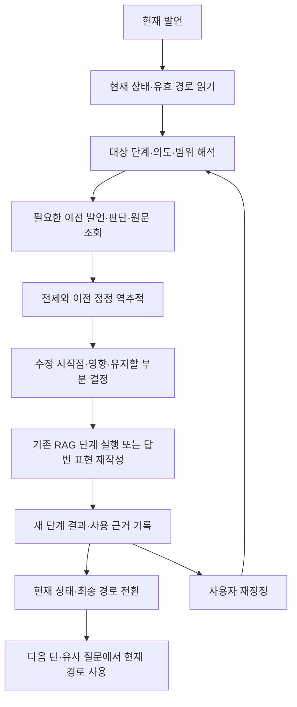

# legal_agent 전체 설계 — RAG 전 단계 수정·멀티턴 체인·최종 경로 재사용


후속 실제 CM 검증(2026-10-02): [수정·3차 비교와 남은 원인](/home/jin/8-AGENT/07_DOCS/REFERENCE/REPORTS/LEGAL_AGENT_CM_MEMORY_FINAL_20261002.md). 메모리 작업 통제 후보는 구현·실험했으며, 법률 도메인 카탈로그 전체 통제와 MAIN·GENOS 연결은 미완료다. 본문의 설계 당시 상태와 구분한다.
설계 개정: **r3 / 2026-10-01**. 상태: **전체 설계 수정, 구현·연속 실행 검증 전**.

후속 연결: r3 작성 당시의 요구와 상태는 아래 본문에 보존한다. 이후 정정·기억 후보의
[완료 실험과 남은 범위](/home/jin/8-AGENT/07_DOCS/REFERENCE/REPORTS/LEGAL_AGENT_CORRECTED_MEMORY_ONTOLOGY_REVIEW_20261001.md)를 확인했으며,
판단마다 도메인 개념·관계·방법을 필수 결속하는 현재 후속 설계는
[온톨로지 판단 통제 설계](/home/jin/8-AGENT/07_DOCS/REFERENCE/REPORTS/LEGAL_AGENT_ONTOLOGY_CONTROL_DESIGN_20261001.md)를 따른다.

작성 환경: WSL /home/jin/8-AGENT. 현재 작업 코드와 선택된 로컬 릴리스를 구분한다.
이 문서는 이전 본문을 전체 개정했다. 당시 설계·확인 기록은
[r2와 사용자 요구 명확화 보관본](LEGAL_AGENT_MEMORY_MULTITURN_DESIGN_20261001_R2_ARCHIVE.md)에 보존했다.

## 1. 확정한 요구와 이번 범위

**사용자가 RAG의 어느 부분을 고쳐 달라고 하든, 그 부분의 실제 입력·판단·결과·근거를
가져와 수정하고, 필요한 이전 단계까지 돌아가 문제를 다시 풀 수 있어야 한다.
다음 턴과 다음 유사 질문은 수정된 유효 경로를 사용해야 한다.**

질문 → 답변 → 추가 조건 → 정정 → 재정정 → 해결은 같은 의도에 대한 하나의 해결 경험 묶음이다.
모든 질문·발언을 지식 DB의 독립 지식으로 등록하지 않는다. 실행 이력은 체인을 복원하는
보조 원장이고, 온톨로지에 축적하는 대상은 **의도·조건·출처와 최종 해결 경로의 연결**이다.

이번 개정에서 적용한 사용자 요구:

- 정정을 잘못 이해해서 사용자가 다시 정정하는 과정도 멀티턴 체인에 포함한다.
  최초 전제·앞선 정정·현재 결과를 연결해 원인을 추적한다.
- 수정 범위를 최종 결론에 한정하지 않는다. 초기 의도, 질문 요구, 검색 범위·계획,
  탐색, 원문 읽기, 근거 선별, 해석·판단, 답변 종합·표현까지 대상으로 삼는다.
- “이번 답변만 표로”는 현재 유효한 최종 답변과 필요한 참조를 가져와 기존 LLM 작성
  경로에 표 작성 지시를 전달한다. 출력 형식마다 별도 업무 처리기를 만들지 않는다.
- 잘못된 경험을 가져왔으면 wiki의 의도→경험 연결을 고친다. 맞는 경험의 과정이
  틀렸으면 같은 묶음의 경로를 고친다. 폐기한 연결·경로는 일반 조회·재사용에서 제외한다.
- 수정된 경로가 다음 질문에 반영되는지는 구현 후 같은 저장소에서 연속 실행해 확인한다.
  한 번의 수정 답변이나 DB 저장 성공만으로 완료 처리하지 않는다.
- 사용자가 최종적으로 지정한 내용의 법률 정확성 승인, DB 직접 편집·관리 기능은
  별도 작업으로 둔다. 이를 이번 멀티턴 구현의 추가 승인 절차로 넣지 않는다.
  기존 원문·접근권한·인용·버전 계약은 실행 과정에서 유지한다.

여기서 “최종 경로”는 **그 문제와 조건에서 현재 채택된 해결 경로**다. 문서의 법적 효력이나
공통 지식 승인 상태를 새로 판정하는 용어로 쓰지 않는다.

이번 산출물은 본 설계와 [경험·온톨로지 소비 계약](SHORTCUT_EXPERIENCE_SCHEMA_DESIGN_20261001.md)이다.
SQL 적용, 모델 호출, 서버 구현, MAIN 전환, GENOS 배포는 수행하지 않았다.

## 2. 구성 요소와 정본

| 구성 | 맡는 일 | 저장·소비의 기준 |
|---|---|---|
| legal_agent | 현재 질문을 해석하고 필요한 단계 실행·재실행 | 기존 Pipeline·Coordinator·session·도구·LLM 사용 |
| 세션·사건 상태 | 현재 조건, 살아 있는 목표·판단·경로, 수정 진행 상태 | 같은 사건의 다음 턴이 즉시 읽는 정본 |
| 실행 journal·불변 산출물 | 실제 발언·입력·도구 결과·판단·근거·수정 계보 | 원인 역추적·복구용. 지식으로 자동 등록하지 않음 |
| legal_wiki | 의도·쟁점·조건에서 해결 경험으로 연결 | 잘못된 연결을 폐기하고 현재 경로를 가리키는 지도 |
| ontology / shortcut 저장소 | 최종 해결 경험과 그 경로의 개별 단계 연결 | 의도·조건·출처·묶음·경로 버전에 따라 조회 |
| user_wiki | 개인의 과거 문제·정정·경로를 찾아주는 화면·색인 | 사건·실행 원장을 참조하는 projection, 별도 판단 정본 아님 |

legal_wiki는 지식의 탐색 지도, shortcut은 그 지도에서 찾은 실제 경로와 단계의 보관·소비 계약이다.
같은 경험을 두 정본에서 독립적으로 갱신하지 않는다. 묶음과 경로의 소유자는 구현 시 하나로
정하고, 기존 wiki 또는 외부 wiki 서비스는 그 정본의 ID·revision을 주고받는다.

같은 사건은 현재 상태에서 바로 이어간다. 다른 사건·새 유사 질문은 wiki/ontology에서
관련 경험을 찾는다. 매 턴 사용자가 과거 질문을 직접 고르도록 강제하지 않는다.
필요하면 사용자가 질문·문단·판단을 선택해 대상을 더 정확하게 지정할 수 있다.

## 3. 전체 단계에서 무엇을 가져오고 수정하는가

MAIN의 구축 흐름은 [ARCHITECTURE](../../../00_SYSTEM/ARCHITECTURE.md)와
[PIPELINE](../../../00_SYSTEM/PIPELINE.json)을 따른다.

```text
RAW·구조화 → 용어·정의·문서 연결 → 명시 참조·탐색 색인
                                         ↓
요청·의도/현재 조건 → 검색 범위·계획 → 탐색·후보 → 원문 읽기
 → 근거 선별 → 요구별 해석·판단 → 종합 → 최종 답변
                                         ↓
                    정정·역추적·필요 단계 재실행
                                         ↓
                    최종 해결 경로 → wiki/ontology → 다음 질문
```

다음 이름은 r3의 **논리적 단계 분류**다. 운영 PIPELINE의 새 engine ID를 추가했다는 뜻이 아니다.
특히 현재 bounded 코드에서는 질문 요구 계획을 근거 선별 뒤에 만들기도 한다.
실제 실행 순서는 각 run의 이벤트·의존 관계로 추적하고, 단순 번호 순서로 재계산하지 않는다.

| 논리 단계 | 가져올 실제 기록 | 수정·재실행 예 | 이후 영향 |
|---|---|---|---|
| 요청 접수·의도·목표 | 최초 질문, 현재 발언, 이전 해석·목표·조건 | “내가 물은 건 신고 절차가 아니라 적용 대상이야” | 바뀐 목표에 의존한 검색부터 답변까지 |
| 질문 요구·사실·가정 | 요구 목록, 사실 출처, 적용 목표, 실제/가정 분기 | “그건 첫 질문 조건이 아니라 두 번째 질문 조건이야” | 해당 조건을 사용한 단계와 새 조건의 잠재 영향 |
| 범위·검색 계획 | 허용 문서, 내규/외규, 질의, 탐색 이유 | “내규 대신 외규로 찾아줘” | 후보·읽기·선별·판단·답변 |
| 문서·용어·구조 탐색 | 실제 탐색 경로, 용어/좌표, 후보 목록과 범위 | “이 용어가 아니라 그 조문 기준으로 찾아” | 바뀐 탐색 결과를 사용한 단계 |
| 원문 읽기·확보 | 문서 ID·버전·해시·span, 읽기 범위·미완료 표시 | “본문만 봤는데 단서와 별표까지 읽어” | 확보 내용에 의존한 선별·해석·답변 |
| 근거 선별 | 채택/제외 근거, 이유, 실제 전달 원문 | “이 근거를 제외한 이유가 잘못됐어” | 해당 근거의 판단과 답변 |
| 해석·개별 판단 | 입력 전제, 핵심 이유, 근거, 부모 판단 | “예외 적용 여부를 다시 봐” | 해당 판단에 의존한 종합·문단·후속 판단 |
| 종합·답변 내용 | 살아 있는 판단·요구 대응, 문단/claim 연결 | “둘째 결론이 아니라 첫째 결론에 연결해” | 필요한 종합·작성·후속 답변 |
| 답변 표현 | 현재 유효 답변, 문단·인용 대응, 현재 지시 | “표로”, “더 짧게”, “이 부분만 풀어서” | 표현만 바뀌면 앞선 조사·판단 유지 |
| 경험 연결·활용 | 현재 intent→bundle 연결, 경로 revision, 사용 receipt | “이 질문에 가져온 과거 사례가 달라” | 잘못된 연결·현재 채택 부분부터 재탐색 |
| 구축 산출물의 출처 | RAW/구조/용어/참조/색인 manifest와 해당 원본 위치 | 탐색 오류가 구조화·색인에 기인했는지 확인 | 오류 위치·영향·재구축 계획을 특정 |

구축 단계까지 원인이 이어지면 그 단계의 관련 입력·산출물·계보도 가져올 수 있어야 한다.
실제 RAW·공유 DB 수정과 새 데이터 세대 반영은 별도 구축·DB 관리 계약으로 넘긴다.
멀티턴 모듈이 운영 원문을 직접 고치는 방식을 만들지 않는다. 소비자는 새 세대가 명시적으로
준비되면 바뀐 source/index binding에 의존한 RAG 결과를 재확인한다.

## 4. 체인의 기본 단위와 연결

한 단계 결과마다 다음 정보를 참조할 수 있어야 한다. 모델의 숨겨진 사고 과정을 요구하는
계약이 아니라 실제 입력, 명시적으로 출력한 핵심 이유, 도구 결과와 근거를 저장하는 계약이다.

| 논리 객체 | 필수 내용 |
|---|---|
| 해결 경험 묶음 | 안정적인 bundle_id, 문제 의도·조건, 목표·분기, 현재 route revision |
| 단계 결과 | stage/operation, node_id/version, native run/event, 입력·결과 ref/hash, 핵심 이유 |
| 전제 연결 | 어떤 결과의 어느 버전을 실제 사용했는지, 필수 부모·원문 참조 |
| 정정 기록 | 원발언, 지칭 대상, 고친 내용·범위, 앞선 정정 참조, 실제 적용 상태 |
| 경로 버전 | 여러 run에서 현재 유효한 단계들의 닫힌 의존 그래프, 답변/근거 참조 |
| 현재 상태 | goal/branch별 현재 경로, 수정 중인 부분, 폐기·보류된 결과, state revision |
| 적용·소비 영수증 | 실제 가져온 단계, 실행·재실행·유지 여부, 출력과 다음 단계의 사용 기록 |

연결은 반드시 구분한다.

- **전제 의존:** B가 A의 결과를 사용했다. A가 틀리면 B의 유효성을 확인해야 한다.
- **대체 이력:** B1이 B0을 고쳤다. 과거 내용을 찾아 원인을 설명할 때 사용한다.
- **발언·출처 계보:** B1이 어느 질문·정정·원문 때문에 만들어졌는지 추적한다.
- **의도·경험 연결:** 현재 문제를 어떤 과거 bundle과 연결했는지 나타낸다.
- **분기·구성 소속:** 어떤 실제/가정 조건과 경로에 포함되는지 나타낸다.

시간상 바로 앞에 있다는 이유만으로 전제 관계를 만들지 않는다. 대체 연결만 따라
최신 항목을 찾는 것으로 원인 역추적을 대신하지 않는다. 모든 이력을 계산 대상에
넣지도 않는다. 현재 실행은 유효 경로를 쓰고, 원인 진단은 관련 폐기 이력까지 읽는다.

논리 node를 다른 run에 연결할 때 원래 run/version을 그대로 참조하면서 현재 run의
실행 객체에 명시 대응한다. 과거 native ID를 현재 journal의 유효 객체로 가장하지 않는다.
기존 원장에 없는 판단·검색 순위·읽기 범위는 복원했다고 표시하지 않는다.

## 5. 정상 후속 질문과 반복 정정의 실행



### 5.1 발언을 받아 현재 문제에 연결

인증된 사용자·외부 세션 ID·현재 goal/branch와 원발언을 결속한다.
“그때 둘째 질문”은 발언 순번과 질문 순번을 구분하고, 답변 문단을 지정하면 실제 판단 ID로 연결한다.
생략된 후속 질문을 독립 질의로만 검색하지 않는다.

해석 출력은 현재 발언의 의도, 대상, 범위, 바꿀 내용, 읽어야 할 단계 참조, 진행할 작업으로 만든다.
이 출력도 수정 가능한 단계 결과다. 사용자가 “그 정정을 잘못 이해했어”라고 하면
해석 결과와 그 원발언으로 돌아갈 수 있어야 한다.

기존 첫 모델 계획 호출에 이 기능을 결합하되, 최초 필요 자료가 한 번에 부족하면
관련 원본을 가져와 다시 판단할 수 있게 한다. 추가 호출이 항상 없어야 한다는 제한은 두지 않는다.
대상이 실제로 여러 개이며 발언·앵커로 구분되지 않을 때만 확인한다.

### 5.2 이전 정정과 최초 전제까지 역추적

현재 지칭 결과에서 전제 의존, 대체 이력, 원발언·원문을 각각 따라간다.
이전 정정의 해석이 잘못됐는지, 최초 질문의 의도가 틀렸는지, 중간 근거가 잘못됐는지 확인한다.

현재 결과 C1이 B1을, B1이 최초 A0을 사용했다면 C1→B1→A0의 전제를 읽는다.
B1이 정정에서 만들어졌다면 해당 정정 발언과 고치기 전 B0도 함께 확인한다.
최초 A0이 오류 원인이면 A부터 다시 풀고, B1만 틀렸으면 B부터 다시 푼다.
원인이 여러 개면 여러 시작점을 기록한다. 정상 후속 질문에서 생긴 판단도 같은 방식으로 연결한다.

예산 안에서 임의 턴 수까지 돌아보고 그 이전은 없는 것으로 취급하지 않는다.
정확한 참조를 따라 필요한 원본을 여러 번 나누어 가져오며, 누락·예산 소진은 미해결로 남긴다.
출처가 없는 요약으로 최초 전제를 만들어 내지 않는다.

### 5.3 영향 범위와 재실행 계획

수정된 시작점에 의존하는 **현재 유효 결과**를 재확인 대상으로 삼는다.
과거 폐기 이력은 원인 조회에만 사용하고 새 재계산 큐에 그대로 넣지 않는다.
서로 무관한 질문·유효 분기는 유지한다. 공유 전제가 바뀌면 그것을 사용한 여러 질문에 전파한다.

새 조건은 기존 dependency에 없을 수 있다. 예를 들어 긴급 여부를 처음 알게 된 경우
기존 edge가 없다는 이유로 영향 없음으로 처리하지 않는다. 같은 목표의 요구·계획·근거·판단에서
새 조건의 관련성을 재평가하고 필요한 연결을 만든다. 조건 추가를 항상 사건 전체에 강제하지도 않는다.

LLM은 수정의 의미와 필요한 조사 범위를 판단한다. 서버는 참조·소속·revision·권한을
확인하고 영향 그래프와 실행 계획을 만든다. plan에 다음을 기록한다.

- 정확히 수정할 입력/판단과 오류 시작점.
- 유지할 결과와 재확인할 결과, 그렇게 판단한 이유.
- 가져올 원본·증거와 실행할 기존 단계·operation.
- 단계별 입력·필수 부모·완료 후 공급할 결과.
- 처리하지 못한 부분과 다음 동작.

의존 순서로 실행하며, 실제 조사 중 새 오류가 발견되면 관련 상류 단계로 다시 진입한다.
결론을 원하는 값으로 바꾸는 것만으로 재계산을 대신하지 않는다.

### 5.4 새 경로 구성

각 단계가 실제 소비한 부모·근거와 새 결과를 기록한다.
현재 결과의 필수 부모가 모두 유효한지 확인한 뒤 경로를 구성한다.
정정 실행에서 바뀌지 않은 유효 단계와 이번에 만든 단계를 **여러 run에 걸쳐** 묶는다.

최종 경로는 마지막 run 전체도, 마지막 답변 문장도 아니다.
독립 분기와 복수 부모를 포함할 수 있는 해결 그래프다.
최신 시각으로 결과를 임의 선택하지 않는다.

### 5.5 현재 상태 전환과 다음 질문

정정이 적용된 순간부터 영향을 받은 이전 결과의 일반 사용을 중단한다.
재실행 중에는 그 부분을 수정 중으로 표시한다. 다른 유효 결과는 사용할 수 있다.
재실행이 실패해도 수정 전 답변을 현재 유효 답변처럼 되살리지 않는다.

새 결과와 최종 경로를 확정할 때 현재 state/route revision을 조건으로 전환하고,
실제 전환·답변·후처리 이벤트를 연결한다. 오래된 실행의 뒤늦은 결과가 새 경로를 덮어쓰지 못하게 한다.
다음 턴은 야간 wiki 구축을 기다리지 않고 현재 상태의 새 경로를 즉시 사용한다.

다른 유사 질문에서의 재사용은 ontology/wiki의 현재 연결과 route revision을 확인한다.
전달 직전에도 경로·폐기 상태를 재확인한다. 캐시에 오래된 단계 내용이 있어도
그 revision이 현재 사용 가능한지 확인하지 못하면 그대로 공급하지 않는다.

## 6. 답변을 표로 바꾸는 최소 경로

```text
“이번 답변만 표로”
 → 현재 유효 최종 답변·문단·참조·조건 불러오기
 → 기존 작성 LLM에 “내용·조건·출처를 유지하고 표로 재작성” 전달
 → 작성 결과와 기존 판단/근거의 대응 기록
 → 새 답변 표현 게시
```

표·목록·요약마다 새로운 RAG 업무 실행기를 두지 않는다.
현재 작성·출력 계약에서 표를 표현하도록 연결하고 필요한 문단/claim 대응을 유지한다.
재작성 과정에서 원문이나 법적 결론을 다시 조사해야 한다는 의미는 아니다.
“표로 바꾸면서 이 조건도 고쳐”처럼 내용 변경이 함께 오면 관련 판단 단계까지 돌아간다.

표현 변경은 presentation 결과의 새 버전이고 의미적 판단 경로는 그대로 유지할 수 있다.
현재 답변이 없는 경우에는 먼저 그 답변을 찾아야 하며, 없는 내용을 기억으로 만들어 쓰지 않는다.
이번 요청의 형식 지시를 개인의 영구 선호나 새로운 온톨로지 지식으로 자동 등록하지 않는다.

## 7. 전체 체인을 설명하는 연속 사례

다음은 설명·구현 검증용 합성 시나리오다. 기존 ADR-0591에서 연속 실행한 결과가 아니다.

| 순서 | 사용자 발언·상황 | 필요한 처리 | 현재 유효 결과 |
|---|---|---|---|
| 최초 | “국내 법인의 절차를 확인해줘” | 의도→범위→탐색→읽기→선별→판단→답변 | 모의 내규 기준 B |
| 정상 후속 | “필요 서류도 알려줘” | 원래 목표·B 절차에 의존한 서류 판단 추가 | B와 그 서류 경로 |
| 1차 정정 | “내규 말고 외규로 다시 봐” | 범위 해석부터 외규 검색·읽기·선별·판단, 의존 서류도 재확인 | 모의 외규 기준 D |
| 긴 후속 | 조건·세부 질문을 계속함 | 원래 목표·현재 경로에 연결, 실제 원본은 참조로 유지 | 현재 D 기반 후속 경로 |
| 2차 정정 | “앞의 정정을 잘못 이해했어. 최초 질문은 이 내부 절차를 말한 거야” | 1차 정정 발언·해석과 최초 질문까지 돌아가 범위·목표를 재해석 | 새로 확인한 내규 경로 |
| 표현 | “지금 결론을 표로 정리해” | 현재 답변과 참조를 가져와 LLM 재작성 | 같은 결론의 표 |
| 다음 턴 | “그럼 서류는 뭐가 필요해?” | 2차 정정 후 경로에서 답함 | 폐기된 외규 D를 사용하지 않음 |
| 새 유사 질문 | 동일 의도·조건의 새 질문 | wiki의 현재 묶음·최종 경로를 찾아 필요한 단계 참조 | 마지막 run이 아닌 최종 그래프 사용 |

2차 정정의 모의 결론은 문장이 같아 최초 B로 돌아가더라도 최초 결과를 무조건 복원하지 않는다.
정정된 의도·조건·원문 버전에서 여전히 유효한 부분인지 확인하고 현재 경로에 연결한다.

다른 과거 경험을 잘못 가져온 별도 사례에서는 의도→bundle 연결만 폐기한다.
그 경험이 다른 의도·조건에서는 유효하다면 경험 자체를 일괄 삭제하지 않는다.

## 8. 현재 코드의 출발점과 변경 지도

아래 “현재”는 2026-10-01에 확인한 작업 코드다. 현재 선택된 frozen 릴리스와 자동으로 같아지지 않는다.
새 함수·객체·설정 이름은 제안이다.

| 위치·현재 호출 | 현재 연결 상태 | r3 변경 책임·소비자 |
|---|---|---|
| service._normalize | LEGAL_AGENT/ELS_QUERY의 session/user/request/channel ID 제거 | 신뢰된 continuity envelope를 app까지 전달 |
| app.ask | 허용 필드에 연속 대화 식별자 없음 | 선택적 session·goal·답변/판단 앵커 검증, 실행 context 연결 |
| Pipeline.plan / _run | 현재 요청으로 문서 범위·query 생성, 매 요청 새 run | 현재 goal/조건 반영, 원발언과 resolved task 분리, 경로 revision 전달 |
| ServingLegalAgent._open_session | 요청별 새 journal, 같은 run ID 재개 거부 | 새 run을 유지하며 이전 단계 패키지·현재 경로를 명시 결속 |
| BoundedSourceSession.plan_request_search | 현재 question 중심 첫 검색 계획 | 정정/후속 해석과 필요한 이전 단계 참조를 기존 호출에 결합 |
| prepare_source_recall / SourceRecall.prepare | 해당 session의 탐색·확보 결과 캐시 | 단계 재진입 시 바뀐 query/scope/binding을 검사하고 관련 캐시 갱신 |
| persist_bounded_selection | 실제 확보 원문에서 source_selection을 기록 | 검색 계획·읽기·조건의 전제 연결, 선별 단계만의 재실행 지원 |
| prepare_question_plan / ObligationSession | 현재 원질문 요구·claim·검토 대응 | 최초 목표·현재 발언·정정 해석의 계보와 목표 revision 전달 |
| WorkRepository.put / invalidate | 요청 내 버전별 의존과 CURRENT→STALE 전파 | 여러 run의 논리 대응·현재 경로 반영, 모든 단계 artifact의 실제 의존 검사 |
| Coordinator.run | retrieve/select/assemble 반복 또는 answer 재작성 분기 | 필요한 논리 단계·operation부터 재진입, 유효 입력을 현재 port로 공급 |
| StageRunner.execute | 기존 engine/port/hash 검증·stage artifact 저장 | 재사용/실행/재실행 결과를 동일 port로 전달하고 receipt 연결 |
| views / gateway / packer | 현재 요청의 모델 view·정확한 근거·입력 한도 | 관련 체인 조회 및 단계별 전달, 실제 사용 ref/hash 기록 |
| composer / answer_and_review | 문단을 claim으로 기록하고 기존 출력 계약으로 작성 | 답변만 재작성하는 경로, 표 표현 및 문단/판단 대응 유지 |
| publication / deferred_publication | 요청별 outbox·게시·복구 | state/route revision guard, 늦게 완료된 이전 경로 게시 차단 |
| action_memory.build / legal_llm_wiki | 완료 run에서 목적 개념화·불변 raw·projection | 최종 bundle manifest를 intake 기준으로 사용, 폐기 경로 재개념화 차단 |
| action_memory_store | 기존 경험 catalogue/compile와 중단 상태 | 현재 묶음·경로 확인, 단계별 온라인 조회·적용 연결 |
| user_wiki projection·검색 | 목표 기능의 생산 경로 없음 | 개인이 과거 문제·정정·단계를 찾는 입구, 현재 원장 참조 |
| 기존 구축 CLI·manifest | RAW/구조·용어·참조·색인별 명시 구축 | 원인 진단용 자료 adapter, DB 관리 쪽에 수정 대상·재구축 의존 전달 |

현재 invalidate는 엔티티 의존성을 재귀적으로 무효화하지만 stage_artifact 처리는 kind에 따른
거친 분기다. “모든 단계의 부분 재실행이 이미 된다”고 해석하지 않는다.
현재 Coordinator는 외부 네 port를 고정해 확인하므로 논리 단계를 새 port로 무작정 늘리지 않는다.
기존 session 안의 세부 operation을 확장하고 외부 출력 계약을 유지한다.
bounded_started·source_recall_record·source_selection_record·selection_views 등 session 내부 상태도
재진입 시 갱신하거나 명시적으로 다시 구성해야 한다.

제안 책임 분리는 기존 legal_agent 내부의 체인 조회, 수정 명령 해석, 재실행 계획, 경로 구성으로 둔다.
별도 agent 루프·복제된 전체 RAG 실행기를 만들지 않는다.
공통 런타임 계약을 바꾸는 경우 API 소비자·workflow·schema·engine manifest·hash를 함께 버전 관리한다.

## 9. 저장·전달 계약과 긴 대화

본 설계는 물리 SQL을 새로 확정하지 않는다. 기존
[사건 SQL 초안](../../../00_SYSTEM/SCHEMAS/legal-agent-case-memory-v1.draft.sql)과
[shortcut SQL 초안](../../../00_SYSTEM/SCHEMAS/shortcut-experience-v1.draft.sql)은 r2의 기계적 계약이다.
r3의 전체 단계·cross-run 최종 경로·역추적·온라인 소비를 구현한 스키마로 설명하지 않는다.
별도 DB 작업에서 node 참조·경로 포인터·폐기 상태·outbox 등 필요한 인터페이스를 맞춘다.

단계별 모델 입력은 최소한 다음을 갖는다.

```json
{
  "contract": "rag-chain-v1-proposed",
  "context": {"goal_ref": "G2", "branch_ref": "actual", "state_revision": "STATE_CURRENT", "route_ref": "ROUTE_CURRENT"},
  "utterance_ref": "CURRENT_TURN",
  "resolved_task": "현재 목표와 이번 변경을 합친 실제 작업",
  "stage": "SOURCE_SELECT",
  "current_results": ["NODE_AND_VERSION"],
  "required_parent_refs": ["PARENT_AND_VERSION"],
  "correction_refs": ["RELEVANT_CORRECTION"],
  "origin_refs": ["INITIAL_UTTERANCE_OR_SOURCE"],
  "retired_refs_for_diagnosis": [],
  "missing_refs": [],
  "task": "현재 단계에서 수행할 구체 작업"
}
```

참조만 보내 의미를 알 수 없게 하지 않는다. 이번 판단에 필요한 내용·조건·핵심 이유와
읽어야 할 정확 원문을 함께 전달하고, 나머지는 조회 가능한 참조로 남긴다.
과거 기억 번호는 현재 원문 인용 번호와 구분한다.
원문을 실제로 읽고 모델에 전달한 범위에 맞춰 현재 요청의 증거 영수증을 만든다.

대화 요약에는 최초 의도·현재 조건·goal/branch·핵심 전제 ID·정정 계보 참조·미해결을 남긴다.
원발언·정확한 판단·원문을 대체하지 않는다. 오래된 최초 질문도 참조로 복원할 수 있어야 한다.
여러 부모·가정 분기가 있으면 필요한 전제를 각각 확인한다.

필수 체인이 입력 한도를 넘으면 관련 구간을 나눠 읽는다. 선택적 과거 경험부터 제외하고
필수 조건·근거를 잘라 완료 처리하지 않는다. 실제 최종 messages/schema의 token·byte 한도를 검사한다.
자료가 누락되면 어느 단계의 무엇이 없는지 표시하고 복구한다.

## 10. 정정 결과를 실제 활용하는 일관성

구현 후 다음을 같은 실행 흐름에서 확인해야 앞선 대화의 “2번”을 해결했다고 판정한다.

| 지점 | 반드시 확인할 것 |
|---|---|
| 정정 접수 | 정확한 goal/branch와 현재 revision에 정정 연결 |
| 원인 조회 | 앞선 정정·최초 전제·원문을 실제로 가져옴 |
| 영향 처리 | 관련 이전 결과의 일반 사용 중단, 무관한 결과 유지 |
| 재실행 | 필요한 단계가 변경 입력을 실제 사용, output port 소비 확인 |
| 현재 상태 확정 | 새 결과·경로·답변이 동일 revision에 결속 |
| 같은 사건 다음 턴 | 새 경로를 조회하고 그 부모·근거로 답변 |
| 새 유사 질문 | ontology/wiki의 현행 연결과 최종 경로를 가져옴 |
| 캐시·지연 게시 | 오래된 revision 채택·게시 차단 |
| 후처리·재수집 | 완료된 이전 run을 다시 읽어도 폐기 경로가 새 지식으로 부활하지 않음 |

state와 경험 저장소가 별도 DB이면 하나의 트랜잭션으로 묶인다고 가정하지 않는다.
온라인 상태의 commit과 outbox를 같은 정본에 기록하고, 경험 소비자는 idempotent event와
현재 revision을 확인한다. 반영 지연 동안 철회된 경로가 검색되더라도 사용 직전 검사에서 막는다.
같은 사건의 현재 상태는 이 후처리 지연과 무관하게 새 경로를 사용한다.

동시 정정은 base revision 비교와 직렬화/lease로 처리한다.
LLM 호출 동안 DB 트랜잭션을 열어 두지 않는다.
실패·중복 요청은 같은 작업 식별자로 복구하고, 늦은 실행·SSE·게시에는 revision guard를 적용한다.

## 11. 구현 검증 시나리오와 완료 기준

이번에는 검증 설계만 작성했다. 구현·품질 비교 시작 전 별도 ADR을 예약하고
입력·기준·gold·후보·모델·측정 항목을 동결한다.
ADR-0591 후보에서 분기하면 완료된 정확한 부모 ADR-0591-experiment-v1/GUARDED를 명시한다.
완료된 원응답·채점·frozen 후보는 바꾸지 않는다.

각 연속 시나리오는 같은 DB·실제 실행 경로에서 끝까지 진행한다.
실제 상태와 prompt의 맥락을 일치시키고, 질문별 독립 초기화로 멀티턴 성공을 대신하지 않는다.

| 시나리오 ID | 확인할 기능 | 완료의 증거 |
|---|---|---|
| C-INTENT | 긴 대화 후 최초 의도 정정 | 최초 발언·해석을 읽고 필요한 초기 단계부터 새 결과 생성 |
| C-REPAIR | 1차 정정 오해→2차 정정→최초 원인 | 이전 정정 원문과 해석 조회, 오류 시작점 변경, 의존 결과 재계산 |
| C-STAGES | 범위·질의·탐색·읽기·선별·판단·종합 각각 수정 | 요청한 단계 input/output·부모와 실제 실행 receipt |
| C-NEW | 처음 없던 새 조건 추가 | 기존 edge가 없어도 영향 검토, 필요한 단계 재실행 |
| C-SHARED | 두 질문이 공유한 전제 수정 | 관련 두 질문 재확인, 무관한 질문 유지 |
| C-PRESENT | 표→요약→상세 설명 | 현재 답변을 사용한 LLM 작성, 의미 경로 유지, 형식 반영 |
| C-HYPOTHETICAL | 가정 후 실제 조건으로 후속 | 분기·조건이 명시되고 실제 상태로 가정이 섞이지 않음 |
| C-WIKI | 잘못 가져온 경험 정정 | 해당 연결 중단, 다른 의도의 유효 경험 보존 |
| C-FINAL | 여러 run에서 최종 경로 구성 | 마지막 run에 없는 유효 부모도 포함, 폐기 부모는 제외 |
| C-NEXT | 정정 직후 같은 사건 다음 질문 | 최종 route revision과 새 판단/원문이 실제 입력·출력에 사용됨 |
| C-REUSE | 새 유사 질문의 경험 활용 | 현행 ontology 연결→최종 경로→필요 단계 소비 receipt |
| C-REINGEST | 옛 journal 재수입·캐시 적중 | 폐기 경로 일반 사용·재개념화 차단 |
| C-LONG | 요약 이후 최초 전제 조회 | 요약 밖 원발언·정확한 근거 조회가 trace에 남음 |
| C-RECOVER | 중복·재시작·정정 도중 실패 | 오답 부활 없이 동일 수정 작업 복구 |
| C-RACE | 이전 실행이 새 정정 뒤 완료 | 오래된 경로의 commit·답변 게시 차단 |
| C-BUILD | 검색 오류의 구축 계보 조회 | 정확한 구조/용어/색인 산출물과 영향 범위 확인, 별도 수정 인터페이스 전달 |

각 항목은 답변 문장뿐 아니라 가져온 자료, 무효화 대상, 실행·유지한 단계, 최종 경로,
다음 턴·새 유사 질문의 실제 소비까지 검사한다.
의역 여러 개를 서로 독립된 사례로 세지 않는다.
새 정정까지 포함해 회복한 성공률, 사용자 정정 횟수, 불필요한 재실행, 폐기 경로 사용 여부를
함께 측정한다. 한 번의 해석 오류와 끝까지 회복하지 못한 오류를 구분한다.

## 12. 도입·활성화·롤백

| 구현 순서 | 산출물 | 종료 기준 |
|---|---|---|
| 체인 참조·단계 기록 | 기존 journal과 논리 node/version 대응·원본 조회 | 초기부터 최종까지 실제 사용 전제·산출물 추적 |
| 입력과 현재 상태 연결 | service/app/session 공통 context | 같은 세션의 정상 후속 질문이 현재 경로 사용 |
| 수정·역추적·부분 재실행 | 기존 Coordinator·bounded operation 확장 | C-REPAIR와 단계별 수정, 무관한 결과 유지 |
| 답변 표현 재작성 | 기존 작성 LLM 경로 | C-PRESENT 통과, 표현별 별도 실행기 없음 |
| 최종 경로·wiki 소비 | 묶음 manifest·현재 연결·단계 주입 | C-FINAL/C-NEXT/C-REUSE/C-REINGEST 통과 |
| 복구·동시성·긴 대화 | revision guard·조회 분할·outbox | 누락·지연 결과·동시 정정 처리 확인 |
| MAIN·GENOS 연결 | 계약·hash·반입·실행·롤백 자료 | 저장소 승격 절차와 GENOS 현장 검증을 각각 완료 |

제안 활성화 설정은 기존 legal_agent profile에 선택적으로 추가한다.
현재 계약·기본 registry에 자동 연결하지 않는다. 구현 후보는 별도 freeze와 전체 소비자 검증을 거친다.
세션 연속성과 경험 주입의 활성화는 각각 확인하되 둘이 같은 경로 ID·revision 계약을 사용한다.

롤백은 경험 주입·단계 채택을 끄고 기본 조사로 돌아간다.
이미 존재하는 연속 대화의 상태를 버리고 생략된 질문을 조용히 독립 질의로 처리하지 않는다.
chain 기능을 끄면 해당 대화의 재개 불가를 명시하고 원장은 보존한다.

로컬과 GENOS는 사용자·세션 식별 및 모델·저장 adapter만 다르게 하고 같은 체인·재실행 코드를 사용한다.
현재 세션에서 GENOS에는 접근하지 않는다. 현장 실행·workflow 소비·SSE·내부 모델 품질은
코드 반입과 별도로 확인한다. 신규 외부 모의 실험은 현행
[모델 정책](../../../00_SYSTEM/EXPERIMENT_MODEL_POLICY.json)과 ExperimentClient를 따른다.

## 13. 기대효과·비용·미확인

| ID | 종류·지표 | 현재 근거와 측정 방법 |
|---|---|---|
| E-CHAIN | 목표: 반복 정정 후 문제 해결 | 최초 전제까지 조회·필요 단계 재계산·다음 턴 소비로 판정 |
| E-REUSE | 목표: 폐기 경로 재사용 차단 | 일반 조회·캐시·재수집·모델 주입 trace 검사 |
| E-CALLS | 미확인: 요청당 호출·token·비용 변화 | 체인 조회/재해석/재실행/작성·복구를 구분해 측정 |
| E-LATENCY | 미확인: 전체 완료·첫 토큰·단계별 지연 | 동일 조건의 기존 경로와 후보에서 실제 완료 시간 측정 |
| E-SCHEDULE | 미산정: 구현 일정 | 단계 기록·배선·역추적·재실행·소비·복구별 공수와 통합 확인 후 산정 |

```text
순 호출 절감 = 실제 생략한 호출 - 체인 해석·재판단·복구로 추가한 호출
지연 이득 = 생략한 작업 시간 - 조회·검사·추가 전달·재실행 시간
```

조회와 전달만 늘고 기존 작업을 모두 수행하면 비용·지연이 증가할 수 있다.
최초 의도 오류는 넓은 재실행이 필요하고, 표현 변경은 작성 범위만 실행하는 이점이 있다.
현재 성능 개선율·일정·운영 비용은 산정하지 않았다.

## 14. 기존 검증의 의미와 확인 근거

기존 SQL 계약 검사와 ADR-0591 결과는 관측 당시 기록으로 보존한다.
r3의 전체 기능·긴 연속 체인·최종 경로 소비가 검증됐다는 근거로 전용하지 않는다.

| 근거 ID | 관측 당시 범위 | r3에 대한 한계 |
|---|---|---|
| H-SQL | r2 사건·shortcut SQL 계약 검사 40개 통과 | r3의 런타임 소비·역추적·단계 재실행·DB 이행을 확인하지 않음 |
| H-RESOLVE | ADR-0591 맥락 포함 해석 17/20 | 같은 초기 상태의 독립 발언 처리. 긴 연속 대화가 아님 |
| H-ANSWER | ADR-0591 모의 절차/출처 ID 4/4 | 좁은 항목이며 가정 표시와 전체 의미 정확성은 별도 |
| H-BOUNDARY | ADR-0591 기능·경계 관측 63개 | 잘못된 SQL 입력 수락 확인도 포함. 기능 정상 63개가 아님 |
| H-RELEASE | 현재 ACTIVE_RELEASE generation 37 | r3 구현·서빙 반영 아님 |

현재 활성 포인터의 release_id는 legal-agent-source-prefix-20260930-r3이고 quality_certified=false다.
사용자 가이드의 이전 릴리스 설명보다
[실제 활성 포인터](../../../01_DATA/ACTIVE/local/ACTIVE_RELEASE.json)를 현재 선택의 근거로 사용했다.

주요 확인 파일:

- [진입점](../../../service.py), [HTTP ask](../../../02_BACKEND/semantic_runtime/app.py),
  [Pipeline](../../../02_BACKEND/semantic_runtime/pipeline.py),
  [session 생성](../../../02_BACKEND/semantic_runtime/legal_agent_adapter.py).
- [Coordinator](../../../02_BACKEND/semantic_runtime/legal_agent/coordinator.py),
  [StageRunner](../../../02_BACKEND/semantic_runtime/stage_runner.py),
  [bounded 세부 단계](../../../02_BACKEND/semantic_runtime/legal_agent/bounded_source_session.py).
- [의존 원장](../../../02_BACKEND/semantic_runtime/legal_agent/repository.py),
  [질문 요구·답변](../../../02_BACKEND/semantic_runtime/legal_agent/question_obligations.py),
  [작성 claim 연결](../../../02_BACKEND/semantic_runtime/legal_agent/composer.py).
- [기존 경험 후처리](../../../02_BACKEND/lawrag/pipeline/action_memory.py),
  [wiki projection](../../../02_BACKEND/lawrag/pipeline/legal_llm_wiki.py),
  [경험 저장소](../../../02_BACKEND/semantic_runtime/action_memory_store.py).
- [기존 모의 실험 보고서](CASE_MEMORY_FUNCTIONAL_MOCK_20261001/README.md),
  [ADR-0591 기록](../../../04_EXPERIMENTS/ADR/ADR-0591-case-memory-functional-mock-probe/README.md).
- [workspace 경로 계약](../../../00_SYSTEM/WORKSPACE.json),
  [이 개정의 보존·문서 검사 영수증](../../../09_ARTIFACTS/AUDITS/20261001-rag-multiturn-design-r3/receipt.json).

이번 개정은 같은 작성자가 코드·계약·문서를 대조한 자체 검토다.
독립 감독 검토, 신규 실험 통과, 운영 활성화 또는 GENOS 배포를 의미하지 않는다.

## 2026-10-02 실제 CM 실험에서 추가된 구현 요구

ADR0611~0613에서 실제 CM 두 질문과 공개 원문을 사용해 같은19턴을 수정 전후로 비교했다. 마지막 후보는 현재 사실·복원·저장·이력·재사용을 처리하지만 전체 도메인 온톨로지 구현으로 보지 않는다.

- 선별 결과의 추가 근거 요구(`needs_fulltext`)를 실행기가 소비해 RECALL→READ→SELECT로 되돌아가야 한다. 재탐색 결과의 새 판단 버전과 후속 의존성을 같은 사건에 결속하고, 무한 재시도 대신 한도·보류를 기록한다. 현재 후보에는 이 연결이 없다.
- `stage`는 재실행 시작점이다. 검사자에게도 실제 후속 실행 계약을 제공한다. 일반 답변 검사는 현행 사실을 사용하고, 과거 조건은 이력 조회에서 다룬다.
- 법률의 일반 규칙·예외·조건별 설명을 새로운 사건 사실 추가와 혼동하지 않도록 판단 종류와 적용 조건 근거를 구분해야 한다. 모델에게 문장 규칙을 주는 것만으로 의미 정확성을 보장하지 않는다.
- 최종 경험에 조사 이력은 보존하되, 조사한 원문·채택한 근거·실제 인용을 서로 다른 관계로 표시해야 한다. 현재 연구 후보가 모든 READ 원문에 SUPPORTED_BY를 붙이는 부분은 미완료다.

최종 기능 원점수31/33, 실제 DB 복원4/4, 이력 설명2/2와 CM 기준답 일치6/12를 분리해 보고했다. 비교 기준의 CM 일치는7/12이므로 후보 전체를 채택하지 않았다. 공통 DB 이행·운영 연결·배포는 수행하지 않았다.
