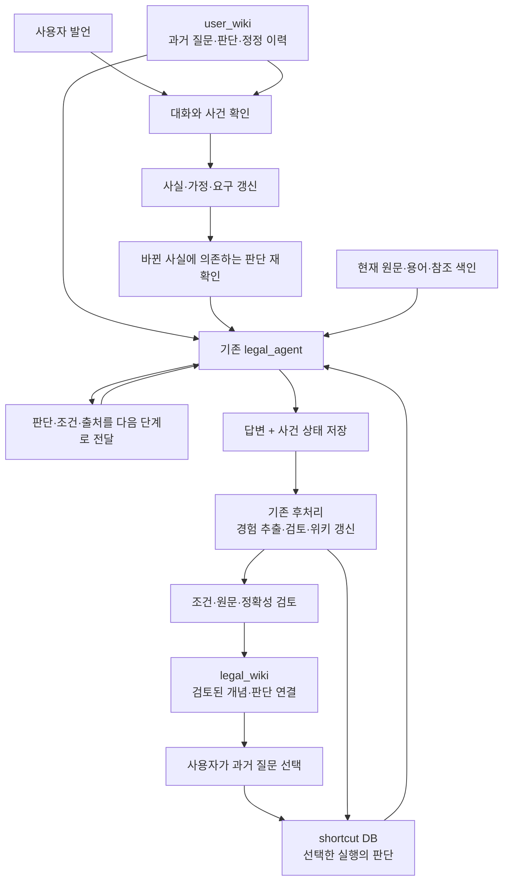

# legal_agent 전체 기억 설계 — 위키·사용자 기억·멀티턴·판단 재사용

## 사용자 요구 명확화 — 온톨로지와 최종 수정 루트

2026-10-01 ADR-0591 결과 설명 후 사용자가 저장·재사용 단위를 명확히 했다.
**지식 DB에 축적하는 대상은 모든 질문·발언의 목록이 아니라, 질문 의도·조건·원문과
최종 수정된 조사·판단 루트를 연결한 온톨로지다.** 아래 기존 r2의 사건/대화 원장은
진행 중 작업을 이어가기 위한 보조 계약이며 온톨로지의 축적 단위를 대신하지 않는다.

- 질문→답변→사용자 정정→재조사→최종 해결은 하나의 해결 경험 묶음이다.
  각각의 native run을 독립적인 정답 경험으로 등록하지 않는다.
- 다른 질문/경험을 잘못 가져온 경우에는 wiki의 질문 의도→경험 연결을 수정한다.
  해당 잘못된 연결은 검색·재사용에서 폐기한다. 가져온 경험 자체가 다른 질문에서는
  유효한지 별도로 구분한다.
- 맞는 질문/경험을 가져왔지만 조사·판단이 틀린 경우에는 같은 묶음의 루트를 수정한다.
  채택된 최종 루트가 그 질문 의도·조건의 유효 루트가 되며, 과거 오답 루트와 그에
  의존한 판단·요약·위키 연결은 활성 온톨로지와 재사용 후보에서 폐기한다.
- 최종 루트는 여러 정정 실행에 걸친 유효 판단과 근거를 결속한 결과다.
  단순히 가장 마지막 run이나 답변 문자열을 선택하는 것으로 대신하지 않는다.
- 다음 유사 질문은 현재 유효한 최종 루트를 먼저 찾는다. 폐기된 이전 루트가
  재수집·재개념화·오래된 선택/캐시로 다시 살아나지 않도록 소비자까지 검사한다.
  기존 불변 감사 이력은 보존하며 활성 지식으로 노출·채택하지 않는다.

### 긴 멀티턴에서 최초 전제까지 거슬러 문제를 푸는 요구

같은 날 사용자가 추가로 명확히 한 핵심은 **긴 대화에서 누적된 문제 풀이의 의존
관계를 역추적하는 것**이다. 정상 후속 질문도 이전 판단·조건·요구에 의존할 수 있다.
정정 버전의 최신 항목을 찾는 기능만으로 이 요구를 충족하지 못한다.

예를 들어 최초 판단이 A→B→C, 1차 정정의 결과가 A→B1→C1일 때,
사용자가 C1이 틀렸다고 재정정하면 C1의 표현만 바꾸지 않는다. C1이 사용한 B1,
B1을 만든 1차 정정의 발언·해석, 최초 B의 전제와 원문까지 거슬러 읽어 오류의
시작점을 확인한다. 최초 A의 잘못된 전제를 물려받은 경우에는 A도 새로 판단해야 한다.
앞선 예시의 A 유지도 실제 영향 확인 후에만 가능하다.

필요한 실행 계약은 다음과 같다.

1. 현재 요구/지칭 대상에서 이전 판단을 찾고, 교체 관계·전제 의존 관계·원발언/원문
   출처를 구분해 관련 사슬을 최초 의도와 해당 전제까지 복원한다. 시간 순서만으로
   의존 관계를 추정하지 않는다. 여러 부모가 있으면 필요한 전제를 모두 확인한다.
2. 새 발언이 앞선 정정의 값, 앞선 정정의 해석, 최초 질문 해석, 근거 선택 중 무엇을
   부정하는지 확인한다. 원발언에 없던 가정을 이어받았는지, 이미 철회된 전제로
   후속 답을 만들었는지 검토하고 재판단의 시작점을 기록한다.
3. 그 시작점의 전제/판단과 이에 의존한 현재 결과를 사용 중단한 뒤, 유효한 전제부터
   의존 순서대로 새로 문제를 푼다. 다른 문제의 무관한 판단은 유지한다. 서로 다른
   조건·가정 분기의 판단을 임의로 합쳐 최종 루트로 만들지 않는다.
4. 새 루트의 조건·근거·의존 관계가 현재 요구와 맞는지 확인하고 같은 해결 경험
   묶음의 유효 루트와 wiki 연결을 함께 교체한다. 오래된 선택·요약·캐시를 포함한
   일반 검색/재사용 경로가 폐기된 루트를 다시 선택하지 않게 한다.
5. 대화가 길어져 요약됐어도 최초 질문·정정의 원발언·실제 판단/원문은 필요한
   부분을 ID로 다시 읽을 수 있어야 한다. 원본·관계가 없으면 요약으로 체인을
   복원한 것처럼 간주하지 않고 누락을 표시한다. 모호한 범위에만 확인을 요청한다.

잘못된 루트는 일반 지식 검색·정답 재사용에서 폐기한다. 원본과 교체/의존 이력은
이번 재정정의 원인을 진단하기 위한 제한된 역추적에서 읽을 수 있게 보존한다.
이 진단 조회가 폐기된 루트를 유효한 온톨로지 경로로 되살리는 동작이 되어서는 안 된다.
대화 실행 이력은 이 연결을 복원하는 보조 자료이며 모든 발언을 온톨로지 노드로
자동 등록하는 요구가 아니다.

후속 검증은 같은 저장 상태에서 최초 요청→조건 추가→1차 정정→긴 후속 대화→
2차 정정→최초 전제 역추적→새 루트 계산→다음 요청에서 새 루트 선택을 연속 실행해야 한다.
최초 전제 오류, 1차 정정 해석 오류, 여러 부모/분기, 원본 누락, 폐기 루트 캐시를
포함하고, 단순 최신 버전 조회·각 발언의 독립 fixture 검사로 완료 처리하지 않는다.
현재 구현·SQL은 이 계약을 완성한 것이 아니며 새 후보와 실행은 별도 ADR에서 검증한다.

ADR-0591의 기존 결과는 턴별 상태·정정·기초 저장 경계를 검사한 기록으로 보존한다.
그 실험은 위 **최종 해결 경험 통합·wiki 연결 정정·오답 루트 폐기·다음 질문에서의
최종 루트 선택**을 end-to-end로 검증하지 않았으므로 이 요구의 완료 근거로 쓰지 않는다.
이 요구 명확화는 문서의 변경이며 SQL·생산 코드·활성 DB·MAIN을 변경한 것은 아니다.

설계일: 2026-10-01. 상태: **구현 전 설계**. WSL 코드와 선택된 frozen 릴리스를 확인했다.
실제 DB 이행·온라인 호출 변경·새 모델 실험·MAIN 전환은 하지 않았다.
같은 날 사용자 구체화에 맞춰 r2로 보완했다: 검증된 legal_wiki 연결망, 개인 질문·판단 이력,
GENOS 식별자 전달, 특정 질문의 특정 판단을 고치는 저장 계약을 추가했다.

관련 산출물:

- [사건·사용자 DB SQL 초안](../../../00_SYSTEM/SCHEMAS/legal-agent-case-memory-v1.draft.sql)
- [기존 shortcut DB SQL r2](../../../00_SYSTEM/SCHEMAS/shortcut-experience-v1.draft.sql)
- [shortcut 상세 설계와 쉬운 용어](SHORTCUT_EXPERIENCE_SCHEMA_DESIGN_20261001.md)
- [사건 DB 계약 검사](../../../05_TESTS/CONTRACTS/test_case_memory_schema_draft.py)

## 1. 한눈에 보는 설계

**위키에서 관련 경험을 찾고, 현재 사건의 사실을 관리하며, 기존 legal_agent가 판단을 이어간다.**
같은 사건의 후속 질문은 현재 상태를 이어받는다. 다른 사건의 경험은 사용자가 선택한 질문에서 가져온다.
이전 단계의 판단·이유·조건·출처는 모두 연결해 보존하고, 다음 단계에는 이해 가능한 형태로 전달한다.

| 구성 | 쉬운 설명 | 맡는 정보 |
|---|---|---|
| legal_wiki | 검증된 법률 지식·판단으로 가는 지도 | 법률 개념·쟁점·적용 조건·원문·검토된 판단과 탐색 경로의 연결 |
| user_wiki | 사용자가 무엇을 물었고 무엇을 고쳤는지 찾는 개인 기록 | 질문 시점·당시 판단·출처·정정 이력·개인 선호·사건 바로가기 |
| 현재 사건 | 지금 이야기하는 계약·거래·업무 | 사실·가정·쟁점·대화·정정 이력·판단의 현재 적용 여부 |
| shortcut DB | 다른 질문에서 얻은 판단 경험 | 질문→실행→개별 판단→조건·원문·검토→재사용 이력 |
| legal_agent | 실제로 조사하고 답하는 실행자 | 현재 질문·사건 상태·근거·기억을 보고 단계별 판단 |

**판단은 개별 노드로 존재한다.** 실제 원본은 journal의 버전 있는 entity이고,
`cm_decision`은 그 판단을 대화에서 찾는 색인, shortcut의 step은 경험으로 보관하는 연결이다.
개인 화면과 공통 지식 화면은 같은 판단의 원본을 참조한다. 판단 내용을 각각 복사해 다른 정본으로 만들지 않는다.

이전 초안은 legal_wiki를 질문 묶음 입구 중심으로 설명했다. 이번 요구에서는 역할을 넓혀,
**검증된 개념·관계·조건·판단을 통해 필요한 경험과 원문에 도달하는 지식 지도**로 설계한다.
기존 질문 묶음 서비스는 그 지도의 후보 탐색 입구다. 질문이 비슷하다는 확인만으로
그 안의 판단이 승인되지는 않는다. 현재 로컬 projection은 이 전체 기능을 아직 제공하지 않는다.



### 실제 사용 예

1. “이 계약의 신고 여부를 확인해줘.” → 사건 C1과 첫 대화 T1을 만들고 기존 검색을 진행한다.
2. “당사자는 해외 법인이야.” → C1의 사실 F1을 사용자 제공 정보로 저장한다.
3. “아니, 국내 법인이야.” → F1의 새 버전을 만들고 F1을 사용한 판단과 후속 판단만 재확인한다.
4. “국내 법인이라고 가정하면?” → 실제 상태를 고치지 않고 가정 분기를 만든다.
5. “다른 계약도 봐줘.” → 새 사건 C2로 연결한다. C1의 당사자 조건은 자동 복사하지 않는다.
6. 다른 질문의 도움을 받고 싶으면 위키에서 유사 질문을 선택한다. 그 질문의 검토된 실행을
   고정하고 현재 단계에 필요한 판단 경험을 가져온다.

이 예시는 시스템 동작 설명이며 법률 결론을 제시하는 예시가 아니다.

## 2. 현재 구현에서 확인한 출발점

확인한 활성 포인터: `legal-agent-source-prefix-20260930-r3`, generation 37,
`quality_certified=false`. 선택 자료는 `pecab-only-public-main-20260929-v1/generation`이다.
`app.py`, `pipeline.py`, `context.py`, `bounded_source_session.py`, `gateway.py`,
`journal-v5.sql`의 frozen 파일은 릴리스 manifest 해시와 일치했고, 확인 당시 작업 코드와도 같았다.
이것은 선택 파일의 연결 확인이며 현장 성능·전체 코드 품질 인증은 아니다.

| 현재 위치 | 현재 동작 | 설계에서 활용할 지점 |
|---|---|---|
| `app.ask` | 질문·문서·범위·팀 등만 허용. 대화·사건 입력 필드 없음 | 선택적 대화 envelope 검증과 신뢰된 사용자 식별 |
| `Pipeline.plan/_run` | 원문 범위를 결정하고 요청마다 query·run·session 생성 | 현재 사건 범위를 결합하고 원래 질문/해결할 요구를 분리 |
| `ServingLegalAgent._open_session` | 기존 run ID의 journal 재개를 거부. publication 복구는 별도 | 매 턴 새 run을 유지하고 이전 상태·판단을 새 run에 연결 |
| `RequestContext` | 요청·query·binding·deadline은 실행별 고정 | 최초 사건 상태 지문을 binding에 추가하고 후속 상태는 이벤트로 연결 |
| `coordinator.run` | retrieve→select→assemble→answer, 필요 시 다시 진입 | 새 루프를 만들지 않고 기존 단계 앞뒤에 기억 계약 연결 |
| `BoundedSourceSession` | 구조 직접 경로 또는 검색 계획→회수→선별/복구→요구 정리 | 단계별 상태·기억 입력과 부분 작업 생략 |
| `WorkRepository` | fact/claim 등 버전, dependency, evidence, 모델 입력·시도 보존 | 사실→판단 연결과 현재 실행 안의 무효화 재사용 |
| `WorkRepository.invalidate` | 같은 journal의 의존 항목을 재귀적으로 STALE 처리 | 실행 간 사건 의존성을 현재 journal로 가져온 뒤 적용 |
| gateway 두 경로 | 일반 `ModelGateway`와 bounded `_Gateway`의 요청 생성이 다름 | 공통 전달 계약을 두 경로 모두에서 검사 |
| publication/finalizer | 답변 outbox 및 지연 게시 경로 | 사건 상태와 답변 게시의 일관성·재개 연결 |
| action-memory/wiki | 오프라인 개념화·원문 안내·위키 projection 구현 | 기존 후처리로 단계별 경험 수입 확장 |

현재 `user_wiki`, 사건별 멀티턴 저장·API 소비 구현은 확인한 경로에 없다.
shortcut r2는 SQL 설계이며 실제 경험 DB에 설치하지 않았다. 요청 내부의 `fact` 지원이
있다는 사실을 여러 턴의 사실 정정 기능이 이미 있다는 뜻으로 해석하지 않는다.

### 2.1 GENOS에서 이미 오는 식별자와 현재 끊기는 위치

2026-10-01 작업 코드와 승호님 코드의 **2026-09-28 로컬 보관본**을 읽어 확인했다.
승호님 보관본의 commit은 `f43a11d1562f708c00dc9f954d6bf2cde6907af8`이다.
실제 현장에 적용된 리비전이나 프런트 요청 payload를 확인한 결과는 아니다.

| 위치 | 확인된 내용 | 필요한 변경 |
|---|---|---|
| 우리 `genos_rag_chat._session_id` | chatId/chat_id/sessionId/session_id를 읽음 | 원본 식별자 기반의 충돌 없는 연결 |
| 우리 `_user_id` | user_id/userId 또는 userInfo의 해당 필드를 읽음 | 신뢰된 사용자 검증 및 환경별 adapter |
| 승호님 `els_chat._user_id` | userInfo.user_id, 스튜디오는 overrideConfig.vars.genosUserInfo.user_id | 스튜디오 경로도 정식 입력 계약으로 포함 |
| 우리 `_request_body` | session_id/user_id/channel/request_id를 전송 | 신뢰된 continuity envelope로 연결 |
| `service._normalize` | LEGAL_AGENT/ELS_QUERY에서 위 네 필드를 제거 | 제거 대신 검증 후 별도 execution_context로 전달 |
| `app.ask` | continuity/사용자/세션 필드 미지원 | allowlist·인증·case repository를 함께 연결 |
| workflow `_run_once` | 호출마다 request_id를 새 UUID로 교체 | 전송 시도 ID와 재시도 중복 방지용 client_request_id를 구분 |

즉 현재는 **프런트 식별자 → workflow 전송 → service에서 제거 → 매번 새 실행**이다.
필드 제거 한 줄만 없애면 app의 입력 검사에서 거부되므로 API와 소비자를 같이 변경해야 한다.
socketIOClientId는 실시간 전달 통로이며 대화·사용자 식별자로 쓰지 않는다.

현재 `_safe_id`는 문자 치환과 64자 절단, 고정 anonymous 값을 사용한다. 영속 기억에는
이 결과를 키로 사용하지 않는다. 다른 원본 ID가 같은 값으로 합쳐질 수 있기 때문이다.
연결 키는 `(provider, namespace, tenant_id, verified_user_id, opaque_session_id)`로 둔다.
원본 opaque ID는 SQL 매개변수로 다루거나 길이 구분이 있는 직렬화의 지문으로 연결한다.
로그·파일명에 쓸 안전한 표시 ID와 기억 식별자를 구분한다. 길이 제한 초과는 잘라내지 않고 거부한다.

프런트가 보낸 user_id 자체는 인증 근거가 아니다. 신뢰된 workflow/인증 계층에서 사용자와
조직을 검증해 identity receipt를 만든다. 사용자 정보 전체를 프롬프트나 user_wiki에 복사하지 않는다.
인증된 식별자가 없으면 공유 anonymous 기억을 읽지 않는다. 단일 질문 또는 새 격리 세션으로 처리한다.
저장된 과거 인증 receipt가 현재 요청의 인증·권한 검사를 대신하지 않는다.

## 3. 무엇이 정본인가

### 3.1 legal_wiki

질문 묶음과 검증된 법률 지식은 같은 화면에서 탐색하되 API의 `item_kind`와 검토 상태로 구분한다.

| 자료 | 정본 | 사용 방식 |
|---|---|---|
| 원문과 법령 해석 | 기존 원문 세대·용어 색인, 해석 위키의 검토 이력 | 해석은 탐색에 사용하고 답변 근거는 적용 버전 원문에서 확보 |
| 유사 질문 개념 | 다른 쪽 질문 묶음 서비스 / 기존 legal_llm_wiki | 사용자가 과거 질문을 고르는 입구 |
| 검증된 지식 연결 | 위키 담당 서비스의 버전 있는 개념·관계·검토 이력 | 개념→쟁점→적용 조건→검토된 판단→원문/탐색 경로 |

외부 질문 묶음 서비스가 실제 정본이면 우리 `concept/episode`를 두 번째 묶음 정본으로
운영하지 않는다. provider와 opaque ID/버전으로 연결한다. 현재 로컬 위키 projection은
해당 서비스의 수입·표시 adapter가 될 수 있다. 이행 때 정확한 소유권을 한쪽으로 고정한다.

제안 handoff 필드:

```json
{
  "provider": "legal_llm_wiki",
  "item_kind": "QUESTION_EXPERIENCE",
  "group_ref": "opaque-group-id",
  "wiki_revision": "opaque-revision",
  "past_question_id": "server-question-id",
  "selected_by": "authenticated-user",
  "selection_id": "server-selection-id"
}
```

`selected_by`는 서버가 기록한다. 서버는 질문 권한 확인 후 `shortcut_run_binding`으로
정확한 과거 실행을 고정한다. 위키 재분류·새 실행이 기존 선택을 자동 변경하지 않는다.
위키의 해제·분쟁 상태는 매 조회/채택 시 반영한다. 원문 개정은 원문 경로를 다시 검증한다.
위키의 제목·요약·분류는 법률 정확성 승인이나 원문 READ 영수증을 대신하지 않는다.

#### 검증된 연결망의 논리 스키마 — 위키 담당 서비스와 맞출 계약

| 객체 | 쉬운 뜻 | 필수 내용 |
|---|---|---|
| concept | 법률 개념·쟁점 | ID·버전·이름·정의·상위/관련 개념·원문 참조 |
| knowledge_version | 검토할 법률 정보 하나 | 명제·적용 조건·예외·적용 시점·문서 범위·원문 버전/좌표/해시 |
| knowledge_link | 개념에서 정보/판단으로 가는 연결 | 양쪽 ID/버전, 관계 종류, 성립 조건, 연결 자체의 근거 |
| experience_binding | 정보에서 과거 실행으로 가는 연결 | 정확한 question/run/step ID·불변 패키지 해시·검토 ID |
| knowledge_review | 검토·변경 이력 | 검토 대상 버전/해시·검토자·정책·판정·이유·근거·날짜·후속 검토 |

이것은 외부 위키와 합의할 **논리 계약**이다. 기존 데이터 원문의 폐기된 의미 스키마를
되살리거나 별도 법률 원문 DB를 만드는 변경이 아니다. 위키 담당 서비스의 실제 API·DB 스키마가
이 세션에 제공되지 않았으므로 물리 표 이름·migration·온라인 연결은 아직 확정하지 않았다.

기본 탐색에는 검토된 `ACCEPTED` 버전과 그 버전에 대해 검토된 연결만 포함한다.
`PROPOSED / DISPUTED / OUTDATED / RETRACTED`는 일반 판단 근거·shortcut 채택 후보에서 제외하고
관리·검토 화면에서 원인을 볼 수 있게 한다. 최신 검토 이벤트와 원문·권한·해제 상태를 함께 확인한다.
승인한 버전이 바뀌면 과거 승인을 새 버전에 그대로 복사하지 않는다. 원문 변경의 영향이 미확인이면
확인할 때까지 해당 연결을 보류한다.

`ACCEPTED`는 **기록된 조건·원문 버전·검토 범위에서 승인됨**을 뜻한다. 생성 모델의 자신감,
사용자 좋아요, 사용자 질문 선택, 실행 성공은 이 상태를 만들지 않는다. 지정된 검토 주체와
정책이 근거 충족·반례/예외·조건 적합성을 확인한 기록이 있어야 한다. 현행 final_review나
action-memory의 ACTIVE가 이 법률 검토를 수행했다고 해석하지 않는다.

shortcut DB는 미검토·실패·정정 기록도 원장으로 보존한다. 온라인에서 **검증된 법률 지식**으로
가져오는 경로는 위 조건을 통과한 항목만 허용한다. 같은 사건에서 방금 만든 미검토 판단은
대화 연속성을 위해 상태와 출처를 명시해 이어받을 수 있지만 공통 지식으로 승인되지는 않는다.
탐색 안내의 유효성 검토와 법률 명제의 정확성 검토도 별도 종류로 기록한다.

새 경험은 기존 후처리에서 추출→중복/모순 확인→검토→새 위키 버전으로 연결한다.
검색은 계속 현재 원문에 접근할 수 있어야 한다. 경험이 쌓였다는 이유로 기존 경로에 없는
새 예외·자료를 탐색하지 못하게 닫지 않는다. 이 축적은 모델 가중치의 자동 학습을 의미하지 않는다.

### 3.2 user_wiki

개인별 질문·판단·정정 이력과 설정을 읽기 좋게 보여 주는 projection이다.
정본은 개인 설정의 `cm_user_memory`와 사건 원장의 `cm_turn/cm_decision/cm_edit`다.
사건 사실·판단을 별도 개인 문서에 중복 저장해 어느 것이 최신인지 경쟁시키지 않는다.

| 저장할 것 | 예시 | 적용 방식 |
|---|---|---|
| 답변 선호 | “표로 정리해줘”, “출처를 먼저 보여줘” | 이번 요청의 명시 지시가 우선 |
| 업무 맥락 | 사용자가 확인한 담당 업무·관심 분야 | 관련성 안내용. 문서 권한이나 법률 적용 사실로 사용하지 않음 |
| 사건 바로가기 | 사용자가 접근 가능한 C1·C2 | 사건 ID만 연결, 사건 사실을 중복 저장하지 않음 |
| 질문 이력 | “오전 두 번째 질문”, “지난번 계약 검토” | 대화 ID·turn ID·순번·시각·사건·목표로 조회 |
| 판단 이력 | “그때 왜 내규를 골랐지?” | 당시 판단 ID/버전·내용·이유·조건·출처로 조회 |
| 정정 이력 | “그 부분을 외규로 바꿨던 것” | 수정한 발언→대상 판단→새 상태→대체 판단 연결 |

“앞으로 표로 답해줘”처럼 명시적인 저장 요청은 그 발언을 확인 기록으로 사용할 수 있다.
단순 반복 행동에서 추론한 선호는 PROPOSED로 보관하고 적용하지 않는다. 매 턴 확인 팝업을
추가하지 않는다. 취소·변경은 새 버전, 현재 요청만의 지시는 전역 선호 수정으로 승격하지 않는다.
확인된 기억도 만료·철회·접근권한을 검사한다. 사용자 기억 자체가 모델 명령 우선순위를 갖지 않는다.

같은 세션에서는 현재 사건을 ID로 직접 불러온다. 다른 세션의 기록이 필요할 때 user_wiki에서
허용된 사건·질문·판단 후보를 찾고 원본을 읽는다. 단순 의미 유사도로 다른 계약의 조건을
현재 사건 사실에 합치지 않는다. 사용자가 “지난 계약 이어서”라고 지칭하거나 선택한 대상을
확인한 뒤 현재 사건을 연결한다. 화면은 user_wiki 하나여도 저장 책임은 개인 설정과 사건 원장으로 나뉜다.

사용자 자신의 판단도 원발언과 함께 보존한다. “내 생각에는 의무가 없어”는 확인된 사실이나
승인된 법률 지식으로 승격하지 않는다. journal의 판단 record와 `cm_decision.body_json`에
`origin_kind=USER_POSITION`, 원발언·해당 목표를 기록해 `AGENT_ASSESSMENT`와 구분한다.
내용·핵심 이유·조건·출처를 찾을 수 있어야 하며 사용자의 입장을 agent의 결론으로 바꾸어 표시하지 않는다.

### 3.3 현재 사건과 대화

대화는 발언이 오가는 통로, 사건은 지금 판단하는 대상이다. 한 대화에서 여러 사건을 다룰 수 있고
하나의 사건을 여러 대화에서 이어갈 수 있다. `conversation_id`만으로 사실을 합치지 않는다.
최초에는 서버가 사건·실제 분기를 자동 생성한다. 이후에는 UI가 활성 사건을 명시해 전달한다.
“그 법인”, “아까 결론”의 대상이 하나로 결정되지 않으면 현재 사실을 바꾸지 않고 확인을 요청한다.

사실에는 값뿐 아니라 **출처, 확인 수준, 버전**을 둔다.
`USER_ASSERTED`=사용자가 말함, `SOURCE_VERIFIED`=출처로 확인, `ASSUMPTION`=가정,
`UNKNOWN`=미확인, `RETRACTED`=철회이다. 사용자의 확신과 외부 검증을 혼동하지 않는다.
복수 출처가 충돌하면 하나를 임의 선택하지 않고 쟁점에 남긴다.

### 3.4 shortcut DB

기존 r2를 유지한다. `question→run→step`이 경험의 원본 연결이다. 동일한 결론 문장도
조건·근거가 다르면 다른 step이다. 현재 사건의 최신 상태를 shortcut DB에서 읽지 않는다.
당일 후속 질문은 온라인 사건 상태를 즉시 읽으며 야간 경험 구축 완료를 기다리지 않는다.

## 4. 저장 위치와 데이터 흐름

경로는 `load_layout(root).path('runtime')`와 배포 설정으로 해결한다. 다음 경로는 제안이다.

| 저장소 | 제안 위치/기존 위치 | 쓰기 책임 |
|---|---|---|
| 온라인 사건·사용자 저장소 | `runtime/semantic/context/context.sqlite` | 신뢰된 context repository, 짧은 트랜잭션 |
| 요청별 실행 원장 | 기존 `runtime/semantic/legal-agent/runs/<date>/<run>/journal.sqlite` | 기존 WorkRepository |
| 완료 경험 저장소 | 기존 `runtime/semantic/action-memory/memory.sqlite` + shortcut 표 | 기존 action-memory intake |
| legal_llm_wiki 표시 파일 | 기존 `runtime/semantic/action-memory/legal_llm_wiki/` | 기존 위키 export |
| user_wiki 표시 파일 | `runtime/semantic/context/user-wiki/<opaque-user>/` | 개인 기억·사건 색인으로부터 파생 |
| 원문·용어 색인 | 선택한 기존 generation | 기존 데이터 구축 파이프라인 |

SQL은 SQLite로 검사하는 저장 계약 초안이다. 온라인 사건 DB의 기본 배치 가정은
**단일 쓰기 소유자와 검증된 영속 로컬 디스크**다. 여러 GENOS 리비전이 NFS의 SQLite를
동시에 쓰는 구성으로 배포 성공을 가정하지 않는다. 내부 단일 저장 서비스 또는 트랜잭션 DB가
필요하면 이 논리 계약을 이행한다. 영속 위치·잠금·인증·복구 방식은 현장 구성에서 확인해야 한다.

쓰기 주기가 다르므로 온라인 사건과 야간 기억을 같은 DB 잠금에 묶지 않는다.
원문 구축 generation은 이 설계로 재구축할 필요가 없다. 판단·사건·위키는 원문을 참조한다.

### 사건·사용자 SQL의 표

| 표 | 한 행의 뜻 | 주요 연결 |
|---|---|---|
| cm_conversation | 대화 통로 | 조직·소유자 |
| cm_session_binding | 외부 세션과 내부 대화의 연결 | 발급처·환경·조직·검증된 사용자·원본 세션 ID |
| cm_case | 계약·업무·사건 하나 | 조직·소유자 |
| cm_access_event | 사건 권한의 부여/변경/회수 | 사용자·권한·순번 |
| cm_branch | 실제 상황 또는 가정 | 부모 분기와 당시 상태 버전 |
| cm_state | 사건 상태의 불변 보관본 | 사실 목록·미해결 요구·적용 범위·출처 정책 |
| cm_head | 현재 상태 번호 | 조건부 UPDATE로 한 버전 전진 |
| cm_turn | 실제 사용자 발언 | 대화 내 순번·사건·분기·접수 당시 상태·중복 요청 키 |
| cm_fact | 사실의 한 버전 | 원발언/첨부/원문 위치·내용 지문·적용할 목표 ID |
| cm_state_fact | 상태가 사용한 사실 버전 | 사실 소속 분기·ID·버전 |
| cm_run_binding | 이번 발언의 native 실행 | turn 및 최초 상태 버전 |
| cm_run_state | 실행 중 채택한 상태 | 순서·상태 버전·journal 이벤트 |
| cm_decision | 다음 턴에서 찾을 판단 | 원본 run·entity 종류/ID/버전·내용 지문·대체한 이전 판단 ID |
| cm_decision_fact | 판단이 사용한 사실 | 정확한 사실 버전 |
| cm_decision_parent | 판단이 사용한 앞선 판단 | 여러 부모 허용, 순환 금지 |
| cm_decision_check | 특정 사건 상태에서 판단의 적용 여부 | 적용 가능/재확인/해당 없음/분쟁 |
| cm_answer_anchor | 답변 문단이 설명하는 판단 | 게시본/해시·문단·run·판단 ID, 여러 판단 허용 |
| cm_edit | 대상이 특정된 자연어 정정 요청 | 수정 발언·대상 질문/판단·정확한 사실 버전·변경 범위·요청 내용 |
| cm_edit_application | 정정을 반영한 상태 | edit ID·그 발언이 만든 상태 버전·실제 반영 영수증 |
| cm_user_memory | 개인 선호·업무 맥락·사건 링크 | 사용자별 확인·변경·철회 이력 |
| cm_outbox / cm_delivery | 다른 저장소에 전달할 사건과 시도 기록 | 중복 없이 재개 가능한 전달 |
| cm_schema | 확장 계약 버전 | 기존 user_version과 별도 |

SQL의 PK/FK는 표에 기재된 연결을 강제한다. 현재 권한, JSON의 세부 의미, 해시 계산,
적용 가능성은 저장 함수가 검사한다. 같은 조직이라는 이유만으로 다른 사용자의 사건을 읽지 않는다.
외부 입력의 user_id·owner_id·team_id를 인증 근거로 쓰지 않는다.

r2는 총 23개 표다. `cm_turn.turn_number`는 서버가 대화별로 순서대로 배정하는 발언 번호이며
시각이 같아도 순서가 바뀌지 않는다. “두 번째 질문”의 의미가 두 번째 발언과 다를 수 있으므로
표시한 질문/답변 앵커와 goal의 원발언 연결도 함께 사용한다. 순번만으로 의미를 단정하지 않는다.
판단 교체는 `supersedes_decision_id`로 명시하고 원래 판단 행을 수정하지 않는다.
`cm_edit`의 대상 질문과 판단은 실제 run 연결이 일치해야 한다. 사실 정정은 그 판단이
사용한 정확한 사실 버전이어야 한다. 영향받는 판단 목록은 해당 edit의 반영 receipt를 참조한
`cm_decision_check`에 기록한다.

SQL은 `target_goal_id`, JSON patch의 의미, 게시본 hash 일치, 현재 판단의 유효성까지
검증하지 않는다. writer는 목표가 해당 질문·판단에 속하는지, before 값이 현재 상태와 맞는지,
허용된 필드의 변경인지 검사해야 한다. 과거 교체된 판단을 지칭했으면 원래 판단→현재 판단
연결과 값 차이를 보여주고 이미 끝난 정정을 다시 적용하지 않는다.

`cm_state.state_json`의 필수 논리 내용:

```json
{
  "schema_version": "case-state-v1",
  "goals": [{"goal_id": "G1", "text": "신고 여부 확인", "status": "OPEN", "origin_turn_id": "T1", "scope_override": null}],
  "scope_policy": {"source_category": null, "document_filter_ref": "server-scope-ref"},
  "unresolved": [],
  "fact_membership_hash": "sha256-of-cm_state_fact-rows",
  "parent_state_hash": "sha256-or-null"
}
```

상태의 사실 목록은 `cm_state_fact`가 정본이며 JSON은 그 목록 지문을 가진다. 상태·사실 목록·
outbox를 쓴 다음 head를 전진시키는 하나의 트랜잭션으로 commit한다. head가 가리킨 상태는
뒤늦게 사실을 추가할 수 없다. 상태 지문과 목록의 일치는 writer가 검증한다.

`scope_policy`는 사건의 기본 범위이며 각 goal은 별도 `scope_override`를 가질 수 있다.
“이 질문에서는 외규”는 해당 goal의 override만 변경한다. “이 사건 전체를 외규로”라고
명시한 경우에만 사건 기본값과 영향받는 목표를 함께 바꾼다. `cm_fact.goal_id`도 특정 목표의
조건과 사건 공통 사실을 구분한다. 기존 공통 사실을 특정 목표에만 다르게 적용하려면 새
goal 전용 사실을 만들며 기존 사실의 적용 범위를 버전 변경으로 몰래 바꾸지 않는다.
유효한 값은 목표별 override→사건 기본값 순으로 계산하고 의존성을 실제 사용한 값에 결속한다.
여러 목표의 범위가 다르면 검색 계획·후보 풀·근거 선별도 목표별로 나눈다.

가정 분기는 부모의 특정 상태를 가리킨다. `cm_state_fact.fact_branch_id`로 당시 부모의
사실 버전을 참조하므로 실제 분기의 이후 정정이 가정 분기로 자동 흘러가지 않는다.
소비자는 참조한 사실이 고정된 부모 상태 또는 해당 분기에서 생성됐는지 검사한다.
SQL의 같은 사건 FK만으로 분기 상속 권한까지 인증하지 않는다.

## 5. 온라인 한 턴의 정확한 실행 순서

### 5.1 요청 계약

기존 `/v1/rag/ask`의 새 선택적 `continuity` envelope를 제안한다. 현재는 미지원이다.
내부 term-runtime-v1 Request에 임의 필드를 넣지 않고, 인증·사건 정보는 execution_context의
별도 검증된 계약으로 전달한다. HTTP body allowlist, service/workflow 전달, 직접 CLI 진입점도 맞춰야 한다.

```json
{
  "question": "아니, 국내 법인이야. 결론이 달라져?",
  "use_llm": true,
  "continuity": {
    "schema_version": "legal-agent-continuity-v1",
    "conversation_id": "chat-id",
    "case_id": "case-id",
    "branch_id": "actual",
    "expected_revision": 3,
    "client_request_id": "retry-stable-id",
    "reply_to_turn_id": "previous-turn-id",
    "target_anchor": null,
    "shortcut_selection_id": null
  }
}
```

case/conversation 식별자는 서버가 발급한다. 사용자가 선택할 수는 있으나 권한은 서버가
검증한다. 첫 질문에서는 서버가 envelope 기본값을 만든다. 기존 envelope 없는 단일 질문은
현재 계약 그대로 처리할 수 있다. 멀티턴 클라이언트는 반환된 서버 ID를 다음 턴에 명시한다.
사용자가 전달한 전체 history를 신뢰된 사건 상태로 받아들이지 않는다.

응답에는 기존 result 옆의 별도 envelope로 case/branch/turn ID, committed revision,
run ID, 정정된 사실 ID, 재확인한 판단 ID, 답변 게시 상태를 돌려준다. 프롬프트·SQL의 내부 이름을
일반 사용자 화면에 노출하지 않고 “당사자 조건을 수정해 관련 판단을 다시 확인했습니다”라고 표시한다.

### 5.2 접수와 상태 해석

1. 서버 인증 주체, 대화/사건 권한, client_request_id를 검증한다. 같은 키·같은 입력은 기존
   처리 상태를 반환하고 다른 입력으로 같은 키를 쓰면 거부한다.
2. 사건 분기의 base revision을 읽는다. UI가 알고 있는 revision과 다르면 임의 덮어쓰지 않고
   충돌을 반환한다. 실제 모델 작업 전부터 revision별 실행 소유권을 잡는다.
3. `cm_turn`과 새 native run을 만든다. 요청 원문과 `question_pieces`는 변경하지 않는다.
   최초 사건 상태의 지문·권한 검사 결과를 RequestContext.binding에 고정한다.
4. 최근 관련 발언, 현재 사실·요구, 이전 판단을 첫 해석/검색 계획 입력에 전달한다.
5. 기존 첫 계획 호출의 출력에 `turn_update`를 추가한다. NEW_TASK / CONTINUE / CORRECT /
   HYPOTHETICAL / SWITCH_CASE / INSPECT_MEMORY / UPDATE_USER_MEMORY / PROPOSE_KNOWLEDGE_CHANGE /
   CLARIFY 중 의도, 명시 출처 span, 변경 대상 turn/decision/goal/fact ID,
   변경값, 현재 해결할 요구, 변경 후 상태에 맞는 검색 계획을 함께 반환한다.
6. 서버가 발언·대상·권한·범위를 검증하고 정확한 state delta를 commit한다. 기존 binding을
   덮어쓰지 않고 journal의 CASE_STATE_COMMITTED 및 cm_run_state로 새 effective revision을 연결한다.
7. 새 상태를 사용한 검색 계획만 실행한다. 해석이 모호하거나 충돌하면 상태 변경 없이
   확인 질문으로 종료한다. 확인 질문도 서버 생성 응답 또는 명시 CLARIFY 결과 계약으로 기록한다.

### 5.3 현재 코드에 필요한 특별 처리

현재 `prepare_question_plan()`은 원문 선별 뒤에 실행된다. 사실 정정을 여기서 처음 처리하면
이미 잘못된 조건으로 검색한 뒤이므로 늦다. 정정 해석은 `plan_request_search()` 앞부분에 통합한다.

구조 좌표가 유일한 질문과 인사·목록은 현재 계획 호출을 생략할 수 있다. **멀티턴이 상태 변경을
포함할 가능성이 있으면 이 우회를 해석 전에 타지 않는다.** 해당 경우에는 해석 호출 1회가
추가될 수 있다. 모든 요청에서 온라인 추가 호출 0회를 보장하지 않는다. 일반 내용 검색은
기존 계획 호출에 결합해 호출 수를 늘리지 않는 것을 목표로 한다.

`question`에 이전 답변을 이어붙여 원질문을 조작하지 않는다. `resolved_task`는 별도 구조로
두고 원발언·사실·현재 요구를 참조한다. `question_pieces`의 Q 번호는 현재 발언의 좌표로
유지하며 이전 발언 T, 사실 F, 이전 판단 J, 원문 E를 별도 namespace로 다룬다.
기존 `question_refs`만 받는 요구 정리·claim schema에는 버전이 있는 context 참조 확장이 필요하다.

상태를 프롬프트에 한 번 추가하는 것만으로는 연결이 끝나지 않는다. 현재
`prepare_navigation_context()`와 구조 탐색, `source_selection.select_sources()`는 원래
질문 문자열을 직접 사용한다. 이 소비자들이 원발언과 별도의 `resolved_task`·현재 요구를
함께 받도록 바꿔야 “국내 법인이야”만 검색하는 오류를 막을 수 있다. 상태가 확정되면
그 전에 만든 navigation_context·question_matches·검색 계획 캐시도 해당 revision 기준으로
새로 만든다. 과거 사건 범위에서 만든 후보 풀을 현재 범위의 결과라고 재사용하지 않는다.

문서 범위는 인증된 현재 ACL과 명시한 팀·내규/외규·문서 범위를 교집합으로 계산한다.
이전 사건의 선택 범위를 이어받을 수 있지만 사용자의 명시 범위 변경은 새 상태로 기록한다.
개인 업무 맥락이나 위키 후보 때문에 현재 허용 범위를 넓히지 않는다.

### 5.4 판단 수정과 부분 재사용

사실 F의 사용 버전이 현재 상태와 다르면 해당 사실에 의존한 판단을 찾는다.
`cm_decision_parent`를 따라 후속 판단도 재확인 대상으로 표시한다. 제거된 사실,
새 예외, 원문/범위 변경도 재확인 원인이 된다. 새 사실이 기존 의존 그래프에 없으면
영향 없음으로 간주하지 않고 기존 계획 호출이 관련 쟁점을 재검토하도록 보낸다.
의존성이 불완전한 과거 판단은 더 넓은 범위로 보수적으로 다시 판단한다.

이 적용 상태는 **현재 사건 상태 버전에만** 연결한다. 국내 법인으로 정정됐다는 이유로
해외 법인 사례의 과거 판단을 전체 경험 DB에서 철회하지 않는다. 법적 판단 자체의 오류가
확인된 경우에만 별도 검토·철회 사건을 기록한다.

현재 run으로 이어받을 때 원래 journal을 다시 열어 수정하지 않는다. 서버가 현재 fact entity,
source_selection/claim 후보와 의존성을 새 ID로 만든다. fact→판단, 판단→판단 연결을
현재 repository.put(dependencies=...)에 명시해 로컬 invalidate가 작동하게 한다.
원문은 현재 권한·세대·내용·읽기 범위를 확인해 현재 evidence/presentation 영수증으로 결속한다.

현재 `commit_draft()`는 작성 결과로 새 claim을 만들고 기존 claim을 무효화한다.
따라서 과거 claim을 DB에 복사해 최종 답변으로 우회하지 않는다. 현재 초안의 문단이
기존 선별·원문 제시 검사를 통과한 뒤, 새 claim에 원래 판단과 재사용 이유를 연결한다.
실제 근거 선별의 해석 상태와 법률 정확성 검토 상태도 계속 구분한다.

### 5.5 “어느 질문의 어떤 판단”을 찾아 자연어로 수정하기

저장·조회 사슬은 다음과 같다. ID는 사용자 화면에서 숨기고 질문 날짜·제목·판단 설명을 보여준다.

```text
검증된 사용자 + 외부 세션 → 내부 대화
  → 발언/질문 T2 (순번·시각·원문) → 실행 R2
    → 목표 G2 → 판단 J2 (종류·내용·이유·조건·정확한 원본 버전)
      → 사용한 사실 / 선행 판단 / 원문 / 도구 결과
      → 답변 문단 A2

새 발언 T3: “아까 두 번째 질문에서 내규가 아니라 외규야”
  → 수정 E1: T2의 J2, G2의 검색 범위, INTERNAL → EXTERNAL
  → 새 사건 상태 S2 → J2를 사용한 검색·선별·결론 재확인
  → 새 판단 J2b, supersedes_decision_id=J2 → 새 답변
```

대상 해석 순서:

1. 사용자가 특정 답변에 답글을 달거나 문단을 선택했다면 `reply_to_turn_id/target_anchor`를 먼저 사용한다.
2. “두 번째 질문”, 시각, 질문 제목, “그때 범위 판단” 등의 표현으로 접근 가능한 turn·goal·판단 후보를 좁힌다.
3. 현재 사건의 직전 판단과 최근 관련 발언을 함께 읽어 지칭 대상을 판별한다. 제목이 같다고 판단 ID를 합치지 않는다.
4. 모델이 제안한 `(target_turn_id, target_decision_id, target_goal_id, expected revision, operation)`을
   코드가 원본 관계·사용자 권한·명시 발언으로 검증한다. 모델 confidence만으로 확정하지 않는다.
5. 한 대상이면 저장하고 적용한다. 둘 이상이면 해당 질문들의 짧은 제목을 제시해 어느 것인지 확인한다.
   명확한 사용자의 정정을 매번 다시 승인받지는 않는다. 대상이 불명확한 동안에는 상태를 수정하지 않는다.

`cm_edit`는 대상이 해결된 요청, `cm_edit_application`은 실제 반영을 구분한다. 후자는
동일 수정 발언에서 만들어진 base+1 상태에만 붙고 state·outbox·head와 같은 트랜잭션에 쓴다.
동일 발언에 여러 정정이 있으면 여러 edit을 같은 새 상태에 적용할 수 있다.
오래된 state에서 만든 patch는 재해석 없이 최신 state에 적용하지 않는다.

“여기서는 내규가 아니라 외규”의 기본 변경 대상은 **해당 질문/목표의 검색 범위 판단**이다.
개인 전체 선호나 모든 사건의 법률 지식을 바꾸지 않는다. 바뀐 범위에서 검색 계획과 후보 풀을
다시 만들고 그 결과에 의존한 근거 선택·결론을 재확인한다. 다른 질문의 무관한 판단은 유지한다.
범위 판단 하나를 고쳤더라도 후속 의존 작업이 많으면 재실행 범위가 커질 수 있다.
법령 적용에 대한 사실·결론은 원문 확인 후 새로 판단한다.

과거 질문을 지칭하는 것과 과거 시점의 상태로 되돌아가는 것도 다르다. 기본은 현재 상태에서
해당 목표를 정정한다. “그때 조건으로 다시 검토”는 그 상태를 고정한 별도 분기에서 실행한다.
이전 답변·원문·실행 기록을 덮어쓰지 않고 “무엇을 바꿔 왜 결론이 달라졌는지” 보여준다.

### 5.6 지식체계 자체를 자연어로 조회·수정하는 입구

가능하다. 자연어를 **대상을 특정한 조회/변경 명령**으로 해석해 기존 저장·검토 함수를 호출한다.
별도 범용 SQL 생성기나 새로운 agent 루프를 만들 필요는 없다. 첫 요청 분류의 처리 종류로 추가한다.

| 사용자 발언 | 해석한 동작 | 결과 |
|---|---|---|
| “아까 왜 내규로 판단했어? 출처는?” | 해당 질문·판단·입력 사실·원문 계보 조회 | 당시 기록된 이유와 출처를 설명. 없는 이유를 새로 만들어 과거 판단처럼 말하지 않음 |
| “그 질문에서는 외규로 다시 봐줘” | 대상 목표의 범위 변경 | 새 상태·판단 생성, 의존 작업 재확인 |
| “결론은 그대로 두고 국내 법인이라고 가정해봐” | 가정 분기 생성 | 실제 사건을 유지하며 별도 판단 |
| “앞으로 답변은 표로 정리해줘” | 개인 선호 변경 | 사용자 발언을 확인 기록으로 새 개인 기억 버전 |
| “위키에서 이 개념은 무엇과 연결돼?” | 권한 내 검증된 개념·관계 조회 | 연결 이유·승인 범위·원문·버전 제시 |
| “이 개념 연결이 틀렸어. 이 근거로 바꿔줘” | 정확한 위키 버전의 수정 후보 생성 | 변경 전후·이유·원문을 검토하고 승인된 새 버전을 활성화 |

개인 사건의 사용자 제공 조건 수정과 공통 법률 지식의 정확성 승인은 다른 처리다.
공통 위키의 변경은 PROPOSED 기록부터 만들고 기존 지식 검토 절차에 연결한다.
검토 권한과 요건을 충족한 경우 승인·게시까지 같은 자연어 관리 흐름에서 수행할 수 있지만,
일반 사용자의 수정 발언만으로 검증 상태를 만들지는 않는다. 모순 제보의 보류 처리도 정책과 이력을 남긴다.

읽기 계약은 `inspect_question/inspect_decision/inspect_knowledge`, 쓰기 계약은
`apply_case_edit/update_user_memory/propose_knowledge_change`처럼 좁은 기능으로 나눈다.
이 이름은 제안이다. 현재 API에는 없으며 인가된 서버 함수만 DB 쓰기를 수행한다.
검색된 과거 발언·위키 본문에 쓰기 명령이 있어도 현재 사용자의 변경 요청으로 실행하지 않는다.
판단 기록은 결과·핵심 이유·조건·근거를 저장하며 모델의 비공개 내부 사고과정 저장을 전제로 하지 않는다.

## 6. 모든 판단과 출처를 다음 단계로 넘기는 계약

**저장은 완전하게, 전달은 중복 없이, 필요한 내용은 실제로 읽을 수 있게** 구성한다.
과거 경험 후보의 3개/1024-token 목표와 현재 사건의 필수 판단 전달을 구분한다.

### 공통 handoff 객체 — 제안 `decision-handoff-v1`

```json
{
  "case_state": {"case_id": "C1", "branch_id": "actual", "revision": 4, "hash": "..."},
  "active_goals": [{"id": "G1", "text": "신고 여부", "origin_turn_ref": "T1"}],
  "facts": [{"ref": "F1", "revision": 2, "text": "당사자는 국내 법인", "basis": "USER_ASSERTED", "origin_refs": ["T3"]}],
  "decisions": [{
    "ref": "J2", "statement": "원문 Y를 핵심 근거로 선택", "reason": "현재 대상과 범위가 일치",
    "conditions": ["당사자 조건 F1"], "exceptions": [], "unresolved": [],
    "fact_refs": ["F1"], "parent_refs": ["J1"], "source_refs": ["E2"], "status": "APPLICABLE"
  }],
  "origins": [{"ref": "E2", "kind": "SOURCE", "document_id": "...", "version": "...", "span": "...", "hash": "...", "read_receipt": "..."}],
  "changed_or_rejected": [{"ref": "J0", "status": "NEEDS_CHECK", "reason": "해외 법인 조건이 정정됨"}],
  "manifest": {"all_decision_ids_hash": "...", "pages": 1, "delivered_pages": [1], "complete": true}
}
```

원문 참조는 SOURCE, 사용자 발언은 USER_TURN, 선행 판단은 DECISION, 위키는 WIKI_HINT,
도구 결과는 TOOL_RESULT로 구분한다. 선행 판단을 출처로 적어도 그 뒤의 사용자 발언·원문까지
추적 가능해야 한다. 도구 결과는 실제 result hash, 원문은 source/span/version hash로 고정한다.
모든 원본과 수정·거부 이력은 journal과 case DB의 manifest에 포함한다.

### 어느 단계가 무엇을 읽나

| 단계 | 반드시 전달할 내용 | 실제 원문 |
|---|---|---|
| 첫 해석/검색 계획 | 현재 발언·관련 이전 발언·현재 사실/요구·정정 내역·판단 목록 | 문서 탐색 정보. 근거를 읽기 전에는 읽었다고 표시하지 않음 |
| 원문 회수 | 현재 검색 계획·조건·관련 판단·찾아야 할 출처 위치 | 도구가 허용 범위의 원문을 확보 |
| 근거 선별 | 이전 판단의 이유·조건·부모·현재 후보 대응·정정/기각 상태 | 선별에 실제 사용한 원문/발췌 및 읽기 범위 표시 |
| 질문 요구 정리 | 현재 발언과 이어받은 요구, 사실/가정 출처 | 관련 근거 참조. 현재 요청에 없는 요구를 생성하지 않음 |
| 작성 | 현재 유효한 판단들의 내용·이유·조건·예외·미확인·출처 연결 | 답변에 필요한 정확한 원문을 실제 입력에 포함 |
| 검토/복구 | 위 목록 + 초안·불일치·재확인 대상 | 해당 주장의 원문과 사실 출처 |

다음 단계의 서버 상태에는 이전 단계의 모든 판단과 계보가 있다. LLM 입력에도 현재 유효한
판단의 의미와 출처 목록을 전달한다. 단순 ID만 남기고 판단 내용을 제거하지 않는다.
중복 원문은 한 번만 넣고 여러 판단이 같은 E 참조를 가리키게 한다. 기각·교체된 판단은
짧은 이유와 상태를 보여 주고 원본은 조회 가능하게 한다.

필수 판단 목록이나 원문이 한도에 안 들어가면 페이지 manifest와 필요한 원문 읽기로 나눈다.
페이지를 보지 않았는데 전체 판단·근거를 확인했다고 표시하지 않는다. 중요한 조건·예외를
잘라 넣지 않는다. 페이지 분할에는 추가 호출이 필요할 수 있으며 시간 측정에 포함한다.
최종 작성에 필요한 판단·원문을 끝내 담을 수 없으면 범위를 나눠 답하거나 미확인을 표시한다.

요약은 원본 대체가 아니다. 짧은 요약에서 원래 조건이 손실됐으면 상세 원본을 가져온다.
긴 대화를 압축해도 발언·사실 버전·정정·판단·출처의 정본은 유지한다.

## 7. 재사용은 어디서 얼마나 하나

같은 사건의 continuation은 직접 case ID로 찾는다. 다른 사건의 경험만 위키 선택을 경유한다.
두 경로는 후보를 찾는 방법이 다르고, 최종 적용 검사·원문 결속·작업 처리 기록은 공유한다.

| 대상 | 처음 허용할 범위 | 다시 해야 하는 것 |
|---|---|---|
| 같은 원문 내용 | 내용·권한·범위 확인 후 로컬 확보 결과 재사용 | 현재 모델 view의 실제 제시 기록 |
| 검색 계획 | 요구와 범위가 맞으면 참고/채택 | 새 사실이나 자료 변화에 필요한 검색 |
| 후보 선별 | 현재 후보와 정확히 대응하는 개별 판단 | 새 후보, 정정에 영향받는 판단 |
| 사실·요구 정리 | 출처가 확인된 현재 사건 상태 | 새 발언의 지칭·정정·가정 해석 |
| 법적 결론 | 검토된 과거 판단을 조건부로 참조 | 현재 사실·예외·원문 확인, 변경분 판단 |
| 답변 전체 | 초기에는 그대로 재생하지 않음 | 현재 요구에 맞는 작성 및 근거 결속 |

`ADOPTED`는 판단을 채택했다는 사실, `SKIPPED`는 실행기가 특정 작업을 실제 생략했다는
사실이다. 두 상태를 같게 만들지 않는다. task_key는 전체 SOURCE_SELECT 단계가 아니라
후보 단위 등 충분히 작은 작업을 가리킨다. 단순 참고 후 같은 일을 모두 했다면 EXECUTED다.

## 8. 코드 연결 지도

새 파일·함수 이름은 모두 제안이며 구현된 것으로 읽지 않는다.

| 기존 진입점 | 제안 변경 | 입력→출력/소비자 |
|---|---|---|
| `app.ask`, `service.py`, GENOS workflow | 현재 버리는 IDs를 검증해 continuity envelope로 전달, studio 입력 추가 | 원발언·opaque session·인증 주체 → execution_context |
| `Pipeline.plan/_run` | 사건 현재 범위 반영, 문서 범위 교집합, 원문 질문 보존 | context + 요청 → 동일 term-runtime Request/Query + 별도 사건 binding |
| `ServingLegalAgent._open_session` | 사건 base snapshot·개인 선호·선택 경험 참조 전달 | 새 RequestContext와 session; 기존 journal 재개 금지 유지 |
| 제안 `legal_agent/case_context.py` | 사실 delta 검증·영향 범위 계산·현재 entity 생성 | state + turn_update → committed revision + stale candidates |
| 제안 `semantic_runtime/context_store.py` | case/user 저장·CAS·권한·outbox | 동일 단일 소유자에서 읽기/쓰기 |
| 제안 `legal_agent/memory_commands.py` | 질문·판단 대상 해석 검증, 이력 조회·사건 정정·위키 수정 후보 | 같은 첫 분류 결과 → 좁은 서버 함수, 별도 agent 루프 없음 |
| `BoundedSourceSession.plan_request_search/investigate` | 첫 상태 해석 및 변경 후 계획, 멀티턴 우회 경로 수정 | turn_update + resolved_task + search plan |
| `structured`, `prepare_question_plan`, `persist_bounded_selection` | handoff 입력·현재 질문/이전 요구 ref 검사·작업 단위 부분 채택 | 단계별 새 entity와 원문 receipt |
| `question_obligations.ObligationSession`, `obligation_protocol` | 기존 도구 경로도 같은 사실/기억 계약 사용 | bounded와 도구 경로의 기능 차이 명시·계약 검사 |
| `WorkRepository.put/invalidate` | 실제 사실 의존을 모두 등록, 사건 인덱스용 event 생성 | 요청 내부 cascade와 사건 간 추적 연결 |
| `workflow_tiers_views`, `NumberedReferences` | F/T/J/E namespace·출처 매핑·판단 목록 페이지 | 저장 view와 모델 view의 매핑 |
| `ModelGateway` 및 bounded `_Gateway` | 최종 wire에서 handoff·기억·토큰·바이트·반출 범위 검사 | 실제 전달 request hash와 receipt |
| `coordinator`, `StageRunner` | 선택된 개별 작업 결과를 기존 단계 계약으로 소비 | 반복 작업 생략·복귀. 전체 루프는 유지 |
| `publication`, `deferred_publication`, SSE 경로 | 사건 revision·권한·현재 판단 검증을 게시 경계에 연결 | 유효 답변 또는 충돌/중단 |
| 기존 `action_memory.build` 및 위키 export | 완료 패키지 수입, shortcut 구축, 개인 기억 표시 갱신 | 현재 scheduler/후처리 사용 |

모델 내부 출력 계약은 기존 v5에 몰래 필드를 추가하지 않고 새 버전의 schema/domain/profile로
관리한다. 요청 journal의 이행도 별도 버전으로 하며 기존 v5 완료 기록을 변형하지 않는다.
공개 term-runtime의 기본 결과 구조와 원문 세대는 유지하되, continuity envelope의 HTTP 계약과
워크플로우·클라이언트 소비자를 함께 버전 관리한다. 활성 PIPELINE 설정은 구현·검증 후에만 연결한다.

제안 설정 이름:

```text
continuity.enabled
continuity.store_binding
continuity.identity_adapter
continuity.state_policy
continuity.handoff_budget_policy
user_memory.enabled
shortcut.enabled
shortcut.mode = hint | partial_reuse
shortcut.policy_binding
```

정책은 hash 고정 파일로 관리한다. 설정 예시를 실제 설정에 추가하지 않았다.
현재 코드의 profile 검증기가 미지 필드를 거부할 수 있으므로 새 계약과 함께 구현해야 한다.

## 9. 동시 수정·실패·복구

### 상태와 답변의 일관성

한 사건 분기는 동시에 하나의 active turn writer만 갖도록 한다. 저장 서비스의 실행 소유권은
만료·갱신·fencing token을 갖는 lease 또는 동등한 직렬화 장치로 구현한다. SQL 초안의 cm_head는
상태 CAS를 표현하며 장시간 lease 구현 자체를 제공하지 않는다. LLM 호출 동안 DB 트랜잭션을
열어 두지 않는다. 소유권을 잃은 실행은 그 뒤의 상태 수정·토큰 전달·게시를 할 수 없다.

사용자가 정정 중인 실행을 취소하면 기존 run을 중단하고 새 turn을 시작한다. 같은 branch의
정정과 답변 SSE를 직렬화하여 이미 바뀐 사실의 답변을 계속 보내지 않는다. 클라이언트는
stream chunk에 run/turn/state revision을 함께 받아 이미 본 초안이 취소됐음을 표시할 수 있어야 한다.
첫 토큰 전에만 검사하는 것으로 스트리밍 전체의 일관성을 보장했다고 하지 않는다.

deferred publication은 PENDING 상태일 수 있다. 다음 turn은 원래 요청 journal과 durable
case checkpoint를 읽는다. 최종 JSON 파일이나 야간 episode 생성만 기다리지 않는다.
미완료/실패한 실행은 검증된 중간 사실·도구 결과와 미완성 판단을 구분해 이어받는다.

### 두 DB의 원자성을 가정하지 않는다

사건 state와 native journal은 별도 저장소다. CASE_UPDATE_PROPOSED를 journal에 남기고
case DB에서는 turn/idempotency 키로 state+outbox를 원자적으로 쓴다. 같은 event ID로
journal의 CASE_STATE_COMMITTED를 확인한 뒤 downstream을 실행한다.
중간 실패 시 outbox를 재전달하고 hash가 같은 사건만 수락한다. hash가 다르면 충돌로 중단한다.
현재 판단 인덱스도 journal event에서 갱신하고 checkpoint가 확인되기 전에는 다음 턴이
완료 판단으로 소비하지 않는다. run 도중 만들어진 SQLite 본체만 해시해 immutable이라 부르지 않는다.

| 실패 | 사용자/실행 동작 | 복구 |
|---|---|---|
| 과거 경험 DB·위키 조회 실패 | 새 경험 주입 없이 기존 조사 진행 | 다음 조회/후처리 재시도 |
| 현재 사건 DB 조회 실패 | 생략된 후속 질문을 단일 질문처럼 해석하지 않음 | 재시도 또는 사용자가 명시적으로 새 독립 질문 작성 |
| user_wiki 조회 실패 | 개인화 없이 진행 | 원질문·사건 필수 상태는 유지 |
| 두 창에서 동시 정정 | 한쪽만 state commit, 다른 쪽은 충돌 | 최신 상태 확인 후 새 turn; 자동 덮어쓰기 금지 |
| 사실 대상 모호 | 사실을 수정하지 않고 확인 질문 | 원발언 참조 유지 |
| 새 예외 추가 | 기존 dependency가 없더라도 영향 검토 | 변경 요구 관련 판단부터 재검토 |
| 원문·권한 변경 | 해당 원문·판단의 채택 중단 | 허용된 현재 자료로 다시 조사 |
| 잘못된 요약 | 짧은 기억 사용 중단 | 원본 판단·조건 확인, 새 요약 버전 |
| 모델 출력 형식 오류 | 기존 repair/예산 경로 | 같은 상태·근거에서 수정, 중복 commit 금지 |
| 전송 예산 부족 | 선택적 기억부터 제거, 필수 상태는 분할 | 불완전 상태에서 완료 처리 금지 |
| 해제된 질문 묶음 | 해당 선택 경로로 새 경험 소비 중단 | 다른 질문 선택 또는 기본 조사 |

## 10. 시간·토큰 설계

현재 성능 개선 수치·개발 기간은 미산정이다. 원래 속도에 영향을 주는 세대/인덱스 준비,
도구 시간, 입력·출력 토큰, 수정 호출이 있기 때문에 context 크기만으로 개선을 단정하지 않는다.

| 항목 | 설계 기준 | 성격 |
|---|---|---|
| 별도 기억 설명 호출 | 정상 내용 검색에서는 기존 계획·선별 호출에 결합 | 목표, 추가 호출 0회 보장 아님 |
| 정정·가정 해석 | 기존 첫 호출과 결합; 구조 직접 경로에서는 필요 시 추가 | 경로별 측정 필요 |
| 과거 경험 추가량 | 기존 r2의 최대 3개·항목 256 tokens·전체 1024 tokens/8192 bytes·가용 입력 10% 이하 | 초기 목표값, 미측정 |
| 현재 사건 필수 상태 | 위의 경험 예산과 별도. 필요한 판단·조건·출처를 누락하지 않음 | 필수 계약 |
| 대화 입력 | 최근 필요한 발언+현재 상태+원발언 조회 | 오래된 사실을 단순 대화 길이로 삭제하지 않음 |
| 요약·위키 작성 | 기존 후처리 | 온라인 대기에서 제외하되 총비용에 포함 |

최종 messages와 response schema를 포함한 실제 wire 요청의 token/byte를 모두 검사한다.
검증된 context 한도와 counter/보수 estimator가 없으면 선택적 경험 주입을 끈다.
필수 사건 상태는 한도 검증 가능한 경로를 제공하기 전까지 멀티턴 활성화 조건을 충족하지 못한다.

```text
순 지연 변화 = 추가 상태 조회·저장 + 늘어난 입력·출력 처리 + 추가 해석·페이지·복구 시간
              - 실제로 생략한 검색·읽기·판단 시간
총비용 변화 = 온라인 호출 비용 변화 + 후처리 경험 구축 비용
```

측정은 첫 토큰/전체 완료, 단계별 모델 시도·수리 수, 입력·출력 tokens, DB 시간,
실제 생략 작업 수, fallback 수, 정확성·근거 충족을 함께 본다. 기존 ADR-0575의 호출 감소와
지연 증가 사례 때문에 호출 수만으로 빨라졌다고 판정하지 않는다.

## 11. 도입 순서와 완료 기준

| 단계 | 구현 산출물 | 완료 기준 |
|---|---|---|
| 1. 식별·저장 | 인증 identity, case/turn/state, 단일 writer·멱등성·outbox | 사건 분리·동시 정정·부분 실패 재개 계약 통과 |
| 2. 멀티턴 | 첫 호출의 정정/가정 해석, 현재 사실·요구 전달 | 원발언 추적·가정 격리·영향받는 판단 재확인 |
| 3. 출처 전달 | decision-handoff, F/T/J/E 번호와 실제 wire 검사 | 모든 필수 판단·조건·출처가 다음 단계에서 실제 제시됨 |
| 4. 개인 기억·위키 입구 | 질문/판단 이력 조회·개인 설정·검증된 지식 연결·질문 선택 handoff | 대상 질문/판단 정확성, 다른 사건 사실 섞임 없음, 검토·권한 경계 |
| 5. 경험 참고 | shortcut intake·조회·단계별 짧은 기억 | 정정/해제/버전 변경 후보 배제, 참고/거부 기록 |
| 6. 부분 shortcut | 작은 작업 단위 결과 채택·실제 생략·복귀 | 품질·원문 회수·지연·비용 사전 기준에 따른 비교 |

후보 구현 및 품질 비교를 시작할 때는 저장소의 ADR 선점·snapshot·freeze·검증 규정을 따른다.
이 문서 작성과 메모리 DB의 기계적 검사는 새 모델 실험이 아니다.
통과 전에는 로컬 활성 릴리스, GENOS 내부 리비전, PIPELINE 기본 기능을 변경하지 않는다.

검증 시나리오는 최소한 다음을 포함한다: 단일 질문 보존, 생략 후속 질문, 국내/해외 정정,
가정과 실제의 분리, 사건 전환, 새 예외·상충 사실, 사실 삭제, 오래된 법령, 여러 부모,
동시 수정·취소·SSE, 위키 철회, 개인 기억 철회, 외부 반출, 필수 상태 초과, 프롬프트 내 악성 명령,
일부 DB만 commit된 뒤 재개. 학습 경험의 의역만으로 일반화 품질을 주장하지 않는다.

되돌리기는 기능 설정과 호환 reader 버전을 되돌려 수행한다. 데이터 이력을 삭제하지 않는다.
멀티턴 기능을 끈 뒤 후속 질문을 조용히 단일 질문으로 처리하지 않고 클라이언트에 재개 불가를
알린다. 이전 원문·릴리스·완료 journal은 유지한다.

GENOS는 현재 세션에서 접근할 수 없다. 최종 배포는 내부 모델·임베딩, 신뢰된 사용자 identity,
공유 가능한 context 저장소, 코드서빙과 별도인 workflow 입력 필드 변경, 워크플로우 테스트,
복구 확인을 필요로 한다. 외부 공개 원문 승인은 비공개 사건·사용자 기억의 전송 승인이 아니다.

### 11.1 GENOS와 로컬의 공통 구현 경계

```text
GENOS: chatId + 신뢰된 사용자 정보 → GENOS identity adapter ┐
                                                         ├→ 동일 continuity/context 서비스
로컬: 개발용 사용자 + 브라우저 세션 → local identity adapter ┘
    → 동일 turn/state/target resolver → 기존 legal_agent → 같은 journal/handoff/shortcut 계약
```

GENOS만 멀티턴을 구현하고 로컬에서는 프롬프트에 history를 붙이는 식으로 나누지 않는다.
로컬 웹 UI는 임의의 사용자 프로필을 실제 인증처럼 취급하지 않는 명시적 개발 모드로 두고,
테스트용 사용자 ID·새 대화/이어가기·선택한 답변 문단을 서버에 전달한다. CLI/실험 runner도
같은 서비스에 연결해 `conversation_id/case_id/revision`을 반환받고 다음 발언에 사용한다.
새 파이프라인을 만들기보다 기존 `/v1/rag/ask`, `Pipeline`, agent session 경로를 확장한다.

| 구분 | 로컬 | GENOS |
|---|---|---|
| 사용자 입력 | 명시적인 개발 identity, 합성 사용자·사건 | 검증된 플랫폼/스튜디오 identity |
| 영속 저장 | 실험별 격리된 로컬 context DB | 배포 토폴로지에 맞춘 내부 저장 서비스 |
| 모델/자료 | 현행 실험 정책의 모델·공개 허용 원문·명시적 모의 사건 | 내부 모델·내부 권한의 실제 자료 |
| 공통 코드 | 상태 정정·판단 계보·목표별 범위·handoff·재사용 정책 | 동일 논리 계약 |
| 확인할 것 | 재시작·두 창·두 사용자·정정 대상·실제 입력·지연 | 플랫폼 실제 필드·인증·영속성·워크플로우·내부 모델 |

로컬 실험을 시작할 때 ADR을 선점하고 선택 코드·데이터·프롬프트·모델·입력 및 성공 기준을
동결한다. 현재 실험 모델 정책 파일과 `ExperimentClient`를 따른다. 실제 내부 질문·개인 기억을
외부 실험 입력으로 사용하지 않는다. 기존 단일 질문 기준, 멀티턴, 경험 참고, 부분 생략을
분리 비교하고 사실이 바뀐 사례를 단순한 캐시 적중 성공으로 채점하지 않는다.

핵심 로컬 시나리오:

1. 같은 세션의 질문→추가 조건→조건 정정: 정확한 사실과 의존 판단만 새 버전이 된다.
2. 같은 사건에 질문 두 개: “두 번째 질문의 범위만 외규”가 첫 질문의 내규 범위를 바꾸지 않는다.
3. 다른 세션에서 “지난번 두 번째 질문”: user_wiki 후보 조회→정확한 질문·판단을 선택/해석한다.
4. 같은 외부 세션 문자열·다른 사용자: 서로 기록을 볼 수 없다. 모호한 “아까”는 쓰기 없이 확인한다.
5. 잘못된 위키 수정 제안: 후보로 남고 검증된 지식 경로에 자동 진입하지 않는다.
6. 승인된 유사 경험: 현재 조건·원문 검사를 거쳐 참고 또는 일부 작업 생략, 각각의 실제 시간을 측정한다.

모델 성공 기준은 실행 전에 사례별 정답 대상 turn/decision/goal, 허용 변경·불변 항목,
재확인할 의존 판단, 출처 전달 범위로 정한다. 대상 오수정·권한 혼합·근거 없는 승인·
필수 판단/조건 누락을 허용하지 않는다. 속도는 정확성이 유지되는 사례에서 비교하고
첫 토큰/전체 완료·추가 해석 호출·실제 생략 작업을 함께 측정한다. 현재 수치 목표·실측은 없다.

이번 산출물은 위 실험의 설계와 SQL 저장 계약 검사까지다. 로컬 자연어 멀티턴 서버·UI·모델
비교 실행이나 GENOS 적용을 완료한 것은 아니다. SQL r1→r2는 미설치 초안 변경이며
실제 DB가 생긴 후에는 기존 행 이행·writer/reader 버전 고정·롤백을 별도 설계해야 한다.

## 12. 이번 설계에서 실제 확인한 범위

사건·사용자 SQL 초안은 별도 메모리 SQLite에서 검사했다. 기존 shortcut r2 검사도 함께 수행했다.
테스트는 정정 이력, 가정 분기 고정, 상태의 뒤늦은 변경 차단, 조직 경계, 사실 의존 판단 조회,
순환 차단, 사용자 주장/검증 구분, 개인 기억 종류·확인, 중복 요청, 상태 CAS, run의 최초 상태 결속을 다룬다.
초기 사건·사용자 계약 13개와 shortcut 계약 18개는 31개가 통과했다.
r2에서는 사용자별 외부 세션 분리, 긴 ID 원형 보존, 특정 질문/판단 결속, 답변 문단 연결,
수정 발언과 반영 상태의 일치, 사실 의존 일치, 목표 범위 불변, 대체 판단 연결 검사를 추가했다.
범위 정정 시 해당 질문의 후속 판단만 조회하고 다른 질문을 보존하는 검사도 추가했다.
현재 사건·사용자 계약 **22개**, 기존 shortcut 계약 **18개**, 합계 **40개 통과**했다.

실행 명령:

```bash
PYTHONPATH=02_BACKEND .venv/bin/python -B -m pytest -q \
  05_TESTS/CONTRACTS/test_case_memory_schema_draft.py \
  05_TESTS/CONTRACTS/test_shortcut_schema_draft.py
```

이것은 자체 설계 검토이며 실제 모델의 정정 해석·출처 충실성·품질·속도 및 현장 저장소를
검증한 결과가 아니다. 런타임 소비자, 인증 adapter, lease, outbox worker, UI, 실제 migration은 미구현이다.

### 확인 근거

- [전체 MAIN](../../../00_SYSTEM/ARCHITECTURE.md), [PIPELINE](../../../00_SYSTEM/PIPELINE.json), [workspace](../../../00_SYSTEM/WORKSPACE.json)
- [활성 포인터](../../../01_DATA/ACTIVE/local/ACTIVE_RELEASE.json), [선택 릴리스 manifest](../../../08_DEPLOYMENT/RELEASES/legal-agent-source-prefix-20260930-r3/release.json)
- [요청 API](../../../02_BACKEND/semantic_runtime/app.py), [Pipeline](../../../02_BACKEND/semantic_runtime/pipeline.py), [서빙 adapter](../../../02_BACKEND/semantic_runtime/legal_agent_adapter.py)
- [RequestContext](../../../02_BACKEND/semantic_runtime/legal_agent/context.py), [기존 coordinator](../../../02_BACKEND/semantic_runtime/legal_agent/coordinator.py)
- [bounded 경로](../../../02_BACKEND/semantic_runtime/legal_agent/bounded_source_session.py), [요구 추적](../../../02_BACKEND/semantic_runtime/legal_agent/question_obligations.py)
- [판단 저장](../../../02_BACKEND/semantic_runtime/legal_agent/repository.py), [journal 계약](../../../02_BACKEND/semantic_runtime/legal_agent/journal-v5.sql)
- [gateway](../../../02_BACKEND/semantic_runtime/legal_agent/gateway.py), [원문 bundle](../../../02_BACKEND/semantic_runtime/legal_agent/source_bundle.py), [게시](../../../02_BACKEND/semantic_runtime/legal_agent/publication.py)
- [기존 위키](../OPERATIONS/LEGAL_LLM_WIKI.md), [기존 후처리](../../../02_BACKEND/lawrag/pipeline/action_memory.py), [GENOS 진입점](../../../GENOS.md)
- [현재 service 정규화](../../../service.py), [현재 GENOS workflow](../../../08_DEPLOYMENT/GENOS/workflow/genos_rag_chat.py)
- [승호님 비교의 고정 commit·보관 근거](../OPERATIONS/GENOS_SEUNGHO_STREAM_COMPARISON_20260928.md)
- [보관 receipt](../../../90_RUNTIME/OUT/audit/genos-seungho-20260928/RECEIPT.json), [ELS workflow 보관본](../../../90_RUNTIME/OUT/audit/genos-seungho-20260928/source/02-els-qa/deploy/workflow/els_chat.py)
