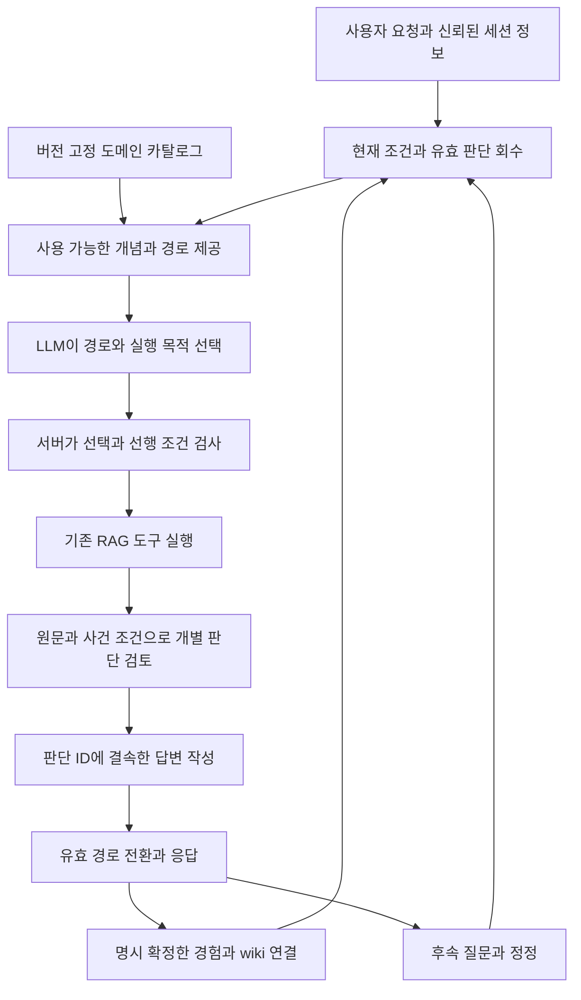

# 도메인 온톨로지에 따른 판단과 멀티턴 정정 구현 설계

후속 실제 CM 검증(2026-10-02): [수정·3차 비교와 남은 원인](/home/jin/8-AGENT/07_DOCS/REFERENCE/REPORTS/LEGAL_AGENT_CM_MEMORY_FINAL_20261002.md). 메모리 작업 통제 후보는 구현·실험했으며, 법률 도메인 카탈로그 전체 통제와 MAIN·GENOS 연결은 미완료다. 본문의 설계 당시 상태와 구분한다.
2026년 10월 1일 · 설계 초안 v1 · WSL 로컬 · 코드 연결과 계약을 확인한 자체 검토

**에이전트는 우리가 제공한 도메인 개념·관계·검토 방법에서 판단 경로를 선택하고, 설명은 자유롭게 작성한다. 도구 실행 전에 선택을 기록하고, 실행 뒤 실제 원문·조건으로 판단을 검토한다. 정정은 그 선택이나 조건을 새 버전으로 바꾸고 이를 소비한 판단을 다시 확인한다.** 이번 설계는 기존 RAG의 네 엔진과 원문 계약을 유지하며, 도메인 선택과 개별 판단 근거를 그 내부에 연결하는 방식이다.

완료한 정정·기억 실험과 현재 운영 코드를 기준으로 작성했다. 새 런타임 기능·모델 실험·운영 DB 이행·MAIN 전환·GENOS 배포는 수행하지 않았다. 제공하는 SQL과 JSON은 운영 registry에 등록하지 않은 설계 초안이다. 공통 지식 편집·승인 UI와 DB 관리 기능은 앞서 정한 별도 범위로 유지한다.

## 온톨로지와 판단 경로의 의미

우리 온톨로지는 **근거와 버전이 있는 도메인 개념·정의·관계·적용 범위의 지도**다. 이 지도 위에서 허용하는 검토 방법·이동 순서·완료 조건을 판단 경로 계약으로 관리한다.

| 구성 | 역할 | 예시 |
|---|---|---|
| 등록 개념 | 질문의 의미를 기존 도메인 용어로 식별 | 대상자, 신청, 승인 절차 |
| 문서별 정의 | 같은 용어의 의미와 효력 범위를 원문에 결속 | 특정 규정의 특정 버전에 있는 대상자 정의 |
| 타입이 있는 관계 | 무엇이 무엇을 정의·참조·한정하는지 표현 | 정의 조항에서 용어로 향하는 DEFINITION_OF |
| 검토 방법 | 어떤 질문을 어떤 근거와 조건으로 검토할지 규정 | 정의 확인, 적용 범위 확인, 명시 참조 확인, 예외 검토 |
| 경로 틀 | 허용 관계·대상 타입·선행 검사·다음 동작 규정 | 문서 범위 확인 → 정의 원문 읽기 → 사건 사실 대조 |
| 개별 판단 | 실제로 선택한 경로와 근거·조건·결과 | 이 질문의 대상 해당 여부 판단 |

용어집의 검토된 표현·정의·명시 참조는 탐색에 사용할 수 있다. 이를 법적 해석 관계로 자동 승격하지 않는다. 실행 카탈로그에서 `NAVIGATION_REVIEWED`는 탐색용, `DOMAIN_REVIEWED`는 근거를 갖춘 해석 개념·관계용으로 구분한다. 용어집의 기존 `canonical_approval=false` 의미를 바꾸지 않는다.

경로 틀은 모든 질문의 완성 답변을 미리 작성한 것이 아니다. 등록된 개념·관계를 슬롯에 넣고 허용된 동작을 조합한다. 서버가 그 조합을 검사해 현재 질문용 경로를 제공하고, 모델은 제공된 경로를 선택한다. 검색 질의와 설명 문장은 자유롭게 작성할 수 있지만 그 목적·범위·판단 근거는 선택한 경로에 결속된다.

초기 질문에서 대상 개념이 아직 발견되지 않았을 수 있다. 이때 `DISCOVERY`·`NAVIGATION` 선택은 대상 개념을 비워 둘 수 있지만, 등록된 도메인 작업 목적 `purpose_id`와 탐색 방법·허용 문서 범위가 필수다. 예를 들어 “대상자 여부 확인”이라는 목적 아래 해당 문서의 용어 후보를 가져온다. `APPLICATION`·`PRESENTATION`에서는 실제 선택한 개념과 판단을 반드시 연결한다. 이렇게 해야 모르는 용어를 찾기 위해 임의 개념을 만들어야 하는 순환을 피할 수 있다.

원문을 전부 Rule·조건·효과로 바꾸는 데이터 구축 단계는 추가하지 않는다. 선택한 원문을 읽고 판단을 생성하는 MAIN을 유지한다. [현행 MAIN](/home/jin/8-AGENT/00_SYSTEM/ARCHITECTURE.md:115)

## 저장과 책임

| 저장 영역 | 적재 내용 | 갱신 책임과 소비자 |
|---|---|---|
| 원문·용어 세대 | 원문, 좌표, 정의·명시 참조, 탐색 색인 | 기존 MAIN 구축. RAG가 읽기 전용으로 소비 |
| 도메인 실행 카탈로그 | 사용할 개념·관계·방법·경로 틀과 검토 영수증 | 기존 용어집 구축 흐름의 명시 compile 확장 제안. 실행 전에 버전·해시 고정 |
| 사건 상태와 native journal | 발언·정정·현재 조건·선택 경로·도구 결과·개별 판단 | 기존 사건 계약과 요청별 journal. 다음 턴·조회·복구의 정본 |
| 최종 해결 경험 | 확정된 의도·조건·개별 판단·근거·최종 경로 | 현재 유효 경로만 명시 확정. 다음 질문에서 범위와 조건을 확인하고 활용 |
| legal_wiki·user_wiki | 개념·의도에서 경험과 원문으로 연결, 개인 이력 표시 | 위 정본의 ID·revision을 가리키는 projection |

모든 질문을 온톨로지의 독립 지식으로 적재하지 않는다. 질문과 정정은 실행 이력에 저장하고, 해결 경험은 마지막 유효 경로가 확정될 때 한 묶음으로 저장한다. 틀린 중간 경로는 재사용에서 제외한다. 감사 이력을 보존해 최초까지 역추적할 수 있게 한다.

공통 온톨로지 변경과 사건의 정정을 구분한다. “이 질문은 내규가 아니라 외규다”는 현재 질문의 범위 결속을 고친다. “이 개념 관계 자체가 잘못됐다”는 공통 관계 변경 후보를 만들고 해당 관계를 소비한 경험을 보류한다. 공통 정본을 수정·승인하는 별도 관리 기능을 이번 멀티턴 경로에 끼워 넣지 않는다.

## 현재 코드와 목표 실행 경로

현재 선택된 로컬 릴리스는 `legal-agent-source-prefix-20260930-r3`, generation 37이며 `quality_certified=false`다. 관련 앱·session adapter·bounded session·Coordinator의 작업 파일은 선택 릴리스 파일과 바이트가 같음을 확인했다. 작업 `PIPELINE.json`과 릴리스의 `PIPELINE.json`은 다르므로 실행 기준은 선택된 릴리스 manifest와 그 profile이다.

기억 후보는 별도로 동결된 ADR0609 연구 snapshot이다. 실제 34턴에서 정정·복원·저장·재사용을 확인했지만 기본 `service.application`에 연결되지 않았다. 이 설계는 후보를 production에서 직접 import하는 방식으로 도입하지 않는다.

새 개념·경로가 없으면 기존 원문을 탐색할 수 있는 등록된 발견 방법 안에서 후보를 더 가져온다. 그래도 허용 경로가 없으면 부족한 개념·관계·근거를 설명하고 보류한다. 모델이 새 방법이나 해석 관계를 즉시 정본으로 만들어 우회하지 못하게 한다.

## 도메인 실행 카탈로그 구축

추가할 compiler는 기존 `pipeline.py glossary` 아래의 명시 하위 명령으로 제안한다. 이름은 `domain-control compile/status/verify`이며 아직 존재하는 CLI가 아니다. 별도 데이터 입력·질의 서버는 만들지 않는다.

입력은 선택된 원문·용어·정의·참조 세대, 사용할 해석 개념과 방법의 명시 검토 기록, 코드가 지원하는 검사·동작 registry다. compiler는 기존 ID를 보존하고, 정의의 문서 범위·관계 방향·원문 좌표·검토 출처·정확한 버전을 검사한다. 원문에서 단서를 추출했다는 사실만으로 해석 관계를 승인하지 않는다.

출력 위치는 workspace의 `data` root 아래 `DOMAIN_CONTROL_RELEASES/<catalogue-id>/`로 제안한다. `catalogue.sqlite`, 파일 해시 manifest, compile receipt를 새 불변 패키지로 만든다. 기존 원문 세대는 수정하지 않는다. 서빙 설정은 catalogue 파일과 manifest의 정확한 해시를 명시하며 최신 폴더를 자동 선택하지 않는다.

카탈로그는 원문 세대의 기존 manifest 해시를 참조하고, 서빙 릴리스는 원문과 카탈로그의 해시를 각각 참조한다. 자기 자신을 포함한 manifest 해시를 payload 안에서 다시 해시하는 순환 결속은 만들지 않는다. 방법만 바뀌면 원문 구조화와 용어 색인을 다시 생성할 필요가 없고, 새 카탈로그·코드 릴리스·경험 재검토가 필요하다. 원문·정의·참조가 바뀌면 기존 MAIN이 새 원문 세대를 만들고 그에 결속한 카탈로그를 새로 compile한다.

초기 방법은 다음 역할을 지원하도록 제안한다. 실제 법률 정본으로 사용할 세부 내용과 출처 검토는 도메인 카탈로그의 입력이다.

| 방법 역할 | 허용하는 일 | 완료 조건 |
|---|---|---|
| 질문 개념 발견 | 질문 구간을 등록 용어·문서 범위의 후보에 연결 | 선택·보류 이유와 질문 원구간 결속 |
| 용어·구조 기반 근거 찾기 | 등록 용어·문서·명시 좌표로 기존 탐색 도구 사용 | 후보와 실제 필터·색인 버전 기록 |
| 정의 확인 | 같은 문서 범위의 정의 관계를 따라 원문 읽기 | 정의 원문·범위 확보. 사건 적용은 후속 검토 |
| 명시 참조 확인 | 실제 참조 관계의 출발과 대상 원문 확인 | 대상 확인·적용 범위 검토. 참조만으로 적용 결론을 확정하지 않음 |
| 적용 조건과 예외 검토 | 현재 사실과 원문의 요건·예외를 대조 | 확인된 조건·위반·미확인을 구분하고 원문 근거 연결 |
| 근거 채택·배제 | 질문 요구와 읽은 원문을 비교 | 각 선택의 도메인 목적·근거·보류 이유 기록 |
| 판단 종합과 표현 | 현재 유효 판단을 질문 요구와 문단에 연결 | 결론·조건·출처·미확인 보존 |

원문에 특정 예외가 없다는 이유만으로 법률 전체에 예외가 없다고 판단할 수 없다. 방법의 완료 조건은 조사한 문서·버전·범위에 대한 결과와 남은 미확인을 표현한다. 같은 규정에서도 정의·준용·예외의 관계를 혼동하지 않도록 관계 타입마다 근거 요구를 다르게 둔다.

## 선택 전 검사와 판단 후 검사

실행 카탈로그와 모델에 전달한 목록은 구분한다. `offer_id`는 현재 질문·사건 revision·접근 범위·카탈로그 버전에서 실제로 제공한 후보 묶음을 식별한다. 모델은 전체 DB에 존재하지만 제공되지 않은 ID를 임의 선택할 수 없다. 작은 view와 cursor로 후보를 추가 회수하고, 누락된 목록을 전체 지식의 부재로 오해하지 않게 표시한다.

| 검사 시점 | 서버 검사 | 실패 처리 |
|---|---|---|
| 요청 입구 | 신뢰된 사용자·팀·문서 범위, 세션 결속, 요청 중복, 현재 revision | 다른 주체·오래된 수정 요청 거부. 클라이언트 user_id로 인증하지 않음 |
| 경로 제공 | source·ontology·policy 해시, 후보의 범위와 실제 제공 영수증 | 세대 불일치·범위 밖 후보 제공 차단 |
| 실행 전 | 개념·관계·방법·step의 제공 여부, 타입·방향, 범위, 허용 동작, 선행 조건 | 상태 변경 전 제한된 명령 수리. 재실패는 보류 |
| 실행 후 | 실제 동작·인자·결과와 선택의 일치, 원문 좌표·해시·완독·전달 기록 | 실패·부분 성공 보존. 미완료 근거를 완료로 표시하지 않음 |
| 판단 채택 전 | 필수 조건 검사, 정확한 사실 버전, 원문 의미와 주장 부합, 미확인·충돌 | ADOPT·REJECT·DEFER 구분. 의미 검사 실패를 인용 일치로 덮지 않음 |
| 종합·게시 전 | 현재 head·부모·근거·카탈로그의 유효성, 문단의 실제 판단 연결 | 낡은 실행·퇴역 판단·보류된 필수 판단으로 최종 결론 게시 차단 |
| 경험 재사용 전 | 원문·카탈로그·권한·현재 조건과 과거 경로의 적용 가능성 | 같으면 재사용, 다르면 필요한 검토·탐색 재실행 |

모델이 선택하는 구조는 `ActionChoice`, 실행 뒤의 개별 판단은 `AtomicJudgment`로 제안한다. 이유 문장은 자유 문자열로 유지한다. 구조의 필수 필드는 개념·관계·방법·경로·질문·사실 버전·원문·부모 판단이다. 이유 문장에 이 구조가 뒷받침하지 않는 새 조건이나 결론이 들어갔는지도 확인한다.

발견 단계의 목표 개념·관계와 읽기 전의 근거 목록은 아직 비어 있을 수 있다. 이를 완료된 적용 판단으로 취급하지 않는다. 방법의 postcheck가 충족되기 전에는 해당 step만 수행하고 다음 단계의 전제나 최종 결론으로 확정하지 않는다.

저장용 `AtomicJudgment` 전체를 모델에게 출력시키지 않는다. 모델은 제공된 후보·근거에서 판단 내용과 조건별 검토 결과를 제안한다. 서버가 ID·버전·해시·binding·실제 receipt를 채우고 검사한 뒤 native entity와 proof를 한 트랜잭션으로 저장한다. `$defs`의 저장 계약과 단계별 model wire 계약을 구분해 생성해야 한다. ID·해시가 실제 생성되기 전에 모델이 이를 만들어 내게 하지 않는다.

사용자 정정 patch의 사실 근거는 USER_ASSERTED·ASSUMPTION·UNKNOWN으로 제한한다. SOURCE_VERIFIED는 서버가 원문·확인 영수증을 결속한 검토 결과로만 생성할 수 있다. 사용자의 “이게 맞다”와 원문으로 확인한 사실을 같은 승인 상태로 바꾸지 않는다.

기계 검사는 ID·해시·타입·필수 읽기·revision을 확인한다. 도메인 의미 검사는 선택한 관계의 의미와 사건 조건에 대한 원문 적용을 검토한다. 후자는 여전히 모델과 도메인 검토의 품질 평가가 필요하다. 이번 설계에서 형식 검사만으로 의미 타당성이 보장된다고 가정하지 않는다.

## 개별 판단과 native journal 계약

도메인 판단을 기존 journal의 `intent`, `assessment`, `finding`, `claim` 등 실제 entity와 연결한다. 판단 종류를 추가하는 대신 기존 entity 버전에 `dq_proof`를 일대일로 붙이는 초안이다. 사실·부모·유효 head·무효화의 정본은 기존 native 표와 동작을 유지한다.

| 새 초안 표 | 내용과 소비자 |
|---|---|
| `dq_binding` | 사건·질문 revision과 source·catalogue·policy 결속 |
| `dq_offer` | 모델 또는 결정론 시스템이 실제로 받은 선택 목록 |
| `dq_choice` | 실행 전에 허용한 방법·경로·step·동작·이유 |
| `dq_execution` | 선택한 동작의 실제 결과·실패·시도 영수증 |
| `dq_proof` | 기존 entity의 정확한 버전에 붙은 도메인 판단 근거 |
| `dq_proof_fact` | 판단이 사용한 사실의 정확한 native 버전. 기존 dependency에도 연결 |
| `dq_guard_dependency` | 적용 가능성 검사에서 확인한 조건 키와 값의 해시 |
| `dq_answer_anchor` | 답변 artifact·문단에서 사용한 실제 판단 버전 |

새로운 별도 proof head는 두지 않는다. `entity_head`의 CURRENT·STALE·CONTESTED·RETRACTED를 따른다. 서로 다른 요청의 native 별칭은 같은 ID처럼 사용하지 않는다. 재사용할 때 실제 원문과 불변 판단을 현재 journal에서 검증·재결속하고, 사건 색인에 이전 run/version과 새 entity의 대응을 기록한다.

현재 `journal-v5.sql`과 repository는 버전 5를 기대한다. 도메인 확장은 **새 요청 journal 버전 6**과 새 DomainRepository로 제안한다. 새 journal용 DDL은 기존 v5 기본 표와 도메인 fragment를 함께 포함하는 별도 파일로 구현해야 한다. 기존 완료 journal을 수정하지 않는다. publication·deferred publication·recover의 버전 분기에도 6을 추가하고 같은 도메인 guard를 적용해야 한다. SQL 초안만 적용하고 VERSION을 바꾸는 것으로 도입이 완료되지는 않는다.

증거 basis에는 단순 source ID 외에 document·generation·artifact hash·block·문자 위치·정확한 인용·읽기 영수증·전달 view가 필요하다. 모델이 답변에 주장한 근거는 해당 호출에서 실제 전달되었거나 이전 성공 view에서 전달된 근거여야 한다. 선택 목록에 있던 원문 위치와 실제 읽은 근거를 같은 것으로 처리하지 않는다.

## 전체 RAG 단계의 통제와 수정

현재 engine 단계는 retrieve·select·assemble·answer다. 다음 일곱 이름은 엔진 내부의 논리 단계다. 별도 engine 일곱 개를 만드는 설계가 아니다.

| 논리 단계 | 도메인 통제 대상 | 기존 연결 지점과 수정 영향 |
|---|---|---|
| INTENT | 질문 구간·요구·개념·사건 조건의 선택 | 앱과 session의 질문 계획. 변경한 의도에 의존한 경로 재검토 |
| PLAN | 근거가 필요한 이유, 문서·용어·탐색 방법·검색 범위 | `BoundedSourceSession.plan_request_search`. 범위·개념 변경은 탐색 이후 재실행 |
| RECALL | 허용된 용어·구조·참조를 따른 후보 확보 | `SourceRecall.discover`와 실제 경로 기록. 후보 회수 결과를 후속에 결속 |
| READ | 필요한 원문 구간·참조 대상·완독 범위 | `prepare_source_recall`와 기존 SourceSession. 추가 읽기에 의존한 판단 재검토 |
| SELECT | 채택·배제·보류의 도메인 이유 | `source_selection.select_sources`와 `persist_bounded_selection`. 바뀐 근거를 사용하는 판단 재검토 |
| ASSESS | 정의·조건·예외·관계 적용의 개별 판단 | question obligation·assessment·claim의 commit 앞 검사. 해당 판단의 자손 재검토 |
| COMPOSE | 유효 판단을 종합하고 자유로운 문장·표로 표현 | assemble·composer·review·publication. 표현만 바뀌면 근거·판단 유지 |

현재 bounded 경로는 질문 요구 계획을 원문 선별 후 만들기도 한다. 새 설계는 최초에 개념·질문 목적의 최소 결속을 만들고, 원문 확보 뒤 세부 요구와 판단을 보완한다. 실제 순서는 이벤트와 의존 관계로 관리한다. 고정된 단계 번호만으로 모든 재실행을 결정하지 않는다.

현재 Coordinator는 RESEARCH면 retrieve·select·assemble을 함께 다시 실행하고, 그렇지 않으면 answer를 다시 실행한다. 또한 `BoundedSourceSession.bounded_started`는 같은 session의 추가 조사를 제한한다. 따라서 세밀한 재진입은 설정만으로 되지 않는다. **제안 ControlledOntologySession의 operation checkpoint·캐시 무효화와 Coordinator의 reentry plan 소비를 함께 구현해야 한다.** StageRunner와 네 엔진의 외부 포트는 유지한다.

## 멀티턴 정정과 체인 해소

수정 해석은 원발언·답변 문단·선택 경로·개별 판단·앞선 정정 이벤트를 후보로 받아야 한다. “첫 정정”은 정정 순번이며 질문 순번이나 전체 발언 번호로 바꾸지 않는다. 시스템은 실제 이벤트 ID를 회수해 대응한다.

정정 계약은 target refs, base revision, 변경 patch, 이전 정정 refs, 최초 원기록 refs, 무효화·재검토·유지 대상, 미해결을 반환한다. patch는 사실 변경·철회, 개념/범위/관계 재결속, 원문 재선별, 특정 operation 재진입, 경험 연결 정정, 표현 변경으로 타입을 구분한다. 모델이 임의 SQL이나 DB 경로를 실행하는 계약은 두지 않는다.

정정 처리 순서는 다음과 같다.

1. 현재 주체·질문·branch·revision을 확인하고 실제 대상 기록을 회수한다.
2. 이전 정정과 최초 원발언을 필요한 만큼 정확한 refs로 역추적한다. 조회 예산이 부족하면 누락을 미해결로 남긴다.
3. 기존 기록을 덮어쓰지 않고 새 사실·선택·정정 버전을 만든다. 복원하는 값의 원본 출처와 이번 복원 이벤트를 함께 기록한다.
4. 변경된 정확한 버전에 의존하는 현재 유효 판단을 무효화한다. 관련 경험의 재사용도 즉시 중단한다.
5. 새 조건 추가·원문 범위 변경·관계 변경이면 현재 질문의 경로 적용 가능성도 다시 확인한다.
6. 유지할 유효 판단과 재실행할 operation을 구분하고 의존 순서로 실행한다.
7. 새 근거·판단·문단 대응과 닫힌 경로를 확인해 현재 경로를 전환한다.

**기존 의존 관계의 자손만 찾으면 새로 들어온 조건을 놓칠 수 있다.** 이미 검사한 조건은 `dq_guard_dependency`로 역조회한다. 이전에 없던 조건은 같은 질문의 현재 경로에 대해 추가 관련성 검토를 수행한다. 연결이 없다는 이유로 영향 없음으로 처리하지 않는다. 공유 사실이면 해당 사실을 사용한 다른 목표까지 영향 범위를 확인한다. 질문에 국한된 사실은 무관한 질문을 바꾸지 않는다.

| 사용자 정정 | 구조의 변화 | 필요한 재실행 |
|---|---|---|
| “내규가 아니라 외규야” | 해당 질문의 문서 범위와 개념·관계 결속 변경 | 범위 선택부터 영향을 받은 탐색·근거·판단 |
| “1차 정정에서 외규로 바꾼 게 틀렸어. 최초 내규가 맞아” | 1차 정정의 적용 내용과 최초 기록을 회수해 새 내규 범위 버전 생성 | 현재 유효 외규 경로를 중단하고 복원한 범위에서 다시 확인 |
| “긴급 건이라는 조건도 있어” | 새 사건 조건 버전과 적용 가능성 검토 추가 | 예외·절차 등 관련 판단 및 필요하면 추가 근거 확보 |
| “그 사례를 가져온 게 잘못됐어” | wiki의 의도→경험 연결 변경 | 현재 질문의 잘못된 경험 소비 부분. 원래 경험 묶음은 유지 |
| “둘째 문단의 정의 선택이 틀렸어” | paragraph anchor가 가리키는 정의·판단 선택 변경 | 그 판단과 해당 판단을 사용한 결론 |
| “표로 정리해줘” | 표현 요청만 변경 | 유효 판단을 가져와 COMPOSE |

한 번 더 정정하는 요청도 같은 처리 경로를 사용한다. 정정의 해석 자체가 잘못됐으면 그 해석 entity와 이벤트가 수정 대상이다. 최초로 돌아갈 때 과거 오답을 다시 활성화하는 것이 아니라 원기록에서 필요한 값을 가져와 현재 버전의 판단을 새로 만든다.

## 상태 전환과 실패 복구

사건 head는 현재 revision과 유효 경로를 가진다. 모델 실행 중에는 DB의 쓰기 lock을 유지하지 않는다. 작업 시작 시 revision을 읽고, 실제 patch 적용과 경로 전환 시 CAS로 확인한다. 오래된 실행 결과는 원장에는 보존하지만 새 head를 덮어쓰지 않는다.

| 상태 | 의미와 다음 동작 |
|---|---|
| READY | 현재 조건과 유효 경로가 결속되어 소비 가능 |
| PENDING | 정정이 적용되어 기존 관련 판단은 사용할 수 없고 새 검토가 필요 |
| BUILDING | 필요한 operation 실행 중. 실패하면 PENDING으로 남음 |
| COMMIT_READY | 새 결과와 route hash가 준비되어 게시·head 전환을 복구할 수 있음 |
| READY 새 revision | 게시 결과와 닫힌 경로를 확인하고 전환 완료 |

native journal과 사건 DB는 서로 다른 파일이므로 하나의 SQL 트랜잭션으로 모두 커밋했다고 가정하지 않는다. 다음 복구 가능한 순서를 제안한다.

1. native journal에 새 판단·최종 artifact와 publication 준비 기록을 남긴다.
2. 사건 DB에서 base revision을 CAS로 확인하고 후보 route와 COMMIT_READY·outbox를 기록한다.
3. 사건의 짧은 owner lock 아래에서 head·권한·source·catalogue를 다시 확인하고 native publication을 export한다.
4. 같은 lock 아래에서 사건의 게시 receipt와 READY 경로를 전환한다. 답변 반환 직전에도 revision과 route를 확인한다.

파일 export 뒤 프로세스가 죽으면 결과 파일은 존재할 수 있지만 사건 head가 READY가 되지 않아 지식 재사용은 차단된다. recovery는 prepared result hash·candidate route·현재 권한과 버전을 확인해 같은 전환을 재개한다. 새로운 정정이 먼저 적용됐으면 옛 결과를 활성화하지 않는다. 관련 모든 writer·publisher가 같은 사건 lock을 사용하도록 구현해야 한다. native owner lock만으로 여러 요청의 사건 경합이 해결되지는 않는다.

deferred publication도 같은 guard와 복구 계약을 적용해야 한다. 초기 후보에서는 도메인 모드의 동기 publication 경로부터 검증하고, background 경로는 위 guard와 복구를 검증한 뒤 활성화한다. 기존 단일턴 모드의 게시 설정은 유지한다.

동일 request ID·동일 입력의 재호출은 저장된 응답을 반환한다. 그 사이 사건 head가 바뀌었다면 해당 응답의 revision과 현재성을 함께 표시한다. 중복 응답을 새로운 유효 판단으로 저장하거나 과거 답을 현재 답처럼 표시하지 않는다. source·ontology·권한 변경은 읽기·게시·재사용 시점에서 다시 검사한다.

## 최종 경험과 다음 질문에서의 활용

최종 경험의 내용은 마지막 run 전체가 아니라 **현재 조건에서 유효한 판단들의 닫힌 의존 그래프**다. 서로 다른 run에서 유지한 판단과 새 판단을 함께 구성할 수 있다. 원래 run의 ref/hash와 현재 대응을 보존한다.

최종 경험에는 문제 목적, 적용 조건, source·ontology·method binding, 경로와 개별 판단 refs, 사용 원문, 미확인 사항, 사용자 확인 상태를 저장한다. 사용자 확인은 `USER_CONFIRMED_EXPERIENCE`이며 공통 법률 정답 인증과 구분한다. 명시 확정은 유효 조건·경로를 저장하는 동작이며 별도 매턴 승인 흐름을 추가하지 않는다.

새 질문은 wiki에서 관련 경험을 찾고 다음을 확인한다. 같은 목적·조건·source·ontology·권한이면 현재 run에 결속해 필요한 표현을 만든다. 사실이 다르면 관련 판단과 경로 조건을 다시 검사한다. source나 방법이 달라졌으면 해당 단계부터 재검토한다. 이전 판단이나 연결이 폐기됐으면 가져오지 않는다.

현재 프로토의 bigram·최대 32개 후보 검색은 초기 후보 비교 기준으로 남긴다. 대규모 의미 검색의 품질·비용은 별도 측정 대상이다. 검색 결과가 없다고 온톨로지나 경험 전체에 해당 개념이 없다고 단정하지 않는다. 목적 문자열에는 사건 조건을 섞지 않고, 조건과 적용 가능성은 별도 구조로 관리한다.

## 코드 변경 지도와 이행 범위

아래 모듈명은 새 구현 제안이며 현재 존재하는 런타임 API로 표현하지 않는다.

| 파일과 진입점 | 제안 변경 | 입력·출력·소비자와 호환성 |
|---|---|---|
| `service.py` 요청 정규화와 `application` | 명시 memory/domain 모드의 세션·request ID 보존, 신뢰된 identity·catalogue binding 주입 | 일반 단일턴 입력 유지. GENOS·로컬 adapter의 입구만 다르고 공통 상태/판단 모듈 사용 |
| `semantic_runtime.app.create_app`와 `ask` | 도메인 기억 envelope 검증·주체 검사·응답 trace 제공 | 현재 앱은 추가 session 필드를 거부하므로 closed 허용 목록을 명시 확장. 내부 `runtime.request` 모양은 유지 |
| `pipeline.py`와 `legal_agent_adapter.py` | 실행 context에 사건/route·catalogue를 주입하고 선택형 ControlledOntologySession·DomainRepository 생성 | 기존 4개 engine와 source generation 유지. 새 config validator 필요 |
| 제안 `domain_catalogue.py` | 카탈로그 해시·ID·범위 검사, 경로 인스턴스·offer 생성 | 용어/정의/관계 ID를 prompt용 작은 목록으로 제공 |
| 제안 `domain_protocol.py` | 단계별 제공 ID enum과 닫힌 선택·판단 schema 생성 | 기존 v5 model response에 필드를 몰래 추가하지 않음. 선택 모드에서 새 schema를 사용하고 기존 native proposal로 명시 변환 |
| 제안 `domain_control.py` | 실행 전 선택 검사·실행 후 proof 검사, 사실/관계/원문 결속 | tool 실행과 entity commit 앞 guard. 도메인 검토 실패가 상태를 확정하지 못하게 함 |
| 제안 `controlled_ontology_session.py` | bounded session의 logical operation checkpoint·재진입·선별·판단 연결 | 기존 SourceRecall·SourceSession·선별·작성 함수 사용. 자동 branch fallback으로 자유 판단을 우회하지 않음 |
| 제안 `domain_repository.py`와 새 journal-v6 | 선택·proof·anchor를 native journal에 저장 | 새로운 요청에만 적용. 이전 journal 읽기/회복 코드 보존 |
| `coordinator.py` | reentry plan에 따라 필요한 engine과 내부 operation을 재개 | RESEARCH 전체 재실행과 COMPOSE만 실행을 포함해 의존 기반 선택 지원 |
| 사건/기억 모듈 | ADR0609의 의미 분리·정정·퇴역·CAS·확정·재사용 기능을 일반 모듈로 이행 | research snapshot을 production에서 import하지 않음. r2 사건 SQL과 실제 prototype DB는 명시 mapping이 필요 |
| `publication.py`·`deferred_publication.py` | journal 6, 현재 사건 route·domain proof guard·복구 분기 | 저장된 FINAL만으로 최신 도메인 판단을 게시하지 못하게 검사 |
| `source_bundle.py`·composer·review | claim·조건·원문과 domain proof 연결, 문단 anchor 검사 | 현재 Result port 보존. 추가 trace는 버전 있는 HTTP envelope/별도 artifact로 제공 |
| `PIPELINE.json`·engine manifest·release 계약 | 선택형 ontology_control binding/parameters schema, 새 코드 해시와 journal schema 결속 | 현재 폐쇄 parameters/profile 검사와 함께 수정. 작업 JSON만 바꾸면 활성 릴리스에 반영되는 것으로 보고하지 않음 |
| GENOS workflow | session/revision 전달, INSPECT의 자연어 answer와 판단 링크 표시 | Python 편집기 반영은 ZIP·Git·코드 리비전과 별도. 실제 현장 검증은 workflow 테스트 화면 |

설정의 책임은 세 갈래다. source/domain catalogue 파일 binding은 서빙 설정이 고정하고, 신뢰된 identity adapter가 사용자 범위를 고정하고, 실행 profile이 모델·호출/시간/읽기 예산을 고정한다. 사용자 질의에서 카탈로그 파일·DB 경로·모델 endpoint를 바꿀 수 없다.

신규 memory 요청 envelope에는 버전·question·session_id·request_id·expected_revision와 선택적 문단/판단 anchor를 둔다. user_id는 서버 인증 결과와 일치 확인하는 값이고, 실제 주체와 접근 범위는 adapter가 제공한다. 원발언은 그대로 저장하며 RAG용 현재 목적·조건 view와 구분한다. 짧은 후속 발언만 기존 `runtime.request.question`으로 보내는 방식은 사용하지 않는다. 현재 조건을 만드는 입력과 원발언의 정확한 ref를 session context에 결속해야 한다.

외부 transport를 사용하는 경우에는 새 발언뿐 아니라 추가하는 과거 질문·이유·근거 각각의 전송 허용 범위도 확인해야 한다. 현재 발언의 `public_question=true`를 개인 이력 전체의 전송 승인으로 확대하지 않는다. GENOS 내부 모델과 공개/모의 외부 실험은 기존 환경별 계약을 따른다.

원문·용어 index의 내부 계약은 유지한다. 새 도메인 카탈로그와 journal만 새 버전이다. 이전 경험은 `LEGACY_UNBOUND`로 표시하고 탐색 후보로는 볼 수 있지만 도메인 통제된 판단으로 곧바로 채택하지 않는다. 원문·조건·개념·방법을 재검토한 뒤 새 경험 버전을 만든다. 기존 SQL 초안의 사건 schema, shortcut 경험 schema, 실제 연구 DB의 column이 동일하다고 가정하지 않는다.

## 대표 정상과 실패 흐름

| 상황 | 처리와 사용자에게 보이는 결과 |
|---|---|
| “이 규정의 대상자에 해당하는지 봐줘” | 해당 문서의 개념·정의 경로 선택 → 원문 읽기 → 사실 대조 → 근거와 조건을 연결한 판단 → 설명 |
| 동명 용어의 다른 문서 정의 선택 | 같은 문서/명시 연결 범위 검사에서 차단. 적용 가능한 관계를 더 확인하거나 보류 |
| 관계 ID는 맞지만 참조를 직접 적용으로 해석 | 관계 타입의 적용 조건과 양끝 원문 검토가 충족되지 않아 확정 차단 |
| 사건 조건이 미확인 | UNKNOWN 유지. 사실처럼 채워 넣지 않고 필요한 정보를 설명 |
| 정정 대상이 여러 개 | 실제 문단·질문·정정 후보를 회수. 그래도 구분되지 않을 때만 대상 확인 |
| 최초 원기록 조회를 완료하지 못함 | 복원했다고 표시하지 않고 미해결 refs와 다음 조회 동작 기록 |
| 도구나 제공자 실패 | 선택/시도/부분 결과 보존, PENDING으로 재개. 옛 관련 답변의 재사용은 차단 |
| source·ontology 버전 변경 | 영향받은 판단/경로를 새 binding에서 확인. 구 버전은 감사 조회만 허용 |
| 읽기 권한이 회수됨 | proof·이유·wiki projection·경험 재사용에서도 해당 원문/개념 노출 차단 |
| “왜 그 조항을 읽었어” | 선택 전에 저장한 개념·방법·경로·expected_information과 실제 실행 결과를 자연어 answer로 표시 |
| “표로 바꿔줘” | 현재 유효 판단과 anchor를 COMPOSE로 가져와 작성. 의미 변경이 섞이면 정정 요청으로 분리 해석 |

INSPECT는 답변용 view와 자연어 answer를 반환하도록 설계한다. 현재 후보가 자료만 반환해 workflow에서 표시되지 않는 문제를 그대로 두고 조회가 완성됐다고 처리하지 않는다. 이유 조회는 모델의 숨겨진 사고가 아니라 실제 선택·입력·근거·결과 기록을 설명한다.

## 기대효과와 자원 판단

수정 대상의 명확성은 구조상 기대효과다. 잘못된 개념·관계·사실·방법을 식별하고 이를 소비한 판단을 찾을 수 있다. 실제 수정 정확도와 사용자 이해도 개선은 미측정이다. 새로운 근거 검사와 후보 제공이 지연·비용을 늘릴 수도 있다.

| 수치 ID | 종류와 분모 | 근거와 해석 |
|---|---|---|
| OBS1 | 관측, 기존 체인 6개 대화 49턴의 동작 검사 | 303/303. 합성 검색·실제 모델. 이번 도메인 통제 품질 수치가 아님 |
| OBS2 | 관측, 통합 후보 3개 대화 34턴의 사전 체크포인트 | 42/42. 모의 원문과 실제 SourceRecall 사용. 모든 법률 문장 정답률이 아님 |
| OBS3 | 관측, 통합 후보 성공 외부 호출 218회 | 비용 0.15840128달러, 턴 중앙 지연 약 21.65초. 새 설계 비용 예측에 전용하지 않음 |
| GOAL1 | 목표, 선택 실행·확정 판단·게시의 계약 위반 건수 | 제공 밖 ID·잘못된 binding·미완료 필수 근거·퇴역 판단으로 확정되는 경우를 후보의 계약 통과 근거로 허용하지 않음 |
| UNKNOWN1 | 미확인, 새 도메인 모드의 품질·지연·비용·구현 일정 | 자료 범위·방법 수·실제 callback/wire schema·새 호출 수를 확인한 뒤 측정·산정 |

질문당 새 경로 선택·검토 비용을 `Cgate`, 재사용 때문에 실행하지 않아도 되는 기존 조사의 비용을 `Cskip`, 재사용 적용 비율을 `p`라고 하면, 변동 호출 비용의 차이는 `Cgate - p × Cskip`이다. 계산식이며 입력 값은 미산정이다. `Cgate > p × Cskip`이면 호출 비용은 늘어난다. 카탈로그 구축·도메인 검토·저장·유지 비용은 이 식 밖의 추가 비용으로 함께 측정해야 한다. 호출 수가 줄어도 큰 view·재시도·검토 호출로 비용이 늘 수 있다. 중앙 지연으로 p95나 처리 용량을 추정하지 않는다.

## 검증과 도입 순서

이번에는 새 모델 실험을 시작하지 않았다. 후속 구현에서 다음 순서로 후보를 만든다.

1. **카탈로그와 proof 계약:** 도메인 ID·관계 방향·문서 범위·method 검토·새 journal·closed schema를 구현하고 무효 입력 검사를 수행한다.
2. **native 실행 연결:** 도구 실행 전 choice·실행 receipt·개별 판단 proof·문단 anchor를 기존 네 엔진에 연결한다. 실제 source 읽기와 현재 publication까지 확인한다.
3. **정정과 복구:** 사건 revision·새 조건·최초 복원·개별 의존 관계·CAS·게시 중단·restart·late result·deferred guard를 연결한다.
4. **최종 경험과 wiki:** 최종 그래프를 저장하고 새 질문에서 버전·조건·권한을 검사해 소비한다. Legacy 경험 이행을 분리한다.
5. **실제 모델 비교와 현장 검증:** 구현 수정/첫 호출 전에 새 ADR을 선점하고 기준·후보·출처·모델·성공 기준을 동결한다. 공개 또는 모의 자료는 현재 실험 정책을 따르고, 내부 자료·모델은 GENOS에서 검증한다.

동작 계약과 도메인 의미 평가는 구분한다. 의미 평가의 단위는 독립된 사건/문서 범위이며 같은 사건의 여러 턴·의역을 독립 사례 수로 늘리지 않는다. 사람이 확인한 원문·조건·관계·허용 경로를 채점 기준으로 별도 동결하고 제품 입력에 정답 경로를 넣지 않는다. 같은 모델의 verifier 통과만으로 정답을 확정하지 않는다.

| 검증 묶음 | 반드시 비교할 결과 |
|---|---|
| 닫힌 선택 | 제공하지 않은 ID·관계 타입/방향·method step·범위 밖 원문을 차단 |
| 도메인 의미 | 맞는 ID지만 틀린 정의 적용, 참조와 적용 혼동, 예외·미확인 사실 누락을 검출 |
| 표현 자유 | 같은 판단 경로를 다른 문장·표로 표현해도 조건·근거와 연결이 유지 |
| 체인과 정정 | 1차 오정정 후 2차 정정이 원본까지 회수하고 새 유효 경로를 생성. 무관한 판단 유지 |
| 새 조건 | 기존 edge에 없던 조건을 추가해 관련 경로와 판단을 재확인 |
| 실제 배선 | service 정규화 → identity → Pipeline → session → source → proof → publication → 응답 → 확정 경험 → 다음 질문 |
| 복구와 동시성 | DB/파일 export 사이의 중단, 동시 정정, 낡은 결과, 세대/권한 변경에서 현재성 보존 |

후보의 기능 검증 완료와 MAIN 승격은 별도다. 선택 코드는 모든 새 모듈·schema·engine parameter·journal·catalogue를 manifest로 고정해야 한다. 검증 전 기본 경로로 자동 선택하지 않는다. 도입 시 이전 code/source/catalogue 조합과 apply/rollback receipt를 보존한다. 롤백은 기존 경험·새 journal을 삭제하지 않고 서빙 선택을 이전 버전으로 되돌리며, 이전 코드가 journal 6을 잘못 열지 않도록 버전 분기를 둔다.

GENOS는 이 세션에서 접근할 수 없다. 인계 시 코드 리비전·catalogue/source 해시·설정·schema·재개/복구/롤백을 함께 전달하고 현장 실행 명령은 `python3`로 작성해야 한다. 현장 확인은 workflow 테스트 화면에서 수행하고 workflow Python 단계 반영과 코드서빙 리비전 배포를 각각 확인한다.

## 설계 산출물과 검토 판정

| 산출물 | 범위 |
|---|---|
| [데이터 계약 초안](/home/jin/8-AGENT/00_SYSTEM/SCHEMAS/legal-agent-domain-control-v1.draft.schema.json) | 카탈로그·선택·보류·개별 판단·정정·답변 anchor의 타입과 필수 필드 |
| [카탈로그 SQL 초안](/home/jin/8-AGENT/00_SYSTEM/SCHEMAS/legal-agent-domain-catalogue-v1.draft.sql) | 불변 개념·관계·방법·경로 저장. 해석 관계의 review 타입 구분 |
| [native journal 확장 SQL 초안](/home/jin/8-AGENT/00_SYSTEM/SCHEMAS/legal-agent-domain-journal-v1.draft.sql) | 새 journal용 choice·receipt·proof·사실/조건/문단 연결. live DB 이행 스크립트 아님 |
| [모의 계약 예시](/home/jin/8-AGENT/00_SYSTEM/SCHEMAS/legal-agent-domain-control-v1.draft.examples.json) | 정의 경로 선택·근거 판단·재정정의 정적 모양. 실제 실행 영수증 아님 |

초안의 schema meta·정적 예시·필수 필드·허용 타입·SQL 외래키·불변 기록 검사 **37개가 통과**했다. SQL 검사는 메모리 내 임시 DB에서 수행했다. 실제 offer ID 소속, 경로의 의미, 원문 함의, 서버 실행 배선은 이 검사로 확인하지 않았다. 해당 검사는 후속 런타임 구현의 책임이다. [초안 계약 검사 기록](/home/jin/8-AGENT/07_DOCS/REFERENCE/REPORTS/LEGAL_AGENT_ONTOLOGY_CONTROL_DESIGN_20261001.contract-check.json)

자체 검토 판정은 **조건부 타당**이다. 기존 native 도구·근거·버전·무효화·게시 흐름 위에 연결할 수 있으나, 세밀한 bounded 재진입·closed model protocol·journal 6/recovery·신뢰된 세션 입구·서로 다른 DB의 게시 전환을 함께 구현해야 한다. 이 선행 조건을 문서에 반영했으며 실제 구현·도메인 의미 품질은 미검증이다. 속도·비용 개선과 개발 일정을 확정하지 않았다.

자체 검토에서 발견한 초기 개념 발견의 순환, 서버 소유 ID·해시의 모델 출력 혼동, 사용자 patch의 SOURCE_VERIFIED 지정 문제를 문서와 초안 계약에 보완했다. 동일 작성자의 자체 검토이며 독립 감독 결과로 표현하지 않는다. [대상 해시와 검토 기록](/home/jin/8-AGENT/07_DOCS/REFERENCE/REPORTS/LEGAL_AGENT_ONTOLOGY_CONTROL_DESIGN_20261001.review.json)

## 확인한 근거

- [이전 실험과 온톨로지 가능성 검토](/home/jin/8-AGENT/07_DOCS/REFERENCE/REPORTS/LEGAL_AGENT_CORRECTED_MEMORY_ONTOLOGY_REVIEW_20261001.md)
- [활성 릴리스 포인터](/home/jin/8-AGENT/01_DATA/ACTIVE/local/ACTIVE_RELEASE.json)와 [선택 릴리스 manifest](/home/jin/8-AGENT/08_DEPLOYMENT/RELEASES/legal-agent-source-prefix-20260930-r3/release.json)
- [Pipeline의 session·Coordinator·게시 경로](/home/jin/8-AGENT/02_BACKEND/semantic_runtime/pipeline.py:119), [Session 생성](/home/jin/8-AGENT/02_BACKEND/semantic_runtime/legal_agent_adapter.py:86), [현재 Coordinator](/home/jin/8-AGENT/02_BACKEND/semantic_runtime/legal_agent/coordinator.py:5)
- [현재 bounded 원문 탐색](/home/jin/8-AGENT/02_BACKEND/semantic_runtime/legal_agent/bounded_source_session.py:63), [native 의존 관계 저장](/home/jin/8-AGENT/02_BACKEND/semantic_runtime/legal_agent/repository.py:147), [게시와 복구](/home/jin/8-AGENT/02_BACKEND/semantic_runtime/legal_agent/publication.py:35)
- [현재 앱의 요청 필드 검사](/home/jin/8-AGENT/02_BACKEND/semantic_runtime/app.py:237), [현재 서비스의 세션 필드 제거](/home/jin/8-AGENT/service.py:527)
- [용어집의 승인 계약](/home/jin/8-AGENT/00_SYSTEM/GLOSSARY_SCHEMA.json), [탐색 recipe의 제공 ID·문서 범위 검사](/home/jin/8-AGENT/02_BACKEND/semantic_runtime/navigation_learning.py:36), [관계 판단 근거 검사](/home/jin/8-AGENT/02_BACKEND/semantic_runtime/legal_agent/relations_session.py:47)
- [기존 작업 하네스와 실제 모델 실패 이력](/home/jin/8-AGENT/07_DOCS/REFERENCE/OPERATIONS/TASK_HARNESS.md), [이전 멀티턴 설계 r3](/home/jin/8-AGENT/07_DOCS/REFERENCE/REPORTS/LEGAL_AGENT_MEMORY_MULTITURN_DESIGN_20261001.md)

외부 사례의 효과 수치는 사용하지 않았다. 이 설계의 근거는 해당 저장소 코드·계약·선택 릴리스와 완료한 모의 실험이다. 정상/실패 시나리오는 새 도메인 모드에서 실행한 결과가 아니라 앞으로 구현·검증할 계약이다.

## 2026-10-02 실제 CM 실험에서 추가된 구현 요구

ADR0611~0613에서 실제 CM 두 질문과 공개 원문을 사용해 같은19턴을 수정 전후로 비교했다. 마지막 후보는 현재 사실·복원·저장·이력·재사용을 처리하지만 전체 도메인 온톨로지 구현으로 보지 않는다.

- 선별 결과의 추가 근거 요구(`needs_fulltext`)를 실행기가 소비해 RECALL→READ→SELECT로 되돌아가야 한다. 재탐색 결과의 새 판단 버전과 후속 의존성을 같은 사건에 결속하고, 무한 재시도 대신 한도·보류를 기록한다. 현재 후보에는 이 연결이 없다.
- `stage`는 재실행 시작점이다. 검사자에게도 실제 후속 실행 계약을 제공한다. 일반 답변 검사는 현행 사실을 사용하고, 과거 조건은 이력 조회에서 다룬다.
- 법률의 일반 규칙·예외·조건별 설명을 새로운 사건 사실 추가와 혼동하지 않도록 판단 종류와 적용 조건 근거를 구분해야 한다. 모델에게 문장 규칙을 주는 것만으로 의미 정확성을 보장하지 않는다.
- 최종 경험에 조사 이력은 보존하되, 조사한 원문·채택한 근거·실제 인용을 서로 다른 관계로 표시해야 한다. 현재 연구 후보가 모든 READ 원문에 SUPPORTED_BY를 붙이는 부분은 미완료다.

최종 기능 원점수31/33, 실제 DB 복원4/4, 이력 설명2/2와 CM 기준답 일치6/12를 분리해 보고했다. 비교 기준의 CM 일치는7/12이므로 후보 전체를 채택하지 않았다. 공통 DB 이행·운영 연결·배포는 수행하지 않았다.
