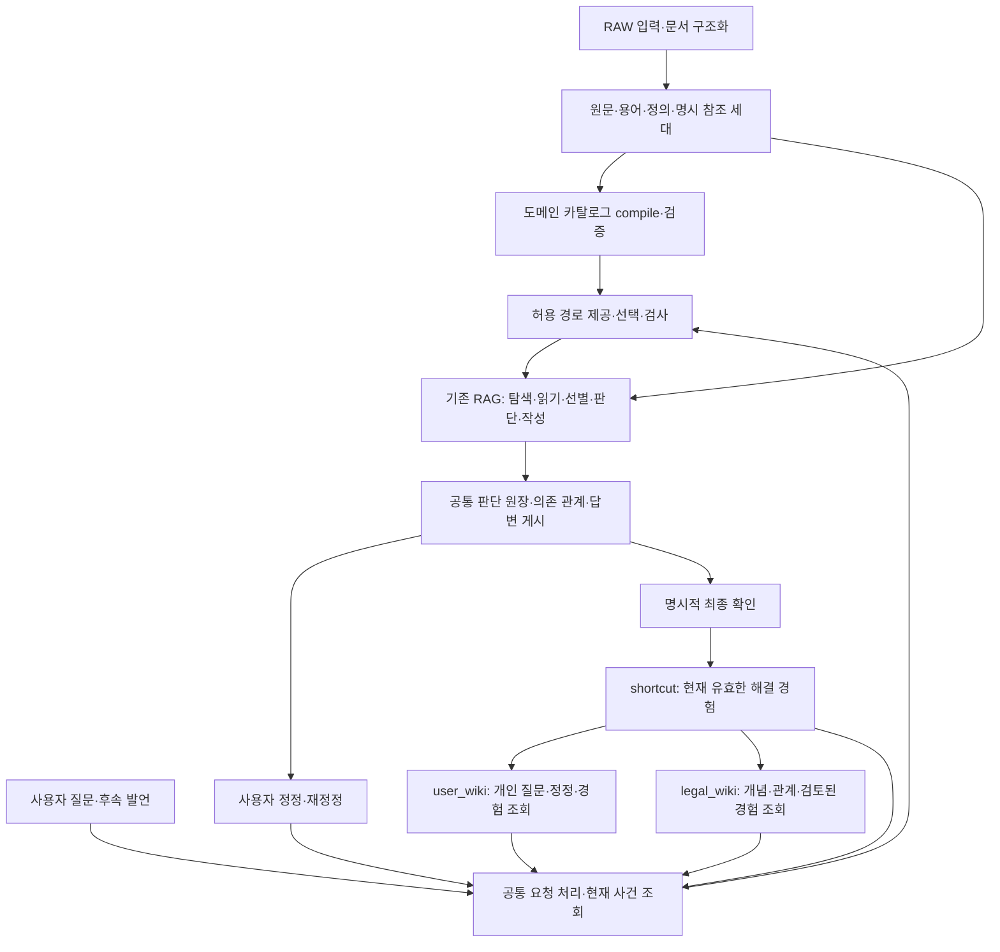

# 멀티턴·shortcut·legal_wiki·user_wiki 통합 구현 계획

2026-10-02 · 제안 v1 · 코드 연결 확인 및 자체 검토 · 구현/실험/활성화 전

후속 구현: legal_agent를 유지하는 통합 v6의 첫 전체 흐름과 저장·복구 계약을 작업 코드에 연결했다.
실제 연결·검증 범위와 남은 작업은 [통합 실행 운영 기록](../OPERATIONS/UNIFIED_LEGAL_AGENT_20261002.md)을 따른다.
아래 제안 v1은 작성 당시 계획으로 보존하며, MAIN·GENOS 활성화 완료를 뜻하지 않는다.

사용자 요구: 네 기능이 같은 질문과 판단을 공유하고, 정정과 지식 갱신이 다음 조사까지 이어지는 하나의 시스템으로 동작해야 한다. 본 문서는 기존 도메인 통제 설계를 현재 통합 작업 코드에 맞춰 구체화한다. 이전 설계·실험·반입 ZIP은 관측 당시 기록으로 보존한다.

## 1. 구현 목표와 완료의 의미

**하나의 요청 처리 흐름, 하나의 현재 사건 상태, 같은 판단 ID와 버전, 하나의 경험 확정 절차를 만든다.**

- 멀티턴은 현재 질문의 사실·범위·판단을 변경하는 기능이다.
- shortcut은 최종 확인된 조건·판단·근거·해결 경로 묶음이다.
- user_wiki는 공통 원장을 사용자·대화·질문 관점으로 조회하는 기능이다.
- legal_wiki는 같은 경험과 검토된 개념·관계를 도메인 관점으로 조회하는 기능이다.
- 온톨로지는 각 단계가 선택할 개념·관계·검토 방법·허용 경로를 제공한다. 설명 문장은 자유롭게 작성하되, 실행 목적과 판단 근거는 제공된 도메인 ID와 실제 근거에 결속한다.

물리적 파일을 하나로 합치는 것을 완료 조건으로 삼지 않는다. 원문 불변층, 사건 상태, 요청별 증거 원장은 수명이 다르다. 대신 **각 정보의 정본과 갱신 책임을 하나로 정하고 모든 소비자가 같은 정본을 따라야 한다.** 위키 화면이나 검색 색인이 별도의 정답 상태를 만들면 통합 실패다.

대화와 정정 이벤트의 보존은 작업 이력 저장이다. 이를 온톨로지 적재로 부르지 않는다. 온톨로지의 개념·관계는 검토 계약을 통과해 반영하고, 최종 경험은 그 개념·관계에 연결한다. 수정 전 오답 경로는 감사 이력으로만 남기고 현재 판단·재사용 후보에서 제외한다.

사용자에게는 질문 → 기억·지식 조회 → 원문 조사 → 판단·답변 → 정정 → 최종 경험 확정 → 다음 질문의 활용이 하나의 흐름으로 보인다. 컴포넌트별 별도 봇이나 별도 사용 명령을 요구하지 않는다.

## 2. 현재 연결이 끊기는 원인

| 확인한 현재 코드 | 끊긴 지점 | 통합 시 변경 |
|---|---|---|
| `app.ask`가 `memory=true`에서 `Memory.execute`로 직접 반환 | 일반 RAG의 Pipeline/Coordinator/publication과 메모리 실행의 종결·응답 형식이 다름 | 같은 Pipeline의 새 통합 프로필에서 공통 실행과 게시 절차 사용 |
| `memory_binding.RuntimeModel`과 `memory_rag.NativeRag.open`이 각각 native session을 열음 | 모델 호출 세션과 원문 실행 세션의 journal/run이 나뉨. 서로 이벤트로 연결하지만 하나의 run은 아님 | 한 요청의 admission lease, RequestContext, 모델 예산, WorkRepository, source session을 공유 |
| `corrected-memory/memory-v2.sqlite`에 사건·노드·경험을 저장 | native journal의 entity/version/dependency와 메모리 node/head/route가 별도 상태 체계 | 현재 사건/경로를 소유하는 CaseRepository와 native 판단 참조 계약으로 정리 |
| `action_memory.build`가 완료 native journal을 수집하고 별도 `action-memory/memory.sqlite`에 저장 | 멀티턴에서 최종 확인한 경험의 저장과 동일한 완료 이벤트를 소비하지 않음 | 최종 경험 확정 이벤트를 공통 입력으로 사용. 미확인 실행 이력은 조사 후보로만 보존 |
| `legal_llm_wiki.export_wiki`가 action-memory를 Markdown으로 투영 | 온라인 RAG는 그 페이지/개념 매칭을 소비하지 않음 | 공통 KnowledgeRepository의 조회 결과를 온라인 RAG와 위키 렌더러가 함께 소비 |
| `corrected_memory.context`는 현재 세션의 전체 goal/event와 개인 경험 후보를 전달 | 다른 대화의 미확정 질문·정정 이력 조회, 긴 대화의 선택적 원장 조회가 없음 | 사용자별 질문 색인 → 질문 묶음 → 필요한 이벤트/판단을 단계적으로 조회 |
| `candidates(query)`는 문자 겹침 기준 최대 32개, `checked_knowledge(id)`는 빈 질의의 32개 목록에서 재확인 | 관련도 검색에서 선택한 ID가 빈 질의의 후보 목록 밖이면 실제 유효 경험도 거부될 수 있음 | 후보 탐색과 정확한 ID 조회 분리. ID 조회는 직접 읽고 권한·상태·세대·해시를 검사 |
| INTENT 개념명은 자유 문자열, 메모리 방법 12개만 닫힌 목록 | 법률 도메인 개념·관계·판단 이유는 아직 공통 승인 카탈로그에 결속되지 않음 | 제공 개념·경로 선택 → 실행 전 검사 → 실행 결과와 판단 근거 검증 |

위 내용은 현재 코드의 연결 분석이다. 새 성능 실험으로 판정한 결과가 아니다. 특히 후보 32개 문제는 코드에서 확인한 경계이며 재현/회귀 검사는 구현 작업의 선행 항목으로 둔다.

## 3. 전체 MAIN 안의 목표 흐름

legal_wiki에 연결되는 개인 경험은 소유자·팀 범위를 유지한다. 사용자 확인만으로 공통 법률 지식이나 다른 사용자에게 공개된 경험으로 승격하지 않는다. 공통 승인 상태의 변경 입력은 기존 검토 계약/명시 영수증을 받는다. DB 직접 편집·공통 승인 UI는 사용자가 정한 별도 범위다.

## 4. 공통 계약과 저장 책임

아래 계약과 새 모듈 이름은 모두 제안이며 아직 실행 API가 아니다.

| 정본 | 책임·산출물 | 소비자 |
|---|---|---|
| 원문·용어 generation | 문서/원문 좌표·해시·정의·명시 참조. 기존 MAIN 구축 계약 유지 | 도메인 compiler, 기존 RAG source tools |
| DomainCatalogue | 검토된 개념/관계, 방법·경로 틀, 검토 등급, 적용 범위, 버전·해시 | 모든 판단의 offer와 실행/결과 guard |
| CaseRepository | 사용자/사건/질문 묶음, 원발언·정정 이벤트, 현재 조건·revision·경로, request 중복 처리, 경험과 게시 outbox | 멀티턴·경험 조회·위키·응답 게시 |
| native WorkRepository v6 | 실행 전 선택, 도구 관측, 원문, 개별 판단·버전·근거·의존, 모델 실제 입출력/사용량, 답변 artifact | CaseRepository가 수락한 경로, 감사·복구 |
| KnowledgeRepository | CaseRepository의 현재 확정 경험을 조회하는 공통 인터페이스. 별도 정답 DB를 새로 만들지 않음 | shortcut 탐색, user_wiki, legal_wiki, 다음 RAG |
| 두 위키와 검색 색인 | 공통 경험/질문/도메인 ID의 파생 조회본. 현재성은 정본에 재확인 | 사용자 설명, RAG에 제공할 후보. 삭제 후 재생성 가능 |

### 공통 식별자

- `principal_scope`: 신뢰된 사용자·조직/팀·허용 문서·반출 범위. 인증된 사용자와 문서 팀 필터를 혼동하지 않는다.
- `session_id → case_id → question_id`: 대화, 사건, 정정이 누적되는 질문 묶음. 새 대화의 동일 경험 재사용은 새 question_id에 원래 experience_id를 연결한다.
- `request_id`: 논리 요청 중복 방지. `(principal, session_id, request_id)`로 묶고 같은 키의 다른 입력은 충돌 처리한다.
- `case_revision`, `question_revision`, `run_id`: 현재 상태와 실제 실행을 구분한다.
- `judgment_ref = (run_id, kind, entity_id, version, payload_hash)`: 같은 이름의 판단이 다른 실행에 존재해도 혼동하지 않는다.
- `route_id/revision`, `experience_id/revision`, `answer_id/paragraph_id`: 유효 경로, 확정 경험, 화면 문단을 판단에 연결한다.
- `source_generation + catalogue_manifest_hash + method_policy_hash + code/profile binding`: 재사용 허용 여부와 변경 영향의 기준이다.

### 한 질문 묶음의 의미

원질문과 여러 정정은 같은 question_id 아래에 남긴다. 현재 경로는 하나이고, 수정 전 경로·경험은 재사용에서 제외한다. 최종 경험은 마지막 run의 모든 출력이 아니라 **현재 조건에서 유효한 판단들의 닫힌 의존 그래프**다. 유지된 이전 판단과 이번에 다시 계산한 판단을 함께 참조할 수 있다.

새 run에서 쓰는 과거 증거는 현재 접근권한·원문 해시를 검사한 뒤 현재 run에 결속한다. 타 run의 로컬 증거 별칭이나 변경 가능한 행 번호를 그대로 가져오지 않는다. 원본 판단 참조와 재결속 영수증을 함께 보존한다.

## 5. 온톨로지가 실제 판단을 통제하는 위치

한 단계의 공통 호출 계약은 다음 순서다.

1. 현재 목적·사실·원문 범위·카탈로그 버전으로 허용 개념과 방법/경로 후보를 만든다.
2. 모델은 제공된 ID를 선택하고 사건에 적용할 파라미터와 짧은 도메인 이유를 출력한다.
3. 서버가 선택 ID, 출발/도착 개념 타입, 선행 판단, 허용 원문 범위, 필요한 사실을 검사한다.
4. 기존 탐색·읽기·선별 도구를 실행하고 실제 반환 근거를 기록한다.
5. 개별 판단이 어떤 조건·원문·이전 판단에 의존했는지 검증한 뒤 현재 판단으로 수락한다.
6. 답변 문장/문단을 수락된 판단 ID에 연결한다. 설명을 바꿔도 적용 조건·근거를 바꾸지 못한다.

예시 도메인 이유의 형태: `검토 목적=적용 조항 확인 / 방법=명시 위임 참조 확인 / 출발 근거=선택 조문의 단서 / 관계=위임 / 다음 검토=세칙 원문 확보`. 이는 특정 CM 사례의 법률 결론을 새로 확정하는 예시가 아니라, 조사 선택을 표현하는 계약 예시다.

선택 후 도구 사용 이유를 별도로 생성하는 사후 설명은 정본 근거가 아니다. 도구 실행 전에 저장된 선택과 실행 후 확인된 원문·판단을 설명에 사용한다. ID/인용/의존성의 구조 검증과 법적 적용 의미의 정확도는 별도다.

카탈로그에 없는 개념은 등록된 DISCOVERY/CLARIFY 경로로 발견 후보를 만들거나 보류한다. 미확인 개념을 기존 개념에 억지로 맞추지 않는다. 검토 전 후보가 바로 법률 해석 관계가 되지 않는다. 일반 인사·문서 목록·기록 조회 같은 비법률 작업도 등록된 시스템 작업으로 기록하되 불필요한 법률 판단을 만들지 않는다.

기존에 제거한 전체 법문 Rule/조건/효과 의미 재작성 파이프라인을 복원하지 않는다. 카탈로그는 검토된 용어·관계와 조사 방법을 결속하고, 사건 적용 판단은 읽은 원문에 근거해 별도로 생성한다.

## 6. 정정·위키 연결 수정·지식 수정의 공통 처리

| 요청 | 바꾸는 정본 | 후속 처리 |
|---|---|---|
| “두 번째 질문은 내규가 아니라 외규야” | 그 질문의 source category/조건 revision | 해당 범위에 의존한 계획·원문·판단·답변만 무효화하고 필요한 단계부터 재실행 |
| “두 번째 정정이 잘못됐어. 첫 정정 당시로” | target correction event의 before/after 참조로 지정 필드 복원 | 최신 문장만으로 추측하지 않고 원이벤트까지 탐색. 복원은 새 revision이며 원문/권한/카탈로그는 현재 기준으로 재검사 |
| “이 질문에 연결한 과거 경험이 다른 질문 것이야” | 현재 질문→experience의 연결 | 기존 경험 자체는 보존. 잘못 가져온 경험에 의존한 현재 판단도 재검토 |
| “조건은 유지하고 표로 보여줘” | 답변 표현 revision/anchor | 판단·경험 승인은 유지하고 작성 단계만 실행 |
| “이 관계 자체가 잘못됐어” | 관계 이의 후보와 사용 중단 상태 | 개인 연결 수정과 구분. 해당 관계를 사용한 판단/경험의 영향 범위 표시, 공통 승인 변경은 별도 검토 입력 |
| “이게 최종 맞아. 기억해” | 현재 유효 경험의 확정 이벤트 | 같은 experience revision을 두 위키와 재사용 색인에 전달 |

의존성에는 채택한 긍정 근거뿐 아니라 분기에서 검사한 사실의 부재·조건값·미확인 상태도 기록한다. 그래야 “없다고 보고 생략한 조건”이 뒤늦게 추가돼도 관련 판단이 재검토된다. 다른 질문이 이 판단을 실제로 의존했다면 그 후속 질문도 영향 대상으로 표시하고, 무관한 질문은 유지한다.

## 7. 저장·게시·실패 복구

native journal과 사건 DB가 다른 파일인 경우 두 파일에 쓰는 것을 원자적 트랜잭션이라고 부르지 않는다. 한 저장 단계에서 실패해도 현재 답이 뒤바뀌지 않도록 다음 commit 절차를 구현한다.

1. CaseRepository에서 revision을 검사하고 정정 이벤트/새 조건/PENDING을 저장한다. 해당 질문 묶음의 대체되는 이전 경험과 실제 의존 경험은 즉시 재사용에서 제외한다. 잘못 가져온 다른 질문의 경험은 현재 질문과의 연결만 해제하며 원래 경험 자체를 폐기하지 않는다.
2. 하나의 native run에서 필요한 판단을 수행하고, 검증한 판단·답변을 불변 준비 상태로 저장한다.
3. 게시 직전에 현재 사건 revision·원문/카탈로그 binding·접근권한을 다시 확인한다.
4. CaseRepository의 한 트랜잭션에서 준비된 판단 refs를 현재 경로로 수락하고 응답 게시/위키 갱신 outbox를 기록한다. 늦은 run은 수락하지 않는다.
5. 기존 publication/recovery가 수락된 commit만 내보낸다. export 재시도는 같은 해시의 결과를 재사용한다. v6 복구 분기에 사건 guard가 없으면 게시를 거부한다.

최종 확인은 별도 짧은 트랜잭션으로 같은 현재 경로를 experience에 연결한다. 완료된 답변을 생성했다는 이유만으로 확정 경험을 만들지 않는다. 위키 반영이 늦어져도 조회 시 정본의 current/retired와 revision을 확인하므로 폐기된 경험은 사용할 수 없다. 새로 확정한 경험은 세션 조회에서 outbox 반영을 기다리거나 정본으로 보완해 즉시 조회한다.

수정 도중 실패하면 상태는 PENDING이고 오래된 답을 최신 정답으로 반환하지 않는다. 재시도는 첫 미완료 의존 지점부터 이어간다. 답변 재전송 시에도 권한과 현재성을 재확인하고 과거 revision의 응답인지 표시한다.

GENOS의 저장 경로는 기존 `GENOS_RUNTIME_DIR`와 workspace runtime root 계약을 따른다. 초기에는 한 주체가 CaseRepository 쓰기를 담당하도록 정한다. 여러 서빙 인스턴스와 NFS의 잠금/영속성은 현장 검증 후 지원 범위를 확정한다. 검증 없이 여러 프로세스의 공유 SQLite 쓰기를 지원 완료로 선언하지 않는다.

## 8. 다음 질문에서 네 기능이 함께 쓰이는 방식

1. user_wiki에서 현재 사용자에게 허용된 관련 질문·정정·확정 경험을 찾는다. 미확정 과거 질문은 맥락이며 shortcut 정답이 아니다.
2. legal_wiki에서 현재 원문/카탈로그에 결속된 개념·관계와 사용 권한이 있는 경험 후보를 찾는다. 개인 경험과 공통 검토 지식의 등급을 유지한다.
3. 같은 KnowledgeRepository가 후보를 정확한 ID로 읽고 현재성·출처·권한을 확인한다. 검색 후보 한도를 권한이나 전체 존재 여부 판정에 사용하지 않는다.
4. 조건과 binding이 같으면 판단·근거를 현재 사건에 결속한다. 조건이 다르면 경험의 조사 경로를 출발점으로 쓰고 달라진 조건의 의존 판단을 다시 실행한다.
5. 관련 경험이 없거나 충분하지 않으면 동일한 온톨로지 경로 계약 아래 기존 원문 RAG를 실행한다. 재사용 실패가 정상적인 새 조사까지 막지 않게 분기한다.
6. “왜 그렇게 판단했나”는 동일 judgment/choice/evidence refs로 설명한다. 표와 일반 문장도 같은 판단을 표시한다.

긴 대화는 사용자→사건/질문→revision/정정→판단 순으로 조회한다. 요약은 검색용이며 원이벤트 ID와 해시를 유지한다. 복원·정정·이력 설명의 근거는 요약 문장 대신 실제 원장이다. 의미 검색의 모델/임베딩 도입 여부는 비교 검증으로 결정하고, 현행 문자 검색보다 좋다고 미리 가정하지 않는다.

## 9. 파일·호출 변경 지도

| 기존 연결 | 구현 작업(새 이름은 제안) | 결과 소비자 |
|---|---|---|
| `service.py`, `app.create_app/ask`, GENOS workflow | 세션/신원 envelope를 공통 요청 context로 변환. 일반 질문과 후속 발언을 같은 진입점으로 연결 | Pipeline, HTTP/SSE, 사용자 위키 |
| `Pipeline.run`, `legal_agent_adapter.ServingLegalAgent.open_session` | CaseContext와 하나의 admission/context/run을 주입. 임시 단일턴도 동일 엔진 사용 | Coordinator/StageRunner, 모델 gateway/source tools |
| `corrected_memory.py`, `memory_methods.py` | 기존 정정/복원 의미와 검사를 CaseRepository/명령 해석기로 이행. 독립 RAG 실행 루프를 제거 | 공통 coordinator, 질문 이력/수정 |
| `memory_binding.py`, `memory_rag.py` | 별도 세션 생성과 별도 판단/작성 경로를 공통 native 실행으로 흡수. 호환 facade 후 사용 제거 | 같은 query/run/evidence/answer |
| `coordinator.py`, `stage_runner.py`, bounded source/session | 기존 retrieve/select/assemble/answer 4개 엔진 안에 7개 논리 체크포인트 연결. 의존 그래프로 재진입 결정 | 원문/선별/판단/작성 재실행 |
| `journal-v5.sql`, repository 계층, domain-journal 초안 | 새 journal-v6와 DomainRepository. 선택·proof·문단 anchor·실제 모델 제시 영수증 | publication, feedback, 경험 refs |
| 기존 glossary 구축/`06_TOOLS/pipeline.py` | 제안 `glossary domain-control compile/status/verify`로 검토 입력을 카탈로그화 | 단일 서빙 profile의 정확한 catalogue binding |
| 제안 `domain_catalogue.py`, `domain_protocol.py`, `domain_control.py` | 공통 offer·closed choice·전후 guard | 자동 시스템 분기와 모든 모델 판단 |
| 제안 `case_repository.py`, `knowledge_repository.py` | 현재 사건/경험 정본과 통합 조회·commit/outbox | 두 위키와 다음 RAG |
| `action_memory_store.py`, `action_memory.build` | 완료 로그 자동 수집과 최종 경험 승인을 분리. 공통 확정 이벤트 소비·기존 이력 read adapter | 경험 색인·도메인 추상화 후보 |
| `legal_llm_wiki.py`, 제안 `user_wiki.py` | 동일한 경험/질문 refs에서 각각 도메인/개인 조회본 구성. Markdown 직접 수정은 정본 변경 아님 | 사람과 온라인 KnowledgeRepository 조회 |
| `publication.py`, `deferred_publication.py`, `feedback.py` | case revision/current proof guard, 중복 없는 export와 복구, 판단 ID에 연결된 피드백 | 답변·수정 후보·재사용 제외 |
| `PIPELINE.json`, 엔진 manifest, contracts schema | 하나의 선택형 통합 profile, 새 schema/binding/engine hash 등록. 현재 4개 엔진 계약 명시 호환 | 로컬/GENOS 같은 코드 선택 |

성능·보안·배포 설정을 사용자 발언으로 변경하는 경로는 두지 않는다. source/catalogue/model/profile은 선택 릴리스, 신원은 호스트, 사건 사실은 현재 대화가 책임진다. 외부 모델에는 새 질문뿐 아니라 가져온 이력·경험·원문 각각의 반출 허용 범위를 확인한다.

## 10. 구현 순서와 단계별 완료 조건

공통 시스템 담당은 원장·실행·게시·조회 계약을 구현하고, 도메인 검토 담당은 카탈로그의 해석 관계·방법 근거를 확인한다. GENOS 현장 담당은 신뢰된 신원·영속 저장·내부 모델·워크플로우를 확인한다. 이 문서는 인력 배정이나 위임 실행을 의미하지 않는다.

| 단계 | 작업 묶음 | 선행 | 완료 조건 |
|---|---|---|---|
| P0 | 기준 코드/활성 릴리스/DB schema 목록, 공통 ID·상태·권한·source/catalogue 계약 동결 | 현재 계획 | 각 데이터 종류에 정본과 소비자 지정. 이행 매핑·실패 상태·회귀 목록 작성 |
| P1 | CaseRepository + native 공통 세션/commit + 최소 경험/위키 projection | P0 | 모의 한 질문의 생성→정정→확정→두 위키 조회→새 대화 재사용이 같은 ID/버전으로 끝까지 연결. 별도 수작업 복사 없음 |
| P2 | 도메인 카탈로그 compiler와 공통 선택/판단 guard, native journal v6/publication 연결 | P1의 계약 | 최소 승인 경로로 P1 전체 흐름 반복. 개념/경로 없는 판단, 근거 없는 채택, guard 우회 게시 차단 |
| P3 | RAG 전 단계 판단·의존성·문단 anchor·재정정·실패 재개 확대 | P2 | 범위/사실/검색/원문선별/판단/표현 어느 지점의 정정도 필요한 의존 판단만 갱신. 무관 질문 보존 |
| P4 | 두 위키 통합 조회, 정확 ID 조회, 조건이 다른 경험의 조사 경로 활용, 긴 이력 선택 조회 | P3 | 다른 대화의 관련 기록 발견→조건 비교→재사용/추가 조사→재확정 완료. 후보 목록 밖 유효 ID도 권한 검사 후 조회 |
| P5 | legacy 읽기/새 세대 이행, 공통 outbox 재생, 중단/동시성/변경 세대 회귀 | P4 | 원본 해시 보존, 이행 재실행 무중복, 부분 장애 복구, 구경로 재사용 차단, rollback receipt 검증 |
| P6 | 전체 흐름 계약 + 독립 사례의 실제 모델 비교 + 비용/시간 검증 | P5 | 사전에 동결한 채택 기준 충족. 모델 의미 오류와 시스템 연결 오류 별도 분류 |
| P7 | 검증된 코드/데이터/catalogue를 MAIN 승격, GENOS 반입·현장 확인 | P6 통과 및 현장 준비 | 선택 포인터·코드 hash·catalogue/data·서빙 리비전·워크플로우가 검증본과 일치. 복구 경로 확인 |

P1을 먼저 얇게 관통시키는 이유는 네 기능의 데이터 계약이 실제로 이어지는지 초기에 확인하기 위해서다. P1의 모의 결과로 도메인 통제나 법률 품질을 완료 처리하지 않는다. 이후 단계에서도 같은 전체 흐름 검사를 반복하고, 컴포넌트 단위 통과만으로 단계를 닫지 않는다.

## 11. 한 묶음으로 확인할 인수 시나리오

| ID | 전체 흐름·실패 주입 | 통합 완료의 관측값 |
|---|---|---|
| U01 | 최초 질문→답변→범위 정정→정정을 다시 정정→최초 조건 복원 | 같은 question_id, 이벤트 역추적, current route 하나, 의존 단계 재실행 |
| U02 | 확정→두 위키 조회→새 대화의 동조건 재사용 | 같은 experience_id/revision·judgment refs·출처. 사용자가 위키별로 따로 저장하지 않음 |
| U03 | 경험에 없는 조건을 추가한 새 질문 | 과거 결론 복사 금지, 적합한 조사 경로와 필요한 새 검토 사용 |
| U04 | 잘못 연결한 경험을 다른 경험으로 정정 | 연결 변경 이력·현재 영향 판단 재검토. 원래 다른 질문의 정답 묶음은 불변 |
| U05 | 조건 유지·표로 변경→다시 설명 | 판단/근거/승인 유지, COMPOSE와 문단 anchor만 새 버전 |
| U06 | 정정 후 원문 회수 실패→재시도 | PENDING 유지, 옛 경험 재사용 차단, 미완료 단계부터 회복 |
| U07 | 최종 경험 commit 직후 위키 색인 장애 | 정본 경험 보존, 두 위키 재생 가능, 오래된 경험은 current 검사로 차단 |
| U08 | 응답 준비 후 새 정정 도착·늦은 모델 응답 | 구 revision은 IGNORED_LATE/수락 거절, 새 상태를 덮어쓰지 않음 |
| U09 | 사용자/팀/허용 문서·반출 범위 변경 | 질문·위키·경험·원문 모두 동일 주체 검사. 원래 승인으로 접근 범위를 확대하지 않음 |
| U10 | 원문 또는 카탈로그/방법 버전 변경 | 관련 경험 보류/재검토, 변경 전의 결론을 현재 정답으로 게시하지 않음 |
| U11 | 후보 32개 밖의 경험, 많은 질문·긴 정정 이력 | 정확 ID 접근과 페이지 조회 분리, 최초 이벤트/의존 경로를 누락 없이 복원 |
| U12 | 추가 원문 필요→명시 참조 추적→READ→재선별 | 선택기의 추가 탐색 요구가 실제 RAG로 돌아감. 읽음/채택/인용/주장 근거 구분 |
| U13 | 제공되지 않은 개념/관계/경로 ID 또는 근거 없는 판단 | 실행·판단 수락·답변 게시 단계에서 거부, 발견/질문/보류의 등록 경로로 처리 |
| U14 | 같은 request 재전송·같은 ID의 다른 입력·프로세스 재시작 | 무중복 처리, 다른 입력 충돌, 수락된 commit만 복구 |
| U15 | 기존 일반 RAG·인사·목록·내규/외규·SSE·피드백 | 기존 사용자 계약 보존, unified 요청도 같은 run/answer/feedback ID로 연결 |

초기 핵심 계약에서는 폐기 경로 채택, 타 사용자 접근, 미제공 경로 실행, 늦은 결과 덮어쓰기, 근거 없는 게시를 허용하지 않는다. 이는 검증 목표이며 운영에서 오류 확률 0을 입증했다는 뜻이 아니다.

## 12. 이행·재구축·롤백

- 기존 `memory-v2.sqlite`, action-memory DB, 완료 journal, Markdown raw/snapshot은 백업/해시 목록으로 보존한다. 신규 store/schema를 만들고 명시 매핑과 import receipt로 이행한다.
- 현재 개인 확인 경험은 `LEGACY_UNBOUND`로 읽을 수 있게 하되 도메인 검증을 통과한 경험으로 자동 표시하지 않는다. 원문·조건·현재 카탈로그·판단을 재검토한 뒤 새 경험 revision을 만든다.
- 기존 action-memory에서 만든 개념/관계는 기존 검토/중단 상태를 유지한다. 미확정 로그에서 추출했다는 사실만으로 공통 legal_wiki의 승인 관계가 되지 않는다.
- user_wiki와 legal_wiki 파생 페이지/검색 색인은 공통 이벤트에서 재구축한다. 같은 outbox event의 반복 처리는 동일한 결과를 만든다. 개념/관계 중단 overlay도 이행 대상이다.
- 카탈로그·사건 원장·위키만 변경하면 원문 전체 재파싱은 하지 않는다. 원문/용어 연결 자체의 수정이 필요한 경우에만 기존 MAIN의 새 generation 구축을 따른다.
- 새 프로필은 명시 선택 후보이며 registry/default 자동 선택을 막는다. 이전 릴리스·데이터·카탈로그·store는 보존한다. 새 형식을 모르는 구코드에 새 DB를 쓰게 하지 않는다.
- MAIN 승격과 GENOS deployment는 별도다. 현장 코드 적용은 기존 ~/DEV 백업 방식, 명령은 python3, 검증은 워크플로우 테스트 화면을 사용한다. GENOS 접근을 여기서 재시도하지 않는다.

## 13. 평가·비용·일정 판단

이번 작업은 계획 작성이다. 새 ADR 예약·후보 구현·모델 호출·비교 실험은 실행하지 않는다. 향후 평가 작업 시작 시 저장소의 실험 두 표준을 끝까지 읽고 동일 scope reservation 확인→ADR 선점→snapshot/register/freeze를 따른다. 결과를 본 뒤 바꾸는 후보는 새 ADR이다.

비교 기준은 그때 동결한 현재 통합 작업 코드와 새 통합 후보를 같은 데이터·모델·권한·예산으로 실행한 결과다. 현재 활성 r3는 별도 호환 회귀 기준이다. ADR0613의 완료 arm은 계보와 개발용 실패 사례로 연결하되, 해당 점수를 현재 통합본의 baseline 실측값으로 대체하지 않는다.

평가 단위는 원래 사건/질문이다. 같은 사례의 정정 19턴을 독립 19문항으로 세지 않는다. CM038/CM003은 개발/회귀용으로 남기고, 관련 정정 턴 전체를 같은 split에 두어 미사용 사례를 확보한다. 제품 입력에 기준답·사후 평가 이유를 넣지 않는다. 현재 허용된 모델 정책과 공개 자료 반출 계약을 유지하며 실제 내부 사례는 GENOS에서 평가한다.

사전에 동결할 채택 기준: 통합 계약 통과, 같은 조건의 baseline 대비 법률 기준답 일치·핵심 근거 누락의 허용 회귀, 모호한 정정 확인 동작, 재사용 오적용, 경험 검색 누락, P50/P95 시간·토큰·실비·게시/색인 지연, MAIN/GENOS 환경별 별도 판정. 기본 제안은 법률 품질의 하락을 허용하지 않는 것이다. 표본 수와 비열등 판단 방식은 실제 평가 데이터 확인 뒤 결과를 보기 전에 확정한다.

| 수치 ID | 종류·지표 | 환경/분모·근거 | 값·해석 |
|---|---|---|---|
| M01 | 관측: 기존 마지막 CM 기준답 일치 | ADR0613, 알려진 CM 2사례에서 법률 평가12턴/arm, 같은 제품/평가 모델 | 7/12→6/12. 일반 정확도 개선 입증 아님 |
| M02 | 관측: 기존 CM 처리 시간 | 같은 실험19턴/arm. 실패·저장·조회 포함 | P50 27.4→36.0초, P95 83.8→62.1초. 통합 계획의 예상 시간 아님 |
| M03 | 관측: 현 작업 코드 검사 | 20261002 WSL 모의 계약/회귀292개 | 290통과·기존 실패2. 단독 영업일 형태소 누락은 별도 검색 결함으로 추적 |
| M04 | 목표: 공통 실행·정본 일관성 | U01~U15와 장애/권한 변형 | 같은 요청·판단·경험 refs, current 단일성, 위반 게시 차단 |
| M05 | 미확인: 새 구조의 비용·시간·품질 | 새 후보의 전체 흐름·독립 사례·GENOS 현장 | 미측정. 현재 위키/테스트 수로 성능을 추정하지 않음 |
| M06 | 미산정: 구현 공수·달력 일정 | P0~P7의 코드 이행 범위·도메인 검토량·현장 저장 조건 확인 필요 | 단계별 종료 조건 기준으로 진행. 근거 없는 주/인일 약속을 두지 않음 |

비용 판단식(구조 설명, 실측 예측 아님): 요청당 순 절감 = 재사용 적합률 × (줄어드는 조사 비용 − 재사용 검증 비용) − 공통 조회/도메인 검사 비용 − 요청당 배분한 색인·유지 비용. 적합률이 0이면 추가 비용만 발생한다. 공통 검사가 늘거나 카탈로그가 자주 바뀌면 재검토 비용이 커진다. 호출 수, 토큰, 달러, P95 지연은 각각 측정하고 서로의 개선율로 대체하지 않는다.

## 14. 자체 검토와 남은 판단

검토는 작성자의 코드 추적과 계약 대조이며 독립 감독 검토가 아니다. 중요한 미확인은 초기 승인 카탈로그의 실제 커버리지, 새 도메인 강제가 늘리는 보류율, GENOS의 신원 전달 및 영속 저장/다중 인스턴스 조건이다. 이 조건을 숨긴 채 “네 기능 완료”로 표시하지 않는다.

공통 DB 관리 화면을 추가 승인 단계로 끼워 넣지 않는다. 사용자 사건 정정은 즉시 처리하고, 개인 경험 확인과 공통 법률 지식 승인은 기존 범위를 유지한다. 구현 시작 후에도 완료 판정은 개별 파일 개수가 아니라 **동일 질문이 네 기능을 왕복하는 전체 실행 기록**으로 한다.

## 확인한 로컬 근거

- [전체 MAIN](../../../00_SYSTEM/ARCHITECTURE.md), [데이터 계약](../../../00_SYSTEM/DATA_MODEL.md), [PIPELINE](../../../00_SYSTEM/PIPELINE.json), [workspace roots](../../../00_SYSTEM/WORKSPACE.json)
- [도메인 통제 설계](LEGAL_AGENT_ONTOLOGY_CONTROL_DESIGN_20261001.md), [domain journal 초안](../../../00_SYSTEM/SCHEMAS/legal-agent-domain-journal-v1.draft.sql)
- [현재 통합 상태](../OPERATIONS/SYSTEM_MEMORY_INTEGRATION_20261002.md), [조사 경험 위키](../OPERATIONS/LEGAL_LLM_WIKI.md)
- [HTTP 분기](../../../02_BACKEND/semantic_runtime/app.py), [Pipeline](../../../02_BACKEND/semantic_runtime/pipeline.py), [native session 생성](../../../02_BACKEND/semantic_runtime/legal_agent_adapter.py)
- [메모리 사건/경험](../../../02_BACKEND/semantic_runtime/legal_agent/corrected_memory.py), [모델 세션](../../../02_BACKEND/semantic_runtime/legal_agent/memory_binding.py), [원문 실행 세션](../../../02_BACKEND/semantic_runtime/legal_agent/memory_rag.py)
- [native journal v5](../../../02_BACKEND/semantic_runtime/legal_agent/journal-v5.sql), [게시·복구](../../../02_BACKEND/semantic_runtime/legal_agent/publication.py), [Coordinator](../../../02_BACKEND/semantic_runtime/legal_agent/coordinator.py)
- [경험 구축](../../../02_BACKEND/lawrag/pipeline/action_memory.py), [경험 저장](../../../02_BACKEND/semantic_runtime/action_memory_store.py), [위키 생성](../../../02_BACKEND/lawrag/pipeline/legal_llm_wiki.py)
- [CM 원점수 보고서](LEGAL_AGENT_CM_MEMORY_FINAL_20261002.md), [통합 검증 영수증](../../../08_DEPLOYMENT/GENOS/handoffs/system_integration_20261002_r1/VALIDATION.json), [GENOS 제약](../../../GENOS.md)
