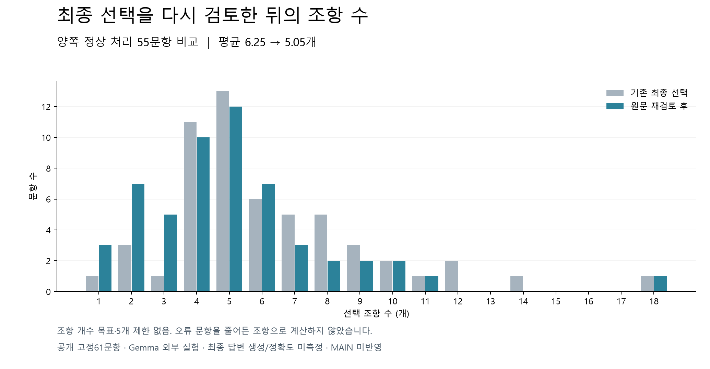

# 최종 선택 원문 재검토 결과

사용자 최신 지시대로 5개 목표·개수 제한을 제거했다. 이미 선택된 원문에서 출발해 불필요·중복이 확인될 때만 제거하고, 필요한 원문은 개수와 관계유형에 무관하게 유지하는 격리 후보를 구현했다.

| 항목 | 결과 |
|---|---:|
| 전체 시도 | 61문항 |
| 신규 호출 오류 | 5문항 |
| 양쪽 정상 처리 비교 | 55문항 |
| 같은 정상 문항의 평균 조항 수 | 6.25 → 5.05 |
| 전체 필수 원문 유지 | 80/90 → 72/90 |
| 새로 회복 / 기존 보존 원문 손실 | 0 / 8 |
| 전체 후보 평균(오류0 포함, 별도 지표) | 6.11 → 4.62 |
| 추가 재검토 p50 / p95 | 23.1 / 64.2초 |
| 과거 회수+과거 선별+이번 재검토 합산 p95 | 212.0초 |
| 모델 호출 / 비용 | 91회 / $0.2515 |

[문항별 출처·관계 화면](reviewed-sources.html), [비교 CSV](comparison.csv).

기존 출력 코드 `08_DEPLOYMENT/GENOS/workflow/genos_rag_chat.py`의 render → _sources → _tier_sources 경로는 source-tiers-v4 source_bundle의 CORE/SUPPLEMENTAL을 법령명·좌표·발췌·선택 이유로 표시한다. source_bundle 없는 경로는 claims의 evidence_ids가 있으면 실제 사용된 문맥만 표시한다. 따라서 현재 출처 표시는 존재하지만, v4/v5 선택 출처 전체가 답변에서 실제 인용됐다는 뜻은 아니다. 로컬 표시 계약4개가 통과했으며 GENOS 현장 확인은 하지 않았다.

이번 후보는 선택 조항 사이의 참조 원문과 해시, 두 끝점, 방향을 확인해 관계 목록을 만든다. 같은 조문 쌍·유형은 화면에서 묶고 서로 다른 원문 문장은 보존했다. 네이티브 참조 역할은 원문의 단서이며 법적 적용 승인으로 표시하지 않는다. 질문에 적용되는지 평가하지 않은 관계는 그대로 미확정이다. 확정 못한 관계는 숨겨 정답처럼 바꾸지 않는다.

후보 계약10개, 기존 출처 렌더링 계약4개 통과. 실행 시작 시 scoped transport 초기화 실패가 있었고 외부 호출0회인 run-001을 보존했다. 실제 모델 평가는 run-002다. 설정·기준·선별 알고리즘은 실제 호출 전에 동결했으며 비교 도중 튜닝하지 않았다.

사전 기준 통과: **False**. 인샘플 고정61문항이며 최종답변 생성·정확도·독립 평가·GENOS 성능은 미측정이다. 합산시간은 서로 다른 실행의 시간을 더한 값이며 새로운 실제 종단시간이 아니다. 새 출처·관계 표시는 실험 산출물에 연결했고 운영 API·활성 MAIN에는 반영하지 않았다.

[ADR 기록](../../../../04_EXPERIMENTS/ADR/ADR-0518-five-source-replacement-loop/README.md) · [문항별 원본](../../../../04_EXPERIMENTS/ADR/ADR-0518-five-source-replacement-loop/실험/README.md)

## 손실 구분

5문항은 제거 목록과 제거 사유의 일대일 대응 검증에 실패했다. 이 문항에서 이전에 보존된 필수 원문7개를 최종 출력하지 못했다. 정상 처리 중 실제 필수 원문을 제거한 경우는 cm-025의1개다. 모델은 상증세법 제35조를 “저가 양수 관련 조항으로 질문의 대상과 무관”하다고 제거했지만, 질문은 이미 과세된 저가분의 조정을 묻는다. 문항의 하위 쟁점과 출처의 역할 연결을 놓친 사례다. 따라서 조항 수 감소만으로 개선을 선언하지 않으며 후보는 Rejected다.
