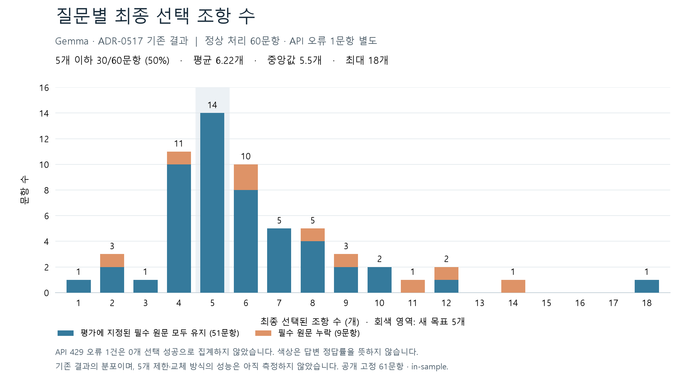

# 조항 수 분포와 5개 유지 방향

2026-09-22. 완료된 ADR-0517의 읽기 전용 집계다. 모델 호출·재선별·top-5 성능 평가를 새로 수행하지 않았다. 기존 결과와 원문을 수정하지 않았으며 MAIN 변경도 없다.

## 측정값

| 항목 | 관측값 |
|---|---:|
| 시도 / 정상 선별 / API 429 오류 | 61 / 60 / 1문항 |
| 정상 선별 평균 / 중앙값 / 범위 | 6.22 / 5.5 / 1~18개 |
| 5개 이하 | 30/60문항, 50% |
| 4~6개 | 35/60문항, 58.3% |
| 평가 지정 원문을 모두 유지 | 51/60 정상 문항 |
| 초기 원문 후보군 평균 | 229.56개 |
| 최종 선별 후 평가 지정 원문 유지 | 전체 시도 기준 80/90개 |

기존 summary의 평균 6.11개·p50 5개는 API 오류 문항의 0개까지 포함한 61문항 집계다. 이 그래프는 오류를 분리하고 정상 60문항의 산술 평균과 통상적인 중앙값을 표시한다. 원래 지표를 덮어쓰지 않았다. 최종 답변 모델에 전달된 결과가 아니라 `PREPARED_NOT_SENT` 상태의 선별 결과다. 원문 유지 여부는 답변 정답 여부를 뜻하지 않는다.

| 선택 조항 수 | 1 | 2 | 3 | 4 | 5 | 6 | 7 | 8 | 9 | 10 | 11 | 12 | 14 | 18 |
|---|---:|---:|---:|---:|---:|---:|---:|---:|---:|---:|---:|---:|---:|---:|
| 문항 수 | 1 | 3 | 1 | 11 | 14 | 10 | 5 | 5 | 3 | 2 | 1 | 2 | 1 | 1 |

평가에 지정된 필수 원문 수는 1개인 문항 36개, 2개인 문항 21개, 3개인 문항 4개다. 이 평가표상 필수 원문 수만 보면 5개 안에 들어간다. 그러나 평가표가 모든 법적 보조 근거를 열거했다는 의미도, 모델이 올바른 5개를 선택한다는 증명도 아니다. 공개 고정 61문항의 in-sample 결과이며 decision_eligible=false다.

## 후보 수를 늘리지 않는 개선 방향 — 미구현·미측정

기존 선별 코드는 첫 선택 최대 16개를 유지하고 복구 후보 최대 8개를 추가한다. 따라서 불필요한 첫 선택을 제거하거나 더 적합한 원문으로 교체할 수 없다.

제안 흐름: **최대 5개 작업 집합 → 질문별 근거 공백 확인 → 공백에 해당하는 경로만 탐색·원문 읽기 → 기존 조항과 비교·교체 → 근거 공백 재확인.** 1~3개로 충분하면 5개를 억지로 채우지 않는다. 탐색 중 읽는 누적 원문 수와 답변용으로 유지하는 조항 수를 구분한다.

| 지점 | 보강 방향 | 수를 늘리지 않는 이유 |
|---|---|---|
| 첫 선택 | 조항 제목·검색 경로에 더해 직접 적중한 원문 구간을 확인 | 제목만 보고 생기는 오선택을 줄이려는 목적 |
| 누락 점검 | 질문의 미해결 항목을 원문 span과 연결 | 막연한 관련성 대신 필요한 근거를 특정 |
| 재회수 | 누락된 정의·산식·예외를 가리키는 실제 참조 문장과 목적 조항 조회 | 모든 인접 조항을 추가하지 않고 해당 의존성만 확인 |
| 교체 | 새 조항이 해결하는 공백과 기존 조항이 담당하는 근거를 비교 | 기존 고유 근거를 잃지 않는 경우 중복·무관 조항을 퇴출 |
| 경로 기록 | 질의·원문 인용 문장·목적 조항·채택/탈락 사유 보존 | 같은 질의의 반복 회수를 독립적인 지지로 세지 않음 |
| 종료 | 공백 해소 또는 시간 예산 소진·진전 없음 | 5개를 채웠다는 이유만으로 완료하지 않음 |

이미 회수한 원문과 탈락 사유는 서버 캐시에 남겨 재검토할 수 있다. 매번 전체 약 230개 목록을 모델에 반복 전달할 필요는 없다. 새 후보는 임시 비교 대상으로 읽고, 채택할 때 작업 집합을 원자적으로 교체한다. 필수 근거가 실제로 5개를 초과하면 공백을 숨기지 않고 하위 질문으로 나누거나 미해결 상태를 표시한다.

### 실제 누락 경로: cm-004

누락된 `증권 인수업무 등에 관한 규정` 제5조는 이미 회수된 후보였다. 탐색 DB에는 다음 참조 원문이 보존돼 있다.

> 2. 공모가격: 「증권 인수업무 등에 관한 규정」 제5조제1항에 따른 가격

`ref:9fd6d17d14d9792ae158349d`, 시작 조항 `article:1fa6eb7a10072f0d8f71bfc1`, 목적 조항 `article:d6b8cdfee9884a4315cb77a2`, 해소 상태 `EXACT_NAMED_DOCUMENT_ARTICLE`이다. 조회는 `navigation.sqlite`의 reference 테이블을 읽기 전용으로 수행했다. 이 참조가 질문에 필요한지는 원문과 질문으로 별도 판단해야 한다.

기존 선택 입력은 경로를 압축하고, 두 번째 호출에서 먼저 선택한 조항의 최대 1,200자 구간만 제시한다. 위 의존성 문장을 별도 근거로 제시하지 않는다. 따라서 개선 가설은 반복 발견 횟수만 높게 평가하는 것이 아니라, 이 문장과 목적 조항 원문을 함께 읽고 현재 5개 중 무엇과 교체할지 판단하는 것이다. 효능은 후속 독립 실험 전까지 미확인이다.

## 재현과 근거

- 집계 원본: [ADR-0517 summary](../../../../04_EXPERIMENTS/ADR/ADR-0517-bounded-provenance-protocol/artifacts/summary.json)
- 기존 선별 코드: [source_selection.py](../../../../02_BACKEND/lawrag/research/candidates/adr_0517/selection/revisions/rev-001/snapshot/02_BACKEND/semantic_runtime/legal_agent/source_selection.py)
- [문항별 CSV](cases.csv), [분포 CSV](distribution.csv), [통계·원본 SHA-256](statistics.json), [SVG](article-count-distribution.svg)
- 저장소 루트에서 `.venv/bin/python 07_DOCS/REFERENCE/REPORTS/LEGAL_SEARCH_SELECTION_DISTRIBUTION_20260922/plot.py` 실행. matplotlib와 맑은 고딕 폰트를 사용했다.
- 61건 분리 집계, 정상 선택 조항 합계 373개, 원본 불변을 검사했고 생성된 PNG의 한글·축·범례를 확인했다.

5개 유지 교체 방식은 설계 방향이며, 현재 실행 중인 API·활성 릴리스·GENOS에는 반영하지 않았다.
