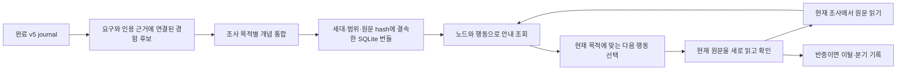

# 노드·행동 경험 기억 프로토타입

2026-09-29. 기존 v5 원문 도구·journal을 사용하는 격리된 구현이다. 실제 Gemma 호출에는 모의 규정·모의 질문만 사용했다. MAIN과 GENOS에는 반영하지 않았다.

## 구현한 흐름



사용자 질문 전체를 먼저 유사도 검색하지 않는다. 예를 들어 ‘적용 범위’ 조문을 읽은 순간, 그 노드에서 출발했던 정의 확인·범위 확인·신고 절차·제외 거래 후속이라는 조사 개념을 안내한다. 현재 질문이 신고 기한을 요구하면 절차 개념을, 제외 거래의 후속을 요구하면 후속 개념을 선택할 수 있다. 복합 질문은 여러 개념을 함께 사용할 수 있다.

개념은 `목적, 기대하는 정보, 이탈 조건, 관측된 다음 행동, 근거 이력, 독립 지지 수`를 가진다. 전혀 같은 질문의 반복은 지지 수를 늘리지 않으며, 다른 표현의 같은 목적은 함께 묶는다. 경로 일부가 같아도 목적이 다르면 별도 개념으로 보존한다. raw 이력은 압축 뒤에도 보존한다.

## 최종 모의 실행 결과

Gemma/Parasail FP8의 실제 호출로 모의 이력10개를 개념4개로 묶었다. 같은 질문의 중복1건은 독립 지지 수에 추가하지 않았다. 목적별 그룹은 사전 정의한 묶음과 일치했다. 계약 검사20개와 후보 snapshot 검사가 통과했으며, 기준선과 후보 모두8/8 기능 판정을 통과했다. 이8개는 실제 모델 질문6개와 세대·범위 guard2개다. 실제 법률 정답률의 인증은 아니다.

| 사례 | 기준선 읽기 순서 | 경험 안내 읽기 순서 | 확인한 동작 |
|---|---|---|---|
| 정의 확인·의역 질문 | 2→1→3 | 2→1 | 정의 목적을 선택해 추가 예외 읽기1건 감소 |
| 적용 범위 확인 | 2→1→3 | 2→1→3 | 정의·예외 원문 유지 |
| 이미 적용 대상인 거래의 신고 절차 | 2→4 | 2→4 | 절차 개념 선택 |
| 적용 여부와 신고 절차의 복합 요구 | 2→1→3→4 | 2→1→3→4 | 두 요구 모두 유지 |
| 의결권 없는 지분의 제외·후속 | 2→1→3→5 | 2→1→3→5 | 신고 절차 개념에 이탈 표시, 제외 거래 후속으로 이동 |
| 조사 목적이 없는 질문 | 2 | 2 | 임의의 목적을 만들지 않고 CLARIFY |
| 낡은 세대·다른 허용 범위 | 모델 호출 없음 | 모델 호출 없음 | 후보 안내를 비움 |

위 숫자는 모의 규정 조문 번호이며 실제 읽기 순서다. 필수 원문10/10개가 양쪽 모델에 제시되었다. 모델 질문6개에서 실제 읽고 제시한 원문 합계는17→16개로 줄었고, 호출 수는 양쪽13회로 같다. 정확도·호출 수 개선을 확인한 결과는 아니다.

온라인 입력 토큰은50,982→73,863개, 기록된 온라인 비용은$0.00816546→$0.01176688로 약44% 증가했다. 안내 문맥을 추가하는 현재 형태는 비용을 절감하지 않는다. 소규모1회 실행의 지연으로 속도 개선을 주장하지 않는다. 이력 통합 비용은 위 온라인 비교에서 제외했으며 전체27호출 비용은$0.02124068이다.

예외 사례에서는 제1조·제3조를 읽어 인수 제외를 확인한 뒤 ‘신고 절차 확인’ 개념을 이탈 처리했다. 해당 개념은 다음 view에 다시 제시되지 않았으며, 제5조의 제외 거래 후속을 읽고 정의·예외·후속 근거를 최종 인용했다. 이탈은 질문 목적에 맞지 않는 제안을 버리는 기록이며 법률 정본의 수정이 아니다.

## 코드 계약과 소비자

| 단계 | 구현·소비자 | 입력 → 출력 |
|---|---|---|
| 후보 추출 | `collect_journal` | 완료된 v5 journal + 현재 source catalogue/binding → 원문 span을 검증한 경험 후보 |
| 개념 통합 | `consolidate` | 같은 세대·범위·시작 노드·행동의 후보 → 모델이 목적별로 묶은 개념 번들 |
| 불변 색인 | `publish` | 번들 → `(source_id, tool)`로 조회하는 SQLite snapshot + SHA receipt |
| 탐색 안내 | `ExperienceGuide.lookup` | 실제 `read/read_node` 관측 → 최대4개 개념과 다음 원문 읽기 제안 |
| 현재 view 연결 | `guided_view` | native v5 view + 안내 → 별도 저장한 현재 view와 현재 도구 핸들 |
| 경로 수정 | `feedback` | 사용/이탈한 개념 + 사유 → 해당 요청에서 이탈 개념 억제, 원시 기록 보존 |

후보 코드 정본은 [ADR-0562 frozen route_experience.py](../../../02_BACKEND/lawrag/research/candidates/adr_0562/experience/revisions/rev-001/snapshot/02_BACKEND/semantic_runtime/legal_agent/route_experience.py)다. [연구 runner](../../../06_TOOLS/EXPERIMENTS/adr_0562/run.py)가 명시적으로 주입한다. 기본 service·registry·PIPELINE.json의 소비자로 자동 등록하지 않았다.

현재 source ID·원문 해시·선택 세대·문서 범위가 과거 번들과 일치해야 안내한다. 과거 요청의 도구 핸들을 재사용하지 않고 현재 요청에서 다시 발급한다. bundle이 불일치하면 안내를 비우고 현재 원문 탐색을 유지한다. 제안은 조언이며 도구의 기존 원문·범위 검증을 우회하지 않는다.

## 확인 결과의 정본

- [ADR-0559: 구현·초기 출력 실패 보존](../../../04_EXPERIMENTS/ADR/ADR-0559-node-action-experience-concepts/README.md)
- [ADR-0560: 출력 형식 수정 후 재검증](../../../04_EXPERIMENTS/ADR/ADR-0560-node-action-experience-wire-repair/README.md)
- [ADR-0561: 현재 원문 인용 계약 재검증](../../../04_EXPERIMENTS/ADR/ADR-0561-node-action-experience-citation-contract/README.md)
- [ADR-0562: 빈 목록·이탈·근거 연결 계약 검증](../../../04_EXPERIMENTS/ADR/ADR-0562-node-action-experience-closed-feedback/README.md)
- [사례별 기능 판정](../../../04_EXPERIMENTS/ADR/ADR-0562-node-action-experience-closed-feedback/artifacts/run-001/offline-grade.json)
- [실제 경로·답변·사용량](../../../04_EXPERIMENTS/ADR/ADR-0562-node-action-experience-closed-feedback/artifacts/run-001/result.json)

초기 모델은 일부 ANSWER JSON을 생성한 뒤 공백을 반복해 출력 한도를 소진했다. 실패를 보존한 뒤 별도 ADR에서 출력 스키마를 prompt에도 명시하고 답변 필드를 마지막에 배치했다. 두 번째 실행의 예외 사례에서는 native 근거 핸들(E)과 source ID(article)를 혼동해 계약 검증이 실패했다. 세 번째 ADR에서 실제 읽은 source ID 목록을 prompt와 출력 enum에 제공했다. 그 실행은 후보 7/8이며, 기준선의 빈 개념 목록에 일반 개념명을 넣는 오류와 예외 사례의 최종 정의 인용·이탈 표시 누락을 확인했다. 네 번째 ADR은 빈 목록을 maxItems0으로 닫고, 원문으로 확인된 이탈과 실제 사용한 중간 판단 근거의 최종 인용을 명시했다. 기억 코드·모의 자료·처음 동결한 판정 기준과 gold는 변경하지 않았다. 두 arm은 같은 호출 계약을 사용하며 gold는 제품 모델 입력에 들어가지 않고 실행 완료 뒤 원장에 결합한다.

## 재현·연결 방법과 남은 범위

오프라인 계약 검사는 다음 명령으로 재현한다.

```bash
.venv/bin/python -m pytest -q 06_TOOLS/EXPERIMENTS/adr_0562/test_contracts.py
.venv/bin/python 06_TOOLS/run_tool.py adr_candidate.py validate 02_BACKEND/lawrag/research/candidates/adr_0562/experience
```

실제 모델 실행은 완료 output을 덮어쓰지 않고 새 ADR을 선점해 수행해야 한다. 기존 모의 fixture는 공개 법령 또는 현장 성능의 대용물이 아니다.

이 프로토타입은 MAIN 피드백 단계의 확장 후보이며, 배치 통합 함수를 제공한다. 야간 스케줄러, 실제 운영 로그의 품질 검토, 많은 개념의 재통합, 강제 관계 차단, 기본 BoundedSourceSession 전체 API, 관계·구조 정본의 자동 수정은 아직 연결하지 않았다. 초기화 시 전체 번들·원문 catalogue를 검증하므로 큰 데이터에서 비용 검증도 필요하다.

각 ADR의 final 검사와 최종 candidate 검사는 통과했다. 이 작업의8개 arm 노드와 부모 해시 연결도 일치했다. 저장소 전체 graph 검사는 기존 ADR-0305·0444·0541·0542 및 ADR-0158의 관계 기록에서6개 오류가 남아 실패했다. 이 작업과 무관한 완료 기록을 수정하지 않았고, [전체 오류와 작업 범위 감사](../../../04_EXPERIMENTS/ADR/ADR-0562-node-action-experience-closed-feedback/artifacts/local-lineage-audit.json)를 보존했다.

질문에 도움이 됐다는 ‘사용 근거’와 ‘법률적으로 정확했다’는 검증은 다르다. 추출·통합 성공만으로 법률 정답을 승인하지 않으며 모든 개념은 PROPOSED / UNVERIFIED다.
