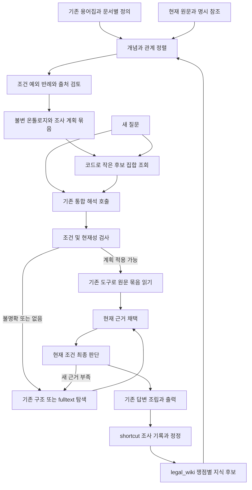

# 온톨로지로 RAG 탐색과 판단 시간을 줄이는 구현 설계

2026-10-09 · 설계 제안 · 기준은 로컬 MAIN49 `grounded-entry-20261009-r1`

온톨로지는 반복 탐색과 선택을 줄일 수 있다. 핵심은 조사 경험을 질문별 경로에서 **개념·조건·근거·확인 절차로 일반화하고, 검토된 부분을 미리 실행 가능한 조사 계획으로 만들어 두는 것**이다. 질문이 들어오면 작은 계획 후보를 기존 질문 해석 호출에서 선택하고, 코드는 필요한 현재 원문을 확보한다. 모델은 그 원문의 채택과 현재 사건의 적용 판단에 집중한다.

전체 온톨로지를 매번 모델에 넣거나, 온톨로지 검색용 모델을 새로 호출하면 오히려 느려질 수 있다. 첫 구현은 일반화한 **조사 계획**을 기존 v6에 연결하고, 조건 계산 결과를 최종 판단의 보조 자료로 제공한다. 최종 법률 판단을 통째로 자동화하거나 과거 답변을 재사용하는 것은 이번 속도 개선의 선행 조건이 아니다.

이 문서는 코드·선택 릴리스·저장된 측정 결과를 읽어 작성했다. 신규 모델 호출·성능 실험·제품 변경·MAIN 전환은 수행하지 않았다. 자체 검토이며 독립 감독 검토나 현장 성능 인증은 아니다. 구현·수치·배포 상태는 [근거 원장](evidence.json)에 연결한다.

## 현재 병목과 온톨로지가 해결하는 범위

현재 새 질문의 실제 관측 경로는 `request-entry → source-law-navigation-1 → source-law-navigation-2 → memory-assess`다. 논리적 일곱 단계와 물리적 모델 호출 수는 다르다. COMPOSE는 이미 ASSESS가 만든 문장을 결정적으로 조립한다. 도메인 단계 선택도 코드가 수행하므로 이를 없애서 모델 호출이 줄었다고 계산하면 안 된다.

| ID | 확인한 사실 | 해석과 한계 |
|---|---|---|
| O1 관측 | ADR0710 공개 세 질문에서 MAIN48 기준 22회·169.544초, MAIN49 후보 12회·185.976초. 입력은 108,339→144,356토큰 | 호출 감소가 전체 속도 향상을 보장하지 않음. 각 질문 한 번씩 실행한 과거 관측이며 일반 성능 추정값이 아님 |
| O2 관측 | MAIN49 H03 첫 탐색은 법령 12개·행동 270개·입력 66,883토큰, 전달 원문 페이지 0개 | 실제 원문을 읽기 전 후보 선택 화면이 큼. 메뉴 크기가 행동 오류의 원인이라는 인과관계는 아직 미검증 |
| O3 관측 | 같은 H03의 모델 전송 시간 합계 30.102초, 서버 요청 81.659초 | 온톨로지로 모델 호출만 줄여도 남는 시간이 큼 |
| C1 계산 | O3의 차이 51.557초 = 81.6591038450133 − 30.101736636992428 | 전송 타이머 밖의 잔여 시간. 전부 초기화·검색·직렬화 중 하나라고 단정할 수 없음 |
| O4 코드 | core route는 과제·사실·자료 구분과 원문 binding을 맞춰 조회 | 문구·조건이 다른 새로운 질문에 지식의 일부를 조합하는 소비 경로가 없음 |
| O5 코드 | domain catalogue는 질문·원문·판단의 시스템 개념이며 `select`는 빈 법률 개념/관계와 DISCOVERY를 기록 | 법률 도메인 관계를 실제로 선택해 탐색 계획을 실행하는 온톨로지는 아직 미연결 |

O1~O3은 ADR0710 결과와 기존 입력 진단 원장에 근거한다. O4~O5는 선택된 frozen 코드에서 확인했다. 원본 요청·응답·질문·본문은 보고서에 반복 복사하지 않는다.

**해결 범위:** 법령/조문 찾기, 어떤 정의와 예외를 읽을지 선택하기, 이미 확인한 조건을 반복 정리하기. **별도 개선이 필요한 범위:** 기동·색인 준비·원문 I/O·직렬화·모델 자체 지연·과도한 출력. 이 잔여 시간을 구간별로 분리해야 전체 지연 개선을 판단할 수 있다.

## 문제별 기존 방식과 변경 후 목표

| 같은 입력 또는 상황 | 기존 방식과 실제 결과 | 변경 방식 | 원하는 결과와 확인 방법 |
|---|---|---|---|
| 알려진 업무 개념을 다른 표현으로 질문 | core route의 task/facts 일치 중심. 해당 새 표현의 적중률·시간은 미측정 | 용어집 ID와 문서별 의미 범위에 질문을 연결하고, 관계·사실 슬롯으로 조사 계획 선택 | 다른 표현·새 사실의 독립 사례에서 원문 묶음이 연결되는지, 오적용·복귀·E2E를 확인 |
| H03 같은 큰 후보 메뉴 | 원문 읽기 전 법령별 구조·적중·행동을 펼침. O2 관측 | 일반화한 계획이 있으면 해당 원문을 먼저 확보. 없으면 기존 후보 순서를 보존한 간결한 메뉴 사용 | 모델에 실제 전달한 후보·토큰·행동 수 감소, 필요한 원문 전달과 추가 검색 접근 유지 |
| 정의·본칙·예외를 차례로 찾는 업무 | 현재 모델이 탐색 행동을 선택. 유형 전체의 반복 비용은 미측정 | 검토된 의존 관계를 사전 전개해 필요한 원문 범위를 하나의 읽기 계획으로 실행 | 위치 선택을 위한 모델 호출 감소. 원문 확보·전달·채택을 서로 다른 영수증으로 확인 |
| 읽기 의도를 쓰면서 동일 검색을 재제안 | ADR0708 과거 후보에서 중복 검색 차단 후에도 실패. MAIN49 새 재현 아님 | 계획 실행은 닫힌 도구/인자 계약으로 코드가 처리. 모델에는 현재 읽은 자료와 남은 선택만 제시 | 잘못된 이유에서 행동을 추측하지 않음. 동일 상태·동일 실패 계획 재실행 방지와 일반 탐색 복귀 확인 |
| 같은 사실·조건을 판단 단계마다 설명 | 현재 조건·주장 구조는 존재하나 일반화한 조건 식의 소비는 제한됨 | 검토된 타입 있는 조건을 참/거짓/미확인으로 계산하고 근거와 함께 ASSESS에 전달 | 이미 확인한 기계적 조건에 대한 재조사 감소. 미확인 조건을 거짓이나 충족으로 바꾸지 않음 |
| 전체 응답이 느림 | O1에서 호출 수를 줄여도 총 시간 증가 | 온톨로지·메뉴·비모델 처리 시간을 각각 계측하고 효과를 분리 | 실제 전체 시간과 분포로 판정. 호출 수나 토큰 감소만으로 성공 선언 금지 |

같은 원인은 다의어, 다른 시점, 조건 정정, 여러 쟁점의 조합에서도 발생한다. 계획이 범위 밖의 질문을 가져오거나 필수 원문을 잘라내는 방식으로 메뉴를 줄이지 않는다. 구조 검색과 fulltext의 선택 가능성, 전체 허용 범위 재탐색, RETURN_TO·재개·추가 조사 경로를 보존한다.

## 목표 구조와 구축 순서

전체 MAIN의 용어집 → 원문 구조화 → 문서–용어 연결 → 정의·명시 참조 색인은 그대로 사용한다. 피드백 단계에서 얻은 경험을 검토된 지식으로 만들고, RAG 단계가 이를 조사 계획으로 소비하도록 연결한다.

구축은 요청 처리 밖에서 수행한다. 새 질문을 처리하면서 온톨로지 생성·통합·검토 모델을 호출하지 않는다. 기존 `action-memory build --mode shortcut-v4`의 변경 큐와 legal_wiki compiler를 확장하고, 기존 `glossary domain-control`의 검토·컴파일·검증 진입점으로 묶음을 발행한다. 이 확장은 제안이며 현행 CLI에 해당 새 계약이나 옵션이 이미 있다는 뜻이 아니다.

### 일반화할 지식 단위

| 단위 | 내용과 출처 | 실행에서의 역할 |
|---|---|---|
| 개념 | 기존 용어 ID, 문서/조문별 정의 범위, 새 개념의 검토 상태 | 질문의 표현을 관련된 개념 후보로 연결 |
| 타입 있는 관계 | 적용 대상, 정의 의존, 예외, 위임/명시 참조, 절차 선후, 조건 변형 | 어떤 원문·확인 항목이 함께 필요한지 결정 |
| 조건부 규칙 | 주체·행위·대상·시점, 성립 조건, 예외, 결과, 정확한 원문 refs | 기계적으로 확인할 조건을 계산하고 현재 판단에 제공 |
| 조사 계획 | 질문 목적, 입력 슬롯, 필수 읽기 범위, 선택적 분기, 종료/복귀 조건 | 기존 도구의 읽기·조회 행동을 미리 구성 |
| 개별 사건 | 현재 사용자가 제공한 사실, 정정, 분기, 사실의 출처와 상태 | 매 요청의 슬롯 값. 다른 사건의 사실을 가져오지 않음 |

예를 들어 가상의 양도 제한 질문에서 회사명·날짜·자산은 사건 값으로 남긴다. 보유자 자격·취득 방식·거래 유형·기간·예외는 재사용할 개념과 슬롯으로 분리한다. 새로운 질문이 양수인 자격을 묻는다면 그 관계에 필요한 부분을 결합한다. 특정 거래를 다른 거래의 하위 개념으로 볼 수 있는지도 근거 있는 관계가 있어야 하며, 단어가 비슷하다고 동일한 제한을 적용하지 않는다.

조사 경로 일반화와 법률 규칙 승인은 별도 상태다. 사례에서 “이 원문을 함께 확인하면 도움이 된다”를 발견할 수 있지만, 반복된 답변만으로 일반 법칙을 승인하지 않는다. 법률 주장은 원문이 지지하는 범위에서 검토한다. 여러 사건의 사실을 합치지 못하도록 한 현재 compiler의 검사를 제거하지 않고, 공유 원문에 근거한 규칙과 개별 사건을 분리한다.

### 무엇을 미리 계산할 것인가

발행 시 정의→본칙→필수 예외/참조의 의존성을 조사 목적별로 전개해 둔다. 각 묶음은 적용 가능한 문서·시점·대상 범위와 필수 자료 목록을 가진다. 그 결과에서 즉시 읽을 위치, 현재 사실이 필요한 분기, 아직 미해결인 관계를 컴파일한다. 여러 계획의 공통 원문은 좌표와 해시로 합치고, 모든 계획의 필수 확인 항목은 유지한다.

그래프에 예외 연결이 없다는 사실은 “예외 없음”의 증거가 아니다. 명시한 자료 범위의 검토 영수증과 미해결 목록으로만 계획의 완결성을 표시한다. 범위가 닫히지 않은 계획도 탐색 힌트로는 쓸 수 있지만, 그것으로 충분성 검사를 건너뛰지는 않는다. 전체 법체계의 완결성을 주장하지 않는다.

초기 저장 방식은 기존 SQL 권위 저장소와 별도의 읽기 전용 SQLite 파생 색인으로 충분하다. 새 그래프 서버나 임베딩 서비스를 선행 도입하지 않는다. 온톨로지의 가치는 저장 엔진 이름보다 관계와 조건의 계약, 실제 RAG 소비에 있다.

## 질문 시의 실행 설계

### 기존 앞단 호출에서 개념과 계획을 선택

1. 현재 ACL·자료 구분·원문 세대를 먼저 정한다.
2. 코드가 승인된 표현 연결·용어·문서 단서를 조회한다. 질문별 별칭 목록은 보조 색인이며 과거 질문 문자열을 유일한 재사용 키로 삼지 않는다.
3. 관련된 작은 개념/계획 후보만 `request_entry.run`의 기존 호출에 제공한다. 새 출력에는 선택한 개념/계획 ID, 사용자가 준 슬롯 값과 원문 위치를 추가한다. 현재 목적·배경 구분을 유지한다.
4. 코드는 미제공 ID, 잘못된 관계 끝점, 불일치 자료 범위, 값 타입·단위·부정·시점·사용자 원문 결속을 검사한다. 인용된 문구가 존재한다는 검사만으로 의미 추출의 정확성을 인증하지는 않는다.
5. 모호한 경우는 한 후보를 최고 점수만으로 실행하지 않는다. 추가 라우팅 모델 없이 기존 탐색으로 진행하거나, 답을 바꾸는 사건 사실만 기존 확인 질문으로 묻는다.

현재 `UnifiedExecution.invoke`는 도메인 catalogue 전체를 입력에 붙인다. 온톨로지가 커질 때 이 경로를 그대로 쓰면 병목이 재발한다. 서버에는 전체 정본을 보관하고, 모델에는 이번 후보 부분그래프와 현재 의무만 전달하도록 함께 바꿔야 한다.

### 근거 읽기와 판단 분리

적용 가능한 조사 계획은 문서 선택·구조 이동·확정된 위치 읽기를 기존 도구로 실행한다. 이 실행은 법률 결론의 채택을 뜻하지 않는다. 반드시 다음 세 상태를 나눠 저장한다.

- **확보:** 현재 원문을 실제로 읽었고 좌표·해시가 맞음.
- **전달:** 이번 모델 호출에 해당 본문이 들어갔음.
- **채택:** 현재 SELECT가 그 근거를 채택했음.

계획에 필요한 본칙·정의·예외 원문을 읽은 상태에서 SELECT를 시작한다. SELECT의 기존 원문·범위 검사는 유지하며, 바로 채택/FINISH하거나 부족한 자료의 탐색을 선택할 수 있다. 자동 실행 코드가 과거 FINISH를 복원하거나 새 채택 판단을 만들어 넣지 않는다.

현재 `core_evidence_route.direct_discovery`는 좌표로 후보를 구성하는 재사용 지점이다. 이것만 연결하면 원문 읽기 위치를 고르는 탐색 호출이 남을 수 있다. 따라서 `READ`와 `law_navigation`의 실제 페이지 전달까지 연결해야 호출 감소가 가능하다. 새 계획 어댑터는 기존 `unit_reading`·원문 도구를 호출하고, 복수 자료의 진행 상태를 기존 조사 journal에 남긴다.

**첫 구현의 조건부 경로 목표 D1:** 입력 해석 1회 + 이미 읽은 근거 채택 1회 + 최종 적용 판단 1회 = 모델 3회. 이것은 계획이 명확하고 근거가 한 번의 전달 예산에 들어가며 교정·재조사가 없는 요청의 설계 목표다. 현행 공개 세 질문의 4회를 일반 요청의 기준값으로 확대하지 않는다. SELECT와 ASSESS를 합쳐 2회로 만드는 변경은 이번 범위에서 제외한다.

단순 타입 비교·검토된 날짜/기간 계산은 코드가 처리하고, 해석이 필요한 조건은 미확인으로 둔다. 조건 계산 영수증은 값의 출처·연산 계약·단위·규칙 버전을 ASSESS에 전달한다. 모델의 최종 적용 판단은 현재 원문과 현재 사실을 보며 유지한다. 현행 `reuse_policy.condition`의 제한된 연산을 넘어서는 기능은 새로운 조건 계약 버전으로 추가해야 한다.

### 부분 적중과 일반 탐색 복귀

일부 쟁점만 계획에 맞으면 그 원문부터 확보하고, 나머지는 현재 탐색에서 해결한다. 제한된 묶음만 보고 전체 답변을 완료했다고 표시하지 않는다. 사전 후보 수·관계 전개 수·문자/페이지 예산을 넘으면 계획을 축소해 충분하다고 하지 않고 탐색 경로로 복귀한다.

유효한 core route가 이미 있는 요청은 기존 경로를 우선 활용한다. 일반화한 계획은 그 경로가 없거나 다른 쟁점에 필요한 부분을 보충할 때 사용한다. 우선순위와 부족분은 요청에 기록하고, 두 재사용 경로가 서로 번갈아 재시작하지 않도록 동일 상태의 실패 계획을 제외한다. 정상적인 추가 조사와 조건 변경 시에는 새 상태로 다시 검토할 수 있다.

한 호출에 동일 원문은 하나의 근거 목록으로 제공하고 나머지는 참조로 연결한다. 다음 판단 호출에는 필요한 원문을 다시 제공한다. 모델이 과거 호출의 본문을 기억한다고 가정하지 않는다. 요청한 항의 본문·단서·호·목 전체가 필요하면 읽기 범위를 유지하고 페이지 처리한다.

## 저장 계약과 실제 변경 지도

아래 `ontology-investigation-v1`과 설정명은 모두 **새 제안**이다. 현재 계약의 이름으로 오인하거나 지금 실행하지 않는다.

| 산출물 | 필수 계약 | 소비자 |
|---|---|---|
| 지식 후보 | 기존 unit/revision, 원 사건·원문 refs, concept/관계 후보, 조건/예외/미확인, ACL | 기존 legal_wiki 검토/구성 경로 |
| 불변 온톨로지 묶음 | schema/id/revision, 용어집·원문·navigation·fulltext 지문, 컴파일 코드/정책, 검토 영수증, 공개 범위, 내용 hash | 서비스 로더·도메인 조회 |
| 조사 계획 | 적용 목적·의미 범위, 입력 슬롯, 필수 refs/예외, 읽기 범위, 분기·중단/복귀, 의존 단위 revision, completeness | 기존 PLAN/RECALL/READ |
| 요청 실행 영수증 | bundle/plan hash, principal/ACL 지문, request/goal revision, 슬롯 출처, 조회·계산·읽기 결과, 실제 전달, 복귀 이유 | SELECT/ASSESS·journal·감사·재개 |

불변 파일은 workspace의 `data` 논리 root 아래 새 파생 세대에 저장하고 `lawrag.platform.workspace`로 경로를 해결한다. 리뷰/변경 큐와 상태는 기존 `runtime` root를 쓴다. 원문·모델 입출력은 복사하지 않고 기존 refs와 해시를 사용한다. 기존 파일 projection의 법률 위키와 새 실행 색인은 같은 SQL 지식 revision을 참조하되 각각의 용도를 분리한다.

| 기존 진입점/파일 | 제안 변경 책임 | 실제 소비자·호환성 |
|---|---|---|
| `legal_wiki_compiler.admit/build_with_pipeline` | 원문에 결속한 개념·관계·계획 후보와 의존/반례를 추가. 사건 사실 분리 유지 | 기존 sw_* 권위 저장소. 현재 revision 변경 금지 |
| `glossary domain-control` → `unified_memory.main`, `domain_control.compile_catalogue` | 기존 v1 카탈로그와 새 온톨로지 계약을 명시적으로 구분, 검토 입력 검증·조사 계획/색인 발행 | 새 묶음. CLI·PIPELINE 생산자/소비자를 함께 등록 |
| `DomainCatalogue.load/offer/select` | 선택된 묶음 읽기, 목적·관계·범위 검사. 현재 시스템 단계 방식과 승인 법률 개념을 별도 기록 | `UnifiedRag` binding과 요청별 개념 영수증. 기존 v1 reader 유지 |
| `request_entry.schema/run/accept/consume` | 현재 호출에 작은 후보와 슬롯 선택 추가, 원문·상태 결속 검증 | 기존 새 질문 진입점. 정정/기존 goal의 해석 경로는 별도 어댑터로 동일 계약 소비 |
| `UnifiedExecution.invoke`, `WikiExecution.stage` | 전체 catalogue 주입을 부분그래프 투영으로 변경, core route/일반화한 계획/일반 탐색 선택 | 현재 세션·권한·자료 범위 유지 |
| `law_candidates.discover`, `core_evidence_route.direct_discovery` | 공통 좌표 검증·후보 생성을 재사용하고 계획 provenance를 구분 | 같은 SourceRecall과 READ. 저장된 core route를 다른 contract로 위장하지 않음 |
| `memory_rag.NativeExecution.stage`, `unit_reading`, `law_navigation` | PLAN이 지정한 읽기 전개·확보/전달·checkpoint를 같은 조사 실행기에 연결 | SELECT의 현재 판단 유지. 기존 모델 결정을 위조하지 않음 |
| `reuse_policy.condition`, `completion_execution.completion_stage` | 버전 있는 조건 평가와 미확인 상태·근거 refs 전달 | ASSESS와 재조사. 기존 결정적 COMPOSE 유지 |
| `PIPELINE.json`, profile, engine pins, `control.prepare`, `service._local_release` | 명시 bundle/hash·mode·예산/전송 계약 설정, 릴리스에 모든 의존 파일 결속 | 실제 `/v1/rag/ask`, HEALTH binding, API/SSE/워크플로우 결과 |

작업 코드 파일은 `02_BACKEND/semantic_runtime/legal_agent/` 및 `02_BACKEND/lawrag/pipeline/` 아래 기존 모듈을 확장한다. 조건·계획 helper 분리는 가능하지만 별도 RAG 실행기나 새로운 기본 검색 파이프라인은 만들지 않는다. 새 내부 설정의 제안은 `ontology.mode=off|hint|plan`, `ontology.bundle={path,sha256}`, 후보/관계/본문 예산 및 계약 버전이다. 기본은 off로 두고 검증한 릴리스에서만 선택한다. 구체 예산값은 후속 ADR 호출 전에 동결한다.

`term-runtime-v1` 외부 요청/응답과 원문 저장 계약은 유지한다. 내부 계획·영수증은 허용된 내부 데이터와 journal에 넣고, 공개 출력에는 답변 근거와 실제 한계만 표시한다. 폐기된 `LEGAL_SCHEMA.json` 의미 재작성 구조를 되살리지 않는다. 초기에는 용어집/원문/전체 fulltext 재구축 없이 새 지식 파생 묶음만 만든다. 이후 원문이나 용어 ID가 바뀌면 영향을 받은 관계·계획과 색인을 새 세대로 재컴파일한다.

묶음 발행은 임시 산출물 검증 → 불변 세대 → 해시 고정 릴리스 선택 순서다. 파일 생성만으로 활성화하지 않는다. sw_*에 필요한 새 payload와 검토 이벤트는 명시 계약 버전으로 저장하고, 새로운 물리 테이블이 필요하면 별도 schema migration과 rollback을 둔다. 기존 사건·위키·core route의 revision을 덮어쓰지 않는다.

## 실패와 재개 시나리오

| 상황 | 실행·저장 동작 | 사용자 결과와 복구 |
|---|---|---|
| 알려진 규칙 구조, 표현과 사건 값만 새로움 | 기존 해석이 개념/슬롯을 결속, 계획 조건 확인, 현재 원문 묶음 확보·전달, SELECT/ASSESS 수행 | 근거 있는 새 답변. 계획 적중만으로 과거 결론을 출력하지 않음 |
| 기간·자격 등 핵심 사실 없음 | 해당 조건은 UNKNOWN. 일반 규칙 설명이면 조건별 설명 가능, 사건 적용이면 필요한 사실만 확인 | 불필요하게 전체 검색을 다시 돌거나 일반 설명을 개인 사건 심사로 확대하지 않음 |
| 한 표현에 복수 법률 개념 | 문서·시점·거래 유형으로 후보 구분, 해소 안 되면 일반 탐색 | 잘못된 한 계획으로 조용히 고정되지 않음 |
| 낯선 조합 또는 일부 쟁점 적중 | 허용된 조합만 합성. 공통 원문 중복 제거, 나머지 쟁점은 일반 탐색 | 부분 적중과 최종 충분성을 구분 |
| 원문·용어집 세대 변경 | 묶음의 binding 불일치로 해당 계획 사용 중단, 기존 탐색 유지. 새 세대 재검토 | 옛 조문 좌표나 규칙으로 답하지 않음 |
| 문서 ACL 축소·승인 철회 | 요청/읽기/게시 시 현재 상태 재검사. 캐시는 scope/revision/revocation 지문 포함 | 금지된 자료나 파생 규칙이 모델·화면에 노출되지 않음 |
| 읽기 일부 성공 뒤 중단 | plan hash·step cursor·확보/전달 상태를 기존 journal에 저장, 같은 지문에서만 재개 | 이미 확보한 원문은 무결성 검사 후 재사용, 미전달 내용을 채택했다고 표시하지 않음 |
| 계획이 틀려 새 근거 필요 | 실패 원인과 현재 상태를 남기고 기존 조사로 복귀. 같은 상태의 같은 실패 계획은 다시 적용하지 않음 | 기존 추가 조사·한정 답변 경로 유지 |
| 구축 중 실패·중복 이벤트 | snapshot/revision/hash로 중복 방지, 발행 전 실패는 현재 묶음에 영향 없음 | 새 산출물을 복구·재개. 이전 원문/지식 이력 보존 |
| 개인 사례에서 공통 관계 후보 발견 | 개인 원기록은 개인 범위 유지. 공통화는 허용된 원문 근거와 별도 검토/공개 범위로 발행 | 일반화 자체가 접근·반출 승인이 되지 않음 |

지식 검토 책임은 승인된 운영/도메인 검토 주체, 계약·지문·권한 검사는 코드, 현재 사건의 해석과 적용은 기존 모델 단계가 맡는다. 모델 의미 오류는 코드의 구조 검사만으로 제거되지 않는다. 관계의 충돌·판본 차이는 삭제·임의 우선순위로 합치지 않고 조건 변형과 미해결 상태로 남긴다.

불변 릴리스 rollback은 철회된 지식을 다시 허용하지 않는다. 현재 SQL lifecycle/철회 상태를 요청 시 확인하며, 이 확인이 실패하면 해당 지식 가속만 비활성화하고 원래의 현재 권한 경로를 사용한다. 진행 중 요청은 시작 지문에 결속하되 보안·철회 검사는 최신 상태를 적용한다.

## 기대 효과와 손익분기

속도 개선율은 아직 미산정이다. 온톨로지 적중률·과잉 읽기·조회 비용·잘못된 계획의 복귀 비용을 새로 측정해야 한다. O1의 호출 감소율을 시간이나 비용 절감률로 바꾸지 않는다.

요청당 평균 시간의 설계 산식은 다음과 같다. 기호의 단위는 초/요청이고 p와 q는 전체 요청 중 서로 겹치지 않는 비율이다. 성공 적용군과 실패 복귀군은 실제 분모를 별도로 기록한다.

`순 시간 절감 = p × (S − A) − L − q × F`

- S: 성공 적용 요청에서 생략한 탐색·선택의 평균 시간.
- A: 그 요청에서 추가로 수행한 조건 평가·과잉 읽기·입력 처리의 평균 시간.
- L: 모든 요청에 붙는 온톨로지 후보 조회와 입력 증가의 평균 시간.
- F: 실패 적용 뒤 원래 탐색으로 돌아가기까지 추가로 쓴 평균 시간.
- **손익분기:** S > A일 때 `p > (L + qF) / (S − A)`. S ≤ A이면 이 구성은 온라인 속도 이득을 내기 어렵다.

이는 집단별 측정값으로 계산할 식이며 현재 보정된 예측 모델이 아니다. 같은 계획도 긴 원문을 과도하게 읽으면 A가 커지고, 다의어가 많으면 q가 커진다. 범용 그래프를 넓게 순회하기보다 검토된 작은 조사 계획을 컴파일하는 이유다.

총 운영비는 `온라인 비용 + 구축·모델 추출 비용/N + 검토·갱신 비용/N`으로 비교한다. N은 해당 묶음의 유효 기간에 실제 처리한 요청 수다. 구축이 요청 밖에서 이뤄져도 비용은 사라지지 않는다. 인건비와 모델 요금은 같은 화폐 단위로 환산할 근거가 없으면 별도 표시한다. 모델/자료/캐시 조건이 다른 로컬과 GENOS 수치는 합치지 않는다.

| ID | 종류·분모 | 이번 설계의 값 또는 판정 |
|---|---|---|
| D1 | 조건부 목표·정상 적중 요청 | 기존 entry 1 + SELECT 1 + ASSESS 1 = 모델 3회. 실제 호출은 교정/재시도 포함 측정 |
| D2 | 구조 목표·모든 요청 | 별도 온톨로지 라우팅/요약/검토 모델 호출 0회. 기존 entry의 입력 증가 비용은 L에 포함 |
| D3 | 제안 성능 목표·사전에 정한 적용 가능 사례군 | 동일 조건의 기준 대비 E2E 중앙값 20% 이상 감소. 실측 예측이 아니며 실행 전 기준 동결 필요 |
| D4 | 제안 회귀 한도·전체 평가 요청 | E2E p95 증가 5% 이내. 분포를 볼 표본이 부족하면 통과 판정 보류, 반복된 의역을 독립 표본으로 세지 않음 |
| U1 | 미확인 | 실제 적중률·토큰/비용 절감·GENOS 속도·검토 인력·전체 일정. 후속 측정과 최초 지식 묶음 작성으로 산정 |

개발은 입력 투영과 계측 → 지식/계획 계약·컴파일 → 실제 읽기와 판단 소비 → 독립 검증·승격 순서가 적절하다. 인일과 달력 일수는 초기 범위와 검토량이 정해지지 않아 산정하지 않는다. 단순히 큰 온톨로지를 먼저 만드는 방식보다 빈도가 높고 원문·조건이 명확한 업무 묶음에서 시작한다.

## 검증 설계와 MAIN 반영 범위

실험은 아직 시작하지 않았다. 구현·효과 비교에 착수할 때 진행 중 동일 scope reservation을 확인하고, 저장소의 두 실험 표준을 끝까지 읽은 뒤 stable runner로 새 ADR을 선점한다. 부모 후보는 현재 완료된 `ADR-0710 / integrated`를 기준으로 검토하되, 착수 시 최신 작업 코드·선택 릴리스와 차이를 다시 확인한다. 관측 뒤 변경한 후보는 후속 ADR로 분리한다.

권장 비교는 동일 기본 코드·자료·모델의 네 구성이다: 현재 기준, 메뉴/입력 간소화만, 온톨로지 계획만, 둘의 통합. 실행 전에 arm과 코드·데이터·스키마·모델·설정·문항·성공 기준을 동결한다. 이렇게 해야 메뉴 최적화의 이득을 온톨로지 일반화의 효과로 잘못 보고하지 않는다. 현재 세 질문은 알려진 회귀 자료로만 쓴다.

평가는 다음 독립 범위를 구분한다.

- **같은 관계의 새 사건:** 계획 작성에 쓰지 않은 사실·표현·목적을 가진 사건. 의역 묶음은 하나의 근원 사례로 집계한다.
- **새 조합:** 각각 알려진 개념이 새롭게 조합된 경우. 실제 근거·조건을 조합하고 허용되지 않은 관계를 만들지 않는지 본다.
- **반례:** 부정, 시점, 주체 자격, 거래 유형, 예외 하나를 바꿔 오적용과 추가 확인을 검사한다.
- **미지원 영역:** 관련 온톨로지가 없는 새로운 규칙군. 일반 탐색의 성능과 품질을 보존하는지 본다.
- **운영 경계:** 정정·취소·복귀·중단/재개·원문 개정·권한 축소·철회·외부 전송 차단.

정답·필수 근거·평가용 해설은 제품 입력과 온톨로지 생성 자료에서 분리한다. 이미 공통 등록한 CM 질문·근거는 미사용 holdout으로 취급하지 않는다. 외부 검증은 허용된 공개 자료/모의 자료와 실제 반출 설정을 따르고, 내부 사건 질문과 경험에서 파생된 지식은 임의로 외부 모델에 보내지 않는다. 신규 외부 실험은 당시 정본 모델 정책과 `ExperimentClient`를 따른다. 내부 품질·속도는 GENOS 내부 모델과 자료로 확인한다.

측정 항목은 E2E/첫 답변 시간, 모델 전송별 시간·횟수·입출력 토큰, 기동/조회/원문 읽기/직렬화 시간, plan 후보·적중·거절·복귀, 선택지 수, 필요한 근거의 확보/전달/채택, 조건/예외 판단과 답변 완결성이다. 원문을 덜 읽거나 실패를 일찍 반환해 빨라진 요청은 성공 지연 개선과 분리한다. 차가운 기동과 준비된 상태, 동시성·캐시 조건도 분리한다.

승격의 심각한 차단 기준은 인용/원문 무결성·ACL·미확인 조건의 확정화·철회 무시·상태/지문 보존·실제 서빙 연결 실패다. 그 밖의 세부 의미 오류는 유형과 근거를 남기고 사전에 동결한 허용 회귀 기준으로 판단한다. 모든 질문의 정답 100%를 자동 승격 조건으로 삼지 않는다.

완료 범위는 계약/회귀 확인 → 독립 사례 비교 → 필요한 수정만 작업 코드에 통합 → 동일 코드 재검증 → 해시 고정 MAIN plan/apply → 활성 포인터 확인 → 실제 `service.service` HEALTH와 `/v1/rag/ask`의 bundle/plan binding·답변 소비 확인이다. Git main 병합·데이터 선택·로컬 MAIN·GENOS 배포는 각각 기록한다. `validate --final`과 graph 검사, apply/rollback receipt를 보존한다.

실패하면 feature mode와 이전 릴리스를 명시적으로 재선택하고, 새 묶음·이벤트·실패 기록은 보존한다. 작업 코드 복구와 선택 릴리스 rollback은 별도로 수행한다. GENOS는 검증한 코드/묶음을 기존 DEV에 적용하고 현장 `python3`, 실제 Python 버전, 데이터/코드 지문, 새 리비전을 확인한다. 질의·warmup은 워크플로우 테스트 화면에서 확인한다. 로컬 성공을 현장 완료로 보고하지 않는다.

## 자체 검토와 근거

자체 검토에서 확인한 설계상 함정과 반영 사항은 다음과 같다.

| 검토 항목 | 반영 |
|---|---|
| 큰 ontology를 기존 catalogue처럼 모든 호출에 주입하는 역효과 | `UnifiedExecution.invoke`의 부분그래프 투영을 필수 변경에 포함 |
| core route를 조회하면 모델 읽기 선택까지 사라진다는 오해 | 후보 생성과 실제 원문 확보/전달을 분리하고 READ·SELECT까지 배선 |
| COMPOSE·도메인 단계에 이미 없는 모델 호출을 절감으로 계산 | 실제 관측 단계로 D1을 계산, 조건부 3회 목표로 제한 |
| 원문·용어집을 전부 새 의미 스키마로 재구축 | 현행 원문 계약 유지, 새 지식/계획 파생 묶음만 구축 |
| 단순 메뉴 축소 효과를 ontology 효과로 보고 | 별도 비교 구성과 새 관계/사건 평가를 포함 |
| 그래프에 없는 예외를 존재하지 않는 것으로 간주 | 범위 있는 검토·미해결·UNKNOWN·추가 탐색 유지 |
| immutable bundle rollback으로 철회 지식 부활 | 요청 시 현재 lifecycle 재검사와 안전한 기존 탐색 복귀 |

주요 근거:

- [전체 MAIN 정의](/home/jin/8-AGENT/00_SYSTEM/ARCHITECTURE.md), [현재 데이터 계약](/home/jin/8-AGENT/00_SYSTEM/DATA_MODEL.md), [활성 포인터](/home/jin/8-AGENT/01_DATA/ACTIVE/local/ACTIVE_RELEASE.json)
- [MAIN49 결과](/home/jin/8-AGENT/04_EXPERIMENTS/ADR/ADR-0710-grounded-entry-profile-bound-main/MAIN_RESULT.md), [원 측정 JSON](/home/jin/8-AGENT/04_EXPERIMENTS/ADR/ADR-0710-grounded-entry-profile-bound-main/artifacts/run-001/result.json)
- [기존 입력 최적화 설계](/home/jin/8-AGENT/07_DOCS/REFERENCE/REPORTS/RAG_TOKEN_INPUT_OPTIMIZATION_DESIGN_20261009.md), [저장 요청 집계](/home/jin/8-AGENT/09_ARTIFACTS/AUDITS/20261009-main49-token-input/input-sizes.json)
- [핵심 근거 shortcut](/home/jin/8-AGENT/07_DOCS/REFERENCE/OPERATIONS/CORE_EVIDENCE_SHORTCUT_20261007.md), [legal_wiki 기존 설계](/home/jin/8-AGENT/07_DOCS/REFERENCE/REPORTS/SHORTCUT_LEGAL_WIKI_SYSTEM_DESIGN_20261005/README.md)
- [과거 표현·절차 재사용 경로](/home/jin/8-AGENT/07_DOCS/REFERENCE/OPERATIONS/GLOSSARY_LEARNING.md): 구 NavigationSession용 계약이며 현재 v6 온톨로지 소비가 완성됐다는 증거가 아님. 기존 개념·검토·발행 계약을 재사용하되 v6 실제 소비는 본 설계에서 연결해야 함.
- [GENOS 환경 경계](/home/jin/8-AGENT/GENOS.md), [파일/해시·현재 선택 대조와 수치 원장](evidence.json)
