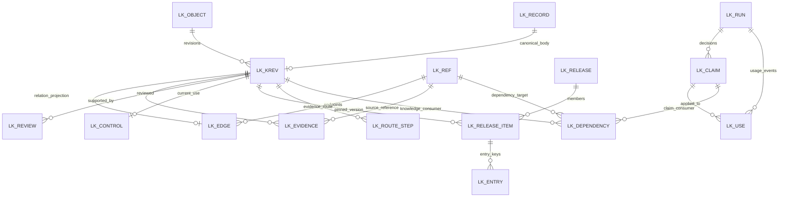

# DB 식별 버전 테이블과 ERD

[전체 목차](../../../ARCHITECTURE/ONTOLOGY_V3.md) · [DB 목차](../DATABASE_ARCHITECTURE.md)

원래 논의의 절 번호를 유지했습니다. 설계 제안과 구현·검증 상태는 각 절의 구분을 따릅니다.

## 4. 공통 식별·버전·시간 계약

### 지식의 동일성과 버전

**2026-10-22 추가 기준: 원문이 일차 저장 단위다.** `object_id`는 영구 식별자이며, 원문 기반 지식의 동일성 판단은 `문서 판본 + 조항/span + 개념`으로 한다. 질문 ID는 Agent 발견 이력으로 연결한다. 같은 원문·개념을 다른 질문이 발견했다고 새 정본을 복제하지 않는다.

기존 설계의 `LK_REF`로 원문 anchor와 개념을 참조하고 `LK_EVIDENCE`에 기준 원문과 보충 근거의 역할을 연결한다. `LK_ENTRY`의 `SOURCE_ANCHOR` 조회를 원문에서 검토 사항을 찾는 경로로 사용하며, `QUERY_TERM`은 최초 진입의 보조 색인이다. 쓰기 단계의 원문·개념 중복 확인과 원문 조회 후 검토 사항 소비 계약은 추가 구현 대상이다. 아래 DDL 초안에 해당 의미 제약이 이미 구현되었다고 해석하지 않는다. [저장·조회 기준](../../../ARCHITECTURE/ONTOLOGY_V3/SOURCE_ANCHORED_STORAGE.md).

- `object_id`: 질문·본문 hash와 독립된 영구 지식 ID. 동일 이름·유사 문장만으로 자동 합치지 않는다.
- `revision`: 같은 지식의 수정 버전. 이전 본문을 UPDATE하지 않고 새 `LK_RECORD` 행을 추가한다.
- `content_hash`: 정규화된 실제 payload의 hash. ID, revision, tenant/scope, 조건, 출처 참조가 함께 결속된다.
- `LK_HEAD`: 편집의 최신 revision. **현재 게시 버전 또는 법률상 유효 버전을 의미하지 않는다.**
- `release_id/release_revision`: 실제 RAG가 읽을 정확한 버전 묶음.
- `ref_id`: 종류·소유 포트·tenant/scope·원래 ID/버전·내용 hash·위치의 정규화 참조 hash. 현재 권한 자체를 hash로 대체하지 않는다.

주장, 관계, 필수 검토 항목, 형식 조건, 재사용 근거 경로를 `LK_OBJECT.OBJECT_KIND`로 구분한다. 후보도 같은 모델로 저장하되 검토와 게시 전에는 채택 지식으로 소비하지 않는다. 개념 ID·정의는 기존 용어집을 참조한다.

### 효력 시점과 기록 시점

`VALID_FROM/VALID_TO`는 해당 지식의 명시된 적용 기간이고 `RECORDED_AT`은 시스템에 기록한 시각이다. 구간은 [from, to)로 해석한다. 알 수 없는 시행일은 `VALIDITY_KIND=UNKNOWN`으로 보존한다. 날짜를 모르는데 현재 날짜로 채우지 않는다.

소급 정정은 새 revision에 과거 효력 구간과 현재 기록 시점을 함께 남긴다. 과거 답변 재현은 그때의 release·revision·원문 binding·검토 receipt를 읽고, 오늘의 재검토는 현재 통제와 현재 원문을 별도로 확인한다. 이 구분만으로 모든 법률의 시행·경과조치를 자동 판정하는 것은 아니다.

### 권한·출처

`tenant_id/team_id/scope_id`는 소유·관리 범위다. 팀 소속만으로 문서 접근을 허용하지 않는다. 지식 제목·검색 결과·근거경로·관계 끝점·영향 건수도 연결된 원문의 권한을 다시 검사한다.

`LK_REF`는 참조 위치의 정본 연결이다. 외부 원문·basis·경험은 소유 저장소가 다를 수 있어 물리 FK 대신 소유 포트에서 ID·판본·해시·span·권한을 검증한다. 내부 지식과 주장 참조는 실제 FK를 둔다. `VERIFIED_AT`은 당시 검증 시점이며 영구 유효의 표시가 아니다.

아직 확보하지 못한 원문은 가짜 ID·hash의 LK_REF로 만들지 않는다. 후보 payload의 미확인 항목에 요구사항·실패 receipt를 남기고, 실제 정본과 버전을 확인한 뒤 참조를 생성한다.

## 5. 테이블 설계와 정본

모든 컬럼·타입·제약은 [SCHEMA_DRAFT.json](SCHEMA_DRAFT.json), 생성 순서와 FK·인덱스는 [DDL 초안](ORACLE_DDL_DRAFT.sql)에 있다. 아래 새 이름은 논리 이름이다. 현장 table map과 스키마 점검 후 물리 이름을 확정한다.

### A. 지식과 근거 — M03·M04·M05

| 테이블 | 기본키 | 핵심 컬럼·역할 | 정본/소비자 |
|---|---|---|---|
| 기존 `LK_RECORD` | namespace, object_id, revision | 불변 payload, tenant/team, content_hash | 지식·검토·명령·게시 내용의 정본 |
| 기존 `LK_HEAD` | namespace, object_id | 현재 편집 revision, CAS | 원장 변경 경계 |
| `LK_OBJECT` | object_id | tenant/team/scope, object_kind | 영구 ID의 변경 불가 식별 메타데이터 |
| `LK_KREV` | object_id, revision | payload_hash, 효력 기간, 기록 시각 | knowledge 원장의 동기 투영; M05·M07 |
| `LK_REF` | ref_id | 종류, owner_port, 외부 ID/버전/hash, locator_json, family_key_hash | 외부 정본 또는 내부 FK 참조 |
| `LK_EDGE` | object_id, revision | subject_ref_id, predicate, target_ref_id, relation_schema_hash | 관계 지식의 동기 투영; M07 |
| `LK_EVIDENCE` | object_id, revision, ref_id, evidence_role | 원문·경험 역할, 당시 위치 검증 상태 | 근거 조회; M07·M08 |

관계도 자신의 ID·revision·근거·검토를 갖는 지식 객체다. `LK_EDGE`에 간선이 있다는 이유로 승인되거나 무조건 전이되는 것은 아니다. 관계 타입별 끝점 타입·조건·방향·합성 규칙은 M04 계약 hash에 결속한다.

같은 원문 span은 `LK_REF`로 참조하고, `LK_EVIDENCE`에서 ‘금액 산정’, ‘합산 범위’, ‘예외’처럼 역할을 부여한다. 같은 조문에 있는 내용도 별도 역할로 찾을 수 있다.

### B. 검토·게시·현재 통제 — M06

| 테이블 | 기본키 | 핵심 컬럼·역할 |
|---|---|---|
| `LK_REVIEW` | review_id | 정확한 대상 버전, ADOPT/REJECT/DISPUTE/WITHDRAW, 검토자·정책·검토범위 hash. 이유·근거는 review 원장 |
| `LK_CONTROL` | object_id, revision | UNREVIEWED/ENABLED/HOLD/WITHDRAWN, 검토 참조, control 원장 revision |
| `LK_SCOPE_GATE` | tenant_id, scope_id | 현재 control_epoch와 짧은 트랜잭션 잠금 |
| `LK_RELEASE` | release_id, release_revision | 원문 query release·binding, 구성 hash, 모델 계약 hash, 항목 수 |
| `LK_RELEASE_ITEM` | release_id, release_revision, object_id | 정확한 지식 revision; 같은 묶음에 동일 ID의 여러 버전 금지 |

검토 이력은 추가만 한다. 현재 사용 상태 변경은 `control` 원장에 새 revision을 추가하고 `LK_CONTROL`을 같은 트랜잭션에서 갱신한다. 검토 ADOPT는 해당 검토 범위에서 조직이 채택했다는 뜻이며 법률 정답 인증이 아니다.

서로 충돌하는 검토를 마지막 timestamp나 다수결로 자동 해소하지 않는다. 양쪽 원문·범위·검토 이유를 보존하고 권한 있는 명시적 control 결정으로 후속 사용 상태를 정한다. 특정 검토 범위를 넘어 재사용하려면 별도 범위 검토가 필요하다.

게시 준비와 활성 선택은 구분한다. `LK_RELEASE`는 봉인된 묶음의 투영이고, **활성 채널은 기존 `LK_RECORD(namespace='channel') + LK_HEAD`를 사용**한다. 별도 ACTIVE 테이블을 추가해 두 개의 선택 정본을 만들지 않는다.

### C. 빠른 진입과 근거 경로 — M02·M07

| 테이블 | 기본키 | 조회 목적 |
|---|---|---|
| 기존 `LK_LOOKUP` | release_id, term, object_id, revision | 구 소비자 호환. 현행 후보 조회는 INSTR(query, term) 기반 |
| `LK_ENTRY` | release_id, release_revision, key_kind, key_hash, object_id | TERM_ID / SOURCE_ANCHOR / NEED_ROLE / QUERY_TERM으로 후보 범위를 좁힘 |
| `LK_ROUTE_STEP` | object_id, revision, step_no | 필요 역할별 원문 참조와 READ/FOLLOW_REFERENCE 순서 |

`LK_ENTRY.KEY_HASH`는 타입·정규화 버전을 포함한 키의 hash다. 조회 후 원래 정규화 키를 대조한다. 긴 표기를 자르거나 문자열 일치만으로 의미 동일성을 확정하지 않는다.

색인 결과는 후보다. 기존 원문 검색이 용어를 못 찾았거나 사안 분류가 불명확하면 원문 탐색을 계속한다. 진입 적중이 법률 정답이나 근거 충분성을 보장하지 않는다.

### D. 실제 사용과 영향 — M08·M09

| 테이블 | 기본키 | 핵심 컬럼·역할 |
|---|---|---|
| `LK_RUN` | run_id | request, tenant/scope, 권한 snapshot hash, source/knowledge release, 원래 journal 참조 |
| `LK_CLAIM` | run_id, decision_id, claim_id | 주장·판단 artifact hash와 FACT/RULE/INTERPRETATION/CALCULATION/CONCLUSION |
| `LK_USE` | use_id | OFFERED/SELECTED/APPLIED/CALCULATED/POSTHOC_REVIEW 등 사건, 실제 journal 위치, 지식 버전, 생성 경로·근거 지지 상태 |
| `LK_DEPENDENCY` | dependency_id | 지식 버전 또는 주장 → 의존 대상 ref, 의존 역할, 사용 사건·proof hash |
| `LK_OUTBOX` | event_id | 같은 DB 트랜잭션의 변경 사건, 중복 키, 처리 상태·기한·lease epoch |
| `LK_SYNC` | consumer_id, partition_id | 확인한 입력 범위·미반영 구간·실패·연속 처리 위치·coverage hash |

실행 정보의 정본은 기존 journal이다. 새 테이블에 질문·답변·원문 본문을 반복 저장하지 않는다. 주장 ID는 decision artifact와 함께 묶어 재작성 전후·부분 응답을 섞지 않는다. 조회용 사용 기록에 최종 답변으로 표시하려면 기존 발행 완료 receipt까지 확인해야 한다.

`LK_EDGE`의 의미 방향과 `LK_DEPENDENCY`의 영향 방향은 다르다. 예를 들어 ‘계약이 거래에 포함된다’는 의미 간선과 ‘승인 판단이 합산 해석에 의존한다’는 사용 의존을 구분한다. 의존 행은 해당 원장 payload 또는 실행 사건에서 결정적으로 만들어 proof hash를 남긴다.

## 6. ERD

이는 주요 연결을 표시한 그림이다. `LK_USE`의 주장 연결은 OFFERED 등에서 선택적이고, 의존의 소비자는 지식 또는 주장 중 하나다. 상세 FK·nullable·배타 조건은 DDL에 있다. REF의 외부 원장 연결은 물리 FK가 아니다.

## 7. JSON과 관계형 컬럼의 경계

JSON에는 자연어 주장, 적용 범위, 형식 조건식, 예외 설명, 추출 이유, 검토 이유, 소유 포트의 복합 위치를 둔다. PK/FK, 버전, 관계 타입·끝점, 근거 역할, 게시 구성, 현재 사용 통제, 진입 키, 사용·의존 키는 컬럼으로 둔다.

핵심 조회는 원장 전체 JSON을 다시 해석하지 않고 `LK_ENTRY → LK_RELEASE_ITEM → LK_KREV/CONTROL → LK_ROUTE_STEP/EVIDENCE`로 수행한다. 선택한 소수 객체의 payload와 원문만 읽는다.

Oracle 19c의 CLOB JSON + IS JSON 검사를 사용하되 JSON 문법 통과가 필드 계약·법률 의미 검증을 대신하지 않는다. [Oracle 19c JSON 문서](https://docs.oracle.com/en/database/oracle/oracle-database/19/adjsn/json-in-oracle-database.html)

`LK_KREV/LK_EDGE/LK_EVIDENCE/LK_REVIEW/CONTROL/RELEASE_ITEM`의 값은 원장과 같은 명령 트랜잭션에서 생성하고 hash를 대조한다. 이 테이블에 별도의 편집 API를 두지 않는다. 발행 전 구성·참조·인덱스 결속을 확인하고, 재구축은 새 projection 버전 또는 새 release로 검증 후 선택한다.

---

[이전: DB 전체 구조와 기존 저장소](OVERVIEW.md) · [목차](../DATABASE_ARCHITECTURE.md) · [다음: DB 조회 인덱스와 거래금액 사례](QUERIES.md)
