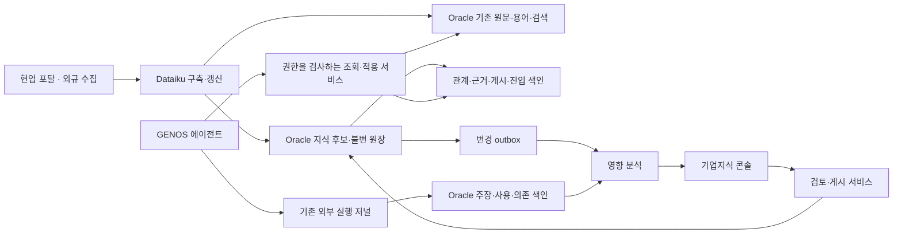

# DB 전체 구조와 기존 저장소

[전체 목차](../../../ARCHITECTURE/ONTOLOGY_V3.md) · [DB 목차](../DATABASE_ARCHITECTURE.md)

원래 논의의 절 번호를 유지했습니다. 설계 제안과 구현·검증 상태는 각 절의 구분을 따릅니다.

## 1. 설계 결론

**기존 원문·조사경험·근거관계 원장을 재사용하고, 그 위에 버전이 있는 기업 지식과 검토·사용·변경 영향의 관계를 저장한다.**

저장 구조는 다음 세 원칙을 따른다.

1. 원문, 용어 정의, basis 관계, 조사 경험은 각각 기존 정본을 참조한다. 기업 지식 DB에 본문을 다시 복사하지 않는다.
2. 지식 본문과 검토 이유는 기존 `LK_RECORD`의 불변 JSON 기록으로 보존한다. 관계·근거·게시 구성·사용 의존성은 타입이 있는 테이블과 인덱스로 조회한다.
3. 지식이 후보로 제시된 것, 실제 선택된 것, 특정 결론의 해석·계산에 사용된 것을 구분한다. 영향 분석은 이 사용 기록을 따라간다.

기존 `lk_record/lk_head/lk_lookup` 세 테이블은 유지하고 **18개 추가 논리 테이블**을 제안한다. 이 수는 설계 산출물의 개수이며 현재 DB의 테이블 수가 아니다. 객체별 가변 내용을 모두 별도 테이블로 분해하는 EAV 구조 대신, 자주 조인하는 키·관계·상태만 관계형으로 둔다.

‘통제’는 정답을 고정한다는 뜻이 아니다. 누가 어떤 범위와 근거로 지식을 채택했는지, 어디에 사용했는지, 무엇이 바뀌면 재검토할지 추적한다.

## 2. 현재 코드에서 확인한 저장 구조

| 코드상 저장소 | 실제 계약·현재 코드 사실 | v3 처리 |
|---|---|---|
| `SIDDA.LEGAL_SRC_DOCUMENT_A` | DATASET_VERSION + DOCUMENT_ID | 기존 원문 판본 정본 유지 |
| `SIDDA.LEGAL_SRC_SOURCE_UNIT_A` | DATASET_VERSION + DOCUMENT_ID + UNIT_ID, PARENT_ID | 조·항·호·목·표 구조 유지 |
| `SIDDA.LEGAL_SRC_BLOCK_PAYLOAD_A` | DATASET_VERSION + DOCUMENT_ID + BLOCK_ID, 본문·원본 해시 | 정확한 원문·span 조회에 재사용 |
| `LEGAL_RAG_ASSET_PART_A / LEGAL_RAG_RELEASE_A` | 자산 분할·원문/자산 릴리스 | 이관·기존 결속 유지. 자산 BLOB을 새 지식 조회로 오인하지 않음 |
| `LEGAL_RAG_QUERY_ROW_A / QUERY_RELEASE_A / QUERY_ACTIVE_A / QUERY_STATE_A` | 불변 조회 행·manifest·CAS 활성 선택·작은 외부 상태 | 원문·용어·검색 조회와 버전 고정 재사용 |
| `lk_record / lk_head / lk_lookup` | 불변 namespace 기록, CAS head, 게시별 검색어. Oracle 주입 adapter 존재 | 지식 정본·명령 receipt·기존 API 유지하고 v3 namespace와 투영 추가 |
| `basis_head/revision/binding/event/receipt/lineage/migration/view_head` | 내규–외규 관계·개별 검토·판본 대응. Oracle adapter 존재 | 승인 정본 유지. 새 관계에 복사 승인하지 않고 참조 |
| `sw_*` | 요청·사건·사실·조사·위키·의존·queue·cursor. 현재 repository는 SQLite 및 artifact 경로 사용 | M01/M02 경험·경로의 출처. Oracle 저장 전환은 별도 구현 대상 |

코드에서 테이블 이름과 DDL 함수가 확인되었다는 사실은 현장에 테이블이 생성·적재되었다는 뜻이 아니다. `lk_*`와 `basis_*`는 주입 table map을 사용하므로 현장 소유자·물리 이름을 임의로 SIDDA로 확정하지 않는다.

원문 조회는 `oracle_query_catalog.py`와 `oracle_query_db.py`의 요청별 고정 release·JSON_TABLE 투영 경로를 확인했다. 기존 `oracle_dp`의 전체 로컬 복원은 이 설계의 서빙 경로가 아니다. GENOS 코드서빙에 새 SQLite·파일 캐시를 만들지 않는다.

`sw_*`와 기존 실행 저널의 Oracle 전환이 이 설계만으로 끝나지는 않는다. 초기에는 허용된 외부 실행 저장소를 원장으로 유지하고 사용 색인을 Oracle로 전달한다. 장기 Oracle 전환은 M01 및 실행 상태 adapter의 계약을 구현·검증한 뒤 수행한다.

## 3. 물리 배치와 쓰기 책임

이는 논리 책임도다. 별도 서버나 DB 인스턴스를 추가해야 한다는 뜻은 아니다. 현장에 허용된 직접 DB 연결 또는 조회 API를 adapter로 사용한다. 현재 지식 관리 adapter는 주입된 Oracle DB-API 연결이고, 원문 조회는 별도 ORDS 경로이므로 두 경로를 이미 같은 서비스라고 설명하지 않는다.

| 쓰기 주체 | 허용 책임 |
|---|---|
| Dataiku 배치 | 원문·검색 새 release 구축, 지식 후보 생성·등록. 자동 검토 승인 불가 |
| M06 검토·게시 서비스 | 지식 수정·검토 결정·게시·사용 중단과 해당 트랜잭션 outbox |
| M08 실행 연결 | 기존 journal에 실제 사용 사건 기록, 멱등 투영 요청 |
| 기존 후처리 worker 확장 | 실행/의존 색인 반영, coverage 갱신, 영향 후보 산출 |
| GENOS 조회 코드 | 필요한 행·원문 조회. 기동 시 DDL·전체 데이터 복원 없음 |

DB 계정과 애플리케이션 사용자 권한은 구분한다. 사용자는 원장 테이블에 직접 UPDATE하지 않는다. 기존 API/명령 경계가 tenant·scope·원문 권한·revision을 검사한다. DDL 초안에는 실제 계정·GRANT를 추정해서 넣지 않았다.

---

[목차](../DATABASE_ARCHITECTURE.md) · [다음: DB 식별 버전 테이블과 ERD](MODEL.md)
