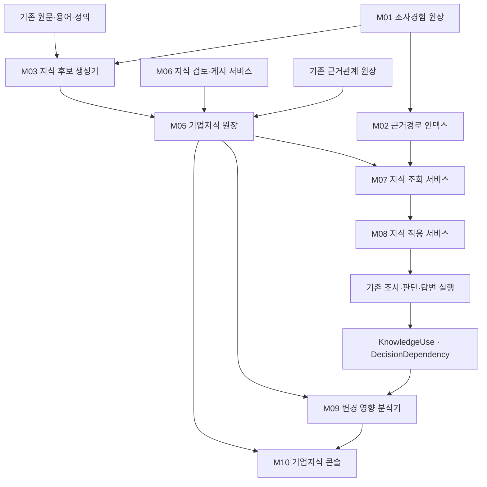

# 호출 연결과 저장 책임

[전체 목차](../../../ARCHITECTURE/ONTOLOGY_V3.md) · [구현 목차](../IMPLEMENTATION_NAMES.md)

원래 논의의 절 번호를 유지했습니다. 설계 제안과 구현·검증 상태는 각 절의 구분을 따릅니다.

## 7. 기존 기능과 새로운 기능의 연결

M04는 전체 계약을 정의하고, M11은 기존 조사 실행에서 단계 정책을 담당하며, M12는 표현 가능한 조건 계산에만 호출한다. M05에서 M06으로의 검토 요청과 M09의 재검토 결과는 기존 command 경로로 돌아간다.

### 기존 진입점을 유지한다

| 진입점 | 연결할 구현 단위 |
|---|---|
| `pipeline.py action-memory build --mode shortcut-v4` | 기존 배치에서 M03 호출, 경험 입력과 예산·계보 유지 |
| `pipeline.py legal-knowledge` | 기존 CLI에서 M06 command·M05 조회를 호출 |
| `/v1/legal-knowledge/commands` | M06으로 위임. 새 명령은 버전 계약으로 추가 |
| `/v1/legal-knowledge/objects`, detail | M05의 동일 객체·revision 조회 |
| `/v1/legal-knowledge/preview` | M07의 실제 질의 문맥을 받도록 계약 확장 |
| `/v1/legal-knowledge/impact` | M09로 위임. 기존 직접 의존 결과와 확장 결과의 버전 구분 |
| `/v1/rag/ask` 내부 | request_entry·조사·판단·발행 시 M08 연결 |
| `/legal-knowledge/` | M10 콘솔과 위키 문서 보기 |

신규 사용 이력 조회가 필요하면 기존 `/v1/legal-knowledge` 라우터 안에 버전 계약을 추가한다. 별도 실행 서버나 중복 파이프라인으로 만들지 않는다.

## 8. 저장 책임과 동기화

영속 저장은 Oracle 또는 승인된 데이터 계층에 둔다. 아래 논리 저장 단위를 GENOS 코드서빙에 새로운 로컬 DB로 만들지 않는다.

| 정본 | 소유 책임 | 조회용 파생물 |
|---|---|---|
| 원문·용어·정의·basis 관계 | 기존 원장 | 기존 탐색·참조 색인 |
| 조사 경험·원문 읽기·사실 수정 | M01 기존 기록 | M02 근거경로 색인 |
| 조직 지식·revision·검토 결정·게시 선택 | M05·M06, 기존 lk_* 기반 확장 | M07 검색·관계 역색인 |
| 질의의 명시적 적용·계산·주장 의존 | M08 기존 실행 journal | M09가 읽는 사용·의존 조회 색인 |
| 화면·문서 | M10 | 정본에서 재생성 가능 |

기존 journal과 Oracle이 다른 저장소라면 두 곳을 한 트랜잭션처럼 보고하지 않는다. 사용 기록은 실행 기록을 정본으로 두고, 기존 발행 복구·후처리 경로에서 안정된 이벤트 ID와 hash로 조회용 색인을 멱등 반영한다. 색인 미반영은 `ImpactReport`의 조회 범위에 드러나야 한다. 이 연결은 신규 구현 대상이며, 현재 이미 구현되어 있다는 뜻이 아니다.

원문과 개인정보를 사용 색인에 다시 복사하지 않는다. 원기록 참조·주장 ID·지식 버전·의존 종류를 중심으로 저장하고 읽을 때 권한을 다시 확인한다.

## 9. 같은 입력에서 무엇이 달라져야 하는가

기존 실행의 실제 사용자 결과는 이번 작업에서 측정하지 않았다. 아래의 현행 사실은 코드에서 확인한 계약이며, 목표 결과는 앞으로 검증할 내용이다.

| 상황 | 현행 방식·확인 수준 | 변경 구현 | 원하는 결과·검사 |
|---|---|---|---|
| 다른 사건에서 같은 합산 관계를 발견 | 위키 unit ID에 사건·질문이 포함됨. 실제 중복량은 미관측 | M03 후보 출처 + M05 독립 지식 ID | 경험 둘을 보존하면서 검토된 지식 하나를 명시적으로 참조 |
| 단계가 진행되며 개념 선택을 기록 | 현재 domain_control은 단계 방법과 빈 개념·관계 ID를 기록 | M11 정책 기록 + M08 실제 적용 기록 | 단계 수행과 법률 관계 사용을 서로 다른 기록으로 조회 |
| 근거가 부족하다는 중간 판단 | 기존 bounded 회수는 요청 진입 중심. 근거 필요별 일반화 효과는 미관측 | M07 find_evidence + M02 경로 | 필요 항목·기존 확보 상태에 맞춰 원문 경로를 제시하고 중복 조사 억제 |
| 관계를 수정·철회 | 지식 Service는 채널 retire·직접 영향 조회, basis에는 개별 철회 존재 | M06 개별 사용 중단 + M09 사용·역의존 연결 | 바뀐 관계에 의존한 지식·주장만 재검토 후보로 찾고 범위 표시 |
| 모델이 새로운 B-C-A를 연결 | 지지·조건·경로의 통합 기록은 후속 설계 | M04 관계 계약 + M08 적용 기록 | 새 경로임을 보존하고 원문·조건으로 검토, 미적중만으로 오류 처리하지 않음 |

개편 이후에도 원문 해석이 틀릴 수 있다. 파일 이름 변경이나 스키마 통과를 의미 품질 향상으로 보고하지 않는다. 또한 같은 원인은 여러 문서·질문·재개에서 나타날 수 있으므로 특정 예시 문구에만 맞춘 분기 대신 ID·범위·현재성 계약을 검증한다.

---

[이전: 데이터 객체와 함수 계약](CONTRACTS.md) · [목차](../IMPLEMENTATION_NAMES.md) · [다음: 구현 이행과 실패 처리](MIGRATION.md)
