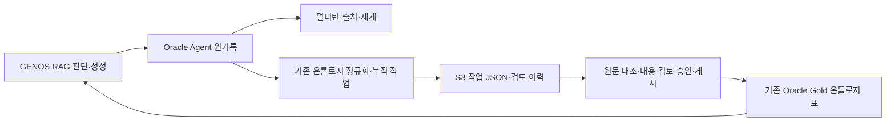

# Oracle Agent 기록 저장 축소안 R2

2026-10-30 · 설계 초안 · 제품 구현/DDL 실행/자료 이관/GENOS 배포 미수행

**후속 로컬 DB 적용:** 이 문서와 R2 Excel은 적용 전 설계 이력이다. 이후 사용자 지시로 기존 로컬 SIDDA에 신규3표를 생성하고 실제 DB검사19개를 통과했다. [실제 생성 명세 R3](../ORACLE_AGENT_RECORD_LOCAL_APPLIED_20261030_R3/README.txt)와 [적용·검증 결과](../../../../09_ARTIFACTS/AUDITS/20261030-agent-record-oracle-r2/적용과_검증결과.txt)를 확인한다. 적용 시점 선택은 MAIN125였으며 RAG 저장 consumer의 Oracle 연결·기존 이관·NFS 제거는 아직이다.

## 결정할 내용

사용자 요청은 RAG의 질문·답변·판단·정정을 Oracle Agent 레이어에 보존하고, 같은 원기록을 멀티턴과 온톨로지 축적에 사용하는 것이다. SQLite/NFS를 운영 정본으로 유지하는 것은 이 목표의 완료 상태가 아니다. 로컬 개발용 SQLite는 별도 어댑터로 유지한다.

**제안은 신규 Agent 3테이블·21컬럼 + 기존 상태 1테이블·5컬럼 재사용이다. Gold는 기존 13테이블·60컬럼을 유지하며 이번 DDL 추가·수정은 0이다.**

| 위치 | 역할 | 신규 컬럼 수 |
|---|---|---:|
| `LGL_AGT_RUN_A` | 실행·요청·부모자식·복구 대상의 작은 색인 | 9 |
| `LGL_AGT_REC_A` | 세션·사건·판단·근거·호출·관계·검색 투영의 공통 기록 | 8 |
| `LGL_AGT_BODY_A` | 원기록·모델 입출력의 무손실 본문 조각 | 4 |
| 기존 `LGL_EXEC_ST_A` | 현재 상태·요청 멱등·누적 예산·소유권·head의 작은 CAS 객체 | 추가 0, 기존 5 유지 |

물리명·논리명·타입은 **등록 전 후보**다. 개발계 Agent owner는 기존 지정 `SIDDA`를 참고하지만, 실제 실행 대상·권한·표 생성 여부를 이 문서가 확인한 것은 아니다. DDL은 `__AGENT_OWNER__` 자리표시자를 유지한다.

R1의 신규 7표·85컬럼에서 세션/사건/판단/연결/호출 표를 공통 기록으로 묶었다. 이는 **등록 구조를 줄이는 선택**이며 원래 기록을 삭제하거나 코드 변경량·SQL 왕복이 같은 비율로 줄어든다는 주장이 아니다. 일반 인덱스는 7개와 신규 PK 3개를 제안하며 실제 실행 계획을 보고 확정한다. 3표가 수학적으로 가능한 절대 최소라는 주장도 아니다.

2표로 더 합치는 방법은 실행 목록·복구 색인까지 공통 기록의 종류별 투영으로 옮기는 것이다. 가능성은 있으나 실행/요청/세션/부모/상태의 서로 다른 조회를 표현하는 투영 행·코드가 더 늘어난다. 현재는 작은 실행 색인을 따로 남기는 3표안을 권한다. 긴 본문까지 같은 행에 합치는 것은 목록 조회·빈번한 상태 변경과 큰 CLOB를 다시 결합하므로 채택하지 않는다.

## 현재 코드에서 확인한 범위

- 선택 포인터: **MAIN124 / judgment-gold-20261030-r1**. 작업 코드와 선택 코드에 함께 존재하는 조사 대상 파일은 채집 시 동일했다. 실제 실행 중 프로세스 및 GENOS 리비전 확인은 별도다.
- 선택 `PIPELINE.json`은 `shortcut_v4.features.capture=true`, `workflows.enabled=true`다. `unified_runtime.open_cases()`는 feature/state/source-mode에 따라 v3 또는 v4로 분기한다. `cases-v3.sqlite`만 이전 대상으로 삼으면 부족하다.
- `WorkRepository`는 파일 경로·SQLite 연결·PRAGMA와 SQL을 직접 사용한다. `journal-v6.sql`에 31개 표 정의가 있다.
- `case_repository`, `shortcut_repository`, workflow 부모/자식, publication, 진행 표시·요청 보고서, 출처 조회에 파일 경로·SQLite 직접 접근이 퍼져 있다. 저장 factory 하나의 연결 문자열 교체로 끝나지 않는다.
- 온톨로지 `export-journal`은 아직 SQLite를 열어 event seq 이후의 원기록을 수집한다. Oracle 온톨로지 게시와 이 입력 소비자의 Oracle 전환은 별개의 작업이다.
- 기존 Oracle `State.put()`은 단건 객체별 조회→쓰기/commit→재조회다. 이 메서드를 작은 기록마다 반복 호출하는 방식은 새 설계의 transaction이 아니다.

`source_inventory.json`은 18개 원장 정의 파일군에서 추출한 **141개 표 정의 항목·832개 컬럼 항목**을 담는다. 동명 표를 파일군별로 구별하고 같은 파일의 동일 선언 중복은 제외했다. 현재 경로·조건부 경로·AD·구버전/배치 경로를 표시했다. 실제 운영 DB의 141개 표가 확인됐다는 뜻도, 저장소 전체의 모든 SQL을 완전 분석했다는 뜻도 아니다. 코드 변경 지도는 직접 연결 경계 34파일이며 전체 영향 파일 수의 확정치가 아니다.

## 기존 방식 → 수정 방식

| 같은 상황 | 현재 방식·확인된 사실 | 수정 방식 | 원하는 결과·검증 |
|---|---|---|---|
| 새 질의·조사 | 실행별 `journal.sqlite` 생성, 사건/근거/호출을 저장 | Agent의 RUN/REC/BODY 및 STATE를 함께 사용 | Oracle에 확정한 같은 요청을 재조회; 원문·입출력·hash 동일 |
| 대화 정정 | case/shortcut SQLite에 과거 node·event와 현재 head | 과거는 REC 불변판본, 현재는 CAS+판본0 투영 | 수정 전 판단·사용자 지시·수정 결과를 모두 조회 |
| 출처 버튼 | `app.py`가 run ID로 journal 파일 glob | 권한 있는 run→발행 record→근거/span 참조 | 파일 없이 같은 인용문 표시, 현재 문서 권한·판본 재검증 |
| 중단·재개 | 파일 잠금, 경로와 누적 budget 연결 | DB 소유권 토큰·fence와 요청/부모자식 예산 transaction | stale 소유자는 쓰지 못하고 새 run으로 예산을 초기화하지 않음 |
| 답변 준비 후 중단 | DB outbox 후 fsync/link 파일 발행, 폴더 복구 순회 | 동일 결과의 Oracle outbox·발행 영수증, indexed pending 조회 | 새 모델 호출 없이 확정 결과만 멱등 발행 |
| 온톨로지 수집 | SQLite event를 seq 순서로 읽음 | 동일 계약의 Oracle events_after | 정정·철회·실패를 포함해 증분 수집; 최신 head만 수집하지 않음 |
| NFS 속도/장애 | 의존 코드는 확인; 현장 지연·손상 발생은 이번에 미관측 | Agent 저장·조회 전환 뒤 NFS mount 요구 제거 | 동일 요청의 실제 왕복·바이트·commit/lock 시간을 측정 |

목표 열은 아직 구현하거나 실행한 결과가 아니다. 저장소 변경으로 모델의 법률 판단 정확성·기존 UNKNOWN 문제가 해결됐다고 간주하지 않는다.

## 세 표의 컬럼과 공통 계약

### 실행 색인 — 9컬럼

`SCOPE_HASH_VAL`, `RUN_KEY_HASH_VAL`, `SESS_KEY_HASH_VAL`, `REQ_KEY_HASH_VAL`, `PRNT_RUN_KEY_HASH_VAL`, `ST_CD`, `STRT_DTTM`, `CHG_DTTM`, `BODY_HASH_VAL`.

실행별로 필요한 목록·요청·부모자식·미완료 조회만 컬럼에 둔다. 최초 요청, 원 run/query/request ID, 실행 종류, 원 binding, 원 schema와 이관 출처는 본문에 보존한다. 단계·마감·누적 예산·상태 변경순번·결과 포인터는 기존 STATE와 판본 기록에 둔다.

같은 request에 과거 run이 여러 개 있을 수 있으므로 `REQ_KEY_HASH_VAL`에는 단독 UNIQUE를 두지 않는다. **요청의 단일 소유권과 재조회 응답은 STATE의 request key CAS가 담당**한다. 부모 실행과 자식 실행을 독립된 새 요청 예산으로 취급하지 않는다.

### 공통 기록 — 8컬럼

`SCOPE_HASH_VAL`, `OWNER_KEY_HASH_VAL`, `REC_KIND_CD`, `REC_KEY_HASH_VAL`, `REC_REV_NO`, `ORD_SEQ_NO`, `LOOKUP_HASH_VAL`, `BODY_HASH_VAL`.

- `REC_KIND_CD`는 종류별 schema/reader/writer/index 정책을 가진 **명시 registry**에서만 허용한다. 모든 데이터를 자유 JSON으로 받아 의미 검증을 없애는 표가 아니다.
- `REC_KEY_HASH_VAL`은 원 저장소 ID·원 표·정규화된 원 PK tuple의 결속키다. 원 식별자와 PK 값은 본문에도 보존한다. 원 ID를 hash로 바꿨다는 이유로 원 binding/hash를 재계산해 덮지 않는다.
- **`REC_REV_NO>=1`은 불변 보존판본**이다. 기존 표의 원 version/revision과 별도이며 원 version은 본문에 남는다. 수정·정정은 새 보존판본과 사건을 추가한다.
- **`REC_REV_NO=0`은 현재/검색 투영**이다. 같은 transaction에서 확정한 보존판본을 가리키며 재생성할 수 있다. 갱신·삭제 가능한 것은 이 투영뿐이며 보존판본 삭제와 구분한다. Oracle 구현에서 보존판본 변경 거부 경계를 검증해야 한다.
- `ORD_SEQ_NO`는 종류별 사건 순번/질문 순번/span 순서/대기 우선순위 중 한 가지로 고정한다. 정렬이 없는 종류는 0을 쓴다. 원 NULL이나 원 숫자는 상세에 그대로 보존한다.
- `LOOKUP_HASH_VAL`은 상태·원문 anchor·용어·관계 끝점 등 **등록한 조회 계약**의 키다. 임의 JSON 경로를 전체 CLOB에서 검색하지 않는다.
- 한 원기록에 여러 조회 방식이 필요하면 `IX:*` 종류의 얇은 투영 행을 추가한다. 따라서 컬럼은 줄어들지만 행과 인덱스 유지 비용이 늘 수 있다.

| 기록 종류 예시 | 보존할 원본 | 조회 방법 |
|---|---|---|
| SESSION / GOAL / INTAKE / BRANCH | 사용자·팀·세션·질문·사건 분기 | 소유 범위+종류+현재판본, 사용자/팀 IX, 질문 ordinal |
| EVENT | 원 사건 ID/seq/kind/판단·정정·철회·사유 | 소유키+고정 EVENT+보존판본1+seq 이후 페이지. 원 kind별 조회는 IX:EVENT_KIND |
| ENTITY / CASE_NODE / HEAD | 판단 상세·원 판본·현재 head 참조 | 원 PK 키의 정확 조회, 현재 투영 |
| EVIDENCE / SPAN / VIEW / PRESENTATION | 확보 원문·좌표·판본·hash·실제 전달 증거 | 근거 키·원문 IX·SPAN_OF/VIEW 관계 투영 |
| CALL / WORKFLOW_CALL | 논리호출·시도·PREPARED/SENT/UNKNOWN 등·입출력·사용량 | 원 호출 키, 현재판본의 상태 조회키, 논리호출/시도 IX |
| REF / REF_OUT / REF_IN | 양끝점 owner/종류/ID/판본·관계·순서·원 근거 | 정방향/역방향 조회키; 같은 본문 참조 |
| CHECKPOINT / BUDGET / OUTBOX / PUBLICATION | 단계·마감·사용량·준비/발행 상태·결과 hash | STATE의 현재 포인터와 종류별 현재 투영 |
| DIAGNOSTIC / REPORT / RECEIPT | 실패·부분 결과·정확 모델 wire 및 감사 | 요청/run·종류·순번. 큰 본문은 필요 시만 읽기 |

이 표는 registry 설계 예다. `existing_column_mapping.csv`는 원 컬럼별 보존/투영 위치를 제공하지만 **실행 가능한 완성 이관 변환기나 모든 SQL 조회의 동등성 증명은 아니다.** 구현 단계에서 각 종류의 INSERT/UPDATE/조회/삭제·현재 투영을 명시해야 한다.

사건 종류마다 REC_KIND를 나누면 전체 사건을 원래 seq 순서로 읽을 때 여러 종류를 합쳐 정렬해야 한다. 그래서 원장 사건은 `EVENT` 한 종류·보존판본1에 두고 원 event kind를 본문과 `IX:EVENT_KIND`에 보존한다. 새 사건 순번은 소유 원장별 STATE cursor와 같은 transaction에서 할당하며, 원 event seq는 별도 원값으로 유지한다. 기존 원장 단위에 해당하는 소유키를 사용해 서로 다른 goal/run의 원 seq를 합쳐 충돌시키지 않는다.

실행 목록·사건 증분·정정 판본·상태별 호출·출처 참조·역참조·본문 조각은 [조회 계약](QUERY_CONTRACTS.md)과 [SELECT 예시](agent_query_review.sql)에 연결했다. SELECT 예시는 실제 adapter나 실행 계획 검증을 대신하지 않는다.

### 본문 조각 — 4컬럼

`SCOPE_HASH_VAL`, `BODY_HASH_VAL`, `PART_SEQ_NO`, `PART_JSON_CN`.

본문은 정확한 UTF-8/바이너리 바이트를 hash하고, transport가 처리할 수 있는 범위로 분할한다. 데이터 조각의 JSON에 `format`, `codec`, `raw_bytes`, `raw_sha256`, `stored_sha256`, `data_base64`를 둔다. 압축은 `RAW_BASE64` 또는 `ZLIB_BASE64`이며 무손실이다. 같은 권한 영역의 같은 원 바이트만 공유한다. 원문 corpus 전체를 서빙에 캐시하는 기능이 아니다.

`PART_SEQ_NO=0`의 JSON은 전체 `body_sha256`, `total_bytes`, `part_count`, `layout_version`을 담는 완성 manifest다. 데이터 조각은 1..N이다. **조각 쓰기→복원/hash/개수 대조→manifest를 마지막에 확정→업무 기록에서 참조** 순서를 지킨다. 중간 실패는 참조되지 않은 불완전 조각이며 성공 본문으로 노출하지 않는다. 원본 파일 보관·미사용 조각 정리는 별도 보유 정책으로 정하고 이 작업에서 삭제하지 않는다.

동일 scope/body hash에는 한 가지 불변 배치 계약을 사용한다. 조각 크기·codec/layout을 도입 전에 동결하고, 동시 등록자는 이미 완성된 manifest와 정확 바이트를 검증해 재사용한다. 같은 hash로 조각 배치를 바꾸거나 기존 조각을 덮지 않는다. 불완전 조각의 재개도 같은 배치 계약과 원 바이트 대조가 필요하다.

조회는 작은 manifest와 필요한 조각의 순서 있는 묶음 읽기다. 매번 모든 모델 입출력을 복원하지 않는다. 동일 본문을 승인된 한 요청 안에서 잠시 재사용할 수 있지만 서빙 디스크/요청 간 corpus 캐시는 추가하지 않는다.

초기 검토용 조각 크기는 복원 바이트 **64KiB**다(목표/가정). 실제 ORDS 필드·본문 한도 및 driver 지원을 측정해 동결하며 기존 모델 출력 상한을 새로 만드는 수치가 아니다. 큰 출력은 조각 수를 늘려 보존하고 자동 자르지 않는다. 이 64KiB 단위는 Oracle LOB 저장 블록 크기와 다른 애플리케이션 전송 단위다.

### 기존 STATE 재사용

5컬럼은 그대로 두되 새 이름공간의 `a1:req:<hash>`, `a1:head:<hash>`, `a1:lease:<hash>`, `a1:budget:<hash>`, `a1:cursor:<hash>`와 같이 128자 이내 키를 사용한다. 기존 scope/key/revision/value hash 계약을 유지한다. legacy row와 새 scope의 의미를 자동 혼합하지 않는다.

큰 대화·원문·모델 입출력을 STATE에 넣지 않는다. 요청 멱등은 원 입력·principal·binding을 비교하고 같은 ID의 다른 입력은 충돌이다. scope hash는 안정적인 인증 namespace이며 문서 ACL snapshot/hash는 본문·binding으로 별도 검증한다. 문서 개정 때문에 새 scope로 갈라져 중복 요청 검사가 사라지지 않도록 한다.

## 온톨로지·Gold 경계

로그를 저장한 것과 조직의 승인 지식을 게시한 것은 다르다. 원래 판단, 사용자 정정, 수정 결과, 원문 판본·인용 좌표, 실제 확보/전달 영수증, 미확인, 원래 기록에 없는 reason/purpose의 부재를 유지한다. 질문별 사실·결론을 그대로 공통 지식으로 승격하지 않는다. Gold 지식은 기존 원문 판본·위치·개념 중심 모델을 유지한다.

**Gold DDL 0은 이번 실행 기록 저장 전환의 범위다.** 기존 `ONTL_POST/HEAD/ANC` 게시·조회와 Gold 매핑은 그대로 둔다. 현재 온톨로지 `WORK/EVT`는 작업·검토 감사용이므로 전체 RAG 원장으로 몰아넣지 않는다.

현재 v4에는 개인 확인 경험뿐 아니라 `common_catalogue` 등 공통 승인 자료도 있다. `sw_knowledge/sw_unit/sw_source`라는 이름만 보고 모두 새 Agent 실행 이력이나 새 Gold 지식으로 분류하지 않는다. 원자료·승인 이력은 이관 시 보존하고, 개인 경험/공통 승인 지식/재생성 색인을 나눈다. 공통 지식을 기존 Gold 게시 형식으로 바꾸는 것은 별도 의미·소비자 적합성 검증 대상이며 본 설계는 자동 변환·승인하지 않는다. **이 활성 기능의 소비자가 미연결이면 NFS 완전 제거를 완료로 표시하지 않는다. 기능을 몰래 끄지도 않는다.** 기존 Gold 표에 수용할 수 있는지 검증 전 등록 구조 확대를 선제 요청하지 않는다.

## 구현 연결과 transaction

제안 이름 `AgentRecordStore`의 `begin_request`, `events_after`, `records`, `put_transition`, `prepare_call`, `finish_call`, `prepare_publication`, `recover_pending`은 아직 구현되지 않았다. 기존 로컬 SQLite 저장소와 Oracle 저장소를 같은 의미 계약으로 연결한다. 범용 SQL 문자열 치환기는 만들지 않는다. SQLite의 PRAGMA·trigger·JSON 함수·rowid·ON CONFLICT를 Oracle 호환 문자열로만 바꾸면 기존 원자성/불변성 계약이 보존되지 않는다.

Oracle 경로는 유지보수 코드가 소유한 한 operation의 PL/SQL/transaction으로 관련 기록과 STATE를 처리한다. 기존 `State.put()`이 각자 commit하므로 이를 여러 번 호출해 원자적 저장으로 취급하지 않는다. 기존 ORDS 전송을 확장하되 임의 사용자/모델 SQL을 허용하지 않는다. 직접 DB-API 연결 가능 여부는 현장 확인 대상으로 남기고 이미 가능하다고 가정하지 않는다.

순서는 다음과 같다.

1. 인증된 주체·원문 scope·원 request/binding을 확인하고 필요한 본문 조각을 등록·검증한다.
2. 요청·세션·부모 실행 등 필요한 STATE 행을 정해진 키 순서로 잠근다. expected revision과 소유권 fence를 확인한다. body/record의 새 식별 충돌은 원 바이트/원 PK로 대조한다.
3. **같은 operation ID의 기존 영수증을 잠금 안에서 재확인**한다. 동일 완료 요청은 기존 결과를 반환한다. event/call의 업무상 중복은 이 CAS 경계가 담당한다. 일반 인덱스만 있다고 업무 UNIQUE가 생기는 것은 아니다.
4. 불변 REC 판본·사건, 판본0/IX 투영, RUN 상태, STATE 예산/순번/head, operation 영수증을 같은 transaction에 저장한다. 하나라도 실패하면 rollback한다.
5. commit 후 작은 영수증·revision·hash를 반환한다. 응답 유실 시 같은 operation ID를 조회해 조정한다. 모델을 다시 호출해서 저장 불명을 해결하지 않는다.

부모·자식 모델 호출 예약은 같은 transaction에서 누적 예산을 차감한다. LLM 대기 중 DB 행 잠금을 계속 잡지 않는다. lease에는 DB 시각 기반 만료와 소유권 토큰/fence를 두고 모든 상태 변경에서 검사한다. 만료는 소유권 회수 조건일 뿐, `SENT/UNKNOWN` 모델 호출의 재전송 허가가 아니다.

## 주요 실행·실패 시나리오

| 시나리오 | 저장 경계 | 복구 담당·결과 |
|---|---|---|
| 신규 질문 | 요청 멱등+원 입력+run+첫 사건 확정 후 조사 | Agent 저장 adapter가 원장을 시작; 초기 저장 실패면 모델 전송 전 종료 |
| 모델 전송 | PREPARED와 예산 예약 확정→SENT 확정→외부 전송 | 기존 gateway가 전송 담당. SENT 후 전송 전 죽어도 보수적으로 불명; 새 예산으로 재시도 금지 |
| 정상 응답 | 원 응답/영수증 본문 확정 후 상태 전환 | 원 응답 보존과 판단 승인 별도. 실패 제안도 원기록 유지 |
| 응답 후 DB 장애 | 이미 수신한 응답은 메모리에 있으나 영속 확정 불명 | SAVE_UNCONFIRMED/UNKNOWN 경계 유지. 저장된 영수증 재조회. 확정 전 프로세스까지 죽으면 미저장 응답 본문 보존은 보장할 수 없음; 성공 표시/모델 재생성으로 대체하지 않음 |
| 같은 request 재전송 | 입력/principal/binding 같음 | 완료 결과 재조회; 다르면 충돌. 최초 마감/사용량 유지 |
| 동시 정정 | 같은 세션/goal의 expected revision | 한 변경만 commit. 늦은 결과는 원 출력으로 남기고 현재 판단을 덮지 않음 |
| 준비된 답변 뒤 종료 | OUTBOX/정확 결과 hash 저장 | publication 복구가 현재 권한·원문 재검증 후 같은 답변만 발행; 새 모델 0 |
| 권한 축소·원문 개정 | 현재 ACL·원 판본/hash 대조 | 기존 기록 삭제 없이 사용 차단/재검토; 원 hash를 현재값으로 고쳐 통과시키지 않음 |
| 온톨로지 수집 중단 | 마지막 성공 수집 seq·원 event ID | 같은 원사건 중복은 독립 의견으로 세지 않음. 성공 ingest 이후에만 cursor 전진 |
| 큰 본문 업로드 중단 | manifest 없는 부분 조각 | 업무 기록 참조 금지. 같은 hash로 조각 대조·완성; 자동 삭제 없음 |
| NFS 없는 재배포 | Oracle에서 active/pending/committed 원장 조회 | 과거 대화·출처·부모자식·재개·diagnostic API까지 동작해야 전체 전환 완료 |

영속 저장은 무기한 보관을 뜻하지 않는다. 보유·삭제·법적 보관 정책은 현장 기준을 따르며 이번 설계에서 원 기록을 삭제하거나 축약하지 않는다. 기록 DB 장애 때 로컬 파일로 조용히 fallback하지 않는다.

## 기존 기록 이관

1. 실제 활성 설정과 `SHORTCUT_CURRENT` 등 선택 포인터, v1~v6 journal/구 case/현재 v4/AD/워크플로우·파일 산출물을 목록화한다. 아직 이번에는 운영 DB를 열지 않았다.
2. 유지보수 구간에 쓰기를 멈추고 서로 참조하는 DB와 발행 파일의 일관된 백업·원 파일 hash를 남긴다. 완료 이력·구 버전 reader를 보존한다. 실행 중 SQLite 본체만 복사하지 않는다.
3. 기존 무손실 reader로 압축 참조를 복원하고 원 논리 hash를 확인한다. original PK/NULL/Unicode 좌표/원 payload 문자열/실패/철회/판본/권한/원 바인딩을 `legacy_row` 본문과 source receipt로 옮긴다. 새 envelope hash와 원 hash는 별도다.
4. typed 변환기로 Oracle 보존판본과 현재/검색 투영을 생성한다. 경로 참조를 논리 run/store 키로 바꾸되 원 경로는 이관 출처로만 보존한다. 경로 문자열을 근거 권한으로 쓰지 않는다.
5. 건수뿐 아니라 원 값·원 hash·참조 그래프·판본·현재 head·누적 예산·발행 응답·정정 이력을 대조한다. 레코드 자체의 의미를 바꾸거나 실패를 성공으로 정정하지 않는다.
6. 과거 기록 조회와 진행 중 기록 재개를 따로 검사한다. 원 코드/정책 binding이 달라 재개할 수 없는 실행은 원 상태 보존 후 명시적으로 표시한다. 임의 현재 binding으로 재결속하지 않는다.
7. Oracle을 유일한 쓰기 정본으로 선택한다. 이중 쓰기를 임시로 추가하면 split-brain·순서·부분 성공 계약까지 필요하므로 최소안은 유지보수 전환이다.
8. 전환 뒤 Oracle에 새 기록이 생기면 낡은 SQLite로 단순 rollback하지 않는다. 호환되는 이전 코드+Oracle로 롤백하거나, 쓰기 중지 후 새 Oracle 기록의 역이관을 검증해야 한다.

## 성능·작업량·도입 기준

| 수치 ID | 종류 | 값/단위 | 근거·한계 |
|---|---|---|---|
| D01 | 설계 | 신규 3표·21컬럼, 기존 1표·5컬럼 | schema_proposal.json과 Excel/DDL 대조 |
| D02 | 채집 | Gold 13표·60컬럼, 이번 DDL 0 | ACTIVE_MAPPING이 가리킨 JSON 정의. 실제 DB 재조회 아님 |
| D03 | 정적 추출 | 141개 표 정의·832개 컬럼 항목/18파일군 | source_inventory.json; 실제 table count·행수·완전 호출 그래프 아님 |
| D04 | 정적 지도 | 직접 경계 34파일 | code_change_map.csv; 하위 SQL 소비자 전체 파일 수 미산정 |
| P01 | 코드 관측 | 기존 State 정상 단건 갱신 기본 3회 SQL/API 요청 | read→write→read. 큰 CLOB 추가 조회와 이미 완료된 재조정 예외 있음. 현재 NFS 원장 전체의 왕복 측정이 아님 |
| P02 | 가정 | 본문 원 조각 64KiB | 전송 호환 시험에서 조정·동결. 예상 최적값 아님 |
| P03 | 계산식 | `T저장조회 = N왕복×RTT + DB처리 + 전송바이트/대역폭 + 복원/해시 + 잠금대기` | 동시성·server/API 오버헤드를 실제 계측으로 보정. 모델 대기와 분리 |
| P04 | 미확인 | 현재 NFS 대비 지연·p95·처리량·저장량 | 동일 업무 동작과 실제 현장 경로 비교 전 개선율/시간 보장 없음 |
| W01 | 계획 | 아래 6개 작업 묶음 | 인일·완료 날짜는 미산정. 인력 속도·현장 DDL/권한·복잡한 직접 SQL 이행의 실측 없음 |

표 수를 줄이면 REC 현재/IX 행과 본문 manifest를 추가 유지하는 비용이 생긴다. 이 비용이 네트워크 묶음 처리와 본문 중복 제거 이득보다 크면 느려진다. 기록 하나마다 State.put을 반복하거나 큰 JSON을 매번 통째로 재저장하거나 CLOB 전체를 목록에서 스캔하면 악화된다. 반대로 operation 단위 commit, keyset 페이지, 현재 투영, 같은 요청 안의 검증된 본문 재사용으로 왕복/전송을 줄이는 것이 목표다.

Oracle의 transaction은 여러 DML을 원자적으로 묶을 수 있으며, LOB 문서는 적절히 큰 단위 읽기/쓰기로 네트워크·I/O를 줄이는 원칙을 설명한다. 이 기능 설명은 GENOS/ORDS의 실측 성능을 증명하지 않는다. [Oracle transaction](https://docs.oracle.com/en/database/oracle/oracle-database/19/cncpt/transactions.html), [Oracle LOB 성능](https://docs.oracle.com/en/database/oracle/oracle-database/19/adlob/performance-guidelines.html).

| 작업 묶음 | 산출물 | 종료 조건 |
|---|---|---|
| 1. 저장 계약·등록 초안 | 이 R2 Excel/DDL/기존컬럼 대응표 | 현장 owner/쓰기권한/표준용어·타입/본문 전송 방식 확인 후 등록본 확정 |
| 2. Oracle 저장 adapter | typed registry, transaction, CAS/fence, 본문 codec | 원자성·불변판본·동시성·미확정 쓰기·큰 한글 본문 검사 |
| 3. 실행·대화·workflow·v4 연결 | 기존 RAG 의미 계약을 쓰는 저장/조회 consumer | 요청·정정·부모자식·budget·publication이 같은 DB 정본에 연결 |
| 4. 조회·온톨로지·진단 연결 | 출처/진행/과거답변/수집/보고서 저장 포트 | 파일 경로 없이 실제 소비자가 같은 원기록을 읽음 |
| 5. 기존 이관·동등성 검사 | 버전별 변환기, backup/receipt, 실패 보존 | 원값/hash/권한/참조/head/원 예산 대조, 구버전 조회·현재 재개 구분 |
| 6. 실제 연결·승격·현장 도입 | 정확 후보/선택/롤백, GENOS 반입 자료 | NFS 없는 새 시작·재배포·과거조회·오류복구 및 실제 왕복/부하 검증 |

검사 목표는 원문/권한/원 값·hash 손상 0, 같은 request의 중복 전송 방지, stale fence 쓰기 거부, 부분 본문 참조 거부, 발행의 동일 결과 보존이다. 법률적 정답·온톨로지 의미 품질 인증은 별도다. 지연 허용치·시험 동시성·비교 표본은 실제 기준선 확인 후 결과를 보기 전에 동결한다. A/B·replay·성능 비교·MAIN 승격은 저장소 ADR 절차를 따르며 이번 문서 생성은 그 실행이 아니다.

## 산출물·자체 검토·미해결

- [테이블·컬럼·원기록 대응 Excel](Agent_테이블컬럼_및_기록대응_R2.xlsx)
- [구조화 정의](schema_proposal.json), [Agent DDL 검토본](agent_schema_review.sql)
- [기존 표 대응](existing_table_mapping.csv), [기존 컬럼별 보존·투영](existing_column_mapping.csv)
- [코드 변경 지도](code_change_map.csv), [원 정의·현재 선택·해시](source_inventory.json)
- [업무별 조회 계약](QUERY_CONTRACTS.md), [SELECT 검토 예시](agent_query_review.sql)
- [정적 문서 검증 결과](validation.json), [재생성 스크립트](build_design.py)

자체 검토이며 독립 감독 검토는 아니다. 최초 R2 검증에서 SQL 파서는 owner가 붙은 CREATE INDEX 7문장을 generic Command로 처리했다. CREATE TABLE 3개는 Oracle 방언으로 파싱됐고 인덱스는 별도 정의·컬럼 참조 검사로 검증했다. 실제 Oracle 구문/권한/실행 계획 검증으로 확대하지 않는다.

남은 것은 신규 물리명의 표준 등록, 실제 Agent 권한·연결, 모든 종류별 query/쓰기 계약 구현, 저장 규모·전송 한도, 공통 승인 위키의 소비자 연결, 구 버전 변환, 실제 성능/재배포 검증이다. **설계안을 만드는 동안 제품·MAIN 선택·기존 Gold·Oracle DB·GENOS·Git commit/push·메일은 변경하지 않았다.**
