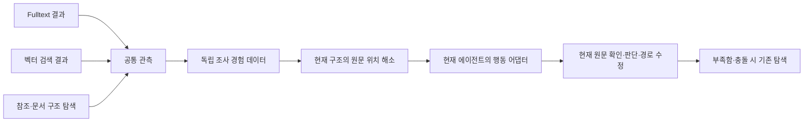

# 도구·에이전트·구조와 분리된 조사 경험 — 2026-09-29

사용자 요구는 경험이 독립 데이터로 남고, RAG 에이전트·검색 방식·문서 구조가 달라져도
현재 환경에서 재사용되는 것이다. Fulltext는 경험을 관측하는 한 경로다.
ADR-0563에 독립 데이터 계약과 어댑터 프로토타입을 추가했다. MAIN·GENOS에는 연결하지 않았다.

후속으로 [조사 개념의 제외 관계와 공통 DB 접근](INVESTIGATION_ONTOLOGY_ACCESS_20260929.md)을
구현했다. PURPOSE EXCLUDES DATA_CLASS 관계를 여섯 합성 접근 어댑터가 공유하며,
독립 구조 매핑과 실제 도구·맥락 인식 배선은 별도로 검증해야 한다.

## 데이터와 실행의 경계

경험은 판단 목적, 확인할 정보, 이탈 조건, 지원 이력 수와 원문 근거 사이의 이동을 보존한다.
특정 검색어·도구 이름·실행 노드 ID·요청 핸들·generation은 경험의 식별자가 아니다.
원래 실행 기록은 감사 근거로 보존하고 과거 답변을 정본으로 승인하지 않는다.

이번 앵커 계약은 논리 문서 식별자, 동결 원문 텍스트 표현본 해시, 문자 범위와
정확한 범위 해시다. 현재 구조 투영은 해당 범위를 현재 노드와 연결하고 원문 일치를 검증한다.
제목 유사도나 옛 노드 ID만으로 대응을 추정하지 않는다. 실제 PDF·OCR·다른 표현본은
원본 및 표현본 계보에 결속된 매핑 어댑터가 필요하다.

## 교체되는 부분

| 변경 | 경험 데이터 | 현재 어댑터의 책임 |
|---|---|---|
| Fulltext → 벡터·참조 탐색 | 원문 앵커와 개념 유지 | 결과를 source_located / evidence_acquired / relation_followed로 정규화 |
| read → fetch_fragment | acquire_evidence 의도 유지 | 현재 도구·인수·핸들로 변환 |
| 노드 재명명·재정렬·세대 변경 | 원문이 같으면 유지 | 새 매핑 검증 |
| 노드 분할 | 원문 범위 유지 | 범위를 덮는 여러 노드로 연결 |
| 노드 병합 | 원문 범위 유지 | 병합 노드에 연결; 이미 읽은 범위는 재안내하지 않음 |
| 원문 개정·표현본 변경 | 목적과 이력 보존 | 자동 재사용 중단, 새 원문 대응 재검증 |
| 매핑 누락·중복·권한 차이 | 보존 | 실행 가능한 shortcut을 내주지 않고 기존 탐색에 반환 |

위치 발견과 실제 읽기는 별도 관측이다. 검색 결과만으로 원문을 읽었다고 기록하지 않는다.
이탈은 요청 안에서만 적용하고 저장 경험을 덮어쓰지 않는다. 공통 모듈은 도구를 실행하지 않으며,
에이전트가 목적을 선택하고 기존 범위·원문 근거 계약으로 행동한다.

## 구현과 확인

- [격리 후보](../../../02_BACKEND/lawrag/research/candidates/adr_0563/portable/revisions/rev-001/snapshot/02_BACKEND/lawrag/core/investigation_memory.py): 도구 중립 데이터, 원문 범위 해소, 관측·행동 능력 계약.
- [연구 소비자](../../../06_TOOLS/EXPERIMENTS/adr_0563/audit.py): hash 동결 후보만 import. 운영 registry/API는 이 후보를 선택하지 않는다.
- [합성 어댑터](../../../06_TOOLS/EXPERIMENTS/adr_0563/fixtures.py): 서로 다른 읽기 도구와 현재 노드 매핑. 완료된 ADR-0562 원문·개념을 검증 후 변환한다.
- [검사](../../../06_TOOLS/EXPERIMENTS/adr_0563/test_contracts.py): 합성 계약 23개 통과. 도구 교체, 구조 교체와 거절 조건을 확인했다.
- 기존 Gemma 통합 결과의 개념 4개·이력 10개를 변환했다. 새 모델 호출은 0회이며 의미 분류·답변 품질 평가는 하지 않았다.
- [결과](../../../04_EXPERIMENTS/ADR/ADR-0563-portable-investigation-memory/artifacts/run-001/result.json), [재사용 데이터](../../../04_EXPERIMENTS/ADR/ADR-0563-portable-investigation-memory/artifacts/run-001/portable-memory.json), [ADR](../../../04_EXPERIMENTS/ADR/ADR-0563-portable-investigation-memory/README.md).

## 실제 파이프라인에 남은 연결

담당 단계는 MAIN의 피드백 루프다. 경험 생성·통합은 기존 요청 원장과 원문 근거를 입력으로 삼고,
새 세대 구축 시 현재 구조 투영을 생성·검증해야 한다. 현재 변환은 합성 원문을 위한 명시 어댑터이며,
실제 전체 ingestion에서 투영을 자동 생성하는 기능은 없다.

서빙 소비자는 공통 관측 어댑터와 원문 회수/탐색 세션이다. 전체 Fulltext 회수 뒤에만 안내를
붙이면 검색 비용은 줄지 않는다. 첫 관측 이후 행동을 정할 때 경험을 사용하고,
해소 실패·정보 부족·예외 시 기존 탐색으로 이어져야 한다. 이 실행 배선과 하네스 조임은 미연결이다.
별도 검색 실행기·nightly 스케줄러·운영 registry·설정은 추가하지 않았다.

이번 확인은 직렬화·매핑·행동 변환의 합성 계약이다. 실제 에이전트 교체·내부 데이터·GENOS,
회수율·법률 정확도·Fulltext 절감·속도·대량 경험 색인 성능을 검증한 결과가 아니다.
호환 계약과 검증된 매핑이 있어야 재사용되며, 임의의 구조 변경을 자동 추론하지 않는다.
롤백은 어댑터를 사용하지 않고 기존 탐색으로 복귀한다. 완료 이력·원문·MAIN 포인터는 보존했다.
