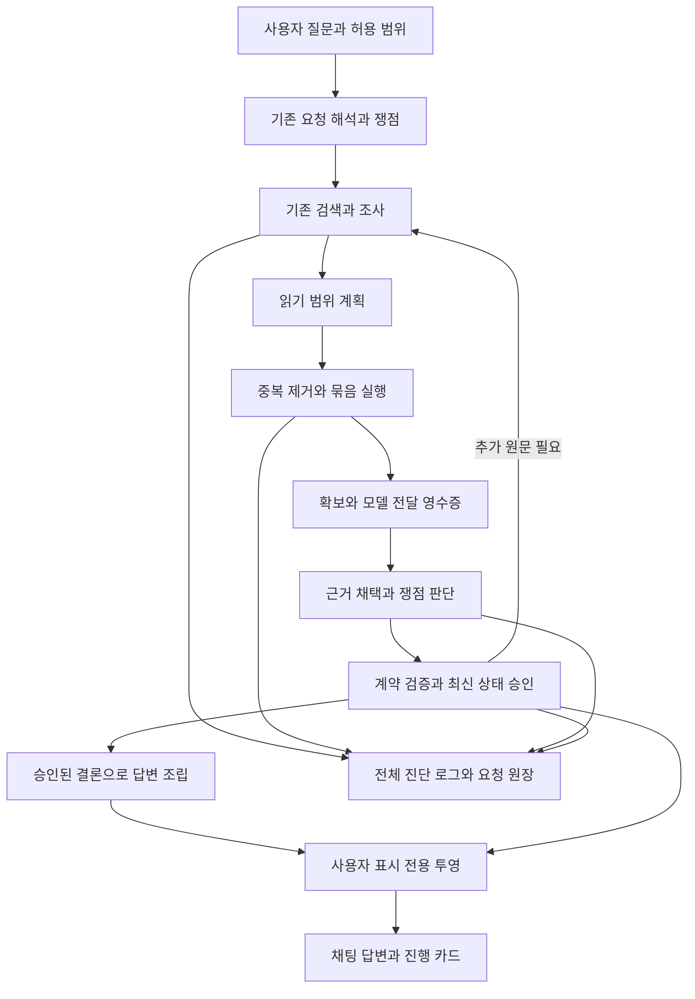

# RAG 판단 일관성과 오류 표시 및 행동 최적화 구현 계획

작성일: 2026-10-08 · 작성 당시 상태: 설계 완료, 구현·신규 실험·MAIN 변경 전

> 구현 결과(2026-10-09): ADR-0693~0702의 선별 구현을 ADR-0703에서 같은 코드로 검증하고 로컬 MAIN47 `structured-judgment-20261009-r1`에 반영했다. 실패0695/0697/0701과 미실행0699는 보존했다. [변경·검증·실제 서비스 선택·롤백](../../../04_EXPERIMENTS/ADR/ADR-0703-exception-coupled-final-holdout/MAIN_RESULT.md). 이하 본문은 작성 당시의 설계 기준이다. GENOS 현장 적용은 별도다.

**오류의 화면 노출을 먼저 막고, 판단 상태를 하나로 맞춘 뒤, 문서 읽기 행동을 별도 개선한다.** 행동 최적화는 독립적으로 효과를 검증하되 기존 RAG 조사 실행기에 연결한다. 새 에이전트나 별도 검색 파이프라인을 추가하지 않는다.

사용자가 원하는 결과는 다음과 같다.

- 오류·거절된 판단·복구 시도·전체 원인은 로그에 남는다. 채팅에는 확인한 답변, 실제 부족한 정보, 필요한 경우 최종 작업 실패 상태만 간단히 표시한다.
- 같은 근거에서 이유 없이 판단을 뒤집거나, 이미 처리한 부족을 반복해서 조사하거나, 일반 규칙 질문에 불필요한 사실 판단을 추가하지 않는다.
- 함께 읽을 수 있는 범위는 묶어서 읽는다. 한 조씩 넘길 때마다 모델에게 다음 행동을 다시 묻는 일을 줄이면서 원문·예외·인용 범위를 보존한다.

## 1. 기준 상태와 적용 범위

이 계획의 기준은 **로컬 MAIN46 `native-cm-serving-20261008-r1`**이다. MAIN 전체는 용어집을 공통 기반으로 한 입력·구조화 → 문서–용어 연결 → 색인 → RAG → 피드백이며, 이번 수정의 주 대상은 RAG의 조사·판단·표시와 요청 기록이다.

| 구분 | 확인한 상태 | 이 계획에서의 처리 |
|---|---|---|
| 선택 코드 | 릴리스 manifest의 272개 파일 해시 일치 | 이 릴리스를 기준으로 필요한 수정만 통합 |
| 선택 원문 | `term-source-8729f978a28924cb8c5b`, 1,546문서 | 동일 세대 고정. 오류 표시·행동 변경 때문에 재구축하지 않음 |
| 색인·저장 | compact-v2, navigation-v7, storage-v4/factorized-v1, 최소 단위 fulltext | 기존 reader·구조 ID·원문 span 사용. 감사 DB를 새 검색 경로로 사용하지 않음 |
| 폴더 연결 | workspace-layout-v2, `20261008-input-exclusions-workspace-r6` 활성 receipt | 논리 root와 실제 실행 세대를 함께 고정 |
| 판단 완료 계약 | 선택 릴리스 v1, 작업 코드 v2, 이전 격리 후보 v3 | 후보 전체 복사 금지. 호환 reader와 필요한 수정별로 대조 |
| 기존 후보 검증 | ADR-0690은 완료 기각, ADR-0691은 미완료 | 성공한 MAIN 기능으로 설명하지 않음. 기존 실행·실패 이력 보존 |
| 로컬 실제 서비스 | 기존 영수증에서 `service.service`의 MAIN46 선택·원문 읽기 확인 | 이 계획의 읽기 전용 검토를 새 서비스 실행·답변 검증으로 세지 않음 |
| GENOS | 현장 코드·편집기·실행 결과 미확인 | 로컬 검증 이후 별도 반입 및 워크플로우 화면 검증 |

최근 구조화는 `pipeline.py build-all`의 native-no-models 경로, 원문 병합은 `document-release prepare`, 색인 연결은 `document-release reindex`를 따른다. 이 상위 단계와 CM 근거 연결을 보존한다. `PIPELINE.json`의 구축 후보 `activated:false`만 보고 실제 MAIN46 선택을 부정하지 않는다. 선택 정본은 ACTIVE 포인터와 그 manifest다.

로컬 외부 모델에 허용된 원문 범위는 기존 서비스 검증 기준 65문서다. 전체 1,546문서나 CM 질문을 외부로 보낼 수 있다는 뜻이 아니다. CM 공통 51문항과 `risk_cm` 등록 질문은 별개이며, 실제 내부 질문의 실행은 GENOS에서 한다.

핵심 지문과 검토 코드의 해시는 [설계 근거 영수증](../../../09_ARTIFACTS/AUDITS/20261008-rag-judgment-action-design/evidence.json)에 고정했다. 검토 방식은 동일 작성자의 자체 검토이며 독립 검토가 아니다.

## 2. 문제별 기존 결과와 수정 목표

| 문제·발생 상황 | 기존 방식과 확인된 결과 | 수정 방식 | 원하는 결과와 검증 |
|---|---|---|---|
| 판단 오류가 채팅에 나옴 | 작업 코드 `render_error()`가 전체 JSON·중첩 원인·traceback을 본문으로 만듦. `full_error` 이벤트는 진행 카드에도 남김. 일부 테스트가 이 동작을 요구함 | 로그용 진단과 사용자용 응답을 생산 단계부터 분리하고 모든 표시 소비자에 같은 정책 적용 | 복구된 오류는 화면에 0건. 긴 오류의 마지막 부분까지 로그에서 확인하고 본문·카드·SSE·캐시 표시에는 없는지 검사 |
| 현재 판단과 앞선 판단이 충돌 | 현재 진행 경로는 모델 출력 제안과 승인된 checkpoint를 모두 다룸. 실제 사용자 화면의 충돌별 원인은 아직 개별 대조 필요 | 현재 판단은 승인된 최신 revision만 표시. 미승인 제안과 거절 이력은 로그에 보존 | 오래된 응답 도착·재시도·복귀 때도 현재 판단 하나가 유지됨 |
| 충분하다고 하면서 핵심 원문이 없다고 함 | ADR-0690 후보 H01에서 `COVERED`와 material gap을 함께 제안. 복구 도중 중단되어 최종 결과는 미확인 | 부족·쟁점 상태·답변 범위를 하나의 승인 계약으로 검사하고 불일치 제안을 게시하지 않음 | 핵심 부족이 있으면 해당 쟁점은 부분 충족/미확인. 사용자 화면에 내부 계약 오류 대신 실제 부족 범위만 표시 |
| 판단 내용 자체가 모순 | 과거 기록에서 선택 요건을 필수 요건으로 바꾼 설명, ADR-0690 H04 후보의 근거 없는 “예외 없이” 일반화가 관측됨 | 동일 결론을 여러 곳에서 다시 생성하지 않고 공통 claim을 참조. 조건·예외가 중요한 결론은 구조를 보존해 조립 | OR/AND, 적용 대상, 예외, 특정 사실의 충족 여부가 서로 다른 문단에서 뒤집히는지 원문 대조 |
| 불필요한 재조사 | 과거 실행에 같은 부족을 낸 뒤 조사 없이 FINISH하는 반복이 있음. 작업 v2와 후보 v3는 일부 복구했으나 MAIN46에는 미선택 | 부족의 식별·실제 조사 결과·새 근거를 연결. 이미 닫힌 부족의 재개에는 새 근거 또는 요청 변경 필요 | 같은 상태의 반복 조사 차단. 새 사실·새 원문이 생긴 정상 재조사는 허용 |
| 조 단위로 잘게 읽음 | 일괄 `READ_ARTICLES`가 이미 있고 targets 상한은 8. 후보 조문 페이지 기본값은 4. 개별 읽기의 내부 반복이 모델 호출 반복인지는 별도 계측 필요 | 모델은 필요한 범위를 선택하고 실행기는 중복 제거·묶음 읽기·허용된 범위 내 페이지 채우기를 담당 | 묶을 수 있는 읽기의 모델 왕복 감소. 읽기 범위·필수 근거·권한·최종 답변이 훼손되지 않는지 함께 검사 |

오류 노출 경로는 코드로 확인했다. 행동이 잘게 나뉘는 빈도와 MAIN46의 의미 오류 발생률은 아직 측정하지 않았다. 과거 MAIN45 기반 후보 결과를 새 세대의 성능 수치로 사용하지 않는다.

## 3. 목표 실행 흐름과 변경 위치

| 실제 변경 지점 | 담당 변경 | 출력 소비자와 호환성 |
|---|---|---|
| `service.py::_local_release/application`, `service/service.py` | 선택 코드·데이터·유효 프로필·표시 정책의 실행 binding 확인 | 기존 로컬 서비스 입구 유지. 작업 디렉터리 import 성공만으로 완료하지 않음 |
| `semantic_runtime/app.py::legal_error_payload`와 예외 handler | 오류를 먼저 로그에 기록하고 사용자 응답에는 허용 필드만 구성 | JSON/API·HTML 화면·각 chat adapter. HTTP 실패 상태와 request ID 보존 |
| `semantic_runtime/progress.py::ProgressCapture`, `_model_io`, `_case_judgment` | 진단과 공개 진행 분리, 승인 전 출력의 현재 판단 표시 차단 | SSE 및 `rag-progress-v1` 소비자. 공개 허용 이벤트만 전달 |
| `semantic_runtime/chat_adapter.py` | 일반 응답·예외 경로에 동일 표시 정책 적용 | 루트 `/chat`의 text·카드·상태. backend는 한 번만 실행 |
| `08_DEPLOYMENT/GENOS/workflow/genos_rag_chat.py` | `render_error`, `render`, `_ChatProgress`, 표시 재사용 경계 수정 | 별도 워크플로우 Python·token·Visible Reasoner·최종 dict |
| `main_workflow.py`, `08_DEPLOYMENT/GENOS/stream_app.py` | JSON/SSE 경로의 공개 투영과 표시 정책 revision 결속 | 기존 독립 SSE 서버와 분리 표시 단계 유지 |
| `legal_agent/completion_contracts.py`, `completion_execution.py` | 쟁점·부족·claim 승인, 공유 결론·조건 구조, 의미 복구 범위 | ASSESS → COMPOSE → 최종 응답·judgment_view. 과거 v1/v2/v3는 원래 계약으로 읽음 |
| `legal_agent/law_navigation.py` | `decision_schema`, 조사 상태 전이, `execute_tool`에 범위 계획과 반복 방지 연결 | 기존 SELECT·READ_ARTICLES·READ_SCOPE·RETURN_TO·부족 재조사 |
| `legal_agent/unit_reading.py`, `evidence_inventory.py`, `investigation_chain.py` | 중복 범위·확보/전달 구분·계획 실행 영수증 | 기존 reader와 원장. 원문 ID·span·자동 채택 금지 유지 |
| `profile-unified-v6.json`, 엔진 pin, `PIPELINE.json` | 후보 정책 명시, 실제 소비 설정·해시 동시 갱신 | 후보만 명시 선택. 운영 기본값 자동 변경 금지 |

위 `semantic_runtime`과 `legal_agent` 경로는 `02_BACKEND/semantic_runtime` 아래다. 구현 시 경로 해석은 `lawrag.platform.workspace`를 사용한다. `run_tool.py`의 receipt에 결속된 실행 경로와 working command 예외를 확인하고, 동결된 GENERATIONS 디렉터리를 직접 수정하지 않는다. 새 root·복제 실행기를 만들 필요가 없다.

## 4. A안 오류는 로그에 보존하고 채팅은 결과만 표시

### A1 표시 계약

내부 예외 객체·원인 체인·모델 입출력·거절 이력은 기존 진단 저장소와 요청 로그가 소유한다. 사용자 응답은 그 객체를 통째로 직렬화하지 않고 별도 허용 필드로 만든다. 문자열 금칙어 제거만으로 해결하지 않는다.

| 상황 | 로그 | 사용자 화면 |
|---|---|---|
| 검증 거절 후 복구 성공 | 첫 제안, 오류, 복구 호출, 승인 결과 모두 보존 | 승인된 진행 상태와 최종 답변만 |
| 내부 재시도·일시적 전송 실패 | 원인·시도·최종 상태 보존 | 원문 확인 등 유효한 진행만. 오류 카드 없음 |
| 일부 근거로 답변 가능 | 실패 원인과 실제 확보·채택 범위 보존 | 확인한 답변 + 빠진 자료·사실의 범위. traceback이나 재시도 설명 없음 |
| 최종 작업 실패 | 전체 원인과 request ID 보존 | “답변을 완료하지 못했습니다.”와 조회 번호. 완료/정상 답변으로 표시하지 않음 |
| 권한 또는 세대 불일치 | 접근 검증 결과와 binding 보존 | 확인 불가 상태. 접근할 수 없는 문서명·본문은 노출하지 않음 |

제안하는 공개 오류 필드는 기존 응답 envelope 안의 `request_id`, `answer_status`, 허용된 사용자 메시지다. 새 진단 endpoint는 만들지 않는다. 기존 운영 진단 기능은 신뢰된 운영 경로에서 로그를 조회하며, 사용자가 보낸 `debug=true`만으로 상세 오류를 반환하지 않는다. 인증 경계가 없는 경로의 기본값은 공개 투영이다.

### A2 빠져나가는 모든 통로를 함께 수정

최종 text뿐 아니라 진행 SSE, token, `agentFlowExecutedData`, `judgment_flow`의 설명, 예외 fallback, 웹 debug 화면, `workflow_display` 재사용을 검사한다. 복구된 오류를 `limitations`나 일반 `reason`으로 옮겨 다시 노출하지 않는다. 사용자에게 유용한 원문 부족과 내부 실행 오류는 생산 단계에서 구분한다.

`workflow_display`에는 **표시 정책 revision**을 추가하고 schema/revision·요청 ID·응답 해시·내용 해시를 함께 검증한다. 과거 전체 오류 표시 캐시는 재사용하지 않는다. 불일치하면 같은 backend 결과의 안전한 필드로 다시 렌더링하며 RAG를 재실행하지 않는다. 과거 최종 답변·원시 기록은 그대로 보존한다.

진행 카드는 정상 활동과 승인된 현재 판단을 유지한다. 모델의 미승인 출력은 로그로 남기고, 카드에 새로운 확정 판단처럼 게시하지 않는다. 답변 token에는 검증된 답변을 보낸다는 기존 워크플로우 방향을 유지한다.

### A3 통과 조건

`test_genos_full_error_log.py`의 “채팅에 traceback이 보여야 한다”는 검사는 새 사용자 요구에 맞춰 교체한다. 로그 완전성 검사는 유지한다. 45,000자 이상 중첩 오류·한글·비밀값·복구 성공·최종 실패를 넣어 **로그의 전체 원인 보존과 공개 채널의 비노출을 동시에** 확인한다. 본문을 비워 테스트를 통과하는 방식은 허용하지 않는다. 성공 답변·인용·카드·실패 상태도 각각 유지되어야 한다.

이 변경 자체는 모델 호출을 추가하지 않는다. 모델 품질 효과를 주장하지 않고 표시 계약과 연결을 검증한다.

## 5. B안 판단 상태와 의미의 충돌을 구분해 수정

### B1 하나의 승인 상태

새 요청의 `request_revision`과 쟁점별 승인 상태를 기준으로 판단한다. 기존 entity version·journal·case stage를 활용하며 별도 판단 DB를 만들지 않는다.

`제안 생성 → 참조·범위·상태 검사 → 승인 revision 저장 → 표시/COMPOSE 소비` 순서를 지킨다. 제안에는 사용한 revision과 근거 fingerprint를 결속한다. 늦게 도착한 옛 응답은 현재 판단을 덮어쓰지 못한다. 상태 변화와 journal 기록은 기존 저장 트랜잭션에 함께 결속한다.

- 핵심 gap이 남은 쟁점은 COVERED가 될 수 없다. 참조 없는 claim으로 충족 상태를 만들 수 없다.
- 일반 규칙 설명과 실제 사건 적용을 구분한다. 일반 규칙 질문에 신청일·회사 상태 같은 불필요한 사실 확인을 추가하지 않는다. 실제 결론을 바꾸는 미제공 사실만 요청한다.
- 같은 요청·근거·부족 처리 상태에서는 같은 판단을 다시 생성하지 않는다. 새 근거, 사용자 정정, 권한/판본 변경, 부족 처리 완료, 최종 예산 종료는 정당한 재판단 사유로 기록한다.
- 조사 종료와 질문 충족을 구분한다. 자료를 찾지 못했거나 예산이 끝났다는 이유로 충족 상태를 높이지 않는다.
- 형식 오류를 복구하는 호출은 기존 제한 안에서 수행한다. 복구만 했는데 원문을 새로 읽었거나 의미 검증이 끝났다고 기록하지 않는다.

### B2 부족별 조사 결과

이전 후보에서 수정한 gap 식별, 복수 쟁점의 claim 참조, gap별 완료 행동·새 근거 연결을 현재 코드에 선별 통합한다.

부족은 쟁점·종류·해결된 문서/판본/범위와 결속한다. 아직 대상이 특정되지 않았으면 이유 fingerprint를 보존해 서로 다른 부족을 빈 문자열 하나로 합치지 않는다. 이후 대상을 찾으면 이전 gap과 연결한다. 문장 표현만 바뀌었는지와 실제 새 부족인지는 구분한다.

`RESOLVED`는 그 부족에 대응하는 새 채택 근거가 있어야 한다. `NOT_AVAILABLE`은 그 대상을 실제로 조사한 결과가 필요하며 다른 문서 검색이나 거절된 행동으로 대신하지 않는다. `NOT_NEEDED`는 왜 요청 밖인지 기록하되, 이것만으로 기존 핵심 부족을 조용히 지우지 않는다. 필요성에 동의하지 못하면 그 부족을 남긴 제한 답변으로 종료한다.

닫힌 부족은 새 원문·사용자 정정·판본 변경이 있을 때 재개할 수 있다. 같은 상태에서는 반복 재개하지 않는다. `RETURN_TO`는 예전 탐색 화면을 다시 여는 행동이며, 이후 승인 판단을 자동으로 과거 값으로 되돌리지 않는다.

### B3 문장 사이의 의미 충돌

상태 계약만으로 법률 의미의 정답을 증명할 수 없다. 현재 ASSESS 프롬프트에도 모순 금지 지시가 있으므로 지시를 한 줄 더 넣는 것으로 완료하지 않는다.

우선 같은 결론을 공통 `claim_id`로 한 번 생성하고 관련 쟁점들이 참조하게 한다. COMPOSE는 승인된 최신 claim만 사용하며 동일 결론을 다른 문단에서 독립적으로 다시 쓰지 않는다. 같은 근거를 여러 쟁점이 공유하는 것은 허용한다.

선택/누적 요건과 예외가 핵심인 경우에는 기존 ASSESS 호출의 출력에 다음 **제안 계약**을 넣는다. 법률 전체의 의미 스키마나 원문 정본을 새로 구축하는 기능은 아니다.

- 규칙의 대상·행위·적용 범위와 결론의 종류: 일반 규칙 설명 / 특정 사건 적용.
- 조건 그룹: `ALL`, `ANY`, `UNKNOWN`; 각 조건의 원문 span 참조와 원문에 있는 예외 참조. 중첩 조건이 필요하면 그룹 간 참조를 허용하고 순환·과도한 깊이를 거절한다.
- 특정 사건 적용은 필요한 사용자 사실의 출처를 별도로 참조한다. 법령 인용으로 사용자의 사실 충족을 증명하지 않는다.
- 조건 구조를 확정할 근거가 없으면 UNKNOWN 또는 미확인 범위를 보존한다. 없는 예외를 새로 만들거나, 예외를 확인하지 않은 상태를 “예외 없음”으로 바꾸지 않는다.

COMPOSE는 구조가 확인된 조건 그룹의 AND/OR 표현을 그대로 조립한다. 구조가 잘못 추출되면 여전히 오답일 수 있으므로 조건 구조는 검증할 모델 관측값이다. 문자열이 비슷한 두 claim을 자동 합치거나 모든 문장 모순을 규칙으로 해결한다고 가정하지 않는다.

새 필드는 strict schema의 required/enum/additionalProperties, 저장 payload, 검증기, renderer, judgment_view까지 함께 설계한다. 기존 v3 후보를 재정의하지 않고 새 완료 계약 버전을 예약한다(명칭 제안: `investigation-completion-v4`). 일반 claim만 있는 과거 계약은 원래 reader로 읽는다. 새 버전으로 과거 기록을 덮어쓰지 않는다.

상시 별도 judge 호출은 추가하지 않는다. 기존 ASSESS와 제한된 repair에서 수정하며, 그래도 의미가 불명확하면 근거가 확인된 범위의 조건부 답변으로 남긴다. 실제 의미 개선 여부는 원문 대조 평가로 별도 판단한다.

## 6. C안 행동 최적화는 독립 과제로 구현

### C1 모델이 정할 것과 실행기가 처리할 것

모델은 **무엇을 확인해야 하는지, 어느 문서·범위가 관련 있는지, 무엇을 근거로 채택할지** 정한다. 실행기는 그 범위를 어떻게 적은 중복과 왕복으로 읽을지 처리한다. 기존 SELECT 안에 작은 범위 계획기를 두고 `READ_ARTICLES`·`READ_SCOPE`·저장 원문 읽기와 연결한다.

같은 법의 여러 조문을 내부적으로 하나씩 읽는 코드는 이미 하나의 모델 결정으로 실행될 수 있다. 개선 목표는 함수 호출 개수를 줄이는 것이 아니라 불필요한 **모델 왕복·중복 I/O·중복 문맥 전달**을 줄이는 것이다.

### C2 범위 계획과 묶음 실행

1. 질문이 명시한 문서·조문은 저장 구조로 바로 찾고, 관련 조문 목록을 함께 제시한다. 관련 범위가 이미 식별되었다면 후보 목록 페이지만 반복해서 넘기지 않는다.
2. 모델이 선택한 목표와 범위를 제안 `read-plan-v1`로 고정한다. 실행기는 권한·판본·원문 세대·현재 판단 revision·예산을 다시 확인한다.
3. 같은 문서 판본의 겹치는 범위는 정확한 span 집합으로 합친다. 떨어진 조문은 묶음 목록으로 유지한다. 중간의 읽지 않은 조문까지 읽었다고 표시하지 않는다.
4. 승인한 유한 범위의 페이지는 남은 전달 예산까지 결정적으로 채운다. 단순 다음 페이지 선택에 추가 의미 판단을 요구하지 않는다. 다음 문서 선택·참조 추적·범위 확대는 다시 조사 판단을 받는다.
5. 실제 다음 모델 입력에 들어간 본문만 전달 완료로 기록한다. 확보·전달·채택은 계속 별도 상태다. 묶어서 읽었다는 이유로 자동 ADOPT하지 않는다.
6. 계획 완료, 예산 도달, 권한/판본 변경, 구조 모호성에서 멈추고 이유와 남은 범위를 저장한다. 단일 모델 입력보다 큰 문서는 예산에 맞게 나누며 무조건 전체 문서를 주입하지 않는다.

예를 들어 같은 문서의 관련 6개 조문을 이미 고른 상황이면, 6번의 다음 행동 결정을 요구하는 대신 하나의 범위 계획으로 읽고 허용 문맥에 함께 전달하는 것이 목표다. **설명용 사례이며 실제 호출 절감 측정값은 아니다.** 긴 조문·다른 판본·권한 밖 자료라면 같은 묶음으로 처리하지 않는다.

작은 문서라도 요청 범위·권한·본문 크기가 확인될 때 전체 읽기를 선택할 수 있게 한다. 정의·예외·별표는 이미 있는 구조와 명시 참조를 이용해 필요한 확장 후보로 제시한다. 인접 조문 전체를 항상 필수 근거로 취급하지 않는다. 검색 후보 순위와 법적 적용 판단도 계속 분리한다.

### C3 계획과 읽기 영수증

| 제안 필드 | 생산자 | 소비자·불변 조건 |
|---|---|---|
| plan ID, request revision, 판단 revision, issue refs | 조사 실행기 | 재시도·복귀·중복 실행 식별. 기존 요청 journal에 기록 |
| generation, document version, scope/권한 fingerprint | 서버의 실제 binding | reader·캐시·재개 시 재검사. 사용자 입력만 신뢰하지 않음 |
| requested ranges | 검증된 모델 선택과 구조 조회 | 선택 범위가 부족하면 별도 계획으로 확장 |
| acquired ranges | 원문 reader | DB에서 확보한 범위. 모델이 읽었다는 의미 아님 |
| delivered ranges와 model attempt ID | 실제 문맥 조립기 | 그 호출에 전달된 범위. 예전에 전달했어도 현재 문맥에서 빠졌으면 필요 시 재전달 |
| adopted evidence refs | 기존 근거 채택 | 실제 전달한 원문 span만 채택. 합친 범위도 원래 출처·인용 ID 보존 |
| completed subactions, remaining ranges, stop reason | 실행기 | 부분 실행 후 중복 없이 재개. 미전송/응답 미확인 모델 호출 상태와 구분 |

원문 캐시는 generation·document version·span·권한 범위에 결속한다. 동일 파일의 읽기 전용 원문은 공유하되 사용자별 허용 여부는 매번 검사한다. 저장 자료가 있다는 이유로 새 요청의 모델 문맥에 이미 전달된 것으로 처리하지 않는다.

현재 READ_ARTICLES 상한 8, 후보 조문 페이지 4, 기본 batch group 12는 서로 다른 한도다. 이 값을 동시에 크게 올리는 방식으로 시작하지 않는다. 먼저 기존 한도 안에서 계획·중복 제거·전달 계측을 넣고, 한도 변경은 별도 후보로 검증한다. 문자 수를 토큰 수로 간주하지 않으며 실제 입력 토큰·응답 예약분과 문맥 한도를 함께 확인한다.

## 7. 실패와 재개 시나리오

| 시나리오 | 실행과 저장 | 답변·표시 및 통과 조건 |
|---|---|---|
| 여러 관련 조문이 같은 문서에 있음 | 한 계획 → 중복 제거 → 확보 → 한도 내 전달 → 채택 → 판단 | 실제 전달 범위와 인용 일치. 다음 페이지를 고르는 불필요한 모델 호출 감소 |
| 일반 규칙 질문인데 실제 사건 사실은 없음 | INTENT의 일반 설명 목적 유지, 규칙과 조건 설명 | 불필요한 사실 요구 없음. 특정 사건에 대한 충족 판단은 만들지 않음 |
| 새 ASSESS가 충분함과 핵심 부족을 함께 제안 | 미승인 기록 후 제한된 repair 또는 제한 답변 | 충돌 제안·검증 오류는 로그만. 화면 상태는 부분/미확인 |
| 대체 요건과 예외가 있는 문장 | 조건 그룹과 span, 공통 claim을 검증 후 조립 | 대체 요건을 전부 필수로 바꾸지 않는지 원문 대조 |
| 자료를 찾지 못하고 같은 gap이 다시 나옴 | gap별 실행 결과와 새 근거 비교 | 진전 없는 재조사 차단. 부재를 실제 법적 예외 없음으로 해석하지 않음 |
| 긴 문서의 중간에서 예산 소진 | 남은 범위를 영수증에 보존하고 부분 종료 | 전체 확인으로 표시하지 않음. 유효한 근거가 있으면 범위를 밝힌 부분 답변 |
| 일부 읽기 후 연결 중단 | 완료된 deterministic 읽기 재사용, 진행 cursor 보존 | 누락·중복 채택 없음. 모델 전송 후 응답 미확인은 완료/미전송으로 추정하지 않음 |
| 동일 요청의 중복 실행·늦은 응답 | request/plan ID와 revision 조건부 갱신 | 두 번 승인·중복 final·옛 판단 덮어쓰기 없음 |
| 후속 질문에서 목적 또는 문서 범위 변경 | 새 request revision, 이력은 단서로만 연결 | 옛 FINISH 재생으로 새 질문을 종료하지 않음 |
| 원문 판본·권한·선택 세대 변경 | 옛 계획/문맥 receipt 재사용 거절, 새 binding 필요 | 구세대 인용과 신세대 결과 혼합 없음. 미허용 자료 노출 없음 |
| 오래된 workflow_display 수신 | 정책 revision와 해시 검증, 같은 결과로 안전하게 재표시 | 오류 로그가 캐시를 통해 다시 노출되지 않음. 모델 재호출 없음 |
| 로그 저장 실패 | 기존 관측 저장소와 stderr의 실패 경로 확인, 보존 실패 자체를 운영 기록 | 로그가 모두 보존됐다고 보고하지 않음. traceback을 채팅에 대체 출력하지 않음 |

## 8. 검증 순서와 측정 기준

### 모델 없이 먼저 검증

A는 긴 오류·복구·예외·SSE·카드·캐시 재사용의 계약 검사로 시작한다. B는 승인 상태, gap 해결 근거, 공유 claim, 과거 계약 reader, 늦은 응답을 합성 원문·가짜 모델로 검사한다. C는 중첩/불연속 span, 큰 조문, 예외 참조, 권한 변경, 문맥에서 빠진 원문 재전달, 중간 재개를 검사한다.

기존 `test_genos_full_error_log.py`, `test_main_workflow_display.py`, `test_genos_answer_stream.py`, `test_standalone_current_judgment.py`, `test_judgment_loop_recovery.py`, `test_completion_boundary_adr0679.py`, `test_investigation_completion_adr0678.py`를 관련 소비자 회귀의 출발점으로 쓴다. 테스트 이름만으로 전체 보장을 주장하지 않고 위 시나리오와 일대일 대응시킨다.

### 실제 모델 비교는 후속 ADR에서 분리

- **A:** 표시 변경의 의미 경로·호출 수 불변을 먼저 확인한다. 배포하려면 필요한 최종 서비스·승격 검증을 별도로 충족한다. 단위 테스트만으로 decision eligibility를 발급하지 않는다.
- **B:** MAIN46을 기준으로 선별 통합한 판단 후보를 같은 원문·모델·프로필에서 비교한다. 과거에 본 실패 사례는 알려진 회귀로 따로 두고 새로운 독립 질문 묶음을 동결한다.
- **C:** 검증 완료된 판단 기준 위에 행동 계획만 변경해 비교한다. 읽기 한도 확대나 검색 정렬 변경은 함께 섞지 않는다. 모델 왕복이 줄어든 이유를 사례별로 확인한다.

실행 전 같은 scope reservation을 확인하고 두 실험 표준을 끝까지 읽은 뒤 stable runner로 새 ADR을 선점한다. 질문·필수 근거·코드/설정/데이터·허용 회귀·호출/지연 예산·arm·run을 결과 전에 고정한다. 대상 공개 문서가 허용 65문서 범위인지, source fingerprint·대상 모델 승인과 일치하는지 확인한다. 외부 호출은 지정 ExperimentClient와 Qwen3.8/Parasail FP8, reasoning none, fallback 없음 정책을 따른다.

ADR-0691은 실제 기록과 예약 상태를 대조해 중단·미완료 사유를 append-only로 정리한다. 옛 기준 MAIN45·옛 데이터·옛 workspace에 고정된 runner를 MAIN46 승격용으로 재사용하지 않는다. 미완료 arm은 부모로 쓰지 않는다. 완료 arm을 조합하면 정확한 부모·채택/제외·충돌·롤백 기준을 새 ADR의 계보에 남긴다. 과거 채점이나 기준을 소급 수정하지 않는다.

의역 여러 개를 독립 사례로 과대 집계하지 않는다. 중단 요청과 응답 미확인 호출은 계획 분모에서 빼거나 성공으로 세지 않는다. 재실행/새 후보/재채점은 새 ADR로 구분한다.

### 수치 원장

| ID | 지표와 분류 | 단위·분모·출처 또는 산식 | 판단 방법 |
|---|---|---|---|
| N01 | 기준 코드 검증, 관측 | 선택 manifest 파일 272개 중 hash 불일치 0개. 이번 읽기 전용 점검 | 코드 선택 근거이며 답변 품질 수치 아님 |
| N02 | 공개 원문 범위, 기존 관측 | MAIN46 실제 서비스 검증 영수증의 65문서 | 후속 실행 때 현재 승인과 재대조 |
| N03 | 읽기 설정, 관측 | READ_ARTICLES targets≤8, 후보 조문 page=4, 초기 batch groups=12 | 서로 다른 설정 상한이며 실제 소비량 아님 |
| N04 | 오류 노출, 목표 | 테스트에 주입한 내부 오류 중 공개 채널에 나온 건수=0; 대응 원인 로그 보존 전수 확인 | 본문·카드·SSE·캐시를 모두 검사. 일반 오류 확률 0을 뜻하지 않음 |
| N05 | 무결성 회귀, 목표 | 동결 검증에서 권한 위반·잘못된 인용 span·해시 불일치·상태 손실·다른 코드 실행=0 | 발생 시 승격 중단 |
| N06 | 판단 반복, 후속 관측 | 유효 trigger 변화 없이 수행된 의미 재판단 수 / 완료 및 실패를 포함한 전체 요청 수 | repair와 의미 재판단을 분리. 현재 기준값 미측정 |
| N07 | 읽기 중복, 후속 관측 | 중복 취득 block 수, 불필요한 중복 전달 문자 수 / 각각 전체 취득 block·전달 문자 수 | 현재 문맥에 없어 필요한 재전달은 별도 표기 |
| N08 | 물리 모델 호출, 후속 관측·계산 | 요청별 전송 시도 수. 절감=기준 시도 수−후보 시도 수; 단계·재시도·응답 미확인 별도 집계 | 논리 읽기 행동 수·DB 질의 수·UI 카드 수로 대신하지 않음 |
| N09 | 비용, 후속 계산 | 각 실제 호출의 입력/출력 토큰×해당 시점 단가와 실제 usage 합산 | 호출 수 절감률을 비용 절감률로 사용하지 않음 |
| N10 | 시간, 후속 관측 | 동일 환경 요청 지연, 초기 준비/warm 상태 분리; 표본과 p50/p95 산출 조건 명시 | 과거 다른 세대의 단일 사례 시간을 재사용하지 않음 |
| N11 | 의미 품질, 후속 관측 | 독립 사례별 정답·부분·오류·미답변, 필수 근거 도달, 후보만 회귀 수 | 세부 의미 오답만으로 자동 승격 차단하지 않음. 유형·영향·후속 조치를 공개 |

현재 근거로 속도·비용 개선률이나 구현 일수를 산정하지 않는다. 넓게 묶어 읽으면 호출 수가 줄어도 전달 토큰·메모리·관련 없는 문맥이 늘 수 있다. 비용상 손익분기는 **줄어든 왕복 비용 = 추가 본문 전달·처리·복구 비용**인 지점이다. 묶음 크기를 늘렸을 때 토큰·근거 누락·지연이 어떻게 바뀌는지 따로 측정한다. 새 상시 judge 비용은 기본 설계에 없다.

## 9. 구현과 MAIN 반영 단계

| 단계 | 산출물 | 종료 조건 |
|---|---|---|
| P0 기준 고정 | MAIN46·작업 코드·v3 후보의 변경 지도, 원문/프로필/표시 정책/검색 정책/폴더 receipt 지문 | 새 구조화·CM 연결·전송 변경을 잃지 않는 파일별 통합 범위 확정. 과거 중단 실행 상태 정리 |
| P1 오류 표시 분리 | 로그/공개 응답 경계, 표시 revision, JSON/SSE/카드/캐시 계약 검사 | 전체 오류 로그 보존 + 공개 채널 비노출 + 정상 답변/실패 상태 유지 |
| P2 판단 통합 | 승인 revision·부족 처리·공유 claim·조건 구조·구버전 reader | 상태·원문·재개 계약 통과 후 새 ADR의 실제 모델 결과 및 의미 오류 기록 |
| P3 행동 최적화 | 기존 조사 실행기의 범위 계획·묶음 읽기·영수증·계측 | B와 분리된 비교에서 실제 왕복/중복 개선을 확인하고 필요한 근거와 무결성 보존 |
| P4 동일 코드 최종 검증 | working→검증 후보→배포 패키지 파일 지문, 실제 entry 연결 기록 | 검증한 byte와 패키지가 일치. 누락 helper·별칭·설정·표시 소비자 없음 |
| P5 로컬 MAIN 반영 | hash 고정 promotion plan, apply receipt, ACTIVE 확인, 새 서비스 binding | 승격 계약 충족 후 명시적 `--confirm-main`; 실제 `service.service`와 선택한 chat/stream 입구 확인 |
| P6 GENOS 반입과 현장 확인 | 코드/설정/의존성·편집기 Python·실행/재개/검증/롤백 안내 | 사용자가 현장에 적용한 리비전 및 워크플로우 테스트 화면의 정상·실패·부분 답변 확인 |

P1은 P2·P3의 효과 측정을 기다리지 않고 먼저 완성한다. 행동 최적화는 별도 후보로 유지하므로 판단 개선만 준비됐을 때 함께 묶어 승격할 필요가 없다. 각 후보가 충족해야 할 실험·승격 기준은 그대로 따른다. 일정은 위 단계의 종료 조건으로 관리하며 근거 없는 날짜·공수는 제시하지 않는다.

로컬 MAIN 승격은 Accepted·out-of-sample·`decision_eligible=true`·complete인 arm과 stable `rag_main_promotion.py` 계약을 따른다. 사용자 지시였던 MAIN46 전환 이력을 새 후보의 검증 우회로 사용하지 않는다. stable `adr_structure.py validate --final` 및 `graph` 검사 결과와 기존 관련 없는 오류를 구분해 남긴다.

이 계획은 원문·용어집·navigation/fulltext 재구축을 요구하지 않는다. 코드·프로필·완료 계약·요청 원장 이벤트·표시 캐시 revision이 주 이행 대상이다. 구현 중 원문 저장 계약을 바꿔야 하는 사유가 생기면 소비자·새 세대·하위 재구축 범위를 별도 설계하고 기존 generation을 수정하지 않는다.

## 10. 주요 위험과 롤백

| 위험 | 탐지 | 대응·잔여 한계 |
|---|---|---|
| 오류를 숨기면서 로그까지 누락 | 긴 오류 끝부분·원인 체인과 request ID 대조 | 공개 투영 이전에 기록. 로그 장애도 별도 운영 실패로 남김 |
| API만 고치고 분리 워크플로우는 옛 표시 사용 | renderer hash·policy revision·실제 편집기 코드 확인 | backend·워크플로우 편집기·SSE를 별도 적용 상태로 관리 |
| 상태 검증을 의미 정답 보장으로 오해 | 원문 대조와 사례별 의미 오류 원장 | 조건 구조도 모델 관측값임을 유지. 상시 judge를 추가해 해결됐다고 간주하지 않음 |
| 묶음 읽기가 범위 과다·중요 근거 누락 유발 | 범위 영수증·필수 근거·토큰·중복 전달 측정 | 범위/전달 한도와 partial 상태 유지. 모델의 의미 선택과 코드 실행을 구분 |
| 재개·캐시가 권한이나 판본을 혼합 | binding·권한·document version 불일치 검사 | 재사용 거절 후 새 계획. 원시 이력 보존 |
| 후보 덮어쓰기로 최근 구조화/전송/CM 연결 소실 | 현재 MAIN·working·후보의 파일별 해시와 소비자 회귀 | 변경 단위 통합. 오래된 install/promotion 스크립트 사용 금지 |

각 후보는 변경 파일·부모 코드·프로필·표시 정책·원장 버전의 rollback receipt를 둔다. 활성화 후 문제면 직전 검증 릴리스의 코드와 동일 데이터 binding으로 돌아간다. 새 버전 요청 기록은 보존하고, 옛 코드로 해석할 수 없는 진행 요청은 완료로 위장하지 않는다. 구버전 reader 지원 범위 밖 요청은 호환 버전으로 재개하거나 새 요청으로 분리한다.

API·워크플로우 표시도 함께 되돌릴 수 있게 버전을 묶는다. 내부 진단을 채팅에 재노출하는 rollback은 피하도록 공개 투영 보호를 별도 호환 경계로 유지한다. 원문·실패 이력·완료 ADR·개인 이력은 삭제하지 않는다. 큰 원시 기록은 무손실 압축·해시·복원 방법을 보존하고 보고서에는 링크만 둔다.

GENOS는 코드 ZIP 적용, Git push, 코드서빙 리비전, 별도 SSE 프로세스, 워크플로우 Python 편집기 반영을 각각 확인한다. 현장 검증은 워크플로우 테스트 화면에서 수행하고 `python3`를 사용한다. 로컬 `.venv/bin/python` 명령이나 직접 코드서빙 테스트 UI를 현장 절차로 안내하지 않는다.

## 11. 설계 자체 검토 결과

판정은 **조건부 구현 가능**이다. 기존 호출 경로와 데이터 계약 위에서 구현할 수 있다. 오류 표시의 수정 지점은 확인됐고, 판단 의미 개선과 행동 최적화의 실제 효과는 후속 구현·실험으로 검증해야 한다. 아래 보완은 설계에 반영한 상태이며 운영 해결을 뜻하지 않는다.

| ID | 심각도 | 발견과 근거 | 설계 보완 | 실제 해결 상태 |
|---|---|---|---|---|
| DR-01 | 높음 | `render_error`와 full_error 카드, 관련 테스트가 전체 오류 노출을 요구 | 로그와 공개 투영 분리, 전 채널·캐시 검사 | 미구현 |
| DR-02 | 높음 | 후보는 옛 기준, 현행 MAIN46은 새 코드·원문·workspace | P0 선별 통합과 실제 선택 해시 검증 필수 | 기준 272파일 확인, 통합 미실행 |
| DR-03 | 높음 | 상태 검증 통과가 OR/AND·예외 의미 정확성을 증명하지 않음 | B1 상태와 B3 의미 검증 분리, 조건 구조의 한계 명시 | 미구현·효과 미측정 |
| DR-04 | 높음 | 일괄 읽기 내부 반복을 모델 호출 횟수로 오인할 위험 | 물리 전송/논리 행동/I/O/화면 계측 분리 | 계측 설계 완료, 기준 측정 전 |
| DR-05 | 중간 | 예전에 전달한 원문도 현재 모델 문맥에는 없을 수 있음 | 전달 receipt를 attempt별로 결속, 필요한 재전달 허용 | 미구현 |
| DR-06 | 중간 | 새 필드를 strict schema나 과거 route에 바로 넣으면 호환 실패 | 새 계약 버전·전체 소비자 변경·구버전 reader·재개 정책 | 미구현 |
| DR-07 | 중간 | 공개 오류 비노출과 실패를 정상 완료로 숨기는 것은 다름 | answer_status/HTTP/조회 번호와 실제 부족 범위 보존 | 미구현 |

수치 판정: N01의 파일 수와 불일치는 이번에 직접 확인했다. N02는 기존 서비스 영수증에 한정된 관측, N03은 설정 상한이다. N04·N05는 목표이며 나머지 개선 값은 미산정이다. 호출·토큰·시간·비용의 단위와 분모를 분리했고, 일반적인 개선률을 계산할 근거는 아직 없다. 외부 성능 레퍼런스를 우리 결과로 전용하지 않았다.

## 근거 파일

- [MAIN 정의와 현재 연결](../../../00_SYSTEM/ARCHITECTURE.md), [파이프라인 선언](../../../00_SYSTEM/PIPELINE.json), [폴더 선택](../../../00_SYSTEM/WORKSPACE.json), [원문·용어 계약](../../../00_SYSTEM/DATA_MODEL.md).
- [활성 포인터](../../../01_DATA/ACTIVE/local/ACTIVE_RELEASE.json), [MAIN46 릴리스](../../../08_DEPLOYMENT/RELEASES/native-cm-serving-20261008-r1/release.json), [기존 실제 서비스 검증](../../../09_ARTIFACTS/AUDITS/20261008-native-cm-serving/active-service-verified.json).
- [기존 판단 문제와 초기 조치](LEGAL_AGENT_JUDGMENT_LOOP_FIX_20261008.md), [ADR-0690 의미 검토](../../../04_EXPERIMENTS/ADR/ADR-0690-judgment-loop-package-holdout/SEMANTIC_REVIEW.md), [ADR-0691 실행 정본](../../../04_EXPERIMENTS/ADR/ADR-0691-judgment-loop-unstarted-holdout/실험/manifest.json).
- [오류·표시 소비자](../../../08_DEPLOYMENT/GENOS/workflow/genos_rag_chat.py), [진행 생산자](../../../02_BACKEND/semantic_runtime/progress.py), [chat adapter](../../../02_BACKEND/semantic_runtime/chat_adapter.py), [오류 표시 기존 테스트](../../../05_TESTS/CONTRACTS/test_genos_full_error_log.py).
- [판단 계약](../../../02_BACKEND/semantic_runtime/legal_agent/completion_contracts.py), [판단 실행](../../../02_BACKEND/semantic_runtime/legal_agent/completion_execution.py), [조사 행동](../../../02_BACKEND/semantic_runtime/legal_agent/law_navigation.py), [원문 읽기](../../../02_BACKEND/semantic_runtime/legal_agent/unit_reading.py).
- [GENOS 적용 경계](../../../GENOS.md), [구현 계획 검토 영수증](../../../09_ARTIFACTS/AUDITS/20261008-rag-judgment-action-design/review.json).
