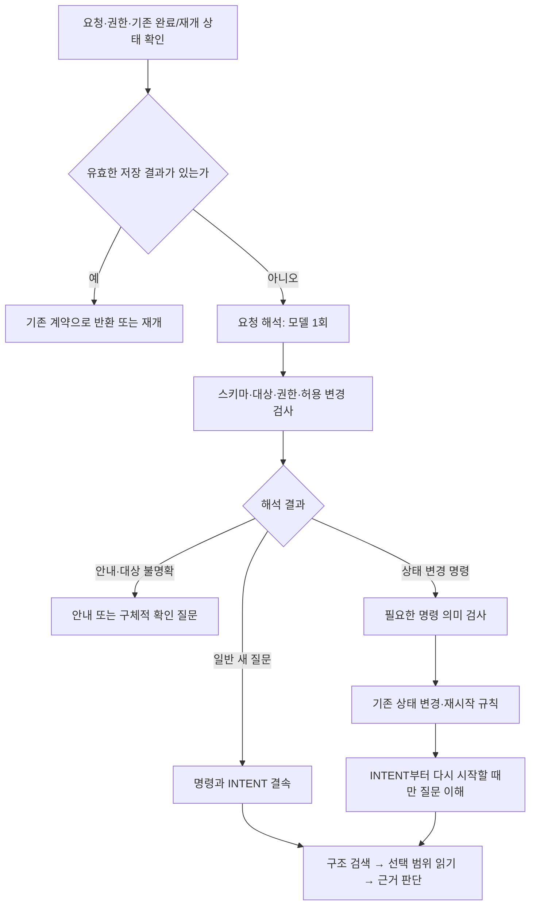

# 요청 해석 통합과 RAG 실행 최적화 설계 — MAIN48 기준

작성일: 2026-10-09. 상태: **설계·백로그만 작성, 신규 모델 호출·제품 구현·MAIN 변경 없음**.

후속 통합 설계: [요청 해석·법령 발견·구조 이동](RAG_REQUEST_ENTRY_SEARCH_ROUTING_DESIGN_20261009.md). CM-018 진단과 사용자 추가 지시에 따라 문서 미식별 시 발견용 fulltext, 문서 선택 후 좌표 직행, 페이지·반복 제어를 통합했다. 아래 관측 당시 기록은 보존하며, 검색 정책·구현 순서·프로필 검증 위치는 후속 문서를 따른다.

일반 새 질문의 **요청 분류 → 세션 해석 → 명령 확인 → 질문 이해**를 **요청 해석 한 번 + 기존 코드 검사**로 합친다. 상태 복원·사실 수정·경험 저장처럼 기존 기록에 영향을 주는 명령은 필요한 추가 검사를 유지한다. 이후에는 기존 구조화 검색과 선택 범위 묶음 읽기를 사용한다. 별도 에이전트·실행기·검색 서비스·DB 세대를 추가하지 않는다.

앞단 네 호출의 통합은 첫 개선이다. 이것만으로 전체 응답 7초를 약속할 수 없다. 호출 밖의 시간과 원문 검토 시간도 구분해 측정한 뒤, 확인된 병목만 후속으로 줄인다.

## 1. 기준과 실제 연결

| 구분 | 확인한 기준 |
|---|---|
| 전체 MAIN | 용어집 → 입력·구조화 → 문서–용어 연결 → 색인 → 용어 기반 RAG → 피드백. 이번 변경 담당은 RAG 요청 진입부와 실행 관측이다. |
| 선택된 로컬 서빙 | [ACTIVE_RELEASE.json](../../../01_DATA/ACTIVE/local/ACTIVE_RELEASE.json): generation **48**, `compact-progress-20261009-r1` |
| 선택 코드 | [release.json](../../../08_DEPLOYMENT/RELEASES/compact-progress-20261009-r1/release.json), SHA-256 `c974d8d433945333730a25770030d3798b3854db2baf3cef3e39bf67bfcd5b96` |
| 검증 후보·작업 코드 | 승격 영수증이 지정한 ADR-0704 `compact-display/rev-006`. 서빙 285파일의 작업·후보·선택 릴리스 해시 일치를 이번에 다시 확인했다. 초기 후보 전체를 가져오지 않는다. |
| 원문·색인 | `term-source-8729f978a28924cb8c5b`, 선택 data manifest SHA-256 `d45898e5e82503d255c1d0626f60091ea1f31993d1b3f2ffb1ae968293953379`. 기존 읽기 전용 세대를 공유한다. |
| 현재 기능 | 구조 우선·범위 내 fulltext·선택 범위 묶음 읽기·판단 승인 경계는 MAIN47에서 연결. 압축 진행 표시·호출별 시간은 MAIN48에서 연결. |
| 서비스 확인 범위 | ADR-0704의 새 WSL 프로세스 `service.service` HEALTH/RAG_SEARCH 선택 영수증을 확인했다. 이번 설계에서는 서비스를 재실행하지 않았다. 상주 프로세스나 GENOS의 현재 상태를 뜻하지 않는다. |

프로필·검색 정책·실제 서비스 binding 전체 지문과 계산의 입력은 [evidence.json](../../../09_ARTIFACTS/AUDITS/20261009-request-entry-optimization-design/evidence.json)에 기록했다. 원문·모델 입출력은 복사하지 않고 기존 결과와 무손실 압축 기록의 경로·해시를 연결했다.

실제 호출 경로는 다음과 같다.

```text
service.service → service.py → /v1/rag/ask
→ app.ask / execute_ask → pipeline.run → coordinator.run_case
→ unified_runtime.open_cases
→ ShortcutCases.execute → CaseRepository / Memory
→ UnifiedRag / WikiExecution → 기존 7단계 → 승인 판단 → 답변·SSE·저장 표시
```

현재 기본 `shortcut_v4.capture=true`에서는 `ShortcutCases`가 실제 소비자이며 `SHORTCUT_CURRENT.json`이 선택한 `cases-v4.sqlite`를 사용한다. capture를 끄면 `CaseRepository`의 v3 경로가 남는다. `PIPELINE.json`의 일부 이전 상태 문구만으로 현재 실행을 판정하면 안 된다. 선택 릴리스·실제 `open_cases` 분기·AD 설정을 함께 확인한다.

## 2. 무엇이 중복되고 무엇은 필요한가

| 문제 | 기존 방식과 확인 결과 | 수정 방식과 확인할 결과 |
|---|---|---|
| 같은 질문을 앞단에서 반복 해석 | `source-request-route`가 분류하고, `memory-resolve`가 명령을 만들고, `memory-command-check`가 의미를 다시 검사한 뒤, `memory-intent`가 쟁점을 만든다. 아래 공개 사례 모두 4회 순차 호출이다. | 새 질문의 분류·명령·쟁점을 한 응답으로 받는다. 첫 응답이 유효한 일반 새 질문에서 앞단 실제 호출 1회를 확인한다. |
| 코드 검사와 모델 검사의 구분 부족 | `normalize`·`admit`은 대상·필드·권한·허용 변경을 검사하지만, 별도 명령 모델은 발화와 명령의 의미 일치를 검사한다. 둘이 동일하지 않다. | 코드 검사는 항상 유지한다. 새 질문에서 별도 의미 검사 생략이 가능한지 평가하고, 상태 변경 명령에는 초기 도입 시 유지한다. 모델의 자기 승인 필드는 만들지 않는다. |
| 상속 경로의 중복 진입 | `ShortcutCases._execute`와 `CaseRepository._execute` 모두 분류 경로를 거친다. 현재는 캐시로 분류 모델 중복 호출을 막지만 context는 다시 구성한다. | 요청별 해석 결과와 권한 확인된 context를 공유한다. 같은 요청·상태 안에서만 재사용하고 기존 재진입에서 추가 호출하지 않는다. |
| 진행 단계가 실제 호출 수처럼 보임 | MAIN48은 이미 진행 카드를 최대 5단계로 압축했다. 표시 축소는 속도 개선이 아니다. | 기존 표시를 유지하고 접힘의 실제 전송 시도 수로 개선을 확인한다. 통합 호출을 네 호출로 가상 기록하지 않는다. |
| 전체 요청의 나머지 지연 원인 미분리 | 과거 3사례에서 모델 전송 시간 합계 밖에 약 24초가 남는다. 이 차이만으로 DB·검색·NFS가 원인이라고 할 수 없다. | 적은 수의 구간 타이머로 준비·상태 처리·검색/읽기·검증/발행을 분리한다. 측정 결과에 따라 후속 변경을 선택한다. |

답변 조립 `COMPOSE`는 이미 코드로 수행하며 추가 모델 호출이 없다. 이를 또 없앤다고 호출 절감에 넣지 않는다. 기존 완료 요청 캐시, 동일 근거의 승인 판단 재사용, 읽기 중복 제거도 새 기능으로 계산하지 않는다.

## 3. 합친 요청 해석의 계약

### 3.1 입력과 출력

새 모듈은 기존 runtime 안의 작은 `request_entry.py`로 제한한다. 호출 이름은 `memory-request-entry`로 두고 현재 모델 gateway·예산·외부 전송 검사를 그대로 사용한다.

입력은 현재 사용자 발화, 접근 가능한 현재 사건·목표의 요약, 명시적으로 지목한 이력과 사실, 허용 명령 목록, 제품의 답변 가능 범위다. 기존 `model_context`가 제거하는 전체 문서 ID 목록을 다시 넣지 않는다. 세션 전체 대화·이전 결론·개인 위키를 무제한 추가하지 않는다. 외부 모델에는 기존 `session_export`와 source export 허용 검사를 먼저 통과한 context만 전달한다.

| 제안 출력 | 계약 |
|---|---|
| `kind` | `CASE / DIRECT / CLARIFY`의 닫힌 분기 |
| `command` | CASE에서만 기존 METHODS 명령 계약. 대상·이력·경험 ID는 서버가 제시한 값만 선택한다. 실제 action·재시작 단계·문서 권한은 코드가 결정한다. |
| `intent` | 초기 도입에서는 `CASE_START`의 목적·개념·쟁점만 기존 INTENT 스키마로 제안한다. 상태 변경·복원 명령은 null로 둔다. |
| `answer` | DIRECT/CLARIFY에서만 짧은 안내. 근거 조사가 필요한 법률 결론을 직접 생성하지 않는다. |
| `reason` | 짧은 처리 이유. 전체 오류나 내부 추론을 공개 표시로 보내지 않는다. |

`verified`, 임의 document IDs, 임의 실행 함수명은 모델의 권한이 아니다. 요청 ID, 원문 해시, 사용자·팀·원래 세션, 목표 revision, 데이터/프로필/코드 binding은 서버가 결과에 결속한다.

### 3.2 처리 순서



`Memory._execute`의 상태 계산을 부작용 없는 `preview_state`로 추출하고 실제 저장도 같은 계산을 사용한다. 모델 호출 전에 상태를 먼저 바꾸지 않는다. 해석 후 `normalize → admit → preview_state`로 유효 질문·변경 사실·재시작 지점을 확정한다. 일반 새 질문의 INTENT는 확정 상태 및 원문 해시에 결속한 뒤 소비한다. 예측 상태와 실제 상태가 다르면 수용하지 않는다.

INTENT 소비는 `CompletionExecution.completion_stage('INTENT')` 안에서 기존 검증·기록 흐름을 따라 수행한다. `UnifiedExecution.stage`의 도메인 선택, 단계 기록, native 참조, `stage_committed`를 생략하지 않는다. **내부의 7개 내구성 단계는 유지하면서 물리 모델 호출만 줄인다.** 승인된 최신 판단을 표시하는 기존 소비자도 유지한다.

### 3.3 요청별 실제 호출 목표

아래는 앞단 호출만 세며, 첫 응답 정상·전송 재시도 없음이 전제다. 원문 조사·답변 판단 호출은 별도다.

| 요청 | 설계의 앞단 호출 수 | 처리 |
|---|---:|---|
| 일반 새 질문 | **1** | 분류+새 사건 명령+쟁점을 한 번에 수용 |
| 인사·제품 안내·대상 확인 질문 | 1 | 통합 해석에서 종료. 인사 뒤 법률 질문이 붙으면 CASE로 진행 |
| 읽기 전용 이력 설명 등 | 1을 목표 | 기존 명령의 범위와 대상을 코드 검사. 애매한 대상은 확인 질문 |
| 사실 수정·복원·경험 확인/재사용·연결 변경 | 통상 2 | 통합 해석+기존 명령 의미 검사. 명시된 변경만 실행 |
| 위 명령 중 INTENT 재시작이 필요한 경우 | 통상 3 | 실제 상태 확정 후 INTENT 추가. 복잡한 복원까지 무조건 1회라고 주장하지 않음 |
| 이미 완료된 동일 요청 | 0 | 기존 request hash·권한·응답 유효성 검사 후 반환 |
| 실패 후 재개 | 저장 상태에 따라 다름 | 승인된 해석·단계를 사용할 수 있으면 앞단 생략. 전송 여부 불명·binding 변경은 별도 처리 |

초기 의미 검사 대상은 `FACT_UPDATE`, `STATE_RESTORE`, `PURPOSE_REVISE`, `EXPERIENCE_CONFIRM`, `EXPERIENCE_REUSE`, `WIKI_RELINK`와 기존 상태에 영향을 주는 재계획·재진입 명령이다. 의미 검사 생략 범위를 늘리는 것은 별도 후속 비교로 결정한다. 새 사람 승인 단계를 추가하는 설계가 아니다.

단순히 네 프롬프트를 이어 붙이지 않는다. 분류·명령·쟁점에 중복된 현재 질문과 공통 규칙을 한 번 제공하고, 불필요한 긴 이유 출력을 줄인다. 다만 필수 입력·사용자 조건을 잘라 토큰 절감을 맞추지 않는다.

## 4. 구조화 검색과 실행 최적화

현재 `law_candidates.structured_discovery`와 `structure_query.resolve`가 문서명·별칭·조문 좌표·목차를 조회하고, 정확히 찾은 원문을 확보한다. `law_navigation`은 구조 우선 정책과 선택 범위 묶음 읽기를 사용한다. 이 경로를 앞단 통합 뒤에도 그대로 연결한다.

1. **인덱스 준비는 데이터 파이프라인에서 한다.** 질문마다 전체 법령을 읽거나 다시 구조화하지 않는다. 선택 세대의 문서·용어·정의·명시 참조 색인을 사용한다.
2. **먼저 문서와 구조 범위를 찾는다.** 입력의 명시 문서·조문은 코드로 해석하고, 의미상 후보 선택이 필요할 때 모델이 판단한다. 존재하지 않는 좌표·동명 문서의 모호함을 전역 본문 검색으로 숨기지 않는다.
3. **fulltext는 구조 탐색 이후 선택한 문서/하위 범위에서 실행한다.** 범위 밖으로 넓힐 필요가 생기면 새 구조 후보 선택을 기록한다. 검색 결과가 적거나 페이지가 끝났다는 이유로 전체 법률을 자동 검색하지 않는다.
4. **모델이 정한 읽기 범위를 코드가 처리한다.** 기존 `READ_ARTICLES`/`READ_SCOPE`와 `unit_reading.acquire_batch`의 중복 제거·페이지 한도·cursor를 사용한다. 같은 범위의 다음 페이지마다 의미 결정을 새로 요구하는 구간이 실제로 남아 있는지 먼저 계측한다.
5. **확보·모델 전달·채택을 구분한다.** 읽은 문서 전체를 자동 근거로 채택하지 않는다. 추가 조사와 종료 판단은 남기고, 같은 근거·같은 부족 상태의 재판단 방지 정책도 유지한다.

첫 후보에서는 검색·ASSESS 프롬프트·범위 정책을 바꾸지 않는다. 앞단 효과를 분리하기 위해서다. 이후 독립 후보에서만 남은 페이지 조정 호출·중복 읽기를 줄인다. 독립 읽기의 동시 실행은 필요성이 측정됐을 때만 검토하고, SQLite 연결 공유·상태 기록 순서를 바꾸지 않는다.

최종 ASSESS와 탐색 종료 결정을 한 번에 합치는 방안은 이번 채택안에 넣지 않는다. 근거 전달 완료와 채택 검증까지 같이 바꾸어 원인 분리가 어렵기 때문이다.

## 5. 변경 파일과 소비자

아래는 **구현 예정 지도**다. 이번에 제품 파일을 변경한 목록이 아니다. `L/`은 `02_BACKEND/semantic_runtime/legal_agent/`를 뜻한다.

| 경로·함수 | 변경과 소비자 |
|---|---|
| `L/request_entry.py` 신규 | 통합 입력·닫힌 출력 스키마·검증 결과. 기존 gateway로 1회 요청하고 별도 실행기는 만들지 않는다. |
| `L/shortcut_cases.py::_execute/resolve` | 실제 v4 진입에서 통합 해석을 요청당 한 번 수행. 기존 `resolved_command`와 분류 캐시에 연결. 사건 재배정·원래 세션·branch·revision 검사 유지. |
| `L/case_repository.py::direct_request/resolve/_execute` | 통합 분류/명령을 소비해 상속 경로의 중복 모델 호출 방지. 외부 전송 전 세션 검사와 완료·실패 재개 경계 유지. |
| `L/corrected_memory.py::resolve/_execute` | `preview_state`를 추출해 계획과 저장이 같은 로직 사용. `normalize/admit`는 재사용. 통합 해석의 조건부 명령 검사와 기존 repair 예산 연결. |
| `L/completion_execution.py::completion_stage` | 수용된 새 질문 INTENT를 같은 단계에서 검사·기록. 그 결과가 없으면 기존 INTENT 수행. COMPOSE의 코드 조립 유지. |
| `L/unified_rag.py` | 새 파일을 수동 코드 지문 목록에 포함. accepted entry 전달과 상태 binding 검증. 단계 기록·승인 순서 유지. |
| `L/wiki_execution.py`, `L/procedure_memory.py` | 새 호출 계약을 기존 command/intent replay와 섞지 않음. `core_evidence_route`와 학습/힌트 기능의 실제 분기를 모두 검사. |
| `L/domain.py::profile`, `00_SYSTEM/LEGAL_AGENT/profile-unified-v6.json` | 단일 정책 필드 `request_entry_policy: legacy / fused-v1` 제안. 기존 프로필은 legacy 기본. 문자열 enum은 현재 정수 제한 검사와 분리해 검증. |
| `02_BACKEND/semantic_runtime/execution_metrics.py`, `request_report.py` | 새 호출을 요청 해석으로 표시. 실제 transport 횟수·개별 시간 유지. 추가 구간 계측은 총계만 저장하고 진행 카드를 늘리지 않음. |
| `00_SYSTEM/PIPELINE.json`, `02_BACKEND/ENGINES/legal_agent/6.0.0/*.json` 및 영향받는 엔진 manifest | 선택 프로필·파일 목록·코드 해시를 기존 재해시 경로로 갱신. 파일을 만들기만 하고 릴리스에 빠뜨리지 않음. |

설정은 요청 시작 때 한 번 고정하고 receipt에 남긴다. 초기 적용 범위는 실제 v6/v4 `ShortcutCases` 경로다. `capture=false`의 v3 경로는 legacy 정책을 명시적으로 선택·기록하고, 최적화됐다고 표시하지 않는다. 이 제한은 성능 보고의 분모에도 반영한다. 이후 v3까지 넓히려면 해당 저장·재개 계약을 별도로 검증한다.

원문·용어 스키마 및 SourceSet은 바꾸지 않으므로 RAW 재반입·원문 전체 재구축은 필요하지 않다. DB 테이블·`user_version` 변경도 초기 설계에는 없다. 기존 `sw_event`에 새 종류의 불변 이벤트를 기록하는 방식으로 검토하며, 구 버전 reader가 알 수 없는 종류를 처리하는 계약을 롤백 검사에 포함한다. 실행 경로·산출물 경로는 `lawrag.platform.workspace`와 기존 runtime 선택자를 사용한다.

## 6. 실패·재개·동시 요청

통합 응답은 실행 명령 자체가 아니라 **검사 전 제안**이다. 다음 처리를 기존 request·case·native journal에 연결한다.

| 상황 | 처리 |
|---|---|
| 잘못된 JSON·불가능한 명령·명령과 intent 불일치 | 변경을 저장하지 않고 기존 공통 예산 안에서 의미/스키마 수정 최대 1회. 통합 실패 뒤 옛 4호출을 숨겨서 다시 실행하지 않음. 최종 실패는 안내·조회 번호, 전체 거절은 로그. |
| 모호한 목표·복원 시점 | 마지막 사건/시점을 추측해 변경하지 않고 구체적 확인 질문. 조문 번호와 과거 질문 순서를 혼동하지 않는 fixture 포함. |
| 전송 재시도 | 기존 transport 정책과 실제 시도 수 기록을 유지. 요청 전체를 맹목적으로 재실행하지 않음. 응답 불명은 재개 기록과 공급자 지원 여부에 따라 처리하며 정확히 한 번의 모델 실행을 보장한다고 쓰지 않음. |
| 해석 후 다른 요청이 상태를 변경 | 수용 전 revision·입력·권한·binding 재확인. 낡은 제안을 새 상태에 적용하지 않음. 충돌은 기존 실패/재개 절차로 반환. |
| 새 질문에 따른 사건 재배정 | 현재 `INTAKE_REASSIGNED` 트랜잭션 보존. 원래 요청의 해석과 서버가 만든 새 사건/목표의 연결을 기록. 자신의 정상 재배정과 외부 동시 변경을 구분. |
| 해석 수용 후 중단 | 수용 payload·해시·정책·context revision·계획 상태·명령 적용 여부를 기존 사건 이벤트에 기록. 같은 요청 및 유효 binding에서만 재사용. |
| 사건 DB 저장 성공, native journal 기록 실패 | 둘의 원자적 저장을 가정하지 않음. 사건 DB의 수용·적용 이벤트를 정본으로 삼아 native 참조를 멱등 연결. 중복 명령 적용 없이 기존 outbox/승인 경로에서 회복. 구현 전 동일 DB 트랜잭션에 포함되는 쓰기 범위도 확인. |
| 권한 축소·세대/코드 변경·old pending 요청 | 재사용 전에 권한·참조·해시 검사. 호환되지 않는 저장 해석은 사용하지 않음. 기존 단계 재개/명시 충돌 규칙 유지; 진행 중 요청을 새 정책으로 무조건 재분류하지 않음. |

`REQUEST_ENTRY_ACCEPTED` 이벤트는 기존 요청/사건 aggregate에서 찾아 전체 이력을 매번 검색하지 않는다. 호출 전후 context는 같은 요청 안에서만 공유하고, 접근 권한은 실행 시점에 다시 검사한다. 구현 시 사건 DB 트랜잭션·재개 지점에 대한 fault injection을 먼저 수행한다.

## 7. 수치 근거와 성능 기대의 한계

자료는 [ADR-0703 structured-reading 결과](../../../04_EXPERIMENTS/ADR/ADR-0703-exception-coupled-final-holdout/artifacts/run-001/structured-reading)의 공개 질문 3건이다. 외부 Qwen3.8/Parasail FP8 호출이며, MAIN48 신규 성능 시험도 GENOS 현장 시험도 아니다. 각 질문은 별도 프로세스에서 실행됐고 앱 준비 시간은 아래 요청 시간 밖에서 따로 측정됐다. 요청 안의 지연 초기화 여부는 아직 분리되지 않았다.

| 사례 | 요청 전체 초 | 앞단 4회 초 | 전체 모델 7회 합계 초 | 차이: 원인 미분리 초 |
|---|---:|---:|---:|---:|
| H01 | 65.586 | 10.077 | 40.938 | 24.648 |
| H02 | 55.896 | 10.442 | 31.354 | 24.542 |
| H03 | 53.408 | 9.315 | 29.480 | 23.928 |

각 요청은 `route → resolve → command-check → intent → navigation 1 → navigation 2 → assess`다. 별도 모델 답변 조립 호출은 없다. 모델 시간은 공급자 왕복·클라이언트 처리 등을 포함한 기록값이며 순수 GPU 시간과 다르다.

| ID | 구분 | 수치·분모·계산 또는 확인 방법 |
|---|---|---|
| O1 | 관측 | 위 3요청 각각 실제 모델 7회, 앞단 4회. 결과 JSON의 `usage`와 원시 압축 기록의 호출 경로 확인. |
| O2 | 관측·합산 | 앞단 9.315~10.442초/요청. 4회 입력 4,144~4,207토큰, 출력 729~773토큰. 입력 토큰 전부를 없앨 수 있는 것은 아님. |
| O3 | 관측·합산 | ASSESS 9.276~20.351초/요청. 앞단 통합이 이 시간을 줄인다고 가정하지 않음. |
| C1 | 계산 시나리오 | 일반 새 질문 앞단 `4→1`, 3회 감소. 같은 후속 경로이면 전체 `7−4+1=4`, 호출 수 42.9% 감소. 시간·토큰·비용 감소율이 아님. |
| C2 | 계산된 상한 시나리오 | 대체 호출 비용을 0으로 두고 나머지가 같아도 요청은 H01 55.509초, H02 45.454초, H03 44.093초. 실제 예측값이 아니라 앞단 제거만의 한계. |
| A1 | 가정 | 통합 응답이 최초 검사에서 수용되고 추가 조사·repair가 늘지 않아야 C1이 성립. 현재 미검증. |
| T1 | 목표 | 대상 일반 새 질문의 정상 경로 앞단 1회. 실제 시도 수·추가 호출 이유를 전부 포함해 확인. |
| U1 | 미확인 | 새 호출 지연·토큰·품질, 전체 p50/p95, warm/cold 차이, 동시 요청 성능, GENOS 내부 모델 효과. |

요청별 산식은 다음과 같다. 첫 정상 비교에서는 baseline에도 repair가 없는 요청끼리 비교하고, 전체 운영 분포에서는 양쪽의 실제 모든 시도를 센다.

```text
T_new = T_old − T_old_front
        + T_entry + T_guard + T_late_intent + T_repair + ΔT_nonmodel

손익분기:
T_entry + T_guard + T_late_intent + T_repair + ΔT_nonmodel < T_old_front
```

일반 새 질문의 정상 경로는 guard·late_intent·repair가 0이다. 반대로 통합 프롬프트가 커지거나 수정 요청이 잦아 새 비용이 기존 약 9~10초를 넘으면 지연 이득이 사라진다. 평균 비교에는 각 추가 호출의 발생 비율도 곱해 반영한다. 공급자 실제 usage/비용 기록으로 비용을 비교하며 호출 수 비율로 요금을 추정하지 않는다. 세 사례로 p95나 일반화된 속도 향상을 주장하지 않는다.

### 적은 로그로 나머지 시간을 찾는 방법

`execution_metrics`의 요청별 호출 기록에 고정된 구간 총계만 더한다: 자원 준비, context/상태, 구조 탐색·원문 읽기, 검증·저장·발행. 중첩 구간의 시간은 단순 합산하지 않고 포함 관계와 실제 model interval을 구분한다. 병렬 실행이 생기면 모델 시간 합계와 wall time이 다르다는 표시를 유지한다.

현재 `query_latency.py`는 DB 상세 로그를 되돌린 no-op 상태다. 과거 SQL별 상세 로깅을 다시 켜지 않는다. 각 페이지·SQL마다 로그와 진행 카드를 만드는 방식도 피한다. 구간 총계는 요청 종료 시 한 번 저장하고, 기존 접힘에는 실제 LLM 횟수·개별 시간·서버 요청 시간을 유지한다.

준비 비용이 크면 먼저 기존 `runtime_cache`의 재사용과 실제 프로세스 생존 여부를 확인한다. 캐시는 데이터·설정 지문으로 묶고 권한별 결과를 혼용하지 않는다. `service._warm_resources`는 현재 GENOS 명시 세대용이므로 로컬 범용 warmup이라고 설명하지 않는다. warmup 확대가 필요하면 같은 자원 준비 함수를 재사용하는 별도 변경으로 검증한다. 미분리 24초를 이유로 무결성 검사·fsync를 없애지 않는다.

## 8. 검증·도입·롤백

실행 순서는 **앞단 통합 → 관측된 나머지 병목 개선 → 필요한 검색 실행 개선 → 최종 동일 코드 승격**이다. 앞단 통합과 단계별 총계 계측은 함께 연결할 수 있지만, 캐시·검색·판단 정책 변경 효과는 별도 arm/후속 ADR로 분리한다.

1. 구현·효과 비교 시작 시 진행 중 reservation을 확인하고 실험 표준에 따라 새 ADR을 먼저 확보한다. 부모는 실제 선택 코드의 완료된 `ADR-0704/compact-display/rev-006`으로 고정한다. 과거 H01~H03은 진단에 이미 사용했으므로 새 미사용 holdout이라고 부르지 않는다.
2. 기존 진입점에서 후보를 격리하고 모델·프로필·코드·데이터·정책·질문·성공 기준을 호출 전에 동결한다. 외부 실험은 `ExperimentClient`의 현행 Qwen3.8 / `qwen/qwen3.8-27b`, Parasail FP8 단독, reasoning none, fallback 없음 정책과 반출 허용 범위를 따른다. 내부 질문은 반출하지 않는다.
3. 우선 계약검사로 정상 1회·상속 중복 호출 0·7단계/참조 보존을 확인한다. 인사+법률 질문, 입력 안내 문구가 인용된 질문, 복수 사건, 과거 시점 복원, 사실 수정, 명시 분류 prefix, 표 출력, 권한 철회, 오래된 revision, 외부 반출 거절, 재시도·중단·재개를 포함한다. `capture` 및 `core_evidence_route`의 실제 조합도 확인한다.
4. 동일 질문·동일 데이터의 baseline/후보를 실행한다. 처음 실행과 준비된 프로세스 실행을 분리하고 순서를 균형화한다. front·전체 실제 호출 수, 입출력 토큰, 실제 비용, 서버 시간, 추가 검사/repair 비율, 필수 근거 도달·주장/인용·조건/예외·요청 보존을 비교한다. 계측 자체의 비용도 확인한다.
5. 일반 새 질문의 정상 앞단 1회와 후속 호출 유지 여부를 별도로 판정한다. 통합으로 전체 시간이 개선되지 않으면 속도 개선으로 채택하지 않는다. 의미 채점의 세부 실패는 별도 기록하지만 인용·권한·해시·상태 보존·실제 연결의 심각한 회귀는 승격을 차단한다. 반복 의미 실패와 허용 회귀의 판정 기준은 결과 전에 동결한다.
6. 필요한 변경만 기존 작업 코드에 선별 통합하고 **그 동일 코드**에서 계약·연결·최종 독립 사례를 확인한다. 필수 233계약 등 기존 MAIN48 검증의 현재 목록을 재확인하고 변경 영역 검사를 추가한다. 이전의 알려진 실패를 지우거나 새 통과 근거로 쓰지 않는다.
7. eligible·complete·Accepted 후보만 기존 `rag_main_promotion.py`의 hash 고정 plan과 `--confirm-main` 절차로 승격한다. 활성 포인터와 새 프로세스의 실제 `service.service`가 선택한 코드·프로필·데이터·검색 정책·새 요청 정책 binding을 남긴다. 실행 중 서비스 재시작 여부도 따로 기록한다.

롤백은 승격 시 기록한 직전 선택 릴리스를 기존 promotion rollback 경로로 복구한다. 새 해석 이벤트는 삭제하지 않는다. 정책은 요청 시작 때 고정하므로 진행 중 요청에서 legacy/fused를 바꿔 이중 적용하지 않는다. 저장된 옛 INTENT는 기존 계약으로 검증하며, 새 해석 receipt와 맞지 않는 캐시는 사용하지 않는다. 작업 코드 되돌림은 후속 수정 여부를 확인한 파일별 백업 영수증으로 별도 수행한다.

GENOS는 코드 ZIP·workflow 편집기·NFS 세대·Git push·코드서빙 리비전·워크플로우 테스트를 별도 상태로 관리한다. 이번 설계만으로 현장 배포를 요청하거나 성공으로 기록하지 않는다. 현장 검증은 기존 지침대로 워크플로우 테스트 화면에서 내부 모델로 수행한다.

## 9. 이번 산출물과 자체 검토

이 문서, 숫자·binding 근거 JSON, BL-009를 작성했다. 기존 제품 코드와 선택 포인터는 변경하지 않았다. 자체 검토에서 실제 `ShortcutCases` 경로, v3 예외, 상태 확정 후 INTENT 의존성, 수동 코드 지문, 반복 진입, 완료/재개, DB 로그 롤백, 실제 서비스 선택까지 대조했다. 독립 검토나 새 성능 검증을 수행한 것은 아니다.

관련 문서: [이전 오류·판단·행동 설계](RAG_JUDGMENT_ERROR_ACTION_DESIGN_20261008.md), [전체 MAIN 아키텍처](../../../00_SYSTEM/ARCHITECTURE.md), [MAIN48 완료 기록](../../../04_EXPERIMENTS/ADR/ADR-0704-compact-progress-call-metrics/MAIN_RESULT.md), [백로그](../../BACKLOG.md).
