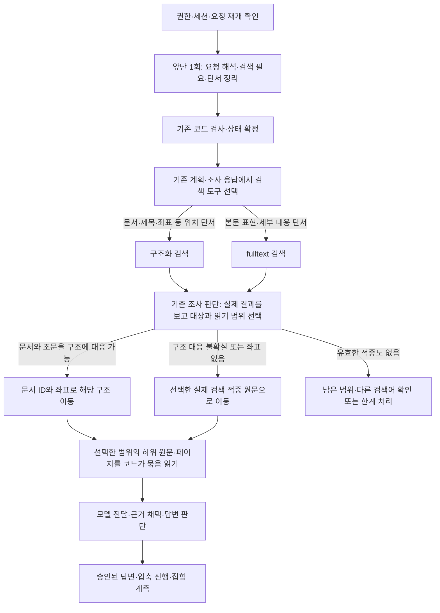

# 요청 해석·법령 발견·구조 이동 통합 설계 — MAIN48

> 2026-10-09 실제 반영: [MAIN49 완료 기록](../../../04_EXPERIMENTS/ADR/ADR-0710-grounded-entry-profile-bound-main/MAIN_RESULT.md). 앞단 통합·실제 제목 힌트·구조/fulltext 선택을 검증 코드와 동일하게 활성화했다. 기본 profile hash 연결도 보완했다. 후보·작업271계약과 공개3문항 양쪽3/3 원문 근거 응답,287파일 및 실제 로컬 서비스 선택 확인. 모델 호출22→12회지만 입력 토큰108,339→144,356·요청 시간169.544→185.976초로 늘었다. 아래의 이전 후보/MAIN48 상태는 당시 기록이다. 이유/행동 불일치·도구 목록 축소·교정 입력 축소와 난이도별 예산은 후속이며 GENOS 적용은 별도다.


작성일·요구 수정일: 2026-10-09. 상태: **ADR-0707 격리 후보에 실제 법령 제목 힌트와 선택형 구조/fulltext 검색을 구현했다. ADR-0708 동일 코드 재검증에서 본문 첫 검색도 확인했지만 이후 반복 검색으로 최종 답변은 실패했다. MAIN48·GENOS는 변경하지 않았다.** ADR-0706의 이전 결과와 구분한다.

**앞단에서 요청·배경·위치/내용 단서를 정리 → 단서에 맞는 검색 도구 실행 → 결과를 보고 대상과 읽기 범위 선택 → 필요한 원문 전체 읽기**로 설계한다. 앞단 1회는 요청 분류·세션 해석·명령 확인·질문 이해를 합친다는 뜻이다. 검색이나 답변 판단까지 한 호출로 끝낸다는 뜻이 아니다. 검색 도구 선택은 기존 검색 계획·조사 응답에 포함하며 별도 분류 모델을 추가하지 않는다.

사용자 정정: **구조화 검색은 대략 어디에 있는지 단서가 있을 때 쓰는 도구이고, fulltext는 본문 속 세부 내용을 찾는 도구다.** 구조 검색을 모든 요청의 필수 선행 단계로 만들거나 fulltext를 구조 검색 실패 뒤에만 허용하지 않는다. 법령·조문·장절·제목 단서가 있으면 구조로 바로 접근할 수 있고, 위치를 모르고 표현·내용을 찾는 요청이면 fulltext로 시작할 수 있다. 이미 얻은 fulltext 적중의 문서·위치 ID는 구조 확장·원문 읽기에 바로 재사용한다. 구조 검색 결과도 목차/좌표일 뿐 원문을 읽었다는 증거가 아니다.

이 문서는 [앞단 통합 설계](RAG_REQUEST_ENTRY_OPTIMIZATION_DESIGN_20261009.md)를 최신 사용자 지시에 맞춰 합친 **현행 통합 설계**다. 이전 문서의 상태·복구 계약은 유지하고 검색 정책은 이 문서가 대체한다. 이전 초안의 “구조·메타데이터 우선 → 부족할 때 fulltext”라는 고정 순서는 철회한다. 현재 MAIN의 구조 우선 구현과 앞으로의 도구 선택 설계는 다르며, 완료된 실험의 기준이나 결과를 소급 변경하지 않는다.

제49조 제1항의 구조 설명은 **그 항의 본문·단서·각 호·목 전체를 읽어 관계를 확인하는 과제**다. 검색 적중 한 문장이나 구조 제목만으로 완료하지 않는다. 긴 경우 같은 선택 범위의 남은 페이지를 코드가 이어 읽고 실제 모델 전달의 완전성을 확인한다. 다른 조문도 요청한 구조·참조 관계를 설명하는 데 필요하면 읽을 수 있다. 업무 배경 자체를 별도의 적용 판단 완료 조건으로 추가하는 것과 구분한다.

## 0. 최신 구현·검증 — 문장과 실제 법령 제목 대조

사용자 문장에 실제 법령명과 맞는 부분이 있는지 **LLM 없이** 확인하고, 그 결과를 기존 통합 해석1회에 전달한다. 최근 원문 세대의 `document.name`은 폴더 경로를 포함하므로 저장된 `document_title`을 사용한다. 권한/요청 범위 밖 문서와 본문이 아닌 첨부 이름은 후보에서 제외한다.

- 정확한 법령 제목 / 등록 약칭 / 제목 일부 일치 / 미등록 약칭의 글자 순서 유사 후보를 구분한다. 문장의 어느 구간과 실제 제목의 어떤 부분이 맞는지 위치와 원문을 제공한다. 유사 후보를 정식 약칭으로 등록하거나 적용 법령으로 확정하지 않는다.
- 최대6개 힌트와 전체/생략 후보 수를 전달한다. 제목 단서가 없으면 빈 목록이며 관련 법률이 없다는 뜻이 아니다. 힌트가 회수·권한 범위를 강제 축소하지 않는다.
- 같은 앞단 응답에서 STRUCTURE/FULLTEXT와 제목 후보를 선택한다. 구조 검색을 선행 의무로 두지 않으며 선택한 문서/하위 범위의 본문 검색도 유지한다. 기존 `structure_first`의 범위 읽기 기능은 유지하고 새 `selectable_search`가 첫 도구/전체 본문 재검색 선택을 연다.
- 원문 요청을 task로 보존하고 배경은 `context_quotes`에 별도 기록한다. 새 의미 검증 모델 호출은 추가하지 않는다. 인용/권한/형식 검사 통과를 의미 정확성의 증명으로 취급하지 않는다.
- 쉬운 질문/어려운 질문의 시간·예산 차등 정책은 사용자 지시에 따라 **후속 논의로 보류**했다.

| 실제 확인 | 결과 |
|---|---|
| 정식 법령명 | 정확 제목 힌트 → STRUCTURE, 후보82.556초/4콜로 답변 완료 |
| `상증세법 시행령 제49조 제1항` | 실제 `상속세 및 증여세법 시행령`의 미등록 약칭 후보 → 정식 제목 검색 → STRUCTURE,65.430초/4콜. 제1항12블록 전체의 모델 전달을 원문 문자 범위로 확인 |
| 법령명 없는 재무제표 제출 기한 | 첫 후보는 공급자429로 미실행. 같은 코드 후속에서 힌트0개 → FULLTEXT 직접 실행 확인. 이후 동일 RESEARCH 반복/보정 실패로145.129초/4콜/HTTP422, 최종 답변 미완료 |

정식 법명 질문은 부모 후보69.456초보다 느렸고 CM 질문은 부모114.629초보다 빨랐다(각1회). 양쪽 모두4콜이어서 전체 개선을 일반화하지 않는다. 제목 대조 자체는 약3.6~6ms 수준의 관측이며 추가 모델0회다. 본문 실패 시간을 속도 개선으로 계산하지 않는다. [ADR-0707](../../../04_EXPERIMENTS/ADR/ADR-0707-grounded-law-title-entry/README.md), [동일 코드 후속 ADR-0708](../../../04_EXPERIMENTS/ADR/ADR-0708-grounded-title-body-retest/README.md)에 실패·재시도·개별 시간·토큰과 원문을 보존했다. 공급자 오류는 token usage 영수증이 없으므로 실제 시도 원장과 분리해 집계했다.

코드는 `law_title_hints.py → request_entry.run → law_candidates.discover → law_navigation`으로 기존 경로에 연결했다. 후보의 새 경계/도구/묶음 읽기 검사46개 통과. 추가 과거 회귀군의4실패는 부모와 같으며 보존했다. [완료 확인 지문](../../../09_ARTIFACTS/AUDITS/20261009-law-title-entry-completion/verification.json)에서 작업 코드/선택 릴리스285파일 불변, 동결 후보 불변을 확인했다. MAIN 승격이나 실제 서비스의 새 정책 활성화는 아직 하지 않았다.

남은 핵심은 **이미 확보한 후보를 읽어야 할 때 RESEARCH를 반복하는 행동 선택**과 보정/재개 상태 처리다. 제목 인식·첫 도구 선택 성공과 최종 답변 실패를 분리해 후속 검증한다. 아래 설계의 승격·일반화·장기 대화·페이지 확장 항목 전체를 완료한 것은 아니다.

## 1. 현재 무엇이 연결되어 있는가

전체 MAIN은 용어집 → 입력·구조화 → 문서–용어 연결 → 색인 → RAG → 피드백이다. 이번 설계는 RAG 진입·탐색이 중심이며 약칭 투영·준비 캐시가 선행 데이터를 제공한다.

| 구분 | 확인한 상태 |
|---|---|
| 로컬 선택 서빙 | [활성 포인터](../../../01_DATA/ACTIVE/local/ACTIVE_RELEASE.json) generation **48**, `compact-progress-20261009-r1` |
| 코드 계보 | ADR-0704 `compact-display/rev-006` 검증 후보·작업 코드·선택 릴리스의 서빙 **285파일** 해시 일치를 이번 설계에서 다시 확인 |
| 원문·색인 | `term-source-8729f978a28924cb8c5b`, data manifest `d45898e5e82503d255c1d0626f60091ea1f31993d1b3f2ffb1ae968293953379` |
| 보존할 현재 기능 | 구조 조회, 선택 범위 fulltext, 묶음 읽기, 확보/전달/채택 구분, 승인 판단 소비, 오류 비공개, 최대 5단계 진행 표시·접힘 호출 계측 |
| 실제 경로 | `service.service → service.py → /v1/rag/ask → app.ask/execute_ask → pipeline.run → coordinator.run_case → unified_runtime → ShortcutCases → UnifiedRag/WikiExecution` |
| 상태 저장 | 기본 `shortcut_v4.capture=true`는 선택된 `cases-v4.sqlite`. capture 해제 시 v3 `CaseRepository` 분기가 남음. 기존 요청·사건·단계 기록을 사용 |
| 실행 증거 | [ADR-0705](../../../04_EXPERIMENTS/ADR/ADR-0705-cm-max-call-bottleneck-probe/README.md)의 동일 MAIN48 코드 1회 probe. 이번 설계에서 서비스나 모델을 다시 실행하지 않음 |
| GENOS | 현장 반입·내부 모델 실행·배포는 별도이며 이번에 확인하지 않음 |

지문·관측 수치·참조 파일 해시는 [설계 근거 JSON](../../../09_ARTIFACTS/AUDITS/20261009-request-entry-search-routing-design/evidence.json)에 연결한다. 과거 raw·원문을 보고서에 중복 복사하지 않는다.

### 현재의 “법령명으로 정렬”은 두 경로가 다르다

- **본문 색인 경로:** `UnitFulltextIndex.law_groups_page`는 적중을 `document_id`로 묶고, 문서의 가장 좋은 본문 적중 점수(`MIN(match_score)`)로 순서를 정한다. 동점은 document ID 순이다. 법령 제목의 가나다순이 아니다. 제목은 표시 이름이며 문서·버전의 식별자는 ID다.
- **현재 구조 우선 경로:** `law_candidates.discover`가 `structured_discovery`로 바로 분기한다. `structure_query.catalogue`는 구조 후보를 문서명·ID·원문 위치 순으로 정렬한다. 이 목록은 본문 관련도 순위가 아니다.
- **이번 CM-018:** `LAW_FULLTEXT_DIRECTORY`와 `LAW_SCOPED_FULLTEXT`는 모두 0건이다. 구조 후보와 복귀 판단에서 막혔으므로, 전체 법령 본문을 검색·읽어서 느려졌다고 해석할 수 없다.

### 당시 후보 생성과 모델 선택의 기준

`navigation_match.SurfaceIndex.match`는 정규화한 등록 표면형의 긴 일치를 우선한다. 띄어쓰기·문자 정규화는 하지만 미등록 약칭을 의미상 비슷한 정식 제목으로 확장하는 유사도 검색은 아니다. `structure_query.document_hits`는 제목/등록 약칭과 body 문서를 고른다. catalogue에는 제목 부분문자열 검색도 있으나 `상증세법 → 상속세 및 증여세법`을 그 자체로 연결하지 못한다. 문서가 식별되지 않고 좌표만 잡히면 허용 문서들에서 같은 번호를 찾고, 문서명순으로 제시한다.

그다음 `law_navigation`의 모델은 질문·쟁점, 법령 카드, 현재 구조/미리보기/전달 원문, 이전 행동을 보고 조사·보류·읽기·재검색·복귀를 선택한다. 프롬프트는 쟁점과 제시 자료를 연결해 선택 이유를 쓰도록 한다. “이름 유사도 몇 점 이상이면 이동” 같은 수치 기준은 없다. 실행 대상은 서버가 현재 제시한 handle에 한정하지만 검색어는 바꿀 수 있다. 따라서 임의 ID 금지와 검색어를 정식 명칭으로 바꿔 찾는 행위는 구별해야 한다.

CM-018에서는 목표 문서가 노출 카드에 없었고, 모델은 처음에 일부 목록을 전체 허용 문서로 오인했다. 다음 판단에서는 이전 목록에 해당 문서가 있었다고 잘못 말하며 복귀했다. 실제 검색어는 계속 `상증세법`을 유지했고 정식 명칭으로 확장하지 않았다. 현재 프롬프트/정책은 RESEARCH를 구조 재검색으로 제한하므로 본문 검색으로 다른 단서를 얻지도 못했다. **정확한 약칭 연결 실패 + 후보/페이지 전달 손실 + 제한된 재검색 경로 + 모델의 목록 해석 오류**가 함께 관측됐다. 모델 내부 추론이나 어느 한 원인의 기여율을 이 기록만으로 확정하지 않는다.

## 2. 관측한 문제와 바꿀 행동

CM-018 입력은 “상증세법 시행령 제49조 제1항의 구조는? (업무 문맥: 주식매수선택권 부여시가의 평가)”다. 공개 허용 범위에 정식 문서와 제49조가 존재한다. 이번 probe는 **14회·157.538초 뒤 HTTP 422, 원문 확보·전달·채택 모두 0**으로 끝났다. 프로파일링 비용을 포함한 단일 실패 요청이다.

| 문제·상황 | 기존 방식과 실제 결과 | 확인된 원인·한계 | 변경과 원하는 결과 | 검증 |
|---|---|---|---|---|
| 약칭을 문서로 연결하지 못함 | `상증세법`을 해소하지 못해 `MISSING_DOCUMENT`; 모델은 실제 허용 문서가 없다고 설명 | `0798989e52ca0254`와 제49조 unit `1037`은 존재. 선택 약칭 투영에는 해당 항목 없음 | 문서 미식별과 부재를 구분. 정식 명칭 후보를 찾는 동안 제49조·제1항 좌표 유지 | 저장된 실제 문서에 도달하는지, 다른 법령의 제49조를 대신 읽지 않는지 |
| 조문 번호가 문서 탐색을 대신함 | 여러 문서의 같은 번호가 구조 목록에 섞임 | 문서가 확정되지 않은 좌표는 정확한 위치가 아님 | 문서 후보와 문서 내부 좌표를 별도 계약으로 전달. 선택 직후 문서 안에서 좌표 재조회 | 번호만 같은 무관 문서로 자동 확정되지 않음 |
| 후보 페이지의 연결 손실 | 구조 목록은 22→52→55개 항목, `next_offset=12`; 변환된 law menu는 11→7→7문서·다음 cursor 없음 | 구조 행의 첫 페이지를 문서 목록으로 축약하며 전체/연속성 손실 | 문서 목록과 구조 목록의 페이지 단위를 분리하고 원래 이어보기 보존 | 첫 페이지 밖 후보에 도달. 구조 행 수를 문서 수로 표시하지 않음 |
| 상태만 오가는 반복 | RESEARCH 2회·RETURN_TO 5회, 중복 식 3회 거절·repair 2회 | 같은 근거·부족 상태에서 복귀/재판단 반복 관측 | 새 후보·좌표·읽기·근거 전달·해소된 부족을 진행으로 판정 | 같은 상태의 순환은 예산을 초기화하지 않고 다른 유효 행동 또는 한계 처리로 종료 |
| 원문 전에 큰 모델 입력 | 탐색 10회 입력 342,890토큰, 회당 약 2.8만~4.1만 | 화면·후보·이력의 반복 전달. 지연 기여율은 미검증 | 짧은 문서 카드와 현재 위치·남은 쟁점 위주로 전달 | 실제 입력 토큰과 필수 후보/근거 누락을 함께 비교 |
| 앞단의 반복 해석 | 분류·명령 해석·명령 확인·질문 이해 4회, 26.265초 | 같은 입력의 중복 해석. 코드 검사와 의미 검사는 다름 | 일반 새 질문은 검색 계획까지 한 번에 제안하고 코드 검사 유지 | 정상 앞단 1회, 상속 경로 추가 호출 0. 상태 변경은 별도 검사 |
| 초기 자료 준비 | 44.541초, 그 안의 resources 43.596초 | 구조 생성·동결 비용 확인. 프로파일링 추가 비용은 미분리 | 기존 세대별 프로세스 캐시 재사용 확인, 필요한 색인을 준비 단계로 이동 | 초기/반복 요청을 분리하고 캐시·무결성·권한 회귀 검사 |

앞의 세 문제는 약칭 외에도 동명 문서·개정본·시행령/시행규칙·별표 좌표에서 나타날 수 있다. CM-018 정답이나 특정 alias를 코드에 넣어 해결하지 않는다. 문서 도달 성공은 법률 적용 판단의 정확성을 보증하지 않는다.

## 3. 통합 실행 흐름



안내·확인 질문은 C/D에서 종료할 수 있다. 위 그림은 근거 조사가 필요한 CASE 흐름이다. 법령 표현과 조문 좌표는 앞단에서 보존할 수 있지만, 검색 후 이동 판단은 기존 `source-law-navigation`이 맡는다. 별도 routing 모델을 추가하지 않는다. 이미 문서·좌표가 유일하게 확인되는 구조 검색 결과는 코드가 직접 연결할 수 있다. 상자마다 모델 호출을 추가하는 설계가 아니다.

### 3.1 앞단에는 검색 의도와 단서를 포함한다

기존 제안 `request_entry.py`의 `memory-request-entry` 한 응답을 확장한다. 입력은 현재 발화, 권한이 확인된 사건 요약, 허용 명령, 원문에서 추출한 좌표, 준비된 짧은 문서 후보다. 전체 문서 목록·구조 트리·대화 이력을 넣지 않는다. 이미 조회한 제목/약칭 결과는 재사용한다. 후보가 없어도 통합 해석은 가능한 검색 표현과 미해결 대상을 낼 수 있다.

| 제안 필드 | 내용·서버 검사 |
|---|---|
| `kind / command / intent` | 앞단 설계의 CASE/DIRECT/CLARIFY, 기존 METHODS 명령, 일반 `CASE_START`의 INTENT 계약 유지 |
| `discovery_plan.targets[]` | 질문의 각 문서 표현과 그 문서에 붙은 좌표를 묶음. 복수 법령의 좌표를 서로 교차 조합하지 않음 |
| `mention / coordinate_hint` | 원문 표현과 위치 참조. “상증세법 시행령”, “제49조 제1항”을 별도로 보존. body/부칙/별표 구분과 문서 유형도 보존 |
| `candidate_handle` | 기존 세션에 서버가 이미 제시한 문서가 있을 때만 참조, 없으면 null. 새 검색 결과의 후보 선택은 검색 후 조사 판단이 수행. 정식 명칭 제안은 조회 문자열이며 문서 ID나 권한이 아님 |
| `discovery_queries` | 문서 발견에 필요한 짧은 명칭/용어 표현. 좌표는 별도 필드이므로 질문 전체를 그대로 본문 검색식으로 던지지 않음 |

공통 `reason`은 짧은 선택 이유다. 모델의 자신감 숫자나 `verified:true`를 실행 권한으로 사용하지 않는다. 코드가 만든 후보 상태는 `RESOLVED / AMBIGUOUS / UNRESOLVED`, 위치 상태는 `MATCH / AMBIGUOUS / NOT_FOUND / NOT_REQUESTED`로 나눈다. 이는 제안 이름이며 구현 시 기존 오류·표시 계약과 호환시킨다. 권한 밖 대상은 별도 비공개 진단으로 처리하고 존재 여부를 외부에 노출하지 않는다.

첫 도구를 선택하는 것과 이후의 모든 이동 경로를 고정하는 것은 구분한다. 위치 단서에는 구조 조회를, 본문 내용 단서에는 fulltext를 기존 검색 계획·조사 응답에서 선택하고 결과에 따라 전환할 수 있게 한다. fulltext 전에 구조 검색을 반드시 성공/실패시켜야 하는 관문, 혹은 법령명을 반드시 정식명으로 확정해야 하는 관문을 만들지 않는다.

초기 해석이 현재 무거운 matcher 초기화 외에 전체 세대 스캔을 하나 더 만들면 안 된다. 문서명·별칭 메타데이터만 작은 인덱스로 조회하고, 깊은 구조 해석은 문서 선택 뒤 수행한다. 현재 자원 준비 경로를 재사용하며 준비 비용은 별도로 측정한다.

### 3.2 문서를 찾는 것과 그 안에서 위치를 찾는 것을 분리한다

| 입력/조회 상태 | 실행할 일 | 모델이 추가로 판단할 수 있는 지점 |
|---|---|---|
| 공식 제목/검증된 별칭 + 유일한 문서·버전 + 정확한 좌표 | 해당 구조 단위와 필요한 하위를 직접 조회·읽기 | 원문을 전달한 뒤 근거 관련성·충분성 판단 |
| 문서는 명확하지만 좌표 없음 | 해당 문서의 관련 제목·용어·구조, 필요하면 범위 내 본문 검색 | 읽을 후보·범위 선택 |
| 좌표는 있으나 문서 미식별 | 좌표 보존, 제목/약칭/용어→문서 연결 조회, 부족하면 본문 색인으로 문서 후보 발견 | 모호한 후보 중 선택. 선택 직후 좌표 조회는 코드가 연속 수행 |
| 문서·좌표 모두 없음 | 쟁점 용어로 관련 문서 후보를 찾고 대표 적중·구조 위치 제시 | 후보와 조사 범위 선택 |
| 선택한 문서에 명시 좌표 없음/여럿 | 버전·본문/별표·좌표 오류 확인. 관련 적중은 별도 후보로 제공 | 다른 버전/대상을 확인하거나 질문. 관련 적중을 요청 좌표로 가장하지 않음 |
| 복수 문서·복수 좌표 | 각 대상의 연결을 유지하며 독립 조회, 같은 원문 중복 읽기는 제거 | 법률 관계·필수 추가 문서의 의미 판단 |

구조로 바로 갈 수 있는지는 **검색 결과의 문서·위치와 저장 구조를 대조해 결정**한다. 검색에서 확보한 문서 ID는 `structure_query.resolve(..., document_id=...)` 같은 기존 경로로 전달한다. 코드에서 이미 유일한 정확한 위치를 찾았다면 “법령 열기 → 조문 찾기 → 항 찾기”를 각각 별도 모델 호출로 만들지 않는다.

검색 결과에 이름만 있으면 띄어쓰기·기호·표시 경로를 정리하고 등록 별칭/제목 후보로 대응시킨다. 문자상 유사성은 후보 제시 근거로만 사용하고 법률/시행령/시행규칙·버전을 확인한다. 유일하게 연결되지 않으면 후보 원문을 직접 열어 확인한다. 우리 색인의 적중은 이미 `document_id/source_id/unit_id`를 가지므로 이름 유사도 검사를 다시 통과시킬 필요가 없다. 다만 **적중 원문이 소속된 문서와 그 본문에서 언급하는 다른 법령**은 다르다. 언급된 법령으로 이동할 때만 별도 대상 연결을 수행한다. 직접 열 수 있는 적중 ID/원문도 없으면 임의 위치로 이동하지 않는다.

### 3.3 검색 도구의 역할과 fulltext 범위를 구분한다

**위치 단서가 있는 조회:** 법령명이 정확히 떨어지지 않더라도 제목·약칭 후보와 조문·장절 단서로 구조화 검색을 사용할 수 있다. 실제 문서·버전·좌표를 확인한 뒤 해당 원문 범위를 읽는다. 대략적인 위치만 알아도 사용할 수 있으며 완전 일치한 법령명만 허용하는 도구로 만들지 않는다.

**내용 단서로 문서·위치 발견:** 표현·세부 내용이 단서이면 처음부터 기존 FTS 색인을 조회해 문서별 대표 적중과 위치를 받는다. 구조 조회 실패를 선행 조건으로 요구하지 않는다. 유효한 분야/문서 제한이 있으면 적용하고, 특정할 근거가 없으면 요청에 허용된 문서 집합을 검색한다. 전체 허용 집합의 색인 조회와 그 모든 원문을 모델에 읽히는 것은 다르다. 모델 추측만으로 유효 후보를 영구 제외하지 않으며, 좁은 범위에서 찾지 못하면 범위 확대 이유를 기록한다.

**선택 범위의 내용 검색:** 문서·하위 구조가 알려져 있으면 그 범위에서 필요한 본문 표현을 fulltext로 찾는다. 위치가 이미 알려져 있고 요청이 해당 범위의 구조/전체 설명이면 검색을 반복하지 않고 전체 원문을 읽는다. fulltext 적중에서 출발한 경우에도 질문에 필요한 상위·하위 범위로 읽기를 넓힌다. 기존 `fulltext_scope_keys`·원문 읽기 계약을 사용한다.

현재 legacy fulltext `discover/prepare`는 여러 후보의 적중을 확보 단계로 이어 보낼 수 있다. 도구 선택 구현에서 이를 그대로 호출해 후보 전체 읽기를 유발하지 않는다. `law_groups_page` 등의 **조회 부분만 재사용**하고, 발견 결과는 후보 메타데이터/짧은 탐색용 미리보기로 전달한다. 원문 READ와 evidence packet 전달을 거쳐야 법률 근거가 된다. 미리보기도 외부 전송 시 원문 접근·반출 범위를 따른다.

현재 `structure_first=true`의 구조 강제 분기와 재검색 제한은 새 도구 선택 정책으로 교체할 대상이다. 단순히 false로 바꾸면 기존 fulltext+자동 확보 경로로 돌아가므로 스위치 변경만으로 구현 완료로 보지 않는다. 구조 검색·본문 검색·원문 읽기를 기존 실행기에 각각 연결하고 후보에서는 요청 단서에 맞게 선택한다. 권한 밖 대상·데이터 해시 실패는 어떤 도구로도 우회하지 않는다. 같은 검색식·범위의 무결과를 반복하거나 페이지가 끝났다는 이유만으로 전체 검색을 자동 실행하지 않는다.

### 3.4 법령 후보의 묶음·정렬·페이지 계약

1. 문서 카드는 `document_id + version`으로 묶는다. 법률·시행령·시행규칙, 과거/현재 버전은 제목이 비슷해도 합치지 않는다.
2. 선택한 도구의 단서에 맞게 정렬한다. 구조 조회는 문서명/별칭·제목·좌표·버전 대응을, fulltext는 본문 관련도와 대표 적중을 사용한다. 용어 연결·제목 적중은 발견 근거다. 서로 다른 점수를 임의 가중합하거나 새 reranker 모델을 넣지 않는다.
3. 첫 화면은 이름·버전·발견 이유·대표 적중 위치·요청 좌표 존재 여부·읽기/이동 선택지만 짧게 제공한다. 모든 법령의 구조 트리를 펼치지 않는다. 첫 페이지 밖 후보는 보존한다.
4. 문서 목록은 문서 단위로 묶은 **뒤에** 페이지를 나눈다. 구조 목록은 구조 행 단위의 total/다음 위치를 유지한다. 현재처럼 구조 첫 페이지에서 문서를 추려 전체 문서 목록으로 바꾸지 않는다.
5. cursor에는 목록 종류, 질의, 범위, 데이터/색인·별칭·정책 지문을 결속한다. `NEXT_LAWS`는 발견 목록의 종류에 맞게 처리하고 `NEXT_STRUCTURE`는 구조 목록을 잇는다. 현재 구조 우선 모드의 `NEXT_LAWS` 전면 거절도 이 범위에서 수정한다.
6. 후보 전체 미검토·시간/토큰 한도·다음 페이지 존재는 각각 남긴다. “첫 페이지에 없음”을 “법령 없음”으로 바꾸지 않는다.

### 3.5 CM-018에 적용할 목표 흐름

```text
앞단: 검색 필요, [문서 표현 = 상증세법 시행령] [좌표 = 본문 제49조 제1항]
→ 문서 표현과 제49조 제1항이라는 위치 단서가 있으므로 구조 조회 선택
   (본문 내용으로 위치를 찾아야 하는 요청이면 fulltext를 선택하며, 구조 실패를 기다리지 않음)
→ 결과에 나타난 문서·적중 위치와 정식 명칭을 보고 조사 대상 선택
→ 선택한 ‘상속세 및 증여세법 시행령’의 문서 ID에 제49조 제1항 좌표 적용
   (구조 연결이 안 되면 실제 적중 원문부터 직접 열어 확인)
→ 제1항의 본문·단서·각 호·목 전체를 읽고 미전달 하위/페이지가 없는지 확인
→ 전달된 근거로 구조 설명·관련성 판단
```

위는 **새 도구 선택 정책으로 확인할 목표**다. ADR-0706에서는 양쪽 모두 원문을 읽고 답변했지만, 앞단 후보가 배경 문맥을 추가 적용 요구로 확대하면서 제54조 조사·판단 비용이 늘었다. 그 관측은 제49조 제1항을 일부만 읽어도 된다는 뜻이나 다른 조문을 무조건 읽지 말라는 뜻이 아니다. 해당 항의 전체 구조와 필요한 참조 관계를 확인하되 배경만으로 별도 적용 과제를 만들지 않는다. 특정 문서명을 하드코딩하거나 모델의 약칭 해석을 영구 alias로 자동 등록하지 않는다. 전체 답변을 무조건 1회/2회 호출로 보장하지 않는다.

## 4. 기존 상태·판단·표시 계약과 합치는 방법

### 요청 상태와 재개

`normalize → admit → preview_state(제안) → 기존 저장` 순서를 유지한다. `preview_state`는 기존 상태 계산을 부작용 없이 추출하고 저장과 같은 로직을 사용한다. 모델 응답 전에 사건을 바꾸지 않는다. 일반 새 질문의 INTENT와 검색 계획은 확정된 유효 질문·revision·권한·원문 해시·세대에 결속한다.

`CompletionExecution.completion_stage('INTENT')` 안에서 수용된 INTENT를 소비하고, `UnifiedExecution.stage`의 도메인 선택·검증·단계 기록·native 참조를 유지한다. **7개 내구성 단계는 그대로 두고 모델 호출을 줄인다.** COMPOSE는 이미 코드 조립이므로 절감 호출에 포함하지 않는다.

사실 수정·복원·목적 변경·경험 재사용처럼 상태가 달라지는 명령은 기존 의미 검사를 유지한다. 변경 후 유효 질문이 달라지면 초기 검색 계획을 폐기하고 기존 INTENT가 새 계획도 제안하게 한다. 이를 위해 별도 routing 모델을 추가하지 않는다. 앞단 호출 목표는 일반 새 질문 1회, 상태 변경은 통상 2회, INTENT 재시작까지 필요하면 통상 3회다. 모두 정상 응답·재전송 없음 조건이며 실제 재시도는 별도 계수한다.

검증한 계획과 실행 결과는 기존 요청/`sw_event`/stage 저장에 확장 payload로 기록한다. 새 DB·별도 실행기를 만들지 않는다. 중단 후에는 계획 binding과 실제 원문 전달 상태를 확인해 재개한다. 계획이 남았다는 사실만으로 읽기나 근거 채택이 끝났다고 표시하지 않는다.

### 반복과 큰 탐색 입력

현재 query 중복 검사와 재시도 예산에 **진행 상태 지문**을 연결한다. 범위·질의·후보 페이지·선택 문서/좌표·원문 해시·실제 전달·남은 부족 상태를 포함한다. 복귀 frame 번호나 이유 문구만 달라진 것은 새 조사로 세지 않는다. RETURN_TO 자체는 허용하되 같은 상태 순환이 반복되면 아직 실행하지 않은 유효 위치/페이지 선택 또는 한계 처리로 끝낸다. 새 호출 budget을 복귀로 초기화하지 않는다.

모델 입력에는 현재 선택된 후보, 필요한 이동 경로, 최근 행동의 결과, 미해결 쟁점, 실제 전달한 근거의 요약/참조만 유지한다. 현재 판단에 필요한 원문은 제공하고 전달 원장에 기록한다. 과거에 한 번 보냈다는 이유로 새 호출이 원문을 기억한다고 가정하지 않는다. 전체 오류·거절·전송 입출력·이력은 비공개 원시 기록에 보존하며 모델에게 매번 다시 보내지 않는다.

### 판단과 화면

오류·거절 판단·재시도 내역은 로그에 남기고 채팅 본문·진행 카드·SSE·저장 표시에는 승인된 최신 판단만 보낸다. 최종 실패는 짧은 안내와 조회 번호다. 기존 최대 5단계 진행 표시를 유지하며 후보 발견/구조 이동을 카드마다 새 턴처럼 늘리지 않는다.

접힘에는 기존 실제 LLM 전송 횟수·각 호출 시간·토큰·서버 시간을 유지하고, 새 통합 호출을 “요청 해석”으로 표시한다. 검색의 후보 수와 실제 읽은 문서/조문 수는 구분한다. 검색 중간의 문서 발견을 “전체 법령 검토 완료”로 표시하지 않는다. 내부 phase는 실패까지 추적하되 상세 오류 텍스트를 표시 계층으로 다시 보내지 않는다.

필수 요건·선택 요건·예외가 답변에서 뒤집히는 문제는 검색 도달 성공과 별도로 검증한다. 검색 점수나 정확한 좌표 일치가 법적 적용 판단을 승인하지 않는다. 기존 SELECT/ASSESS·근거 검사를 보존하며, 같은 근거와 같은 부족 상태의 재판단을 줄인다.

## 5. 변경 지도와 데이터 이행

아래는 **구현 예정**이다. `L/`은 `02_BACKEND/semantic_runtime/legal_agent/`, `R/`은 `02_BACKEND/semantic_runtime/`다.

| 파일·진입점 | 변경 책임 | 소비자·이행 |
|---|---|---|
| `L/request_entry.py` 신규 | 분류·명령·INTENT·검색 계획의 닫힌 출력과 공통 입력 | 기존 gateway 사용, 요청별 1회 저장. 후보 ID는 제시한 handle만 |
| `L/shortcut_cases.py`, `case_repository.py`, `corrected_memory.py` | 실제 v4 진입의 통합 해석, 기존 `resolved_command` 재사용, 상태 preview/확정 | 상속 중복 호출 방지. v3 capture-off는 초기에는 legacy로 명시하고 별도 계측 |
| `L/completion_execution.py`, `unified_rag.py`, `wiki_execution.py` | accepted INTENT/계획 소비·재개·기존 7단계/판단 참조 유지 | 수동 코드 지문 목록에 신규 파일 및 변경 계약의 관련 helper 포함. 옛 경험/route 재사용도 binding 확인 |
| `L/source_recall.py`, `law_candidates.py::discover/structured_discovery/prepare` | 계획의 목표별 분기, 문서 발견과 원문 확보 분리, 선택 후 좌표 직행 | 후보 결과가 READ/SELECT 완료로 위장되지 않음. 기존 core_evidence_route 분기와 검색 재진입에도 같은 검사 |
| `L/structure_query.py::resolve/catalogue` | 미식별 문서/좌표 모호함 구분, 문서 선택 후 좌표 재사용, 페이지 단위 보존 | 문서·본문/부칙/별표·항/호의 실제 구조 검사. generic MISS만으로 부재 주장 금지 |
| `L/law_navigation.py::build_view/execute_tool` | 구조·본문 검색을 단서에 맞게 선택하도록 강제 순서 제거, 결과에 따른 원문 READ, 짧은 문서 카드, 후보 ID→좌표 연결, 발견 cursor | 첫 도구 선택에 별도 모델 호출을 추가하지 않음. NEXT_LAWS/NEXT_STRUCTURE/SEARCH_BODY 배선·권한 유지. 적중 ID 재사용 |
| `L/investigation_chain.py`, `L/unit_reading.py` | 진행 지문·복귀 예산 연결, 선택 범위 묶음 처리/중복 제거 보존 | 자동 읽기 범위는 선택된 구조에 한정. 관련 명시 참조는 기존 계약으로 처리 |
| `R/unit_fulltext.py` | 기존 문서별 관련도 묶음·cursor 재사용. 필요 시 발견 미리보기의 제한된 조회 보완 | 기존 색인 스키마 유지 우선. 새 검색 엔진·reranker 도입 없음 |
| `R/document_aliases.py`, `navigation_match.py`, `term_links.py` | 정식 제목/공식 약칭/용어→문서의 실제 후보 제공 경로 연결 | 공식 별칭과 일반 동의어를 구분. 모델 제안은 일시 검색 표현; 승인 없는 정본 편입 금지 |
| `R/legal_agent_adapter.py`, `L/workflow_tiers_policy.py`, `law_candidates.validate_policy` | 선택된 v6가 실제 사용하는 프로필 검증 경로 확장 | 이전 설계의 `domain.py::profile`만 수정하는 방안은 불충분. v6는 adapter에서 workflow_tiers_policy를 선택함 |
| `R/runtime_cache.py`, `navigation_match.py`, `multi_entry_navigation.py`, 서비스 자원 준비 | 관측한 초기화 비용의 캐시 재사용·준비 범위 점검 | 별도 측정/후속 후보. 해시 검사를 없애지 않음. 동일 SQLite connection을 무분별하게 공유하지 않음 |
| `R/execution_metrics.py`, `request_report.py`, 표시 소비자 | 새 phase 이름, 호출 밖 구간 총계, 후보/확보/전달/채택 구분 | 기존 접힘·SSE·저장 표시 계약 검사. `query_latency.py`의 철회된 SQL 상세 로그는 재도입하지 않음 |
| `00_SYSTEM/LEGAL_AGENT/profile-unified-v6.json`, 엔진 manifest, `PIPELINE.json` | 정책·프로필·파일/데이터/alias 지문을 실제 선택 경로에 결속 | 후보 검증 후 같은 코드 승격. 선언만 갱신해 활성화로 보고하지 않음 |

설정은 기존 제안 `request_entry_policy: legacy/fused-v1`와 candidate navigation 안의 **제안** `entry_routing: legacy/document-first-v1` 두 축으로 제한한다. 앞단과 탐색 효과를 분리할 목적이며 별도 기능 플래그를 계속 늘리지 않는다. `structure_first=true`는 유지한다. 기존 page size·검색 횟수·읽기/시간 예산을 재사용하고 새 상한이 필요하면 호출 전 동결한다. 기존 프로필의 기본값은 legacy, 후보 프로필만 명시적으로 활성화한다. schema validator의 문자열 필드를 기존 정수 제한 검사에서 분리한다.

약칭 데이터는 현재 `document-aliases` projection이 출처 XML의 공식 `법령명약칭`을 제공한다. 통칭 `상증세법`이 이 필드에 들어 있다고 가정하지 않는다. 공식 별칭 누락은 출처를 확인해 새 투영으로 보완하고, 비공식 약칭은 검토된 기존 용어집/문서 연결을 통해 후보로 제공한다. 초기 구현은 검색 시 정식 명칭 제안을 재조회하는 방식으로도 동작해야 한다. 문서 유형을 제거한 별칭 정규화로 법률과 시행령을 하나로 합치지 않는다.

원문 불변층과 완료 세대는 변경하지 않는다. alias/문서 발견 메타데이터를 바꾸면 새 projection·검색 정책 지문·manifest와 선택 설정을 만들고 해당 navigation/cache만 재구축한다. 원문·FTS 스키마를 바꾸지 않는다면 전체 원문 재입력/재색인은 필요하지 않다. 구조/색인 계약을 바꾸게 되면 영향받는 하위 소비자와 새 세대를 따로 동결한다. 파일 경로는 기존 workspace 논리 root로 해결한다.

## 6. 실패·부분 성공·재개

| 상황 | 코드 행동·저장 | 표시·잔여 위험 |
|---|---|---|
| 모델이 잘못된 법령 후보를 고름 | 존재/권한/버전 검사는 코드로, 의미상 관련성은 원문 검토로 확인. 관련 없음이면 후보 배제 이유를 남겨 다른 후보 탐색 | 문서 존재 검사가 적용법 판단을 대신하지 않음 |
| 문서 약칭/좌표가 모호함 | 좌표를 버리지 않고 후보와 연결 상태 보존. 미식별/모호/해당 버전에서 불발을 구별 | 자료가 없다고 단정하지 않음. 해소 불가능할 때만 구체적 대상 확인 |
| 선택 후 좌표 없음 | 원문 버전과 좌표 종류 재검사, 실제 적중 지점은 별도 위치로 유지 | 관련 텍스트를 제49조 제1항으로 잘못 인용하지 않음 |
| 발견 검색 무결과/한도 도달 | 질의·범위·확인 페이지·미확인 범위 기록. 같은 조건 재검색 차단 | 확인한 범위의 한계만 설명. 실제 실패면 기존 짧은 안내·조회 번호 |
| 문서 선택 뒤 프로세스 중단 | 요청 상태에 선택·미해결 좌표 보존, 재개 시 binding 확인 후 미완료 읽기 실행 | 후보 선택만으로 확보/전달/채택 완료 표시 금지 |
| 일부 원문만 확보·전달 | 기존 evidence/read ledger에서 빠진 페이지부터 이어감 | 전체 구조를 확인한 것처럼 답하지 않음 |
| 응답 전송 실패/모델 timeout | 기존 시도 원장·deadline·repair 예산 사용. 결과가 유효하게 저장됐는지 확인 | 실제 전송 시도는 모두 집계. 성공이 불명확한 시도를 없애지 않음 |
| 세대·권한·세션 revision 변경 | 저장 계획·후보/cursor/캐시 무효화. 현재 허용 범위로 재해석/조회 | 과거 허용 후보나 원문을 새 모델 context로 유출하지 않음 |
| 서비스 정책 변경 중 기존 요청 재개 | 요청 시작의 코드·정책 binding을 유지하거나 기존 호환성 오류로 종료 | 진행 중 legacy/fused 혼용과 상태 이중 반영 금지 |

계획·후보·원문 cache 키에 원문/유효 질문 해시, 상태 revision, scope, 세대, 코드·프로필·검색 정책·alias 지문을 필요한 수준으로 결속한다. 캐시와 커서는 새 근거가 아니며 사용자/팀별 결과를 혼용하지 않는다.

## 7. 효과를 어떻게 판단할 것인가

| ID | 종류·지표 | 값·분모·근거·한계 |
|---|---|---|
| O1 | 관측: 기준 실행 | CM-018 한 요청, MAIN48 동일 코드, 14회·157.537930초·실패. [ADR-0705 진단](../../../04_EXPERIMENTS/ADR/ADR-0705-cm-max-call-bottleneck-probe/artifacts/run-001/diagnostic.json) |
| O2 | 관측: 앞단/탐색 | 앞단 4회·26.265초, 탐색 10회·77.301초. 탐색 입력 342,890토큰, 원문 확보 0. 둘을 원문 분석 시간으로 부르지 않음 |
| O3 | 관측: 로컬 준비 | 44.541359초. 그 안의 resources 43.595904초, CPU 43.380444초. 중첩값을 합계에 더하지 않음 |
| C1 | 계산: 나머지 | `157.537930−26.265−77.301−44.541359 = 9.430571초`. 같은 요청의 구간 분리이며 다른 요청의 성능 예측이 아님 |
| C2 | 조건부 계산: 앞단만 교체 | 뒤의 실패 경로가 그대로라면 `14−4+1=11회`. 실패를 빠르게 반복하는 것만으로 채택하지 않음 |
| T1 | 목표: 정상 새 질문 | 앞단 최초 정상 응답은 1회. 별도 routing 호출 0회. 실제 repair·상태 변경 추가 호출은 숨기지 않음 |
| T2 | 목표: 문서/좌표 도달 | CM-018의 허용된 정확한 문서·요청 좌표/실제 원문에 도달하고 미해결 위치를 조작하지 않음. 신규 독립 사례에서도 검증 |
| T3 | 목표: 전체 개선 | 완료/실패·근거 누락을 함께 보고 전체 호출·토큰·시간·비용 감소 여부 판정. 단순한 조기 실패나 표시 축소를 개선으로 세지 않음 |
| O3 | 관측: 앞단만 통합한 ADR-0706 | 공개3질문×2방식. 각 앞단4→1콜. 전체 합계22→19콜, 200.279→296.466초. CM018의 배경→적용 요구 확대와 추가 조사·재판단이 관측됨. 각1회, 새 검색 정책의 효과가 아님 |
| U1 | 미확인 | 최신 도구 선택 정책의 비용·요구 범위/읽기 완전성 개선, 독립 표본의 완료 시간·정답 품질, warm/cold p50/p95, GENOS 효과, 구현 일정 |

전체 시간의 비교식은 다음과 같다. 기존 탐색 시간을 전부 없앨 수 있다고 가정하지 않는다.

```text
T_new = T_old − 기존 앞단 시간 − 제거된 탐색/준비 비용
        + 통합 해석 시간 + 추가 명령 검사/repair
        + 새 발견 검색/후보 판단 비용 + 그 밖 처리 변화

손익분기: 제거한 비용 > 새로 추가한 비용
```

일반 질문에서 앞단 3회가 줄어도 잘못된 후보 때문에 추가 호출이 3회 생기면 호출 수의 순절감은 0이다. 각 호출의 시간·입출력 크기가 다르므로 비용/지연의 손익분기는 실제 usage로 따로 계산한다. 정식 법령명이 이미 명확한 질문에 불필요한 발견 검색을 붙이거나, 통합 응답이 너무 커져 repair가 늘면 악화될 수 있다. 초기에 정확히 찾은 경우 발견 단계를 생략해야 하는 이유다.

초기 준비 비용은 요청 라우팅과 별도 축이다. 기존 `runtime_cache`가 유지되는 프로세스에서 무엇을 재사용하는지 확인하고, 구조 생성/동결 중 불변 부분만 준비 단계로 이동한다. 현재 `service._warm_resources`는 GENOS 명시 세대용이므로 로컬에 이미 범용 warmup이 있다고 가정하지 않는다. 초기 요청과 준비된 프로세스 요청을 별도로 측정하고 프로파일링 추가 비용도 확인한다. 지금 자료로 7초 응답이나 일반화된 속도 향상률을 제시하지 않는다.

## 8. 검증·도입 순서와 완료 조건

1. **요청 범위·검색 도구·읽기 범위를 구분한다.** 위치 단서의 구조 조회와 내용 단서의 fulltext를 기존 조사 실행기에 선택 가능한 도구로 연결한다. 강제 구조 우선 분기·문서/좌표 연결·페이지 계약을 함께 점검한다. 요청한 항 전체를 읽는 것과 배경 문맥을 적용 과제로 확대하는 것을 구분한다. CM018은 알려진 회귀 사례이며 미사용 holdout으로 취급하지 않는다.
2. **앞단 한 호출과 연결한다.** 같은 문서 발견 계획을 `memory-request-entry`로 올리고 v4 실제 진입·상속 캐시·상태 변경/재개까지 검사한다. 탐색 입력 축약·진행 지문도 실제 호출/누락으로 검증한다. 더 많은 독립 에이전트나 실행기를 만들지 않는다.
3. **초기화 최적화는 확인한 병목만 별도 비교한다.** 첫 프로세스/반복 요청·캐시 hit·메모리·동시성·무결성을 확인한다. 준비된 캐시의 수치를 첫 요청 성능으로 보고하지 않는다.
4. **통합한 동일 코드로 최종 검증·MAIN 연결을 한다.** 아래 계약·독립 사례 검증을 통과한 코드/프로필/데이터/정책 그대로 승격한다. 작업 코드 수정과 활성 릴리스 변경은 별개다.

위는 최신 요구의 실행 계획이며 이번 문서 정정에서는 실험을 시작하지 않았다. 앞단만 구현한 ADR-0706은 완료·미채택 상태로 보존한다. 후속 구현·비교는 reservation 확인, 두 실험 표준 완독, 새 ADR 선점 후 가설·허용 회귀·대상·버전·평가를 동결한다. 기준 전체 경로는 MAIN48이며 후보에 채택하는 수정에 맞춰 완료된 부모 arm과 진단 관계를 명시한다. snapshot/register/freeze로 격리하고 앞단만/탐색만/통합의 효과를 구분할 최소 비교를 사전에 정한다.

검증 묶음은 다음을 포함한다.

- **문서·좌표:** 공식명, 검증 별칭, 미등록 약칭, 법률/시행령/시행규칙, 복수 법령, 번호만 있는 질문, 좌표 없는 질문, 부칙/별표, 동명·다중 버전, 존재하지 않는 항, 첫 페이지 밖 후보, 검색식 변화·범위 확대와 cursor.
- **도구·읽기 범위:** 위치 단서가 있는 질문은 fulltext 없이 구조 조회로 도달할 수 있음. 내용 단서 질문은 구조 검색을 선행하지 않고 fulltext를 선택할 수 있음. 구조 설명은 선택 항의 본문·단서·전체 호·목 및 남은 페이지의 실제 확보/모델 전달을 검사함. 배경을 새 완료 요건으로 만들거나 읽지 않은 하위를 설명하지 않음.
- **상태·보안:** 단순 새 질문 1회, 법률 질문이 섞인 인사, 수정·복원·재배정, capture on/off, core_evidence_route 재사용, 오래된 revision, 접근 철회, 반출 거절, 중단·부분 전달·재개. 권한/코드/데이터 해시 위반은 허용하지 않는다.
- **원문·답변:** 확보·모델 전달·채택 각 원장, 필수 근거 누락, 실제 원문 인용, 선택/필수 요건과 예외의 일관성, 요청 범위/조건 보존, 최신 승인 판단의 표시·SSE·저장 일치. 계약 통과와 의미 품질은 별도다.
- **효율:** 실제 모델 전송 횟수·개별 시간·토큰·비용, front/탐색/ASSESS/로컬 준비 시간, 새 원문 없이 반복한 행동, 시간·토큰 한도, 성공/실패별 지연. 같은 질문·데이터·환경에서 순서를 균형화하고 최초/반복 요청을 나눈다.

일반화 평가의 독립 단위는 서로 다른 원 질문/법령 과제다. 한 질문의 의역을 독립 표본으로 부풀리지 않는다. 필수 근거 정본은 평가 입력과 분리한다. `risk_cm` 105문항의 외규 표시는 비공개 질문 반출 승인이나 미사용 증명이 아니다. 공개 실험은 허용 문서·질문 범위 안에서 현행 ExperimentClient/Qwen3.8 정책으로, 실제 내부 데이터는 GENOS에서 검증한다. 세부 의미 채점 실패는 별도 기록하되 심각한 인용·권한·해시·상태·서빙 연결 회귀는 승격을 차단한다. 정량 허용 회귀·통과 기준은 호출 전에 확정한다.

승격 완료는 선별 통합 → 동일 코드 검증 → final validate/graph → eligible·complete·Accepted arm → hash 고정 promotion plan/명시적 `--confirm-main` → 활성 포인터 → 실제 로컬 서비스 선택 binding까지다. 이전 후보 전체를 덮어쓰지 않는다. 검색 정책·request entry·alias·코드·데이터 지문과 apply/rollback 영수증을 함께 남긴다. 실행 중 로컬 서비스 재시작 여부도 별도로 확인한다. GENOS 코드 ZIP·workflow 편집·NFS 세대·Git push·서빙 리비전·현장 워크플로우 검증은 따로 관리한다.

롤백은 승격 영수증의 이전 릴리스를 복구하고 정책/alias 선택을 그 binding으로 되돌린다. 완료 원문·실험·실패 로그·새 상태 이벤트는 삭제하지 않는다. 새 payload와 호환되지 않는 재개는 조용히 옛 정책으로 재실행하지 않고 기존 오류/재개 경계에서 처리한다. 작업 코드 복원은 이후 변경을 확인해 파일별로 수행한다.

## 9. 자체 검토와 남은 일

현재 본문 관련도 정렬과 구조 목록 정렬을 구분했고, 구조 목록 첫 페이지가 전체 문서 목록으로 바뀌는 연결 손실을 확인했다. v6 프로필의 실제 validator, 후보 발견 뒤 자동 원문 확보 위험, 현재 NEXT_LAWS 거절, 새 파일의 수동 코드 지문, v4/v3 분기, 재개와 원문 전달 상태를 변경 지도에 반영했다. 자체 검토이며 독립 검토나 신규 성능 검증은 수행하지 않았다.

이번 정정 산출물은 이 설계와 BL-008/009이며, 기존 설계 근거 JSON·완료 ADR은 수정하지 않았다. 앞단 후보의 구현·E2E 결과는 ADR-0706에 있고, 최신 검색 도구 선택·항 전체 읽기 확인 정책의 구현·검증·MAIN 반영은 남아 있다. 관련 기준은 [전체 MAIN 아키텍처](../../../00_SYSTEM/ARCHITECTURE.md), [기존 오류·판단·행동 설계](RAG_JUDGMENT_ERROR_ACTION_DESIGN_20261008.md), [백로그](../../BACKLOG.md)다.
