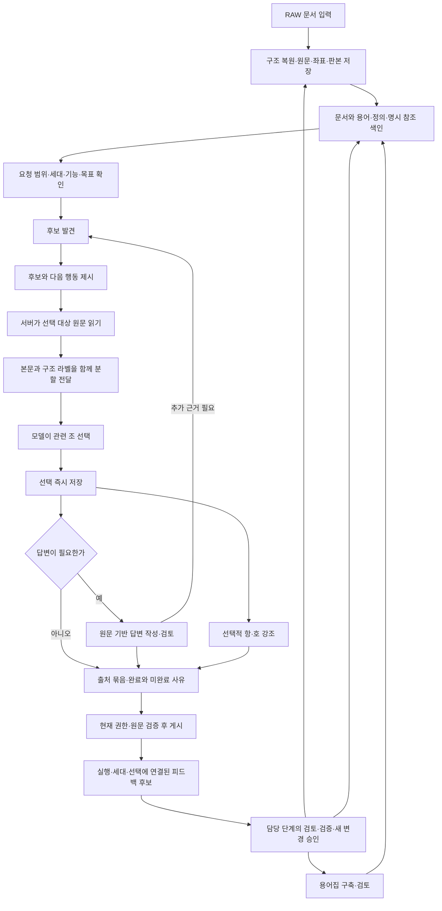

# 원문 탐색·선택·답변 전체 흐름 재설계

2026-09-21 · **설계 제안. 구현·모델 실험·MAIN 변경·GENOS 배포는 수행하지 않았다.**

모델은 질문에 필요한 원문과 그 의미를 판단한다. 서버는 정확한 원문 조회, 구조·ID 연결, 분량 조절, 작업 진행, 오류 전달, 저장과 게시를 책임진다. 관련 조를 선택한 성과는 세부 강조나 답변 작성이 실패해도 보존한다. 사용자에게는 무엇을 찾고 읽었는지, 무엇이 아직 미확인인지, 왜 중단했는지를 보여준다.

이 설계는 기존 RAG의 **탐색 → 읽기 → 전달 → 선택 → 답변 → 게시 → 후속 확인** 전체를 대상으로 한다. 전체 MAIN의 입력·용어집·색인·피드백과의 연결도 다루되, 원문 구조화 엔진이나 용어집 정본을 새로 만들지 않는다. 새 의미 추출·조건식 데이터 스키마를 복원하지 않는다.

수정 가능한 원본은 이 문서다. [40개 사례 대응표](CASES.md), [기계 판독 사례 원장](CASES.json), [자체 검토](SELF_REVIEW.md), [현재 코드·설정·자료 해시](BASELINE.json)를 함께 제공한다.

## 1. 설계 결정과 현재 기준

| 결정 | 새 기준 |
|---|---|
| 관련성 선택 | 기본 단위는 조 또는 문서의 검증된 구조 마디. 모델 출력은 선택 대상·핵심/보완/보류/제외·짧은 이유 |
| 세부 강조 | 선택 이후의 별도 작업. 틀린 강조를 버려도 관련 조 선택은 유지 |
| 원문 제시 | 서버가 실제 전송 객체에 맞춰 정확 범위를 나눔. 본문·문서명·조항 라벨·선택 ID를 한 항목에 결합 |
| 다음 행동 | 매 단계에 현재 미완료 작업, 이용 가능한 기능, 실행 가능한 행동과 그 결과를 제시 |
| 오류 | 모델 수정, 서버 재구성, 운영 설정, 종료할 조건을 구분. 수정 가능한 오류는 실패 항목과 수정 선택지를 주고 제한 내 재시도 |
| 종료 | 새 결과·필수 읽기·미전달 원문을 무시한 정상 완료 금지. 추가 후보가 모두 처리되어야 종료하는 전수 탐색도 요구하지 않음 |
| 답변 | 원문 관련성 선택과 법적 주장 검토는 독립 상태. 답변 목표인 요청은 선택 후 작성·검토에 진입 |
| 게시 | 선택 저장·결과 생성·게시·원문 열기를 각각 검증. 게시 권한과 외부 모델 전송 승인을 별도 계약으로 처리 |

확인 기준은 다음과 같다.

- 작업 MAIN 기본: `legal-agent-tools-v2`. v3/v4는 opt-in이다.
- 선택된 로컬 release: `document-navigation-rag-20260921-v1`, 포인터 generation 17, `quality_certified=false`. 해당 frozen `legal-rag`의 첫 엔진은 `term-retrieve@1.0.0`이다. 작업 기본 v2와 같은 코드로 취급하지 않는다.
- 데이터: `01_DATA/TERM/relation-subtree-main-serving-20260920-v1/generation`. source/index/glossary의 정확 binding은 BASELINE 및 manifest를 따른다.
- 관측 실패: ADR-0488의 공개 외부 Qwen, 3문항 × v3/v4 × 2반복. [설계 문제 8개](../SOURCE_TIERS_EDGE_CASES_20260921/DESIGN_REVIEW.md)와 [엣지케이스 40개](../SOURCE_TIERS_EDGE_CASES_20260921/README.md)를 입력으로 삼았다.
- v5라는 이름은 **미등록 제안**이다. `legal-agent-tools-v5` / `legal-agent-rag-v5`를 기존 adapter와 StageRunner에 opt-in으로 추가한다. 기존 완료 실험의 코드를 수정하거나 독립 서빙 실행기를 만들지 않는다.
- GENOS 내부 모델·현장 서버에는 접근하지 않았다. 이후 외부 실험은 현행 Qwen/FP8/thinking off 정책, 현장 실행은 GENOS 내부 모델·임베딩 설정을 따른다.

## 2. 전체 MAIN에서의 위치와 실행 흐름 — R01



화살표는 논리 흐름이며 새 상위 파이프라인 노드를 추가한다는 뜻이 아니다. 기존 `retrieve/select/assemble/answer` 네 stage와 coordinator를 유지한다. retrieve 안의 작업 제어가 탐색·읽기·전달·선택을 수행하고, select/assemble은 저장된 선택을 투영한다. answer는 요청 목표에 따라 작성·검토 또는 출처 결과 조립을 수행한다. reviewer가 추가 원문을 요구하면 기존 RESEARCH 재진입을 사용한다.

| MAIN 단계 | 입력 → 출력 | 새 설계와의 계약 |
|---|---|---|
| 입력·구조화 | RAW → document/source_unit/source_block + source fingerprint | 원문·부모·범위·판본을 그대로 읽음. 조/항/호 구조가 불명확하면 R02의 미확정 마디로 취급 |
| 용어집 | 출처별 사전·문서 정의 후보 → 검토된 용어·정의·관계 | 탐색 단서. 단어/관계 존재를 법적 적용 근거로 사용하지 않음 |
| 문서–용어 연결·색인 | 고정 source + glossary → navigation/fulltext/명시 참조 | source/index/glossary hash를 요청에 고정. 가용/미구축/미수록/범위 제한을 기능 영수증으로 반환 |
| RAG | 질문·범위 → 원문 선택·답변·미완료 사유 | 이번 재설계 범위. 원문 읽기/모델 제시/선택/게시 상태를 각각 저장 |
| 피드백 | 실행 ID·결과 hash·선택/주장 ID·source binding → PROPOSED 후보 | 검색 방향·구조·용어·답변 오류를 나눠 등록. 운영 원문이나 정답을 자동 갱신하지 않음 |

## 3. 책임 분리와 최소 모델 계약 — R02

### 3.1 서버의 기본 원문 단위

`SourceUnitRef`는 **제안 계약**이다. 조문이면 article root, 내규이면 검증된 절/조 마디, 별표이면 별표 또는 검증된 표 마디를 가리킨다. 모든 문서를 법령의 ‘조’로 꾸미지 않는다.

```text
SourceUnitRef (서버 소유)
  source_binding: generation_id / store_sha256 / artifact_sha256
  document_id / branch(body·appendix·history 등) / unit_id / unit_kind
  unit_extent: 실제 block와 범위 목록 + extent_hash
  coordinate_label: 검증된 부모 경로·조·항·호 / 불명확하면 원문 마디 표기
  resolution: EXACT | AMBIGUOUS | STRUCTURE_UNRESOLVED
```

영구 ref는 위 identity의 canonical hash다. 모델에는 현재 view 안의 짧은 `S1` 같은 별칭을 제공하고 서버가 ref에 결속한다. 이 별칭은 요청/판본을 넘어 재사용하지 않는다. 같은 조의 서로 다른 READ 페이지는 같은 SourceUnitRef에 모으되 정확 범위는 각각 보존한다. 동명이법·현행/개정이력·부칙/본문은 합치지 않는다.

조 root가 불명확하면 기존의 정확 block 범위를 `SOURCE_REGION`으로 사용하고 `조문 범위 미확정`을 표시한다. 단순 숫자 정규식으로 조 전체를 복원하지 않는다. 실제 구조 수정이 필요하면 새 데이터 세대로 이행한다.

### 3.2 관련 조 선택과 읽은 범위는 다르다

- 모델은 **정확 원문이 실제 제시된 SourceUnitRef**를 선택할 수 있다. 제목·검색 미리보기만으로 선택할 수 없다.
- 일부만 읽어도 그 조를 관련 원문으로 선택할 수 있다. 이때 `selection_scope=UNIT`, `read_coverage=PARTIAL`, `basis_delivered_ranges`를 함께 저장한다. ‘조 전체 관련성 선택’과 ‘조 전체 읽음’을 혼동하지 않는다.
- 정확 인용과 법적 주장에는 실제 전달된 범위만 사용할 수 있다. 원문 열기는 서버가 선택 조 전체를 페이지로 제공할 수 있지만, 열린 범위가 자동으로 모델 READ 기록이 되지는 않는다.
- 항·호 강조는 별도 `HighlightDecision`. 미제시·잘못된 호·해소되지 않은 구조라면 강조만 미확정으로 남기고 관련 조 선택은 보존한다.
- 후보 자동 열람은 가능하지만 **모델의 명시적 선택 없는 후보를 핵심/보완 출처로 추가하지 않는다.**

### 3.3 모델이 반환하는 것

탐색/선택 단계 출력의 예시다. 실제 동적 schema는 현재 view에 제시된 선택지만 허용한다. 다음 ID·문구는 설명용이며 제품/gold 주입값이 아니다.

```json
{
  "actions": [{"action": "A2"}],
  "sources": [
    {"source": "S1", "decision": "KEEP_CORE", "reason": "질문에서 비교할 취득 유형을 규정한다."},
    {"source": "S2", "decision": "DEFER", "reason": "적용 범위를 더 읽어야 한다."}
  ]
}
```

`actions`, `sources`, `finish_request`는 해당할 때만 반환한다. sources의 decision은 KEEP_CORE/KEEP_SUPPLEMENTAL/DEFER/REJECT. 목표·view·revision·generation·해시·좌표·문자수·검토 완료 상태는 모델이 복사하지 않는다. 서버가 해당 attempt의 snapshot으로 채운다. 검색어가 필요한 A2라면 `query`만 추가로 받으며 허용 키와 예시를 해당 action 정의에 둔다. 도구명·cursor·대상 종류를 모델이 재조합할 필요가 없다.

모델이 새로운 검색 방향을 정할 자유는 남긴다. action 목록에 `SEARCH_IN_SCOPE` 같은 검색어 입력 템플릿, 용어/정의/관계 탐색, 선택 범위 변경, 누락 기능 설명을 둔다. 서버의 추천 행동만 선택하도록 의미 판단을 고정하지 않는다.

강조는 별도 짧은 출력으로 받는다. `H1` 항목은 조항 라벨과 정확 본문에 함께 붙는다. `REVIEWED`는 어떤 선택 schema에도 넣지 않는다. 검토 상태는 R09의 실제 검토 기록에서 산출한다.

## 4. 요청 목표·미완료 작업·완료 상태 — R03

### 4.1 목표와 원질문 보존

`GoalRecord`는 질문 원문·원문 hash·질문 구간·출력 목표·미확인 질문을 보존하는 런타임 작업 상태다. 의미 추출 데이터 정본이 아니다. 기존 `question_pieces`는 원문 위치 분할로만 사용하며 괄호 문맥을 자동 독립 업무로 취급하지 않는다.

기존 `/v1/rag/ask` 입력을 유지한다. 기본 목표는 ANSWER다. 원문 목록만 요구한 명시적 요청은 원질문의 해당 구간을 근거로 SOURCES로 해석할 수 있으나, 불명확하면 ANSWER를 유지한다. 모델이 어려워서 답변 목표를 SOURCES로 낮추는 것은 허용하지 않는다. 자료 목록·목차 요청은 기존 메타데이터 경로를 유지한다. `use_llm=false`는 기존 의미인 모델 미사용을 유지하며, 모델 관련성 선택 성공으로 표시하지 않는다.

최초 v5에는 새 `response_mode` 요청 필드를 추가하지 않는다. 추후 명시적 UI 모드가 필요하면 닫힌 Request schema, app 허용 필드, Pipeline.run, bridge까지 별도 계약 개정한다. 서버 내부 GoalRecord를 외부 요청에 몰래 끼워 넣지 않는다.

### 4.2 하나의 완료 플래그로 합치지 않는다

| 축 | 제안 상태 | 의미 |
|---|---|---|
| work_status | RUNNING / FINISHED / INTERRUPTED / FAILED | 실행 생명주기. FINISHED가 품질 성공은 아님 |
| source_status | SELECTED / PARTIAL / NO_SELECTION | 선택된 출처·읽기/처리 범위. 상세 reason 필수 |
| answer_status | NOT_REQUESTED / REVIEWED / PARTIAL / UNRESOLVED | 법적 주장 작성·검토 결과. REVIEWED도 정확성 보증은 아님 |
| stop_reason | GOAL_MET / NO_MATCH_IN_EXECUTED_SEARCHES / NEEDS_CLARIFICATION / NO_PROGRESS / BUDGET_LIMIT / RETRY_LIMIT / DELIVERY_FAILED / CAPABILITY_UNAVAILABLE / SOURCE_CHANGED / ACCESS_RESTRICTED | 작업을 마친 구체적 이유 |
| publication_status | NOT_PREPARED / COMMIT_READY / PUBLISHED / BLOCKED | 결과 게시. source/answer 상태와 독립 |

예: source=SELECTED, answer=UNRESOLVED, publication=PUBLISHED는 유효하다. 답변은 미완료지만 원문은 사용자에게 남는다. source=NO_SELECTION, stop=DELIVERY_FAILED는 ‘관련 자료 없음’이 아니다.

source_status의 PARTIAL은 필요한 출처 선택 작업 일부가 미완료라는 뜻이다. 조 일부를 읽었다는 사실은 별도 read_coverage=PARTIAL로 표시하며, 그것만으로 모든 요청의 source_status를 PARTIAL로 낮추지 않는다. 모델이 전달된 일부 범위로 질문에 필요한 원문을 선택했더라도 전체 열람/해석 완료를 뜻하지 않는다.

### 4.3 작업 원장

새 `work_item` 테이블을 병렬로 늘리지 않고 기존 `frontier`를 v5 상태 계약에 맞춰 확장한다. 종류는 DISCOVERY_RESULT_DELIVERY, READ_REQUEST, SOURCE_DELIVERY, SOURCE_DECISION, HIGHLIGHT_REPAIR, ANSWER_RESEARCH, CLARIFICATION이다. 각 항목은 canonical 대상, 부모 action, 질문 연결, 우선순위, 상태, 결과 receipt, blocker를 가진다.

필수 처리 항목은 새로 발생한 모델 요청의 결과 전달, 명시적으로 요청된 READ, 이미 관련 후보로 읽기로 결정한 대상, 원문 전달, 현재 답변의 필수 근거다. 단지 발견된 모든 후보는 필수 항목이 아니다. 선택하지 않은 나머지는 후보 메뉴와 미처리 수에 남긴다.

`진전`은 새로운 canonical 후보, 새로운 READ 범위, 실제 전달된 새 범위, 근거 있는 선택/판단 변화, 확인된 부재·불가 사실로 계산한다. 같은 query 문자열 변형·별칭 재발급·이유 문장 수정·동일 READ 캐시 재사용은 새 진전으로 세지 않는다. 첫 검색 EMPTY는 탐색 기록이지만 관련성 성공은 아니다.

`GOAL_MET` 전에는 다음을 확인한다: 새 모델 요청 결과를 적어도 다음 판단 입력에 제공했는가, 요청된 읽기/전달과 현재 주장에 필요한 근거가 처리됐는가, 요청 목표를 막는 오류/한도가 남지 않았는가, 요청 목표의 결과가 있는가. 모델의 finish_request는 제안이며 서버가 이 조건을 확인한다. 조건 미충족이면 수정 가능한 다음 작업으로 돌리거나 명시적인 부분 완료 사유로 끝낸다. 요청에 필수가 아닌 강조·주변 관계는 보류 사유를 남기고 전체 목표 완료와 분리할 수 있다. 사용자가 특정 호의 정확한 강조를 요구했다면 그 작업은 필수로 취급한다.

## 5. 탐색·관계·읽기 제어 — R04

매 판단 입력의 첫 부분에는 원질문, 현재 목표, 직전 모델 행동 결과, 현재 미해결 오류, 추천되는 다음 행동과 가능한 대안을 둔다. 초기 실패 이후 긴 설명을 추가하는 방식에 의존하지 않는다.

1. **기능·범위 확인:** 선택된 문서·판본·색인·사전 기능을 점검한다. 없는 기능은 UNAVAILABLE, 현재 scope에 미수록인 문서는 ABSENT_FROM_SELECTED_CORPUS, 모호한 locator는 AMBIGUOUS로 반환한다.
2. **명시 위치 우선:** 질문이 문서와 조항을 지정했고 source 구조에서 유일하게 해소되면 서버가 같은 scope에서 정확 READ를 준비할 수 있다. 이는 사용자 요청 대상의 읽기이며 자동 관련성 선택이 아니다. 모호하면 후보를 제시한다.
3. **후보 발견:** 기존 title/literal/fulltext·용어·정의·참조 도구를 재사용한다. 검색 receipt의 범위·검색 방식·전체 적중 수·페이지 잔여·판본을 보존한다. 서로 다른 문서의 같은 조 번호를 하나로 합치지 않는다.
4. **결과 전달 우선:** 새 후보40을 저장했다면 다음 모델 입력에 첫 묶음과 잔여39/36 등의 정확한 페이지 정보를 제공한다. unread 상태만으로 자동 종료하지 않는다. 구체적인 묶음 크기는 입력 예산이 정한다.
5. **모델 READ 선택:** 후보 카드에는 서버가 생성한 실행 가능한 OPEN action이 붙는다. 모델은 A-ID를 고른다. action ID는 cursor와 다른 namespace를 쓰고 정확 operation/args/request를 가리킨다.
6. **관계 선택:** READ 직후 6종 관계를 모두 자동 확장하는 기본 동작을 제거한다. 읽은 원문에 이미 연결된 명시 참조·정의·공통 문맥의 가벼운 존재 메뉴를 먼저 만들고, 모델/현재 주장에 필요한 family만 펼친다. 존재 메뉴도 비용이 크면 LAZY_AVAILABLE로 남긴다.
7. **확장 한계:** 자동으로 읽은 관계 대상도 모델 제시·선택이 필요하다. 관계 메뉴·제목 유사성은 법적 적용 승인으로 바뀌지 않는다. 준용의 방향·출발 문언·대상·치환 범위는 답변에서 사용할 때 R09에서 확인한다.

상위/하위 구조에 예외가 있다는 이유만으로 자동 법률 판단하지 않는다. 다만 현재 읽은 마디의 공통 머리문장·단서·지시어가 잘린 경우, 서버는 구조상 부모 문맥을 확인할 작업을 만들 수 있다. 법적 중요성의 최종 판단은 모델·검토에 남긴다.

## 6. 원문과 모델 입력 구성 — R05

### 6.1 본문·좌표·선택지를 함께 전달

```text
source S1 — 실제 문서명 / 판본 / 제26조 / SOURCE_SELECTION_AVAILABLE
읽은 범위: 제1항 일부, 전체 읽기 미완료
  fragment F1 — 제1항 제2호 — 정확 본문 …
  fragment F2 — 제1항 제3호 — 정확 본문 …
  fragment F3 — 제1항 제4호 — 정확 본문 …
가능한 행동: 관련 조 선택 / 다음 범위 읽기 / 연결 원문 확인 / 보류
선택적 강조: H1↔F1, H2↔F2, H3↔F3 (서버가 같은 카드 안에 표시)
```

구조 라벨은 source_unit의 검증된 부모 경로에서 만든다. 라벨을 확인할 수 없으면 원문 마디·해당 위치로 표시한다. 모델이 쓴 “3호”를 서버가 선택된 “2호”의 제목으로 출력하지 않는다. 명시적 번호 설명과 강조 라벨이 충돌하면 강조 오류로 반환한다. 자유문 설명의 모든 의미 오류를 결정론적으로 감지할 수 있다고 주장하지 않는다.

### 6.2 두 종류의 한도

- `max_view_chars`: 실제 view 직렬화 문자 수 한도. 원문 외 상태·오류·선택지를 포함한다.
- `max_request_bytes`: 모델·system·view·동적 출력 schema·수정 메시지·provider 옵션을 포함한 최종 전송 JSON byte 한도. HTTP 인증 값은 로그/모델 본문에 넣지 않는다.
- `display_excerpt_chars`: 사용자 카드의 기본 발췌 길이. 앞의 모델 입력 한도나 조 선택 유효성 조건과 별개다.

기존 `max_context_chars`는 v5 profile에서 max_view_chars로 명시 이행한다. provider 상한·현장 검증 상한을 임의로 늘리지 않는다. binding에 tokenizer 한도가 추가로 있으면 그것도 확인하며 문자=token으로 환산해 보장하지 않는다.

### 6.3 끝까지 맞는 입력을 만드는 순서

1. view/attempt의 고정 ID, phase, revision, 오류, action 별칭, 동적 schema를 먼저 정한다.
2. 현재 모델 행동의 결과와 미해결 오류를 우선 배치한다. 자동 작업 결과는 별도 요약이다.
3. 필요한 정확 원문 조각을 추가한다. 넘치면 의미 요약으로 원문을 대체하지 않고 block/문자 범위로 나눈다. 단일 block이 너무 길어도 내부 범위를 나눌 수 있어야 한다.
4. 필수 원문 뒤에 후보·관계 메뉴를 넣고, 생략한 범위는 cursor/목록 snapshot으로 보존한다. 최소 원문보다 schema/메뉴가 크면 action/schema 메뉴도 먼저 줄인다.
5. adapter의 **실제 최종 payload 생성 함수**를 통과한 JSON 전체를 직렬화해 검사한다. 메타데이터·repair 메시지를 붙인 뒤에도 반복 확인한다.
6. 초과하면 우선순위가 낮은 항목을 줄이고 재구성한다. 각 시도는 payload 크기 감소 또는 정확 source 분할을 만들어야 한다. 같은 크기·같은 범위 반복은 금지한다.
7. 최소 원문+필수 프로토콜도 넣을 수 없으면 INPUT_UNREPRESENTABLE로 중단한다. 작은 오류 응답은 사용자에게 남기며 모델이 안 받은 자료를 평가했다고 기록하지 않는다.

`SourceSlice`는 document/block/start_cp/end_cp/hash를 가진 별도 정확 READ evidence다. 기존 Repository의 ‘E 전체 text를 view에 그대로 넣는다’ 계약을 우회하지 않고 **E 자체를 제시 가능한 정확 조각으로 저장**한다. source unit과 E의 다대일 매핑으로 전체 coverage를 계산한다. 원문 `source_block`은 수정하지 않는다.

제시 상태는 SAVED_VIEW, SENT, DELIVERED, DECIDED를 구분한다. 실제 응답 model/binding·현재 revision·시간 조건을 만족한 전송만 DELIVERED로 연결한다. JSON 형식 오류가 있어도 전달 사실과 해석 성공은 별개지만, 그런 응답에서 선택을 복원하지는 않는다. 해석·선택은 유효 응답에만 결속한다. 긴 관계 JSON은 손실 없이 저장하되 모델에게는 의미 있는 필드/대상 페이지로 제공하고, 잘린 JSON fragment를 이해 완료 조건으로 삼지 않는다.

## 7. 선택·강조·부분 저장 — R06

`SourceSelection`은 goal + SourceUnitRef를 식별자로 사용한다. 원문 조각을 바꿔 강조해도 source 선택 ID는 유지되고 selection version/highlight version만 변한다. scope/판본 변경은 새 identity다. CORE/SUPPLEMENTAL은 역할이며 확신 점수가 아니다.

저장 필드: 원문 ref, 모델 선택 attempt/view, role, 짧은 이유, 선택 당시 제시 범위, 읽기 coverage, 상태 CURRENT/STALE/RETRACTED, 선택 revision. 해석 상태는 검토 record를 조회해 파생하며 모델 선택의 유효성 조건에 넣지 않는다.

검토 정보는 질문·claim·basis 범위별로 표시한다. 일부 인용이 SUPPORTED였다는 이유로 조 전체나 그 조의 모든 적용이 검토 완료라고 표시하지 않는다. 기존 선택은 다음 응답에서 생략되어도 유지된다. 취소는 현재 selection summary의 명시 취소 action으로 가능하지만, 신규 선택/대체 선택의 새 원문은 정확 제시가 필요하다.

하나의 유효 JSON 응답을 받아도 변경을 항목별로 검증한다. 독립적인 조 선택, 강조, 탐색 행동의 결과를 각각 ACCEPTED/REJECTED/BLOCKED로 반환한다. 검증된 조 선택은 저장하고 잘못된 강조는 저장하지 않는다. 다만 같은 조의 선택/제외 충돌이나 서로를 전제로 하는 교체는 한 트랜잭션으로 검증한다.

이를 위해 gateway의 **전체 응답 검증과 항목 검증을 분리**해야 한다. JSON 파싱·최상위 envelope/배열 구조가 깨졌으면 전체 형식 복구, envelope가 유효하면 각 operation을 그 항목 schema와 상태 계약으로 검증한다. 모델에게는 완전한 목표 schema를 제공하되, 현행 `protocol.validate`가 한 항목 오류로 전체를 반환하지 않는 경로를 v5용으로 대체한다. 임의 raw JSON을 source 선택으로 신뢰하는 완화는 아니다.

명백한 서버 소유 필드인 interpretation_status를 모델이 추가한 경우에는 값을 적용하지 않고 `SERVER_OWNED_FIELD_IGNORED`로 알린다. source/decision/reason의 유효성은 독립적으로 검사해 보존할 수 있다. 이 정규화 allowlist는 profile/schema에 고정한다. 알 수 없는 필드, 잘못된 source/decision, 충돌하는 선택을 추측으로 고치는 일반 schema 완화는 허용하지 않는다.

모든 항목은 **같은 응답의 원래 snapshot**에 대해 먼저 검증한 후, 원장 잠금 아래 확정한다. 첫 항목을 저장해 revision이 바뀌었다는 이유로 같은 응답의 나머지를 오래된 응답으로 거부하지 않는다. action의 대상·scope도 그 snapshot에 결속하며 실제 실행 직전에 현재 권한을 다시 확인한다. 한 run에서 동시에 여러 모델 응답을 커밋하지 않는다.

개수 상한은 활성 카드 선택에 적용한다. 모델이 초과 선택하면 현재 유지 항목·새 후보·정확 초과 개수·명시 교체 행동을 반환한다. 서버가 관련성 순위를 임의로 정해 출처를 버리지 않는다. 초과분은 `CAP_PENDING`으로 저장할 수 있지만 채택 출처로 집계하지 않는다. 기존 유효 선택은 유지한다.

카드 발췌는 서버가 선택 조의 **전달된 정확 범위**에서 생성한다. 유효 강조를 우선하고 문단 경계에서 분할한다. 전체가 길면 일부 발췌임을 표시하고 원문 열기를 제공한다. 발췌 사이에 생략 표시를 두고 원문을 이어 붙여 새 문장처럼 만들지 않는다. 2,241자 조 선택은 정상이며 카드1,600자 정책을 넘었다는 이유로 거부하지 않는다. 법적 답변 context는 이 카드 발췌로 만들지 않는다.

## 8. 오류 계약과 자동 재시도 — R07

### 8.1 모든 실패를 같은 오류로 묶지 않는다

| 분류 | 예 | 복구 주체·다음 동작 |
|---|---|---|
| MODEL_CORRECTION | 미제시 대상, 잘못된 행동 종류, 상충 선택, 잘못된 강조 | 오류를 모델에 주고 현재 유효한 대안으로 해당 항목만 수정 |
| SERVER_REPACK | 단일 원문/메타데이터/수정 메시지가 입력 한도 초과 | 서버가 원문·메뉴를 다시 나누고 동일 작업 전달. LLM에 입력 크기 계산을 맡기지 않음 |
| TRANSIENT_TRANSPORT | 재시도 가능한 일시적 전송 장애 | 기존 단일 전송 gateway에서 공유 예산 내 재시도. 실제 provider/model은 바꾸지 않음 |
| CAPABILITY_OR_DATA_GAP | 기능 미연결, 문서 미수록, 구조 모호, 스캔 미완료 | 이용 가능한 대안 제시 또는 부재·불가·미확인을 명시. 반복 호출로 자료를 만들지 않음 |
| CONFIGURATION | 승인/판본/모델/게시 경로 결속 실패 | 실행 전 차단하거나 운영 설정 문제로 기록. 모델 재생성은 해결책이 아님 |
| TERMINAL_BOUNDARY | 권한 거부, 원문 변조, 소진된 총예산, 최소 입력 불가 | 허용되는 결과·상태를 보존하고 명확한 사유로 종료 |

### 8.2 구조화 오류

```text
ErrorRecord (서버 생성)
  error_id / category / stable_code / stage / affected_item
  actual / expected / human_message
  retry_owner: MODEL | SERVER | OPERATOR | NONE
  retryable / valid_next_actions / attempts_used / attempts_remaining
  preserved_items / blocked_dependencies
  status: OPEN | RESOLVED | SUPERSEDED | EXHAUSTED
  source_binding / causing_attempt_or_action / resolution_receipt
```

모델 입력에는 OPEN 오류와 해당 수정에 필요한 항목만 먼저 넣는다. 원시 예외·전체 stack trace·보안상 노출하면 안 되는 범위는 모델/사용자 메시지와 분리한다. 실제 가이드가 없으면 `guidance_status=UNAVAILABLE`과 “현재 이 오류를 자동 수정하는 경로가 없습니다”를 기록한다. 없는 기능의 가짜 action을 생성하지 않는다.

예를 들어 강조 H1이 해당 원문 제2호인데 요청된 강조가 제3호이면 `HIGHLIGHT_COORDINATE_MISMATCH`, 실제 라벨, 가능한 H2, 유지된 S1을 반환한다. 새 설계에서는 2,241자 조 선택을 카드 한도 오류로 만들지 않는다. 레거시 span 계약을 병행하는 이행 검사에서는 실제합계2,241·한도1,600·초과641을 반환해야 한다.

### 8.3 재시도는 실패 부분에 한정한다

1. 유효 JSON이면 독립 항목별 결과를 먼저 저장한다. 파싱 불가 JSON은 문자열 일부를 추측해서 선택으로 저장하지 않는다.
2. 모델 수정 오류는 오류 ID·잘못된 값·가능한 수정·보존 상태를 담은 REPAIR view로 재호출한다. 선택지·schema를 해당 작업으로 좁힌다.
3. 같은 원인·같은 대상·같은 유효 대안 집합을 오류 signature로 삼는다. 단순 오류 문구 변화가 재시도 카운터를 초기화하지 않는다.
4. 동일 오류에 허용된 수정 시도를 썼는데 같은 오류가 남으면, 선택이 보존되는 서버 대안으로 전환하거나 EXHAUSTED로 종료한다. 무한 재생성하지 않는다.
5. 오류가 해결되면 RESOLVED와 해결 receipt를 남기고 일반 작업으로 복귀한다. 해결된 오류를 계속 프롬프트에 넣지 않는다.

서버 재분할·READ 재개·게시 재시도는 각각 따로 기록하며 모델 호출로 집계하지 않는다. 모델 재시도는 provider adapter 밖에서 숨겨 수행하지 않고 기존 ModelGateway의 물리 시도 원장을 사용한다. UNKNOWN 응답은 성공으로 커밋하지 않는다. 늦은 응답은 현재 revision·lease·deadline에 맞지 않으면 무시한다.

전송 요청이 실제 provider에서 한 번만 처리됐다는 보장은 별개다. provider가 멱등 키를 지원하지 않는 UNKNOWN 재시도는 중복 과금 가능성을 남기고 물리 시도를 모두 센다. 보장할 것은 선택/주장이 현재 요청에 중복 커밋되지 않는다는 점이다.

## 9. 예산과 종료 예약 — R08

현재 v4의 모델14회·도구56회·세션300초·종료예약3회는 **기존 정책 상한**이다. 좋은 품질이 나오는 수치로 입증되지 않았다. 새 품질 비교에서는 같은 총예산으로 묶되 내부 배분을 작업 의무에 따라 계산한다.

`remaining_calls = total_limit - reserved_physical_attempts`. 탐색 전에 남은 선택/답변 작성/검토/필수 수정의 최소 호출을 예약한다. SOURCES 요청에는 답변 작성·검토 예약이 없고, ANSWER 요청에는 아직 필요한 compose/review 경로를 남긴다. 실제 선택이 없어 작성 불가하면 해당 예약을 해제하고 실패 상태 조립에 사용한다. 남은 일을 수행할 수 없는 검색·자동 관계 작업은 새로 시작하지 않는다.

재시도 또한 이 총예산을 소비한다. 순서는 필수 오류 수정·원문 전달 → 필수 조 선택 → 요청한 답변 작성/검토 → 선택적 강조·추가 관계 확장이다. 선택적 강조를 끝내느라 답변 검토 예산을 소진하지 않는다. 마지막 호출에서 새 오류가 나고 예약도 없으면 원인과 수정 미완료를 반환하며 한도를 몰래 늘리지 않는다.

모델 입력 크기, READ 범위 크기, relation 스캔 시간, 재시도 수, 카드 표시 수는 각각 별도 상한이다. 최종 선택도 한 번에4개로 고정하지 않고 남은 **선택 대기 페이지**를 예약 예산 내 처리한다. 다 처리할 수 없으면 기존 선택을 보존하고 미처리 범위를 표시한다.

`max_no_progress`는 단순 두 호출 후 종료를 대신하지 않는다. 반복 상태에서 서버가 다음 실행 가능한 미처리 작업을 한 번 안내하고, 새로운 근거나 명시적 처리 변화가 없으면 NO_PROGRESS 원인과 잔여 작업으로 bounded 종료한다. 처리 가능한 새 후보/새 원문이 생긴 시점에는 카운터가 유지되지 않는다.

시간은 API 진입·자원 초기화·모델/도구 제어·게시를 따로 기록한다. 현행 세션 deadline을 전체 E2E 보장으로 표현하지 않는다. 새 서비스 전체 deadline을 도입하면 admission/자원 열기 시작부터 별도 monotonic deadline을 전달해야 하며, 기존 wall_seconds와 혼동하지 않는다.

## 10. 답변 작성과 검토 — R09

### 10.1 출처 선택 후 답변 진입

SOURCES 목표는 선택·출처 상태 결과로 마친다. ANSWER 목표는 선택된 SourceUnitRef와 전달된 정확 범위를 `AnswerEvidencePack`으로 구성해 작성에 들어간다. 기존 `packed.support`가 없다는 이유만으로 compose를 건너뛰지 않는다. 출처 선택을 기존 ADOPT/SUPPORT로 자동 승격하는 방식도 사용하지 않는다.

v5에서는 기존 v3의 ‘먼저 ADOPT/SUPPORT 평가가 있어야 작성 가능’ 계약을 대체한다. `ClaimDraft`는 질문 구간, 주장 문장, 실제 제시된 basis fragment 선택, 사용한 관계, 부족한 사실을 포함한다. 이 단계의 근거 연결은 PROPOSED_SUPPORT이며 법적 승인 상태가 아니다. 서버는 정확 범위·원문 hash·대상 종류를 결속하고, 검토가 완료된 주장만 REVIEWED 상태로 내보낸다.

기존 `RelationsSession.commit_draft/commit_review`의 좌표·판본·출발/대상·반론 검사 중 유지할 규칙을 명시적 helper로 추출하되, v5가 기존 assessment 존재 검사를 우연히 상속하지 않게 한다. 외부 claims의 source_ids는 실제 기존 navigation source_id로 매핑한다. 새 SourceUnitRef ID를 기존 source_id 필드에 넣지 않는다.

### 10.2 어떤 원문을 같이 보아야 하는가

- 카드 표시용1,600자 발췌 대신 주장 검토에 필요한 exact slices를 사용한다.
- 단서·예외·정의·준용을 근거로 한 주장은 출발 문구와 대상 범위·공통 문맥을 함께 확인한다. 소속이 명백한 부모 문맥은 서버가 위치를 연결하되 의미 적용은 모델이 판단한다.
- 채택 조에 참조가 있다는 이유만으로 관련 없는 모든 호의 참조를 검토 의무로 만들지 않는다. 실제 주장 basis와 공통 문맥에 관련된 참조를 대상으로 하고 제외 이유를 남긴다. 중요한 참조의 누락 가능성은 reviewer의 별도 확인 대상이다.
- 공동 검토에 필요한 원문이 한 입력에 들어오지 않으면 좁은 주장으로 나누거나 추가 페이지로 재검토한다. 단서가 잘린 상태에서 검토 성공을 내지 않는다.
- 필요한 원문이 단순 후보에만 있으면 READ/제시로 복귀한다. reviewer가 새로운 출처를 최종 인용하려면 그 원문을 본 모델의 명시 source 선택도 남겨야 한다. 서버가 자동으로 카드에 추가하지 않는다.

### 10.3 검토 상태와 부분 답변

reviewer는 작성과 분리된 호출·프롬프트에서 정확 근거와 반론을 확인한다. 같은 기반 모델을 사용하면 이를 외부 전문가의 독립 검증이라 부르지 않는다. verdict는 SUPPORTED / NEEDS_RESEARCH / NEEDS_REWRITE / UNRESOLVED. 질문에 없는 사실은 만들어 채우지 않는다.

새 반론·원문·source revision이 영향을 준 주장만 재검토한다. 독립적인 검토 완료 주장은 유지한다. 추가 사실이 필요하면 무엇이 필요한지와 달라지는 판단을 묻고, 이미 제공한 사실을 반복 질문하지 않는다. 원문 선택·안전하게 반환 가능한 다른 주장은 함께 남긴다.

법적 주장 생성 또는 검토가 끝내 실패해도 SourceBundle은 유지한다. `answer.text`에는 완료된 부분과 정확한 미완료 사유를 적고, 검토되지 않은 draft를 승인된 claim으로 넣지 않는다. 사용자가 답변을 요청했다면 answer=UNRESOLVED/PARTIAL을 명확히 표시한다.

## 11. 원장·중복·재시작 — R10

새 요청에만 `journal-v5.sql`을 사용하고 과거 v1~v4 journal은 해당 버전 reader로 유지한다. v4 테이블의 CHECK 제약에 새 phase/kind/state를 그대로 넣으면 실패하므로 DDL·Repository.VERSION·protocol·trace·recovery dispatch를 함께 변경한다.

| 보존/변경 대상 | v5 처리 |
|---|---|
| evidence_unit/evidence_span | 정확한 SourceSlice로 저장. 원본 source_id와 범위/hash 보존 |
| entity_version/entity_head/dependency | goal, source_selection, highlight, claim_draft, review, source_bundle의 독립 version·의존성 |
| frontier | 제안 work 종류·상태·blocker·canonical dedupe 확장. 기존 system_task는 자동 작업 실행 receipt로 사용 |
| model_view/model_attempt/presentation | view 저장·실제 payload·전달·파싱/의미 결과 분리. 각 상태가 어떤 receipt를 뜻하는지 명시 |
| action_context/action_receipt | 서버 action 별칭의 정확 operation·범위·actor·부모·동일 snapshot 결속 |
| 추가 source_unit_binding | SourceUnitRef ↔ 저장 원문 마디/범위 ↔ E slice 연결. 사본 원문 생성 금지 |
| 추가 error_record | 오류 signature·해결 상태·재시도·보존 항목. 원시 상세는 접근 통제된 원장에만 저장 |
| publication | 불변 결과 snapshot과 게시 receipt. 이미 게시한 파일은 덮어쓰지 않음 |

선택·강조·오류 처리의 멱등 키는 `attempt_id + operation_index + canonical_payload_hash`다. 동일 키·같은 내용은 이전 receipt, 다른 내용은 충돌이다. READ는 scope/판본/정확 extent/cursor에 결속해 같은 결과를 재사용한다. 새로운 page는 새로운 READ이며 같은 조의 누적 coverage로 합친다. 반복 호출을 재조회 성공으로 부풀리지 않는다.

한 요청은 owner lease/lock과 상태 revision으로 보호한다. 여러 요청 간에 mutable 세션·오류·모델 선택을 공유하지 않는다. source/index는 읽기 전용 공유가 가능하지만 요청 scope와 model view는 분리한다.

재시작 시:

1. COMMIT_READY는 원본 result hash·현재 scope/권한·source binding을 확인하고 같은 결과를 멱등 게시한다.
2. 소유자를 잃은 RUNNING은 INTERRUPTED로 남긴다. 저장된 선택을 보존하고 불완전 action/UNKNOWN attempt는 성공으로 복원하지 않는다.
3. 모델을 호출하지 않는 원장 정합성 검사·완료 결과 게시 복구는 자동 수행할 수 있다. 모델 실행 재개는 원래 deadline·남은 예산·동일 binding·새 owner 획득이 모두 유효하고 명시된 재개 요청이 있을 때만 허용한다.
4. deadline이 지났거나 질문/판본/권한/모델이 바뀌면 새 run으로 이어가고 `resumed_from`과 재사용한 원문·선택을 기록한다. 이전 실행의 모델 선택을 새 질문의 자동 승인으로 복사하지 않는다. 새 유효 view에서 재확인한다.

자동 오류 수정은 **현재 살아 있는 요청 안에서** 수행한다. 앱 시작 때 과거 모든 실패 요청을 재호출하여 비용을 쓰는 자동화는 만들지 않는다.

## 12. 권한·전송·게시·원문 열기 — R11

### 12.1 하나의 정책 확인 경로, 서로 다른 결정

`SourcePolicyBinding`과 `AccessDecision`은 제안 계약이다. 원본 source manifest의 속성, 현재 사용자/서비스 principal의 문서 접근, 외부 모델 전송 승인, 사용자에게 결과를 게시하는 권한을 각각 결속한다.

```text
source_policy: 원본 manifest hash·속성·문서/실제/모의/공개 분류
request_scope: 요청 문서 ∩ 현재 principal 허용 문서
external_grant: 승인 ID/hash·source fingerprint·허용 문서·목적·대상·모델·유효 조건
decisions: READ / SEND_MODEL / PUBLISH / OPEN_SOURCE 별 허용·거부 사유
```

원본 `export_allowed=false`를 true로 수정하지 않는다. 해당 false를 무조건 덮어쓸 수 있는 일반 override도 만들지 않는다. **기존 명시 승인에 결속된 공개 원문 범위**에서만 요청별 SEND_MODEL 허용을 별도로 계산하며, 절대 반출 금지·비공개 문서/질문·키로 확대하지 않는다. 승인 증거가 없거나 분류가 모호하면 전송 불가다. 신규 외부 실험은 현재 승인 파일과 모델 정책을 새 실행에 정확히 고정해야 한다.

publication이 source manifest와 비교할 값은 원본 source_policy다. 외부 모델 SEND_MODEL의 effective decision을 원본 속성과 같은 필드로 비교하지 않는다. 대신 PUBLISH/OPEN_SOURCE 목적의 현재 접근 결정을 별도로 검증한다. adapter·gateway·실험 runner·publication·source endpoint가 같은 정책 검증 함수를 사용해야 한다.

선택된 corpus scope가 사용자 인증을 대신하지 않는다. 사용자별 ACL 제공자는 현재 미연결이므로 제안 `AuthorizationProvider`의 read/send/publish/open 결정 포트를 기존 신뢰 게이트웨이와 연결해야 한다. 단일 로컬 개발 환경은 명시적인 service-owner principal 범위로만 검사하고 사용자별 권한 완료라고 보고하지 않는다. 공유 GENOS 서비스 도입의 선행 조건이다.

### 12.2 사전 점검과 마지막 점검

모델 호출 전 source/index/profile/schema/model·전송 승인과 해당 서비스 게시/열기 설정의 호환성을 검사한다. 실제 모델이 아직 선택하지 않은 source bundle을 만들어 성공을 가장하지 않는다. 마지막에는 실제 선택·주장·모든 결과 필드를 대상으로 source hash와 현재 권한을 다시 검사한다. 사전 점검만으로 이후 권한 변경을 무시하지 않는다.

자료가 바뀌면 관련 선택/강조/주장만 stale로 표시하고 현재 결과를 다시 조립한다. 다만 권한이 줄어든 경우 카드만 제거해도 질문·설명·후보·답변에 제한된 내용이 남을 수 있다. **최초 v5는 기존 전체 outbox 차단을 유지**하고, 현재 허용 범위의 별도 새 결과를 만들 때 모든 필드를 재검증한다. 카드별 정제·재발행을 구현했다고 간주하지 않는다.

### 12.3 불변 결과와 게시 receipt

SourceBundle은 `source-bundle-v5`로 별도 version을 둔다. source identity, 선택 version, 정확 전달/표시 범위, role, 이유, 강조 상태, read coverage, 원문 열기 대상을 가진다. claim이 없어도 만들 수 있다. 제외·stale·cap_pending·미처리 후보 수를 별도로 기록한다.

결과 snapshot 안에는 source/answer/work 상태와 게시할 준비가 됐다는 사실까지만 고정한다. 파일 저장 뒤 `PUBLISHED`로 고치기 위해 hash가 고정된 Result를 덮어쓰지 않는다. 실제 publication_status는 별도 receipt에서 읽는다. HTTP의 기존 `run_id/release` envelope를 v5 `PublishedEnvelope`로 명시 검증하고 publication receipt를 추가한다. `runtime.result`의 닫힌 최상위 필드에 임의로 추가하지 않는다.

`/v1/rag/source`는 v5 선택의 조/마디 전체를 정확 페이지로 열고 표시 발췌와 구분한다. 각 요청에서 principal·scope·판본·hash를 재검증한다. 서버 journal reader를 v4 고정에서 버전 dispatch로 바꾼다. 원문 주소는 클라이언트나 모델의 자유 URL을 사용하지 않는다.

## 13. API·화면·피드백 — R12

### 13.1 기존 API와 호환

기존 Request/Query/Result와 retrieve/select/assemble/answer 외부 포트는 `term-runtime-v1`을 유지한다. 새 workflow metadata는 `assembly.term_agent.workflow_v5`, 출처는 `assembly.term_agent.source_bundle`에 내부 schema_version으로 둔다. `answer.claims[].source_ids`는 기존 source_id 계약을 유지한다. v5 reader는 구 bundle도 읽고 v4 reader에게 새 bundle을 무음 전달하지 않는다.

| 진입점 | 제안 변경·상태 |
|---|---|
| 기존 POST `/v1/rag/ask` | v5 opt-in dispatch, 기존 요청 필드 그대로, 검증된 envelope와 오류 응답 반환 |
| 기존 GET `/v1/rag/source` | v4 발췌 열기 유지, v5는 source-unit 전체 페이지+선택/읽기/강조 범위 표시. page cursor는 서버가 생성 |
| 기존 GET `/v1/rag/source-candidates` | 미열람/미전달/보류/미채택 및 가능한 OPEN 표시. 해당 사용자의 접근 재검증 |
| 제안 GET `/v1/rag/runs/{run_id}/status` | 인증된 해당 실행의 상태·오류·재개 가능 여부. 원문/질문을 무조건 노출하는 로그 API 아님 |
| 제안 POST `/v1/rag/runs/{run_id}/resume` | R10 재개 조건, idempotency·owner·남은 예산 검사. 새 run이 필요하면 새 run과 계보를 명시. 기존 기능으로 보고하지 않음 |
| 기존 POST `/v1/rag/feedback` | 선택/강조/주장/구조 오류를 구분하는 검토 후보 연결. 기존 feedback schema 허용 범위 확인 후 버전 확장 필요 |

service.py의 요청 중계 allowlist에는 source/source-candidates/status/resume 경로와 정확 method를 명시 연결해야 한다. URL에 run_id가 있다는 이유로 인증되었다고 보지 않는다. GENOS workflow의 브라우저 접근 가능한 source base URL·인증·routing은 별도 현장 확인 대상이다.

기존 잘못된 요청은 검증 오류 응답, 안전하게 게시한 부분 결과는 정상 Result와 미완료 상태, 게시 자체가 실패한 요청은 source 내용 없는 typed ErrorEnvelope와 허용된 status 경로로 구분한다. HTTP 성공과 법적 답변 성공을 동일하게 보지 않는다. 오류 envelope에 원문을 실어 게시 검증을 우회하지 않는다.

### 13.2 사용자에게 보여줄 것

기본 순서는 요청한 답변/현재 결론 상태 → 핵심·보완 원문 → 필요한 추가 확인이다. 원문 카드에는 문서·판본·조항·짧은 실제 발췌·조 전체 열기·선택 이유를 표시한다. 기술 ID·schema·예외 stack trace는 기본 화면에서 숨긴다. 의미가 있는 미완료 상태는 숨기지 않는다.

| 상황 | 표시 문구의 기준 |
|---|---|
| 선택 성공·해석 실패 | “관련 원문은 확보했습니다. 적용 판단은 아직 확인하지 못했습니다.” |
| 후보 발견·읽기 실패 | “후보를 찾았지만 원문 읽기를 완료하지 못했습니다.” + 사유·미열람 수 |
| 서버 READ·모델 미전달 | “원문을 읽었지만 모델 검토에 전달하지 못했습니다.” + 입력/전송 사유 |
| 한 검색 0건 | “현재 범위에서 이 검색 방식으로 찾지 못했습니다.” |
| 문서 미수록 확인 | “현재 자료 목록에 해당 문서가 없습니다.” + 확인 범위 |
| 기능/가이드 없음 | “현재 선택 세대에는 이 기능이 없습니다.” / “현재 자동 수정 안내가 없습니다.” |
| 강조 실패 | “관련 조는 유지했습니다. 세부 강조 위치는 미확정입니다.” |
| 게시 실패 | “결과는 저장됐지만 게시하지 못했습니다.” + 허용되는 오류·재개 안내 |

전체 corpus에 자료가 없다고 말하려면 그 범위의 목록/완결 조회 근거가 있어야 한다. `NO_SELECTION`만으로 부재를 표시하지 않는다. 현재 profile의 호출·시간 상한으로 중단했으면 그 사실을 알린다. 사용자의 “다시 실행”은 실패 부분 재개로 연결하며 모든 원문을 다시 읽는 신규 전체 실행으로 조용히 바꾸지 않는다.

피드백은 현재 실행/결과 hash, SourceUnitRef·선택 version·관련 claim, 원문 세대와 사용자가 지적한 오류 유형에 연결한다. 잘못된 항·호는 구조/강조 후보, 잘못된 관련성은 선택 정책 후보, 잘못된 결론은 답변 검토 후보로 분리한다. 운영 정본과 과거 답변 gold는 자동 변경하지 않는다.

현재 `feedback.record_feedback`는 게시된 run에서 answer/query/run hash만 target에 붙이고, `term-runtime-v1`의 Event/Proposal target은 닫힌 객체다. v5의 상세 대상은 제안 `source-feedback-v2`의 Event/Proposal로 정의하고 `record_feedback`·`proposal_for`·API·목록 reader에 버전 dispatch를 추가한다. 기존 feedback.event/proposal과 v1 자료는 유지한다. 새 `feedback.source_event/source_proposal` contract를 PIPELINE에 등록하며 기존 legal-feedback 소비자에 v2를 무검증 전달하지 않는다. 선택/강조/claim 대상은 같은 run의 현재/명시 과거 version에 실제 존재하는지 검증하고 접근 권한을 확인한다. 모델 재개용 run_id와 feedback 대상 run_id를 서로 바꿔 사용하지 않는다.

현재 HTTP feedback 경로는 `legal-feedback` stage 그래프를 실행하지 않고 `record_feedback`를 직접 호출한다. 새 계약을 PIPELINE에 선언하는 것만으로는 연결되지 않는다. 기존 HTTP→record_feedback 경로에서 버전별 `contracts.validate_port`와 proposal_for를 호출하도록 바꾸고, 선언된 feedback 엔진도 같은 함수를 사용하게 대조한다. 피드백 등록과 담당 단계에서 검토·검증 후 새 세대/코드를 승인하는 일은 별도 상태다.

## 14. 구현 변경 지도·이행 범위 — R13

아래 신규 이름은 설계 제안이다. 동일 책임의 코드가 이미 구현 작업 중 추가되어 있으면 실제 연결을 확인해 통합하고 파일명만 맞추기 위한 중복 구현은 하지 않는다.

| 현재 파일·함수 | 변경 책임 | 입력/출력·소비자 | 이행·검증 |
|---|---|---|---|
| `service.py`, `app.create_app/ask` | v5 선택·오류/게시 envelope·source/status/resume 중계 | 기존 Request → v5 세션/Result, UI·bridge | Request 허용 필드 유지; GET/POST allowlist·인증을 함께 검사 |
| `semantic_runtime/pipeline.py` | v5 profile dispatch·기존 coordinator 연결 | 같은 네 stage 포트 | `PIPELINE.json` v5 opt-in·엔진 manifest·schema/dependency hash 동시 등록 |
| `legal_agent_adapter.ServingLegalAgent.open_session` | v5 session/repo/tool dispatch, GoalRecord·정책 결속 | scope/source/index/profile/주체 → 요청 세션 | 모델 실행 전 policy/게시 capability 검사, admission·owner 유지 |
| `legal_agent/coordinator.py`, `stages.py` | 요청 목표·미완료 작업 기반 재진입 | CONTROL FINAL/RESEARCH/RECOMPOSE 등 기존 소비자 | 완료 gate 의미를 v5 내부 상태와 일관되게 매핑 |
| 제안 `workflow_session.py` | R03/R04/R06~R09 orchestration | frontier/선택/error → retrieve·select·assemble·answer | TiersSession의 무진전 hash·끝의 선택을 그대로 상속하지 않음 |
| 제안 `source_units.py` | SourceUnitRef·slice·coverage·원문 페이지 | 기존 Store/unit/block/index → ref·E·라벨 | 정본 데이터 재작성 없음; 모호한 구조 fallback 검사 |
| `relations_tools.py`, `exploration_tools.py`, 제안 `workflow_tools.py` | 기존 조회 재사용, offered action·정확 cursor·선택적 관계 | 서버 action → observation·read slice·frontier | 자동6종 확장 기본 제거는 v5에만 적용. v2/v3/v4 동작 보존 |
| 제안 `workflow_views.py`, `gateway.py` | R05 최종 payload compiler, 작은 오류 수정 schema | 상태/원문 → 저장 view·최종 request·delivery receipt | transport의 payload 준비/전송 분리, 실제 요청 bytes와 저장 payload 일치 |
| 제안 `workflow_protocol.py`, `workflow_policy.py` | 최소 source/repair/claim/review 계약·예산 | schema/profile → gateway/validator | model enum에서 REVIEWED 제거; 추측 가능한 자유 ID 대신 offered refs |
| 제안 `workflow_repository.py`, `journal-v5.sql` | source/error/frontier/receipt·상태 이행 | 새 요청 journal, trace/recovery 소비 | v4 journal 변환 없음. phase/kind CHECK·멱등·revision 검사 |
| `tools_session.py`, `relations_session.py`의 검증 helper | R09의 source 선택→draft→review 연결 | 정확 basis+제안 claim → 검토 결과 | v5는 사전 ADOPT 없다고 compose를 막는 조건 제거. legacy 계약은 유지 |
| `source_bundle.py`, `publication.py` | 새 bundle dispatch·현재 policy·불변 snapshot/receipt | 저장 선택 → 검증 bundle → outbox | `VERSION == 4` 고정 조건을 버전별 validator registry로 교체, 미등록 버전은 거부 |
| 제안 `source_policy.py` | READ/SEND/PUBLISH/OPEN 정책 공통화 | immutable manifest·승인·현재 principal → 목적별 decision | 외부 실험 adapter/runner도 동일 검증 함수 사용. 승인 원본은 보존 |
| `source_tiers_ui.py`, `app.py`, `genos_rag_chat.py` | v5 카드·전체 원문·부분 완료·오류 재개 | source-bundle-v5/workflow_v5/receipt | 기존 source-tiers-v4 렌더 유지, 실제 API와 renderer 동일 ID 검증 |
| `legal_agent_trace.py`, `feedback.record_feedback/proposal_for`, app feedback | 새 상태/선택/오류/coverage·피드백 조회 | journal v5 → 운영 원장·source-feedback-v2 후보 | trace 버전 dispatch, 닫힌 v1 target 유지·v2 별도 계약/소비자 연결 |
| `00_SYSTEM/LEGAL_AGENT`, `00_SYSTEM/SCHEMAS`, engine manifests | v5 opt-in 설정·schema·dependency 선언 | Pipeline·gateway·Repository | 새 이름은 아직 없음. hash 고정 profile와 engine rehash 도구로 검사 |

`lawrag.platform.workspace`의 system/backend/data/docs/runtime 등 논리 root를 통해 새 런타임 경로를 해결한다. 이 문서의 저장소 상대 경로는 검토 위치이며 제품에 하드코딩할 경로가 아니다.

데이터 재구축은 조건부다. 기존 source_unit/source_block의 구조·범위가 정확하면 v5 원문 ref/slice는 요청 journal의 파생 연결이므로 원문·용어집 재구축 없이 사용할 수 있다. 부정확한 조 root·판본 alias·reference 연결을 고쳐야 하면 source 또는 navigation 생성 경로에서 **새 세대**를 만들고 하위 색인·릴리스 binding을 갱신한다. 소스 변경에는 관련 term/navigation/fulltext 및 캐시 재구축 범위를 함께 기록한다. 기존 데이터 CURRENT는 설계 작성으로 바뀌지 않는다.

도입 순서는 (1) 단일 원문 수직 연결, (2) 전달·오류·부분 저장, (3) 답변·관계 재진입, (4) 게시·화면·재개, (5) 동결 품질 비교, (6) 별도 MAIN 승격과 GENOS 인계다. 새 후보의 코드/데이터/profile이 운영 registry 기본 경로에서 자동 선택되지 않게 한다. 과거 source-first의 실패한 긴 평가 장부나 서버 자동 출처 채택을 다시 기본값으로 넣지 않는다.

원복은 신규 요청의 implementation/profile/release를 이전 해시 고정 대상으로 전환한다. 진행 중인 v5는 drain 또는 INTERRUPTED로 남기고 v4 코드로 v5 journal을 열지 않는다. 이전 생성물·오류 이력·새 schema는 삭제하지 않는다. Git 병합, 제품 MAIN 승격, 데이터 CURRENT, GENOS 리비전 배포를 각각 따로 보고한다.

## 15. 검증·기대치·도입 판정 — R14

### 15.1 기존 문제 8개와 새 책임 연결

| 기존 설계 이슈 | 대응 |
|---|---|
| D01 모델 책임 과다 | R02 최소 선택, R05 서버 결속, R07 오류 수정 |
| D02 조 선택/강조 혼합 | R02 SourceUnitRef, R06 독립 강조·표시 한도 |
| D03 목표/제어 미연결 | R03 목표·상태, R09 선택 후 답변 진입 |
| D04 관계 확장 우선순위 | R04 선택적 관계·미확인 질문, R08 예산 |
| D05 진전/종료 계약 | R03 frontier, R05 실제 전달, R08 완료 예약 |
| D06 부분 성공·복구 | R06 항목별 저장, R07 오류 상태, R10 멱등 |
| D07 의미 검증 공백 | R05 원문/라벨 결속, R14 항·호·관련성/보존 분리 평가 |
| D08 설정/환경 계약 | R11 목적별 정책, R12 전체 HTTP·원문 열기 |

40개 E 사례마다 입력, 처리/오류/재시도, 저장되어야 할 결과, 사용자 상태, 검증 방법을 [CASES.md](CASES.md)에 연결했다. 이 표의 존재는 테스트 통과가 아니다.

### 15.2 핵심 정상·실패 시나리오

| 시나리오 | 입력→흐름→결과 | 실패/오해 방지 |
|---|---|---|
| 명시 조항 질의 | 유일 문서/조 해소 → 서버 READ → 본문/라벨 전달 → 모델 KEEP → 선택 저장 → 요청한 답변 검토 → 게시/전체 열기 | gold를 제품 입력에 넣지 않음. READ 자동화와 관련성 선택 분리 |
| CM018 후보40 | 제목0 → 본문40 → 다음 view에 후보·잔여 제시 → 모델 OPEN → 원문 제시 → 조 선택 | 첫40개를 모두 읽어야 한다는 기준 아님. 읽기 판단 기회가 실제 존재해야 함 |
| CM038 큰 입력 | 여러 원문 READ → 최종 payload 초과 → 정확 slice 재분할 → DELIVERED → 선택 | 서버 READ만으로 모델 제시 카운터를 증가시키지 않음 |
| CM003 다른 호 | 관련 조 선택 성공 → 정상 ID이지만 다른 호 강조 → 정확 라벨 충돌 오류 → 강조 재선택 또는 미확정 | 조 선택 유지. 이 검사로 모든 의미 오류를 탐지했다고 주장하지 않음 |
| 긴 조 선택 | 2,241자 조 선택 → 선택 저장 → 카드 발췌만 표시 한도 적용 → 전체 원문 열기 | 1,600자 카드 한도가 조 선택 거부 사유가 되지 않음 |
| 원칙·예외 | 원칙과 연결 메뉴 → 모델 필요 대상 OPEN/선택 → 공동 문맥으로 주장 검토 | 관계 존재만으로 적용 확정하지 않음. 모델 미선택 예외를 서버 자동 채택하지 않음 |
| 답변 검토 실패 | 유효 선택 저장 → draft 오류/근거 미확인 → 원문 bundle 게시+answer 미완료 | 출처 선택을 법적 검토 완료로 승격하지 않음 |
| 진짜 부재·권한·기능 없음 | 확인한 검색/목록 범위·현재 접근/기능 결정 → 대안 또는 한정된 부재 설명 | NO_SELECTION으로 모든 원인을 합치지 않음 |
| 혼합 응답 | S1 유효 선택+H2 오류+A3 invalid → S1 저장, 오류2건 각 receipt → 수정 입력 | 관련 없는 오류 때문에 S1 rollback 금지. 상호 의존 교체는 원자적 |
| 변경·중단 | source/권한 재검증 → stale/차단 → 불변 과거 보존, 허용 재개/새 run | 권한 축소 후 카드만 지우고 다른 응답 필드 노출 금지 |

### 15.3 통과 기준

계약/연결 검사는 모의·결정론 입력으로 수행한다. 각 검사는 **거부 확인 → 오류가 다음 입력에 전달됨 → 유효 수정 → 저장 → 사용자 응답**의 필요한 단계까지 확인해야 한다. 일부 항목의 정상 차단은 재시도 성공이 아닌 명확한 종료가 통과 기준이다. wire 검사에는 실제 provider wrapper가 추가한 필드까지 포함한다.

필수 불변 조건: 모델 미선택 source 자동 채택0, 미전달 원문을 봤다고 기록0, 원문 hash/판본/권한 우회0, 독립 유효 선택의 조용한 손실0. 숫자0은 **테스트 케이스의 목표**이며 현장 오류 확률0이라는 뜻이 아니다. 모든 P0/P1 사례의 계약 통과 전 실제 품질 개선을 완료로 선언하지 않는다.

모델 품질은 별도 사전 동결 평가에서 확인한다. 실제 신규 실험 착수 전에 저장소 실험 표준 두 문서를 끝까지 읽고 reservation/ADR 선점·완료 부모·snapshot/register/freeze를 수행한다. 이번 설계 작성은 실험이 아니다.

비교 기준은 v4 정확 frozen 경로와 v5 후보를 같은 질문·scope·source/index/glossary·모델·총예산·표시 K로 묶는다. 이미 본 CM3는 회귀/in-sample, 미사용 문서·좌표·관계 구조 단위로 나눈 질문은 별도 평가군으로 고정한다. 반복은 같은 문항의 변동 확인이며 독립 문항 수로 합산하지 않는다. 통합 v5 효과와 개별 부품 효과를 혼동하지 않는다.

지표는 발견→READ→DELIVERED→조 선택→bundle→게시→실제 열기를 분리한다. 조 단위 recall/관련성, 항·호 강조 정확성, 실제 표시/인용 범위의 충분성, 법적 답변 타당성, 부분 결과의 유용성, 오류 후 복구율, 부재·미완료 표시를 별도로 채점한다. gold에 없는 출처를 자동 오답 처리하지 않으며 원문 기반 검토 절차를 둔다. 승인된 자료가 없는 질문도 포함한다. 미게시 payload를 최종 사용자 출처로 계산하지 않는다.

### 15.4 수치·자원 원장

| ID | 지표·종류·단위 | 입력/산식/값 | 불확실성과 측정 |
|---|---|---|---|
| N01 | 관측 · 제품 실행 건수 | ADR-0488: 3문항×2arm×2반복=12, v4는6 | 선택된3문항 이외 일반화 불가 |
| N02 | 관측 · 기존 v4 호출 | 합계27회, 6실행. 27/6=4.5회/실행은 계산값 | 조기 실패·미게시 포함. 정상 작업 비용의 기준 평균으로 사용하지 않음 |
| N03 | 정책 · 총량 상한 | 기존14 model attempts·56 tool attempts·session300초 | 처리능력·E2E 보장 아님. v5 비교 총예산은 실행 전 고정 |
| N04 | 관측/계산 · 문자 | CM018 선택2,241자−카드한도1,600자=641자 | 새 설계에서는 선택 오류를 만들지 않음. 표시 한도 최적값 미확인 |
| N05 | 정책 · 입력 크기 | 해당 외부 기록 view60,000자, model binding2,000,000 bytes | 서로 다른 한도. GENOS의 검증 입력 한도는 별도 |
| N06 | 관측 · 선택·게시 | v4 내부 카드가 남은 실행2/6, 게시0/6 | 카드 수·조문 recall·정답률과 구분 |
| N07 | 계산식 · 모델 비용 | `C = Σ(input_tokens×p_in + output_tokens×p_out)/10^6` (단가가 백만token 기준일 때) | 실제 요율·캐시 과금·역할별 사용량으로 측정. 이번 문서에서 가격/절감률 미산정 |
| N08 | 계산식 · 순비용 변화 | `ΔC = C_v5 탐색·전달·선택·수정·작성·검토 − C_v4 동일 목표` | `ΔC<0`일 때만 모델비 절감. 추가 재분할/검토가 재시도 감소보다 비싸면 증가 |
| N09 | 계산식 · 저장/운영 | `추가 저장량 = slice/receipt/error/index별 실제 bytes 합계`; 읽기·해시검사 CPU/IO 별도 | 원문 bytes를 journal마다 중복 저장하는 영향 포함. peak RSS·journal 크기·P95는 실측 필요 |
| N10 | 목표/미확인 · 품질·일정 | 필수 보존/권한/복구 계약 통과 목표. 품질 개선폭·개발 인일·GENOS 지연은 미산정 | 작업 패키지별 구현·테스트·이행 실제 소요와 현장 대기 분리 측정 |

민감도: 원문 page 하나가 추가되어 모델 호출이1회 늘면 그 호출의 input/output 비용이 ΔC에 더해진다. 별도 요약 호출을 없애도 긴 원문 재전송이 늘면 전체 token 비용이 커질 수 있다. 공유 relation scan을 줄여도 exact source paging과 상태 저장 IO가 증가할 수 있다. 총 호출 수 감소만으로 비용·지연 개선을 주장하지 않는다.

### 15.5 도입 산출물과 책임

| 단계 | 담당 책임·산출물 | 다음 단계 진입 조건 |
|---|---|---|
| 1 | 런타임 구현: 단일 SourceUnitRef→READ slice→DELIVERED→모델 선택→bundle 수직 경로 | 정상/미제시/잘못된 강조/긴 조 선택 계약 통과 |
| 2 | 런타임·도구 구현: frontier/오류/재분할/예산/멱등 | 후보40·큰 입력·혼합 오류·반복 복구 사례 통과 |
| 3 | 답변 구현: 선택 후 작성·주장별 검토·관계 재진입 | 무검토 claim 차단, 독립 완료 답변·출처 보존 |
| 4 | API·운영 구현: 목적별 권한·outbox·원문 열기·재개·renderer | 실제 HTTP와 publication/OPEN 검사, 프로필/원장 버전 회귀 |
| 5 | 평가 담당: 사전 동결 모델 품질 비교·별도 원문/의미 검토 | 사전 기준 충족, 허용 회귀 이내, 실제 사용자 전달 검증 |
| 6 | 배포/현장 담당: 명시 승격·GENOS 반입·내부 모델/접근 검증 | 코드/의존성/설정·입출력·재개/롤백 인계 및 현장 기록 |

책임은 역할 구분이며 특정 인원을 임의로 배정하지 않는다. GENOS 반입에는 코드 revision/의존성 해시, 내부 모델·프로필·endpoint 설정 이름, data/index/glossary binding, 실행/중단/재개/검증/롤백 절차, 브라우저 원문 접근·인증 조건을 포함한다. 키 값은 문서/원장에 넣지 않는다.

## 16. 근거와 남은 미확인

설계 작성에는 저장소 코드·스키마·기존 실행만 사용했다. 외부 제품 사례나 논문의 성능을 전용하지 않았다. 확인된 경로와 SHA-256은 BASELINE.json을 따른다.

- [현행 MAIN](../../../../00_SYSTEM/ARCHITECTURE.md), [PIPELINE](../../../../00_SYSTEM/PIPELINE.json), [데이터 계약](../../../../00_SYSTEM/DATA_MODEL.md), [GENOS 경계](../../../../GENOS.md).
- [앞선 출처 수정 설계](../DOMAIN_SYSTEM_HARNESS_REDESIGN_20260921/SOURCE_TIERS_REVISION.md), [실제 구현과 미완료 범위](../DOMAIN_SYSTEM_HARNESS_REDESIGN_20260921/IMPLEMENTATION_VERIFICATION_20260921.md).
- [ADR-0488](../../../../04_EXPERIMENTS/ADR/ADR-0488-qwen-source-tiers-v4-paired/README.md), [metrics](../../../../04_EXPERIMENTS/ADR/ADR-0488-qwen-source-tiers-v4-paired/artifacts/metrics.json), [읽기 전용 오류/선택 원장](../SOURCE_TIERS_EDGE_CASES_20260921/evidence.json).
- [실제 adapter](../../../../02_BACKEND/semantic_runtime/legal_agent_adapter.py), [coordinator](../../../../02_BACKEND/semantic_runtime/legal_agent/coordinator.py), [views](../../../../02_BACKEND/semantic_runtime/legal_agent/tiers_views.py), [selection](../../../../02_BACKEND/semantic_runtime/legal_agent/tiers_session.py), [publication](../../../../02_BACKEND/semantic_runtime/legal_agent/publication.py).

미확인 사항은 모델의 실제 관련성·항호 선택·법적 해석 정확도, 새로운 입력/작업 배분의 비용·지연, 비법령 구조의 충분성, 사용자 ACL 연동, 실제 GENOS 호출·화면·원문 열기다. 이 설계는 이런 항목을 없다고 가정하지 않고 구현·평가·현장 도입의 확인 조건으로 남긴다.
