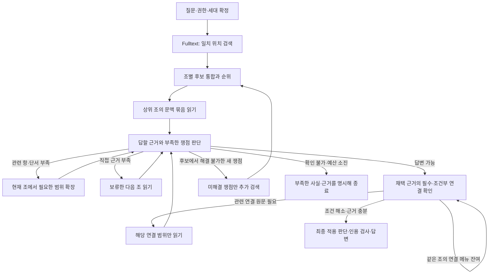

# 구조화 단위 변경에 대응하는 RAG 조회·읽기·종료 설계

2026-10-06 · 설계 완료 / 구현·추가 모델 실행·배포 미수행

**세부 구조는 검색 위치와 인용 좌표로 유지하고, 후보 선별은 조별로, 실제 읽기는 답을 판단할 수 있는 문맥 묶음으로 바꾼다. 각 묶음을 읽은 직후 충분성을 판단해 필요한 범위만 추가하고 종료한다.** 숏컷 개편은 주 작업이 아니다. 기존 실행 단계 안에서 조회와 읽기 계약을 먼저 바로잡는다.

이 문서는 이번 대화 중 작성하던 shortcut 중심 초안을 대체한다. 완료된 실험·릴리스 기록은 변경하지 않는다. [검토 파일·해시·관측 수치](EVIDENCE.json)를 함께 보존한다.

## 1. 현재 문제를 어떻게 확인했는가

작은 단위로 구조화한 것 자체보다, **작은 검색 hit가 읽기 후보·범위 계산·연결 메뉴·진행 로그로 확대되는 방식**이 문제다. 확인한 구현과 현장 미확인을 구분한다.

| 코드에서 확인한 문제 | 발생하는 일 | 이번 변경 |
|---|---|---|
| `ArticleProjection.rank()`가 최소 단위 hit 전체를 반환받은 다음 조별로 줄임 | 최종 조 후보 수에 제한이 있어도 모든 hit를 먼저 적재·보존 | 조별 후보 목록과 내부 hit의 지연 조회를 분리 |
| `prepare()`가 조별 첫 hit를 앞에 두지만 `group_hits()`가 다시 같은 조의 모든 묶음을 연속 배치 | 긴 별첨의 여러 묶음이 초기 읽기 순서를 차지할 수 있음 | 조별 첫 문맥 묶음을 교차 배치하고 같은 조의 추가 묶음은 보류 |
| 묶음을 만들 때 각 hit의 `offer_plan()`으로 상위 subtree 옵션까지 계산하고, 실제 읽을 때 재계산 | 아직 채택하지 않은 원문의 범위·문자 수 계산이 늘어남 | 후보는 좌표·길이 메타데이터만, 확정된 읽기 범위만 구체화 |
| 조 단위 FTS 호환 경로가 후보 조의 블록 본문을 훑어 부분 문자열 일치 항을 추출 | READ 도구 밖에서도 본문 접근 비용 발생, 토큰 검색과 다른 기준으로 작은 후보가 늘어남 | 조 FTS는 조 후보로 유지하고 읽을 조에 대해서만 문맥 계획 |
| 묶음 상한은 자식 own 본문 길이로 계산하지만 최종 묶음에는 상위 도입문도 추가 | 선언한 묶음 크기와 실제 입력 크기가 달라질 수 있음 | 상위 문맥을 포함한 블록 합집합의 실제 길이로 예산 계산 |
| 연결 탐색 후에 충분성 판단, 연결 보류를 `needs_fulltext`에 합침 | 직접 답을 확보해도 연결 검토·전체 검색 재진입을 반복 | 초기 충분성 판단 → 필요한 연결만 확인 → 최종 충분성 판단 |
| 연결 메뉴에서 모두 SKIP하면 다음 frontier가 비고, 같은 조의 미제시 연결은 남음 | 다음 메뉴 대신 처음 검색과 연결 판단으로 복귀 | 같은 조의 메뉴 커서와 연결 깊이를 분리 |

코드 근거: [최소 단위 FTS](../../../../02_BACKEND/semantic_runtime/unit_fulltext.py), [읽기 계획과 묶음](../../../../02_BACKEND/semantic_runtime/legal_agent/unit_reading.py), [선택](../../../../02_BACKEND/semantic_runtime/legal_agent/unit_selection.py), [연결](../../../../02_BACKEND/semantic_runtime/legal_agent/unit_relations.py), [검색 재진입](../../../../02_BACKEND/semantic_runtime/legal_agent/memory_rag.py).

최근 발송 R1은 v6에서 조 단위 FTS도 단위 읽기로 보낸다. 따라서 “단위 색인을 썼을 때만 발생하는 문제”로 좁히면 안 된다. 반대로 현장 사진만으로 현재 GENOS가 선택한 색인·리비전을 확정할 수는 없다. 로컬 활성 포인터는 `sql-ad-mode-v6-20261006-r1` / generation 41이고, 작업 코드·발송 R1과 구분한다.

같은 질문 “내부 회계 관리자는 누가 지정하나요?”의 기존 공개 진단은 다음과 같다. 새 설계의 성능 측정값이 아니다.

| ID | 관측값 | 환경·분모·해석 |
|---|---|---|
| M1 | HTTP 200, 165.280초 / 원문 198곳 / READ 446회 | ADR-0658, 로컬 공개 세대·활성 frozen 코드, 단일 요청. READ는 페이지 호출 수 |
| M2 | 큰 별책서식 216,354자 / 142페이지 / handler 합 54.323초 | 같은 요청. 역참조로 유입되고 최종 선별에서 제외. 전체 READ 단계는 70.900초 |
| M3 | HTTP 422, 131.157초 / 후보 96곳 / 읽기 묶음 12개 / 실제 원문 11곳 / READ 17회 | ADR-0659, 발송 R1의 검색·읽기·종료 경로와 로컬 용어집 호환 compiler. 실패 요청 |
| M4 | 첫 묶음 중 별지·서식 8개 / 연결 20개 중 첫 10개만 제시 | 같은 R1 요청. 모델은 두 차례 충분하다고 판단했지만 남은 연결 때문에 중단하지 못함 |

[ADR-0658 원장](../../../../04_EXPERIMENTS/ADR/ADR-0658-internal-accounting-manager-local-probe/README.md), [ADR-0659 원장](../../../../04_EXPERIMENTS/ADR/ADR-0659-internal-accounting-manager-stop-probe/README.md). 두 실행은 제어 흐름도 달라 구조 단위의 효과만 분리한 A/B가 아니다. 로컬의 최근 선택 릴리스 사이에는 원문·navigation·FTS 해시가 같았다. 데이터 증가가 원인이라는 증거는 없으며, 현장 데이터 변경 여부와 약 10분 지연의 구간별 시간은 미확인이다.

## 2. 검색 단위와 읽기 단위를 분리한다

| 층 | 사용할 단위 | 책임 |
|---|---|---|
| 원문 저장·구조 | 기존 조·항·호·목·표·블록 | 원문 불변, 관계와 인용 좌표 보존 |
| 검색 | 선택된 조 FTS 또는 최소 단위 FTS | 질문에 맞는 위치 발견, 모든 hit를 열람 의무로 만들지 않음 |
| 후보 경쟁 | 조 또는 기존 canonical source root | 같은 조의 반복 일치를 모으고 다른 조의 직접 근거도 앞에서 비교 |
| 실제 열람 | 조 / 항과 조건 / 표의 필요한 행과 머리글 | 판단 가능한 원문 문맥을 한 번에 제공 |
| 근거·인용 | 실제 읽은 블록과 정확 span | 조를 읽어도 답변 근거는 제몇 항·호인지 표시 |
| 충분성 | 질문의 쟁점과 확인해야 할 조건 | 후보 전체 완독률과 분리 |

**짧은 조는 조 전체를 읽는 기본 경로를 복구한다. 긴 조는 관련 항의 하위 호·목과 상위 도입문·단서를 함께 읽는다. 긴 별첨은 질문에 필요한 구역을 읽는다.** 짧음/김은 이름이나 블록 개수가 아니라 선택 모델의 입력 예산에 들어가는 실제 중복 제거 본문량으로 판정한다. 한 항도 매우 길면 의미 경계에서 나누고 미완료 상태를 유지한다.

읽기 규칙은 다음과 같다.

- 항·호·목에서 일치하면 가장 가까운 법적 문맥을 구성한다. 본문이 “다음 각 호”를 지시하면 해당 열거 범위를 포함한다. 앞선 주어·적용 대상·후속 단서를 빠뜨린 leaf 단독 읽기는 완료로 보지 않는다.
- 이미 읽은 범위와 새 범위가 겹치면 기존 evidence를 재사용하고 차집합만 읽는다. 같은 조의 항별 인용 좌표는 그대로 남긴다.
- 표는 관련 행의 셀뿐 아니라 열 제목·행 제목·단위·각주를 포함한다. 병합 셀이나 구조 경계를 검증할 수 없으면 상위 표/구역으로 확장하고, 예산 때문에 못 읽으면 미완료로 기록한다.
- 별첨 여부만으로 제외하지 않는다. 서식 작성법, 기준표 수치, 본문에서 위임한 적용 기준을 묻는 경우 해당 별첨은 필요한 근거다. 단순 역인용 유입만으로 전체 별첨을 열지 않는다.
- 조 FTS에서 항 hit가 없으면 후보 전체를 다시 항으로 분해하지 않는다. 우선순위가 된 짧은 조를 읽거나, 긴 조의 구조 목록에서 필요한 범위를 선택한다. 구조가 없으면 기존 원문 블록 구간으로 읽고 가상의 항을 만들지 않는다.

현재도 같은 조의 hit와 상위 도입문을 합치는 코드가 있다. 새 설계는 “묶기 추가”에서 끝나지 않고 **후보 순서, 문맥 완결성, 지연 범위 계산, 묶음별 종료**를 함께 바꾼다.

## 3. 목표 실행 흐름

기존 `INTENT → PLAN → RECALL → READ → SELECT → ASSESS → COMPOSE`를 유지한다. READ와 SELECT의 협업 안에서 문맥 묶음을 늘리고, 새 검색 이유가 있을 때만 RECALL로 재진입한다. 기존 원문 검증·최종 ASSESS를 사용하며 충분성 확인용 독립 모델 호출을 묶음마다 무조건 추가하지 않는다. 현재 triage/review 출력에 다음 행동과 근거를 결속한다.

### 후보 조회와 계획의 실행 방식

조별 후보에는 `source_id`, 최상위 일치 점수, 일치 위치 목록의 커서, 검색어·회수 경로, 구조 제목을 둔다. 초기에 원문 전체나 모든 ancestor subtree 선택지를 넣지 않는다. 최소 단위 FTS는 현행 점수에서 조별 최상위 hit 순서를 보존하면서 조 후보를 먼저 반환하도록 바꾼다. SQL에서 조별 집계가 여전히 전 hit를 훑을 수 있으므로 DB 스캔 감소를 보장하지 않는다. 먼저 Python 전체 hit 적재와 후속 계획 증폭을 없애고 query plan을 측정한다.

첫 읽기 순서는 서로 다른 상위 조의 첫 문맥 묶음을 우선하고, 동일 조의 나머지는 별도 큐에 보관한다. 미해결 쟁점이 같은 조의 다음 항을 요구하면 해당 큐를 먼저 처리한다. 초기에 모든 후보의 모든 묶음을 만들지 않는다. 여러 검색어의 중복 hit는 `(generation, document, source, unit/block)`로 병합하고 검색 경로는 보존한다.

범위 계산은 부모 경로·블록 경계·길이 정보를 세션 안에서 재사용한다. 계획을 선택한 뒤 실제 블록 합집합을 만들고 길이·권한·원문 해시를 검증한다. 메타데이터만으로 계산한 값과 실제 값이 다르면 예산을 다시 적용한다. `offer_plan()`의 현재 폐쇄된 선택지 검증은 유지하되 아직 읽지 않을 상위 전체 subtree까지 미리 계산하지 않는다.

### 충분성 판정과 종료

`READY`는 다음을 모두 만족할 때만 가능하다.

- 질문의 각 요구에 답할 근거가 있고, 답변 주장에 실제 읽은 span이 연결된다.
- 채택 범위의 상위 조건·단서가 확보되고, 결론을 바꿀 수 있는 적용 조건과 충돌이 해소된다.
- 적용되는 필수 연결의 필요한 범위를 읽었다. 조건부 연결은 적용/불적용과 근거가 남는다.
- 현재 문서 버전·권한·인용 검사를 통과한다.

읽지 않은 검색 후보나 무관한 역인용이 남았다는 사실만으로 `READY`를 막지 않는다. 최초 “답변 가능” 판단은 필수 관계 검토 전의 잠정 판단이며 최종 종료와 구분한다. 필수 근거를 못 얻었으면 충분하다고 꾸미지 않고 확인 질문 또는 한계를 명시한 결과로 끝낸다.

SELECT의 제안 상태 계약은 아래처럼 명시한다. 이름은 신규 제안이며 아직 구현하지 않았다.

| `next_action` | 이유·상태 | 실행 주체 |
|---|---|---|
| `READY` | 위 조건 충족, 쟁점별 근거·종료 이유 | 기존 ASSESS/COMPOSE |
| `EXPAND_CONTEXT` | 현재 항의 조건·열거·표 문맥 부족 | 같은 source의 reader |
| `READ_NEXT` | 직접 근거 부족, 보류 후보 존재 | 후보 큐의 다음 문맥 |
| `CHECK_RELATIONS` | 필수/적용 검토 연결이 남음 | 해당 anchor의 연결 커서 |
| `SEARCH_GAP` | 현재 후보로 못 푼 구체 쟁점과 새 검색 계획 | 해당 쟁점만 RECALL |
| `NEED_FACTS` / `INCOMPLETE` | 사용자 사실 또는 근거 부족, 한도 소진 | 확인 질문/제한된 응답·실패 사유 보존 |

단순 `pending`을 검색 요청으로 바꾸지 않는다. 상태에는 읽은 범위, 보류 후보 커서, 미해결 쟁점, 연결 결정·커서, 남은 전체 예산을 둔다. 매 반복은 새 범위 확보, 연결 해결, 새 검색 계획, 종료 중 하나를 수행해야 한다. 동일 상태·동일 메뉴 반복이면 재검색으로 우회하지 않고 진행 불가 사유로 종료한다. 요청 전체 deadline은 모델 호출·재판단에도 전달하고, 다음 조사 전에 답변 생성에 필요한 잔여 시간을 고려한다. 답변 시간이 부족하면 성공으로 포장하지 않는다.

## 4. 연결은 채택 문맥에 한정해 읽는다

현재 `catalog()`도 읽은 블록과 참조 endpoint를 대조한다. 이 기능을 유지하고, 조 전체만 가리키는 역방향 endpoint 때문에 검토가 넓어지는 부분을 보완한다. 필터가 전혀 없다고 보고 새로 만드는 것이 아니다.

| 종류·방향 | 필요한 처리 |
|---|---|
| 채택 문맥의 정방향 준용·정의 사용 | 해석에 필요한 대상 범위를 읽고 확인. 이미 읽었으면 재사용 |
| 위임·예외·배제·간주·제재·시간 조건·단서 | 현재 질문과 적용 조건을 먼저 판단. 적용 또는 불확실성이 결론에 영향을 주면 관련 원문 확보 |
| 단순 인용·근거 표시 | 직접 답이 부족하거나 의미 확인에 필요할 때 추가 읽기 |
| 별표·별지·서식 | 본문이 위임한 기준이나 질문의 직접 대상이면 해당 구역 읽기 |
| 역방향 연결 | witness와 대상 범위로 채택 항에 실제 영향을 주는지 선별. 역방향이라는 이유로 전부 읽거나 전부 제외하지 않음 |
| UNKNOWN·좌표 불명 | 검증 가능한 witness부터 확보하고 보류 이유 명시. 누락된 `mention_text`를 임의 의미로 채우지 않음 |

같은 anchor의 미제시 메뉴는 cursor로 계속 처리한다. FOLLOW가 없어도 다음 메뉴는 진행한다. 다른 원문으로 이동하는 깊이 제한과 같은 원문의 메뉴 페이지 제한을 구분한다. 이미 해결한 결정은 세대·원문·witness·적용 사실이 같을 때 재사용하고 `pending`은 현재 미해결 집합에서 다시 계산한다. 모델은 간결한 witness/조건 메뉴부터 받고, FOLLOW가 정해진 대상만 상세 읽기 옵션을 만든다. 미확인 필수 조건을 조용히 버리는 정책은 넣지 않는다.

## 5. 실제 변경 지도와 계약 이행

입구는 기존 `service.py`의 `/v1/rag/ask`와 GENOS의 `service/service.py` 어댑터다. 별도 RAG API나 병렬 실행기를 만들지 않는다. 아래는 제안 변경점이며 현재 코드가 이미 이 계약을 제공한다는 뜻이 아니다.

| 기존 파일·함수 | 변경 내용 | 소비자·검증 |
|---|---|---|
| `unit_fulltext.ArticleProjection.rank`, `rank_units` | 조 목록과 hit 커서 분리; 현행 조 순위 보존 | `source_recall` / 후보·검색 경로 보존 검사 |
| `source_recall.discover`, `prepare` | 조 FTS와 단위 FTS를 공통 조 후보 계약으로 전달 | reader / 기존 명시 좌표 경로 보존 |
| `unit_reading.group_hits`, `offer_plan`, `prepare`, `acquire_batch` | 문맥 계획 지연 생성, 조간 순서 유지, 합집합 예산, 짧은 조·긴 항·표의 읽기 | selector / 원문 hash·scope·좌표·문맥 완결성 |
| `unit_selection.select`, `source_selection.select_sources` | 묶음 직후 쟁점 확인과 typed next_action | `memory_rag` / 충분성·부족 사유·다음 상태 |
| `unit_relations.catalog`, `navigate`, `relation_read_policy` | 필요한 관계의 적용 판단, 같은 anchor 메뉴 커서·미해결 집합 | selector / 방향·단서·누락·반복 검사 |
| `memory_rag.stage`, `corrected_memory`의 단계 재진입 | READ/관계 잔여는 이어가기, SEARCH_GAP만 검색 재진입 | 기존 실행 journal / 복구·전체 예산 |
| native READ/evidence 검증 | 요청 내 블록 길이·검증된 coverage 재사용, 추가 범위만 검증 | reader / 최종 정확 인용과 publication 재검증 유지 |
| `progress.py`, `observability.py`, GENOS workflow | 단계별 요약과 정확 조·항 위치, counts 의미 분리 | Reasoner·최종 상세 원장 |
| 선택 엔진 manifest·스키마·release binding | 아래 새 읽기·선택 정책 revision을 함께 결속 | 기존 API 응답·ASSESS·COMPOSE·감사 화면 |

제안 읽기 계약 `context-read-v2`: `packet_id`, generation/manifest hash, document/source ID, matched unit IDs, 선택 문맥 unit IDs, 실제 block/span/evidence IDs, 문맥 추가 이유, 필요한 문맥의 완료 여부, 조 전체 완료 여부, 실제 문자 수, 다음 커서. “선택 문맥 완료”와 “조 전체 완독”은 별도 값이다. SELECT/ASSESS는 전자를 채택 근거로 쓰고 최종 인용은 실제 evidence만 사용한다.

설정은 기존 읽기 정책의 revision 아래 `batch_context_chars`, `max_packets_per_batch`, `short_article_chars`, `max_total_read_chars`, `max_search_reentries`, `relation_page_budget`, `answer_time_reserve`를 제안한다. 기존 `initial_units` 등을 이름만 바꿔 같은 숫자로 옮기지 않는다. 값은 선택 모델의 입력 계약·deadline과 검증 질문으로 동결한다. 묶음 상한은 작업 분할용이며 원문을 잘라 충분하다고 간주하는 상한이 아니다.

초기 변경은 원문·navigation·용어집 세대를 재구축하지 않는 runtime 조회 변경으로 설계한다. 조 FTS와 최소 단위 FTS 각각을 지원한다. 기존 저장 메타데이터로 부족한 길이/구간 정보는 요청 내 계산·캐시부터 적용한다. 후속 영속 색인 최적화가 필요하면 기존 builder와 manifest에 새 파생 색인 계약을 넣어 별도 generation으로 검증하며 완료 세대를 덮어쓰지 않는다. 구조 노드 ID·명시 참조 endpoint·원문 span은 바꾸지 않는다.

새 contract를 모르는 실행 코드는 새 journal을 이어받지 않는다. 기존 완료 기록은 읽기 전용으로 보존하고 진행 중 요청은 원래 release에 결속하거나 명시 실패로 정리한다. 코드·스키마·정책 hash가 달라진 과거 shortcut 절차는 자동 hit하지 않게 결속한다. shortcut 저장 시점과 DB 전면 개편은 이번 우선 범위에서 제외한다. 현재 중간 기록은 실행 중 저장되고 재사용 활성화는 답변 검증·서버 publication 완료 후 응답 반환 직전이다.

## 6. 로그와 실제 요청 시나리오

화면은 검색 → 읽는 위치 → 추가 읽는 이유 → 완료를 보여준다. 예시는 표시 설계이며 새로운 실행 로그가 아니다.

> 검색: ‘내부 회계 관리자 지정’ · 조별 후보 N개
> 원문 확인: 주식회사 등의 외부감사에 관한 법률 제8조 — 근거 위치 제3항
> 조건 확인: 채택 근거의 적용 범위·필수 연결 확인
> 완료: 근거 충분 · 문서 D개 / 조 A개 / 문맥 묶음 P개 · 나머지 후보 열람 생략

문서 수, 조/source 수, 항·호 위치 수, 문맥 묶음 수, 내부 READ 페이지 수를 별도로 센다. ‘원문 394곳’처럼 단위가 불명확한 누적 숫자는 주 진행 표시에서 없앤다. append 방식만 지원하는 화면에서는 phase 전환·최종 요약만 새 카드로 보내고 페이지별 변화는 상세 원장에 남긴다. 로그를 숨겨 실제 읽기 과다를 해결했다고 보고하지 않는다.

| 시나리오 | 동작·저장 결과 |
|---|---|
| 이번 지정 주체 질문 | 상위 직접 근거 조를 읽고 제3항의 근거 span을 확보 → 적용 조건 확인 → 충분하면 답변. 미열람 후보는 보류 영수증 |
| 같은 조에 관련 hit가 여러 개 | 문맥과 중복 블록을 합쳐 제공; 항·호별 정확 인용 유지 |
| 예외·준용 확인 후 결론이 바뀜 | 해당 원문을 추가하고 쟁점 상태 갱신; 이전 충분성 판단 폐기 후 재판단 |
| 긴 별첨이 직접 답변 대상 | 필요한 표/구역의 문맥 확보; 추가 구역은 커서로 이어 읽고 미완료는 명시 |
| 연결 메뉴 모두 SKIP, 잔여 존재 | 같은 anchor의 다음 메뉴로 이동; 전체 fulltext 재시작 없음 |
| 권한 또는 generation 변경 | 캐시·커서·선택지 무효화, 새 binding 검증. 다른 세대 근거 혼합 금지 |
| 모델 오류·timeout·진행 불가 | 전체 예산 내 제한된 수정, 실패/미완료 원장. 재시도로 읽기 예산을 초기화하지 않음 |
| 성공 응답 저장 | 기존 publication과 최종 감사 원장, 해당 계약에 맞는 shortcut 활성화 |

## 7. 구현 순서, 검증과 기대효과

**우선 구현 묶음:** 공통 조 후보 계약 → 문맥 planner·조간 읽기 순서·중복 재사용 → 충분성/연결 커서/검색 재진입 상태 → 로그·소비자 계약. 이 네 변경은 한 조회 흐름으로 검증한다. 프롬프트만 바꾸거나 `batch_groups`만 줄이는 패치를 먼저 완료로 내지 않는다.

그다음 순위 개선을 별도 후보로 다룬다. 최소 단위 FTS는 own 본문 중심 OR 검색이므로, 조 제목·상위 문맥 정보를 활용한 점수 보정 가능성이 있다. 긴 서식의 hit 개수를 단순 합산해 순위를 올리지 않는다. 이 변경은 검색 품질에 영향을 주므로 초기 순위 보존 수정과 분리해 효과를 비교한다. shortcut의 거절된 제안 활성화·publication 복구 위험은 후속 별도 항목이다.

검증은 먼저 모의 계약에서 문맥 누락·순서·종료를 확인한다. 같은 큰 조의 여러 묶음 때문에 다른 조의 첫 후보가 밀리지 않는지, 부모·단서·표 머리글 누락을 잡는지, 겹치는 범위의 native READ가 재실행되지 않는지, 모두 SKIP인 연결 메뉴가 끝까지 진행하는지 검사한다. 충분하면 보류 큐를 읽지 않고, 예외 미확인이면 충분 판정이 거절돼야 한다. 메타데이터 스캔·계획 시간·실제 evidence 획득 시간도 따로 기록한다.

새 실제 실험은 저장소 ADR 절차에 따라 예약·snapshot·기준 동결 후 실행한다. 이번 설계 작성에서는 호출하지 않았다. 구조 단위 효과를 분리하는 시험에서는 같은 조 후보와 원문을 고정하고 leaf별 읽기와 문맥 읽기를 비교한다. 전체 E2E에서는 조 FTS/최소 단위 FTS 각각에서 기존·후보 reader를 같은 모델·권한·세대·예산으로 비교한다. 별도 검색 순위 변경을 섞지 않는다. cold/warm 및 shortcut 미사용/재사용은 분리한다.

평가 질문은 이번 한 질문과 별도로 지정 주체·준용·단서 예외·정의·긴 표·서식 직접 질문·역연결·권한 제한 사례를 포함한다. 정답 주장, 필요한 필수 근거, 정확 span, 미확인 조건 처리, 성공 응답 여부를 우선 평가한다. 인접 표현의 반복 질문을 독립 사례로 부풀리지 않는다. 필수 근거를 잃는 회귀는 허용하지 않는 도입 기준으로 제안하고 실행 전 고정한다.

| ID | 기대·비용 판단 | 종류·확인 방법 |
|---|---|---|
| T1 | 단순 지정 주체 질문의 약 2분 이내 완료를 회복 목표로 삼음 | 사용자 과거 체감 기반 목표, 성능 보장 아님. GENOS workflow에서 총 시간·성공 여부 측정 |
| T2 | 충분 판정 이후 관련 없는 후보의 추가 READ 없음 | 제어 계약 목표. native journal로 확인 |
| T3 | 조별 중복 계획·본문 중복·관계 재진입 감소 | 방향 가설. DB 계획 시간, unique blocks, 실제 READ, 모델 입력·호출·재시도 각각 측정 |
| U1 | 새 설계의 초·토큰·비용 절감량과 구현 인일 | 미산정. 구현·실험 전 확정 수치를 제시하지 않음 |

순 시간 이득은 `줄어든 중복 계획·READ·모델 시간 − 새 문맥 계획·적용 검토 시간`이다. 순 모델 비용 이득은 `기존 실제 입력·출력 요금 − 후보 실제 입력·출력 요금`으로 같은 backend 사용량에서 계산한다. 문맥을 넓히면 입력 토큰이 증가할 수 있고, 모든 별첨 구역이 필요한 질문은 읽기 절감이 없을 수 있다. 절감 시간이 추가 계획·검토 시간과 같으면 시간 이득은 없다. 따라서 묶음 수 감소를 속도·정확도 개선률로 치환하지 않는다.

로컬 검증 후 새 후보 release·정책 hash·engine 의존성·계약을 함께 묶는다. MAIN 승격은 기존 명시 절차로 수행하고, GENOS는 검증한 checkout 반입·Git push·코드서빙 리비전·workflow 편집기 반영을 구분한다. GENOS 질의 검증은 workflow 화면에서 한다. 이전 release와 generation을 rollback 대상으로 보존하며 이번 설계로 활성 포인터를 바꾸지 않았다.

자체 검토: 코드의 기존 묶음·span 필터·읽기 재사용을 신규 기능처럼 기술하지 않도록 보정했다. 조 FTS 실행 결과를 최소 단위 색인의 단독 효과로 해석하지 않았다. 원문 재구축 없이 가능한 조회 변경을 우선하고, 성능 수치는 기존 관측·목표·미확인으로 분리했다. 독립 검토·실제 후보 성능 검증은 수행하지 않았다.
