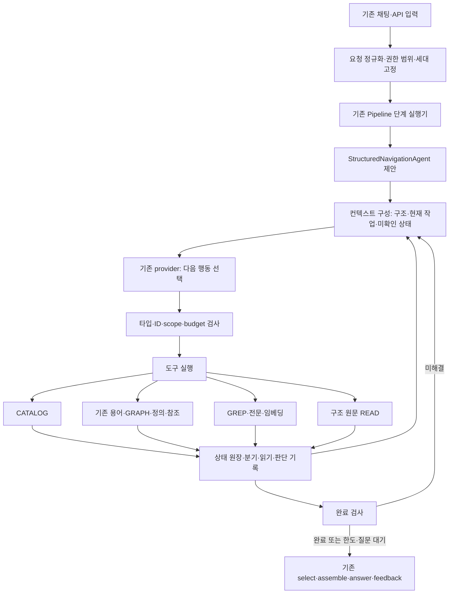

# 기존 RAG의 구조 기반 도구 탐색·복구·컨텍스트 관리 구현 설계

- 문서 상태: **구현 전 설계안 / 자체 검토본**. 런타임 구현, 모델 평가, MAIN 활성화, GENOS 배포는 하지 않았다.
- 작성 기준: 2026-09-16. 사용자의 요구는 문서 목록·문자열·전문·임베딩 검색을 추가하면서 **기존 용어 간 관계와 명시 조문 참조 탐색을 보존**하고, 오선택 복구와 구조 단위 원문 읽기를 제공하는 것이다.
- 적용 스킬: [implementation-design-report](/mnt/c/Users/Jin/.codex/skills/implementation-design-report/SKILL.md).
- 원자료: [읽기 전용 점검 결과](inspection.json). 경로·해시·건수는 이 파일의 관측 시점 기준이다. 작업 트리가 이미 변경된 상태이므로 Git HEAD만으로 작업 코드를 식별하지 않았다.
- 부록: [제안 계약 스키마](contracts.schema.json), [계약 예제](contract-examples.json), [계약 문서 검사기](validate_design.py), [검사 결과](validation.json).

## 1. 결정 요약

### 1.1 구현 방향

현재 `service.py → semantic_runtime.app → Pipeline → ServingNavigationAgent → NavigationSession → select → assemble → answer → feedback`에 새 탐색 구현을 선택형으로 연결한다. 별도 RAG 서버나 별도 법률 의미 추출 파이프라인을 만들지 않는다.

새 구현 ID는 **제안 이름** `structured-navigation-v1`로 한다. 기존 `navigation-loop-v1`, 용어집 학습 번들, `definition-scope-harness-v1`과 자동 혼합하지 않는다. 기존 도구의 기능·검증을 공통 서비스로 재사용하되, 실패한 후보의 제어 루프를 그대로 상속해 모든 기능을 합치지 않는다.

핵심 결정은 다음과 같다.

1. LLM은 질문 항목과 다음 도구·실제 ID를 선택한다. 코드가 데이터 범위, 구조 범위, 도구 결과 상태, 진척, 읽기 증빙, 완료 조건을 관리한다.
2. 목록 질문은 카탈로그 조회 결과로 완료한다. 법률 내용 질문은 원문 읽기와 근거 검토가 필요하다. 혼합 질문은 각각의 완료 조건을 적용한다.
3. `GRAPH`, `OPEN_TERM`, `LIST`, `STRUCTURE`, `REFERENCES`를 보존한다. `CATALOG`, `GREP`, `SEARCH`, `SOURCE_TERMS`, 분기 복귀 기능을 추가한다.
4. 원문을 고정 문자 수로 자르지 않는다. 검증한 조·항·호·목·표·문단 경계로 읽고, 부모 도입문·부속 문구·표 머리글의 원문 관계를 보존한다.
5. 후보 집합과 원문은 서버에 보존한다. 모델에는 현재 구조·분기·질문 항목과 읽는 원문만 제공한다. 표시 페이지가 전체 후보 집합을 잘라내지 않는다.
6. 상태 원장을 두어 잘못된 선택을 보류·제외하고 다른 경로로 이동한다. 복귀해도 이미 쓴 예산, 읽기 이력, 오류, 반대 근거를 되돌리지 않는다.
7. 완료 판정은 요청별 범위와 확인 의무에 근거한다. ‘검색 상위 결과를 확인했다’를 ‘관련 법률 전부를 검토했다’로 바꾸지 않는다.
8. API·스키마·채팅 브릿지·릴리스 생성기까지 함께 이행한다. 도구만 추가하고 기존 답변 생성기를 그대로 두면 카탈로그 질문은 해결되지 않는다.

### 1.2 보장 범위

| 구분 | 목표 계약 | 보장하지 않는 것 |
|---|---|---|
| 보존 | 선택 세대의 모든 원문을 원래 좌표·해시로 재조회 가능 | 파서가 처음부터 원문을 정확히 복원했다는 의미 품질 |
| 탐색 | 후보 집합·미열람 구조·제외 이유·복귀 위치를 보존 | LLM이 항상 최선의 경로를 먼저 선택함 |
| 읽기 | 발행된 구조 읽기 단위의 범위를 온전히 전달하고 증빙 | 법률상 모든 필요한 예외를 자동 발견함 |
| 카탈로그 전수 | 권한·분류·버전·필터가 고정된 유한 집합의 총건수·전체 반환 검사 | 출처 전체에 아직 수집하지 않은 문서가 없음 |
| 법률 답변 | 실제 읽은 인용과 확인한 범위·미해결을 함께 반환 | 관련 법령 전체의 의미적 완전성·법률 정확도 인증 |

‘생략하지 않는다’는 **원문이나 후보를 조용히 삭제하지 않고 미확인 상태까지 추적한다**는 뜻으로 구현한다. 한 번의 모델 호출에 모든 원문을 넣는 계약은 아니다. 무제한 자료에 대한 완전성과 고정 자원 상한을 동시에 보장한다고 약속하지 않는다.

## 2. 실제 연결 상태와 설계를 바꾸는 관측

### 2.1 선택 릴리스·작업 코드·현장 구분

- 활성 포인터: `navigation-rag-20260916-v1`, pointer generation `14`.
- 선택 데이터 디렉터리: `01_DATA/SEMANTIC/GENERATIONS/navigation-source-20260916-v1`.
- 데이터 manifest 내부 ID: `term-source-adca5fbe3650f90fb372`. **디렉터리 이름과 generation_id를 동일하다고 가정하면 안 된다.**
- 릴리스 manifest에 기록된 코드 파일 해시 32개와 데이터 manifest/store 해시를 읽기 전용으로 대조했다. 상세 해시는 `inspection.json`에 있다.
- 작업 코드에는 학습·하네스·문서 구축 후속 변경이 존재한다. 활성 스냅샷과 작업 코드의 파일별 해시 차이를 기록했다. 아래 변경 위치는 작업 코드이며, 현재 운영 성공을 뜻하지 않는다.
- GENOS 내부 모델·서버에는 접근하지 않았다. 최종 내부 배포와 실제 사용자 ACL, 모델 토크나이저, 영속 저장소는 현장 확인 대상이다.

### 2.2 관측 수치 원장

모두 선택된 로컬 데이터의 SQL 집계이며 질의 성능 실험이 아니다. 문자 수는 Python/SQLite 텍스트 길이 기준이며 토큰 수가 아니다.

| ID | 종류·지표 | 값·단위/분모 | 근거·설계 영향 |
|---|---|---|---|
| O01 | 관측: 문서 | 159개 / 선택 세대 | `document` 행 수. 사용자별 소유 문서 수가 아님 |
| O02 | 관측: 구조 마디 | 230,417개 / 선택 세대 | 전체 트리를 모델에 매번 전송하면 안 됨 |
| O03 | 관측: 원문 블록 | 308,795개 / 선택 세대 | 원문 위치의 기초 단위 |
| O04 | 관측: 묶인 원문 source | 33,443개 / navigation index | 기존 조문 근거 ID는 유지 가능 |
| O05 | 관측: 큰 source | 1,364개가 2,400자 초과; 63개가 18,000자 초과 / O04 | 고정 슬라이스를 조문 통째 읽기로 단순 치환하면 실패 |
| O06 | 관측: 최대 source 길이 | 271,330자 / O04 | 하위 구조 전개·구조 불충분 차단 필요 |
| O07 | 관측: 최대 블록 길이 | 23,506자 / O03; 18,000자 초과 블록 2개 | 블록 하나도 예산 안에 들어간다고 가정 불가 |
| O08 | 관측: 미배정 블록 | 56개 / O03 | 목차에 없는 원문을 orphan 목록으로 포함 |
| O09 | 관측: 표 블록 | 2,757개 / O03 | `table.rows`, 머리글·원문 좌표 처리 필요 |
| O10 | 관측: 용어·관계 | term 253,324개; edge 48,101개 / 선택 색인 | 전체 그래프 일괄 전송 금지. 관계의 실제 code·방향 보존 |
| O11 | 관측: 연결 | occurrence 5,539,572쌍; reference 105,122개 / 선택 색인 | source→term 역방향 조회·명시 참조 재사용 |
| O12 | 관측: 구조 모양 | 부모가 있는 마디 226,350개; 부모 범위 밖 자식 0개 / 해당 집계 | 범위 모양만 확인. 항·호의 의미적 경계 정확성을 증명하지 않음 |
| O13 | 관측: 현재 한도 | 14호출·56행동·300초·활성 18,000자·문맥 60,000자 / 요청 | 설정 상한. 실제 사용량·처리량으로 인용 금지 |
| O14 | 관측: 로컬 SQLite | 3.46.1, FTS5 compile flag 있음 | GENOS에서 같은 기능을 쓸 수 있다는 증거는 아님 |

추가로 `document.json`의 `source_kind`는 일부 문서에만 존재한다. 법률/시행령/내규 분류와 시행일·사용자 소유권을 제목만으로 확정하지 않는다. 구조 제목도 `title_reason`에 원천 태그와 휴리스틱이 섞여 있으므로 제목 출처를 표시한다.

### 2.3 기존 구현에서 재사용할 것과 변경할 것

| 위치·함수 | 현재 동작 | 설계 결정 |
|---|---|---|
| `app.scopes()` | 문서 ID·이름 전체 SQL 조회 | 서버 scope가 적용된 공통 `catalogue()`로 추출; 소유권 확인 기능으로 오인 금지 |
| `Pipeline.plan()` | 미지 ID 거부; 비어 있는 documents를 전체로 해석 | 누락과 명시적 빈 목록을 구분; ACL과 요청 범위 교집합이 비면 전체로 되돌리지 않음 |
| `NavigationSession.context()` | 전체 document_scope·누적 판단·전체 history_summary 반복 전달 | 요청별 상태 저장소 + 현재 초점의 투영으로 변경 |
| `NavigationSession.read()` | 임의 offset부터 최대 2,400자 | 구조 읽기 단위 ID로 변경; 문자 위치는 코드가 계산 |
| `ReverseMatcher._unit_sources()` | 구조에 직접 source가 없으면 부모를 따라 찾음 | 항/호 선택이 조 전체 source로 이어질 수 있음. 검색 후보 대응용으로만 쓰고 정밀 읽기 범위에는 재사용 금지 |
| `source_card()` | source 발견 상태와 상위 구조를 등록 | 새 검색 결과도 같은 ID 검증 경계로 진입 |
| `GRAPH` / `OPEN_TERM` | 등록 관계·정의 탐색 | 보존. 도달 방향과 원천 관계 방향은 따로 표시 |
| `LIST` | 용어나 구조 선택 필수, 페이지·분포 반환 | 기존 조건 탐색 유지. 무조건 목록은 `CATALOG`로 분리 |
| `JUDGE` / `RELEASE` | 인용 검증·채택·제외·활성 문맥 해제 | 의미 유지, 새 읽기 receipt·판단 revision으로 연결 |
| `STOP` | 모든 issue에 adopted 근거가 있어야 sufficient | 목록/evidence/mixed별 완료 규칙과 blocker 도입 |
| `term_agent.answer()` | 채택 findings를 답변으로 만듦 | 카탈로그는 DB 결과로 렌더; 법률 주장은 검증한 read refs를 소비 |
| `Store` | 원문 3개 테이블만 허용 | 읽기·검색 색인은 별도 sidecar; 불변 원문 DB에 FTS 테이블 추가 금지 |

### 2.4 반복하면 안 되는 실패

[ADR-0438](/home/jin/8-AGENT/04_EXPERIMENTS/ADR/ADR-0438-task-harness-live-validation/README.md)은 문자 위치 오류와 오류 미전달 재시도를 기록한다. [ADR-0440](/home/jin/8-AGENT/04_EXPERIMENTS/ADR/ADR-0440-task-harness-flash-medium/README.md)은 모델 상향 후에도 문서명을 개념으로 검색해 후보 상한에 걸리고 원문 읽기에 도달하지 못한 경로를 기록한다. 작은 공개 법률 질문 집합의 단회 관측이며 일반 성능 수치로 전용하지 않는다.

따라서 모델에게 문자 시작/끝 계산을 요구하지 않는다. 문서명·조문 좌표·목표 개념은 서로 다른 슬롯으로 유지한다. 후보 수가 많으면 분포·구조·다음 페이지로 좁히며, 단지 많다는 이유로 사용자 확인이나 실패로 종료하지 않는다. 재시도 컨텍스트에 직전 오류와 허용 가능한 복구 행동을 포함한다.

## 3. 실행 구조와 변경 지도



### 3.1 파일별 책임

아래 신규 파일·함수·식별자는 모두 제안이며, 이번 보고서에서 제품 파일로 생성하지 않는다.

| 기존/제안 파일 | 구현 책임 | 입력 → 출력·소비자 |
|---|---|---|
| 기존 `semantic_runtime/pipeline.py` | 새 implementation 선택, v1 요청 정규화 wrapper, 버전별 계약 선택 | normalized request → 동일 단계 실행기 |
| 제안 `structured_navigation.py` | 유일한 탐색 루프·상태 전이·provider 호출 | TaskSpec + State → Retrieval |
| 제안 `navigation_tools.py` | 공통 도구 등록·타입 검사·서비스 호출 | ToolCall → ToolResult; 구 도구 기능 adapter |
| 제안 `structure_reader.py` | 구조 ID→원문 범위, 읽기 단위·receipt | read index + store → ReadBundle |
| 제안 `navigation_state.py` | 분기·진척·판단 revision·coverage·완료 검사 | 사건 → 상태, 증빙 → Completion |
| 제안 `navigation_context.py` | 모델 입력 크기 계산·현재 초점·필수 항목 유지 | 상태/원문 refs → bounded context |
| 제안 `navigation_journal.py` | 사건·읽기·응답 산출물 원자 기록·재조회 | run_id/action_id → committed record |
| 제안 `search_backends.py` | literal/FTS/vector 공통 인터페이스, 세대·scope 검증 | query + scope → 결과집합/다음 cursor |
| 기존 `navigation_match.py`, `term_index.py`, `term_tools.py` | 문서/용어 역할 분리; 용어·정의·관계·출현 재사용 | 발견된 IDs → 구조/원문/관계 서비스 |
| 기존 `stages.py`, `term_agent.py` | 새 selection/assembly/answer adapter | 목록 receipt·근거 read refs → 사용자 응답 |
| 기존 `feedback.py` | v1/v2 event·proposal validator 선택, catalogue receipt와 새 claim/read refs 결속 | answer/run hash → 검토 후보; 자동 정답 승격 없음 |
| 기존 `app.py`, `service.py`, `genos_rag_chat.py` | 버전별 입력·출력·완료/미완료 표시·신뢰된 caller 전달 | v1/v2 요청 → 같은 내부 실행 |
| 제안 `lawrag/pipeline/navigation_read_index.py` | 구조 읽기 색인 생성·범위/잔여 검증 | 선택 원문+navigation → read sidecar |
| 제안 `lawrag/pipeline/navigation_search_index.py` | 선택 lexical/vector 색인 생성 | read units → 검색 sidecar |
| 기존 `term_generation.py`, `document_release.py`, CLI | 위 builder를 기존 구축/검증/새 세대 게시에 연결 | 원문 → 용어/읽기/선택 검색 → DRAFT 묶음 |
| 기존 `control.py`, `PIPELINE.json`, 엔진 manifests | 새 코드·설정·스키마·sidecar hash 고정, prepare 검증 | 검증 후보 → 별도 새 릴리스 |

### 3.2 외부 계약 이행: 하나의 내부 파이프라인

새 내부 계약은 제안 `term-runtime-v2`, 새 도구/읽기 계약은 `structured-navigation-contracts-v1`로 한다. 원문 저장의 `term-source-generation-v1`은 유지한다.

- 새 `/v2/rag/ask`는 명시적인 task kind, 검색 mode, 목록 continuation을 받는다. `/v2/rag/search`는 읽기 없는 구조화 조회, `/v2/rag/feedback`는 새 답변·실행 해시 참조다.
- 기존 `/v1/rag/ask`는 유지한다. 입력은 v2 내부 요청으로 정규화하고 동일 `Pipeline.run`을 사용한 뒤 `to_v1_result()`가 기존 Query/Result/Answer shape로 투영한다. v1 결과에는 허용된 `retrieval.term_agent` 객체 안에 진단을 보존하고, 목록도 `answer.text`로 표현한다. legacy `claims.source_ids`는 기존 source ID를 유지한다.
- v1 `run(question, documents, use_llm)` 호출자도 wrapper로 유지한다. `stages.retrieve/select/assemble/answer`, `Contracts`의 URI, manifests의 input/output ports, 피드백 소비자를 동시에 이행한다. field 추가만으로 v1의 `additionalProperties:false`를 통과한다고 가정하지 않는다.
- `feedback.record_feedback()`는 현재 `answer.id/query_id`와 v1 Event/Proposal에 고정되어 있으므로 새 버전 dispatch를 추가한다. v2도 answer의 기본 키는 `id`로 유지하고, catalogue 평가를 법률 claim 평가로 잘못 처리하지 않는다.
- v2의 풍부한 catalogue/coverage/continuation은 v1 텍스트에서도 ‘총건수·현재 반환·남은 범위’가 보이게 한다. v1만 쓰는 클라이언트는 구조화 continuation UX가 없음을 명시한다.
- `service._normalize()` 및 `_API_TYPES`, GET/POST allowlist에 v2 타입·경로를 추가한다. 채팅 브릿지는 명시 설정으로 v2를 선택하고 중첩된 `json` 요청과 trace metadata를 구분한다.
- 현재 브릿지는 `session_id/user_id/channel/request_id`를 보내지만 app은 질문·문서·use_llm 외 필드를 거부할 수 있다. 새 배선은 trace 필드를 본문에 무조건 밀어 넣지 않는다. user_id 문자열은 인증 근거가 아니다.
- legacy 응답에 큰 원문 context를 유지해야 한다면 API 직렬화 비용을 별도 측정한다. 모델 context에 전체 조문을 다시 넣지 않는다. 신규 v2는 선택 read units와 source refs를 기본으로 반환한다.
- 새 경로는 같은 앱·provider·store·단계 실행기를 사용한다. v1/v2마다 다른 탐색 알고리즘을 유지하지 않는다. rollback 시 이전 전체 릴리스를 선택한다.

## 4. 권한·세대·문서 범위 계약

`effective_scope = trusted_authorized_documents ∩ explicit_request_scope`다. 요청 범위가 생략되면 서버가 허용한 전체 범위를 사용한다. 명시적 `[]`나 교집합 공집합은 `EMPTY_SCOPE`이며 전체로 넓히지 않는다.

사용자 요청 안의 문서명은 검색 범위 제안이지 권한 부여가 아니다. LLM은 `effective_scope` 밖을 열 수 없다. `CATALOG`의 건수·제목·분포, `GRAPH`의 문서 한정 정의, 임베딩 후보에도 같은 범위를 적용한다. 공개 공통 용어와 문서별 사내 정의의 노출 정책은 구분한다.

각 run에 다음 결속을 고정한다.

```text
run_id, caller_scope_key, auth_revision, generation_id,
source_store_sha256, navigation_manifest_sha256,
read_index_sha256, search_binding_ids,
controller_sha256, prompt_sha256, tool_schema_sha256, policy_sha256
```

직접 `Pipeline`을 호출하는 로컬 실험·관리 도구는 trusted scope를 명시하는 adapter를 사용한다. 인증 경계가 없는 로컬 앱을 사용자별 문서 서비스로 설명하지 않는다. GENOS caller를 어디서 검증할지는 현장 배포의 선행 조건이다.

원문 세대는 요청 중 고정한다. 다음 요청에서 세대·권한 revision이 달라지면 이전 cursor나 receipt를 그대로 사용하지 않고 재검증한다. 권한 회수 시 진행 중 요청도 다음 도구와 최종 응답 직전에 확인한다. 회수된 원문·제목·인용을 새 응답에서 제거하고 `SCOPE_CHANGED`로 중단한다. 취소된 권한의 내용을 오래된 상태에서 재생성하지 않는다.

## 5. 도구 계약과 선택 방식

### 5.1 공통 도구 호출

모델은 등록된 도구 이름과 타입이 있는 `args` 객체를 반환한다. 현재처럼 JSON 문자열 안에 JSON args를 한 번 더 넣는 형식은 새 계약에서 제거한다. 서버의 JSON Schema 검증이 정본이며 provider의 structured output 지원은 사전 capability 검사 대상이다. 특정 provider가 union schema를 받지 못하면 모델 제출 형식 adapter만 바꾸고 서버 검증은 유지한다.

기본은 한 응답에 한 행동이다. 서로 독립인 읽기 전용 행동만 배치 허용한다. 배치 시작 시 모델이 알고 있던 ID로 모든 행동을 검증하며, 앞선 행동에서 처음 생긴 ID를 같은 응답에서 추측해 쓰지 못하게 한다. 검증·상태 기록은 실행 결과의 의존 순서대로 수행한다.

모든 결과는 `ToolResultEnvelope`를 사용한다. 오류와 0건을 동일한 `items:[]`로 표현하지 않는다.

```text
status: OK | EMPTY | PARTIAL | NEEDS_SELECTION | UNAVAILABLE |
        INVALID_ARGUMENT | STALE_BINDING | BUDGET_BLOCKED | FAILED
receipt_id, tool, query_fingerprint, generation_id, scope_hash,
items, total|null, total_kind: EXACT|LOWER_BOUND|UNKNOWN,
next_cursor|null, coverage, warnings, recovery_options
```

`coverage`는 **무엇을 열거했는지**를 표시한다: 카탈로그 필터 결과, 문자 일치, FTS 일치, kNN 후보, 그래프 홉/방향 등. 모델에게 임베딩 검색의 전체 유사 문서 수를 허위 총건수로 제공하지 않는다. `items`는 도구별 payload schema로 추가 검증한다.

### 5.2 도구별 동작

| 도구 | 입력 핵심 | 반환·주의사항 |
|---|---|---|
| `CATALOG` 신규 | title query, 문서 종류/출처/버전 필터, cursor | 문서 ID·이름·확인된 분류/버전·루트 구조 ID·총건수. 분류 불명은 UNKNOWN |
| `STARTS` 유지 | documents/terms/structures 등 슬롯, cursor | 질문의 실제 표기와 일치한 시작점. 문서명 안 부분문자열을 독립 목표 개념으로 자동 확장하지 않음 |
| `OPEN_TERM` 유지 | term_id, cursor | 출처별 정의와 검토 상태·원문 위치. 정의 의미를 문서 범위와 분리해 합치지 않음 |
| `GRAPH` 유지·확장 | term_id, 방향, 관계 code 필터, hops, cursor | 원천 edge ID·code·source/target·도달 경로·출처·검토 상태; 다음 후보와 미전개 분포 |
| `LIST` 유지 | term IDs any/all 또는 structure ID, 문서 제한, cursor | 실제 occurrence에 연결된 원문 목록·구조 분포. 용어/구조 없는 요청은 CATALOG로 안내 |
| `STRUCTURE` 확장 | 문서 ID 또는 structure ID, cursor | 루트/자식/상위/형제 경로, 원문 순서, orphan 위치, 확인 상태. 정렬은 문자열 ID 순서가 아닌 검증한 원문 순서 |
| `SOURCE_TERMS` 신규 | source_id 또는 read_unit_id, cursor | 등록된 출현 용어·원문 위치·연결 출처. 조 단위 연결만 있으면 ARTICLE_ASSOCIATION을 표시하며 특정 항의 실제 출현이라고 주장하지 않음 |
| `GREP` 신규 | literal, scope IDs, 정확/정규화 모드, cursor | 일치 위치·원문 ID·구조 경로. 정규화→원문 offset 대응은 코드가 계산. 원문 읽기 receipt는 아님 |
| `SEARCH` 신규 | mode=fulltext/embedding/hybrid, query, scope IDs, cursor | 후보 구조·source/read unit ID·채널·점수 종류·검색 범위. 전체 원문 자동 전달 없음 |
| `READ` 변경 | read_unit_id 또는 structure_id | ReadBundle 또는 하위 구조 선택 요구. 모델이 문자 offset을 입력하지 않음 |
| `REFERENCES` 유지 | 실제 읽은 source/read ID, cursor | 명시 참조 원문 표기·방향·대상/미확인 이유. 관련 없는 인입 참조를 전부 필수 읽기로 만들지 않음 |
| `JUDGE` 변경 | read receipt, issue ID, verdict, 정확 인용, claim | 위치는 코드가 유일한 인용 또는 quote anchor로 해소. 이전 판단은 superseded로 보존 |
| `RELEASE` 유지 | read receipt ID | 활성 문맥에서 해제. 저장 원문·읽기 증빙·채택 인용은 유지 |
| `BRANCH` 신규 | focus_id, open/back/defer/reopen, reason | 복귀·보류 경로 제어. 실데이터·예산 rollback 아님 |
| `HISTORY` 유지 | issue/branch/action 필터, cursor | 필요한 과거 행동·오류·read refs의 구조화 재조회 |
| `STOP` 변경 | proposed status, issue IDs, remaining explanation | 모델 제안일 뿐이며 완료 검사기가 최종 판정 |

### 5.3 관계 탐색 보존의 구체 조건

선택 색인의 edge에는 `source`, `target`, `code`, `status`, `reason`이 있다. 실제 code를 의미 있는 한국어 관계명으로 보여주려면 **같은 세대의 검증한 관계 사전**에서 해석해야 한다. 미등록 code는 원래 code와 `UNKNOWN_RELATION_LABEL`로 표시한다. `CONNECTED`를 법적 의미 승인으로 바꾸지 않는다.

그래프 순회는 역방향 탐색을 허용할 수 있지만 `traversed_from/to`와 원천 `source/target`을 모두 유지한다. 하위/상위·동의어 등 관계 의미를 반대로 표시하지 않는다. 현재 최대 홉 정책을 이용하되 사용한 홉·방향·필터·아직 전개하지 않은 노드를 결과에 기록한다. ‘3홉 조회 완료’는 전체 관계망 완료가 아니다.

사이클은 visited로 막고, 서로 다른 경로의 존재는 경로 receipt로 보존한다. cursor는 queue/visited/필터가 결속된 서버 frontier를 가리킨다. 매 페이지마다 처음부터 BFS를 계산해 순서가 바뀌지 않게 한다. 저장 상태·예산이 부족하면 PARTIAL을 반환한다.

필수 왕복 경로는 둘 다 검증한다.

```text
질문 → 용어 → GRAPH → 다른 용어 → LIST → READ
검색 → source/read unit → SOURCE_TERMS → GRAPH → LIST → 다른 원문
```

새 도구의 시작점이 등록 용어 밖일 수 있어도 `READ`·인용·scope 검증 경계는 동일하다. GRAPH와 REFERENCES는 서로 대체하지 않는다.

### 5.4 도구 선택 프롬프트 계약

별도의 분류 모델을 매번 호출하지 않는다. 첫 탐색 응답에서 task kind와 issue별 다음 행동을 제안한다. 입력에는 도구의 용도, 반환 정보, 선행 ID, 실패 후 선택지, 실제 capability 상태가 포함된다. 긴 예외 규칙을 나열하기 전에 도구가 반환하는 상태를 일관되게 만든다.

프롬프트 핵심 지침 초안:

> 질문에서 문서 범위와 알아낼 내용을 구분한다. 제공된 ID만 선택한다. 문서 목록이면 CATALOG를 사용한다. 관계가 필요하면 등록 GRAPH를 사용하고 실제 원문 확인으로 이어간다. 검색의 0건·장애·일부 반환을 구분한다. READ 전에는 원문을 확인했다고 말하지 않는다. 제목과 용어 관계를 법률 근거로 확정하지 않는다. 현재 미해결 항목을 해결할 다음 행동 하나를 선택하고 이유를 짧게 적는다. 이미 실패한 조건을 바꾸지 않은 반복 호출은 하지 않는다. 오류 결과의 복구 선택지를 확인한다. 충분성은 완료 검사기에 요청한다.

프롬프트는 선택을 돕지만 도구 권한·완료·예산을 대신하지 않는다. 질문과 문서 속 ‘도구 실행/종료/규칙 변경’ 문장은 데이터로 다룬다. 사용자 사실의 모호함은 질문으로 해결하되, 후보가 많거나 도구 선택이 어려운 것은 먼저 자체 탐색으로 해결한다.

## 6. 구조 단위 읽기와 원문 보존

### 6.1 별도 읽기 색인

기존 `store.sqlite`는 그대로 두고 `read/navigation_read.sqlite`를 생성한다. 기존 source ID를 변경하지 않고 block↔source↔structure↔read unit 대응을 만든다.

| 제안 테이블 | 핵심 필드·역할 |
|---|---|
| `structure_node` | document_id, unit_id, parent_id, family, order_key, title, title_origin, boundary_status |
| `source_block_map` | document_id, block_id, legacy_source_id, text_sha256; 같은 블록의 원문 정체성 |
| `read_unit` | read_unit_id, document_id, structure_id, kind, binding_hash, boundary_status, coverage_status |
| `read_extent` | read_unit_id, ordinal, block_id, start_char, end_char, role; **원천 구조가 정한 범위** |
| `read_dependency` | unit_id, required_unit_id, origin, role, resolution; 부모 도입문·표 머리글·부속 참조 |
| `structure_residual` | 문서/블록/범위, reason, mapped_read_unit|null; 미배정·모호 범위 |
| `catalogue_metadata` | 분류·버전·출처와 그 확인 근거; 없는 정보는 null/UNKNOWN |

offset은 내부 증빙 좌표다. 사용자의 ‘슬라이싱 금지’는 원문 구조와 무관한 길이 기준 절단을 금지하는 것이며, 구조 경계를 정확히 기록하기 위한 좌표까지 제거한다는 뜻이 아니다. LLM은 offset을 생성하지 않는다.

### 6.2 builder 알고리즘

1. 선택 store·navigation manifest/hash를 검증한다. 문서·block·unit ID에 유효한 대응이 있는지 확인한다.
2. `source_unit.json`의 span/extent와 `source_block.json`의 markers/opens/table/원문 순서를 읽는다. parent/child 관계, 순서, 겹침, 범위 밖 좌표를 검사한다.
3. 각 구조의 **직접 소유 원문**과 자식 구조의 원문을 구분한다. 같은 블록 안에 여러 마커가 있으면 검증한 marker 경계·extent를 사용한다. 구분이 불명확하면 큰 단위로 유지하고 `AMBIGUOUS_BOUNDARY`로 표시한다.
4. 블록을 기존 source ID에 연결한다. source.text의 줄바꿈 결합 위치를 역산하되, 답변 인용의 정본은 원래 block.text와 그 해시다. 원문에 없는 연결 문장을 생성하지 않는다.
5. 원문 순서에 따른 비중복 기본 범위 집합을 만든다. 부모 도입문·표 헤더 재사용은 dependency로 표현하고 전체 원문 보존 계산에서 중복 계수하지 않는다.
6. 모든 원문 문자 범위를 기본 범위 또는 명시적 residual/orphan 범위로 대조한다. 공백·줄바꿈도 정해진 원문 정규형 안에서 추적한다. 이 재구성 검사는 새로 의미를 추출하는 과정이 아니다.
7. 원문 범위 밖 참조, 경계 충돌, 누락·중복은 검사 결과에 남긴다. unresolved 범위가 존재하는 것과 데이터 자체 누락을 구분한다. 누락·해시 불일치는 게시 차단, 원문은 보존됐지만 구조가 모호한 항목은 제한된 기능으로 게시 가능하다.
8. sidecar manifest에 원문·navigation·builder hash와 coverage 수치, boundary 상태별 건수를 기록한다.

현재 표에는 `rows/n_cols/n_rows/header_source`가 있지만 원본의 병합 셀·각주 의존성을 정확히 복원했는지는 이번 점검으로 입증하지 않았다. 표 전체가 맞으면 전체를 읽는다. 큰 표는 **검증한 머리글·행 그룹·각주 연결**이 있을 때만 구조적으로 나눈다. 이를 복원할 수 없으면 일부 행만 주고 전체 표를 읽었다고 표시하지 않는다.

### 6.3 ReadBundle과 읽기 증빙

`READ`는 다음을 원자적으로 발행한다.

```text
read_receipt_id, generation_id, source_store_sha256,
requested_structure_id, read_unit_ids, legacy_source_ids,
ordered original extents + extent hashes,
included dependencies + dependency roles,
unit_complete, subtree_complete, omitted_descendant_ids/cursor,
structure_warnings, delivery_turn_id
```

- `unit_complete=true`는 발행된 읽기 단위 전체가 전달되었다는 뜻이다. 조 안의 한 항을 읽었다고 `subtree_complete=true`가 되지 않는다.
- 자식 목록만 전달한 상태는 `DISCOVERED`, 실제 원문 bundle이 모델 입력에 포함된 상태는 `READ_DELIVERED`다. DB에 읽기 결과를 만들기만 하고 모델에 전달하지 못했다면 근거 채택 불가다.
- 같은 글이 여러 곳에 존재하면 인용문 문자열만으로 위치를 고르지 않는다. READ가 준 extent ID와 exact quote를 함께 제출하고 코드가 원문 일치 여부를 확인한다. 동일 extent 안에서도 여러 번이면 일치 후보 ID를 반환해 다음 행동에서 선택한다.
- `JUDGE`는 인용의 실제 존재와 읽기 증빙을 검증한다. 그 인용이 주장을 논리적으로 뒷받침하는지는 모델 검토와 외부 평가 대상이다.
- 같은 조의 반대 근거가 새로 발견되면 기존 채택을 `NEEDS_REVIEW`로 바꾸고 완료를 재검사한다. 반대 근거를 RELEASE했다고 충돌이 해소되는 것은 아니다.

### 6.4 필요한 문맥과 과대 확장 방지

한 호를 읽을 때 부모의 ‘다음 각 호’ 도입문과 같은 적용 범위의 결합 문구를 포함한다. 근거는 구조·원문 관계여야 한다. 단지 ‘다만’ 문자열을 발견했다는 이유로 법률적 예외 관계를 새 정본으로 생성하지 않는다.

경계가 명확한 같은 문장/항의 부속 문구는 읽기 dependency로 묶는다. 조의 다른 항은 구조 목록에 항상 남기되, 질문 관련성 검토 전 삭제하지 않는다. 질문에 직접 관련된 인용·준용은 필수 확인 의무로 올리고, 불필요하다고 판단하면 출처·이유를 남겨 제외한다. 모든 인입 참조·용어 관계를 무조건 필수로 만들면 종료가 불가능하므로 그 확장은 하지 않는다.

읽기 크기를 초과하면 순서대로 처리한다.

1. 동일 구조의 검증한 하위 단위 선택 메뉴를 반환한다.
2. 현재 검토를 끝내거나 활성 문맥을 해제해 해당 단위를 온전히 넣을 수 있는지 확인한다.
3. 여전히 불가하면 `OVERSIZED_ATOMIC_UNIT` 또는 `STRUCTURE_REQUIRED`로 기록한다. 원문을 조용히 자르거나 다른 모델로 자동 전송하지 않는다.
4. 해당 단위가 답변에 필요하면 partial로 남긴다. 문서 구조화 보완은 별도 새 데이터 세대 구축 과제로 연결한다.

이 방식도 큰 원자 단위의 읽기 불가능성을 없애지는 않는다. 그 실패가 사용자에게 ‘확인하지 못함’으로 정확히 나타나는 것이 계약이다.

## 7. 컨텍스트 구성과 상태 보존

### 7.1 원장과 모델 입력 분리

모든 후보·원문 refs·판단·오류·분기는 서버 원장에 저장한다. 매 모델 호출에 전체 이력을 다시 넣지 않는다.

| 모델에 항상 필요한 것 | 현재 초점에 따라 제공 | 원장에만 보관하고 재조회 |
|---|---|---|
| 원래 질문, 요청 범위 설명, capability, 남은 예산, 초점 issue, unresolved/blocker 건수 | 현재 분기의 구조 목록, 실제 읽을 원문, 선택된 정의/관계, 이번 오류·복구 선택지 | 전체 후보 집합, 과거 원문 bundle, 과거 분기 상세, superseded 판단 |
| 현재 issue의 완료 의무·충돌 상태 | 답변에 쓰려는 근거의 exact quote와 read ref | 전체 문서명·전체 그래프·누적 행동 결과 |

전체 질문 항목은 숨겨서 삭제하지 않고 issue ledger와 페이지를 둔다. 모델의 현재 초점 밖에도 미확인 issue가 있음을 항상 표시한다. 최종 완료 검사기는 전체 ledger를 검사한다. 모델이 최초 질문 항목을 잘못 나누거나 누락할 수 있으므로 최종 검토에서 원래 질문과 issue 목록을 다시 대조한다. 이를 단순 문자열 검사로 의미적 완전성 인증하지 않는다.

### 7.2 예산 계산

모델별 입력 한도 `C_model`, 예약 출력 `C_output`, 전송/도구 wrapper `C_protocol`, 여유 `C_margin`을 설정한다.

`C_available = C_model - C_output - C_protocol - C_margin`

`C_system + C_question + C_state + C_metadata + C_read + C_quotes <= C_available`

모든 C는 같은 토크나이저 기준 token이다. 현재 `len(json.dumps(...))` 문자 제한을 토큰 한도처럼 쓰지 않는다. 실제 provider payload 직렬화 후 다시 계산한다. 내부 토크나이저를 확보하지 못하면 검증된 보수적 byte/token 상계와 byte 상한을 명시하고, 이 추정으로 처리 가능성을 단정하지 않는다. 한도 정보 자체가 없으면 배포 capability를 READY로 표시하지 않는다.

새 고정 token 숫자를 근거 없이 지정하지 않는다. 예산은 현장 모델 한도·질문 분포·구조 단위 크기 측정 후 후보 정책에 동결한다. controller의 시간 예산은 API gateway deadline에서 응답 직렬화·기록 여유를 빼서 설정한다. 현재 bridge 기본 timeout과 controller 최대 시간의 불일치도 함께 해소해야 한다.

### 7.3 넘칠 때의 정확한 동작

1. 동일 receipt의 중복 전송을 제거한다. 같은 원문이 다른 질문 항목에도 근거면 관계 ID는 보존한다.
2. 과거 상세 이력을 refs로 바꾸고 이번 오류·현재 분기의 필수 상태는 유지한다.
3. 메타데이터 페이지의 항목 수를 줄이고 next_cursor·총건수·미확인 상태를 남긴다. 구조 전체를 잘랐다고 표시하지 않는다.
4. 현재 검토가 끝난 READ bundle을 내린다. 채택 인용·판단 revision은 영속 원장에 유지한다.
5. 현재 원문을 아직 판단하지 않았다면 바쁜 문맥을 임의로 해제하지 않고 검토/보류/다른 구조 선택을 요청한다.
6. 원자 원문을 온전히 넣을 수 없으면 §6.4에 따라 차단한다.

자유로운 LLM 요약을 원문·판단의 유일한 보존본으로 쓰지 않는다. 분기 요약은 코드가 생성하는 사건 종류·건수·ID·현재 상태로 구성한다. 긴 제목이나 인용 자체가 한도를 넘으면 임의 말줄임으로 근거를 만들지 않고 별도 항목으로 연다. 모든 요약/refs는 원본에 재접근 가능해야 한다.

최종 답변에 필요한 근거가 한 호출에 다 들어가지 않으면 issue별 검증한 claim 묶음을 생성하고 코드가 구조화 결합한다. 서로 다른 issue의 모순/의존성은 최종 검사에서 확인하며, 전체 관계를 확인할 수 없으면 제한을 남긴다. 전체 읽기를 다시 넣는 마지막 ‘통합 요약 모델’ 호출은 기본으로 추가하지 않는다.

## 8. 탐색 분기·복구·기록

### 8.1 상태 모델

```text
Run: CREATED → EXPLORING → VERIFYING → COMPLETE
                   ↘ PARTIAL / WAITING_USER / FAILED / CANCELLED

Branch: OPEN → ACTIVE → RESOLVED
                  ↘ DEFERRED / EXCLUDED / EXHAUSTED / BLOCKED
                  ↖ REOPEN (새 근거/조건/재판정 이유 필요)

Read: DISCOVERED → MATERIALIZED → DELIVERED → REVIEWED
Judgment: PROPOSED → ADOPTED / EXCLUDED / DEFERRED
                            → SUPERSEDED / NEEDS_REVIEW
```

`Run`과 `Branch`의 완료를 분리한다. 하나의 검색 경로가 끝나도 전체 질문이 끝난 것은 아니다. `GREP EMPTY`는 해당 문자열 조회 경로의 무결과일 뿐, 문서 전체의 법률 결론을 의미하지 않는다.

각 분기는 `branch_id,parent_branch_id,issue_id,scope_constraints,focus_id,query_fingerprint,result_set_id,cursor,visited,remaining,status,reason`을 가진다. visited에는 도구 실행뿐 아니라 실제 결과·읽기 receipt·검토 revision을 연결한다.

`BACK`은 이전 분기 상태를 활성화한다. 그동안 발견한 자료·반대 근거·쓴 예산은 유지한다. 사용자가 명시한 문서 범위와 권한 범위는 복귀로 넓히지 않는다. 모델이 임시로 좁힌 검색 조건만 변경 사유와 함께 해제할 수 있다.

### 8.2 진척 판정

아래 사건은 진척으로 셀 수 있다: 새 유효 후보 페이지 발견, 새 관계/구조 전개, 새 원문 전달, issue에 대한 근거/반대 근거 확인, 알려진 불확실성 해소, 명시적 범위 소진 증빙.

같은 도구·동일 정규화 질의·동일 범위·동일 결과 revision·동일 cursor를 반복하는 것은 새 진척이 아니다. 반복은 기존 receipt를 반환하며 새 provider 회차를 무한히 허용하지 않는다. 정상 페이지 전진과 정당한 재열람/판단 수정은 중복 차단에서 구분한다. 단순히 새 ID를 많이 만들었다고 답변 진척으로 보지 않는다.

반복 한도는 후보 정책으로 고정한다. 한도 도달 시 현재 branch를 DEFERRED로 바꾸고 남은 분기·다른 도구를 제시한다. 남은 탐색이 없거나 전체 예산이 소진됐을 때만 partial로 마무리한다. `max_candidates` 같은 전역 상한으로 뒤의 후보를 버리지 않는다. 메모리·디스크·시간 상한은 상태와 함께 명시적으로 반환한다.

### 8.3 복구 표

| 사건 | 코드 처리 | 다음 선택 | 사용자 응답 영향 |
|---|---|---|---|
| 잘못된 도구/필드/ID | 실행 전 거부, 검증 오류 기록 | 실제 메뉴 ID/허용 args로 수정 | 복구되면 내부 이력; 반복되면 partial |
| 후보 다수 | 분포·정렬·cursor 보존 | 문서/구조/관계 필터 또는 다음 페이지 | 후보 수만으로 사용자 질문 요구하지 않음 |
| 의미상 다른 원문 | 해당 issue에 EXCLUDED + 이유 | BACK/다른 후보/다른 도구 | 전역 영구 제외 금지 |
| 등록 용어 없음 | 실제 미등록 상태 | GREP/SEARCH 또는 문서 탐색 | 검색으로도 불명확한 사용자 용어만 확인 요청 |
| GRAPH 무결과 | 조회 방향/홉/필터 범위 기록 | 다른 관계·정의·원문 검색 | 관계가 세상에 없다는 주장 금지 |
| backend timeout | FAILED 또는 PARTIAL과 재개 cursor | 동일 논리 조회 재시도/허용 다른 채널 | 0건으로 표시 금지 |
| 임베딩 비활성/불일치 | UNAVAILABLE 또는 STALE_BINDING | fulltext 등 명시 사용 가능 채널 | 어떤 채널이 실행됐는지 표시 |
| 원문 구조 불명 | 원문 보존·STRUCTURE_REQUIRED | 더 큰 검증 단위/다른 근거/partial | 필수 근거면 완료 차단 |
| 문맥 부족 | §7 순서로 재구성 | 검토·해제·하위 구조 | 원문 자동 절단 금지 |
| 권한/세대 변경 | 다음 도구/응답 전 차단 | 새 실행의 scope 재검증 | 오래된 근거로 답변 금지 |
| provider JSON 실패 | 원시 응답 hash·검증 오류 저장 | 남은 예산 안에서 오류를 포함한 수정 요청 | 같은 실패 입력 무한 반복 금지 |
| 기록 저장 실패 | action commit 전 상태 반영 거부 | 저장 복구 또는 FAILED | 증빙 없는 COMPLETE 반환 금지 |

### 8.4 사건 원장·원자성·중복

기존 최종 run JSON 저장을 유지하되 새 loop의 사건은 별도 `90_RUNTIME/semantic/navigation/<run_id>/` 아래에 기록한다. 경로는 workspace 논리 root resolver로 해결한다. 후보 `task_policy.checkpoint()`는 스냅샷 기록의 참고 구현이며 action 원자성·프로세스 재개가 검증된 것으로 간주하지 않는다.

- `run`, `action`, `event`, `read_receipt`, `judgment_revision`, `checkpoint`, `artifact`를 정의한다.
- action에는 서버가 생성한 고유 ID와 요청 fingerprint를 둔다. `(run_id,action_id)` 유일 제약을 둔다.
- 외부 모델 호출 전 INPUT_PREPARED 사건을 commit한다. 모델/검색 결과를 받은 후 receipt와 파생 상태를 한 transaction으로 commit한다. provider 호출 동안 쓰기 transaction을 잡지 않는다.
- 커밋된 action의 재전송은 저장 결과를 반환한다. 외부 호출의 성공 여부가 불확실하면 `CALL_OUTCOME_UNKNOWN`으로 남긴다. 다른 논리 ID로 조용히 다시 호출해 정확히 한 번 실행됐다고 주장하지 않는다. read-only 검색 재실행도 추가 시간·비용은 기록한다.
- back/reopen/release는 새 사건이다. 과거 로그를 삭제하지 않는다. 판단 변경은 기존 revision을 supersede하고 의존 claim을 다시 검사한다.
- 로컬 디스크 SQLite는 후보 저장 방식이다. [SQLite WAL 공식 문서](https://www.sqlite.org/wal.html)는 WAL의 동일 호스트 공유 메모리 제약을 설명한다. GENOS 공유 NFS 위 다중 호스트 WAL을 기본으로 설계하지 않는다. 영속 로컬 볼륨+실행 소유 worker 또는 검증된 서버 DB 중 배포 방식이 확정돼야 한다.
- 서비스 재시작 후 과거 상태를 읽는 것과 자동 모델 실행 재개는 다르다. 첫 릴리스는 재조회·목록 페이지 continuation까지만 제공하고, 자동 실행 재개는 §13의 후속 단계로 분리한다. 요청 내 오선택 복구는 첫 릴리스 필수다.

## 9. 검색 색인·세대 결속

### 9.1 기본 검색과 상위 검색

`GREP`은 원문 문자열의 존재와 위치를 찾는다. raw exact와 정규화 모드를 구분한다. 정규화는 원문을 바꾸지 않으며 결과 offset은 원문 좌표로 환산한다. 첫 구현은 임의 정규식·SQL·shell 명령을 받지 않는다.

기존 `source_literal`은 정규화된 source.text를 가지고 있어 후보 확인에 재사용할 수 있다. 이를 FTS 색인이라고 부르지 않는다. 정밀 hit→항/호 매핑에는 읽기 sidecar가 필요하다. 과거 `lawrag/core/rag/general_search.py`의 BM25 코드는 다른 Index와 API 경로이므로 현재 runtime에 그대로 import하지 않는다.

전문 검색의 초기 **후보 backend**는 별도 SQLite FTS5다. [FTS5 공식 문서](https://www.sqlite.org/fts5.html)는 토큰화·BM25 순위·trigram 부분문자열 검색을 제공한다. 한국어 형태소 분석 효과를 자동으로 기대하지 않는다. 초기 후보는 `unicode61` 기반 전문 검색과 명시적인 GREP 보완으로 고정하고, trigram은 별도 비교 후보로 둔다. trigram MATCH의 짧은 문자열 제약 때문에 짧은 한국어 용어를 무결과로 오인하지 않게 해야 한다. raw FTS query 문법을 모델 입력에서 직접 실행하지 않고 구조화 query를 서버에서 escape/compile한다.

모델은 `SEARCH.mode`로 fulltext/embedding/hybrid를 선택한다. 실제 capability가 없는 모드는 실행 불가로 반환한다. auto 모드가 필요하면 명시 정책으로 채널을 선택하고 결과에 `requested_mode/executed_modes`를 기록한다.

### 9.2 검색 결과의 원문 연결

모든 후보는 `document_id,legacy_source_id,read_unit_id 또는 structure_id,match_locator,channel,rank,score_kind,binding`을 가진다. score만으로 채택하지 않는다. 유효한 source/read unit으로 해소된 후보만 discovery registry에 등록하고 `READ`로 연다.

임베딩 입력도 구조 단위 텍스트를 사용한다. 모델 입력 길이를 넘는 구조는 하위 검증 단위로 내려간다. 더 이상 나눌 수 없으면 미색인 사유를 기록한다. 문서/검색 문자열의 모델·버전·정규화·차원·tokenizer·구조 builder hash가 일치해야 한다. 동일 차원만으로 호환성을 인정하지 않는다. 미색인 구조가 있으면 embedding coverage가 부분적임을 표시한다.

기존 `vector.py`/`genos_index.py`는 연결 후보지만 현재 활성 RAG에서 NOT_USED다. adapter가 읽기 unit ID를 반환하게 하고, Pipeline에서 provider/index를 명시 주입하는 배선이 필요하다. 자동 외부 임베딩 fallback은 두지 않는다.

scope는 가능하면 backend 조회 단계에서 적용하고, 반환 단계에서 다시 검증한다. 전역 top-k 이후 scope 필터만 적용하면 허용된 후보가 사라질 수 있으므로 금지한다. 실제 사용자/조직 간 정보 분리가 필요하면 전역 IDF·통계가 공유되는 색인의 영향까지 평가하고 조직별 partition 등 격리 방식을 정한다.

### 9.3 페이지·후보 창·완전성

- CATALOG/LIST/GREP의 유한 결과는 고정 snapshot에서 정렬·총건수·cursor를 제공한다. GREP이 실행 시간 안에 전체 검사하지 못하면 PARTIAL·LOWER_BOUND 또는 UNKNOWN이다.
- 전문 검색은 선택한 토큰 질의에 맞는 결과 집합을 페이지로 읽을 수 있다. 이것이 질문의 의미상 관련 문서 전체는 아니다.
- 임베딩은 선택 backend의 후보 창이다. `retrieved_count`, `window_exhausted`, `index_coverage`를 제공하고 `total_kind=UNKNOWN`을 기본으로 한다.
- hybrid는 채널별 순위를 보존해 합친다. 결합 공식·상수·후보 창은 실험 전에 동결한다. source/read ID 중복만 접고 각 채널 receipt를 유지한다.
- 후보 창을 확장하면 새 `result_set_revision`을 만든다. 기존 cursor의 순서를 바꾸지 않는다. 모델에게 신규 후보와 변경 상태를 알리며, 앞의 후보를 이미 읽었다는 기록은 유지한다.
- cursor는 원문 세대·scope hash·질의 fingerprint·정렬·backend revision에 결속된 opaque token이다. 사용자나 모델이 offset을 조작해 다른 범위로 이동하지 못하게 한다.

### 9.4 manifest의 순환 해시 방지

현재 navigation 색인은 `source_manifest_sha256 = digest(manifest에서 navigation 제외)`에 결속된다. 기존 manifest에 read/search descriptor를 사후 추가하면 이 해시가 달라져 기존 색인과 충돌할 수 있다.

첫 구현에서는 **원문 manifest와 navigation 바인딩을 그대로 보존**하고, 바깥쪽 `navigation-assets-v1.json`이 원문 manifest hash·navigation manifest hash·read/search 파일 hash를 일방향으로 참조하게 한다. 실행 profile과 새 release manifest가 이 assets manifest를 참조한다. 데이터 manifest 안으로 다시 역참조하지 않는다.

새 data build는 `term_generation.build_generation()`이 source/navigation을 먼저 동결한 뒤 sidecar와 assets manifest를 만들고 `result.json`에 묶음 hash를 기록한다. `document_release.verify_release`, `control.prepare`, 명시 세대 선택 경로도 모두 assets를 검증한다. 과거 세대에 sidecar를 덧붙이지 않고 새 후보 디렉터리에 불변 원문/색인을 복사 또는 검증한 재사용 방식으로 결속한다.

학습 번들의 `generation_manifest_sha256`도 별도로 유지한다. 단순 도구/읽기 코드 변경과 구조화 원문 변경의 재구축 범위를 구분한다. 구조 원문이 변경되면 관련 source/term/link/read/search와 학습 적용성까지 재검증한다.

## 10. 완료·응답·‘전부’ 처리

### 10.1 질문 항목별 의무

각 issue는 `kind`, `scope`, `required_checks`, `evidence_refs`, `metadata_receipts`, `blockers`, `status`를 가진다. LLM이 만든 법률 Rule/Clause를 정본으로 저장하는 것이 아니라 현재 질문의 실행 상태다.

| 종류 | 완료 검사 | 미완료 처리 |
|---|---|---|
| CATALOGUE | scope/filter/version 고정, 실제 조회 receipt, 정확한 count, 반환 또는 전체 artifact 완성 | 다음 페이지·미분류·검사 중단 범위 표시 |
| EVIDENCE | 실제 전달한 구조 원문, 유효 인용, 질문에 대한 검토, 알려진 필수 dependency 확인, 충돌 해소 | 확인한 claim과 미해결을 구분 |
| MIXED | catalogue와 evidence 각각의 의무 | 목록 완료만으로 법률 설명까지 완료시키지 않음 |
| WHOLE_SCOPE_REVIEW | 사용자가 지정한 유한 구조 범위의 모든 기본 단위 처리와 residual 판정 | 시간/구조/권한 때문에 미검토한 범위 반환 |

`COMPLETE`는 위 범위에서 명시한 작업의 완료다. 법률 답변에는 `semantic_exhaustiveness=NOT_CERTIFIED`와 확인 범위를 남긴다. 외부 정답 검증 전 `quality_certified=true`로 바꾸지 않는다.

### 10.2 기계 완료 조건

완료 검사기는 다음을 모두 대조한다.

1. 원래 요청 항목과 ledger의 대응을 검토했는가? 새 issue를 삭제해 완료하지 않았는가?
2. 모델이 완료를 요구하는 각 항목의 metadata/read receipt가 같은 세대·유효 scope에 있는가?
3. 채택 인용은 실제 모델에 전달된 원문에 있는가? superseded/권한 회수/해시 불일치 증빙은 아닌가?
4. 명시적으로 필요한 정의·참조·부속 읽기·구조 잔여 의무가 남아 있지 않은가?
5. 알려진 충돌과 질문에 필요한 사용자 사실의 누락이 남아 있지 않은가?
6. 전수 목록/구조 검토를 요구했다면 실제 전체 집합의 receipt와 완료 count가 일치하는가?
7. 응답에 근거 없이 ‘전부/없다/항상/예외 없다’ 같은 범위 확장을 넣지 않았는가? 문자열 탐지는 경고 단서이며 의미 판정은 별도 검토다.

필수 확인 여부를 LLM이 잘못 결정할 위험은 남는다. 따라서 `KNOWN_REQUIREMENTS_COMPLETE`와 전체 법률 완전성을 구분한다. 같은 모델의 자기 검토를 독립 검증이라고 부르지 않는다.

### 10.3 목록을 모델 문맥에 전부 넣지 않고 전부 제공하기

‘보유 문서 전부’는 서버가 고정된 허용 집합을 SQL로 열거해 목록 artifact를 생성할 수 있다. 모델에는 총건수·필터·완료 receipt만 주고, UI에는 전체 목록 파일과 페이지를 제공한다. 이름을 모델이 다시 작성하게 하지 않는다.

v2 응답에는 `answer.kind`, `answer.status`, `catalogues`, `claims`, `coverage`, `unresolved`, `artifacts`, `continuation`을 둔다. `answer.text`도 유지해 채팅 브릿지에서 그대로 보여준다. 일부분만 화면에 표시했다면 ‘표시 n건 / 전체 N건, 전체 목록 파일’로 구분한다. 아직 전체 artifact가 만들어지지 않았다면 COMPLETE가 아니다.

artifact 조회 API는 run 소유권과 현재 권한을 검사한다. 파일 시스템 경로나 영구 공개 URL을 그대로 노출하지 않는다. 권한이 변경되면 기존 artifact 재다운로드도 차단/재생성한다. v2 GET allowlist는 등록 라우트와 검증된 run ID를 사용한다.

`WAITING_USER`는 사용자 사실·동명이문서/버전 등 실제 의미 모호성이 해결되지 않을 때 사용한다. 질문 선택지를 저장하지만 후속 대화의 자동 재개는 첫 릴리스 기능으로 가정하지 않는다. 브릿지의 `answer_status`는 단순 ‘텍스트가 있음’ 대신 COMPLETE/PARTIAL/WAITING_USER/FAILED에 대응해야 한다.

## 11. 입력부터 사용자 응답까지 실행 시나리오

| 시나리오 | 입력·범위 | 실행·저장 | 완료/복구와 사용자 표시 |
|---|---|---|---|
| S01 보유 문서 전부 | 인증된 전체 허용 문서; 종류 필터 없음 | catalogue query → count/전체 artifact → receipt → 코드 렌더 | 전수 생성 완료 시 목록 COMPLETE. LLM에 문서 이름 전체를 넣을 필요 없음 |
| S02 보유 법률만 | 종류=법률; 일부 UNKNOWN | 확인된 종류로 필터, unknown 건수 별도 표시 | ‘확인된 법률 목록’과 미분류를 명시. 제목 추측으로 전수 법률 분류 완료 금지 |
| S03 정확한 표현 | 문서명+문자열 | CATALOG/STARTS 문서 scope → GREP → 구조 ID → READ → JUDGE | 검색 0건이면 표현/범위 확인 및 다른 경로; 규정 없음 결론 금지 |
| S04 용어 관계 | 등록 용어에서 관련 개념 탐색 | OPEN_TERM/GRAPH → 실제 edge → LIST → READ | 관계는 단서, 법률 설명은 read receipt로 검증 |
| S05 검색에서 관계로 | 사용자 표현이 등록어와 다름 | SEARCH → read/source ID → SOURCE_TERMS → GRAPH → 다른 READ | 임베딩 미사용이면 capability 기반 다른 경로, executed_modes 기록 |
| S06 오선택 복귀 | 동명이개념 중 잘못된 후보 | 원문 읽기 → 해당 issue EXCLUDED → BACK → 다른 후보 | 최초 실패 이력·이미 쓴 예산 보존; 올바른 근거를 찾으면 정상 완료 |
| S07 뒤의 단서 | 조의 앞부분에 긍정 문장, 뒤에 제한 | 구조 지도 → 필요한 항과 dependency 읽기 → 반대 근거 → 판단 수정 | 앞 문장만 채택해 조 전체 완료 불가 |
| S08 여러 문서/버전 | 같은 이름·다른 버전 | catalogue actual IDs/버전 근거 → 명시 scope 또는 사용자 선택 | ‘최신’ 근거가 없으면 최신 자동 선택 금지 |
| S09 큰 표·원자 단위 | 구조 읽기 단위가 모델 예산 초과 | 하위 구조/표 그룹 제시; 불명확하면 blocker 저장 | 원문 자르기 없이 STRUCTURE_REQUIRED/PARTIAL |
| S10 문맥에서 내린 근거 | 이전 분기에 채택한 근거 재검토 | HISTORY → read receipt 검증 → REOPEN → 원문 재전달 | 근거 잊음·자유요약 대체 방지; revision 기록 |
| S11 도구 실패·반복 | provider JSON 오류/검색 timeout | 오류 종류+이전 action 결과를 다음 context에 포함; 반복 검사 | 무한 반복 금지; budget 내 복구 또는 부분 답변 |
| S12 권한/세대 변경 | 페이지 이동 중 scope revision 변경 | cursor/receipt binding 검사 | STALE_BINDING/SCOPE_CHANGED. 새 범위로 재조회 |
| S13 모델 미사용 | v2의 명시 catalogue query 또는 metadata 조회 | DB 조회·구조/시작점만 반환 | 법률 claim 생성 없음. 자연어 auto 해석을 했다고 표시하지 않음 |
| S14 목록+법률 설명 | 목록과 제한 설명 동시 요청 | catalogue receipt와 evidence ledger 독립 처리 | 목록만 성공했으면 MIXED/PARTIAL, 설명 미확인 이유 표시 |
| S15 중복 요청/통신 중단 | 같은 request ID 재전송 | caller+request hash 결속; committed run 결과 반환 | 다른 본문으로 같은 ID면 충돌. 불확실 외부 호출 중복 비용 구분 |
| S16 모델은 완료 주장, 필수 범위 미열람 | STOP sufficient | completion gate가 pending required read/ref를 검사 | 거부 이유를 다음 context에 전달; 한도면 PARTIAL |

각 시나리오에서 최종 run JSON, action 사건, read receipt, 판단 revision, output artifact hash가 같은 run_id에 연결돼야 한다. 모의 검사에서 응답 텍스트만 확인하고 저장·피드백 연결을 생략하지 않는다.

## 12. 검증 설계와 통과 기준

### 12.1 계약·연결 검사: 구현 시 필수

다음은 **제안 검사 목록**이다. 이번 보고서 작성 중 이 제품 검사를 실행하거나 통과했다고 주장하지 않는다. 부록의 검사는 설계 JSON 예제와 링크/수식만 확인한다.

| ID | 검사 단위·반례 | 통과 조건 |
|---|---|---|
| T01 | scope 생략 vs 명시 빈 목록 | empty가 전체로 변하지 않음 |
| T02 | 존재하지 않는 ID·다른 세대 ID | 실행 전 거부; 원문/제목 노출 없음 |
| T03 | 사용자 문서명 vs 목표 개념 | 문서명 후보 폭증으로 뒤 목표 개념 처리를 막지 않음 |
| T04 | 후보가 페이지보다 많음 | 마지막까지 중복/누락 없이 열거; 후보 상한으로 ask-user 금지 |
| T05 | catalogue 종류 UNKNOWN | 확인된 결과와 미분류를 구분 |
| T06 | catalogue artifact | SQL 고정 집합과 artifact IDs/count 일치; 모델 재작성 없음 |
| T07 | 혼합 목록/설명 | 목록 성공만으로 설명 성공 표시 금지 |
| T08 | 기존 GRAPH 모든 실제 code·정/역방향 | 원천 관계 방향·출처·검토 상태 보존 |
| T09 | 관계 사이클·여러 경로·페이지 | 종료 가능, 중복 제어, 누락 범위 명시 |
| T10 | source→term→graph→source 왕복 | 기존 occurrence·read ID 정체성 보존 |
| T11 | 같은 블록의 항·호 마커 | 검증된 extent로 원문 범위 정확 대응 |
| T12 | 부모 도입문·같은 단위 단서 | 필요한 dependency와 함께 온전한 원문 전달 |
| T13 | 뒤 항의 제한/반대 근거 | 부분 읽기와 조 전체 읽기 구분, 기존 판단 재검토 |
| T14 | orphan/잔여/첨부 | 모든 원문이 read 범위 또는 명시 residual로 추적됨 |
| T15 | 표 머리글·병합·각주 불명 | 일부 셀로 전체 읽기 완료 주장 금지 |
| T16 | 원자 단위 과대 | 자동 문자 절단 없이 BUDGET_BLOCKED/STRUCTURE_REQUIRED |
| T17 | 긴 source와 작은 항 | 작은 구조를 정확히 읽으며 원문 ID·해시 보존 |
| T18 | 만들어졌으나 미전달된 READ | JUDGE 채택 거부 |
| T19 | 반복 인용문·가짜 quote | 정확 위치 식별 또는 후보 선택 요구; 추정 offset 금지 |
| T20 | RELEASE→HISTORY→REOPEN | 해제 후 원문·판단/반대 근거 복구 가능 |
| T21 | BACK·조건 변경 | 근거/예산 보존, 사용자 고정 scope 불변 |
| T22 | 같은 fingerprint 반복 vs 다음 페이지 | 반복만 제어하고 유효 페이지 전진 허용 |
| T23 | provider 오류 수정 | 직전 오류가 다음 입력에 포함; 같은 실패 입력 무한 반복 없음 |
| T24 | EMPTY/PARTIAL/FAILED 차이 | UI·완료 검사에서 의미 구분 |
| T25 | 검색 short term·정규화 | 조회 의미와 원문 위치 보존; 0건 오인 없음 |
| T26 | vector 없음·모델/세대 불일치 | 실행 전 거부, 자동 외부 fallback 없음 |
| T27 | search scope와 top-k | 범위 내 후보를 조회 단계에서 처리; scope 외 metadata 차단 |
| T28 | 후보 창 확장·cursor 재사용 | 기존 결과 순서 불변 또는 STALE_BINDING; revision 명시 |
| T29 | 권한 회수 중 도구·응답·artifact | 재검증 후 차단/제한; 옛 인용 새 응답 노출 없음 |
| T30 | 실제 payload 예산 검사 | 전체 wrapper 포함 token/byte 한도 준수, 원문 자동 축약 없음 |
| T31 | 사건 저장 실패·프로세스 중단 | 미커밋 상태로 COMPLETE 없음; 이전 checkpoint 검사 가능 |
| T32 | 중복 action/request | 커밋 결과 재사용; 다른 입력 동일 ID 충돌 처리 |
| T33 | 완료 조건 우회 | required pending/충돌/부적합 scope가 있으면 COMPLETE 거부 |
| T34 | v1/v2 HTTP→단계→답변→피드백 | 각 버전 스키마와 source/run/hash 대응 통과 |
| T35 | service envelope·bridge | trace metadata 분리, v2 path 허용, 상태 렌더·timeout 일치 |
| T36 | 후보 release 준비·rollback | sidecar·코드·정책 hash 검사와 이전 포인터 복구 |
| T37 | 문서 내 도구/완료 지시 | 데이터로 처리, scope·완료 정책 변경 없음 |
| T38 | source 재구성 | 원문 범위 누락·의도하지 않은 중복·해시 차이 검사 |

목표 G01: 위 계약 반례에서 발견된 ID/권한/원문 무결성 위반은 **0건**이어야 한다. 이는 유한한 검사 묶음의 목표이지 운영 오류 확률 0을 의미하지 않는다.

### 12.2 실제 LLM 평가: 별도 승인된 실험 단계

저장소 실험 표준의 ADR 선점·snapshot·입력/정답 분리·사전 기준 동결을 따른다. 지금은 실험을 시작하지 않는다. 다음 구현/평가 요청에서 해당 표준 전체를 다시 읽고 수행한다. 외부 신규 실험 기본 모델은 저장소 정책을 따르며, 과거 상향 모델을 전역 기본으로 바꾸지 않는다. 실제 내부 문서·질문은 GENOS 내부에서 평가한다.

평가는 다음 네 후보를 별도 변경으로 구분한다. 순서는 제안이며 실제 후보/부모 관계는 사전 동결한다.

- B: 선택된 기존 탐색 루프.
- C1: 구조 읽기·복구·컨텍스트 관리 + 기존 용어/관계 도구.
- C2: C1 + catalogue/GREP/전문 검색.
- C3: C2 + 임베딩/결합 검색.

프롬프트 수정은 해당 코드·도구 스키마·모델·예산과 함께 버전으로 고정한다. 도구 변경과 모델 상향을 동시에 바꾸고 원인을 단정하지 않는다. 문서/개념/사례군 단위로 개발·보류 검증 집합을 나누고, 동일 사례의 의역 질문을 독립 표본으로 부풀리지 않는다.

| 지표 ID | 분자/분모·정의 | 해석 |
|---|---|---|
| Q01 실제 완료율 | 정답·필수 근거·상태·범위 검사 모두 통과한 질문 / 평가 가능한 전체 질문 | 모델 FINISH 비율과 별도 |
| Q02 복구 성공률 | 잘못된 시작점 이후 필수 원문과 올바른 답변에 도달한 질문 / 의도적으로 잘못된 시작점을 준 질문 | 정상 선택 평가와 별도 보고 |
| Q03 필수 근거 회수/읽기 | 정답 근거 ID 중 발견/실제 전달된 ID / 정답 필수 근거 ID | 발견·읽기·채택 구분 |
| Q04 누락 단서율 | 답변에 필요한 단서/참조를 놓친 질문 / 그런 단서가 있는 질문 | 낮을수록 좋음; 부모 문맥 포함 여부 점검 |
| Q05 허위 완료율 | 완료로 반환했으나 필수 조건/정답이 실패한 질문 / 완료 반환 질문 | 조기 실패로 호출 수만 줄이는 후보 배제 |
| Q06 경로 비용 | successful run별 도구·모델 호출, 입출력 token, 재시도, 지연 분포 | 실패 포함 전체 지표도 나란히 보고 |
| Q07 문맥 보존 | 재열람 원문/채택 인용의 정확 복원 건 / 해당 복원 요청 | 자유 요약 정확도와 혼동 금지 |

목표 G02: catalogue와 원문 무결성 계약을 통과하고, 사전 정의한 핵심 질문군별 실제 완료가 기준보다 악화되지 않아야 한다. 복구·단서 누락 개선은 질문군별 paired 결과로 확인한다. 작은 표본의 동률을 비열등성 입증으로 부르지 않는다. 목표 표본 수·허용 회귀·통계 판정·지연 SLO는 운영 질문 분포와 기준 실행을 확보한 뒤 결과 확인 **전에** 확정한다. 그 값이 미확정인 상태에서는 운영 품질 승격 결정을 내리지 않는다.

자동 평가와 trace가 충돌하면 원문/실제 행동 기준으로 재검토한다. 같은 모델의 평가를 법률 전문가의 독립 검토로 대체하지 않는다. 필요한 사람 검토자는 구현 담당자와 별도 역할로 지정한다.

## 13. 도입 순서와 완료 산출물

| 단계 | 구현 패키지·책임 | 진입 조건 | 완료 산출물/종료 조건 |
|---|---|---|---|
| P0 | backend+data: 계약·세대·scope adapter | 보고서의 계약 선택 확정 | 실제 JSON Schema·ID/범위/버전 검사, 명시 빈 scope 처리 |
| P1 | data: 구조 읽기 sidecar | 선택 원문/navigation 고정 | 재구성/잔여 보고서, READ bundle·큰 원자 단위 처리 |
| P2 | backend: 상태·컨텍스트·복구 | P0/P1 | 사건 원장, BACK/재열람, 실제 payload 예산, 기존 GRAPH 보존 |
| P3 | backend+API: catalogue/GREP·완료·v1/v2 | P2 | 목록/법률/혼합 실제 HTTP→답변→피드백 계약 통과 |
| P4 | search: 전문 검색·source→term 왕복 | P1/P3, FTS capability | sidecar·검색 모드·범위/오류/페이지·정밀 read 대응 |
| P5 | search+GENOS: 임베딩/결합 | 내부 endpoint/model/tokenizer·자원 확정 | embedding hash 결속·coverage·mode degradation 검증 |
| P6 | evaluation+review: 실모델 품질/비용 평가 | 위 계약 통과와 ADR 동결 | 개발/보류 검증·실제 입력/응답/원문·채점 충돌 검토 |
| P7 | release+운영: 새 후보 배포·rollback | 배포 기준·현장 결속 충족 | 새 release manifest·설정·반입·smoke·이전 포인터/프로세스 복구 |
| P8 | 후속: 프로세스/사용자 후속 대화 재개 | 영속 DB·caller 인증·generation/권한 재검증 | 별도 resume API·CAS lease·중복 비용 검증 |

P0~P4가 구조 탐색의 첫 구현 범위다. 임베딩 provider가 준비되지 않아도 기본 탐색과 관계 탐색을 사용할 수 있다. 다만 전체 요청의 임베딩 선택 기능이 완성됐다고 보고하지 않는다. P8은 요청 내 잘못된 선택의 복구와 별개다.

운영 적용은 Git 병합만으로 끝나지 않는다. `PIPELINE.json` 엔진/스키마 hash, 새 assets manifest, `control.prepare`의 implementation 검증, release 목록, `service.py` 선택 코드, 브릿지 계약을 함께 점검한다. 현재 prepare의 사용자 지시 기반 전환 경로는 품질 승인과 다르므로 새로운 품질 우회를 자동 사용하지 않는다. 이전 릴리스·데이터·정책을 보존하고, 포인터 전환 후 캐시된 서버 코드를 재적재한다. GENOS 배포 성공은 별도 현장 증거로 확인한다.

## 14. 기대효과·비용·일정의 계산 경계

### 14.1 기대와 악화 조건

기대 E01(가설): catalogue는 본문 검색 없이 목록을 완성할 수 있다. 자연어 task 해석에는 모델 호출이 필요할 수 있지만, 명시 catalogue API의 열거·렌더 자체는 모델 호출이 필요 없다.

기대 E02(가설): 구조 metadata를 먼저 제공하면 불필요한 원문 입력을 줄일 수 있다. 반대로 제목이 빈약하거나 구조 경계가 부정확하면 추가 호출·미완료가 늘어난다.

기대 E03(가설): 그래프·문자·전문 검색 간 이동이 오선택 복구를 돕는다. 반대로 도구가 많아지면 선택 실수·과도한 순회가 늘 수 있다. 도구 수 자체를 개선 지표로 쓰지 않는다.

기대 E04(가설): 원문을 자르지 않고 필요한 dependency를 함께 읽으면 뒤의 단서 누락을 줄일 가능성이 있다. 각 항마다 큰 부모 문맥을 반복하면 token과 지연이 증가한다. 재사용 refs·구조 정확성·질문 분포에 따라 손익이 달라진다.

### 14.2 산식 원장

아래는 계산 모델이다. 입력값이 측정되지 않아 실제 절감률·지연·원화 비용은 **미산정**이다.

| ID | 단위·산식 | 입력/불확실성·측정 |
|---|---|---|
| F01 요청 모델비 | `Σ_j(input_tokens_j × input_price + output_tokens_j × output_price)` | 가격 단위를 token당으로 통일. 캐시·추론 token은 provider 청구 정책별 별도 항목. GENOS 내부 원가는 별도 |
| F02 월 순절감 | `Q × (mean_cost_old - mean_cost_new) - build_cost/M - monthly_extra_ops` | Q=월 요청 수, M=구축비 상각 개월. build/검토/재시도·저장 비용 포함 |
| F03 손익분기 | `Q* = (build_cost/M + monthly_extra_ops) / (mean_cost_old - mean_cost_new)` | 분모가 양수일 때만 유효. 0 이하면 비용 절감으로 구축비 회수 불가 |
| F04 월 token 민감도 | 추가 호출 확률 p, 추가 평균 입력 i·출력 o이면 `Δcost = Q×p×(i×price_in+o×price_out)` | p가 늘면 평균 품질이 같더라도 비용 악화. 입력량만 줄었다고 총비용 절감 선언 금지 |
| F05 지연 | `T_init + Σ(T_context + T_provider + T_tool + T_commit) + T_render` | p95는 실측 run 분포로 계산; 평균 항목 합으로 추정 금지 |
| F06 저장 | `S_read + S_fts + S_vectors + run_count×mean_journal_size + retained_artifacts` | 활성 원문 복사·backup·retention까지 배포 디스크 계산에 포함 |
| F07 구현 공수 | `Σ(P0..P7 작업·연결·검증·문서 인일) + 발견된 재작업` | 팀 생산성·현장 접근·모델 한도 미확정으로 미산정. P8 별도, 배포 대기는 달력 일정에 추가 |

초기화가 요청마다 큰 용어/관계 자산을 읽는 비용은 기존 경로에도 존재한다. 같은 세대·scope의 읽기 전용 metadata cache는 후속 최적화 후보이며, mutable session/DB connection을 요청 간 공유하지 않는다. cache key에 세대·색인·policy revision을 넣고 재권한 검사를 생략하지 않는다. 캐시 최적화와 도구 품질 효과는 다른 변경으로 측정한다.

지금 확정 가능한 것은 변경 책임과 계약·실패 경계다. 개발 일수나 정확도 향상률을 임의 수치로 제시하지 않는다. P0/P1의 실자료 구조 검사를 끝내면 read 단위 분포·residual 원인별 보완 공수를 얻고, P2/P3의 end-to-end 실행으로 비용·일정 추정의 첫 근거를 만든다.

## 15. 자체 검토 결과와 남은 결정

본 문서는 같은 작성자의 자체 검토다. 독립 감독 검토나 실모델 검증으로 표시하지 않는다.

| 검토 발견 | 문서 반영 | 잔여 조건 |
|---|---|---|
| GRAPH를 신규 기능처럼 설명할 위험 | 기존 기능 보존과 search→term 왕복을 명시 | 실제 code→관계 라벨 사전 결속 확인 |
| 조 단위 READ도 너무 큼 | 구조 sidecar·과대 원자 단위 차단 | 파서 구조/표 의존성의 의미 품질 |
| 부모 source fallback이 정밀 구조 읽기로 오인 | `_unit_sources`는 검색 대응용으로 제한 | 내부 extent/marker adapter 구현 |
| 목록 질문도 adopted 근거를 요구 | task kind별 완료·DB 목록 렌더 | v1/v2 adapter·UI 상태 이행 |
| context_refs만 남겨 중요 정보가 사라질 위험 | 현재 blocker/초점 의무 고정·exact quote·재열람 | 실제 모델의 정보 활용 품질 |
| 추가 sidecar로 manifest 순환/불일치 | 바깥 assets manifest의 단방향 hash | 실제 builder/release 검사 구현 |
| 범위 필터가 인증으로 오인 | trusted scope 교집합·빈 scope·권한 변경 | GENOS 인증 주체/정책 adapter |
| 서버 중단·NFS 저널을 낙관 | request 내 복구와 durable resume 분리 | 영속 저장 위치·worker ownership |
| 작은 사례의 실패를 모델 성능 일반화 | 실패 원인만 설계 입력으로 사용 | 별도 holdout/사람 검토 |
| 프롬프트 수정만으로 품질 보장 | 타입·상태·범위·완료의 코드 계약 | 실모델 성공률·지연 검증 |

구현 착수 전에 고정할 결정은 다음과 같다. 구현자가 확인할 수 있는 항목은 먼저 확인하고, 사용자 사실이 필요한 경우만 질문한다.

- 모델/provider의 실제 입력·출력 한도와 tokenizer 또는 검증된 크기 추정 방법.
- GENOS 요청의 신뢰된 caller scope, 권한 revision과 응답 직전 재검증 방법.
- 원천별 구조/표/각주 boundary status와 최신/법률 종류 metadata의 확인 근거.
- 영속 상태 저장소와 gateway deadline, artifact 전달 방식.
- 실평가의 질문군·정답 근거·허용 회귀·지연 SLO. 결과 확인 후 기준을 바꾸지 않는다.

이 항목들은 설계 미완성 부분을 숨기기 위한 기본값으로 채우지 않는다. 로컬 구현 가능한 핵심(P0~P4)과 현장 결속 없이는 완료할 수 없는 부분(P5/P7/P8)을 구분한다.

## 16. 근거와 재현 범위

- [현재 아키텍처](/home/jin/8-AGENT/00_SYSTEM/ARCHITECTURE.md), [데이터 계약](/home/jin/8-AGENT/00_SYSTEM/DATA_MODEL.md), [파이프라인 설정](/home/jin/8-AGENT/00_SYSTEM/PIPELINE.json).
- [활성 릴리스 포인터](/home/jin/8-AGENT/01_DATA/ACTIVE/local/ACTIVE_RELEASE.json), [선택 릴리스 manifest](/home/jin/8-AGENT/08_DEPLOYMENT/RELEASES/navigation-rag-20260916-v1/release.json), [서빙 연결](/home/jin/8-AGENT/07_DOCS/REFERENCE/OPERATIONS/NAVIGATION_MAIN.md).
- [탐색 루프](/home/jin/8-AGENT/02_BACKEND/semantic_runtime/navigation_loop.py), [구조/용어 역매칭](/home/jin/8-AGENT/02_BACKEND/semantic_runtime/navigation_match.py), [서빙 adapter](/home/jin/8-AGENT/02_BACKEND/semantic_runtime/navigation_agent.py).
- [원문 Store](/home/jin/8-AGENT/02_BACKEND/semantic_runtime/storage.py), [용어 색인](/home/jin/8-AGENT/02_BACKEND/semantic_runtime/term_index.py), [세대 builder](/home/jin/8-AGENT/02_BACKEND/lawrag/pipeline/term_generation.py), [통합 게시](/home/jin/8-AGENT/02_BACKEND/lawrag/pipeline/document_release.py).
- [단계 실행기](/home/jin/8-AGENT/02_BACKEND/semantic_runtime/pipeline.py), [단계 함수](/home/jin/8-AGENT/02_BACKEND/semantic_runtime/stages.py), [답변 생성](/home/jin/8-AGENT/02_BACKEND/semantic_runtime/term_agent.py), [계약 validator](/home/jin/8-AGENT/02_BACKEND/semantic_runtime/contracts.py).
- [하네스 상태/실패 기록](/home/jin/8-AGENT/07_DOCS/REFERENCE/OPERATIONS/TASK_HARNESS.md), [하네스 구현](/home/jin/8-AGENT/02_BACKEND/semantic_runtime/task_harness.py), [학습 adapter](/home/jin/8-AGENT/02_BACKEND/semantic_runtime/navigation_learning.py).
- [API](/home/jin/8-AGENT/02_BACKEND/semantic_runtime/app.py), [서비스 gateway](/home/jin/8-AGENT/service.py), [GENOS bridge](/home/jin/8-AGENT/08_DEPLOYMENT/GENOS/workflow/genos_rag_chat.py), [GENOS 제약](/home/jin/8-AGENT/GENOS.md), [릴리스 제어](/home/jin/8-AGENT/02_BACKEND/semantic_runtime/control.py).
- [기존 도구 계약 검사](/home/jin/8-AGENT/05_TESTS/CONTRACTS/test_navigation_loop.py), [기존 연결 검사](/home/jin/8-AGENT/05_TESTS/CONTRACTS/test_navigation_main_wiring.py). 이번 작업에서 제품 검사 재실행 없음.
- [SQLite FTS5](https://www.sqlite.org/fts5.html), [SQLite WAL](https://www.sqlite.org/wal.html): backend 기능/제약의 공식 근거. 우리 법률 RAG 품질·GENOS 현장 지원의 증거가 아님.

`inspection.json`은 SQL 집계·파일 hash·선택 세대의 관측 기록이다. 구조 의미 품질, provider 지연, 전체 법률 정확도는 측정하지 않았다. 실행 코드나 데이터에 대한 변경 없이 문서·계약 예제만 생성했다.

## 부록 A. 구현 인터페이스와 불변식

입력·출력의 모호함을 줄이기 위한 구현 계약 초안이다. 아래 필드는 제안이며 현행 API 지원을 의미하지 않는다.

### A.1 새 요청·응답 shape

`RequestV2` 필드와 의미:

| 필드 | 타입·기본값 | 검사 |
|---|---|---|
| schema_version | const `term-runtime-v2` | 명시된 버전만 허용 |
| request_id | string, 생략 시 서버 생성 | caller scope와 본문 hash에 결속. 다른 본문 재사용 거부 |
| question | string | auto/evidence/mixed/whole_scope_review에서는 필수. 현재 질문 길이 제한을 넘으면 입력 오류, 절단 금지 |
| task_kind | auto/catalogue/evidence/mixed/whole_scope_review, 기본 auto | auto는 LLM 제안+코드 검증; 명시 사용자 범위를 약화하지 않음 |
| document_ids | array 또는 null/생략 | 생략/null은 허용 전체, []는 공집합 |
| search_mode | auto/fulltext/embedding/hybrid, 기본 auto | SEARCH 채널 선택의 선호/제약. 기존 GRAPH·READ 사용을 막는 라우트 고정값은 아님 |
| use_llm | boolean, 기본 true | false+auto는 시작점 metadata만. 자연어 의도 해석 없이 catalogue를 실행하려면 catalogue_query 필수 |
| catalogue_query | 구조화 필터 object, 기본 없음 | 제목·확인된 종류·버전·출처 허용 필드만; 임의 SQL 금지 |

인증 context와 deadline은 서버 주입 인자다. LLM이나 위 본문 필드로 authorized_scope를 설정하지 않는다. `whole_scope_review`는 문서/구조 범위를 명시해야 한다. auto에서 사용자의 ‘전부’가 제목 목록인지 내용 전수 검토인지 판별하지 못하면 범위를 확인한다.

`ResultV2`는 기존 단계 경계를 유지한다: `request/query/retrieval/selection/assembly/answer/run_id/release`. 각 단계 출력에는 앞 단계의 과대 원문을 무조건 복제하지 않고 immutable refs를 쓴다. `answer`의 필수 필드는 다음으로 고정한다.

```text
schema_version, id, query_id, generation_id, source_store_sha256,
kind, status, text,
claims[{claim_id, issue_id, text, legacy_source_ids, read_receipt_ids, exact_quote_refs}],
catalogues[{receipt_id, filters, total, total_kind, displayed_count,
            enumeration_complete, items_or_artifact_ref, next_cursor}],
coverage[{issue_id, scope, basis, completed_checks, pending_checks,
          semantic_exhaustiveness}],
unresolved[{issue_id, code, reason}], artifacts[], provider_receipts[]
```

목록 continuation은 `/v2/rag/search`의 명시 operation=`catalogue_page`, cursor를 통해 저장 result set을 읽는다. 새 질문/필터와 cursor를 함께 받지 않는다. 요청 내 모델 루프를 자동 재개하는 기능이 아니다. artifact GET·feedback 경로는 동일 소유권/현재 scope를 검사한다.

### A.2 일반 JSON Schema 외 서버가 반드시 검사할 불변식

부록 스키마는 ToolCall/결과 envelope/읽기 receipt/Completion의 **경계 shape 부분집합**이다. 전체 RequestV2/ResultV2/도구별 payload 스키마를 완성한 제품 파일이 아니다. 다음 검사는 shape 검사와 함께 구현해야 한다.

- action의 issue_id와 JUDGE args.issue_id가 같고, 해당 issue가 현재 run에 존재한다.
- 모델에게 실제 전달된 ID만 사용한다. 서버가 계산만 한 후보는 아직 모델이 발견한 ID가 아니다.
- 모든 read extent는 같은 문서·세대의 실제 block에 있고 `0 <= start < end <= len(block.text)`다.
- `source_block_map`의 source membership, extent hash, READ bundle hash와 실제 전달 payload가 일치한다.
- unit_complete는 기본 extent+필수 dependency의 전달 여부로 계산한다. subtree_complete는 범위 안 자식·잔여 목록의 완료로 계산한다.
- `total_kind=EXACT`이면 실제 result set count와 total이 같고, 모든 페이지의 ID 합집합이 집합과 일치한다. items 수가 전체 수를 넘지 않는다.
- embedding/hybrid window의 완료를 의미상 전체 후보 열거로 바꾸지 않는다. window와 query match scope를 분리한다.
- complete issue의 receipt들이 실제 저장 원장에 존재하고, kind별 필요한 증빙과 권한을 만족한다.
- 같은 자료를 서로 다른 issue에서 사용하는 것은 가능하지만 exclude/adopt/revise 상태를 issue별로 관리한다.
- provider 호출·도구 행동·재시도·back/reopen의 소모 예산은 단조 증가한다. 재개도 정책상 예산을 초기화하지 않는다.
- 동일 result cursor는 scope/filter/generation/backend revision/정렬에 결속된다. cache key에 caller 범위를 빼지 않는다.
- schema에 맞는 출력이라도 새로운 법률 사실·원문 위치·관계 의미의 진실성을 보장하지 않는다.

### A.3 구조 read planner 의사 코드

```python
# 제안 의사 코드. 제품 구현이 아니며 함수들은 신규 책임을 설명한다.
def plan_read(session, target_id):
    target = require_discovered_and_authorized(session, target_id)
    units = read_index.resolve(target, session.binding)
    if not units.boundary_verified:
        return structure_required(units.unresolved_locations)
    bundle = collect_complete_units_and_required_dependencies(units)
    if payload_budget.fits(session, bundle):
        return materialize_without_rewriting(bundle)
    if units.has_verified_children:
        return needs_selection(children=units.child_page,
                               remaining=units.remaining_cursor)
    if payload_budget.can_fit_after_release(session, bundle):
        return needs_context_release(bundle.ref)
    return budget_blocked(code='OVERSIZED_ATOMIC_UNIT', unit_ref=units.ref)
```

`materialize`만으로 delivered가 되지 않는다. provider 입력에 포함된 bundle 목록과 payload hash를 기록한다. 성공한 provider 응답에 연결된 turn만 DELIVERED로 확정하고, 통신 실패로 전달이 불확실하면 DELIVERY_UNCONFIRMED로 둔다. 이 보수적 처리에서 미확정 receipt는 JUDGE 채택에 사용할 수 없다. 전송 성공은 모델의 의미 이해 성공을 뜻하지 않는다.

### A.4 루프·완료 의사 코드

```python
while state.can_continue():
    refresh_authorization_or_stop()
    focus = choose_pending_focus(state)
    context = composer.compose(state, focus)   # full payload budget 검사
    proposal = provider.call(context)          # 기존 provider adapter
    action = validate_typed_action(proposal, context.delivered_ids)
    result = dispatch_read_only_tool(action, binding, effective_scope)
    journal.commit_action_result_and_state(action, result)
    state.update_progress_and_frontier(result)
    if result.requests_completion:
        verdict = completion_gate.check_all_issues(state)
        if verdict.accepted:
            break
        state.record_rejection_for_next_context(verdict)
return render_committed_complete_or_partial_result(state)
```

의사 코드는 복구 처리·provider 오류 저장·idempotency를 생략한 제어 개요다. 실제 구현에서는 §8의 사건/재시도 조건을 적용한다. LLM의 STOP 제안이나 JSON 성공만으로 루프를 COMPLETE로 종료하지 않는다.
